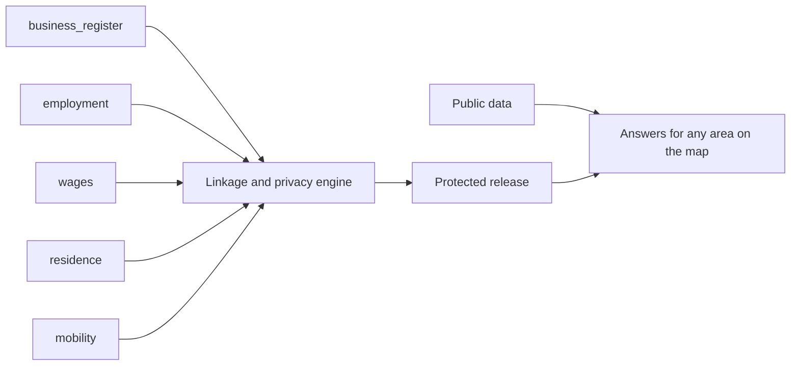

# 01 — Project Brief

| | |
|---|---|
| Status | Draft v0.3, amended by decisions 0016, 0017, 0018 and 0019 on 2026-11-12, and by decisions 0022 and 0023 on 2026-11-13 |
| Date | 2026-11-13 |
| Owner | albarami |
| Purpose | State who the Economic & Investment Intelligence proof of concept is for, what version 1 does and does not do, how success is checked, and what it must never claim. |
| Read first | [README](../README.md), then this document. Every other document in [docs/README.md](README.md) depends on this one. |

## In brief

- EII is a proof of concept (POC) of a company-facing decision-support product for Qatar, built on one living map. A company draws an area, or sets a radius or a walk or drive time from any point at a chosen hour, and sees who is there through the day, the traffic, the businesses, the pay of the people who work and live there, and the public evidence. The assistant answers in Arabic and English.
- The answer joins five record types that different custodians hold: business register, employment, wages, residence and mobility, beside cited public data. Wages are one layer, the distinctive one: "income geography", privacy-protected, area-level wage statistics by where covered earners live and by where they work.
- The companies are the real ones of the public business register; every person is invented, and the labour and residence records attached to the companies are synthetic ([decision 0022](decisions/0022-real-register-companies-with-a-synthetic-world.md)). People present and crowd density are simulated, and so is road traffic unless the optional live traffic provider is switched on ([decision 0019](decisions/0019-forecasts-estimates-scenarios-and-self-serve-sources.md) item 17). Only figures marked Public describe Qatar, and every Synthetic or Simulated figure carries its mark.
- Version 1 covers the whole initiative ([decision 0016](decisions/0016-version-1-covers-the-whole-initiative.md)): seven company decisions as journeys, D1 to D7, each ending with its own answer; three services as journey outputs; and four cases, C1 to C4, as guided stories. The flagship is the location choice (D2), told for an Italian restaurant at a Lusail building.
- The product is for companies only, designed for three personas in this order: international companies already operating in Qatar or planning to come; local companies in any industry; and start-ups and anyone opening a shop ([decision 0023](decisions/0023-ten-additions-and-the-data-rule.md) item 15; section 2). It shows only what a company may see, in two company seats kept apart; version 1 has no oversight seat and no ministry view.
- Prospects, partners and suppliers are real companies of the public business register, shown with their public card fields and employee counts and ordered by tested code over criteria the user can see and change; named synthetic firms are retired, and a company's wages and other labour and residence details appear only as released aggregates ([decision 0022](decisions/0022-real-register-companies-with-a-synthetic-world.md)). Other real businesses appear only as published Public facts. Version 1 gives no verdict and forecasts nothing about the success of a venture. A forecast of a listed published series, a base rate from the Public licence tables and a site estimate for a chosen area appear only as the output of tested code: a forecast with its interval from the backtest, its measured backtest error, its method and its source; an estimate with its low, middle and high cases, its main drivers and, while an input is Simulated or Synthetic, the label "estimate on simulated inputs"; and a base rate with its numerator, denominator and period ([decision 0019](decisions/0019-forecasts-estimates-scenarios-and-self-serve-sources.md) items 2 to 10); a user's scenario is the user's own and is never called a forecast; a ranking is the output of tested code over criteria the user can see, with a rank-stability sentence. No sex or gender attribute is added on the worker, residence or company records or on anything derived from them; movement aggregates are the one exception ([decision 0023](decisions/0023-ten-additions-and-the-data-rule.md) item 16). Nationality enters in three forms only: the nationality group of the synthetic worker records, the register's establishment nationality (decision 0022), and the same groups plus international visitors on movement aggregates (item 16), each only as a dimension of released statistics; official splits by sex or nationality appear only as Public facts ([decision 0017](decisions/0017-public-data-additions-and-public-splits.md)), and the movement generator may use them, summed over the source's own categories, as cited anchors of its splits. The privacy rule is shown on screen and the user is invited to break it.
- [decision 0023](decisions/0023-ten-additions-and-the-data-rule.md) adds ten capabilities (section 6.6): talent available near this site, all of Qatar in 3D with a clock, the national GIS centre's layers, voice, best three sites with "how sure", the financial centre's firms, satellite imagery with address search and a photorealistic 3D mode, property prices and bank credit, the decision question bank, and tenders, district cooling and ten open-data families. All are free and self-serve except the photorealistic 3D mode, the one paid service, which the owner caps at USD 20 in total (BRF-102). The site answer opens with people working here and people living here (BRF-108). Its data rule binds the pack: synthetic records exist only for the confirmed ministry sources (employment of private-sector individuals, wages and residence attached to the register companies, and movement, including the splits of item 16); everything else is public data or the company's own input (BRF-106).
- The build order is the map and data foundation first, then the flagship in full depth, then the other journeys. Each slice ends at a gate, and nothing below a slice gate is half-built.
- The demonstration ends with a specific request: which feeds, which pilot, and the pass and kill criteria.

Naming note. In this document D1 to D7 name the journeys, C1 to C4 the cases, and L1 to L10 the items of the first pack's Later list. M1 to M8 and S1 to S11 remain the labels of the first pack's capabilities, which other documents cite as "capability M3" or "capability S2". The three services are written "service S1" to "service S3" wherever the letter alone could mislead. Build slices are always written with the word slice, as in "slice S0" (see [14_IMPLEMENTATION_PLAN.md](14_IMPLEMENTATION_PLAN.md)).

## 1. Purpose

EII is a product demonstrator and a proof of method. It is to show three things on one screen:

1. what a company could learn if the five record types were joined around any area it chooses, beside public data;
2. that the join can be released only as protected statistics, under rules a data owner can inspect and attack;
3. that every number can be traced to its class (Public, Synthetic, Simulated or Suppressed), its source and its rules.

It is not a market study of Qatar and it is not evidence about Qatar, except for figures marked Public.

## 2. Audience

The product is for companies only ([decision 0023](decisions/0023-ten-additions-and-the-data-rule.md) item 15). Every screen, story scene, label, catalogue entry and evaluation question is designed for its three personas, in this order.

| Who | Role in the POC | What they need from it |
|---|---|---|
| International companies already operating in Qatar or planning to come | First persona: real end users of a future product | Whether to enter Qatar and where to set up or grow, with customers, partners, staffing and the region (journeys D1 to D7 and the three services); scene 7 of the guided story is the international entrant's headquarters evidence pack |
| Local companies in any industry, among them real estate developers, consultants, retailers, restaurants, hotels, research bodies and universities | Second persona: real end users of a future product | Their decisions on location, customers, partners, staffing and growth (journeys D2 to D6, services S2 and S3) |
| Start-ups and anyone opening a shop | Third persona: real end users of a future product | Where to open a first shop or outlet and what it costs to run (journey D2, the flagship, with the break-even of BRF-06) |
| Technical reviewers (GIS and IT staff) | Inspectors of the method | A read-only copy of the release in a standard GIS tool, and the proof that two engines give the same answer (BRF-15) |
| Builders (coding agents from several vendors) | Implement the product from this pack alone | Exact names, rules and gates; see [02_ARCHITECTURE.md](02_ARCHITECTURE.md) and [14_IMPLEMENTATION_PLAN.md](14_IMPLEMENTATION_PLAN.md) |

Every answer to a persona's decision comes with its evidence, its limits and what remains to test. In the POC the companies are represented by two fictional company seats, `company_a` and `company_b`, and one company can never read another's brief or file (BRF-24, BRF-56, BRF-80). The product therefore behaves as the company-facing product: nothing on a company seat may show more than a company would be entitled to see, and version 1 has no oversight seat and no ministry view (section 9.3). The guided story of 8 to 9 minutes (BRF-33), free exploration that is safe to tap, a plain answer to "is this real?" on every number and the closing request of section 15 are features of the product, designed for these personas; the presenter controls stay (BRF-12).

## 3. The problem companies face today

A company deciding where and whether to open a business in Qatar can find, from public and commercial sources:

- where businesses are licensed (existing public business maps);
- how many devices pass a location (telecom footfall products);
- modelled income where people live (commercial purchasing-power layers);
- directories and general answers (investment-portal assistants);
- national tables on sector costs, pay, trade and transport (official open data).

Each of these holds one side of the answer. None of them, from its published description, answers the questions a company actually asks about one door:

- Who works within reach of this door, and what are they paid?
- Who lives within reach, and what are they paid, and how many of them live in labour accommodation rather than family housing?
- Of the outlets licensed nearby, how many are really operating?
- What does this kind of business cost to run, and where do its inputs come from?
- How does all of that change across the Qatari day, on a Friday, in Ramadan and in summer?

The design review of 2026-11-11 read competitors' published descriptions, not their products in use. This brief therefore claims no competitor gap beyond "not found in published descriptions".

The capability bar for version 1 is what existing services together offer companies looking at Qatar, described here only by what they offer ([decision 0016](decisions/0016-version-1-covers-the-whole-initiative.md)): commercial geography with sector patterns, best-location search and licence statistics by region and activity; footfall, crowd density, time patterns and event analytics; crowd and transport monitoring around large events; labour-market analysis with reporting and projections; investor introductions, partner search, investment opportunities and public tenders; and the habits that trusted statistical and commercial tools share: draw-an-area profiles, a source tile on every number, drive-time and walk-time trade areas, a home and work toggle, comparison with the company's best site, fixed auditable analyses behind an assistant, one-page exports, and protected cells marked rather than left blank. Version 1 offers each of these in its own way and adds what only joined records can show. This is a build target, never a claim on screen: nothing says or implies that an existing service is wrong or inferior (BRF-47).

## 4. The five record types and income geography

| Record type | Contract name | What it contributes to the answer |
|---|---|---|
| Business register | `business_register.v1` | Where activity is licensed; company identity, activity and registered location, for the real companies of the public business register ([decision 0022](decisions/0022-real-register-companies-with-a-synthetic-world.md)) |
| Employment | `employment.v1` | How large employers are; occupation groups |
| Wages | `wages.v1` | What covered jobs pay (basic and net) |
| Residence | `residence.v1` | Where covered earners live, with the address reduced to a grid cell |
| Mobility | `mobility.v1` | How many people are present, by hour, and the flows between areas behind the simulated traffic, as aggregates only |

Definitions used throughout the pack:

- **Custodian**: the body that holds a record type under its own mandate. This pack never names a custodian; see OI-06.
- **Covered earner**: a person in a covered private-sector job. People outside that coverage are "not measured", never zero.
- **Door**: a point dropped at a place, from which an area is made by a radius, a walk time or a drive time.
- **Area**: the shape a question is about: drawn by the user, or made from a door by a radius, a walk time or a drive time at a chosen hour of day ([decision 0016](decisions/0016-version-1-covers-the-whole-initiative.md)). Public point layers and Simulated layers are computed for the exact shape, except a movement split, which is never apportioned to a drawn outline: its values are sums over the snapped whole units, with their `other` values, and a share is over the split's own summed total. Figures from the protected record types (business register, employment, residence, wages) are read only after the shape snaps to whole release units, with a snap report.
- **Within reach**: inside an area. Figures from the protected record types describe the snapped area, never the raw shape.
- **Income geography**: area-level wage statistics for covered earners, by where they live and by where they work, released only as privacy-protected statistics.

Contracts are specified in [03_DATA_CONTRACTS.md](03_DATA_CONTRACTS.md). The synthetic stand-ins are specified in [05_SYNTHETIC_WORLD_AND_SIMULATION.md](05_SYNTHETIC_WORLD_AND_SIMULATION.md). Public sources, including the 77 portal datasets and the two investment sources that [decision 0017](decisions/0017-public-data-additions-and-public-splits.md) adds, and the six self-serve sources that [decision 0019](decisions/0019-forecasts-estimates-scenarios-and-self-serve-sources.md) adds, are specified in [04_PUBLIC_DATA_PACK.md](04_PUBLIC_DATA_PACK.md).

Every model of [decision 0019](decisions/0019-forecasts-estimates-scenarios-and-self-serve-sources.md) (the forecasts, the base rates, the site estimate and the people present by pay band) reads the release tables that these five contracts fill, named by their contract names only. The real companies of the public business register, the synthetic labour and residence records attached to them, and simulated data fill them now ([decision 0022](decisions/0022-real-register-companies-with-a-synthetic-world.md)); nothing says that real custodian records are used (item 15).

## 5. The one sentence and why no one can assemble it alone

**The one sentence.** For any area of Qatar that a company draws, or reaches in a walk or drive time at a chosen hour, one living map shows who is there through the day, the traffic, who works and who lives there and what they are paid, which licensed outlets are really operating, what the business costs to run and where its inputs come from, and the public evidence, and turns them into the answer to the company's decision. Every number is marked Public, Synthetic or Simulated, and the user is invited to try to break the privacy rule.

Why no single custodian or vendor can assemble this answer alone (an institutional barrier, not a technical one):

1. Each record type sits with a different custodian under its own mandate. The register holder has no payroll, the payroll holder has no home addresses, and neither has movement.
2. A commercial vendor holds at most one side: telecom footfall products hold presence but not pay; purchasing-power layers model income at home but not pay at the workplace; business maps hold licences but not whether anyone is employed.
3. Joining the records is lawful and acceptable only under a disclosure-control regime that every data owner can inspect, set and attack. The POC demonstrates that regime; it does not settle it.
4. The POC differentiates itself by demonstrating the record join, inspectable disclosure controls and public economics with provenance. It makes no claim about competitor capability or development time.
5. Whether custodians agree to such a join is exactly what the closing pilot request asks (section 15).

## 6. Version 1 capabilities

Every capability below is a user-visible requirement, and version 1 builds every one of them, in the build order of section 6.5 ([decision 0016](decisions/0016-version-1-covers-the-whole-initiative.md)). "Class" is the provenance class the user sees on the result. Composites show the least-real class of their inputs (Public is more real than Synthetic, which is more real than Simulated). Evidence status (Observed, Inferred, Still to test) is a separate axis and is never merged with class; scope exclusions render as Not measured from coverage metadata.

### 6.1 The joined area and its proof (M1 to M8)

| ID | Requirement: what the user sees | Item | Class |
|---|---|---|---|
| BRF-01 | For the area, snapped to whole release units before any protected figure is read (BRF-04), two separate cards, "People who work within reach" and "People who live within reach", each show a rounded count of covered earners, the median wage band, the quartile band range and a band distribution bar. On each card the count and the band shares beside it come from one additive family (PRV-30). The residents card always shows the housing split of covered earners: family housing, labour accommodation, institutions and unknown housing class, with an explicit "other" row where pooling occurred, beside the count that is not measured. That split's count and its shares come from that split's one additive family. The not-measured count is a separate population. The average monthly pay stands beside the count where document 06 releases it, never alone, with the guidance "the average alone is not enough" ([decision 0023](decisions/0023-ten-additions-and-the-data-rule.md) item 11; BRF-108); the wage bill appears only under "More evidence". | M1 The joined door | Synthetic |
| BRF-02 | Simulated people present inside the area, hour by hour through the day, for every dial situation (`weekday_lunch`, `weekday_evening`, `friday_evening`, `ramadan_iftar`), with a `summer` switch that applies to the first three, and for three event days (National Day, a day in Ramadan, a major match). They are shown as estimated counts with a range, split into workers, residents and visitors, and, as three further one-way splits that are not crossed with that split or with each other, by age band, by gender and by nationality group ([decision 0023](decisions/0023-ten-additions-and-the-data-rule.md) item 16), each a count and a share under the minimum-count rule, never a person-level row. They are worded "estimated people around this location", never "footfall of" a named building or business, and a split of visitors is never attributed to a named building or business. Crowd density (people per square kilometre) is drawn on the map and may be animated through the day, always marked Simulated. The custodian plane releases these counts only at release-unit grain under the disclosure controls of [06_PRIVACY_AND_DISCLOSURE_CONTROL.md](06_PRIVACY_AND_DISCLOSURE_CONTROL.md) (panel minimum, complementary suppression, rounding); the product plane apportions released counts of the eligible unsplit presence measures to the area. A movement split is never apportioned to a drawn outline: its values are sums over the snapped whole units, with their `other` values, and a share is over the split's own summed total. A split count carries no range. `other` is shown only when the published split returns it. The seasonal shape of simulated visitors is calibrated and checked against the monthly visits of museums and exhibitions, and their share against hotel supply by municipality ([decision 0017](decisions/0017-public-data-additions-and-public-splits.md)); no named place's level is transferred to a Simulated figure. The hour-of-day shape of simulated visits by place category is calibrated to the relative busyness by hour of named venues pooled over each place category; no venue's own level or shape enters a generator, and no level is anchored to a named place ([decision 0019](decisions/0019-forecasts-estimates-scenarios-and-self-serve-sources.md) item 18). Typical hourly weather profiles by season modulate the hourly profile, never a dated day (item 23). Separate Public monthly context series (metro, tram and bus riders, hotel occupancy and restaurant-and-hotel price index) are shown alongside on their own Public cards, never as hourly or building anchors; of these series, only the July–August metro ratio scales the summer visitor switch. These counts replace the presence index of the first pack ([decision 0016](decisions/0016-version-1-covers-the-whole-initiative.md)). | M2 The Qatari-day dial | Simulated |
| BRF-03 | The same answer shows real public evidence: licences in the municipality against the national rate; zone electricity growth; metro and tram riders; named public places with network distances and a standing "open listings are incomplete" note, with their published visitor counts where a public source has them (BRF-66); sale price per square metre only with its deal count. | M3 Real public evidence | Public |
| BRF-04 | Figures from the protected record types (business register, employment, residence, wages) are read only after the area snaps to whole release units; the snap report states the requested area, the released area, the number of units and the rules that set it, with the fixed snap sentence (DES-101). Public point layers and Simulated layers are computed for the exact shape (BRF-58), except a movement split. A movement split is never apportioned to a drawn outline: its values are sums over the snapped whole units, with their `other` values, and a share is over the split's own summed total. Minimum group sizes, an employer-dominance rule and a subtraction (complement) test apply to every protected figure, in every month of the window; the one company-level figure released is the employee count on a register company's card (BRF-63), which the attack suite treats as attacker knowledge ([decision 0022](decisions/0022-real-register-companies-with-a-synthetic-world.md)), as it does the company's Public registration and cancellation dates ([decision 0023](decisions/0023-ten-additions-and-the-data-rule.md) item 12; BRF-28); every answer carries a privacy receipt; a "Try to break it" scene lets the user attack the rules. | M4 Privacy you can attack | Withheld figures show Suppressed |
| BRF-05 | Every displayed number is produced by deterministic tested code in `eii_core.calc`, the release build, or a fixed application-schema read function listed by the data contracts and covered by tests. Nothing else computes, rounds or compares a number, and no model ever does; the browser formats values it receives and never computes a displayed number. Each number carries one of four provenance marks, computed in code by the least-real rule; a coverage bar; a reliability mark for small counts; and a one-tap path that opens the evidence drawer labelled "Source chain" (Arabic label pending native review). A fact without a complete source chain is not rendered. Every answer carries a receipt that records the accounting gate as "Checked before display" (Arabic label pending native review). | M5 Proof on every number | All four classes |
| BRF-06 | The public cost structure of restaurants (and of the other playbook activities) is shown with a calculator: the user's own rent, seats and average bill (with editable opening days per month, default 30, and optional fixed monthly staff cost) give the break-even revenue, covers per day and seat turns; adding expected covers per day gives the maximum rent, minimum bill and maximum staff-cost breakpoints. The user may also add an incentive package from the investment promotion agency's pages (BRF-65) as an optional input, tagged "your inputs" with its source page; it never changes a Public figure. The catchment-share scenario and the revenue range of the user's outlet join the calculator as further user scenarios (BRF-92, BRF-93). | M6 Unit economics with break-even | Public norms; the result is the user's scenario, evidence status Inferred, tagged "your inputs", never stored in the release |
| BRF-07 | The bilingual assistant selects only claim keys, typed fact slots and an ordered component layout from closed, versioned application-owned claim and component catalogues, which grow to cover the journeys ([decision 0016](decisions/0016-version-1-covers-the-whole-initiative.md)). Every Observed and Inferred sentence is an application-owned English or Arabic template; no model-written prose reaches the screen. Component properties are fact ids, release-unit ids or enumerations. The application validates and renders them, and an invalid layout falls back to the playbook default. Evidence precedes words, and the template writer produces the same brief without a model. An `area` subject accepts Public, Synthetic, Simulated and Inferred slots; `place_public` and `fdi_project` subjects accept Public slots only; a `register_company` subject, a real company of the public business register, accepts Public slots and the employee count of its attached records, and its other labour and residence facts appear only in analyses released under [06_PRIVACY_AND_DISCLOSURE_CONTROL.md](06_PRIVACY_AND_DISCLOSURE_CONTROL.md) and in its own seat ([decision 0023](decisions/0023-ten-additions-and-the-data-rule.md) item 15); named synthetic firms are retired ([decision 0022](decisions/0022-real-register-companies-with-a-synthetic-world.md)). No other Synthetic or Simulated fact is attached to a real named place, business or project. Before display, code runs the accounting gate of [02_ARCHITECTURE.md](02_ARCHITECTURE.md); failure falls back to the template writer's default answer. | M7 Governed bilingual assistant | Inherits the classes of its facts |
| BRF-55 | The provider-neutral typed-decision gateway in [decision 0014](decisions/0014-typed-decision-gateway.md) is build-time and evaluation-only, defaults to `none`, and is never used at run time. Its only visible trace is the single activity-spine lineage line in the Proof room. | M7 (gateway) | Decision evidence only |
| BRF-08 | "We understood your question as..." chips link the commerce activity code, the international activity class (ISIC Rev.4) and the public place category, with a visible "not mappable" bucket for legacy codes. | M8 Bilingual activity spine | Public |

### 6.2 Further capabilities of the first pack (S1 to S11)

| ID | Requirement: what the user sees | Item | Class |
|---|---|---|---|
| BRF-09 | Of the licensed food outlets within reach, the share that show payroll activity, by size band, as an aggregate strip only, visually separate from real named places. | S1 Licensed versus operating | Synthetic |
| BRF-10 | Pay bands for the jobs this outlet hires among people living within a 30-minute drive, beside published national averages and the statutory minimum. The 30-minute drive cut-off is for staffing only (see [02_ARCHITECTURE.md](02_ARCHITECTURE.md)). Drive 20 and drive 30 as area cut-offs belong to the staffing playbook ([decision 0023](decisions/0023-ten-additions-and-the-data-rule.md) item 17). The talent answer's closed list of 10, 20 and 30 minutes (BRF-96) is its own and is not confined to that playbook; it is given in every playbook whose bundle calls `workers_within_reach`. Every other drive or walk area keeps 5, 10 and 15 minutes. | S2 Staffing and pay | Synthetic and Public, each marked |
| BRF-11 | A national pay card shows what really moved national average pay (pay-versus-mix decomposition), naming the public table used. | S3 National pay card | Public |
| BRF-12 | Changed by [decision 0023](decisions/0023-ten-additions-and-the-data-rule.md) item 15: the oversight seat, its live ledger screen and its roll-up of where and what companies are asking leave version 1. Every question from either company seat is recorded, with its release and what went to the AI, in an internal question log that the assistant's memo, replay and evaluation read; no screen shows the log, and a planted screen that shows it fails. The log starts empty and holds only questions asked, with no seeded history (item 12). The seat picker binds the seat to the window with a signed session cookie named `eii_seat`; presenter controls require a per-session presenter token (`X-EII-Presenter-Token`). This is query isolation after selection, not identity or tenant authentication. | S4 Company seats and the question log | Internal record; no screen |
| BRF-56 | `company_a` and `company_b` cannot open each other's briefs; the isolation is checked by a database-level test. The seat picker binds the seat to the window with a signed session cookie; presenter controls require a per-session presenter token. This is query isolation after selection, not identity or tenant authentication. | S4 Company seats and the question log | Rule |
| BRF-13 | For an activity's input basket, the origins that supply each input, the unit value, concentration and trend, plus licensed wholesale depth by municipality. Origins are countries, never named firms. | S5 Supplier lens from customs | Public |
| BRF-14 | As part of where to grow (D6) and service S2, the company's current or best site and a candidate second site are shown side by side with their overlap, worded as shared reach, never as lost sales. | S6 Second-site comparison | Least-real class of the two answers |
| BRF-15 | Reviewers can see every released fact recomputed by PostgreSQL and by the embedded engine, and can open the release read-only in a standard GIS tool. This view is for reviewers only, never for company seats. | S7 Two engines, one answer | Inherits the release |
| BRF-16 | Licence cancellations over time, with bulk months flagged as an inference; licence issues are shown beside them under their own name, and no net series is formed from the two. | S8 Licence churn | Public |
| BRF-17 | A row of at most six "found near" chips for typical neighbouring place categories, with the coverage note; the places layers include the Foursquare Open Source Places dataset (`places_fsq`), fetched inside `./eii build-public` from its public copy on Source Cooperative without an account and shown with the date of the release used ([decision 0019](decisions/0019-forecasts-estimates-scenarios-and-self-serve-sources.md) item 21). | S9 Typical neighbours | Public |
| BRF-18 | A coarse, protected share of where the door's workers live, with origin geography no finer than a large pooled district. | S10 Where the door's workers live | Synthetic |
| BRF-19 | One tap produces a printable briefing pack: one A4 portrait page in the light theme, bilingual on that page (English label, Fact chip, Arabic label) so each number is printed once; deterministic content selection and layout fit everything on that one page. Simulated values print as static dashes. The standing strip and watermark appear on the page. Every figure is traceable. | S11 Briefing pack | Inherits the classes of its facts |

### 6.3 The living map

[Decision 0016](decisions/0016-version-1-covers-the-whole-initiative.md) makes the map itself the base of every journey, and [decision 0017](decisions/0017-public-data-additions-and-public-splits.md) adds public evidence and two investment sources.

| ID | Requirement: what the user sees | Item | Class |
|---|---|---|---|
| BRF-57 | One living map of Qatar: real public geography, roads, business points and the establishment points of the public business register, each of which opens its company card (BRF-63); firm counts and firm density from the register; workers as density and statistics from the synthetic labour and residence records attached to the register companies, whose totals follow the calibration table of the owner's note ([decision 0022](decisions/0022-real-register-companies-with-a-synthetic-world.md)), with the population grid read only collapsed across age and sex, as weights (BRF-89); simulated people present and crowd density through the day, and traffic through the day (simulated by default, BRF-59). Every Synthetic or Simulated figure carries its mark, and none is attached to a real named business, building or place, except what BRF-63 allows a register company. | The living map | Public, Synthetic and Simulated layers, each marked |
| BRF-58 | The user draws an area, sets a radius, or picks a walk or drive time from any point, at a chosen hour of day. Public point layers and Simulated layers are computed for that exact shape, except a movement split. A movement split is never apportioned to a drawn outline: its values are sums over the snapped whole units, with their `other` values, and a share is over the split's own summed total. A split count carries no range. `other` is shown only when the published split returns it. A public statistic published on an official geography is shown on that geography; where it is apportioned to the shape, the result is labelled Inferred and names its method and its geography. Whole cells of a published population grid may be summed over the shape (BRF-89); that sum is not an apportionment. Figures from the protected record types are read only after the shape snaps to whole release units (BRF-04). A drive time at a chosen hour follows the simulated traffic of that hour (BRF-59); with the live provider on, a traffic-aware drive-time area from the provider enters through the adapter as the second entry route of a session area, is bound to the session and seat like a drawn shape and is marked with the provider and its retrieval time, and figures over it follow the rules of a drawn shape and carry the least-real class of their inputs. No drive-time catchment goes beyond 30 minutes, and the closed schema refuses a request above 30 minutes ([decision 0023](decisions/0023-ten-additions-and-the-data-rule.md) item 17). | Geofence | Each layer keeps its class; an apportioned Public statistic carries evidence status Inferred |
| BRF-59 | Simulated congestion by hour on the real road network is drawn on the map and animated through the day; drive-time areas change with the hour. Hourly origin-destination flows, as released, are assigned to the road graph by tested code with one fixed volume-delay rule. With the default provider (the setting `EII_TRAFFIC_PROVIDER` is `simulated`), traffic is always marked Simulated, is never computed from protected rows, and the same release returns the same traffic. With the setting at `tomtom`, the key present and the presenter's offline control not set, the API process fetches live flow tiles and traffic-aware drive-time areas from the provider and passes them on; the browser never holds the key and still contacts only its own origin; nothing of a response is written to disk, to the release, to the ledger or to a log, and the run-time lineage keeps the request, the retrieval time and the response hash. A live tile is a picture layer with the attribution "© TomTom" visible while it is on, and no numeral is read from it; no provider number is a fact. No test, gate, command or guided story needs the provider or its key ([decision 0019](decisions/0019-forecasts-estimates-scenarios-and-self-serve-sources.md) items 16 and 17). | Traffic by hour | Simulated by default; with the provider on, a picture layer marked with the provider and its retrieval time |
| BRF-60 | For the area, six indicators for covered earners: average and median wage by residential area, where groups are large enough; wage bands and their spread; the covered wage bill and the earner count; residential income set beside presence by time of day, with the people present by pay band of BRF-86 as a third element, Inferred; residence and workplace geography (broad commuting catchments and access gaps, where workplaces are reliably known); and wage trends by sector and area, separated from changes in worker mix: by area, the wage trend of the same earners, per municipality and nationally (Synthetic); by sector, national trends by economic activity from the Public series `wage_act`, the finest sector trend in version 1; pay by sector with middle ranges is in BRF-61. The average is never shown alone. The release holds several monthly synthetic periods inside one protected window, so that a "what changed" view and wage trends work; each month passes the same disclosure controls as a single period, one treatment holds for every month of the window, and the window rules of [AGENTS.md](../AGENTS.md) rule 12 are unchanged. The figures describe covered earners and wages paid, not every household, wealth or spending power. | Income geography with trends | Synthetic; wage trends by sector Public; presence set beside it stays Simulated; the pay-band figure is Inferred and carries the Simulated mark |
| BRF-61 | A labour-market view of sectors, occupations, pay and trends: pay by occupation and by sector with middle ranges and earner counts from the protected release, which the attached records of the register companies fill, released under the disclosure rules of [06_PRIVACY_AND_DISCLOSURE_CONTROL.md](06_PRIVACY_AND_DISCLOSURE_CONTROL.md) (Synthetic; [decision 0022](decisions/0022-real-register-companies-with-a-synthetic-world.md) item 3), and where such workers live; sectors also as national mean pay and wage trends by economic activity from the Public series `wage_act`, the finest Public sector view in version 1. Simple projections come from tested code over published or released series; each is marked as a projection with its method and period, and a projection is not a forecast (BRF-84). The forecast of the construction pipeline, turned into expected new households and workers by municipality, belongs to this view (BRF-84). Official figures split by sex or nationality appear here only as Public facts (BRF-66). | Labour-market view | Public and Synthetic, each marked; projections marked as projections |
| BRF-62 | Openings and closures over time on the map: public licence issues and cancellations on their official geography (bulk months flagged as in BRF-16) and the openings and closures of register companies by area and month, from the register's own dates and its monthly snapshots, never generated ([decision 0023](decisions/0023-ten-additions-and-the-data-rule.md) item 12; method card C22). They are shown as counts over time, and a register count is never added to a licence count. Entry and closure base rates of the Public licences are shown under BRF-85, which promises no survival figure; none is computed from the register's openings and closures, and no net figure of issues minus cancellations is shown (section 9.3). | Openings and closures | Public |
| BRF-63 | Prospects, partners, suppliers and complementary firms are real companies of the public business register and of the financial centre's public register, the register companies ([decision 0022](decisions/0022-real-register-companies-with-a-synthetic-world.md)). A register company's card shows every field the register publishes for it, person names excluded, and its number of employees from the synthetic labour and residence records attached to it; the map's establishment points open the card. Lists show register companies with their card fields and employee counts, ordered by tested code over criteria the user can see and change, with the rank-stability sentence (BRF-67, BRF-77); no order uses, or breaks a tie by, a company's wages or any other unreleased labour or residence value. A company's wages and its other labour and residence details never appear on a card, in a list or on any other screen except as released aggregates under the disclosure rules of [06_PRIVACY_AND_DISCLOSURE_CONTROL.md](06_PRIVACY_AND_DISCLOSURE_CONTROL.md); the company's own seat shows them only as its design provides ([decision 0023](decisions/0023-ten-additions-and-the-data-rule.md) item 15). Showing a card is not a lookup; looking up an owner or an individual stays forbidden (BRF-50). Named synthetic firms are retired. Networks of firms or owners stay dropped. | Register companies | Public card fields; the employee count comes from the attached records (Synthetic) |
| BRF-64 | Real businesses appear only from public places data (the layers named in [04_PUBLIC_DATA_PACK.md](04_PUBLIC_DATA_PACK.md)), the two public registers of BRF-63 and public listings, with public tenders where a public source exists. Announced investment projects come from the FDI projects dashboard of the national investment promotion agency: the fetcher reads the dashboard page on every build and loads every project field into the `fdi_projects` contract. The projects are a Public source on the map and in journeys D1, D4, D6 and D7, the market entry pack and the expansion comparison. Capex and jobs keep the source's own note that they are estimates of publicly announced projects and that the dashboard does not capture every project. A project is shown as a published announcement with its source and retrieval date, never as a lookup of a firm, and is never joined to synthetic data, the attached records of a register company included ([decision 0022](decisions/0022-real-register-companies-with-a-synthetic-world.md)). The fetched data stays in the uncommitted `data/` folder (ARC-99). | Real businesses, tenders and investment projects | Public |
| BRF-65 | The sector, opportunity, incentive, set-up and law pages of the national investment promotion agency's site are loaded into structured records and used for sector context, the market entry pack, the set-up steps and the incentive packages offered as optional inputs of the break-even calculator (BRF-06). Application templates render the text from those records, with a link to each page and its retrieval date. The fetched pages stay in the uncommitted `data/` folder (ARC-99). | Investment pages | Public; an incentive package in the calculator is tagged "your inputs" |
| BRF-66 | Further Public evidence comes from the 77 portal datasets that [decision 0017](decisions/0017-public-data-additions-and-public-splits.md) adds, each shown with its source, reference period and retrieval date. Among them: residential unit sales with their deal counts; building permits and completion certificates; establishments and employees by size and activity, with compensation; manufacturing industries and main products; wholesale and retail purchases, sales and stocks (context only, never a forecast); population by municipality, age and sex; hotels by municipality; certificates of origin and arriving vessels; the labour force and the economically active population by sex, occupation and activity; employees and compensation by nationality and activity; students by municipality; hotel guests by nationality and visitor arrivals. Published visitor counts of museums and exhibitions by month and of health centres by year are Public facts of those named public places, never presence estimates; so is the relative busyness by hour of a named venue (BRF-88). Official figures split by sex or nationality are shown only as Public facts with source and year, on the source's own geography and categories (for nationality, the published Qatari and non-Qatari categories); none is joined to a synthetic record, used to segment synthetic records or simulated presence, or combined with a protected figure. A tabulated figure stays on the source's own geography and is never apportioned to a drawn area; the one sum over an area is the whole-cell sum of a published population grid (BRF-89). | Public evidence of decision 0017 | Public |
| BRF-84 | Forecasts of the series of a closed, versioned list: licence issues and cancellations by activity and by the source's own area; property prices by district; the quarterly median price per square foot by district and use, each quarter with its deal count, a series of its own unit and period that is never joined to the property prices by district ([decision 0023](decisions/0023-ten-additions-and-the-data-rule.md) item 8; method card C41); hotel demand and room rates; consumer and producer prices; imports by product; announced investment by sector; and the construction pipeline, turned into expected new households and workers by municipality. A series is forecast only when the public data pack holds its source table; a named series without one is listed in [04_PUBLIC_DATA_PACK.md](04_PUBLIC_DATA_PACK.md) as open. Tested code in `eii_core.calc` chooses the model of each series by a rolling-origin backtest over a closed, versioned list of candidate models; no person and no language model chooses. A series too short for the backtest minimum returns `NO_DATA` with the reason `series_too_short`. Every forecast shows its value, its empirical interval built from the backtest's own errors at each horizon and drawn as a band with a caption that gives two Fact-chip counts (how many of the past values of the backtest fell inside the range that the other past errors gave, out of how many), its measured backtest error, its method and its source. The interval is never called a probability or a confidence level and is never said to hold for the next value. A forecast is an Inferred fact on the subject and geography of its series; a forecast of a Public split by sex or nationality stays on the source's own geography and categories. On screen the licence series keep their names, licence issues and licence cancellations, and no net series is formed from them. The same code forecasts the released monthly statistics of the custodian-type feeds over the released months of the window: pay level, earner count and wage bill, the stayer index at municipality level, and employment by area; establishments by area are register companies by their own dates, a Public count ([decision 0023](decisions/0023-ten-additions-and-the-data-rule.md) item 12). Such a forecast is a fixed function of rows that are already released and reveals nothing that those rows do not; it is a labelled projection from the released months, not a protected statistic of a later month. It carries the Synthetic class, the word "forecast" and the existing caveats of a Synthetic series (synthetic months show the format, not Qatar) beside the backtest caveat; its subject is the `area` of its series; its origin is the last released month; and it is off in public-only mode as a ranking criterion. A series with a carried-forward month in its window is not forecast and returns the `CARRIED_FORWARD` suppression, as method card C21 rules for projections; a series too short for the backtest returns `NO_DATA` with the reason `series_too_short`, shown as "not enough history" ([decision 0019](decisions/0019-forecasts-estimates-scenarios-and-self-serve-sources.md) items 2 to 6; method card C30). | Forecasts of published series | Least-real class of its inputs (Public for a Public series; Synthetic for a series of the released monthly statistics); evidence status Inferred |
| BRF-85 | Entry and closure base rates by activity, on the source's own geography and never for a drawn area, from the Public licence tables. Each is a flow over the published active stock of the same activity and geography, labelled approximate, and is shown with its two counts (the numerator and the stock that is its denominator) and its period. The survival base rate returns `NO_DATA` with the reason `no_denominator`, because the Public licence tables do not link a cancellation to its issue, until a Public source does; no survival figure is promised. Bulk months are handled by the stated rule of the method card. A base rate is worded as a share of past licences of that activity and area, never as the chance that the user's own venture survives, and the word "odds" is never on screen. A base rate is a Public fact with evidence status Observed, the status of the churn rate of card C2 (fixed arithmetic over published counts, caveat `calculated`), and it carries the caveat key `base_rate_not_your_chance`. No figure of issues minus cancellations is shown, and no such rate is computed from the openings and closures of register companies ([decision 0019](decisions/0019-forecasts-estimates-scenarios-and-self-serve-sources.md) item 7; method card C31). | Base rates of Public licences | Public; evidence status Observed |
| BRF-86 | For a whole release unit, a day type and an hour, the simulated workers and residents present split by pay band. `eii_core.calc` computes it in the product plane as a fixed function of published rows only: the published presence groups of the unit's cells and the published pay-band shares of the same unit (the worker-pay partition for workers present, the resident-pay partition for residents present). It is returned only when every row it draws on is published; a withheld, suppressed, carried-forward or remainder row is never filled in, and the figure passes through the suppression reason of the row that is missing. Visitors have no pay band and are shown as one count without a band. The band shares are those of the unit's covered earners, so the figure does not separate people who have no wage record: it assumes that the workers and residents present have the pay bands of the unit's covered workers and residents, and its caveat says so. It is never apportioned to a drawn outline: both sides use the snapped unit list of PRV-18, and it is never called spending, spending power, income present or purchasing power. It is the one combination of presence and pay (PRV-126): no table is added to the release and no dimension to the presence key ([decision 0019](decisions/0019-forecasts-estimates-scenarios-and-self-serve-sources.md) items 11 and 12; method card C32). | People present by pay band | Evidence status Inferred; carries the Simulated mark |
| BRF-87 | Night-time radiance by area and month, from the NASA Black Marble monthly product VNP46A3 (about 500 m grid), as a Public layer aggregated to the frame by the public-data build, with NASA acknowledged and the product DOI cited. It is worded as night-time radiance, never as a measure of business activity ([decision 0019](decisions/0019-forecasts-estimates-scenarios-and-self-serve-sources.md) item 20; method card C36). | Night-time radiance by area and month | Public |
| BRF-88 | The relative busyness by hour of a named venue is a Public fact of that `place_public` subject, labelled "Google Maps popular times" with its retrieval date. It is a relative index from 0 to 100, never a count of people, and never shares a component with an estimated-people figure. The project's own page reader fetches it inside the public-data build, for the named venues of a build-time list and never at run time; the values stay in the uncommitted public cache. The source states no licence for reuse and the publisher's terms name automated reading; the owner's decision to use it is recorded under PUB-12 of [04_PUBLIC_DATA_PACK.md](04_PUBLIC_DATA_PACK.md) ([decision 0019](decisions/0019-forecasts-estimates-scenarios-and-self-serve-sources.md) item 19; method card C37). | Relative busyness of named venues | Public |
| BRF-89 | Population by age and sex from the 100 m grids of the source `worldpop_qat_agesex`, as Public figures with their source and year. Whole cells of the published grid may be summed over an area the user chose: a cell counts when its centre lies inside, and no cell is split. That sum is not an apportionment; it is display only, never a criterion of a ranking, never combined with a protected or Simulated figure and never on one chart with one. No worker, residence or company record carries sex or age, and movement aggregates are the one exception for age band and gender ([decision 0023](decisions/0023-ten-additions-and-the-data-rule.md) item 16; [decision 0019](decisions/0019-forecasts-estimates-scenarios-and-self-serve-sources.md) item 22; method card C38). | Population by age and sex over an area | Public; evidence status Observed |
| BRF-90 | An optional 3D view extrudes whole release units by one protected area statistic, or by the simulated crowd density. It is off by default. Every extruded value is also readable as a Fact chip in the flat view; marks, suppression and the snap rule are those of the flat view; a building keeps its own height and is never extruded by a data value; only traffic, crowd density and the aggregate home-to-work flows of BRF-96 animate ([decision 0023](decisions/0023-ten-additions-and-the-data-rule.md) item 1; [decision 0019](decisions/0019-forecasts-estimates-scenarios-and-self-serve-sources.md) item 14). | Optional 3D view | Each layer keeps its class |

### 6.4 Location choice, journeys, services and cases

The location choice is the flagship; the other journeys, the services and the cases follow it in the build order (section 6.5).

| ID | Requirement: what the user sees | Item | Class |
|---|---|---|---|
| BRF-67 | Candidate areas for an activity are ranked with every criterion, its weight and its value visible; the user can change the weights; a rank-stability sentence stands beside every rank; a public-only mode ranks on Public criteria only. The reverse lists which activities fit a site, for property owners matching tenants to the business mix and the catchment's wage profile. Similar-areas search uses three area types. Reachable access is a travel-time catchment score, by hour where congestion changes travel time. A ranking, a fit or a suggestion is the output of tested code over criteria the user can see and change; it is never a verdict, a probability, a confidence claim or a revenue, demand or success forecast, and it is never worded as advice to act. A forecast, a base rate and the site estimate may be criteria, each visible with its value and weight and removable by the user, and the rank shows which criteria moved it beside its rank-stability sentence. A forecast or base rate of a Public series ranks only candidates on that series' own geography, or enters as an apportioned count where method card C18 allows one; the site estimate, and any criterion with a Simulated or Synthetic input, is off in public-only mode; no Public split by sex or nationality is a criterion, and no list of register companies is ordered by a protected or Simulated figure other than the employee count shown on its cards, and never by a company's wages or another unreleased labour or residence value (PRV-125, [decision 0022](decisions/0022-real-register-companies-with-a-synthetic-world.md)). The screen keeps the name "Areas ranked by the criteria you set" ([decision 0019](decisions/0019-forecasts-estimates-scenarios-and-self-serve-sources.md) item 13). | Best location and its reverse (D2) | Least-real class of the criteria used; Public in public-only mode; reachable access by hour is Simulated |
| BRF-68 | From an area: travel times to the ports, the airport, the free zones and the land routes; complementary firms from the public registers, under BRF-63 and BRF-64; and the import context, from public trade statistics, with imports set beside local production from the manufacturing datasets. An active licence is not production capacity, and the comparison is context, never advice. | Serving the region (D7) | Least-real class of its inputs; the import context is Public |
| BRF-69 | The home screen offers the seven decision journeys D1 to D7 (section 8). Each ends with its own answer, passes the accounting gate before display, and closes with what remains to test, never with a verdict. | Seven decision journeys | Inherits the classes of its facts |
| BRF-70 | Three services are journey outputs (section 9.1): service S1, the market entry evidence pack, turns interest into a specific, testable operating proposal; service S2 compares growth and operating options (a new branch, a larger site, a new territory, a revised service model) with the barriers to resolve; service S3 connects a company with local supplier candidates (register companies under BRF-63, and real businesses from public listings) through a structured qualification route, with aggregate workforce evidence for procurement, recruitment and training. | Three services | Inherits the classes of its facts |
| BRF-71 | Four cases run as guided stories, each with a one-click start (section 9.1): C1, an industrial services firm; C2, a technology supplier; C3, a distributor weighing a second depot, with a synthetic file of its own delivery records; C4, a retail chain with a weak branch, with a synthetic file of its own branch sales. The cases are illustrative. The sample files are marked Synthetic, stand for the company's own records, and stay inside the session and seat that loaded them. | Four guided cases | Inherits the classes of its facts; sample files Synthetic |
| BRF-72 | The assistant works across every module, in Arabic and English: it chooses the area and the indicators, calls fixed tested analyses and returns a map, a chart and a short brief with sources and caveats, under BRF-07. A gallery offers the four cases as one-click stories, and one tap exports a one-page brief (BRF-19). It never types a number. | Assistant across every module | Inherits the classes of its facts |
| BRF-91 | For an area or pin that the user chose, a model of the outlet's catchment gives a low, a middle and a high revenue with its main drivers. Its inputs are the people present by time of day and pay band (BRF-86), the competitors from public listings as counts and distances, and the share who buy and the spend per purchase, which are the user's own ranges with no prefill, as in BRF-93; the Public survey of hotels and restaurants stands beside the result as a benchmark only ([decision 0023](decisions/0023-ten-additions-and-the-data-rule.md) item 12). A seeded Monte Carlo runs over the stated ranges of its uncertain parameters; low, middle and high are fixed percentiles of the model's own draws and are worded as cases of the model, and the main drivers come from a one-at-a-time swing computed in code. While any input is Simulated or Synthetic it carries the label "estimate on simulated inputs". Its subject is the `area`; it is never an estimate for a named real building or business, and no figure for a named competitor is computed for display, shown, stored or logged. A pay band is never called spending power: the spend per purchase by band is the user's own visible and editable range. The estimate is off in public-only mode and is unavailable while OI-03 keeps the survey figures off screen ([decision 0019](decisions/0019-forecasts-estimates-scenarios-and-self-serve-sources.md) item 8; method card C33). | Site demand and revenue estimate | Least-real class of its inputs (Simulated while any input is Simulated or Synthetic); evidence status Inferred |
| BRF-92 | Beside the break-even calculator, a catchment-share scenario: customers choose between the user's outlet and the real competitors from public listings, by distance and by an attractiveness that the user sets for the user's outlet against the competitors as a group, or by competitor category, never for one named business. It shows the share of the user's outlet and the share of the competitors, split by competitor category and by distance band (for example Italian restaurants within 500 m; other restaurants), never per named business; a cell of that split that holds a single competitor is merged into the next wider cell (the same category in the next distance band, then "other"). Where a single competitor is still left after those merges, no split is shown, only the share of the user's outlet and the share of the competitors together; with one competitor in all, only the share of the user's outlet is shown and no share is stated for the competitors. The categories come from the reviewed category mapping of the places layer; the distance bands are a closed list of method card C34 (ASSUMPTION: within 500 m, 500 m to 1 km, 1 km to 2 km, beyond). A named competitor keeps only its Public facts and its distance. Every assumption is visible and editable. It is the user's scenario and is never called a forecast; the singleton fixtures of method card C34 prove the merge and both single-competitor rules ([decision 0019](decisions/0019-forecasts-estimates-scenarios-and-self-serve-sources.md) item 9; method card C34). | Catchment-share scenario | The user's scenario, evidence status Inferred, tagged "your inputs"; the Simulated mark where it reads a Simulated figure; never stored in the release |
| BRF-93 | A revenue range for the user's outlet: low, middle and high cases and the break-even point, from the Public survey of hotels and restaurants as the benchmark (revenue and costs per establishment, by activity), the simulated people present around the location at area grain and the user's own assumptions (capture rate, average bill). The words "capture rate" name only that input of the user. The closed list of typed scenario inputs is extended for these inputs. Like the break-even calculator it stays off screen while OI-03 is open. It is the user's scenario and is never called a forecast. Measures of present size (a wage bill, retail sales, a number of firms) are measurements and stay allowed with their own class ([decision 0019](decisions/0019-forecasts-estimates-scenarios-and-self-serve-sources.md) item 10; method card C35). | Revenue range of the user's outlet | The user's scenario, evidence status Inferred, tagged "your inputs"; the Simulated mark where it reads a Simulated figure; never stored in the release |

### 6.5 Build order

Version 1 builds every capability in this section, in the order that [decision 0016](decisions/0016-version-1-covers-the-whole-initiative.md) sets: first the map and data foundation; then the flagship, the location choice (D2), in full depth; then the other journeys, the services and the cases. Slice S0 is unchanged. The work of [decision 0019](decisions/0019-forecasts-estimates-scenarios-and-self-serve-sources.md) sits in those slices (item 24): the fetchers and tables of its six sources in the public-data slice; the pooled hourly anchor, the weather profiles and the population weights in the simulation slice; the provider switch, the layers, the cards of forecasts, base rates, estimates and scenarios and the 3D view in the map and journey slices. The slices and their gates are in [14_IMPLEMENTATION_PLAN.md](14_IMPLEMENTATION_PLAN.md) and [TASKS.md](../TASKS.md). Each slice ends at a gate with an independent reviewer, and nothing below a slice gate is half-built: if time runs short, what comes later in the order is absent, never half-working. There is no cut order. The public-only answer, the privacy engine, the coverage and provenance marks and the Arabic review are never left out to make room for another capability.

### 6.6 Ten additions and the data rule

[decision 0023](decisions/0023-ten-additions-and-the-data-rule.md) adds ten capabilities, all free and self-serve except the photorealistic 3D mode of BRF-102, the one paid service, which the owner caps at USD 20 in total; it sets the order of the site answer, binds a data rule and makes the product one for companies, designed for its three personas (section 2). Each capability sits in the slices of [14_IMPLEMENTATION_PLAN.md](14_IMPLEMENTATION_PLAN.md); the four items that decision 0023 lists "if time allows" (item 13) are not requirements of this brief until their tasks are named.

| ID | Requirement: what the user sees | Item | Class |
|---|---|---|---|
| BRF-96 | Talent available near this site: the answer carries this label, never "who can work for you", so that it never reads as a list of people. For a site, it shows two released figures side by side within 10, 20 and 30 minutes' drive, and a third: the talent pool (residents by occupation and pay band within reach), the competing demand (jobs of the same occupations within reach), and qualified people within reach per competing job within reach, by occupation group, at the same cut-offs. The third figure is the quotient of the card's own two released figures for the same occupation group and the same cut-off, shown to one decimal, with no further competition model in version 1. Its label is "qualified people per competing job within N minutes". The two-step floating catchment is not used for it. It is computed only from the two released tables, after the privacy engine's work, never from records and never from an unreleased value. It is the only exception to PRV-30 and PRV-18. Where either input is suppressed or below the minimum count, the ratio is not shown and the card says why (reason key `ratio_input_withheld`). Where the competing-jobs figure is zero, no ratio is shown and the card says that no competing job is within reach (reason key `no_competing_jobs`). Tested code in `eii_core.calc` computes it, a Fact chip shows it, and its lineage names both released tables. Each catchment snaps to whole release units like every area (BRF-04; PRV-18). PRV-127 refuses any other ratio of two protected families and any ratio computed before release. Home-to-work flows are drawn as a flow map and animated as aggregate flows, never as trails of individuals. Every figure comes from released rows under [06_PRIVACY_AND_DISCLOSURE_CONTROL.md](06_PRIVACY_AND_DISCLOSURE_CONTROL.md) and tested code (method card C39). These cases bind this answer, its flows and every other talent answer, among them the staffing pay bands (BRF-10), where the door's workers live (BRF-18), the pay benchmarks of the labour-market view (BRF-61) and the Qatarization planner of journey D5: group statistics only, through the release rules, with minimum counts of people and of employers in every cell, the dominance rule, and pay as bands, median and middle range; never a name, an identifier, a residential address, one person's pay or a person-level row; home locations no finer than the district, never a building, street or block; commute lines only as totals between district pairs that pass the minimums; no employer named beside a talent pool or flow; and Qatari and non-Qatari splits only where the cell passes, otherwise withheld with its reason. The owner answered on 2026-11-14, and the third figure is computed ([decision 0023](decisions/0023-ten-additions-and-the-data-rule.md) item 1; OI-140). Version 1 meets the case "commute lines only as totals between district pairs that pass the minimums" by drawing each line from one whole home municipality of `ha_home` to the site's catchment snapped on `ha_work_count`, an exact sum of published `home_area_share` rows, so that each end is an area, the home end is never finer than a municipality, and every total passes the minimums (card C39; OI-147). | A1 (item 1; journey D5, the map and the guided story) | Synthetic; Simulated where the drive times are taken at an hour (MTH-07) |
| BRF-97 | All of Qatar in 3D with a clock: building heights from the recorded height, else floors times a stated storey height, else open 3D building heights, else a 90 m cell mean, with each fallback's measured error behind "More evidence" and every height an estimate; sunlight with shadows on one focus district, the map's light and sky, night lights at dusk, a time scrubber and a before-and-after swipe for scenarios. | A2 (item 2) | Public; heights are estimates |
| BRF-98 | The national GIS centre's public layers: land price by district, rail lines with planned stations and protection zones, health centres and their catchments, landmarks, land use and zoning, address points, land parcels, commercial points and official boundaries, and a few fixed before-and-after imagery views of how a place changed (journey D6). They answer what land costs in an area and how near a planned station is, in the cost views of journeys D2 and D5 and on the map; land use and zoning also serve site fit and are a ranking criterion the user can see and change (BRF-67). Utility account numbers and internal editing fields are never taken. | A3 (item 3; journeys D2, D5 and D6) | Public |
| BRF-99 | Ask aloud and hear the answer: speech to text and a voice run on the workstation and no audio leaves it; a question may be asked in Qatari Arabic or in English; the transcript is shown and confirmed before the question runs; the voice speaks only template-writer text, in Arabic a one-line headline, and the full answer stays on screen. | A4 (item 4) | Inherits the classes of its facts |
| BRF-100 | Best three sites and "how sure": tested location-allocation picks three sites over criteria the user can see and change and shows the effect on the company's own branches; seeded Monte Carlo and Sobol runs report how many of 1,000 runs keep the result and which input it is most sensitive to, beside the rank-stability sentence. It is never a verdict, a probability or advice to act (method card C40). | A5 (item 5; journey D2) | Least-real class of the criteria; evidence status Inferred |
| BRF-101 | The financial centre's firms as a map layer beside the commerce register's companies, counted per tower. | A6 (item 6) | Public |
| BRF-102 | Three map modes: the open map, satellite and photorealistic 3D. The satellite mode shows the imagery provider's world imagery under the product's own layers, with the attribution its imagery style carries, read under `ESRI_API_KEY` within the free tier with pay-as-you-go disabled. The photorealistic 3D mode shows a provider's photorealistic 3D tiles, the one paid service of [decision 0023](decisions/0023-ten-additions-and-the-data-rule.md), which the owner caps at USD 20 in total: the product's own server adds `MAPTILE_API_KEY` to each tile request on a same-origin route, so the browser never holds the key; every billable tile request is counted project-wide, and requests are refused once the count reaches the number that the cap allows; one view loads at most 600 tiles; and the mode is never mixed with another basemap in one view. The satellite and photorealistic 3D modes show the attribution their tiles carry, store no tile and run online only; neither key is printed, logged or committed, and neither reaches a worker. The open map stays the default and the mode of the guided story, every test and every gate, and no test or continuous integration run calls either provider. Address search in the ask bar and the place picker shows a result and flies to it; a result is never written to a file, the database or a log. No figure is read from the imagery or the 3D tiles. | A7 (item 7) | Picture layer; carries no figure |
| BRF-103 | Property sale prices and bank credit: the price per square foot by district, use and quarter with its deal count and value; trends and a forecast with its backtest interval (BRF-84); the guide land price against the recorded deal price in the same district; affordability as years of pay against a Public national mean monthly wage by occupation group, with the released pay bands of residents and workers beside it as their own facts, never in one number with a price (PRV-41); bank credit by sector against the sector's growth. Rents have no open source and are not shown (method card C41). | A8 (item 8; journeys D2 and D5) | Public; the pay bands beside it Synthetic |
| BRF-104 | The decision question bank (109 questions for 16 kinds of user, as written) seeds the question catalogue and the evaluation sets of [09_AI_ASSISTANT.md](09_AI_ASSISTANT.md) without its ministries' group, which [decision 0023](decisions/0023-ten-additions-and-the-data-rule.md) item 15 removes; every question kept is written for the three personas of section 2, every question has a playbook or is recorded as a gap, and the bank's gaps wait for the owner's word. | A9 (items 9 and 15) | Inherits the classes of its facts |
| BRF-105 | Public tenders by buying entity and category, district-cooling capacity by municipality and sector, and ten open-data families are collected as Public sources. The families are trade by product, with imports by origin and by nature and use; the planning council's sector surveys; the producer and machinery price indices; hotels by class, with guests and nights; graduates, scholarships and private training; Qatari jobseekers; electricity and water by sector, network coverage, peak district cooling and mobile coverage; national FDI inflows; and building completion certificates. Each source is registered with its publisher, licence, terms read and retrieval date, and a source whose terms forbid the use, without an owner decision, is recorded and switched off ([decision 0017](decisions/0017-public-data-additions-and-public-splits.md)). Their use is designed in a session of its own. | A10 (item 10) | Public |
| BRF-106 | The data rule: synthetic records exist only for the confirmed ministry sources, the employment of private-sector individuals with their occupations and nationality group, wages and residence addresses, all attached to the register companies, and movement at the grain this pack plans, carrying the three splits of item 16. Every other input is public data or the company's own input (the files of cases C3 and C4). No synthetic data stands in for rents or tenancies, vacancy, card spending, permit or approval status, school capacity or surveys, and no attribute is generated that those sources do not plausibly hold (employment outside the private sector, worksites, trip purpose). | Item 12 | Rule |
| BRF-107 | A plot is shown only as permitted by zoning and looking empty (a parcel with no address point and no building), never as approved or available. | Item 12 (journey D2) | Public |
| BRF-108 | The site answer leads with two blocks side by side for the area picked: people working here (how many, the average monthly pay beside the count, the median pay band, the pay bands, and the main sectors and employer sizes of the companies there) and people living here (how many, the average beside the count, the median pay band and the pay bands); then the age profile of residents as its own Public component (BRF-89), people around by hour (who passes the place, as three separate splits by age band, by gender and by nationality group, never crossed; [decision 0023](decisions/0023-ten-additions-and-the-data-rule.md) item 16), the competitors, the costs and the rest. Every figure follows the release rules of [06_PRIVACY_AND_DISCLOSURE_CONTROL.md](06_PRIVACY_AND_DISCLOSURE_CONTROL.md); the worker and residence records carry no age, so the age profile never shares a component or chart with a protected figure. Movement aggregates carry age band only as a split of who passes (item 16). | Item 11 (journey D2, `site_check`) | Synthetic blocks; Public age profile |

## 7. The flagship journey (narrative by form)

The flagship is the location choice (D2), told for an Italian restaurant. The building is chosen in slice S2, only after its public places data has been checked by hand. One candidate tower had no restaurant within 250 m in the open places extract, while another Lusail landmark had fifteen (design review, 2026-11-11). The narrative below describes form, not values: every synthetic and simulated quantity is shown only as "a count", "a range", "a band" or "a score".

1. **Ask.** A company types, in English or Arabic, that it wants to open an Italian restaurant at the chosen Lusail building. Chips show how the question was understood: the decision (`site_check`), the activity through the activity spine, the cuisine, and the place. If two places match, two chips ask which one.
2. **Fly and draw.** The map flies to the building. The area is drawn by the user, or made from the building by a radius or by a walk or drive time at a chosen hour; by default two areas are made, a 5-minute walk and a 10-minute drive. Public places and Simulated layers are computed for the exact shapes. Before any figure from the protected record types is read, each shape visibly snaps to whole release units; the snap report states the requested area, the released area, the number of units and the rules that set it.
3. **Evidence before words.** The answer leads with two blocks side by side ([decision 0023](decisions/0023-ten-additions-and-the-data-rule.md) item 11; BRF-108), then the other hero cards, all before any narrative text:
   - people working here and people living here: how many, the average monthly pay beside the count, the median pay band and the pay bands, with the main sectors and employer sizes of the companies there, and the housing split and the coverage bar (Synthetic); the age profile of residents follows as its own Public component (BRF-89);
   - estimated people around this location at the selected hour and dial situation, as a count with a range, split into workers, residents and visitors, and, as three separate splits, by age band, by gender and by nationality group (Simulated; [decision 0023](decisions/0023-ten-additions-and-the-data-rule.md) item 16; BRF-02);
   - real restaurants nearby from open places data, with network walking distances to the Italian ones, under the "open listings are incomplete" note (Public);
   - the real cost structure of restaurants in Qatar (Public), with the guide land price and recorded sale prices of the district (BRF-98, BRF-103).
   In the guided story the reading guidance and the housing split are still shown before the first Synthetic wage figure (BRF-34).
4. **The brief.** After the accounting gate passes, the answer column fills in three parts: Observed, Inferred, Still to test. The interface may reveal items one after another for legibility; that is presentation only. Every number in it is a fact chip rendered by the application. Still to test always includes the reading guidance that applies (section 12).
5. **Follow a number.** Tapping any number opens the evidence drawer: class, evidence status, period, rule applied, coverage, source, licence and release.
6. **Flip.** One tap switches to Arabic. The chrome and reading order mirror; the map, charts, numerals and dial do not; every number is identical.
7. **Costs and suppliers.** The user enters their own rent, seats and average bill (and, optionally, expected covers per day, monthly staff cost and an incentive package from the agency's pages). The calculator gives the covers per day required and, when expected covers are entered, the rent and bill breakpoints, tagged "your inputs"; the scenario tools add a catchment-share scenario and a revenue range with low, middle and high cases (BRF-92, BRF-93), the user's own scenarios, never called a forecast. The supplier lens shows which countries supply the basket's inputs, at what calculated import unit value and concentration.
8. **Rank and reverse.** The user asks where else the restaurant would fit. Candidate areas are ranked with every criterion, weight and value visible (a forecast, a base rate or the site estimate may be among them) and a rank-stability sentence beside every rank; the user can change the weights or switch to public-only mode. The reverse view lists which activities fit the chosen site.
9. **Hand-over.** One tap produces the briefing pack. The brief ends with what remains to test, never with a success verdict.

What the flagship never says: a building's tenants or vacancy; that a plot is approved or available (a plot is shown only as permitted by zoning and looking empty, BRF-107); a rent from any source other than the user's own input; any estimate, share, score or Simulated or Synthetic figure for a named business or building, such as its sales, footfall or wages, beyond a register company's card with its employee count (BRF-63, [decision 0022](decisions/0022-real-register-companies-with-a-synthetic-world.md)); any individual's pay; a forecast of the success of the restaurant; a go/no-go verdict on the site. It may show the site estimate (BRF-91) for the area made from the building's pin, labelled "estimate on simulated inputs", never for the building or a named business.

## 8. The seven company decisions against version 1

The initiative names seven company decisions. Version 1 covers every one of them ([decision 0016](decisions/0016-version-1-covers-the-whole-initiative.md)): each is a journey that ends with its own answer. An answer shows evidence, its limits and what remains to test; it never gives a go/no-go verdict, a probability, a confidence claim, advice to act or a forecast of the success of a venture; a forecast, an estimate or a base rate appears only as BRF-84, BRF-85 and BRF-91 say (sections 12 and 13).

| No. | Company decision | The answer the journey ends with | Main capabilities |
|---|---|---|---|
| D1 | Whether to enter Qatar | The market entry pack (service S1): market profile, customers and competitors, local income context, candidate areas, workforce context and next actions | BRF-03, BRF-06, BRF-11, BRF-60, BRF-61, BRF-64 to BRF-67, BRF-70 |
| D2 | Which location fits | The location choice for a drawn or travel-time area, opening with people working here and people living here (BRF-108), with the best-location ranking and its reverse, and the best three sites with "how sure" (the flagship, section 7) | BRF-01 to BRF-06, BRF-09, BRF-17, BRF-57 to BRF-60, BRF-67, BRF-91 to BRF-93, BRF-97, BRF-98, BRF-100, BRF-103, BRF-107, BRF-108 |
| D3 | Where to find customers | The customer finder: a targeted territory and a prospect list of register companies by sector and size band, with their card fields and employee counts ([decision 0022](decisions/0022-real-register-companies-with-a-synthetic-world.md)) | BRF-01, BRF-02, BRF-58, BRF-60, BRF-63, BRF-66 |
| D4 | Whom to partner with | The partner and supplier finder: register companies ordered by fit over criteria the user can see and change ([decision 0022](decisions/0022-real-register-companies-with-a-synthetic-world.md)), real businesses from public listings, public tenders where a public source exists, and a structured qualification route | BRF-13, BRF-63, BRF-64, BRF-66, BRF-70 |
| D5 | How to organise staffing | Staffing and pay: pay by occupation and by sector with middle ranges and earner counts (Synthetic, from the attached records of the register companies: [decision 0022](decisions/0022-real-register-companies-with-a-synthetic-world.md)), where such workers live, trends, national mean pay and wage trends by economic activity (Public), and the labour-market view; talent available near this site within 10, 20 and 30 minutes' drive, with the third figure qualified people within reach per competing job within reach (BRF-96); and the Qatarization planner: which roles Qataris hold in the private sector, at what pay, and where the talent is by district, under the cases of BRF-96 ([decision 0023](decisions/0023-ten-additions-and-the-data-rule.md) items 1 and 15) | BRF-10, BRF-11, BRF-18, BRF-60, BRF-61, BRF-66, BRF-96, BRF-103 |
| D6 | Where to grow in Qatar | Where to grow: openings and closures over time, cluster change and a second-site comparison (shared reach and overlap, never lost sales) | BRF-14, BRF-16, BRF-62, BRF-64, BRF-66, BRF-67, BRF-70, BRF-85 |
| D7 | How to serve the region | Serving the region: travel times from an area to the ports, the airport, the free zones and the land routes, complementary firms, and the import context | BRF-13, BRF-59, BRF-64, BRF-66, BRF-68 |

A comparison of Qatar with other countries is not part of D1 (ASSUMPTION 2).

## 9. Journeys, Later backlog and Dropped list

### 9.1 Journeys, services and cases of version 1

The home screen offers the seven journeys, the three services and the four cases ([decision 0016](decisions/0016-version-1-covers-the-whole-initiative.md)). The playbook, tool and stage-directive lists stay closed and versioned and grow to cover them ([09_AI_ASSISTANT.md](09_AI_ASSISTANT.md)); the first pack's playbooks, `site_check`, `staffing_and_pay` and `costs_and_suppliers`, stay. Section 8 gives the answer each journey ends with.

| Journey | Typical question |
|---|---|
| D1 Whether to enter Qatar | "What does the market for our activity look like in Qatar, and what should we test first?" |
| D2 Which location fits (the flagship) | "I want to open an Italian restaurant at this building." Then: "Where else would it fit?" |
| D3 Where to find customers | "Which sectors and firms should we approach first, and where are they?" |
| D4 Whom to partner with | "Who could distribute for us or supply us here?" |
| D5 How to organise staffing | "What do the jobs we hire pay around here, and where do such workers live?" |
| D6 Where to grow in Qatar | "Where could a second branch go, and how much reach would it share with the first?" |
| D7 How to serve the region | "How quickly can we reach the ports, the airport, the free zones and the land routes from here?" |

| Service | What it offers | Built from |
|---|---|---|
| S1 Market entry | An evidence pack for the entry decision: market profile, customers and competitors, local income context, candidate areas, workforce context and next actions. It turns interest into a specific, testable operating proposal. | D1, with D2, D3 and D5 |
| S2 Expansion and operating support | A comparison of growth and operating options (a new branch, a larger site, a new territory, a revised service model) with the barriers to resolve | D6, with D2 |
| S3 Local supplier and workforce connections | Local supplier candidates (register companies under BRF-63, and real businesses from public listings) through a structured qualification route, with aggregate workforce evidence for procurement, recruitment and training | D4 and D5 |

| Case | Question | Evidence | Ends with |
|---|---|---|---|
| C1 International industrial services firm | Is there enough industrial demand for a permanent local operation? | Licensed industrial activities, employer scale, national mean pay and wage trends by economic activity (Public) | A targeted commercial assessment before committing |
| C2 Overseas technology supplier | Which sectors and firms should it approach first? | Licensed activities and employer concentrations by sector | A focused prospect list of register companies (BRF-63) |
| C3 Distributor weighing a second depot | Open a second depot, expand the current site or use a local partner? | Customer concentrations, access checks, and its own delivery records (a synthetic sample file) | A defined trial before the capital commitment |
| C4 Local retail chain with a weak branch | Is the problem the surrounding area or the branch itself? | Its own branch sales (a synthetic sample file) against local activity, residential wage bands and market changes | A test of hours or offer before it improves, expands or relocates |

The cases are illustrative, not measured results. The sample files are marked Synthetic, stand for the company's own records, and stay inside the session and seat that loaded them. No case ends with a demand figure, a forecast or a verdict: the question of C1 about demand is answered with evidence and a test.

### 9.2 Later (ordered backlog after version 1; each is its own slice)

[Decision 0016](decisions/0016-version-1-covers-the-whole-initiative.md) moved six items of the first pack's Later list into version 1: L1, site ranking (BRF-67); L2, reachable access (BRF-67); L3, imports against local production (BRF-68); L4, as monthly periods inside one protected window (BRF-60), with the window rules of [AGENTS.md](../AGENTS.md) rule 12 unchanged; L8, the four cases (BRF-71); and L10, similar areas (BRF-67). Four items stay Later.

| Item | What it adds | Why it is not in version 1 |
|---|---|---|
| L5 | Neo4j loader as an optional profile, same query templates on both stores | No visible gain in version 1; trigger is a real, lawful relationship feed with paths deeper than four steps (see [02_ARCHITECTURE.md](02_ARCHITECTURE.md)) |
| L6 | Tool server (MCP) over the same governed tools | Lets other assistants mount the same evidence; not needed to demonstrate the answer |
| L7 | Sovereign-mode trial: a local or in-region model behind the same evaluation set | Version 1 uses an online model; a local model must pass the same evaluation first |
| L9 | Product-space context line on the imports card | Builds on the imports-against-local-production view, which is now in version 1 (BRF-68); the design review judged relatedness rankings for Qatar too weak to rank on, so one context line at most |

### 9.3 Dropped (do not build)

| Dropped item | Reason |
|---|---|
| Proxy input-output tables from other economies, and any multiplier built from them | Another economy's structure shown beside Qatar figures gets quoted as a Qatar fact; public sector cost shares already answer "what does it buy" |
| Networks of firms or owners; named acquisition candidates | A web of firms or owners reads as surveillance, and a named acquisition candidate reads as a real recommendation. Decision 0016 returned named prospects, partners and suppliers; [decision 0022](decisions/0022-real-register-companies-with-a-synthetic-world.md) makes them real register companies, ordered by tested code over criteria the user can see and change, and retires named synthetic firms (BRF-63) |
| Any invented attribute on a real named business or place, other than the attached records of a register company under BRF-63 ([decision 0022](decisions/0022-real-register-companies-with-a-synthetic-world.md)) | One instance discredits every number on screen |
| Any sex or gender attribute, dimension or proxy on the worker, residence or company records or on anything derived from them; movement aggregates are the one exception ([decision 0023](decisions/0023-ten-additions-and-the-data-rule.md) item 16). Any nationality attribute, dimension or proxy other than the three forms: the nationality group of the synthetic worker records, in the format of the real records, and the register's establishment nationality, a company attribute ([decision 0022](decisions/0022-real-register-companies-with-a-synthetic-world.md)), and the same groups plus international visitors on movement aggregates (item 16), each used only as a dimension of released statistics under [06_PRIVACY_AND_DISCLOSURE_CONTROL.md](06_PRIVACY_AND_DISCLOSURE_CONTROL.md) | A political and disclosure risk, not a feature. Public figures split by sex or nationality appear only as Public facts with source and year, in the source's own categories, never joined to a synthetic record, used to segment worker, residence or company records, or combined with a protected figure; the movement generator may use them, summed over the source's own categories, as cited anchors of its splits. A tabulated figure stays on the source's own geography and is never apportioned to a drawn area, and whole cells of a published population grid may be summed over an area ([decision 0017](decisions/0017-public-data-additions-and-public-splits.md); [decision 0019](decisions/0019-forecasts-estimates-scenarios-and-self-serve-sources.md) item 22) |
| Success scores, policy-lever simulation, a money figure of spending power, survival and entry rates from synthetic inputs, and any figure for a named competitor | On synthetic and simulated inputs they return the generator's own assumptions: manufactured precision. [Decision 0019](decisions/0019-forecasts-estimates-scenarios-and-self-serve-sources.md) replaces the former ban on capture shares, revenue ranges, forecasts and survival and entry rates by forecasts, base rates, a site estimate and the user's scenarios, each under its own conditions (BRF-84, BRF-85, BRF-91 to BRF-93). Counts of openings and closures over time (BRF-62) are counts; the base rates of BRF-85 come from the Public licence tables only |
| Model-written queries (text-to-SQL, text-to-Cypher), document-extracted graphs | The model could reach or phrase figures outside the governed fact set |
| Agent trails, live shadows, and 24-hour animation of any layer other than traffic, crowd density and the aggregate home-to-work flows of BRF-96 | Privacy-argument load, stage risk, or simulated movement looking more real than it is. The extrusion of data is replaced by the optional 3D view of whole release units under the conditions of BRF-90. [decision 0023](decisions/0023-ten-additions-and-the-data-rule.md) returns voice (BRF-99), sunlight with building shadows on one focus district (BRF-97) and the aggregate flows of BRF-96, each under its conditions; agent trails stay dropped |
| Apache AGE, native graph queries in PostgreSQL, `h3` and routing extensions inside PostgreSQL, pgvector and pgAudit in version 1, Redis, a separate tile server, GPU analytics, a local model in version 1 | No visible gain for the demonstration; more moving parts on stage |
| Formal differential privacy claims | The engine applies disclosure control; it does not provide a formal guarantee |
| The oversight seat and every ministry-only view: the oversight screen, its read functions, its badge and their rules; the ledger as a ministry tool; the guided story's oversight scene; any employer-against-sector view meant for a ministry; and the ministries' group of the question bank | The product is for companies only, designed for its three personas ([decision 0023](decisions/0023-ten-additions-and-the-data-rule.md) item 15). The two company seats and their separation, every privacy and release rule and the question log, an internal record with no screen, stay (BRF-12, BRF-56); this narrows the build and removes no check |

[Decision 0016](decisions/0016-version-1-covers-the-whole-initiative.md) returned to version 1 free-drawn areas (BRF-58); 24-hour animation, for traffic and crowd density only, marked Simulated (the live traffic layer, when the provider is on, is marked with its provider; BRF-02, BRF-59); named synthetic partner, supplier and prospect lists (BRF-63), which [decision 0022](decisions/0022-real-register-companies-with-a-synthetic-world.md) replaces by lists of real register companies; and road assignment (BRF-59), which [05_SYNTHETIC_WORLD_AND_SIMULATION.md](05_SYNTHETIC_WORLD_AND_SIMULATION.md) had also dropped. [decision 0019](decisions/0019-forecasts-estimates-scenarios-and-self-serve-sources.md) returned to version 1 the forecasts of published series (BRF-84), the base rates of Public licences (BRF-85), the site estimate (BRF-91), the catchment-share scenario and the revenue range inside the user's scenario (BRF-92, BRF-93) and the optional 3D view (BRF-90), each under its own conditions.

## 10. Success criteria

Each criterion is checkable by a test or a named reviewer. Gate detail lives in [12_TESTING_AND_QUALITY.md](12_TESTING_AND_QUALITY.md) and [14_IMPLEMENTATION_PLAN.md](14_IMPLEMENTATION_PLAN.md). Latency figures are targets, to be measured, not promises.

### 10.1 Product

| ID | Criterion |
|---|---|
| BRF-20 | The flagship question is answered end to end with Public facts only, no synthetic data and no model call. In public-only mode the answer reads no privacy-derived release unit, Protected table or Simulated table; Public point layers are computed for the exact shape, Public statistics stay on their official geographies (an apportioned result is labelled Inferred with its method and geography), and any snap report is technical metadata rather than a Synthetic fact. |
| BRF-21 | The flagship question is answered end to end, including the synthetic and simulated cards, with no model call; every number resolves to a fact with provenance and lineage. |
| BRF-22 | The same question on the same release returns identical numbers every time, in both languages; this holds for the forecasts, base rates and estimates too, whose model choice, intervals and seeded draws are fixed, and, with the live traffic provider on, a figure over a stored session area is repeatable for that area (BRF-59). |
| BRF-23 | With no `ANTHROPIC_API_KEY` set, every journey, service and case in section 9.1 completes with the template writer, and with none of `TOMTOM_API_KEY`, `EARTHDATA_API_KEY`, `ESRI_API_KEY` and `MAPTILE_API_KEY` set ([decision 0023](decisions/0023-ten-additions-and-the-data-rule.md) item 7). |
| BRF-24 | A `company_b` seat cannot read a `company_a` brief, checked by a database-level test (BRF-56). The seat picker binds the seat to the window with a signed session cookie; presenter controls require a per-session presenter token. This is query isolation after selection, not identity or tenant authentication. |
| BRF-25 | Targets, measured and reported: evidence on screen within 2 s; the checked brief within 6 s when no live model is called (template writer or recorded provider) and within 20 s when a live model composes it. The structured brief is buffered, the accounting gate runs once on the complete brief, and only then is it rendered; evidence cards may appear earlier, each with its complete source chain. |
| BRF-73 | A drawn area, a radius, a walk time and a drive time, each at a chosen hour, return the Public point layers and the Simulated layers for the exact shape, except movement splits, and, from the protected record types, only figures for the snapped release units, with the snap report. The eligible unsplit presence measures may be apportioned to the exact shape. A movement split is never apportioned to a drawn outline: its values are sums over the snapped whole units, with their `other` values, and a share is over the split's own summed total. A planted apportioned movement split must fail, while the same split's whole-unit aggregation passes. Two shapes that snap to the same release units return identical protected figures. |
| BRF-74 | For every dial situation and each of the three event days, the hourly estimated counts with their ranges, the split into workers, residents and visitors, and the crowd-density layer render end to end for a drawn area with no model call, each marked Simulated and worded "estimated people around this location". A test compares the simulated seasonal shape with the public monthly shape of museum and exhibition visits within a stated tolerance ([decision 0017](decisions/0017-public-data-additions-and-public-splits.md)). |
| BRF-75 | The monthly "what changed" view works end to end: for an area it shows the change between months of the window in each income indicator, with wage trends separated from changes in worker mix; every month has passed the same disclosure controls, and the differencing attacks across months recover nothing with the controls on (BRF-28). |
| BRF-76 | Traffic renders by hour on the real road network and animates through the day; a drive-time area from the same point changes with the hour where the simulated congestion changes travel time; with the default provider the same release returns the same traffic every time, and with the provider on a figure over a stored session area is repeatable for that area. |

### 10.2 Honesty and privacy

| ID | Criterion |
|---|---|
| BRF-26 | No numeral is rendered outside the Fact chip (enforced by a lint rule). |
| BRF-27 | Five hundred distinct structured briefs returned by the model before repair or fallback; every fallback is counted and reported; each brief validates against the claim and component catalogues (no model-written prose on screen); the must-decline set passes at 100%, including the requests that `forecast_not_offered` declines: a forecast of the success of a venture; a forecast, estimate, share, score, rank or fit for a named real place, building, business, owner or person; and a forecast of a series that is not on the list of BRF-84. |
| BRF-28 | The attack suite uses typed recovery predicates from [06_PRIVACY_AND_DISCLOSURE_CONTROL.md](06_PRIVACY_AND_DISCLOSURE_CONTROL.md) (PRV-116). With controls off, each predicate is recovered; with controls on, none; this holds for each parameter set evaluated inside the custodian plane. Exactly one parameter set's protected tables are exported. The suite includes the attacks that [decision 0016](decisions/0016-version-1-covers-the-whole-initiative.md) adds, differencing across months and apportioning to drawn shapes, and the planted cases that [decision 0022](decisions/0022-real-register-companies-with-a-synthetic-world.md) adds for register companies, whose card employee counts are attacker knowledge: a company's wage on a card or in a list fails, and a released aggregate that isolates one company fails. A register company's Public registration and cancellation dates are attacker knowledge too, because its attached records hold spells only between them, and an entrant canary tests the known-entrant attack on a company's pay ([decision 0023](decisions/0023-ten-additions-and-the-data-rule.md) item 12; PRV-113). |
| BRF-29 | The standing strip (the permanent demonstrator notice) is visible on every screen and on every page of the briefing pack. |
| BRF-30 | No prepared string, template or generated brief makes a claim listed in section 13; an independent reviewer checks every prepared string against that list. |
| BRF-31 | No contract, table or field of the worker, residence or company records carries sex or gender, and none is derived for them. Movement aggregates are the one exception ([decision 0023](decisions/0023-ten-additions-and-the-data-rule.md) item 16): they carry age band, gender and nationality group as one-way splits, and a gender attribute on a worker, residence or company table fails while those splits pass. Nationality enters in three forms only: the nationality group of the synthetic worker records, in the format of the real records, and the register's establishment nationality, a company attribute ([decision 0022](decisions/0022-real-register-companies-with-a-synthetic-world.md)), and the same groups plus international visitors on movement aggregates, each used only as a dimension of released statistics, and any other nationality field fails; official splits by sex or nationality are allowed only as Public facts with source and year, through their registry entry ([decision 0017](decisions/0017-public-data-additions-and-public-splits.md)), and the movement generator may use them, summed over the source's own categories, as cited anchors of its splits; the population grid by age and sex (BRF-89) is such a Public fact, and no worker, residence or company record carries sex or age; no synthetic name and no label of a fictional company seat or case collides with a real place or business name, the names of the register companies included (the build fails on a collision). |
| BRF-32 | Every prepared Arabic string is signed off by a native reviewer (OI-09). |
| BRF-77 | No rank, fit or suggestion is rendered without its criteria, weights, values and rank-stability sentence, checked by a test with a planted violation; public-only mode ranks with Public criteria only; no ranking is worded as a verdict or as advice to act. |
| BRF-78 | No register company's card or list shows its wages, wage bill or any other labour and residence detail beyond its employee count (BRF-63), checked by a test with a planted wage on a card and in a list; no released aggregate isolates one company, with the cards' employee counts and the register's Public registration and cancellation dates as attacker knowledge (BRF-28); named synthetic firms are retired ([decision 0022](decisions/0022-real-register-companies-with-a-synthetic-world.md)). |
| BRF-79 | Claim validation rejects any Synthetic or Simulated slot on a `place_public` or `fdi_project` subject, and any Synthetic or Simulated slot on a `register_company` subject other than the employee count of its attached records and the labour and residence facts that BRF-63 allows; it also rejects an estimate, share, score, rank or fit on a `place_public` subject, and an estimate, share or score on a `register_company` subject, a list's order being the output of tested code under BRF-63 ([decision 0022](decisions/0022-real-register-companies-with-a-synthetic-world.md)). Every FDI capex and jobs figure carries the source's estimate note, and every Public figure shows its source and retrieval date. |
| BRF-94 | No forecast, estimate or base rate is rendered without its labels, checked by a test with a planted violation: a forecast needs its interval from the backtest, its measured backtest error, its method and its source; an estimate needs its low, middle and high cases, its main drivers and, while an input is Simulated or Synthetic, the label "estimate on simulated inputs"; a base rate needs its numerator, denominator and period. A series too short for the backtest returns `NO_DATA`. No user's scenario is worded as a forecast. |
| BRF-95 | The figure of BRF-86 is returned only when every row it draws on is published: a test with a planted withheld, suppressed, carried-forward or remainder row checks that nothing is filled in. The attack suite treats the figure as a function of observable release fields (PRV-126). |
| BRF-109 | Every talent answer follows the cases of BRF-96, checked by a test with four planted violations, each of which fails: a talent-pool cell below the minimum, a district-pair flow below the minimum, an employer named beside a pool, and a home location finer than the district. A planted talent ratio computed from records or an unreleased value is refused (PRV-127; TST-257); a ratio with a suppressed input is refused (TST-258); the talent ratio from the two released tables passes (TST-259) ([decision 0023](decisions/0023-ten-additions-and-the-data-rule.md) item 1). |

### 10.3 Demonstration

| ID | Criterion |
|---|---|
| BRF-33 | The guided story runs in 8 to 9 minutes (target) in three rehearsals, one with PostgreSQL stopped and one offline. |
| BRF-34 | The story opens on Public evidence; no Synthetic wage figure appears before the reading guidance and housing split have been shown. |
| BRF-35 | After hand-over, every blank offers "Why can't I see this?" and a permanent Reset is visible. |
| BRF-36 | The demonstration ends with the pilot request of section 15, with every field filled. |
| BRF-80 | Each of the four cases starts with one click from the case gallery and runs end to end with the template writer and no model call; its sample file is marked Synthetic and cannot be read from another session or seat (checked by a test). |

## 11. Non-goals

| ID | Version 1 must not |
|---|---|
| BRF-37 | read any real custodian record, at any stage, in any code in the repository. The one real input of custodian type is the calibration table of the owner's note, kept outside the repository and read only by the world build in the lead's own shell ([decision 0022](decisions/0022-real-register-companies-with-a-synthetic-world.md)). |
| BRF-38 | contact a telecom operator or use a real mobility feed. A published relative-busyness figure of a named venue (BRF-88) is a Public fact, not such a feed; the optional live traffic provider (BRF-59) is off by default and is never needed by a test, a gate, a command or the guided story. |
| BRF-39 | name, rank or recommend any real owner or individual, or name, rank or recommend any real firm, except that a register company may appear with its card and be ordered in a list by tested code over criteria the user can see and change (BRF-63), never recommended, scored or given an estimate or share, and that another real business may appear as a published Public fact (a public listing, a public tender where a public source exists, or an announced investment project) with its source, never ranked by fit, scored, recommended or looked up, and given no estimate or share. Named synthetic firms are retired ([decision 0022](decisions/0022-real-register-companies-with-a-synthetic-world.md)). |
| BRF-40 | forecast the success of a venture; give a forecast, an estimate or a base rate that tested code did not compute, a forecast without its interval from the backtest, its measured backtest error, its method and its source, an estimate without its low, middle and high cases, its main drivers and, while an input is Simulated or Synthetic, the label "estimate on simulated inputs", or a base rate without its numerator, denominator and period; or give a forecast, estimate, share or score about a named real business (BRF-84 to BRF-95). |
| BRF-41 | let a company seat see record-level data other than its own company's records as the seat's design provides ([decision 0022](decisions/0022-real-register-companies-with-a-synthetic-world.md); the company seats and their sample files are fictional), another company's brief, or the internal question log, which no screen shows ([decision 0023](decisions/0023-ten-additions-and-the-data-rule.md) item 15). |
| BRF-42 | attach any synthetic or simulated figure, or any estimate, share, score, rank or fit, to a real named business, building or place, except the employee count and the other labour and residence facts that BRF-63 allows a register company, and the order of a list of register companies under BRF-63 ([decision 0022](decisions/0022-real-register-companies-with-a-synthetic-world.md)). |

## 12. Honesty position and reading guidance

**Honesty position (binding).** This POC is a product demonstrator and a proof of method. It is not evidence about Qatar, except for figures marked Public.

What this means on screen:

- Provenance words: Public, Synthetic, Simulated, Suppressed. Arabic proposals, pending native review: عام · اصطناعي · محاكاة · محجوب. Each is carried by texture and line style as well as the word, never by colour alone.
- Evidence-status words: Observed, Inferred, Still to test (with unmeasured populations labelled Not measured from coverage metadata, never zero). "Observed" must never read as "real" when the figure is Synthetic.
- Real suppression rates are unknown until the engine runs on real data inside a custodian's environment. Thresholds are proposals for data owners to set (OI-11).

Reading guidance, shown wherever it applies:

| Guidance | Why it is shown |
|---|---|
| Wages paid are not wealth. | Wage statistics cover covered jobs only; they say nothing of savings, other income or household spending. |
| Movement is not purchases. | Estimated people around a location are not customers or sales, except inside the labelled estimate or the user's scenario, where a range stated by the model or a capture rate set by the user turns presence into customers (BRF-91 to BRF-93). |
| A licence is not trading. | A licensed activity may have no staff or no premises in use. |
| An address is not a worksite. | Registered addresses and where staff actually work can differ. |
| Headcount is not presence. | Employees on a payroll are not the people present at a place at a given time. |
| A projection is not a forecast. | A projection continues a published or released series by a stated method; it says nothing of revenue, demand or success. |
| A rank follows its weights. | A ranking or fit is tested code over criteria and weights the user can see and change, with its rank-stability sentence; it is not advice to act. |
| An announced project is an estimate. | The capex and jobs of announced investment projects are the source's estimates, and the dashboard does not capture every project. |
| A company card shows published fields and an employee count. | A register company's wages and other labour and residence details stay inside the system and appear only as released aggregates (BRF-63). |
| A forecast is a range from past errors. | A forecast of a listed published series comes with an interval built from its own backtest errors and its measured error; the interval says only how many past values fell inside the range that the other past errors gave, and nothing forecasts the success of a venture. |
| An estimate on simulated inputs is a case of a model. | Its low, middle and high are fixed percentiles of the model's own draws over stated ranges; while an input is simulated it says so, and it is never for a named building or business. |
| A base rate is a share of past licences. | It counts past licences of one activity and area against their denominator and period; it says nothing about the user's own venture. |
| Night-time light is not business activity. | Night-time radiance is a satellite reading of light by area and month. |
| Relative busyness is not a count of people. | The busyness by hour of a named venue is a relative index from its publisher; it is not a count and not an estimated-people figure. |

Public figures used to show why this guidance matters (re-verified by the fetchers in [04_PUBLIC_DATA_PACK.md](04_PUBLIC_DATA_PACK.md)):

- Zone 69 (Lusail) electricity grew 3.34 times from 2021 to 2025, against 1.34 times nationally. Electricity is an activity proxy, not a population count.
- Lusail's municipality, Al Daayen, has 32 restaurant licences per 10,000 residents against 15 nationally.
- Of 249,622 active licence-activity counts in May 2025, 211,277 (84.6%) sit under 7-digit codes whose first four digits are an international class, 11,276 (4.5%) under other 7-digit codes, 26,844 (10.8%) under 6-digit legacy codes, and 225 (0.1%) under other code lengths (169 under 13 five-digit codes and 56 under eight eight-digit codes). Among the legacy codes, 138 have a class-looking prefix but must not be mapped by prefix alone; 561000 is spare-parts trade, not restaurants.
- The open places extract holds about 26,000 Qatar records, against about 71,000 establishments counted in Census 2020: listings are incomplete.

## 13. Prohibited claims

Never say or imply, in any screen, string, brief, pack, document or presentation, that:

| ID | Prohibited claim |
|---|---|
| BRF-43 | the POC uses real custodian data; |
| BRF-44 | a Synthetic or Simulated figure describes a real place; |
| BRF-45 | a Simulated or Synthetic footfall figure, or an estimate, share or score, is attributed to a named building or business (published visitor counts of named public places and the relative busyness of a named venue are Public facts, not presence estimates: [decision 0017](decisions/0017-public-data-additions-and-public-splits.md), BRF-88); |
| BRF-46 | the privacy engine is certified or formally private; |
| BRF-47 | an existing public service is wrong or inferior; |
| BRF-48 | the ministries have endorsed or run the system; |
| BRF-49 | a forecast of the success of a venture is given; a forecast, estimate or base rate is given that tested code did not compute, a forecast lacks its interval from the backtest, its measured backtest error, its method and its source, an estimate lacks its low, middle and high cases, its main drivers and, while an input is Simulated or Synthetic, the label "estimate on simulated inputs", or a base rate lacks its numerator, denominator and period; or a user's scenario is called a forecast; |
| BRF-50 | any firm, owner or individual can be looked up (showing a register company's public card and its employee count, under BRF-63, is not a lookup: [decision 0022](decisions/0022-real-register-companies-with-a-synthetic-world.md)); |
| BRF-81 | a fictional company seat or case (`company_a`, `company_b`, cases C1 to C4) is, or stands for, a real business; named synthetic firms are retired ([decision 0022](decisions/0022-real-register-companies-with-a-synthetic-world.md)); |
| BRF-82 | a ranking, fit or suggestion is a go/no-go verdict, a probability, a confidence claim or advice to act; |
| BRF-83 | the capex or jobs of an announced investment project are measured or complete figures rather than the source's estimates. |

## 14. What would get the product refused, and how the design answers

| Refusal risk | Design answer |
|---|---|
| Opening on a simulated crowd invites "is this real footfall?" in the first minute. | The story opens on Public evidence (zone electricity, licences, transit); the dial follows, as estimated counts with a range, marked Simulated and worded "estimated people around this location" (BRF-34, BRF-02). |
| A synthetic number is read as a fact about a real place, or is photographed out of context. | Provenance marks on every number and in every export; the standing strip; wage views only after the reading guidance (BRF-05, BRF-29, BRF-34). |
| Simulated crowds or traffic read as measurements. | Every Simulated layer carries its mark; animation is used only for traffic, crowd density and the aggregate home-to-work flows of BRF-96, never as trails of individuals; with the live traffic provider on, its layer is marked with the provider and shown with its attribution; published visitor counts appear only for named public places, as Public facts, and the relative busyness of a named venue is a Public relative index labelled with its source (BRF-02, BRF-59, BRF-66, BRF-88). |
| An invented figure attached to a real named business. | Forbidden outright, except the attached records of a register company: its card shows only its published fields and its employee count, and its wages and other labour and residence details appear only as released aggregates under the disclosure rules ([decision 0022](decisions/0022-real-register-companies-with-a-synthetic-world.md)); the licensed-versus-operating strip is aggregate and separate from named places (BRF-09, BRF-42, BRF-63). |
| Pay or workforce split by nationality. | The worker, residence and company records carry no sex or gender, and none is derived for them; movement aggregates are the one exception ([decision 0023](decisions/0023-ten-additions-and-the-data-rule.md) item 16). Nationality enters in three forms only, the nationality group of the synthetic worker records, the register's establishment nationality and the same groups plus international visitors on movement aggregates, each only as a dimension of released statistics under the disclosure rules of [06_PRIVACY_AND_DISCLOSURE_CONTROL.md](06_PRIVACY_AND_DISCLOSURE_CONTROL.md) ([decision 0022](decisions/0022-real-register-companies-with-a-synthetic-world.md); item 16); official splits by sex or nationality appear only as Public facts with source and year, on the source's own geography, never joined to a synthetic record and never used to segment worker, residence or company records, and the movement generator may use them, summed over the source's own categories, as cited anchors of its splits; a tabulated figure is never apportioned to a drawn area; the one sum over an area is the whole-cell sum of a published population grid (BRF-31, BRF-66, BRF-89). |
| Networks of firms or owners, or named partner candidates. | Networks of firms or owners stay dropped (section 9.3). Named prospects, partners and suppliers are real register companies, shown with their card fields and employee counts and ordered by tested code over criteria the user can see and change, with the rank-stability sentence; no order uses a company's wages, and its labour and residence details appear only as released aggregates; other real businesses appear only as published Public facts (BRF-39, BRF-63, [decision 0022](decisions/0022-real-register-companies-with-a-synthetic-world.md)). |
| A ranking read as a recommendation. | Every criterion, weight and value is visible and changeable, a rank-stability sentence stands beside every rank, and no ranking is worded as advice to act (BRF-67, BRF-77). |
| Proxy multipliers or manufactured precision (capture rates, revenue ranges, survival rates). | Every forecast, estimate and base rate is the output of tested code: a forecast carries its interval from the backtest, its measured backtest error, its method and its source and is never worded as a probability; an estimate carries its low, middle and high cases, its main drivers and, while an input is Simulated or Synthetic, the label "estimate on simulated inputs"; a base rate carries its numerator, denominator and period; a user's scenario, such as the break-even, the catchment-share scenario and the revenue range, shows every assumption, is editable, is tagged "your inputs" and is never called a forecast; nothing forecasts the success of a venture and nothing is estimated for a named business; proxy multipliers from other economies stay dropped (BRF-06, BRF-40, BRF-84 to BRF-95). |
| The privacy attack succeeds live, or the rules only hide small cells and forget subtraction. | Fixed grid and pooling, one parent-linked partition family per contributor universe, exact sums within each additive family, with no cross-family equality, exhaustive structural closure checks, at least 10,000 fuzz pairs per release and parameter set, and typed attacks under both internally evaluated parameter sets. Exactly one protected table set is exported. Drawn shapes and months are attacked too, with the employee counts on register companies' cards and their Public registration and cancellation dates as attacker knowledge (BRF-04, BRF-28). See [06_PRIVACY_AND_DISCLOSURE_CONTROL.md](06_PRIVACY_AND_DISCLOSURE_CONTROL.md). |
| The AI states a number not in a tool result, or Arabic and English show different figures. | The application renders every number from catalogue templates and validated component layouts; invalid claims or layouts fall back to the playbook default; identical numbers in both languages (BRF-07, BRF-22, BRF-27). See [09_AI_ASSISTANT.md](09_AI_ASSISTANT.md). |
| No answer to "what leaves the building to the AI, and who approved it?" | The model receives protected aggregates, public figures and simulated aggregates only; every send is recorded in the internal question log with its release (BRF-12). |
| A company's own records seen by another company. | The case sample files are synthetic, marked, and stay inside the session and seat that loaded them (BRF-71, BRF-80). |
| A stage failure: a database or container that does not start, a stalled model call, blank tiles, missing Arabic glyphs. | `./eii preflight` only probes; `./eii db-up` and `./eii db-down` start and stop the database; `./eii up` never starts a database. Store chosen at start-up with one presenter switch to the embedded reader; local ledger fallback; template writer; self-hosted glyphs and tiles; the live traffic provider is off by default, so the offline rehearsal needs no key and no outside host; rehearsals with PostgreSQL stopped and offline (BRF-23, BRF-33). See [13_DEPLOYMENT_AND_OPERATIONS.md](13_DEPLOYMENT_AND_OPERATIONS.md). |
| Framing that embarrasses a publisher of public data, or presenting EII as a rival to an existing public service. | Batch-month flags and the pay-versus-mix card are presented as added insight on public data; EII is the missing pay, residence and movement layer, not a replacement (BRF-47). |
| The question log reads as the state watching companies' plans. | Version 1 has no oversight seat and no screen that shows the question log or rolls it up ([decision 0023](decisions/0023-ten-additions-and-the-data-rule.md) item 15); the log serves only the assistant's memo, replay and evaluation, starts empty and holds only questions asked (BRF-12; item 12). The company seat states plainly that its questions are recorded (ASSUMPTION 4 below). |
| Public data visibly wrong where a user knows the ground. | Four hand-verified showcase areas (Lusail, West Bay, Msheireb, The Pearl); the flagship building chosen only after a check; a standing incompleteness note. |
| Two public numbers that do not reconcile. | Neither is displayed until reconciled (OI-03). |
| A public layer with no stated licence used as if redistributable. | A source with no stated licence is fetched at build time, never committed, and validation-only. The census map layers are the exception that [decision 0017](decisions/0017-public-data-additions-and-public-splits.md) item 10 makes for this internal project (OI-04 closed for version 1): they enter the local release, each figure with its source and retrieval date; a second is the relative busyness of named venues (`busy_gmaps`), whose publisher states no licence for reuse and whose terms name automated reading: the owner decided on 2026-11-12 to use it in this internal project, the decision is named under PUB-12 of [04_PUBLIC_DATA_PACK.md](04_PUBLIC_DATA_PACK.md) with `licence_basis: owner_decision`, the values stay in the uncommitted public cache, no test fixture holds them, and the nightly live fetch leaves the source out ([decision 0019](decisions/0019-forecasts-estimates-scenarios-and-self-serve-sources.md) item 19); any wider use needs written licence terms, and hosting the demonstrator publicly or for a commercial purpose switches off the live traffic provider, the relative-busyness source and the free weather interface until the owner decides ([17_DEPLOYMENT_HARDENING.md](17_DEPLOYMENT_HARDENING.md)). The coverage bar uses the finest admitted geography or returns `NO_DATA`. |
| Breadth without depth; the product not finished. | The build order: the map and data foundation first, then the location choice in full depth, then the other journeys; each slice ends at a gate with an independent reviewer, and nothing below a slice gate is half-built (section 6.5). |
| Engineer-facing proof taking the guided story's minutes. | The Trust centre and Proof room sit one level down, outside the main story. |
| Ending without a specific request. | The pilot request of section 15 (BRF-36). |

## 15. The closing ask

The demonstration must end with a written pilot request. Its final content is set in [16_DEMO_RUNBOOK.md](16_DEMO_RUNBOOK.md); this brief fixes its shape.

| ID | The pilot request must state |
|---|---|
| BRF-51 | Which feeds: the record types requested, by contract name (`business_register.v1`, `employment.v1`, `wages.v1`, `residence.v1`, `mobility.v1`), and for each whether it is in scope. |
| BRF-52 | Which pilot: where the engine runs, who operates it, the area and period covered, and what leaves the custodian's environment. |
| BRF-53 | Pass criteria: measurable conditions, each with a threshold and a named judge, under which the pilot continues. |
| BRF-54 | Kill criteria: measurable conditions, each with a threshold, under which the pilot stops and the data are withdrawn. |

Proposed starting point for the runbook to finalise (ASSUMPTION; the simplest safe shape, reasoned from the replacement path in [02_ARCHITECTURE.md](02_ARCHITECTURE.md)): run the same conformance suites, linkage and privacy engine inside one custodian's environment on real feeds; let only the survival report and released aggregates leave. Proposed default pass thresholds for custodian sign-off (each with a named judge in the runbook): feed conformance at or above 98%; workplace earner survival at or above 70% and resident earner survival at or above 80% in commercial areas; zero canary recoveries under the attack suite; zero engine-parity differences. Kill if any conformance failure cannot be fixed by an adapter, if the attack suite recovers any planted canary, or if survival rates fall below those proposed thresholds.

## Open questions and assumptions

ASSUMPTIONS made in this document:

1. The capabilities listed against each journey in section 8, the journeys listed against each persona in section 2 and the "Built from" column of section 9.1 are this brief's classification; the answers, the services and the cases come from [decision 0016](decisions/0016-version-1-covers-the-whole-initiative.md), and the personas from [decision 0023](decisions/0023-ten-additions-and-the-data-rule.md) item 15. The owner should confirm the classification.
2. Serving the region is in version 1 (D7, decision 0016). The market entry pack (D1) describes Qatar only: a comparison of Qatar with other countries is in neither version 1 nor the Later list, and the owner may add it by decision record (OI-27, closed by decision 0016 item 21).
3. The letter S names the first pack's capabilities, the three services and the build slices; this pack writes "capability S2", "service S2" and "slice S2" wherever the letter alone could mislead.
4. The company seat discloses that its questions are recorded in the internal question log, which no screen shows (changed by [decision 0023](decisions/0023-ten-additions-and-the-data-rule.md) item 15, which removes the oversight seat and its roll-up). The master design is silent; the design review's judges asked for it.
5. The pilot-request starting point in section 15 is a proposal, finalised in the runbook.
6. The typical questions in section 9.1 illustrate the journeys. They are not prepared strings: those are fixed by the catalogues of [09_AI_ASSISTANT.md](09_AI_ASSISTANT.md) and checked by an independent reviewer (BRF-30).

Assumptions and open points recorded by decisions 0016, 0017 and 0019 that touch this document:

- ASSUMPTION ([decision 0016](decisions/0016-version-1-covers-the-whole-initiative.md)): the monthly periods are the months of the synthetic reference period (24 months, SYN-12); the number shown first is fixed at the slice S1 gate.
- ASSUMPTION (decision 0016): the three event days are simulated day types (National Day, a day in Ramadan, a major match at a stadium), each with its own hour-by-hour profile; their calibration sources are named in [05_SYNTHETIC_WORLD_AND_SIMULATION.md](05_SYNTHETIC_WORLD_AND_SIMULATION.md).
- OPEN (decision 0016), settled in part by decision 0023 item 10: the public source of tenders is named (BRF-105) and confirmed at slice S2 once its terms are read; if they forbid the use, the source is recorded and switched off, and tenders are not shown.
- OPEN (decision 0016): the apportioning weight for drawn shapes (area, or a licensed public population grid) is fixed in [07_ECONOMIC_METHODS.md](07_ECONOMIC_METHODS.md) and confirmed at slice S2.
- ASSUMPTION ([decision 0017](decisions/0017-public-data-additions-and-public-splits.md)): the incentive packages are optional scenario inputs of the break-even calculator, tagged "your inputs" with their source page; they never change a Public figure.
- OPEN (decision 0017): the exact page structure of the dashboard and of the agency's pages is confirmed at slice S2, against a synthetic test page of the same shape.
- ASSUMPTION ([decision 0019](decisions/0019-forecasts-estimates-scenarios-and-self-serve-sources.md)): the candidate models, the error measure, the backtest minimum, the interval width and the percentiles of the site estimate are fixed in [07_ECONOMIC_METHODS.md](07_ECONOMIC_METHODS.md) and confirmed at the slice that builds them; several of the listed series are short, and their forecasts return `NO_DATA` until the minimum is met.
- ASSUMPTION (decision 0019 item 16): `TOMTOM_API_KEY` and `EARTHDATA_API_KEY` lie outside the keys of [decision 0018](decisions/0018-priorities-and-amendments-to-decision-0015.md) item 12, which stay unused, and may be used by the build within their free allowances; neither is printed, logged, committed or put into a work tree, a brief or a sandbox, and no test, gate, command or guided story needs either.
- ASSUMPTION (decision 0019): the provider's rule on storing responses is not verified; nothing is stored, and no response is committed.
- ASSUMPTION (decision 0019 item 21): the files of the places copy that cover Qatar are found through the dataset's own metadata file, and the task that builds the fetcher confirms it.
- OI-96, closed (decision 0019 item 21): the owner decided on 2026-11-12 that the places copy, dated 2025-01-10, is used for version 1 as it is: no account is opened and no newer release is fetched for now. Where a place of the copy disagrees with OpenStreetMap or Overture, which are current, the newer source wins.
- OPEN (decision 0019 item 7): the Public source for the survival base rate; until a Public source links a cancellation to its issue, the survival base rate returns `NO_DATA` with the reason `no_denominator`.
- OPEN (decision 0019): the Public source of each series of item 2 for which the public data pack holds no table yet.

Open points recorded by [decision 0022](decisions/0022-real-register-companies-with-a-synthetic-world.md) that touch this document:

- Settled by decision 0023 item 12 (below): the synthetic firm births and closures of BRF-62, and the base-rate remark of BRF-85 about them, are replaced by the register's own dates and monthly snapshots.
- OPEN (decision 0022): whether the licensed-versus-operating strip of BRF-09 counts register companies that show payroll activity in their attached records, and whether that aggregate keeps its own suppression now that the register's counts are Public.
- Settled by decision 0023 item 12 (below): establishments by area in BRF-84 are register companies by their own dates, a Public count; the forecast of employment by area stays.
- OPEN (decision 0022): the geography and release rules of pay by sector from the attached records (BRF-61, D5); until document 06 sets them, every such figure follows its existing disclosure rules.
- OPEN (decision 0022), narrowed by decision 0023 item 15: the oversight seat leaves version 1 (BRF-12), and the company seats are fictional; no design yet shows one company's labour and residence details in its own seat, and none is added until a design provides it.
- OPEN (decision 0022): the standing note that open listings are incomplete (section 12) compares the open places extract with a census count; whether it is restated against the register's count once the register file is read.

Points settled or recorded by [decision 0023](decisions/0023-ten-additions-and-the-data-rule.md) that touch this document:

- Settled (item 12): the synthetic firm births and closures of BRF-62 are withdrawn; openings and closures of register companies come from the register's own dates and monthly snapshots, and no base rate is computed from them (BRF-62, BRF-85). Establishments by area in BRF-84 are register companies by their own dates, a Public count.
- Settled (item 12): the site estimate of BRF-91 takes the user's own ranges with no prefill, and the question log starts empty (BRF-12).
- Settled (item 15): the product is for companies only, designed for the three personas of section 2; the oversight seat and every ministry-only view leave version 1 (section 9.3); the question log stays as an internal record with no screen (BRF-12); no passage names an audience of a demonstration, and the presenter controls stay.
- Settled (item 7): `ESRI_API_KEY`, within the free tier with pay-as-you-go disabled, and `MAPTILE_API_KEY`, for the paid photorealistic 3D mode capped at USD 20 in total, are read by the product at run time; neither is printed, logged or committed or reaches a worker, and no test, gate or guided story needs either (BRF-23, BRF-102).
- OPEN (owner, item 12): whether the road traffic of BRF-59 is part of the movement source; until he answers, BRF-59 stands.
- RECEIVED (owner; ruling L-151; item 7; OI-132): the satellite provider's attribution note is received, and ruling L-151 records the note and its permitted locations (BRF-102). What remains is the documentation guard's exception, which task S1-T14 builds.
- ANSWERED (owner, 2026-11-14; item 1; OI-140): the owner answered yes. BRF-96 shows the talent pool, the competing demand and the third figure, qualified people per competing job within N minutes, the quotient of the two released figures, shown to one decimal. It is the only exception to PRV-30 and PRV-18. The two-step floating catchment is not used.
- OPEN (owner; item 1; OI-147): whether a commute line from a whole home municipality to the site's snapped catchment, the only form the published rows of `home_area_share` give, meets the case "commute lines only as totals between district pairs"; until he answers, BRF-96 draws that form and no finer one. This form is the default.
- OPEN (OI-148; not an owner question): confirm the age bands of item 16 against the operator's format when its data arrives. The band edges are held in one configuration value.
- OPEN (item 15): the Qatarization planner of journey D5 and the recovery tracker, which item 15 keeps for companies, have no requirement row in this brief yet; the journey and the task that carry the recovery tracker are still to be recorded, as decision 0023 records.
- ASSUMPTION (item 11): the "age profile" of the people living here is the Public population by age over the area of the living block (BRF-89; method card C38), shown as its own Public component after the two blocks, because no worker, residence or company record carries age (BRF-31); movement aggregates carry age band only as a split of who passes (item 16). Decision 0023 records the same assumption for the people-living-here block.

Open items that touch this document (see [OPEN_ITEMS.md](../OPEN_ITEMS.md)):

- OI-01: the main model key is supplied for go-live and is not used during the build; the template writer and a recorded provider are the default, and the live adapter is switched on only by an owner decision at go-live.
- OI-02: no demonstration date yet.
- OI-03: the restaurant totals and the two wage-table means must be reconciled before display.
- OI-04: closed for version 1 by [decision 0017](decisions/0017-public-data-additions-and-public-splits.md) item 10: the census map layers, which state no licence, enter the local release and are never committed.
- OI-05: product name and Arabic name need clearance; working title "Economic & Investment Intelligence (EII)".
- OI-06: neutral record-type names on screen by default.
- OI-07: settled by [decision 0016](decisions/0016-version-1-covers-the-whole-initiative.md), which allowed named synthetic firms; [decision 0022](decisions/0022-real-register-companies-with-a-synthetic-world.md) retires them and makes prospects, partners and suppliers real register companies (BRF-63).
- OI-08: the live-row label and the organisation minimum served the oversight seat's roll-up, which [decision 0023](decisions/0023-ten-additions-and-the-data-rule.md) item 15 removes from version 1; the question log has no screen (BRF-12). What remains is the distinct-organisation minimum for a roll-up of that log made for the evaluation (PRV-66), needed before the first such roll-up.
- OI-09: native Arabic reviewer.
- OI-11: privacy thresholds are proposals.
- OI-27: closed by [decision 0016](decisions/0016-version-1-covers-the-whole-initiative.md) (item 21): serving the region is in version 1, a comparison of Qatar with other countries stays out (ASSUMPTION 2), and the company-seat notice keeps its draft wording (ASSUMPTION 4), less its mention of the oversight seat, which decision 0023 item 15 removes.

## Sources

All public figures were checked on 2026-11-11 during the design review and must be re-verified by the fetchers in [04_PUBLIC_DATA_PACK.md](04_PUBLIC_DATA_PACK.md), which hold the exact dataset URLs.

- [Decision 0016](decisions/0016-version-1-covers-the-whole-initiative.md), accepted 2026-11-12: version 1 covers the whole initiative (journeys, services, cases, geofence, simulated footfall and traffic, monthly periods, named synthetic firms and the build order).
- [Decision 0017](decisions/0017-public-data-additions-and-public-splits.md), accepted 2026-11-12: 77 further portal datasets, official splits by sex or nationality as Public facts, visitor counts of named public places, and the two investment sources.
- [Decision 0019](decisions/0019-forecasts-estimates-scenarios-and-self-serve-sources.md), accepted 2026-11-12: forecasts, estimates and base rates by tested code, the scenario tools, people present by pay band, the optional 3D view, six self-serve sources and two keys, and the citation of the pack by stable anchor.
- [Decision 0022](decisions/0022-real-register-companies-with-a-synthetic-world.md), accepted 2026-11-13: the real companies of the public business register, with synthetic labour and residence records attached and treated as real; named synthetic firms retired; the subject `register_company`. This brief quotes no figure from the register, and no part of the register file is in the repository.
- [decision 0023](decisions/0023-ten-additions-and-the-data-rule.md), accepted 2026-11-13: ten additions, free and self-serve except the photorealistic 3D mode, whose tiles come from Google's Map Tiles API, the one paid service, capped by the owner at USD 20 in total (item 7); the order of the site answer; the data rule; and a product for companies, designed for its three personas (item 15). This brief quotes no figure from its new sources.
- Qatar Open Data Portal, https://www.data.gov.qa/ (CC BY), retrieved 2026-11-11:
  - "Electricity total consumption by zone number": zone 69 and national growth, 2021 to 2025.
  - Active commercial certificates by municipality and business activity, May 2025: code shares, the 561000 legacy code, and restaurant licences per 10,000 residents (computed with municipal population).
  - Number of business establishments by economic activity, Census 2010 and 2020: about 71,000 establishments in 2020.
- Overture Maps Foundation, Places release 2026-10-21.0, https://docs.overturemaps.org/guides/places/, retrieved 2026-11-11. The Places theme is licensed CDLA Permissive 2.0 or Apache 2.0 depending on the source. The count of about 26,000 Qatar records is the design review's count of the extract.
- United Nations Statistics Division, ISIC, https://unstats.un.org/unsd/classifications/Econ/isic, retrieved 2026-11-11. The page lists ISIC Rev.4 as a previous version, after Rev.5. Version 1 uses Rev.4 by project decision; any move to Rev.5 is a later change to the activity spine.
- The investment sources of decision 0017: the FDI projects dashboard of the national investment promotion agency, https://fdiprojects.invest.qa/ (read 2026-11-12), and the agency's sector, opportunity, incentive, set-up and law pages at https://www.invest.qa/, loaded by the fetcher. This brief quotes no figure from them. The publisher's terms as read at fetch and the basis of use are recorded in the source registry of [04_PUBLIC_DATA_PACK.md](04_PUBLIC_DATA_PACK.md).
- The self-serve sources of decision 0019, read on 2026-11-12 without any key; this brief quotes no figure from them, and the licence, terms and retrieval record of each are in the source registry of [04_PUBLIC_DATA_PACK.md](04_PUBLIC_DATA_PACK.md): the live traffic provider, https://docs.tomtom.com/traffic-api/; the relative busyness of venues, https://support.google.com/business/answer/6263531; NASA Black Marble VNP46A3 night-time lights, https://ladsweb.modaps.eosdis.nasa.gov/missions-and-measurements/products/VNP46A3/ (DOI 10.5067/VIIRS/VNP46A3.002); Foursquare Open Source Places (Apache 2.0), https://docs.foursquare.com/data-products/docs/access-fsq-os-places, and its public copy on Source Cooperative, https://data.source.coop/fused/fsq-os-places/ (its README states the Apache License, Version 2.0 and the publisher's copyright line; its listing holds three dated releases, the newest dated 2025-01-10), from which `./eii build-public` fetches; WorldPop age and sex structures (CC BY 4.0), https://hub.worldpop.org/project/categories?id=8; Open-Meteo hourly weather history (data CC BY 4.0), https://open-meteo.com/en/docs/historical-weather-api.
