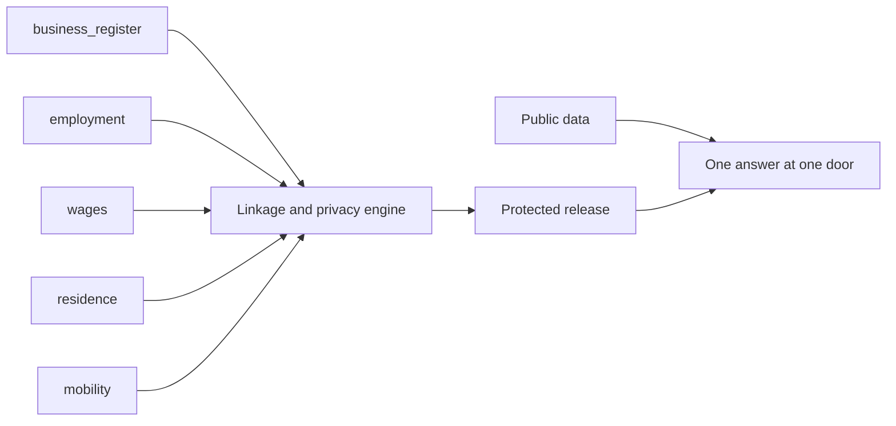

# 01 — Project Brief

| | |
|---|---|
| Status | Draft v0.2, corrected after independent review on 2026-11-11 (see PROGRESS.md) |
| Date | 2026-11-11 |
| Owner | albarami |
| Purpose | State who the Economic & Investment Intelligence proof of concept is for, what version 1 does and does not do, how success is checked, and what it must never claim. |
| Read first | [README](../README.md), then this document. Every other document in [docs/README.md](README.md) depends on this one. |

## In brief

- EII is a proof of concept (POC) of a company-facing decision-support product for Qatar. A company asks one business question about one place and gets one evidenced answer on a map, in Arabic or English.
- The answer joins five record types that different custodians hold: business register, employment, wages, residence and mobility. The distinctive idea is "income geography": privacy-protected, area-level wage statistics by where covered earners live and by where they work.
- All custodian-type records are fully synthetic. Movement is simulated. Only figures marked Public describe Qatar.
- The demonstration audience is a Minister and possibly other ministries. The real end users are companies, so the product shows only what a company may see; a separate oversight seat shows what the operating ministry would see.
- Version 1 builds eight MUST capabilities (M1 to M8) and up to eleven SHOULD capabilities (S1 to S11) around three journeys, led by one flagship: an Italian restaurant at a Lusail building.
- Version 1 names no firms, makes no forecasts, and has no nationality dimension. The privacy rule is shown on screen and the audience is invited to break it.
- The demonstration ends with a specific request: which feeds, which pilot, and the pass and kill criteria.

Naming note. In this document M1 to M8 and S1 to S11 name capabilities. Build slices, which also use the letter S, are always written "slice S0" to "slice S11" (see [14_IMPLEMENTATION_PLAN.md](14_IMPLEMENTATION_PLAN.md)).

## 1. Purpose

EII is a product demonstrator and a proof of method. It is to show three things on one screen:

1. what a company could learn if the five record types were joined around one place;
2. that the join can be released only as protected statistics, under rules a data owner can inspect and attack;
3. that every number can be traced to its class (Public, Synthetic, Simulated or Suppressed), its source and its rules.

It is not a market study of Qatar and it is not evidence about Qatar, except for figures marked Public.

## 2. Audience

| Who | Role in the POC | What they need from it |
|---|---|---|
| Minister and other ministries | Demonstration audience, on a large screen | An 8 to 9 minute guided story, then free exploration that is safe to tap; a plain answer to "is this real?" on every number; a specific request at the end |
| Companies: an international entrant, or a firm already operating in Qatar | Real end users of a future product. In the POC they are represented by two fictional company seats, `company_a` and `company_b` | One question about one door answered with evidence, limits and what remains to test |
| Operating ministry | Represented by the `oversight` seat | Every question from any seat in a live ledger, rolled up into where and what companies are asking, with no company identity shown |
| Ministry reviewers (GIS and IT staff) | Inspectors of the method | A read-only copy of the release in a standard GIS tool, and the proof that two engines give the same answer |
| Builders (coding agents from several vendors) | Implement the product from this pack alone | Exact names, rules and gates; see [02_ARCHITECTURE.md](02_ARCHITECTURE.md) and [14_IMPLEMENTATION_PLAN.md](14_IMPLEMENTATION_PLAN.md) |

The product therefore behaves as the company-facing product. Nothing on a company seat may show more than a company would be entitled to see.

## 3. The problem companies face today

A company deciding where and whether to open a business in Qatar can find, from public and commercial sources:

- where businesses are licensed (existing public business maps);
- how many devices pass a location (telecom footfall products);
- modelled income where people live (commercial purchasing-power layers);
- directories and general answers (investment-portal assistants);
- national tables on sector costs, pay, trade and transport (official open data).

Each of these holds one side of the answer. None of them, from its published description, answers the questions a company actually asks about one door:

- Who works within reach of this door, and what are they paid?
- Who lives within reach, and what are they paid, and how many of them live in labour accommodation rather than family housing?
- Of the outlets licensed nearby, how many are really operating?
- What does this kind of business cost to run, and where do its inputs come from?
- How does all of that change across the Qatari day, on a Friday, in Ramadan and in summer?

The design review of 2026-11-11 read competitors' published descriptions, not their products in use. This brief therefore claims no competitor gap beyond "not found in published descriptions".

## 4. The five record types and income geography

| Record type | Contract name | What it contributes to the answer |
|---|---|---|
| Business register | `business_register.v1` | Where activity is licensed; company identity, activity and registered location |
| Employment | `employment.v1` | How large employers are; occupation groups |
| Wages | `wages.v1` | What covered jobs pay (basic and net) |
| Residence | `residence.v1` | Where covered earners live, with the address reduced to a grid cell |
| Mobility | `mobility.v1` | How many people are present, by time, as aggregates only |

Definitions used throughout the pack:

- **Custodian**: the body that holds a record type under its own mandate. This pack never names a custodian; see OI-06.
- **Covered earner**: a person in a covered private-sector job. People outside that coverage are "not measured", never zero.
- **Door**: a pin dropped at a place, snapped to the fixed grid.
- **Within reach**: the area made from the pin by distance, walking time or driving time, snapped to whole grid cells before any figure is read.
- **Income geography**: area-level wage statistics for covered earners, by where they live and by where they work, released only as privacy-protected statistics.

Contracts are specified in [03_DATA_CONTRACTS.md](03_DATA_CONTRACTS.md). The synthetic stand-ins are specified in [05_SYNTHETIC_WORLD_AND_SIMULATION.md](05_SYNTHETIC_WORLD_AND_SIMULATION.md).

## 5. The one sentence and why no one can assemble it alone

**The one sentence.** At any door in Qatar, one screen shows who works within reach and who lives within reach and what they are paid, which licensed outlets are really operating, what the business costs to run and where its inputs come from, and how that shifts across the Qatari day. Every number is marked real, synthetic or simulated, and the audience is invited to try to break the privacy rule.

Why no single custodian or vendor can assemble this answer alone (an institutional barrier, not a technical one):

1. Each record type sits with a different custodian under its own mandate. The register holder has no payroll, the payroll holder has no home addresses, and neither has movement.
2. A commercial vendor holds at most one side: telecom footfall products hold presence but not pay; purchasing-power layers model income at home but not pay at the workplace; business maps hold licences but not whether anyone is employed.
3. Joining the records is lawful and acceptable only under a disclosure-control regime that every data owner can inspect, set and attack. The POC demonstrates that regime; it does not settle it.
4. The POC differentiates itself by demonstrating the record join, inspectable disclosure controls and public economics with provenance. It makes no claim about competitor capability or development time.
5. Whether custodians agree to such a join is exactly what the closing pilot request asks (section 15).

## 6. Version 1 capabilities

Every capability below is a user-visible requirement. "Class" is the provenance class the user sees on the result. Composites show the least-real class of their inputs (Public is more real than Synthetic, which is more real than Simulated). Evidence status (Observed, Inferred, Still to test) is a separate axis and is never merged with class; scope exclusions render as Not measured from coverage metadata.

### 6.1 MUST (never cut)

| ID | Requirement: what the user sees | Item | Class |
|---|---|---|---|
| BRF-01 | At a pin snapped to the fixed grid, two separate cards, "People who work within reach" and "People who live within reach", each show a rounded count of covered earners, the median wage band, the quartile band range and a band distribution bar. On each card the count and the band shares beside it come from one additive family (PRV-30). The residents card always shows the housing split of covered earners: family housing, labour accommodation, institutions and unknown housing class, with an explicit "other" row where pooling occurred, beside the count that is not measured. That split's count and its shares come from that split's one additive family. The not-measured count is a separate population. Mean wage and wage bill appear only under "More evidence", with the guidance "the average alone is not enough". | M1 The joined door | Synthetic |
| BRF-02 | A dial with four stored situations (`weekday_lunch`, `weekday_evening`, `friday_evening`, `ramadan_iftar`) and a `summer` switch that applies to the first three re-weights who is present around the door (workers, residents, visitors). It is shown as an index, never as a count, and never as a named building's footfall. Separate Public monthly context series (metro, tram and bus riders, hotel occupancy and restaurant-and-hotel price index) are shown alongside on their own Public cards, never as hourly or building anchors; only the July–August metro ratio scales the summer visitor switch. | M2 The Qatari-day dial | Simulated |
| BRF-03 | The same answer shows real public evidence: licences in the municipality against the national rate; zone electricity growth; metro and tram riders; named public places with network distances and a standing "open listings are incomplete" note; sale price per square metre only with its deal count. | M3 Real public evidence | Public |
| BRF-04 | Every area is snapped to fixed grid cells; minimum group sizes, an employer-dominance rule and a subtraction (complement) test apply; every answer carries a privacy receipt; a "Try to break it" scene lets the audience attack the rules. | M4 Privacy you can attack | Withheld figures show Suppressed |
| BRF-05 | Every displayed number is produced by deterministic tested code in `eii_core.calc`, the release build, or a fixed application-schema read function listed by the data contracts and covered by tests. Nothing else computes, rounds or compares a number, and no model ever does; the browser formats values it receives and never computes a displayed number. Each number carries one of four provenance marks, computed in code by the least-real rule; a coverage bar; a reliability mark for small counts; and a one-tap path that opens the evidence drawer labelled "Source chain" (Arabic label pending native review). A fact without a complete source chain is not rendered. Every answer carries a receipt that records the accounting gate as "Checked before display" (Arabic label pending native review). | M5 Proof on every number | All four classes |
| BRF-06 | The public cost structure of restaurants (and of the other playbook activities) is shown with a calculator: the user's own rent, seats and average bill (with editable opening days per month, default 30, and optional fixed monthly staff cost) give the break-even revenue, covers per day and seat turns; adding expected covers per day gives the maximum rent, minimum bill and maximum staff-cost breakpoints. | M6 Unit economics with break-even | Public norms; the result is the user's scenario, evidence status Inferred, tagged "your inputs", never stored in the release |
| BRF-07 | The bilingual assistant selects only claim keys, typed fact slots and an ordered component layout from closed, versioned application-owned claim and component catalogues. Every Observed and Inferred sentence is an application-owned English or Arabic template; no model-written prose reaches the screen. Component properties are fact ids, release-unit ids or enumerations. The application validates and renders them, and an invalid layout falls back to the playbook default. Evidence precedes words, and the template writer produces the same brief without a model. Synthetic or Simulated facts are permitted only in claims or components whose subject is the area around the pin, never a real named place. Before display, code runs the accounting gate of [02_ARCHITECTURE.md](02_ARCHITECTURE.md); failure falls back to the template writer's default answer. | M7 Governed bilingual assistant | Inherits the classes of its facts |
| BRF-55 | The provider-neutral typed-decision gateway in [decision 0014](decisions/0014-typed-decision-gateway.md) is build-time and evaluation-only, defaults to `none`, and is never used at run time. Its only visible trace is the single activity-spine lineage line in the Proof room. | M7 (gateway) | Decision evidence only |
| BRF-08 | "We understood your question as..." chips link the commerce activity code, the international activity class (ISIC Rev.4) and the public place category, with a visible "not mappable" bucket for legacy codes. | M8 Bilingual activity spine | Public |

### 6.2 SHOULD (in version 1; cut in the order of section 6.3 if time slips)

| ID | Requirement: what the user sees | Item | Class |
|---|---|---|---|
| BRF-09 | Of the licensed food outlets within reach, the share that show payroll activity, by size band, as an aggregate strip only, visually separate from real named places. | S1 Licensed versus operating | Synthetic |
| BRF-10 | Pay bands for the jobs this outlet hires among people living within a 30-minute drive, beside published national averages and the statutory minimum. The 30-minute drive cut-off is for staffing only (see [02_ARCHITECTURE.md](02_ARCHITECTURE.md)). | S2 Staffing and pay | Synthetic and Public, each marked |
| BRF-11 | A national pay card shows what really moved national average pay (pay-versus-mix decomposition), naming the public table used. | S3 National pay card | Public |
| BRF-12 | On the `oversight` seat, every question from any seat appears live in a ledger with its release and what went to the AI; it rolls up into "where and what companies are asking" only when at least two organisations are represented (`distinct_organisation_minimum = 2` for this two-company POC; below that threshold the roll-up returns `NO_DATA`; at threshold it shows only the aggregate, never seat or organisation identity). This POC value is query-isolation demonstration configuration, not a production disclosure threshold. The seat picker binds the seat to the window with a signed session cookie named `eii_seat`; presenter controls require a per-session presenter token (`X-EII-Presenter-Token`). This is query isolation after selection, not identity or tenant authentication. | S4 Ministry oversight seat | Seeded history Synthetic; live rows tagged "this session" (OI-08) |
| BRF-56 | `company_a` and `company_b` cannot open each other's briefs; the isolation is checked by a database-level test. The seat picker binds the seat to the window with a signed session cookie; presenter controls require a per-session presenter token. This is query isolation after selection, not identity or tenant authentication. | S4 Ministry oversight seat | Seeded history Synthetic |
| BRF-13 | For an activity's input basket, the origins that supply each input, the unit value, concentration and trend, plus licensed wholesale depth by municipality. Origins are countries, never named firms. | S5 Supplier lens from customs | Public |
| BRF-14 | Two doors are shown side by side with second-branch overlap, worded as shared reach, not lost sales. | S6 Compare two doors | Least-real class of the two answers |
| BRF-15 | Reviewers can see every released fact recomputed by PostgreSQL and by the embedded engine, and can open the release read-only in a standard GIS tool. This view is for reviewers only, never for company seats. | S7 Two engines, one answer | Inherits the release |
| BRF-16 | Licence cancellations over time, with bulk months flagged as an inference. | S8 Licence churn | Public |
| BRF-17 | A row of at most six "found near" chips for typical neighbouring place categories, with the coverage note. | S9 Typical neighbours | Public |
| BRF-18 | A coarse, protected share of where the door's workers live, with origin geography no finer than a large pooled district. | S10 Where the door's workers live | Synthetic |
| BRF-19 | One tap produces a printable briefing pack: one A4 portrait page in the light theme, bilingual on that page (English label, Fact chip, Arabic label) so each number is printed once; a second page is used only when content overflows. Simulated values print as static dashes. The standing strip and watermark appear on every page. Every figure is traceable. | S11 Briefing pack | Inherits the classes of its facts |

### 6.3 Cut order if time slips

Cut in this order: company separation (two-company row-level security, BRF-56), neighbours chips, churn panel, two-door comparison, supplier baskets beyond the flagship, where workers live, the oversight seat (falling back to the paused local-ledger view when PostgreSQL is away, with append-only writes to `data/ledger_local.sqlite`). Never cut: the public-only answer, the privacy engine, the coverage and provenance marks, the Arabic review. The plan in [14_IMPLEMENTATION_PLAN.md](14_IMPLEMENTATION_PLAN.md) carries this order.

## 7. The flagship journey (narrative by form)

The building is chosen in slice S2, only after its public places data has been checked by hand. One candidate tower had no restaurant within 250 m in the open places extract, while another Lusail landmark had fifteen (design review, 2026-11-11). The narrative below describes form, not values: every synthetic and simulated quantity is shown only as "a count", "a band" or "an index".

1. **Ask.** A company types, in English or Arabic, that it wants to open an Italian restaurant at the chosen Lusail building. Chips show how the question was understood: the decision (`site_check`), the activity through the activity spine, the cuisine, and the place. If two places match, two chips ask which one.
2. **Fly and snap.** The map flies to the building. Two areas are made from the pin, by default a 5-minute walk and a 10-minute drive. Each shape visibly snaps to whole grid cells; the snap report states the requested area, the released area, the number of units and the rules that set it.
3. **Evidence before words.** Four hero cards land before any narrative text:
   - who is present around the door at the selected dial position, as an index (Simulated);
   - real restaurants nearby from open places data, with network walking distances to the Italian ones, under the "open listings are incomplete" note (Public);
   - pay of people who work within reach and of people who live within reach, as counts and bands, with the housing split and the coverage bar (Synthetic);
   - the real cost structure of restaurants in Qatar (Public).
4. **The brief.** After the accounting gate passes, the answer column fills in three parts: Observed, Inferred, Still to test. The interface may reveal items one after another for legibility; that is presentation only. Every number in it is a fact chip rendered by the application. Still to test always includes the reading guidance that applies (section 12).
5. **Follow a number.** Tapping any number opens the evidence drawer: class, evidence status, period, rule applied, coverage, source, licence and release.
6. **Flip.** One tap switches to Arabic. The chrome and reading order mirror; the map, charts, numerals and dial do not; every number is identical.
7. **Costs and suppliers.** The user enters their own rent, seats and average bill (and, optionally, expected covers per day and monthly staff cost). The calculator gives the covers per day required and, when expected covers are entered, the rent and bill breakpoints, tagged "your inputs". The supplier lens shows which countries supply the basket's inputs, at what calculated import unit value and concentration.
8. **Hand-over.** One tap produces the briefing pack. The brief ends with what remains to test, never with a success verdict.

What the flagship never says: a building's tenants or vacancy; any business's sales, footfall or wages; any individual's pay; a revenue, demand or success forecast.

## 8. The seven company decisions against version 1

The initiative names seven company decisions. Version 1 covers them as follows. Version 1 names no firms: a list of fictional firms would read as a real recommendation, so any prospect list waits for an owner decision (OI-07).

| Decision | Version 1 coverage | What version 1 offers | Reason |
|---|---|---|---|
| Whether to enter Qatar | Aggregate only | Sector cost structure (BRF-06), national pay card (BRF-11), licence density and zone momentum (BRF-03) | No market-size, revenue or success forecast may be given (section 13). A cross-country comparison is not in version 1 or in the ordered backlog. |
| Which location fits | Full, for one door or two compared doors | The joined door, dial, public evidence, break-even and two-door comparison (BRF-01 to BRF-06, BRF-14) | This is the flagship. Ranking many sites is later (L1, L2, L10). |
| Where to find customers | Aggregate only | Who works and lives within reach and who is present (BRF-01, BRF-02) | No named customers. Business-to-business prospect lists wait for OI-07 and L8. |
| Whom to partner with | Later | Only countries of origin and licensed wholesale depth by municipality (BRF-13) | Named partners need an owner decision (OI-07, L8). Networks of firms are dropped (section 9.3). |
| How to organise staffing | Aggregate only | Pay bands by occupation group, statutory minimum, national pay card, where workers live (BRF-10, BRF-11, BRF-18) | No firm or individual wage is shown; no nationality dimension exists. |
| Where to grow in Qatar | Aggregate only | Two-door comparison with shared reach, zone momentum (BRF-14, BRF-03) | Site ranking, second depot and weak branch are later (L1, L8). |
| How to serve the region | Later | Nothing beyond import origins (BRF-13), which describe supply, not markets | Not in version 1 or in the ordered backlog; scope needs an owner decision. |

## 9. Journeys, Later backlog and Dropped list

### 9.1 The three journeys of version 1

The home screen offers three journey cards, one per playbook. Exactly three playbooks exist in version 1.

| Playbook | Typical question | Main capabilities | Ends with |
|---|---|---|---|
| `site_check` | "I want to open an Italian restaurant at this building." | BRF-01 to BRF-06, BRF-08, BRF-09, BRF-14, BRF-16, BRF-17 | A brief in Observed, Inferred and Still to test, with three suggested next questions |
| `staffing_and_pay` | "What do the jobs a restaurant hires pay around here, and where do such workers live?" | BRF-01, BRF-10, BRF-11, BRF-18 | Pay bands beside the national average and the statutory minimum, with coverage; the playbook calls `area_evidence` for resident, worker and coverage blocks |
| `costs_and_suppliers` | "What does running a restaurant cost, and where do its inputs come from?" | BRF-06, BRF-13 | The user's break-even scenario and the supplier lens |

### 9.2 Later (ordered backlog after version 1; each is its own slice)

| Item | What it adds | Why it is not in version 1 |
|---|---|---|
| L1 | Site ranking with visible weights and a rank-stability sentence, with a public-only mode | Weights are a judgement and need the stability sentence beside every rank; first item after version 1 |
| L2 | Reachable-access score (two-step floating catchment) with a national travel-time matrix | Needs a matrix built per release; hour-of-day versions are Simulated; version 1 keeps only overlap |
| L3 | Imports against local production screen, all Public | An active licence is not production capacity, and a screen is easily read as advice |
| L4 | The second protected window and the release switch ("what changed since the last release"), as one item | The second-window privacy rules are built and attacked first, on two adjacent test windows inside the custodian plane; only then is a second window exported and the switch shown. A difference between two synthetic releases reads as a trend that does not exist; wait for real dated feeds |
| L5 | Neo4j loader as an optional profile, same query templates on both stores | No visible gain in version 1; trigger is a real, lawful relationship feed with paths deeper than four steps (see [02_ARCHITECTURE.md](02_ARCHITECTURE.md)) |
| L6 | Tool server (MCP) over the same governed tools | Lets other assistants mount the same evidence; not needed to demonstrate the answer |
| L7 | Sovereign-mode trial: a local or in-region model behind the same evaluation set | Version 1 uses an online model; a local model must pass the same evaluation first |
| L8 | Further cases (industrial-services demand, technology prospects, second depot, weak branch) | Depth on one journey first; a prospect list of firms needs the owner decision OI-07 |
| L9 | Product-space context line on the imports card | Depends on L3; the design review judged relatedness rankings for Qatar too weak to rank on, so one context line at most |
| L10 | Similar-areas search with three area types | Area types beyond three were unstable in the design review, and twin-area search is already sold commercially |

### 9.3 Dropped (do not build)

| Dropped item | Reason |
|---|---|
| Proxy input-output tables from other economies, and any multiplier built from them | Another economy's structure shown beside Qatar figures gets quoted as a Qatar fact; public sector cost shares already answer "what does it buy" |
| Networks of firms or owners among synthetic companies; named partner, supplier or acquisition candidates | Synthetic firms read as real recommendations, and a web of firms or owners reads as surveillance |
| Any invented attribute on a real named business or place | One instance discredits every number on screen |
| Any nationality dimension or proxy; any sex split at area level | A political and disclosure risk, not a feature |
| Gravity or Huff capture shares, revenue forecasts, survival curves, entry rates, success scores, policy-lever simulation, composite "spending power present" | On synthetic and simulated inputs they return the generator's own assumptions: manufactured precision |
| Model-written queries (text-to-SQL, text-to-Cypher), document-extracted graphs | The model could reach or phrase figures outside the governed fact set |
| Free-drawn areas, agent trails, 3D wage towers, live shadows, 24-hour animation, voice | Privacy-argument load, stage risk, or simulated movement looking more real than it is |
| Apache AGE, native graph queries in PostgreSQL, `h3` and routing extensions inside PostgreSQL, pgvector and pgAudit in version 1, Redis, a separate tile server, GPU analytics, a local model in version 1 | No visible gain for the demonstration; more moving parts on stage |
| Formal differential privacy claims | The engine applies disclosure control; it does not provide a formal guarantee |

## 10. Success criteria

Each criterion is checkable by a test or a named reviewer. Gate detail lives in [12_TESTING_AND_QUALITY.md](12_TESTING_AND_QUALITY.md) and [14_IMPLEMENTATION_PLAN.md](14_IMPLEMENTATION_PLAN.md). Latency figures are targets, to be measured, not promises.

### 10.1 Product

| ID | Criterion |
|---|---|
| BRF-20 | The flagship question is answered end to end with Public facts only, no synthetic data and no model call. In public-only mode, `make_area` uses the fixed base-cell frame partition, reads no privacy-derived release unit, Protected table or Simulated table, and emits the snap report as technical metadata rather than a Synthetic fact. |
| BRF-21 | The flagship question is answered end to end, including the synthetic and simulated cards, with no model call; every number resolves to a fact with provenance and lineage. |
| BRF-22 | The same question on the same release returns identical numbers every time, in both languages. |
| BRF-23 | With no `ANTHROPIC_API_KEY` set, every journey in section 9.1 completes with the template writer. |
| BRF-24 | A `company_b` seat cannot read a `company_a` brief, checked by a database-level test (if BRF-56 survives the cut order). The seat picker binds the seat to the window with a signed session cookie; presenter controls require a per-session presenter token. This is query isolation after selection, not identity or tenant authentication. |
| BRF-25 | Targets, measured and reported: evidence on screen within 2 s; the checked brief within 6 s when no live model is called (template writer or recorded provider) and within 20 s when a live model composes it. The structured brief is buffered, the accounting gate runs once on the complete brief, and only then is it rendered; evidence cards may appear earlier, each with its complete source chain. |

### 10.2 Honesty and privacy

| ID | Criterion |
|---|---|
| BRF-26 | No numeral is rendered outside the Fact chip (enforced by a lint rule). |
| BRF-27 | Five hundred distinct structured briefs returned by the model before repair or fallback; every fallback is counted and reported; each brief validates against the claim and component catalogues (no model-written prose on screen); the must-decline set passes at 100%. |
| BRF-28 | The attack suite uses typed recovery predicates from [06_PRIVACY_AND_DISCLOSURE_CONTROL.md](06_PRIVACY_AND_DISCLOSURE_CONTROL.md) (PRV-116). With controls off, each predicate is recovered; with controls on, none; this holds for each parameter set evaluated inside the custodian plane. Exactly one parameter set's protected tables are exported. |
| BRF-29 | The standing strip (the permanent demonstrator notice) is visible on every screen and on every page of the briefing pack. |
| BRF-30 | No prepared string, template or generated brief makes a claim listed in section 13; an independent reviewer checks every prepared string against that list. |
| BRF-31 | No contract, table or field carries a nationality attribute; no synthetic name collides with a real place or business name (the build fails on a collision). |
| BRF-32 | Every prepared Arabic string is signed off by a native reviewer (OI-09). |

### 10.3 Demonstration

| ID | Criterion |
|---|---|
| BRF-33 | The guided story runs in 8 to 9 minutes (target) in three rehearsals, one with PostgreSQL stopped and one offline. |
| BRF-34 | The story opens on Public evidence; no Synthetic wage figure appears before the reading guidance and housing split have been shown. |
| BRF-35 | After hand-over, every blank offers "Why can't I see this?" and a permanent Reset is visible. |
| BRF-36 | The demonstration ends with the pilot request of section 15, with every field filled. |

## 11. Non-goals

| ID | Version 1 must not |
|---|---|
| BRF-37 | read any real custodian record, at any stage, in any code in the repository. |
| BRF-38 | contact a telecom operator or use any real mobility feed. |
| BRF-39 | name, rank or recommend any firm, owner or individual, real or fictional (OI-07). |
| BRF-40 | give a revenue, demand, market-size or success forecast. |
| BRF-41 | let a company seat see record-level data, another company's brief, or the oversight ledger. |
| BRF-42 | attach any synthetic or simulated figure to a real named business, building or place. |

## 12. Honesty position and reading guidance

**Honesty position (binding).** This POC is a product demonstrator and a proof of method. It is not evidence about Qatar, except for figures marked Public.

What this means on screen:

- Provenance words: Public, Synthetic, Simulated, Suppressed. Arabic proposals, pending native review: عام · اصطناعي · محاكاة · محجوب. Each is carried by texture and line style as well as the word, never by colour alone.
- Evidence-status words: Observed, Inferred, Still to test (with unmeasured populations labelled Not measured from coverage metadata, never zero). "Observed" must never read as "real" when the figure is Synthetic.
- Real suppression rates are unknown until the engine runs on real data inside a custodian's environment. Thresholds are proposals for data owners to set (OI-11).

Reading guidance, shown wherever it applies:

| Guidance | Why it is shown |
|---|---|
| Wages paid are not wealth. | Wage statistics cover covered jobs only; they say nothing of savings, other income or household spending. |
| Movement is not purchases. | A presence index counts people around a door, not customers or sales. |
| A licence is not trading. | A licensed activity may have no staff or no premises in use. |
| An address is not a worksite. | Registered addresses and where staff actually work can differ. |
| Headcount is not presence. | Employees on a payroll are not the people present at a place at a given time. |

Public figures used to show why this guidance matters (re-verified by the fetchers in [04_PUBLIC_DATA_PACK.md](04_PUBLIC_DATA_PACK.md)):

- Zone 69 (Lusail) electricity grew 3.34 times from 2021 to 2025, against 1.34 times nationally. Electricity is an activity proxy, not a population count.
- Lusail's municipality, Al Daayen, has 32 restaurant licences per 10,000 residents against 15 nationally.
- Of 249,622 active licence-activity counts in May 2025, 211,277 (84.6%) sit under 7-digit codes whose first four digits are an international class, 11,276 (4.5%) under other 7-digit codes, 26,844 (10.8%) under 6-digit legacy codes, and 225 (0.1%) under other code lengths (169 under 13 five-digit codes and 56 under eight eight-digit codes). Among the legacy codes, 138 have a class-looking prefix but must not be mapped by prefix alone; 561000 is spare-parts trade, not restaurants.
- The open places extract holds about 26,000 Qatar records, against about 71,000 establishments counted in Census 2020: listings are incomplete.

## 13. Prohibited claims

Never say or imply, in any screen, string, brief, pack, document or presentation, that:

| ID | Prohibited claim |
|---|---|
| BRF-43 | the POC uses real custodian data; |
| BRF-44 | a Synthetic or Simulated figure describes a real place; |
| BRF-45 | a simulated index is a named building's footfall; |
| BRF-46 | the privacy engine is certified or formally private; |
| BRF-47 | an existing public service is wrong or inferior; |
| BRF-48 | the ministries have endorsed or run the system; |
| BRF-49 | a revenue, demand or success forecast is given; |
| BRF-50 | any firm, owner or individual can be looked up. |

## 14. What would get the product refused, and how the design answers

| Refusal risk | Design answer |
|---|---|
| Opening on a simulated crowd invites "is this real footfall?" in the first minute. | The story opens on Public evidence (zone electricity, licences, transit); the dial follows, as an index only (BRF-34, BRF-02). |
| A synthetic number is read as a fact about a real place, or is photographed out of context. | Provenance marks on every number and in every export; the standing strip; wage views only after the reading guidance (BRF-05, BRF-29, BRF-34). |
| An invented figure attached to a real named business. | Forbidden outright; the licensed-versus-operating strip is aggregate and separate from named places; synthetic firms sit in grid cells, never in named buildings (BRF-09, BRF-42). |
| Pay or workforce split by nationality. | No nationality attribute exists anywhere (BRF-31). |
| Networks of firms or owners, or named partner candidates. | Dropped; version 1 names no firms (section 9.3, BRF-39). |
| Proxy multipliers or manufactured precision (capture rates, revenue ranges, survival rates). | Dropped; the break-even is the user's own arithmetic on Public norms, tagged "your inputs" (BRF-06, BRF-40). |
| The privacy attack succeeds live, or the rules only hide small cells and forget subtraction. | Fixed grid and pooling, one parent-linked partition family per contributor universe, exact sums within each additive family, with no cross-family equality, exhaustive structural closure checks, at least 10,000 fuzz pairs per release and parameter set, and typed attacks under both internally evaluated parameter sets. Exactly one protected table set is exported (BRF-04, BRF-28). See [06_PRIVACY_AND_DISCLOSURE_CONTROL.md](06_PRIVACY_AND_DISCLOSURE_CONTROL.md). |
| The AI states a number not in a tool result, or Arabic and English show different figures. | The application renders every number from catalogue templates and validated component layouts; invalid claims or layouts fall back to the playbook default; identical numbers in both languages (BRF-07, BRF-22, BRF-27). See [09_AI_ASSISTANT.md](09_AI_ASSISTANT.md). |
| No answer to "what leaves the building to the AI, and who approved it?" | The model receives protected aggregates, public figures and simulated aggregates only; every send is recorded in the ledger with its release (BRF-12). |
| A stage failure: a database or container that does not start, a stalled model call, blank tiles, missing Arabic glyphs. | `./eii preflight` only probes; `./eii db-up` and `./eii db-down` start and stop the database; `./eii up` never starts a database. Store chosen at start-up with one presenter switch to the embedded reader; local ledger fallback; template writer; self-hosted glyphs and tiles; rehearsals with PostgreSQL stopped and offline (BRF-23, BRF-33). See [13_DEPLOYMENT_AND_OPERATIONS.md](13_DEPLOYMENT_AND_OPERATIONS.md). |
| Framing that embarrasses the host, or presenting EII as a rival to an existing public service. | Batch-month flags and the pay-versus-mix card are presented as added insight on public data; EII is the missing pay, residence and movement layer, not a replacement (BRF-47). |
| The oversight seat reads as the state watching companies' plans. | No company identity on the oversight seat; aggregates only when `distinct_organisation_minimum = 2` is met (BRF-12); seeded history marked Synthetic (OI-08). The company seat states plainly that its questions are recorded and counted in aggregate (ASSUMPTION 4 below). |
| Public data visibly wrong where the audience knows the ground. | Four hand-verified showcase areas (Lusail, West Bay, Msheireb, The Pearl); the flagship building chosen only after a check; a standing incompleteness note. |
| Two public numbers that do not reconcile. | Neither is displayed until reconciled (OI-03). |
| A public layer with no stated licence used as if redistributable. | While OI-04 is open, the source is validation-only: it is fetched at build time, never committed, and no value, derived share, title or geometry enters a release. The coverage bar uses the finest separately licensed geography or returns `NO_DATA`. After the licence is recorded, derived shares carry attribution. |
| Breadth without depth; the product not finished. | One deep journey; slices with gates; a written cut order (section 6.3). |
| Engineer-facing proof taking the Minister's minutes. | The Trust centre and Proof room sit one level down, outside the main story. |
| Ending without a specific request. | The pilot request of section 15 (BRF-36). |

## 15. The closing ask

The demonstration must end with a written pilot request. Its final content is set in [16_DEMO_RUNBOOK.md](16_DEMO_RUNBOOK.md); this brief fixes its shape.

| ID | The pilot request must state |
|---|---|
| BRF-51 | Which feeds: the record types requested, by contract name (`business_register.v1`, `employment.v1`, `wages.v1`, `residence.v1`, `mobility.v1`), and for each whether it is in scope. |
| BRF-52 | Which pilot: where the engine runs, who operates it, the area and period covered, and what leaves the custodian's environment. |
| BRF-53 | Pass criteria: measurable conditions, each with a threshold and a named judge, under which the pilot continues. |
| BRF-54 | Kill criteria: measurable conditions, each with a threshold, under which the pilot stops and the data are withdrawn. |

Proposed starting point for the runbook to finalise (ASSUMPTION; the simplest safe shape, reasoned from the replacement path in [02_ARCHITECTURE.md](02_ARCHITECTURE.md)): run the same conformance suites, linkage and privacy engine inside one custodian's environment on real feeds; let only the survival report and released aggregates leave. Proposed default pass thresholds for custodian sign-off (each with a named judge in the runbook): feed conformance at or above 98%; workplace earner survival at or above 70% and resident earner survival at or above 80% in commercial areas; zero canary recoveries under the attack suite; zero engine-parity differences. Kill if any conformance failure cannot be fixed by an adapter, if the attack suite recovers any planted canary, or if survival rates fall below those proposed thresholds.

## Open questions and assumptions

ASSUMPTIONS made in this document:

1. The seven-decision coverage in section 8 is this brief's classification of the master design's capabilities; the owner should confirm it.
2. "How to serve the region" and "whether to enter Qatar" (as a cross-country comparison) are in neither version 1 nor the ordered backlog; the owner should decide whether to add them.
3. Capabilities and slices share the letter S; this pack writes slices as "slice S0" to "slice S11" to keep them apart.
4. The company seat discloses that its questions are recorded and counted in aggregate on the oversight seat. The master design is silent; the design review's judges asked for it.
5. The pilot-request starting point in section 15 is a proposal, finalised in the runbook.

Open items that touch this document (see [OPEN_ITEMS.md](../OPEN_ITEMS.md)):

- OI-01: no API key yet; the template writer and a recorded provider are the default.
- OI-02: no demonstration date yet.
- OI-03: the restaurant totals and the two wage-table means must be reconciled before display.
- OI-04: census map layers have no stated licence.
- OI-05: product name and Arabic name need clearance; working title "Economic & Investment Intelligence (EII)".
- OI-06: neutral record-type names on screen by default.
- OI-07: no prospect list of firms in version 1.
- OI-08: label for live ledger rows; default `distinct_organisation_minimum = 2` for the two-company POC (BRF-12).
- OI-09: native Arabic reviewer.
- OI-11: privacy thresholds are proposals.

## Sources

All public figures were checked on 2026-11-11 during the design review and must be re-verified by the fetchers in [04_PUBLIC_DATA_PACK.md](04_PUBLIC_DATA_PACK.md), which hold the exact dataset URLs.

- Qatar Open Data Portal, https://www.data.gov.qa/ (CC BY), retrieved 2026-11-11:
  - "Electricity total consumption by zone number": zone 69 and national growth, 2021 to 2025.
  - Active commercial certificates by municipality and business activity, May 2025: code shares, the 561000 legacy code, and restaurant licences per 10,000 residents (computed with municipal population).
  - Number of business establishments by economic activity, Census 2010 and 2020: about 71,000 establishments in 2020.
- Overture Maps Foundation, Places release 2026-10-21.0, https://docs.overturemaps.org/guides/places/, retrieved 2026-11-11. The Places theme is licensed CDLA Permissive 2.0 or Apache 2.0 depending on the source. The count of about 26,000 Qatar records is the design review's count of the extract.
- United Nations Statistics Division, ISIC, https://unstats.un.org/unsd/classifications/Econ/isic, retrieved 2026-11-11. The page lists ISIC Rev.4 as a previous version, after Rev.5. Version 1 uses Rev.4 by project decision; any move to Rev.5 is a later change to the activity spine.
