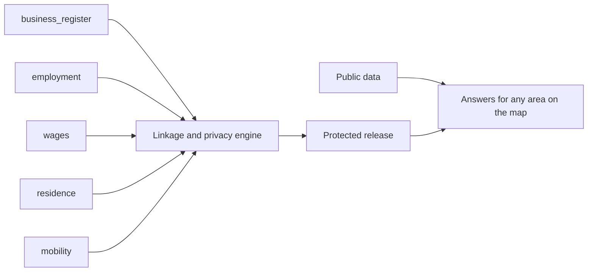

# 01 — Project Brief

| | |
|---|---|
| Status | Draft v0.3, amended by decisions 0016, 0017 and 0018 on 2026-11-12 |
| Date | 2026-11-12 |
| Owner | albarami |
| Purpose | State who the Economic & Investment Intelligence proof of concept is for, what version 1 does and does not do, how success is checked, and what it must never claim. |
| Read first | [README](../README.md), then this document. Every other document in [docs/README.md](README.md) depends on this one. |

## In brief

- EII is a proof of concept (POC) of a company-facing decision-support product for Qatar, built on one living map. A company draws an area, or sets a radius or a walk or drive time from any point at a chosen hour, and sees who is there through the day, the traffic, the businesses, the pay of the people who work and live there, and the public evidence. The assistant answers in Arabic and English.
- The answer joins five record types that different custodians hold: business register, employment, wages, residence and mobility, beside cited public data. Wages are one layer, the distinctive one: "income geography", privacy-protected, area-level wage statistics by where covered earners live and by where they work.
- All custodian-type records are fully synthetic. People present, crowd density and traffic are simulated. Only figures marked Public describe Qatar, and every Synthetic or Simulated figure carries its mark.
- Version 1 covers the whole initiative ([decision 0016](decisions/0016-version-1-covers-the-whole-initiative.md)): seven company decisions as journeys, D1 to D7, each ending with its own answer; three services as journey outputs; and four cases, C1 to C4, as guided stories. The flagship is the location choice (D2), told for an Italian restaurant at a Lusail building.
- The demonstration audience is a Minister and possibly other ministries. The real end users are companies, so the product shows only what a company may see; a separate oversight seat shows what the operating ministry would see.
- Named synthetic firms may appear as prospects, partners and suppliers, always marked Synthetic; real businesses appear only as published Public facts. Version 1 makes no revenue, demand or success forecast and gives no verdict: a ranking is the output of tested code over criteria the user can see, with a rank-stability sentence. The synthetic records carry no sex, gender or nationality; official splits by sex or nationality appear only as Public facts ([decision 0017](decisions/0017-public-data-additions-and-public-splits.md)). The privacy rule is shown on screen and the audience is invited to break it.
- The build order is the map and data foundation first, then the flagship in full depth, then the other journeys. Each slice ends at a gate, and nothing below a slice gate is half-built.
- The demonstration ends with a specific request: which feeds, which pilot, and the pass and kill criteria.

Naming note. In this document D1 to D7 name the journeys, C1 to C4 the cases, and L1 to L10 the items of the first pack's Later list. M1 to M8 and S1 to S11 remain the labels of the first pack's capabilities, which other documents cite as "capability M3" or "capability S2". The three services are written "service S1" to "service S3" wherever the letter alone could mislead. Build slices are always written with the word slice, as in "slice S0" (see [14_IMPLEMENTATION_PLAN.md](14_IMPLEMENTATION_PLAN.md)).

## 1. Purpose

EII is a product demonstrator and a proof of method. It is to show three things on one screen:

1. what a company could learn if the five record types were joined around any area it chooses, beside public data;
2. that the join can be released only as protected statistics, under rules a data owner can inspect and attack;
3. that every number can be traced to its class (Public, Synthetic, Simulated or Suppressed), its source and its rules.

It is not a market study of Qatar and it is not evidence about Qatar, except for figures marked Public.

## 2. Audience

| Who | Role in the POC | What they need from it |
|---|---|---|
| Minister and other ministries | Demonstration audience, on a large screen | An 8 to 9 minute guided story, then free exploration that is safe to tap; a plain answer to "is this real?" on every number; a specific request at the end |
| Companies: an international entrant, a firm already operating in Qatar, or a property owner matching tenants to a site | Real end users of a future product. In the POC they are represented by two fictional company seats, `company_a` and `company_b` | Their decision answered on the map along one of seven journeys, with evidence, limits and what remains to test |
| Operating ministry | Represented by the `oversight` seat | Every question from any seat in a live ledger, rolled up into where and what companies are asking, with no company identity shown |
| Ministry reviewers (GIS and IT staff) | Inspectors of the method | A read-only copy of the release in a standard GIS tool, and the proof that two engines give the same answer |
| Builders (coding agents from several vendors) | Implement the product from this pack alone | Exact names, rules and gates; see [02_ARCHITECTURE.md](02_ARCHITECTURE.md) and [14_IMPLEMENTATION_PLAN.md](14_IMPLEMENTATION_PLAN.md) |

The product therefore behaves as the company-facing product. Nothing on a company seat may show more than a company would be entitled to see.

## 3. The problem companies face today

A company deciding where and whether to open a business in Qatar can find, from public and commercial sources:

- where businesses are licensed (existing public business maps);
- how many devices pass a location (telecom footfall products);
- modelled income where people live (commercial purchasing-power layers);
- directories and general answers (investment-portal assistants);
- national tables on sector costs, pay, trade and transport (official open data).

Each of these holds one side of the answer. None of them, from its published description, answers the questions a company actually asks about one door:

- Who works within reach of this door, and what are they paid?
- Who lives within reach, and what are they paid, and how many of them live in labour accommodation rather than family housing?
- Of the outlets licensed nearby, how many are really operating?
- What does this kind of business cost to run, and where do its inputs come from?
- How does all of that change across the Qatari day, on a Friday, in Ramadan and in summer?

The design review of 2026-11-11 read competitors' published descriptions, not their products in use. This brief therefore claims no competitor gap beyond "not found in published descriptions".

The capability bar for version 1 is what existing services together offer companies looking at Qatar, described here only by what they offer ([decision 0016](decisions/0016-version-1-covers-the-whole-initiative.md)): commercial geography with sector patterns, best-location search and licence statistics by region and activity; footfall, crowd density, time patterns and event analytics; crowd and transport monitoring around large events; labour-market analysis with reporting and projections; investor introductions, partner search, investment opportunities and public tenders; and the habits that trusted statistical and commercial tools share: draw-an-area profiles, a source tile on every number, drive-time and walk-time trade areas, a home and work toggle, comparison with the company's best site, fixed auditable analyses behind an assistant, one-page exports, and protected cells marked rather than left blank. Version 1 offers each of these in its own way and adds what only joined records can show. This is a build target, never a claim on screen: nothing says or implies that an existing service is wrong or inferior (BRF-47).

## 4. The five record types and income geography

| Record type | Contract name | What it contributes to the answer |
|---|---|---|
| Business register | `business_register.v1` | Where activity is licensed; company identity, activity and registered location |
| Employment | `employment.v1` | How large employers are; occupation groups |
| Wages | `wages.v1` | What covered jobs pay (basic and net) |
| Residence | `residence.v1` | Where covered earners live, with the address reduced to a grid cell |
| Mobility | `mobility.v1` | How many people are present, by hour, and the flows between areas behind the simulated traffic, as aggregates only |

Definitions used throughout the pack:

- **Custodian**: the body that holds a record type under its own mandate. This pack never names a custodian; see OI-06.
- **Covered earner**: a person in a covered private-sector job. People outside that coverage are "not measured", never zero.
- **Door**: a point dropped at a place, from which an area is made by a radius, a walk time or a drive time.
- **Area**: the shape a question is about: drawn by the user, or made from a door by a radius, a walk time or a drive time at a chosen hour of day ([decision 0016](decisions/0016-version-1-covers-the-whole-initiative.md)). Public point layers and Simulated layers are computed for the exact shape. Figures from the protected record types (business register, employment, residence, wages) are read only after the shape snaps to whole release units, with a snap report.
- **Within reach**: inside an area. Figures from the protected record types describe the snapped area, never the raw shape.
- **Income geography**: area-level wage statistics for covered earners, by where they live and by where they work, released only as privacy-protected statistics.

Contracts are specified in [03_DATA_CONTRACTS.md](03_DATA_CONTRACTS.md). The synthetic stand-ins are specified in [05_SYNTHETIC_WORLD_AND_SIMULATION.md](05_SYNTHETIC_WORLD_AND_SIMULATION.md). Public sources, including the 77 portal datasets and the two investment sources that [decision 0017](decisions/0017-public-data-additions-and-public-splits.md) adds, are specified in [04_PUBLIC_DATA_PACK.md](04_PUBLIC_DATA_PACK.md).

## 5. The one sentence and why no one can assemble it alone

**The one sentence.** For any area of Qatar that a company draws, or reaches in a walk or drive time at a chosen hour, one living map shows who is there through the day, the traffic, who works and who lives there and what they are paid, which licensed outlets are really operating, what the business costs to run and where its inputs come from, and the public evidence, and turns them into the answer to the company's decision. Every number is marked Public, Synthetic or Simulated, and the audience is invited to try to break the privacy rule.

Why no single custodian or vendor can assemble this answer alone (an institutional barrier, not a technical one):

1. Each record type sits with a different custodian under its own mandate. The register holder has no payroll, the payroll holder has no home addresses, and neither has movement.
2. A commercial vendor holds at most one side: telecom footfall products hold presence but not pay; purchasing-power layers model income at home but not pay at the workplace; business maps hold licences but not whether anyone is employed.
3. Joining the records is lawful and acceptable only under a disclosure-control regime that every data owner can inspect, set and attack. The POC demonstrates that regime; it does not settle it.
4. The POC differentiates itself by demonstrating the record join, inspectable disclosure controls and public economics with provenance. It makes no claim about competitor capability or development time.
5. Whether custodians agree to such a join is exactly what the closing pilot request asks (section 15).

## 6. Version 1 capabilities

Every capability below is a user-visible requirement, and version 1 builds every one of them, in the build order of section 6.5 ([decision 0016](decisions/0016-version-1-covers-the-whole-initiative.md)). "Class" is the provenance class the user sees on the result. Composites show the least-real class of their inputs (Public is more real than Synthetic, which is more real than Simulated). Evidence status (Observed, Inferred, Still to test) is a separate axis and is never merged with class; scope exclusions render as Not measured from coverage metadata.

### 6.1 The joined area and its proof (M1 to M8)

| ID | Requirement: what the user sees | Item | Class |
|---|---|---|---|
| BRF-01 | For the area, snapped to whole release units before any protected figure is read (BRF-04), two separate cards, "People who work within reach" and "People who live within reach", each show a rounded count of covered earners, the median wage band, the quartile band range and a band distribution bar. On each card the count and the band shares beside it come from one additive family (PRV-30). The residents card always shows the housing split of covered earners: family housing, labour accommodation, institutions and unknown housing class, with an explicit "other" row where pooling occurred, beside the count that is not measured. That split's count and its shares come from that split's one additive family. The not-measured count is a separate population. Mean wage and wage bill appear only under "More evidence", with the guidance "the average alone is not enough". | M1 The joined door | Synthetic |
| BRF-02 | Simulated people present inside the area, hour by hour through the day, for every dial situation (`weekday_lunch`, `weekday_evening`, `friday_evening`, `ramadan_iftar`), with a `summer` switch that applies to the first three, and for three event days (National Day, a day in Ramadan, a major match). They are shown as estimated counts with a range, split into workers, residents and visitors, and worded "estimated people around this location", never "footfall of" a named building or business. Crowd density (people per square kilometre) is drawn on the map and may be animated through the day, always marked Simulated. The custodian plane releases these counts only at release-unit grain under the disclosure controls of [06_PRIVACY_AND_DISCLOSURE_CONTROL.md](06_PRIVACY_AND_DISCLOSURE_CONTROL.md) (panel minimum, complementary suppression, rounding); the product plane apportions released counts to the area. The seasonal shape of simulated visitors is calibrated and checked against the monthly visits of museums and exhibitions, and their share against hotel supply by municipality ([decision 0017](decisions/0017-public-data-additions-and-public-splits.md)); no named place's level is transferred to a Simulated figure. Separate Public monthly context series (metro, tram and bus riders, hotel occupancy and restaurant-and-hotel price index) are shown alongside on their own Public cards, never as hourly or building anchors; of these series, only the July–August metro ratio scales the summer visitor switch. These counts replace the presence index of the first pack ([decision 0016](decisions/0016-version-1-covers-the-whole-initiative.md)). | M2 The Qatari-day dial | Simulated |
| BRF-03 | The same answer shows real public evidence: licences in the municipality against the national rate; zone electricity growth; metro and tram riders; named public places with network distances and a standing "open listings are incomplete" note, with their published visitor counts where a public source has them (BRF-66); sale price per square metre only with its deal count. | M3 Real public evidence | Public |
| BRF-04 | Figures from the protected record types (business register, employment, residence, wages) are read only after the area snaps to whole release units; the snap report states the requested area, the released area, the number of units and the rules that set it, with the fixed snap sentence (DES-101). Public point layers and Simulated layers are computed for the exact shape (BRF-58). Minimum group sizes, an employer-dominance rule and a subtraction (complement) test apply to every protected figure, in every month of the window and in every list of synthetic firms; every answer carries a privacy receipt; a "Try to break it" scene lets the audience attack the rules. | M4 Privacy you can attack | Withheld figures show Suppressed |
| BRF-05 | Every displayed number is produced by deterministic tested code in `eii_core.calc`, the release build, or a fixed application-schema read function listed by the data contracts and covered by tests. Nothing else computes, rounds or compares a number, and no model ever does; the browser formats values it receives and never computes a displayed number. Each number carries one of four provenance marks, computed in code by the least-real rule; a coverage bar; a reliability mark for small counts; and a one-tap path that opens the evidence drawer labelled "Source chain" (Arabic label pending native review). A fact without a complete source chain is not rendered. Every answer carries a receipt that records the accounting gate as "Checked before display" (Arabic label pending native review). | M5 Proof on every number | All four classes |
| BRF-06 | The public cost structure of restaurants (and of the other playbook activities) is shown with a calculator: the user's own rent, seats and average bill (with editable opening days per month, default 30, and optional fixed monthly staff cost) give the break-even revenue, covers per day and seat turns; adding expected covers per day gives the maximum rent, minimum bill and maximum staff-cost breakpoints. The user may also add an incentive package from the investment promotion agency's pages (BRF-65) as an optional input, tagged "your inputs" with its source page; it never changes a Public figure. | M6 Unit economics with break-even | Public norms; the result is the user's scenario, evidence status Inferred, tagged "your inputs", never stored in the release |
| BRF-07 | The bilingual assistant selects only claim keys, typed fact slots and an ordered component layout from closed, versioned application-owned claim and component catalogues, which grow to cover the journeys ([decision 0016](decisions/0016-version-1-covers-the-whole-initiative.md)). Every Observed and Inferred sentence is an application-owned English or Arabic template; no model-written prose reaches the screen. Component properties are fact ids, release-unit ids or enumerations. The application validates and renders them, and an invalid layout falls back to the playbook default. Evidence precedes words, and the template writer produces the same brief without a model. An `area` subject accepts Public, Synthetic, Simulated and Inferred slots; `place_public` and `fdi_project` subjects accept Public slots only; a named synthetic firm accepts Synthetic slots only and is never placed at a real address. No Synthetic or Simulated fact is attached to a real named place, business or project. Before display, code runs the accounting gate of [02_ARCHITECTURE.md](02_ARCHITECTURE.md); failure falls back to the template writer's default answer. | M7 Governed bilingual assistant | Inherits the classes of its facts |
| BRF-55 | The provider-neutral typed-decision gateway in [decision 0014](decisions/0014-typed-decision-gateway.md) is build-time and evaluation-only, defaults to `none`, and is never used at run time. Its only visible trace is the single activity-spine lineage line in the Proof room. | M7 (gateway) | Decision evidence only |
| BRF-08 | "We understood your question as..." chips link the commerce activity code, the international activity class (ISIC Rev.4) and the public place category, with a visible "not mappable" bucket for legacy codes. | M8 Bilingual activity spine | Public |

### 6.2 Further capabilities of the first pack (S1 to S11)

| ID | Requirement: what the user sees | Item | Class |
|---|---|---|---|
| BRF-09 | Of the licensed food outlets within reach, the share that show payroll activity, by size band, as an aggregate strip only, visually separate from real named places. | S1 Licensed versus operating | Synthetic |
| BRF-10 | Pay bands for the jobs this outlet hires among people living within a 30-minute drive, beside published national averages and the statutory minimum. The 30-minute drive cut-off is for staffing only (see [02_ARCHITECTURE.md](02_ARCHITECTURE.md)). | S2 Staffing and pay | Synthetic and Public, each marked |
| BRF-11 | A national pay card shows what really moved national average pay (pay-versus-mix decomposition), naming the public table used. | S3 National pay card | Public |
| BRF-12 | On the `oversight` seat, every question from any seat appears live in a ledger with its release and what went to the AI; it rolls up into "where and what companies are asking" only when at least two organisations are represented (`distinct_organisation_minimum = 2` for this two-company POC; below that threshold the roll-up returns `NO_DATA`; at threshold it shows only the aggregate, never seat or organisation identity). This POC value is query-isolation demonstration configuration, not a production disclosure threshold. The seat picker binds the seat to the window with a signed session cookie named `eii_seat`; presenter controls require a per-session presenter token (`X-EII-Presenter-Token`). This is query isolation after selection, not identity or tenant authentication. | S4 Ministry oversight seat | Seeded history Synthetic; live rows tagged "this session" (OI-08) |
| BRF-56 | `company_a` and `company_b` cannot open each other's briefs; the isolation is checked by a database-level test. The seat picker binds the seat to the window with a signed session cookie; presenter controls require a per-session presenter token. This is query isolation after selection, not identity or tenant authentication. | S4 Ministry oversight seat | Seeded history Synthetic |
| BRF-13 | For an activity's input basket, the origins that supply each input, the unit value, concentration and trend, plus licensed wholesale depth by municipality. Origins are countries, never named firms. | S5 Supplier lens from customs | Public |
| BRF-14 | As part of where to grow (D6) and service S2, the company's current or best site and a candidate second site are shown side by side with their overlap, worded as shared reach, never as lost sales. | S6 Second-site comparison | Least-real class of the two answers |
| BRF-15 | Reviewers can see every released fact recomputed by PostgreSQL and by the embedded engine, and can open the release read-only in a standard GIS tool. This view is for reviewers only, never for company seats. | S7 Two engines, one answer | Inherits the release |
| BRF-16 | Licence cancellations over time, with bulk months flagged as an inference. | S8 Licence churn | Public |
| BRF-17 | A row of at most six "found near" chips for typical neighbouring place categories, with the coverage note. | S9 Typical neighbours | Public |
| BRF-18 | A coarse, protected share of where the door's workers live, with origin geography no finer than a large pooled district. | S10 Where the door's workers live | Synthetic |
| BRF-19 | One tap produces a printable briefing pack: one A4 portrait page in the light theme, bilingual on that page (English label, Fact chip, Arabic label) so each number is printed once; deterministic content selection and layout fit everything on that one page. Simulated values print as static dashes. The standing strip and watermark appear on the page. Every figure is traceable. | S11 Briefing pack | Inherits the classes of its facts |

### 6.3 The living map

[Decision 0016](decisions/0016-version-1-covers-the-whole-initiative.md) makes the map itself the base of every journey, and [decision 0017](decisions/0017-public-data-additions-and-public-splits.md) adds public evidence and two investment sources.

| ID | Requirement: what the user sees | Item | Class |
|---|---|---|---|
| BRF-57 | One living map of Qatar: real public geography, roads and business points; synthetic firms and workers as density and statistics at realistic levels, calibrated to public licence and census counts; simulated people present, crowd density and traffic through the day. Every Synthetic or Simulated figure carries its mark, and none is attached to a real named business, building or place. | The living map | Public, Synthetic and Simulated layers, each marked |
| BRF-58 | The user draws an area, sets a radius, or picks a walk or drive time from any point, at a chosen hour of day. Public point layers and Simulated layers are computed for that exact shape. A public statistic published on an official geography is shown on that geography; where it is apportioned to the shape, the result is labelled Inferred and names its method and its geography. Figures from the protected record types are read only after the shape snaps to whole release units (BRF-04). A drive time at a chosen hour follows the simulated traffic of that hour (BRF-59). | Geofence | Each layer keeps its class; an apportioned Public statistic carries evidence status Inferred |
| BRF-59 | Simulated congestion by hour on the real road network is drawn on the map and animated through the day; drive-time areas change with the hour. Hourly origin-destination flows, as released, are assigned to the road graph by tested code with one fixed volume-delay rule. Traffic is always marked Simulated and is never computed from protected rows. | Traffic by hour | Simulated |
| BRF-60 | For the area, six indicators for covered earners: average and median wage by residential area, where groups are large enough; wage bands and their spread; the covered wage bill and the earner count; residential income set beside presence by time of day; residence and workplace geography (broad commuting catchments and access gaps, where workplaces are reliably known); and wage trends by sector and area, separated from changes in worker mix: by area, the wage trend of the same earners, per municipality and nationally (Synthetic); by sector, national trends by economic activity from the Public series `wage_act`, the finest sector view in version 1 (BRF-61). The average is never shown alone. The release holds several monthly synthetic periods inside one protected window, so that a "what changed" view and wage trends work; each month passes the same disclosure controls as a single period, one treatment holds for every month of the window, and the window rules of [AGENTS.md](../AGENTS.md) rule 12 are unchanged. The figures describe covered earners and wages paid, not every household, wealth or spending power. | Income geography with trends | Synthetic; wage trends by sector Public; presence set beside it stays Simulated |
| BRF-61 | A labour-market view of sectors, occupations, pay and trends: pay by occupation with middle ranges and earner counts from the protected release (Synthetic), and where such workers live; sectors only as national mean pay and wage trends by economic activity from the Public series `wage_act`, national by sector being the finest sector view in version 1. Simple projections come from tested code over published or released series; each is marked as a projection with its method and period, and none is a revenue, demand or success forecast. Official figures split by sex or nationality appear here only as Public facts (BRF-66). | Labour-market view | Public and Synthetic, each marked; projections marked as projections |
| BRF-62 | Openings and closures over time on the map: public licence issues and cancellations on their official geography (bulk months flagged as in BRF-16) and synthetic firm births and closures by area and month. They are shown as counts over time; entry rates and survival curves stay dropped (section 9.3). | Openings and closures | Public licences and Synthetic firms, each marked |
| BRF-63 | Synthetic firms may be named, ranked and suggested as prospects, partners or suppliers. Each is always marked Synthetic, its name never resembles a real one (BRF-31), and it is never drawn as a named point at a real address. Its record shows only its fictional name, activity, size band and area; its own wages, wage bill and headcount are never shown. Every list obeys the same minimum, dominance and complement rules as any protected figure. Networks of firms or owners stay dropped. | Named synthetic firms | Synthetic |
| BRF-64 | Real businesses appear only from public places data and public listings, with public tenders where a public source exists. Announced investment projects come from the FDI projects dashboard of the national investment promotion agency: the fetcher reads the dashboard page on every build and loads every project field into the `fdi_projects` contract. The projects are a Public source on the map and in journeys D1, D4, D6 and D7, the market entry pack and the expansion comparison. Capex and jobs keep the source's own note that they are estimates of publicly announced projects and that the dashboard does not capture every project. A project is shown as a published announcement with its source and retrieval date, never as a lookup of a firm, and is never joined to synthetic firm data. The fetched data stays in the uncommitted `data/` folder (ARC-99). | Real businesses, tenders and investment projects | Public |
| BRF-65 | The sector, opportunity, incentive, set-up and law pages of the national investment promotion agency's site are loaded into structured records and used for sector context, the market entry pack, the set-up steps and the incentive packages offered as optional inputs of the break-even calculator (BRF-06). Application templates render the text from those records, with a link to each page and its retrieval date. The fetched pages stay in the uncommitted `data/` folder (ARC-99). | Investment pages | Public; an incentive package in the calculator is tagged "your inputs" |
| BRF-66 | Further Public evidence comes from the 77 portal datasets that [decision 0017](decisions/0017-public-data-additions-and-public-splits.md) adds, each shown with its source, reference period and retrieval date. Among them: residential unit sales with their deal counts; building permits and completion certificates; establishments and employees by size and activity, with compensation; manufacturing industries and main products; wholesale and retail purchases, sales and stocks (context only, never a forecast); population by municipality, age and sex; hotels by municipality; certificates of origin and arriving vessels; the labour force and the economically active population by sex, occupation and activity; employees and compensation by nationality and activity; students by municipality; hotel guests by nationality and visitor arrivals. Published visitor counts of museums and exhibitions by month and of health centres by year are Public facts of those named public places, never presence estimates. Official figures split by sex or nationality are shown only as Public facts with source and year, on the source's own geography and categories (for nationality, the published Qatari and non-Qatari categories); none is joined to a synthetic record, used to segment synthetic records, apportioned to a drawn area or combined with a protected figure. | Public evidence of decision 0017 | Public |

### 6.4 Location choice, journeys, services and cases

The location choice is the flagship; the other journeys, the services and the cases follow it in the build order (section 6.5).

| ID | Requirement: what the user sees | Item | Class |
|---|---|---|---|
| BRF-67 | Candidate areas for an activity are ranked with every criterion, its weight and its value visible; the user can change the weights; a rank-stability sentence stands beside every rank; a public-only mode ranks on Public criteria only. The reverse lists which activities fit a site, for property owners matching tenants to the business mix and the catchment's wage profile. Similar-areas search uses three area types. Reachable access is a travel-time catchment score, by hour where congestion changes travel time. A ranking, a fit or a suggestion is the output of tested code over criteria the user can see and change; it is never a verdict, a probability, a confidence claim or a revenue, demand or success forecast, and it is never worded as advice to act. | Best location and its reverse (D2) | Least-real class of the criteria used; Public in public-only mode; reachable access by hour is Simulated |
| BRF-68 | From an area: travel times to the ports, the airport, the free zones and the land routes; complementary firms, under BRF-63 and BRF-64; and the import context, from public trade statistics, with imports set beside local production from the manufacturing datasets. An active licence is not production capacity, and the comparison is context, never advice. | Serving the region (D7) | Least-real class of its inputs; the import context is Public |
| BRF-69 | The home screen offers the seven decision journeys D1 to D7 (section 8). Each ends with its own answer, passes the accounting gate before display, and closes with what remains to test, never with a verdict. | Seven decision journeys | Inherits the classes of its facts |
| BRF-70 | Three services are journey outputs (section 9.1): service S1, the market entry evidence pack, turns interest into a specific, testable operating proposal; service S2 compares growth and operating options (a new branch, a larger site, a new territory, a revised service model) with the barriers to resolve; service S3 connects a company with local supplier candidates (named synthetic firms and real businesses from public listings) through a structured qualification route, with aggregate workforce evidence for procurement, recruitment and training. | Three services | Inherits the classes of its facts |
| BRF-71 | Four cases run as guided stories, each with a one-click start (section 9.1): C1, an industrial services firm; C2, a technology supplier; C3, a distributor weighing a second depot, with a synthetic file of its own delivery records; C4, a retail chain with a weak branch, with a synthetic file of its own branch sales. The cases are illustrative. The sample files are marked Synthetic, stand for the company's own records, and stay inside the session and seat that loaded them. | Four guided cases | Inherits the classes of its facts; sample files Synthetic |
| BRF-72 | The assistant works across every module, in Arabic and English: it chooses the area and the indicators, calls fixed tested analyses and returns a map, a chart and a short brief with sources and caveats, under BRF-07. A gallery offers the four cases as one-click stories, and one tap exports a one-page brief (BRF-19). It never types a number. | Assistant across every module | Inherits the classes of its facts |

### 6.5 Build order

Version 1 builds every capability in this section, in the order that [decision 0016](decisions/0016-version-1-covers-the-whole-initiative.md) sets: first the map and data foundation; then the flagship, the location choice (D2), in full depth; then the other journeys, the services and the cases. Slice S0 is unchanged. The slices and their gates are in [14_IMPLEMENTATION_PLAN.md](14_IMPLEMENTATION_PLAN.md) and [TASKS.md](../TASKS.md). Each slice ends at a gate with an independent reviewer, and nothing below a slice gate is half-built: if time runs short, what comes later in the order is absent, never half-working. There is no cut order. The public-only answer, the privacy engine, the coverage and provenance marks and the Arabic review are never left out to make room for another capability.

## 7. The flagship journey (narrative by form)

The flagship is the location choice (D2), told for an Italian restaurant. The building is chosen in slice S2, only after its public places data has been checked by hand. One candidate tower had no restaurant within 250 m in the open places extract, while another Lusail landmark had fifteen (design review, 2026-11-11). The narrative below describes form, not values: every synthetic and simulated quantity is shown only as "a count", "a range", "a band" or "a score".

1. **Ask.** A company types, in English or Arabic, that it wants to open an Italian restaurant at the chosen Lusail building. Chips show how the question was understood: the decision (`site_check`), the activity through the activity spine, the cuisine, and the place. If two places match, two chips ask which one.
2. **Fly and draw.** The map flies to the building. The area is drawn by the user, or made from the building by a radius or by a walk or drive time at a chosen hour; by default two areas are made, a 5-minute walk and a 10-minute drive. Public places and Simulated layers are computed for the exact shapes. Before any figure from the protected record types is read, each shape visibly snaps to whole release units; the snap report states the requested area, the released area, the number of units and the rules that set it.
3. **Evidence before words.** Four hero cards land before any narrative text:
   - estimated people around this location at the selected hour and dial situation, as a count with a range, split into workers, residents and visitors (Simulated);
   - real restaurants nearby from open places data, with network walking distances to the Italian ones, under the "open listings are incomplete" note (Public);
   - pay of people who work within reach and of people who live within reach, as counts and bands, with the housing split and the coverage bar (Synthetic);
   - the real cost structure of restaurants in Qatar (Public).
4. **The brief.** After the accounting gate passes, the answer column fills in three parts: Observed, Inferred, Still to test. The interface may reveal items one after another for legibility; that is presentation only. Every number in it is a fact chip rendered by the application. Still to test always includes the reading guidance that applies (section 12).
5. **Follow a number.** Tapping any number opens the evidence drawer: class, evidence status, period, rule applied, coverage, source, licence and release.
6. **Flip.** One tap switches to Arabic. The chrome and reading order mirror; the map, charts, numerals and dial do not; every number is identical.
7. **Costs and suppliers.** The user enters their own rent, seats and average bill (and, optionally, expected covers per day, monthly staff cost and an incentive package from the agency's pages). The calculator gives the covers per day required and, when expected covers are entered, the rent and bill breakpoints, tagged "your inputs". The supplier lens shows which countries supply the basket's inputs, at what calculated import unit value and concentration.
8. **Rank and reverse.** The user asks where else the restaurant would fit. Candidate areas are ranked with every criterion, weight and value visible and a rank-stability sentence beside every rank; the user can change the weights or switch to public-only mode. The reverse view lists which activities fit the chosen site.
9. **Hand-over.** One tap produces the briefing pack. The brief ends with what remains to test, never with a success verdict.

What the flagship never says: a building's tenants or vacancy; any business's sales, footfall or wages; any individual's pay; a revenue, demand or success forecast; a go/no-go verdict on the site.

## 8. The seven company decisions against version 1

The initiative names seven company decisions. Version 1 covers every one of them ([decision 0016](decisions/0016-version-1-covers-the-whole-initiative.md)): each is a journey that ends with its own answer. An answer shows evidence, its limits and what remains to test; it never gives a go/no-go verdict, a probability, a confidence claim or a revenue, demand or success forecast (sections 12 and 13).

| No. | Company decision | The answer the journey ends with | Main capabilities |
|---|---|---|---|
| D1 | Whether to enter Qatar | The market entry pack (service S1): market profile, customers and competitors, local income context, candidate areas, workforce context and next actions | BRF-03, BRF-06, BRF-11, BRF-60, BRF-61, BRF-64 to BRF-67, BRF-70 |
| D2 | Which location fits | The location choice for a drawn or travel-time area, with the best-location ranking and its reverse (the flagship, section 7) | BRF-01 to BRF-06, BRF-09, BRF-17, BRF-57 to BRF-60, BRF-67 |
| D3 | Where to find customers | The customer finder: a targeted territory and a prospect list of named synthetic firms by sector and size band | BRF-01, BRF-02, BRF-58, BRF-60, BRF-63, BRF-66 |
| D4 | Whom to partner with | The partner and supplier finder: named synthetic firms ranked by fit, real businesses from public listings, public tenders where a public source exists, and a structured qualification route | BRF-13, BRF-63, BRF-64, BRF-66, BRF-70 |
| D5 | How to organise staffing | Staffing and pay: pay by occupation with middle ranges and earner counts (Synthetic), where such workers live, trends, national mean pay and wage trends by economic activity (Public), and the labour-market view | BRF-10, BRF-11, BRF-18, BRF-60, BRF-61, BRF-66 |
| D6 | Where to grow in Qatar | Where to grow: openings and closures over time, cluster change and a second-site comparison (shared reach and overlap, never lost sales) | BRF-14, BRF-16, BRF-62, BRF-64, BRF-66, BRF-67, BRF-70 |
| D7 | How to serve the region | Serving the region: travel times from an area to the ports, the airport, the free zones and the land routes, complementary firms, and the import context | BRF-13, BRF-59, BRF-64, BRF-66, BRF-68 |

A comparison of Qatar with other countries is not part of D1 (ASSUMPTION 2).

## 9. Journeys, Later backlog and Dropped list

### 9.1 Journeys, services and cases of version 1

The home screen offers the seven journeys, the three services and the four cases ([decision 0016](decisions/0016-version-1-covers-the-whole-initiative.md)). The playbook, tool and stage-directive lists stay closed and versioned and grow to cover them ([09_AI_ASSISTANT.md](09_AI_ASSISTANT.md)); the first pack's playbooks, `site_check`, `staffing_and_pay` and `costs_and_suppliers`, stay. Section 8 gives the answer each journey ends with.

| Journey | Typical question |
|---|---|
| D1 Whether to enter Qatar | "What does the market for our activity look like in Qatar, and what should we test first?" |
| D2 Which location fits (the flagship) | "I want to open an Italian restaurant at this building." Then: "Where else would it fit?" |
| D3 Where to find customers | "Which sectors and firms should we approach first, and where are they?" |
| D4 Whom to partner with | "Who could distribute for us or supply us here?" |
| D5 How to organise staffing | "What do the jobs we hire pay around here, and where do such workers live?" |
| D6 Where to grow in Qatar | "Where could a second branch go, and how much reach would it share with the first?" |
| D7 How to serve the region | "How quickly can we reach the ports, the airport, the free zones and the land routes from here?" |

| Service | What it offers | Built from |
|---|---|---|
| S1 Market entry | An evidence pack for the entry decision: market profile, customers and competitors, local income context, candidate areas, workforce context and next actions. It turns interest into a specific, testable operating proposal. | D1, with D2, D3 and D5 |
| S2 Expansion and operating support | A comparison of growth and operating options (a new branch, a larger site, a new territory, a revised service model) with the barriers to resolve | D6, with D2 |
| S3 Local supplier and workforce connections | Local supplier candidates (named synthetic firms and real businesses from public listings) through a structured qualification route, with aggregate workforce evidence for procurement, recruitment and training | D4 and D5 |

| Case | Question | Evidence | Ends with |
|---|---|---|---|
| C1 International industrial services firm | Is there enough industrial demand for a permanent local operation? | Licensed industrial activities, employer scale, national mean pay and wage trends by economic activity (Public) | A targeted commercial assessment before committing |
| C2 Overseas technology supplier | Which sectors and firms should it approach first? | Licensed activities and employer concentrations by sector | A focused prospect list of named synthetic firms |
| C3 Distributor weighing a second depot | Open a second depot, expand the current site or use a local partner? | Customer concentrations, access checks, and its own delivery records (a synthetic sample file) | A defined trial before the capital commitment |
| C4 Local retail chain with a weak branch | Is the problem the surrounding area or the branch itself? | Its own branch sales (a synthetic sample file) against local activity, residential wage bands and market changes | A test of hours or offer before it improves, expands or relocates |

The cases are illustrative, not measured results. The sample files are marked Synthetic, stand for the company's own records, and stay inside the session and seat that loaded them. No case ends with a demand figure, a forecast or a verdict: the question of C1 about demand is answered with evidence and a test.

### 9.2 Later (ordered backlog after version 1; each is its own slice)

[Decision 0016](decisions/0016-version-1-covers-the-whole-initiative.md) moved six items of the first pack's Later list into version 1: L1, site ranking (BRF-67); L2, reachable access (BRF-67); L3, imports against local production (BRF-68); L4, as monthly periods inside one protected window (BRF-60), with the window rules of [AGENTS.md](../AGENTS.md) rule 12 unchanged; L8, the four cases (BRF-71); and L10, similar areas (BRF-67). Four items stay Later.

| Item | What it adds | Why it is not in version 1 |
|---|---|---|
| L5 | Neo4j loader as an optional profile, same query templates on both stores | No visible gain in version 1; trigger is a real, lawful relationship feed with paths deeper than four steps (see [02_ARCHITECTURE.md](02_ARCHITECTURE.md)) |
| L6 | Tool server (MCP) over the same governed tools | Lets other assistants mount the same evidence; not needed to demonstrate the answer |
| L7 | Sovereign-mode trial: a local or in-region model behind the same evaluation set | Version 1 uses an online model; a local model must pass the same evaluation first |
| L9 | Product-space context line on the imports card | Builds on the imports-against-local-production view, which is now in version 1 (BRF-68); the design review judged relatedness rankings for Qatar too weak to rank on, so one context line at most |

### 9.3 Dropped (do not build)

| Dropped item | Reason |
|---|---|
| Proxy input-output tables from other economies, and any multiplier built from them | Another economy's structure shown beside Qatar figures gets quoted as a Qatar fact; public sector cost shares already answer "what does it buy" |
| Networks of firms or owners among synthetic companies; named acquisition candidates | A web of firms or owners reads as surveillance, and a named acquisition candidate reads as a real recommendation. Decision 0016 returns only named synthetic prospects, partners and suppliers, always marked Synthetic (BRF-63) |
| Any invented attribute on a real named business or place | One instance discredits every number on screen |
| Any nationality, sex or gender attribute, dimension or proxy on the synthetic or protected records or on anything derived from them | A political and disclosure risk, not a feature. Official figures split by sex or nationality appear only as Public facts with source and year, on the source's own geography and categories, never joined to a synthetic record, used to segment synthetic records, apportioned to a drawn area or combined with a protected figure ([decision 0017](decisions/0017-public-data-additions-and-public-splits.md)) |
| Gravity or Huff capture shares, revenue forecasts, survival curves, entry rates, success scores, policy-lever simulation, composite "spending power present" | On synthetic and simulated inputs they return the generator's own assumptions: manufactured precision. Counts of openings and closures over time (BRF-62) are not entry rates or survival curves |
| Model-written queries (text-to-SQL, text-to-Cypher), document-extracted graphs | The model could reach or phrase figures outside the governed fact set |
| Agent trails, 3D wage towers, live shadows, voice, and 24-hour animation of any layer other than traffic and crowd density | Privacy-argument load, stage risk, or simulated movement looking more real than it is |
| Apache AGE, native graph queries in PostgreSQL, `h3` and routing extensions inside PostgreSQL, pgvector and pgAudit in version 1, Redis, a separate tile server, GPU analytics, a local model in version 1 | No visible gain for the demonstration; more moving parts on stage |
| Formal differential privacy claims | The engine applies disclosure control; it does not provide a formal guarantee |

[Decision 0016](decisions/0016-version-1-covers-the-whole-initiative.md) returned to version 1 free-drawn areas (BRF-58); 24-hour animation, for traffic and crowd density only and always marked Simulated (BRF-02, BRF-59); named synthetic partner, supplier and prospect lists (BRF-63); and road assignment (BRF-59), which [05_SYNTHETIC_WORLD_AND_SIMULATION.md](05_SYNTHETIC_WORLD_AND_SIMULATION.md) had also dropped.

## 10. Success criteria

Each criterion is checkable by a test or a named reviewer. Gate detail lives in [12_TESTING_AND_QUALITY.md](12_TESTING_AND_QUALITY.md) and [14_IMPLEMENTATION_PLAN.md](14_IMPLEMENTATION_PLAN.md). Latency figures are targets, to be measured, not promises.

### 10.1 Product

| ID | Criterion |
|---|---|
| BRF-20 | The flagship question is answered end to end with Public facts only, no synthetic data and no model call. In public-only mode the answer reads no privacy-derived release unit, Protected table or Simulated table; Public point layers are computed for the exact shape, Public statistics stay on their official geographies (an apportioned result is labelled Inferred with its method and geography), and any snap report is technical metadata rather than a Synthetic fact. |
| BRF-21 | The flagship question is answered end to end, including the synthetic and simulated cards, with no model call; every number resolves to a fact with provenance and lineage. |
| BRF-22 | The same question on the same release returns identical numbers every time, in both languages. |
| BRF-23 | With no `ANTHROPIC_API_KEY` set, every journey, service and case in section 9.1 completes with the template writer. |
| BRF-24 | A `company_b` seat cannot read a `company_a` brief, checked by a database-level test (BRF-56). The seat picker binds the seat to the window with a signed session cookie; presenter controls require a per-session presenter token. This is query isolation after selection, not identity or tenant authentication. |
| BRF-25 | Targets, measured and reported: evidence on screen within 2 s; the checked brief within 6 s when no live model is called (template writer or recorded provider) and within 20 s when a live model composes it. The structured brief is buffered, the accounting gate runs once on the complete brief, and only then is it rendered; evidence cards may appear earlier, each with its complete source chain. |
| BRF-73 | A drawn area, a radius, a walk time and a drive time, each at a chosen hour, return the Public point layers and the Simulated layers for the exact shape and, from the protected record types, only figures for the snapped release units, with the snap report. Two shapes that snap to the same release units return identical protected figures. |
| BRF-74 | For every dial situation and each of the three event days, the hourly estimated counts with their ranges, the split into workers, residents and visitors, and the crowd-density layer render end to end for a drawn area with no model call, each marked Simulated and worded "estimated people around this location". A test compares the simulated seasonal shape with the public monthly shape of museum and exhibition visits within a stated tolerance ([decision 0017](decisions/0017-public-data-additions-and-public-splits.md)). |
| BRF-75 | The monthly "what changed" view works end to end: for an area it shows the change between months of the window in each income indicator, with wage trends separated from changes in worker mix; every month has passed the same disclosure controls, and the differencing attacks across months recover nothing with the controls on (BRF-28). |
| BRF-76 | Traffic renders by hour on the real road network and animates through the day; a drive-time area from the same point changes with the hour where the simulated congestion changes travel time; the same release returns the same traffic every time. |

### 10.2 Honesty and privacy

| ID | Criterion |
|---|---|
| BRF-26 | No numeral is rendered outside the Fact chip (enforced by a lint rule). |
| BRF-27 | Five hundred distinct structured briefs returned by the model before repair or fallback; every fallback is counted and reported; each brief validates against the claim and component catalogues (no model-written prose on screen); the must-decline set passes at 100%. |
| BRF-28 | The attack suite uses typed recovery predicates from [06_PRIVACY_AND_DISCLOSURE_CONTROL.md](06_PRIVACY_AND_DISCLOSURE_CONTROL.md) (PRV-116). With controls off, each predicate is recovered; with controls on, none; this holds for each parameter set evaluated inside the custodian plane. Exactly one parameter set's protected tables are exported. The suite includes the attacks that [decision 0016](decisions/0016-version-1-covers-the-whole-initiative.md) adds: differencing across months, apportioning to drawn shapes, and linking firm lists with area figures. |
| BRF-29 | The standing strip (the permanent demonstrator notice) is visible on every screen and on every page of the briefing pack. |
| BRF-30 | No prepared string, template or generated brief makes a claim listed in section 13; an independent reviewer checks every prepared string against that list. |
| BRF-31 | No contract, table or field of the synthetic or protected records carries sex, gender or nationality, and none is derived for them; official splits by sex or nationality are allowed only as Public facts with source and year, through their registry entry ([decision 0017](decisions/0017-public-data-additions-and-public-splits.md)); no synthetic name collides with a real place or business name (the build fails on a collision). |
| BRF-32 | Every prepared Arabic string is signed off by a native reviewer (OI-09). |
| BRF-77 | No rank, fit or suggestion is rendered without its criteria, weights, values and rank-stability sentence, checked by a test with a planted violation; public-only mode ranks with Public criteria only; no ranking is worded as a verdict or as advice to act. |
| BRF-78 | No synthetic firm record or list shows a firm's wages, wage bill or headcount; every firm list passes the minimum, dominance and complement rules; the attack that links firm lists with area figures recovers nothing with the controls on (BRF-28); no synthetic firm is drawn at a real address. |
| BRF-79 | Claim validation rejects any Synthetic or Simulated slot on a `place_public` or `fdi_project` subject and any slot other than Synthetic on a named synthetic firm. Every FDI capex and jobs figure carries the source's estimate note, and every Public figure shows its source and retrieval date. |

### 10.3 Demonstration

| ID | Criterion |
|---|---|
| BRF-33 | The guided story runs in 8 to 9 minutes (target) in three rehearsals, one with PostgreSQL stopped and one offline. |
| BRF-34 | The story opens on Public evidence; no Synthetic wage figure appears before the reading guidance and housing split have been shown. |
| BRF-35 | After hand-over, every blank offers "Why can't I see this?" and a permanent Reset is visible. |
| BRF-36 | The demonstration ends with the pilot request of section 15, with every field filled. |
| BRF-80 | Each of the four cases starts with one click from the case gallery and runs end to end with the template writer and no model call; its sample file is marked Synthetic and cannot be read from another session or seat (checked by a test). |

## 11. Non-goals

| ID | Version 1 must not |
|---|---|
| BRF-37 | read any real custodian record, at any stage, in any code in the repository. |
| BRF-38 | contact a telecom operator or use any real mobility feed. |
| BRF-39 | name, rank or recommend any real firm, owner or individual, except that a real business may appear as a published Public fact (a public listing, a public tender where a public source exists, or an announced investment project) with its source, never ranked by fit, scored, recommended or looked up. Named synthetic firms are allowed, always marked Synthetic ([decision 0016](decisions/0016-version-1-covers-the-whole-initiative.md)). |
| BRF-40 | give a revenue, demand, market-size or success forecast. |
| BRF-41 | let a company seat see record-level data, another company's brief, or the oversight ledger. |
| BRF-42 | attach any synthetic or simulated figure to a real named business, building or place. |

## 12. Honesty position and reading guidance

**Honesty position (binding).** This POC is a product demonstrator and a proof of method. It is not evidence about Qatar, except for figures marked Public.

What this means on screen:

- Provenance words: Public, Synthetic, Simulated, Suppressed. Arabic proposals, pending native review: عام · اصطناعي · محاكاة · محجوب. Each is carried by texture and line style as well as the word, never by colour alone.
- Evidence-status words: Observed, Inferred, Still to test (with unmeasured populations labelled Not measured from coverage metadata, never zero). "Observed" must never read as "real" when the figure is Synthetic.
- Real suppression rates are unknown until the engine runs on real data inside a custodian's environment. Thresholds are proposals for data owners to set (OI-11).

Reading guidance, shown wherever it applies:

| Guidance | Why it is shown |
|---|---|
| Wages paid are not wealth. | Wage statistics cover covered jobs only; they say nothing of savings, other income or household spending. |
| Movement is not purchases. | Estimated people around a location are not customers or sales. |
| A licence is not trading. | A licensed activity may have no staff or no premises in use. |
| An address is not a worksite. | Registered addresses and where staff actually work can differ. |
| Headcount is not presence. | Employees on a payroll are not the people present at a place at a given time. |
| A projection is not a forecast. | A projection continues a published or released series by a stated method; it says nothing of revenue, demand or success. |
| A rank follows its weights. | A ranking or fit is tested code over criteria and weights the user can see and change, with its rank-stability sentence; it is not advice to act. |
| An announced project is an estimate. | The capex and jobs of announced investment projects are the source's estimates, and the dashboard does not capture every project. |
| A named synthetic firm is invented. | It shows the form of a prospect, partner or supplier list; it is not a real business. |

Public figures used to show why this guidance matters (re-verified by the fetchers in [04_PUBLIC_DATA_PACK.md](04_PUBLIC_DATA_PACK.md)):

- Zone 69 (Lusail) electricity grew 3.34 times from 2021 to 2025, against 1.34 times nationally. Electricity is an activity proxy, not a population count.
- Lusail's municipality, Al Daayen, has 32 restaurant licences per 10,000 residents against 15 nationally.
- Of 249,622 active licence-activity counts in May 2025, 211,277 (84.6%) sit under 7-digit codes whose first four digits are an international class, 11,276 (4.5%) under other 7-digit codes, 26,844 (10.8%) under 6-digit legacy codes, and 225 (0.1%) under other code lengths (169 under 13 five-digit codes and 56 under eight eight-digit codes). Among the legacy codes, 138 have a class-looking prefix but must not be mapped by prefix alone; 561000 is spare-parts trade, not restaurants.
- The open places extract holds about 26,000 Qatar records, against about 71,000 establishments counted in Census 2020: listings are incomplete.

## 13. Prohibited claims

Never say or imply, in any screen, string, brief, pack, document or presentation, that:

| ID | Prohibited claim |
|---|---|
| BRF-43 | the POC uses real custodian data; |
| BRF-44 | a Synthetic or Simulated figure describes a real place; |
| BRF-45 | a Simulated or Synthetic footfall figure is attributed to a named building or business (published visitor counts of named public places are Public facts, not presence estimates: [decision 0017](decisions/0017-public-data-additions-and-public-splits.md)); |
| BRF-46 | the privacy engine is certified or formally private; |
| BRF-47 | an existing public service is wrong or inferior; |
| BRF-48 | the ministries have endorsed or run the system; |
| BRF-49 | a revenue, demand or success forecast is given; |
| BRF-50 | any firm, owner or individual can be looked up; |
| BRF-81 | a named synthetic firm is, or stands for, a real business; |
| BRF-82 | a ranking, fit or suggestion is a go/no-go verdict, a probability, a confidence claim or advice to act; |
| BRF-83 | the capex or jobs of an announced investment project are measured or complete figures rather than the source's estimates. |

## 14. What would get the product refused, and how the design answers

| Refusal risk | Design answer |
|---|---|
| Opening on a simulated crowd invites "is this real footfall?" in the first minute. | The story opens on Public evidence (zone electricity, licences, transit); the dial follows, as estimated counts with a range, marked Simulated and worded "estimated people around this location" (BRF-34, BRF-02). |
| A synthetic number is read as a fact about a real place, or is photographed out of context. | Provenance marks on every number and in every export; the standing strip; wage views only after the reading guidance (BRF-05, BRF-29, BRF-34). |
| Simulated crowds or traffic read as measurements. | Every Simulated layer carries its mark; animation is used only for traffic and crowd density; published visitor counts appear only for named public places, as Public facts (BRF-02, BRF-59, BRF-66). |
| An invented figure attached to a real named business. | Forbidden outright; the licensed-versus-operating strip is aggregate and separate from named places; synthetic firms sit in grid cells, never in named buildings; a named synthetic firm shows only its fictional name, activity, size band and area and is never drawn at a real address (BRF-09, BRF-42, BRF-63). |
| Pay or workforce split by nationality. | The synthetic and protected records carry no sex, gender or nationality, and none is derived for them; official splits by sex or nationality appear only as Public facts with source and year, on the source's own geography, never joined to synthetic records or apportioned to a drawn area (BRF-31, BRF-66). |
| Networks of firms or owners, or named partner candidates. | Networks of firms or owners stay dropped (section 9.3). Named prospects, partners and suppliers are synthetic firms, marked Synthetic, with names checked against real names and lists held to the protected-figure rules; real businesses appear only as published Public facts (BRF-39, BRF-63). |
| A ranking read as a recommendation. | Every criterion, weight and value is visible and changeable, a rank-stability sentence stands beside every rank, and no ranking is worded as advice to act (BRF-67, BRF-77). |
| Proxy multipliers or manufactured precision (capture rates, revenue ranges, survival rates). | Dropped; the break-even is the user's own arithmetic on Public norms, tagged "your inputs" (BRF-06, BRF-40). |
| The privacy attack succeeds live, or the rules only hide small cells and forget subtraction. | Fixed grid and pooling, one parent-linked partition family per contributor universe, exact sums within each additive family, with no cross-family equality, exhaustive structural closure checks, at least 10,000 fuzz pairs per release and parameter set, and typed attacks under both internally evaluated parameter sets. Exactly one protected table set is exported. Drawn shapes, months and firm lists are attacked too (BRF-04, BRF-28). See [06_PRIVACY_AND_DISCLOSURE_CONTROL.md](06_PRIVACY_AND_DISCLOSURE_CONTROL.md). |
| The AI states a number not in a tool result, or Arabic and English show different figures. | The application renders every number from catalogue templates and validated component layouts; invalid claims or layouts fall back to the playbook default; identical numbers in both languages (BRF-07, BRF-22, BRF-27). See [09_AI_ASSISTANT.md](09_AI_ASSISTANT.md). |
| No answer to "what leaves the building to the AI, and who approved it?" | The model receives protected aggregates, public figures and simulated aggregates only; every send is recorded in the ledger with its release (BRF-12). |
| A company's own records seen by another company. | The case sample files are synthetic, marked, and stay inside the session and seat that loaded them (BRF-71, BRF-80). |
| A stage failure: a database or container that does not start, a stalled model call, blank tiles, missing Arabic glyphs. | `./eii preflight` only probes; `./eii db-up` and `./eii db-down` start and stop the database; `./eii up` never starts a database. Store chosen at start-up with one presenter switch to the embedded reader; local ledger fallback; template writer; self-hosted glyphs and tiles; rehearsals with PostgreSQL stopped and offline (BRF-23, BRF-33). See [13_DEPLOYMENT_AND_OPERATIONS.md](13_DEPLOYMENT_AND_OPERATIONS.md). |
| Framing that embarrasses the host, or presenting EII as a rival to an existing public service. | Batch-month flags and the pay-versus-mix card are presented as added insight on public data; EII is the missing pay, residence and movement layer, not a replacement (BRF-47). |
| The oversight seat reads as the state watching companies' plans. | No company identity on the oversight seat; aggregates only when `distinct_organisation_minimum = 2` is met (BRF-12); seeded history marked Synthetic (OI-08). The company seat states plainly that its questions are recorded and counted in aggregate (ASSUMPTION 4 below). |
| Public data visibly wrong where the audience knows the ground. | Four hand-verified showcase areas (Lusail, West Bay, Msheireb, The Pearl); the flagship building chosen only after a check; a standing incompleteness note. |
| Two public numbers that do not reconcile. | Neither is displayed until reconciled (OI-03). |
| A public layer with no stated licence used as if redistributable. | A source with no stated licence is fetched at build time, never committed, and validation-only. The census map layers are the exception that [decision 0017](decisions/0017-public-data-additions-and-public-splits.md) item 10 makes for this internal project (OI-04 closed for version 1): they enter the local release, each figure with its source and retrieval date; any wider use needs written licence terms ([17_DEPLOYMENT_HARDENING.md](17_DEPLOYMENT_HARDENING.md)). The coverage bar uses the finest admitted geography or returns `NO_DATA`. |
| Breadth without depth; the product not finished. | The build order: the map and data foundation first, then the location choice in full depth, then the other journeys; each slice ends at a gate with an independent reviewer, and nothing below a slice gate is half-built (section 6.5). |
| Engineer-facing proof taking the Minister's minutes. | The Trust centre and Proof room sit one level down, outside the main story. |
| Ending without a specific request. | The pilot request of section 15 (BRF-36). |

## 15. The closing ask

The demonstration must end with a written pilot request. Its final content is set in [16_DEMO_RUNBOOK.md](16_DEMO_RUNBOOK.md); this brief fixes its shape.

| ID | The pilot request must state |
|---|---|
| BRF-51 | Which feeds: the record types requested, by contract name (`business_register.v1`, `employment.v1`, `wages.v1`, `residence.v1`, `mobility.v1`), and for each whether it is in scope. |
| BRF-52 | Which pilot: where the engine runs, who operates it, the area and period covered, and what leaves the custodian's environment. |
| BRF-53 | Pass criteria: measurable conditions, each with a threshold and a named judge, under which the pilot continues. |
| BRF-54 | Kill criteria: measurable conditions, each with a threshold, under which the pilot stops and the data are withdrawn. |

Proposed starting point for the runbook to finalise (ASSUMPTION; the simplest safe shape, reasoned from the replacement path in [02_ARCHITECTURE.md](02_ARCHITECTURE.md)): run the same conformance suites, linkage and privacy engine inside one custodian's environment on real feeds; let only the survival report and released aggregates leave. Proposed default pass thresholds for custodian sign-off (each with a named judge in the runbook): feed conformance at or above 98%; workplace earner survival at or above 70% and resident earner survival at or above 80% in commercial areas; zero canary recoveries under the attack suite; zero engine-parity differences. Kill if any conformance failure cannot be fixed by an adapter, if the attack suite recovers any planted canary, or if survival rates fall below those proposed thresholds.

## Open questions and assumptions

ASSUMPTIONS made in this document:

1. The capabilities listed against each journey in section 8 and the "Built from" column of section 9.1 are this brief's classification; the answers, the services and the cases come from [decision 0016](decisions/0016-version-1-covers-the-whole-initiative.md). The owner should confirm the classification.
2. Serving the region is in version 1 (D7, decision 0016). The market entry pack (D1) describes Qatar only: a comparison of Qatar with other countries is in neither version 1 nor the Later list, and the owner may add it by decision record (OI-27, closed by decision 0016 item 21).
3. The letter S names the first pack's capabilities, the three services and the build slices; this pack writes "capability S2", "service S2" and "slice S2" wherever the letter alone could mislead.
4. The company seat discloses that its questions are recorded and counted in aggregate on the oversight seat. The master design is silent; the design review's judges asked for it.
5. The pilot-request starting point in section 15 is a proposal, finalised in the runbook.
6. The typical questions in section 9.1 illustrate the journeys. They are not prepared strings: those are fixed by the catalogues of [09_AI_ASSISTANT.md](09_AI_ASSISTANT.md) and checked by an independent reviewer (BRF-30).

Assumptions and open points recorded by decisions 0016 and 0017 that touch this document:

- ASSUMPTION ([decision 0016](decisions/0016-version-1-covers-the-whole-initiative.md)): the monthly periods are the months of the synthetic reference period (24 months, SYN-12); the number shown first is fixed at the slice S1 gate.
- ASSUMPTION (decision 0016): the three event days are simulated day types (National Day, a day in Ramadan, a major match at a stadium), each with its own hour-by-hour profile; their calibration sources are named in [05_SYNTHETIC_WORLD_AND_SIMULATION.md](05_SYNTHETIC_WORLD_AND_SIMULATION.md).
- OPEN (decision 0016): the public source of tenders is confirmed at slice S2; without one, tenders are not shown.
- OPEN (decision 0016): the apportioning weight for drawn shapes (area, or a licensed public population grid) is fixed in [07_ECONOMIC_METHODS.md](07_ECONOMIC_METHODS.md) and confirmed at slice S2.
- ASSUMPTION ([decision 0017](decisions/0017-public-data-additions-and-public-splits.md)): the incentive packages are optional scenario inputs of the break-even calculator, tagged "your inputs" with their source page; they never change a Public figure.
- OPEN (decision 0017): the exact page structure of the dashboard and of the agency's pages is confirmed at slice S2, against a synthetic test page of the same shape.

Open items that touch this document (see [OPEN_ITEMS.md](../OPEN_ITEMS.md)):

- OI-01: the main model key is supplied for go-live and is not used during the build; the template writer and a recorded provider are the default, and the live adapter is switched on only by an owner decision at go-live.
- OI-02: no demonstration date yet.
- OI-03: the restaurant totals and the two wage-table means must be reconciled before display.
- OI-04: closed for version 1 by [decision 0017](decisions/0017-public-data-additions-and-public-splits.md) item 10: the census map layers, which state no licence, enter the local release and are never committed.
- OI-05: product name and Arabic name need clearance; working title "Economic & Investment Intelligence (EII)".
- OI-06: neutral record-type names on screen by default.
- OI-07: settled by [decision 0016](decisions/0016-version-1-covers-the-whole-initiative.md), which allows named synthetic firms, always marked Synthetic (BRF-63).
- OI-08: label for live ledger rows; default `distinct_organisation_minimum = 2` for the two-company POC (BRF-12).
- OI-09: native Arabic reviewer.
- OI-11: privacy thresholds are proposals.
- OI-27: closed by [decision 0016](decisions/0016-version-1-covers-the-whole-initiative.md) (item 21): serving the region is in version 1, a comparison of Qatar with other countries stays out (ASSUMPTION 2), and the company-seat notice keeps its draft wording (ASSUMPTION 4).

## Sources

All public figures were checked on 2026-11-11 during the design review and must be re-verified by the fetchers in [04_PUBLIC_DATA_PACK.md](04_PUBLIC_DATA_PACK.md), which hold the exact dataset URLs.

- [Decision 0016](decisions/0016-version-1-covers-the-whole-initiative.md), accepted 2026-11-12: version 1 covers the whole initiative (journeys, services, cases, geofence, simulated footfall and traffic, monthly periods, named synthetic firms and the build order).
- [Decision 0017](decisions/0017-public-data-additions-and-public-splits.md), accepted 2026-11-12: 77 further portal datasets, official splits by sex or nationality as Public facts, visitor counts of named public places, and the two investment sources.
- Qatar Open Data Portal, https://www.data.gov.qa/ (CC BY), retrieved 2026-11-11:
  - "Electricity total consumption by zone number": zone 69 and national growth, 2021 to 2025.
  - Active commercial certificates by municipality and business activity, May 2025: code shares, the 561000 legacy code, and restaurant licences per 10,000 residents (computed with municipal population).
  - Number of business establishments by economic activity, Census 2010 and 2020: about 71,000 establishments in 2020.
- Overture Maps Foundation, Places release 2026-10-21.0, https://docs.overturemaps.org/guides/places/, retrieved 2026-11-11. The Places theme is licensed CDLA Permissive 2.0 or Apache 2.0 depending on the source. The count of about 26,000 Qatar records is the design review's count of the extract.
- United Nations Statistics Division, ISIC, https://unstats.un.org/unsd/classifications/Econ/isic, retrieved 2026-11-11. The page lists ISIC Rev.4 as a previous version, after Rev.5. Version 1 uses Rev.4 by project decision; any move to Rev.5 is a later change to the activity spine.
- The investment sources of decision 0017: the FDI projects dashboard of the national investment promotion agency, https://fdiprojects.invest.qa/ (read 2026-11-12), and the agency's sector, opportunity, incentive, set-up and law pages at https://www.invest.qa/, loaded by the fetcher. This brief quotes no figure from them. The publisher's terms as read at fetch and the basis of use are recorded in the source registry of [04_PUBLIC_DATA_PACK.md](04_PUBLIC_DATA_PACK.md).
