# 02 — Architecture

| | |
|---|---|
| Status | Draft v0.3, amended by decisions 0016 and 0017 on 2026-11-12 |
| Date | 2026-11-12 |
| Owner | albarami |
| Purpose | Fix the planes, components, trust boundaries, release format, store layer and technology stack that every other document and every build task must follow. |
| Read first | [01_PROJECT_BRIEF.md](01_PROJECT_BRIEF.md), [GLOSSARY.md](GLOSSARY.md), [decision 0016](decisions/0016-version-1-covers-the-whole-initiative.md), [decision 0017](decisions/0017-public-data-additions-and-public-splits.md) |

## In brief

- Nothing is built yet. This document states what must be built and what must never be possible. Every row of a requirement table is to be read as "must", whatever its tense.
- Version 1 covers the whole initiative ([decision 0016](decisions/0016-version-1-covers-the-whole-initiative.md)): seven decision journeys, three services and four cases on one living map of Qatar. The three planes and the release boundary do not change.
- Three planes: the custodian plane builds a release offline; the product plane serves it from one FastAPI process; the experience plane is a React application in a browser.
- Record-level data is synthetic and exists only in a vault inside the custodian plane. The vault is deleted after each build. The one exception is the named synthetic firm list: fictional name, activity, size band and area only, under the disclosure controls, shown on screen and never sent to the model.
- One thing crosses the boundary: the release, a folder of Parquet tables with a manifest, named by a hash of its content. It now holds hourly presence counts with ranges, hourly traffic speeds, several monthly periods inside one protected window, and the firm list.
- An area is drawn, set by a radius, or made by walk or drive time from any point, by hour. Public points and Simulated layers use its exact shape. Only figures from the four protected record types snap to whole release units, before any is read.
- Public data now includes the 77 portal datasets and the two investment sources of [decision 0017](decisions/0017-public-data-additions-and-public-splits.md). Only `./eii build-public` fetches them, into the uncommitted `data/` folder.
- Two stores hold the same release: PostgreSQL 18 with PostGIS, and a DuckDB file that stands by inside the process. The store is chosen at start-up. There is no automatic failover.
- The assistant plans with a closed, versioned list of typed tools, playbooks and stage directives that covers the seven journeys, three services and four cases. It receives tool results only, never a record-level row. The application renders every number and every firm-list row. Without an API key a template writer writes the same brief.
- Every fact carries its provenance, evidence status, lineage and release. Version pins are confirmed at the technical spike (slice S1), each with a written retreat pin.

## 1. System context

### 1.1 What the system is

Version 1 answers the seven company decisions of [decision 0016](decisions/0016-version-1-covers-the-whole-initiative.md), D1 to D7: whether to enter Qatar, which location fits, where to find customers, whom to partner with, how to organise staffing, where to grow in Qatar and how to serve the region. Each journey ends with its own evidenced answer on one living map of Qatar, in Arabic or English ([01_PROJECT_BRIEF.md](01_PROJECT_BRIEF.md)). The three services, S1 to S3, are journey outputs, and the four cases, C1 to C4, are guided stories. It joins five record types that different custodians hold: `business_register.v1`, `employment.v1`, `wages.v1`, `residence.v1` and `mobility.v1`. In this proof of concept every such record is synthetic, and movement and traffic are simulated; public data is real and cited. The architecture makes that true by construction, and lets a real feed replace a synthetic one later without changing the product.

| Term | Meaning in this document |
|---|---|
| Custodian | The body that holds a record type under its own mandate. This pack never names one. |
| Plane | A group of components that share one trust level and one place in the data flow. |
| Vault | The folder that holds record-level synthetic data during a build. Nothing else ever holds such data. |
| Release | One folder of Parquet tables, a manifest and a few listed artefacts, named by a hash of its content. It holds statistics and Public records only, plus the named synthetic firm list of ARC-131; no other record-level row crosses. |
| Grid and release unit | One fixed grid carries all custodian-type statistics: H3 resolution 9 in Greater Doha and 8 elsewhere. A whole-cell release unit is one grid cell or a merge of whole cells inside one root. A municipality remainder may unite failed roots, and the terminal `ha_home` unit may unite every residence unit and remainder of one municipality (PRV-13). No protected figure exists for anything smaller ([06_PRIVACY_AND_DISCLOSURE_CONTROL.md](06_PRIVACY_AND_DISCLOSURE_CONTROL.md)). The fixed grid stays the release grid of protected and simulated statistics. |
| Area | The geography of one answer: a polygon the user drew, a radius, or a walk or drive time from any point, by hour of day ([decision 0016](decisions/0016-version-1-covers-the-whole-initiative.md)). Made only by `make_area` (ARC-89). Public points and Simulated layers use its exact shape; only figures from the four protected record types snap to whole release units (ARC-90). |
| Journey, service and case | A journey (D1 to D7) is one company decision with its own answer. A service (S1 to S3) is a journey output. A case (C1 to C4) is a guided story with a one-click start; cases C3 and C4 load a synthetic sample file that stands for the company's own records (ARC-128). |
| Store | An engine that holds a loaded release for reading: PostgreSQL (serving) or a DuckDB file (embedded). |
| Seat | One of three views of the product: `oversight`, `company_a`, `company_b`. A seat picker, not a login. |
| Fact | The only carrier of a number: value, unit, period, geography, provenance, evidence status, lineage and release ([03_DATA_CONTRACTS.md](03_DATA_CONTRACTS.md)). On screen it is rendered only by the Fact chip, the one interface component allowed to show a numeral. |
| Slice | A build step that ends at a gate: slice S0 to slice S11 ([14_IMPLEMENTATION_PLAN.md](14_IMPLEMENTATION_PLAN.md)). "Capability S7" names a capability of the brief, not a slice, and "service S1" names a service of decision 0016, not a slice either. |

### 1.2 Actors and neighbours

| Who or what | Role | Touches |
|---|---|---|
| Company user and oversight user | Ask questions, draw areas and run the cases from seat `company_a` or `company_b`; watch the ledger from seat `oversight` | The web application only |
| Presenter | Runs the guided story; holds the presenter controls when `EII_PRESENTER=1` | The web application and the presenter console |
| Reviewer | Opens the release read-only in a standard GIS tool | PostgreSQL, as the reviewer role only |
| Builder | Runs the `./eii` commands | The repository and `data/` |
| Public data publishers | Publish the open data the fetchers download, among them the open data portal on both its hosts and the FDI dashboard and site of the national investment promotion agency ([decision 0017](decisions/0017-public-data-additions-and-public-splits.md)) | Reached only by `./eii build-public`, on the hosts of the fetcher allow-list (PUB-03) |
| Claude API | Optional online model, `claude-opus-5-5` | Receives tool results only; runs outside the country |
| Typed-decision provider | Optional second model service behind the typed-decision gateway; offline build and evaluation tooling only, off by default | Explicit build and evaluation scripts under `evals/` and `scripts/` only |

### 1.3 The three planes and the data flow

```mermaid
flowchart LR
  NET(["Public data publishers, on the fetcher allow-list"])
  LLM(["Claude API, optional"])
  subgraph CUS["Custodian plane: offline build, code in custodian/"]
    FET["Public fetchers"] --> PUB[("Public cache")]
    PUB --> GEN["World generators and mobility simulator"]
    GEN --> VAU[("Vault: record-level synthetic data, deleted after each build")]
    VAU --> LNK["Linkage"]
    LNK --> PRV["Privacy engine: every month of the window, one treatment"]
    PRV --> TRA["Traffic assignment: released hourly flows only"]
    TRA --> BLD["Release builder"]
    PRV --> BLD
    PUB --> BLD
  end
  REL[["Release: Parquet tables, manifest, listed artefacts"]]
  subgraph PRO["Product plane: one FastAPI process, code in product/"]
    LOA["Loader: manifest allow-list"] --> PG[("PostgreSQL: one schema per release, app schema")]
    LOA --> DDB[("DuckDB file: embedded standby")]
    PG --> STO["Store interface"]
    DDB --> STO
    STO --> TOO["Closed list of typed tools, in-process routing by hour"]
    TOO --> ASS["Assistant and template writer"]
    TOO --> API["API, server-sent events, static files"]
    ASS --> API
    API --> SES[("Session memory: drawn shapes, case sample files")]
    SES --> TOO
    TOO --> LED["Ledger and egress record"]
    ASS --> LED
    LED --> PG
    LED --> SQL[("Local SQLite ledger")]
  end
  subgraph EXP["Experience plane: browser, code in web/"]
    WEB["React application: seats oversight, company_a, company_b"]
  end
  NET --> FET
  BLD --> REL
  REL --> LOA
  API --> WEB
  ASS -. tool results only .-> LLM
```



1. `./eii build-public`: public fetchers download each public source into `data/public_cache/` and record its URL, host, licence (for the investment sources, the publisher's terms as read and the basis of use), retrieval date and SHA-256 ([04_PUBLIC_DATA_PACK.md](04_PUBLIC_DATA_PACK.md)). They read the FDI dashboard page on every run.
2. `./eii build-world`: inside the sandbox, generators and the mobility simulator read the public cache and the sealed scenario and write synthetic feeds into the vault: monthly records over the reference period, and presence and flows hour by hour ([05_SYNTHETIC_WORLD_AND_SIMULATION.md](05_SYNTHETIC_WORLD_AND_SIMULATION.md)).
3. `./eii build-release`: inside the sandbox, linkage joins the feeds and the privacy engine
   partitions, treats and audits both parameter sets, every month of the window under one
   treatment ([06_PRIVACY_AND_DISCLOSURE_CONTROL.md](06_PRIVACY_AND_DISCLOSURE_CONTROL.md)). The
   traffic assignment then assigns the released hourly flows to the road graph (ARC-133). The
   release builder writes one selected release folder containing exactly the configured
   `export_parameter_set`; only aggregate survival and attack results for both sets cross. The
   vault and the unselected protected table set are deleted.
4. `./eii load-release`: the loader verifies a release and loads its tables into one PostgreSQL schema and one DuckDB file ([08_BACKEND.md](08_BACKEND.md)).
5. `./eii up`: preflight verifies the release, selects the store and starts the one API process ([13_DEPLOYMENT_AND_OPERATIONS.md](13_DEPLOYMENT_AND_OPERATIONS.md)).
6. A seat asks a question, draws an area or starts a case. A playbook runs its tools; each tool reads the release through the store interface and returns facts with a status. A drawn shape or a case sample file stays in the session memory of that session and seat (ARC-127, ARC-128).
7. Evidence facts may reach the browser first. The complete structured brief is buffered, validated
   and passed through the accounting gate before any brief item is rendered. The model selects
   catalogue entries when a key exists; otherwise the template writer makes the same selection
   ([09_AI_ASSISTANT.md](09_AI_ASSISTANT.md)).
8. The browser renders every number from a fact through the Fact chip ([10_FRONTEND.md](10_FRONTEND.md)). The ledger records the question, each tool call and anything sent to the model.

### 1.4 Plane rules

| ID | Requirement | Check |
|---|---|---|
| ARC-01 | The system has exactly three planes. Custodian-plane code lives in `custodian/` (package `eii_custodian`), product-plane code in `product/` (package `eii_product`), experience-plane code in `web/`. Code shared by the two Python planes lives only in `core/` (package `eii_core`). | Review of the tree at every slice gate |
| ARC-02 | The release folder is the only thing that passes from the custodian plane to the product plane. No other file, database, socket or queue joins them. | Tests of ARC-16 and ARC-19 |
| ARC-03 | Record-level data, which in this proof of concept is always synthetic, exists only in the vault. It never appears in a release, a serving store, a ledger, a log, an API response or a model request. The one exception is the named synthetic firm list of ARC-131: each listed firm reaches the release, the serving stores and the API responses, pages and exports that show it with only its fictional name, activity, size band and release unit, beside a key generated for the release that never leaves the stores (DAT-140). No firm row reaches a model request, an egress record, a ledger or a log (ARC-73), and no other field of a firm and no field of a person ever crosses. | Tests of ARC-17, ARC-18, ARC-73 and ARC-131 |
| ARC-04 | The product serves exactly one release at a time, read-only: the one that `EII_RELEASE_DIR` names. The release holds several monthly periods inside its one protected window (ARC-130), so "what changed" compares months of that window. Backlog item L4 joins version 1 only in that form ([decision 0016](decisions/0016-version-1-covers-the-whole-initiative.md)). A second exported protected window and the release switch stay out of version 1: before a second window is exported or "what changed since the last release" is shown, two adjacent test windows must be built and attacked inside the custodian plane (PRV-56). | Start-up test; a second exported window stays blocked until its custodian-plane tests pass |
| ARC-05 | The product's own code runs as exactly one operating-system process, the API. PostgreSQL is the only other service and is optional: with the embedded store active and no API key, the product answers the flagship question with PostgreSQL stopped and the network off. | Offline rehearsal (slice S11 gate) |

### 1.5 Decisions behind this document

| Record | Decision |
|---|---|
| [0001](decisions/0001-fully-synthetic-records-real-public-data.md) | Custodian-type records are fully synthetic; public data is real and cited |
| [0002](decisions/0002-three-planes-and-the-release-boundary.md) | Three planes; the release is the only crossing |
| [0003](decisions/0003-postgresql-postgis-in-version-1.md) | PostgreSQL 18 with PostGIS is in version 1 |
| [0004](decisions/0004-duckdb-build-engine-and-embedded-standby.md) | DuckDB builds the release and stands by as the embedded reader |
| [0005](decisions/0005-economic-graph-as-tables-neo4j-deferred.md) | The economic graph is two tables; a graph server is deferred |
| [0006](decisions/0006-fixed-grid-and-pin-based-areas.md) | One fixed grid; areas only from a pin (amended by decision 0016: items 3 and 4 now apply only to figures from the protected record types) |
| [0007](decisions/0007-disclosure-control-by-pooling-and-stable-treatment.md) | Pool, do not hide; treatment applied once and stored |
| [0008](decisions/0008-assistant-never-types-a-number.md) | The assistant never types a number |
| [0009](decisions/0009-provenance-classes-and-evidence-status.md) | Provenance and evidence status are two axes |
| [0010](decisions/0010-story-opens-on-public-evidence.md) | The story opens on public evidence |
| [0011](decisions/0011-store-selection-at-start-up.md) | The store is selected at start-up; no automatic failover |
| [0012](decisions/0012-neutral-source-labels-and-no-product-comparisons.md) | Neutral source labels; no named product comparisons |
| [0013](decisions/0013-one-deep-journey-before-breadth.md) | One deep journey before breadth (superseded by decision 0016) |
| [0014](decisions/0014-typed-decision-gateway.md) | A typed-decision gateway, off by default, gives decision evidence only (amendment 1 of the master design, written by the lead) |
| [0015](decisions/0015-review-rounds-and-the-scope-of-repository-checks.md) | After round 1 a review rejects only for the kinds REV-39 permits in that round; proposed open items are closed before each slice gate; the repository's own checks are judged against mistakes in three settings; a task may be built ahead of its base (amendment 2, owner decisions of 2026-11-12) |
| [0016](decisions/0016-version-1-covers-the-whole-initiative.md) | Version 1 covers the whole initiative: seven decision journeys, three services and four cases on one living map, with drawn areas, simulated presence counts and traffic by hour, monthly periods inside one protected window and named synthetic firms; supersedes 0013 and amends 0006 (amendment 3, owner decisions of 2026-11-12) |
| [0017](decisions/0017-public-data-additions-and-public-splits.md) | 77 portal datasets and two investment sources join the public pack; official splits by sex or nationality are shown as Public facts only; published visitor counts of named public places calibrate and check the simulated footfall (amendment 4, owner decisions of 2026-11-12) |
| [0018](decisions/0018-priorities-and-amendments-to-decision-0015.md) | Security is strict only for the public repository and for numbers and claims; other hardening goes to document 17; amendments to decision 0015 on review rounds and building ahead |

## 2. Components

Each component has one responsibility. The last column is a requirement on whoever builds it.

| Component | Plane and path | Single responsibility | Reads | Writes | Must never |
|---|---|---|---|---|---|
| Public fetchers | Custodian, `custodian/publicdata/` | Fetch each public source once per run and record URL, host, licence (for the investment sources, the publisher's terms as read and the basis of use), retrieval date and SHA-256; read the FDI dashboard page on every run (ARC-132) | Public source hosts on the fetcher allow-list (PUB-03) | `data/public_cache/` | Run in any command but `./eii build-public`; contact a host off the allow-list; keep a file with no licence or terms record; read the vault |
| World generators | Custodian, `custodian/worldgen/` | Invent people, employers with fictional names, monthly wages over the reference period and residence that fit public anchors | Public cache, calibration manifest, sealed scenario | Feed bundles for four contracts, in the vault | Use the network; read data other than the public cache; emit an identifier that could pass as real; place a synthetic firm at a real named building; give a firm a name that collides with a real place or business name in the public cache (SYN-20); give a record a sex, gender or nationality, or derive one |
| Mobility simulator | Custodian, `custodian/mobility/` | Simulate presence by segment and origin-destination flows hour by hour, for each day type and season and the three event days of decision 0016, as aggregate feed tables for `mobility.v1` | Public cache; the synthetic world in the vault | Aggregate feed tables, in the vault | Emit a trajectory, a device or a count for a named place |
| Linkage | Custodian, `custodian/linkage/` | Join the feeds on keyed tokens and reduce each address to a grid cell | Feed bundles in the vault | Linked tables, in the vault | Write outside the vault; join on a registration number that maps to more than one establishment |
| Privacy engine | Custodian, `custodian/privacy/` | Partition, apply the rules, apply the stored treatment to every month of the window, run the audits and the attack suite, and release the presence counts and the firm list under the same controls | Linked tables; rules | Protected and simulated release tables, control tables, signed reports and the attacker-view audit report | Publish a unit that fails a rule; leave any privacy decision to run time; treat two months of one window under two treatments |
| Traffic assignment | Custodian, `custodian/mobility/`, run by `./eii build-release` after the privacy engine | Assign the released hourly origin-destination flows to the road graph with one fixed volume-delay rule (ARC-133) | The released `flow_hourly` and the routing graph only | `traffic_hourly`, a Simulated release table | Read a record-level row, a feed row or a protected row; run at request time; use any rule but the one fixed volume-delay rule |
| Release builder | Custodian, `custodian/release/` | Write tables, artefacts and the manifest; compute the hashes; delete the vault | Privacy engine and traffic assignment output; public tables; graph and lineage | `data/releases/<release_id>/` | Write a table outside the release contract; write a record-level row other than the firm list of ARC-131; change a finished release |
| Loader | Product, `product/store/` | Verify a release and load it into both stores | One release folder | Schema `r_<16 hex>`, reviewer views, `release.duckdb`, a load receipt | Load a table the manifest does not name; alter a file the manifest names |
| Store layer | Product, `product/store/` | Answer named, parameterised, read-only queries with the same result on either engine | A query name and parameters; one loaded release | Normalised rows | Accept SQL text from a caller; write; read outside the release |
| Tools | Product, `product/tools/` | The closed list of typed tools (ARC-71): turn rows into facts with a status | Validated arguments; the store; the routing graph and the hourly link speeds; the session's drawn shapes and case sample files | Tool results: facts, status, privacy receipt | Return a number outside a fact; return a record-level row other than the firm list's four fields (ARC-131); relax a privacy rule; apportion a protected figure to a drawn shape |
| Assistant | Product, `product/assistant/` | Playbooks, model loop, validator, template writer, memo and replay | The question; tool results; the versioned claim, component, fragment and question catalogues | A structured brief of catalogue keys and fact-slot references; stage directives | Write prose for the screen; put a numeral anywhere; query a store; send the model anything but the fixed prefix, the question and tool results; send the model a `firm_list` row or any field of one (ARC-73) |
| Claim catalogue | Product, `product/assistant/catalogue/claims.yaml` | Define every claim a brief may state: `claim_key`, subject (`area`, `place_public`, `fdi_project`, `synthetic_firm` (only for the application's record templates inside the `firm_list` evidence card, which no brief item selects), `municipality`, `sector`, `national`, `scenario`), ordered fact slots with metric key, unit, geography role, period rule and allowed provenance, required caveats, allowed strengths, English and Arabic templates | Versioned data read by the model path, the validator and the template writer | Not applicable | Accept a `place_public` or `fdi_project` claim with a non-Public slot; a `synthetic_firm` claim with a non-Synthetic slot; a Synthetic or Simulated fact in any other claim or component whose subject is not `area`; serve a brief whose `catalogue_version` differs from the memo key |
| Component catalogue | Product, `product/assistant/catalogue/components.yaml` | Define every interface component a brief's `layout` may place, each with a typed schema whose data properties are fact ids, release unit ids or enumerations | Versioned data read by the model path, the validator and the renderer | Not applicable | Accept a free number, free HTML, a style, a URL or code; accept an unknown component or property |
| Ledger | Product, `product/ledger/` | Append-only record of questions, tool calls, briefs and model egress | Events from the API, tools and assistant | `app` tables, or the local SQLite ledger | Update or delete a row; store a secret, a drawn shape's coordinates, a case sample file or a value computed from one |
| API | Product, `product/api/` | One FastAPI process: endpoints, server-sent events, seats, presenter routes, static files, the drawn-shape route and the case sample-file routes, with session memory for drawn shapes and case sample files | HTTP requests from the browser | Responses and event streams | Expose a store connection, the vault or the API key; listen beyond the loopback address by default; persist a drawn shape or a case sample file, or show one to another session or seat |
| Scene endpoint | Product, `POST /api/proof/scene` | Serve the prepared complement and injection regressions of PRV-119 from a manifest-listed signed fixture | Request body exactly `{"fixture_id": "scene:<lowercase SHA-256>"}`; mounted-release artefacts | Two pre-validated unit sets and area answers, or a closed refusal | Be offered as an assistant tool; accept any other property or arbitrary pin, cell or unit; call or reach the custodian plane |
| PostgreSQL | Product, a local service | Serving store for releases; the `app` schema; reviewer views | Used by the loader as `eii_owner`, the API as `eii_app` and reviewers as `eii_reviewer` | Not applicable | Hold a release table the manifest does not name; carry an extension beyond PostGIS |
| DuckDB file | Product, in process | Embedded read-only reader of the same release | Written once by the loader | Not applicable | Be opened for writing by the API; need an extension to answer a tool query |
| Local ledger | Product, `data/ledger_local.sqlite` | Hold ledger and egress rows while PostgreSQL is not the ledger | Ledger module | Rows replayed into PostgreSQL at a later start-up | Hold a brief |
| Web application | Experience, `web/` | Stage, Brief, Plan rail, cards, Fact chip, seats, Trust centre, Proof room, drawing, hour, day and month controls, and the case gallery | API responses and event streams; map assets | Requests to the API | Render a numeral outside the Fact chip; compute or aggregate a statistic; call any other origin; read, hash, upload or send a file: for a case it posts only the closed key of a shipped sample file to the API's case route (ARC-128) |
| Claude API | External | Plan tool calls and select catalogue claims, components, questions and stage directives over tool results | The fixed prefix, the question, tool results | Tool calls and a structured brief of catalogue keys and fact references | Receive a record, a `firm_list` row or any field of one (ARC-73), a case sample file or a value computed from one (ARC-128); write prose for the screen; be the source of a number |
| Typed-decision gateway | Tooling, `gateway/` (package `eii_gateway`) | Ask an optional outside model for a bounded judgment, yes or no or one label from a closed list, in five closed decision classes, in offline build and evaluation work only | Inputs of a cleared data class; a rubric | Decision records under `evals/typed_decisions/runs/`; then only a queue order, a report flag or a new deterministic rule or test case after a person confirms it | Decide anything about privacy; touch a number, a fact field, a tool argument or a refusal; be imported by anything under `core/`, `custodian/` or `product/`; be required by any command or gate |
| Calculation layer | Shared, `core/` (`eii_core.calc`), the custodian release build and the fixed application-schema read functions listed by the data contracts | Produce every number the product shows, including every comparison, through deterministic tested code: at build time in the release build (the traffic assignment included), at request time in `eii_core.calc` (apportioning to drawn shapes, crowd density, rankings, fits, similar areas, reachable access, projections, monthly differences, case-file figures and the break-even calculator with optional incentive packages included), or in a listed and tested fixed application-schema read function | Release tables, normalised store rows and the session's case sample files | Numbers and comparison facts (difference, ratio, rank, direction) | Let any other code, a model or a typed-decision provider produce, transform, round, compare or select a number; run arithmetic that has no method card and regression test |
| Shared library | `core/`, package `eii_core` | Provenance and the least-real rule, the fact model, the manifest model, grid and shape helpers | Not applicable | Not applicable | Import `eii_custodian` or `eii_product`; open a database |

## 3. Trust boundaries

### 3.1 Who may read and write what

"None" in this table is a requirement; sections 3.2 to 3.7 say how each one is enforced and tested. The browser reaches only the API. The model reaches nothing: it answers requests.

| Actor | Public source hosts | Public cache | Vault | Release folder | Release schema | `app` schema | `release.duckdb` | Local ledger | Claude API |
|---|---|---|---|---|---|---|---|---|---|
| Public fetchers (`build-public`) | read | write | none | none | none | none | none | none | none |
| Generators and simulator (`build-world`, sandboxed) | none | read | write | none | none | none | none | none | none |
| Linkage, privacy engine, traffic assignment, release builder (`build-release`, sandboxed) | none | read | read, then delete | write new folders | none | none | none | none | none |
| Loader (`load-release`) | none | none | none | read; writes its two own files | write as `eii_owner` | set-up SQL as `eii_owner` | write | none | none |
| API process | none | none | none | read | read as `eii_app` | insert and read under row-level security | read | read and write | sends tool results only, when a key exists |
| Reviewer's GIS tool | none | none | none | none | views in `review` only, as `eii_reviewer` | none | none | none | none |

### 3.2 The import boundary

| ID | Requirement | Check |
|---|---|---|
| ARC-06 | `eii_product` never imports `eii_custodian`, `eii_custodian` never imports `eii_product`, and `eii_core` imports neither. | A test parses every Python file of the three packages and fails on a forbidden import, including an import inside a function and a module name passed as a string. A second test imports `eii_product` in a fresh interpreter and fails if any `eii_custodian` module is loaded. Both exist from slice S0. |
| ARC-07 | The package metadata of `eii_product` declares no dependency on `eii_custodian`. | Metadata test |
| ARC-08 | `web/` holds no Python and reaches data only through the HTTP interface of the API process. | Review; end-to-end tests |

### 3.3 The generator sandbox and the network rule

| ID | Requirement | Check |
|---|---|---|
| ARC-09 | `./eii build-world` runs every generator and the mobility simulator inside a bubblewrap sandbox with no network. The only data input is `data/public_cache/`, mounted read-only. The only writable path is the build's vault folder. The full mount list is in [05_SYNTHETIC_WORLD_AND_SIMULATION.md](05_SYNTHETIC_WORLD_AND_SIMULATION.md). | Sentinel test (ARC-11); slice S4 gate |
| ARC-10 | `./eii build-release` runs linkage, the privacy engine, the traffic assignment and the release builder in a sandbox of the same kind: no network; `data/public_cache/` read-only; the build's vault folder and the new release folders writable. ASSUMPTION: document 05 pins the sandbox for `build-world` only; record-level data deserves the same wall in the next step. | Sentinel test run with this mount list |
| ARC-11 | A sentinel test places a file outside the allowed mounts and runs a probe inside the sandbox that tries to read it and to open a network connection. The test passes only if both attempts fail and the same probe outside the sandbox can read the file. It runs in CI and is never skipped. | [12_TESTING_AND_QUALITY.md](12_TESTING_AND_QUALITY.md) |
| ARC-12 | There is no unsandboxed mode and no dedicated-user fallback. If bubblewrap is unavailable on the build machine or in CI, only an equivalent mount-namespace and network-namespace sandbox that enforces the same mounts and passes the same path and network sentinel tests may be used, recorded as a decision; otherwise `./eii build-world` and `./eii build-release` fail. | slice S1 gate |
| ARC-13 | Only `./eii build-public` contacts a public source host, and only a host of the fetcher allow-list (PUB-03): the open data portal on both its hosts and the two investment hosts of [decision 0017](decisions/0017-public-data-additions-and-public-splits.md) among them. It writes only under `data/public_cache/` and never reads the vault. | Every other command and the pull-request test suite pass with the public source hosts unreachable |
| ARC-14 | DuckDB extension files are installed while the network is available, into a project-local directory that lies inside the sandbox's read-only mounts and not in the user's home directory. Sandboxed builds, the loader and preflight load extensions from there with the network off. ASSUMPTION: the stack research found the default extension cache in the home directory, which the sandbox does not mount; the exact path is fixed at slice S1. | Preflight loads each extension with the network off |

### 3.4 The ephemeral vault

| ID | Requirement | Check |
|---|---|---|
| ARC-15 | The vault is `data/vault/<build_id>/` and nothing else. `./eii build-release` deletes it when it ends, also when it fails. | Build test: the folder is absent after a passing and after a failing build |
| ARC-16 | The product has no path to the vault or the public cache. No module of `eii_product` names either folder, the API refuses to start if `EII_RELEASE_DIR` resolves inside `data/vault/`, and the API and every tool work with both folders present but unreadable. | Boundary tests ([08_BACKEND.md](08_BACKEND.md), [12_TESTING_AND_QUALITY.md](12_TESTING_AND_QUALITY.md)) |
| ARC-17 | No identifier of a person, an establishment, a legal entity or an employer group from the vault enters a release. The release builder and the loader each refuse a table that holds a forbidden identifier column or a value matching the synthetic identifier pattern; both lists are in [03_DATA_CONTRACTS.md](03_DATA_CONTRACTS.md). The one value of that pattern a release holds is the key of a listed firm in `firm_list.firm_key`: a `SYN-E-` identifier generated for the release from a sequence of its own, which the release builder proves equal to no identifier of the vault and which never leaves the serving stores (DAT-83, DAT-140). | One refusal fixture per reason; a firm key of the old `fk_` form, a firm key copied from the vault and a `SYN-E-` value in any other column fail, and the distinct released key passes |
| ARC-18 | Canary strings (markers planted in the vault so that a leak can be detected) never appear in a release table, an egress record, a log file or a rendered page. One hit fails the build. | Canary scan ([12_TESTING_AND_QUALITY.md](12_TESTING_AND_QUALITY.md)) |

Two limits, stated plainly. Deleting a file does not prove physical erasure: the vault holds only synthetic data that the seed can regenerate, so deletion is a discipline that keeps "the product cannot open records" literally true, not a security control. And on the build machine both planes run under one operating-system account, so the boundary between them is enforced by code, by tests and by deleting the vault, not by the operating system. A deployment separates the planes by environment (section 10).

### 3.5 The loader allow-list

| ID | Requirement | Check |
|---|---|---|
| ARC-19 | The loader is the only way data enters PostgreSQL or the DuckDB file, and it reads only the folder that `EII_RELEASE_DIR` names. | Role privileges (ARC-25); review |
| ARC-20 | Before loading anything the loader recomputes the release hash, checks the `release_id`, and checks every listed file's SHA-256, row count and schema hash. Any mismatch refuses the whole release. | Tampered-file fixture |
| ARC-21 | The loader loads a table only if the manifest names it and it is one of the release tables of section 4.1, whose names [03_DATA_CONTRACTS.md](03_DATA_CONTRACTS.md) section 7.2 pins. Any other file under `tables/` or `artefacts/` stops the load: nothing is loaded into either store and the command exits non-zero. | Extra-table fixture (slice S5 gate) |
| ARC-22 | A load is atomic and repeatable. Both stores are staged and verified under temporary names and finalised only when both pass; then the loader writes one `load_receipt.json`, which is not listed in `manifest.artefacts`, with `state: complete`, `release_id` equal to the mounted manifest's id and both-engine verification details. A protected release receipt also carries matching `window_key`, `protected_sha256`, `rules_version_id` and `parameter_set`; a `public_only` receipt does not. A release becomes visible in a store only after verification, preflight and the API refuse either store without that receipt or when its `release_id` does not match the mounted manifest, and interrupted staging artefacts are never eligible to serve. An interrupted load leaves nothing visible, and loading the same release twice changes nothing. | Interrupted-load, wrong-identity and repeat tests for both release kinds; a missing, incomplete or wrong-release receipt refuses service |
| ARC-23 | After a load, the base tables of the release schema and of the DuckDB file are exactly the manifest's tables plus `release_manifest`, with the manifest's row counts. | Catalogue comparison |
| ARC-24 | The loader never changes or deletes a file the manifest names. Its only outputs in the release folder are `release.duckdb` and `load_receipt.json`. | File hashes before and after a load |
| ARC-119 | Every path in the manifest is a normalised relative path under its expected subdirectory (`tables/` for table files, `artefacts/` for artefacts). The loader rejects an absolute path, a path that contains `..`, a symlink and any non-regular file, and verifies that each resolved path stays under the release root and its expected subdirectory. | Path-traversal and symlink fixtures |

### 3.6 Database roles and read-only connections

| ID | Requirement | Check |
|---|---|---|
| ARC-25 | PostgreSQL has three roles. `eii_owner` owns every schema, table and view and is used only by the loader and the set-up SQL in `infra/`. `eii_app` is the only role the API process uses. `eii_reviewer` is for reviewers' GIS tools. The API never connects as `eii_owner` or as a superuser, and the owner's credential is never placed in the API's environment. | Preflight checks the connected role |
| ARC-26 | `eii_app` owns no table, view, schema or function, is not a superuser, has no `BYPASSRLS` attribute, cannot create objects and cannot switch to another role. Reason: a table owner bypasses row-level security unless it is forced (observed in the architecture research, 2026-11-11). | Catalogue test; `SET ROLE` refusal test |
| ARC-27 | In a release schema `eii_app` holds `SELECT` only. `INSERT`, `UPDATE`, `DELETE`, `TRUNCATE` and `CREATE TABLE` are refused by privilege, not by a session default, because a session can change a read-only default. | Refusal test |
| ARC-28 | Every table in `app` has row-level security enabled and forced. The API sets the seat inside each transaction; a transaction with no seat set reads no row. Connected as `eii_app` with seat `company_b`, a read of a `company_a` brief returns zero rows. | Database-level test (slice S9 gate) |
| ARC-29 | `eii_app` can insert and read ledger and egress rows and cannot update, delete or truncate them. | Privilege test |
| ARC-30 | `eii_app` holds no `SELECT` on the base tables of the `app` schema. It reads ledger, egress and brief rows only through the fixed read functions of the canonical DDL in [03_DATA_CONTRACTS.md](03_DATA_CONTRACTS.md), which return separate company and oversight types. The `oversight` seat reads through the oversight return type, which omits organisation identity, organisation labels, question text and brief text, and its roll-ups show a group only at or above the distinct-organisation minimum (open item OI-08). | Direct base-table `SELECT` fails; oversight results carry no organisation identity and no question or brief text |
| ARC-31 | `eii_reviewer` holds `SELECT` only on the views of schema `review`, which the loader generates from the manifest. It has no right on `app` or on a release schema. Its credential is for reviewers and never for a company seat, because direct access bypasses the ledger. | Refusal test |
| ARC-32 | Release reads use read-only connections: read-only transactions as `eii_app` with the search path set to one release schema, and a DuckDB connection opened read-only with external access disabled and configuration locked ([08_BACKEND.md](08_BACKEND.md)). | Adapter tests |
| ARC-33 | The database carries no extension other than PostGIS and the built-in procedural language. No function that exists only in PostGIS 3.7 is used. | Preflight and a test read the extension catalogue |
| ARC-34 | The seats are a seat picker, not an identity system: no passwords, no accounts. The seat is chosen once in the seat picker and bound to the window by a signed session cookie named `eii_seat`; the API reads the seat from the cookie, never from the address or a request field. Presenter routes require the per-session header `X-EII-Presenter-Token`. No screen or document may describe the seats as authentication or tenant separation: version 1 demonstrates query isolation after a seat is selected; it does not provide tenant authentication or adversarial company separation. Row-level security demonstrates separation of data between seats; identity comes at deployment. | Review; cookie and token tests |

### 3.7 Network, browser and proof screens

| ID | Requirement | Check |
|---|---|---|
| ARC-35 | The API listens on the loopback address only. The API process opens outbound connections only to PostgreSQL and to the Claude API, when a key is present and the presenter's offline control is not set. | Test with all other outbound traffic blocked |
| ARC-36 | The browser makes no request to any origin other than the API. Tiles, glyphs, fonts and scripts are self-hosted. | End-to-end test that blocks every other origin |
| ARC-37 | The "Try to break it" scene and the Proof room read only the release: its tables and signed build-time reports and fixtures. The complement fixture's two prepared unit sets differ by exactly one published `merged` unit containing at least two base cells, and no figure exists for any member base cell alone (PRV-105, PRV-106). The scene endpoint `POST /api/proof/scene` is the product-plane exception of PRV-119: it accepts only the manifest-listed `fixture_id`, is not an assistant tool and has no custodian-plane path. The unprotected comparison is a replay of signed build-time results and is labelled as one. No run-time code path holds or computes on unprotected data. | Start-up re-validation of every scene artefact and replay; the symmetric difference is one published merged unit with at least two `unit_member` rows; route-schema and no-custodian-path tests (slice S10 gate) |

### 3.8 The session boundary: drawn shapes and case sample files

A drawn shape enters the product from the browser; a case sample file is loaded by the server from a closed key that the browser posts (ARC-128). Neither comes from the release, and both stay inside the session and seat that drew the shape or loaded the file ([decision 0016](decisions/0016-version-1-covers-the-whole-initiative.md)).

| ID | Requirement | Check |
|---|---|---|
| ARC-127 | A drawn polygon enters the product only from the user's own drawing, through the drawn-shape route of [08_BACKEND.md](08_BACKEND.md), which validates it and binds it to the session and seat that drew it. The model refers to a drawn shape only by its identifier and never writes a coordinate. The shape is held in process memory only; it reaches SQL only as lists of cells or units (ARC-54), and the ledger records the `area_id`, which carries the shape's hash, never its coordinates. Protected figures for a drawn shape are computed only from released primitives of whole published units, so a shape can only recombine what the released units already publish; the derivation minimums of [06_PRIVACY_AND_DISCLOSURE_CONTROL.md](06_PRIVACY_AND_DISCLOSURE_CONTROL.md) still apply, and the attack suite covers drawn shapes. | Shape-route and model-schema tests; ledger and log scans; the drawn-shape attacks of the attack suite |
| ARC-128 | A case sample file (the delivery records of case C3 or the branch sales of case C4) enters a session only through the case route of [08_BACKEND.md](08_BACKEND.md), which takes only a closed key naming one of the committed synthetic sample files of that case; the server loads that committed file itself and uses it only when its SHA-256 equals the committed value (ASSUMPTION: no file is ever received from the browser, so no real record can enter; [10_FRONTEND.md](10_FRONTEND.md) FE-120). It is held in the API process's memory for the session and seat that loaded it. The loaded file and every value computed from it are never written to a release, a store, the ledger (which records only the call, the case and its status), the egress record, a log, a backup or the freeze bundle. They are never sent to the model (ASSUMPTION: the egress record of a sent request keeps its exact payload beyond the session) and never shown to another seat or to the oversight seat. Every figure computed from the file is marked Synthetic, carries the "your inputs" tag and has evidence status `inferred`. | Refusal of a file body, a path, a URL and an unknown key; a committed file whose hash differs is not loaded; cross-seat and oversight refusal; scans of ledger, egress, logs and backups; a restart drops the file |

## 4. The release

### 4.1 Folder structure

```
data/releases/<release_id>/
  manifest.json            written by the release builder; the first file the loader trusts
  tables/<table>.parquet   one file per release table, nothing else
  artefacts/               files the manifest lists that are not tables
    routing/               routing graph built from the OpenStreetMap Qatar extract
    story_catchments.json  precomputed areas for the story pins
    attacker_view_audit.json
    attacker_view_public_totals.json
    reports/closure_report.json
    reports/attacker_view_audit_report.json
    reports/attack_report.json
    reports/survival_detail_report.json
    reports/fidelity_report.json
    scene/two_shapes.json
    scene/complement.json
    scene/injection.json
  release.duckdb           written by the loader
  load_receipt.json        written by the loader
```

The privacy artefact entries in this listing apply to a `protected` release. A `public_only`
release is valid without them.

`artefacts/attacker_view_audit.json` is the versioned canonical audit configuration of PRV-112. It
fixes the model schema version, candidate parameter set, `window_key`, `protected_sha256`,
`rules_version_id`, `parameter_set`, target classes, signed local-knowledge, insider and colluder
fixture references, solver tolerances and `time_budget_seconds`, with the measured command, machine
class, elapsed seconds and run hash from which the budget was set.
`artefacts/attacker_view_public_totals.json` is the canonical, versioned,
signed inventory of PRV-115. Its entry identifiers equal exactly one source entry for every
`source_registry` row plus one row entry for every row of every Public manifest table, and each
entry records `enabled` or `not_applicable` under PRV-115.
`artefacts/reports/attacker_view_audit_report.json` records, per parameter set, person and
employer-group target-class counts, solve count, outward-rounded interval widths, elapsed time and
pass or fail under PRV-69 and PRV-112 to PRV-116. The audit uses one exact-aggregate acceptance
model and is evidence under its stated attacker, not a proof of non-disclosure. None of these
artefacts holds an untreated aggregate, a knowledge-fixture value, a target value or another
person-level or employer-level true value.
No artefact or report listed in `manifest.artefacts` contains `release_id`, `build_id` or `built_at`.
For a protected release each names its release by `window_key`, `protected_sha256`,
`rules_version_id` and `parameter_set`. The manifest binds those values to `release_id`, and start-up
verifies that every signed report matches the mounted manifest. `load_receipt.json` is a loader
output, not a manifest artefact; for either release kind it carries the matching `release_id`. A
run-time privacy receipt is not a release artefact and may also show `release_id`.

Release tables (the first pack's names were pinned by the master design; [03_DATA_CONTRACTS.md](03_DATA_CONTRACTS.md) section 7.2 names the tables added by decisions 0016 and 0017 and wins on any difference; columns and keys are in [03_DATA_CONTRACTS.md](03_DATA_CONTRACTS.md)):

| Group | Tables |
|---|---|
| Frame | `grid_cell`, `release_unit`, `unit_member`, `zone`, `district`, `municipality`, `gazetteer`; from decision 0016, `road_link`, the links of the routing graph |
| Protected (Synthetic) | `resident_pay`, `worker_pay`, `home_area_share`, `outlet_register`, `occupation_pay`, each with one row set per month of the window (ARC-130); from decision 0016, `month_change`, the treated changes between adjacent months, synthetic openings and closures included (ARC-130), and `firm_list`, the named synthetic firm list (ARC-131) |
| Simulated | from decision 0016, `presence_count` (ARC-129), `flow_hourly` and `traffic_hourly` (ARC-133), which replace `presence_index`, `flow_od` and `speed_factor` |
| Public | `pub_licence_active`, `pub_licence_cancelled`, `pub_zone_utility`, `pub_transit_monthly`, `pub_sector_accounts`, `pub_wage_table`, `pub_customs_import`, `pub_property_sale`, `pub_census_zone`, `pub_population_municipality`, `pub_census_national`, `pub_census_district`, `pub_place`, `pub_place_verification`, `pub_hotel_monthly`, `pub_price_index`; from decision 0017, the tables of the 77 portal datasets and of the two investment sources: `fdi_projects` and `pub_investqa_record` among them (ARC-132) |
| Graph | `graph_node`, `graph_edge` |
| Lineage | `fact_lineage`, `source_registry` |
| Control | `release_manifest`, `rules_version`, `suppression_reason`, `survival_report` |

`grid_cell` carries its zone, district and municipality keys, and `release_unit` carries its polygon ([03_DATA_CONTRACTS.md](03_DATA_CONTRACTS.md)); the polygon serves the reviewer views and never a tool query.

The application schema `app` exists in PostgreSQL only and is not part of a release: `organisation`, `seat`, `brief`, `ledger_entry`, `egress_record`, and from decision 0016 the reference tables `tool_key` and `playbook_key` of the closed tool and playbook lists ([03_DATA_CONTRACTS.md](03_DATA_CONTRACTS.md) DAT-148). There is no `app.decision_record` table in version 1; decision records of the typed-decision gateway are files under `evals/typed_decisions/runs/`. Map assets (basemap tiles, glyphs, sprites) hold no fact and are not part of a release either; the asset pipeline of [10_FRONTEND.md](10_FRONTEND.md) builds them under `data/`.

| ID | Requirement | Check |
|---|---|---|
| ARC-38 | A release is one folder, `data/releases/<release_id>/`, laid out as in the listing above. ASSUMPTION: the `artefacts/` sub-folder and the name `load_receipt.json` are fixed here because documents 03 and 08 name these contents but not their paths. | Layout test |
| ARC-39 | `tables/` holds one Parquet file per release table and no other file. The table names are exactly those of the release table catalogue of [03_DATA_CONTRACTS.md](03_DATA_CONTRACTS.md) section 7.2, which the table above summarises, except `release_manifest` (ARC-49). | Directory listing equals the manifest's table list |
| ARC-40 | A release holds statistics and Public records only, plus the named synthetic firm list of ARC-131, whose rows carry only a fictional name, an activity, a size band and a release unit, beside a key generated for the release (DAT-140). Protected tables hold additive primitives per release unit and month; rules and thresholds are in [06_PRIVACY_AND_DISCLOSURE_CONTROL.md](06_PRIVACY_AND_DISCLOSURE_CONTROL.md). | Contract tests |
| ARC-41 | A release has `release_kind` equal to `public_only` or `protected`. A `public_only` release contains no Protected or Simulated table, omits `window_key`, `protected_sha256`, `parameter_set`, `world_seed`, `scenario_sha256` and `contracts`, and loads and serves through the same loader and stores. Every tool block that needs an omitted table returns `NO_DATA` with a reason, never an error and never a zero. A `public_only` release is never frozen or entered in the export register. | Slice-S3 `public_only` fixture builds and loads in both stores; omitted-table tools return `NO_DATA`; freeze and register entry are refused |

### 4.2 Manifest fields

Field names follow [03_DATA_CONTRACTS.md](03_DATA_CONTRACTS.md), which holds the normative JSON Schema. The example is abridged.

```json
{
  "release_id": "<64-character lowercase hexadecimal SHA-256>",
  "release_kind": "protected",
  "release_contract_version": "release.v1",
  "build_id": "<build identifier>",
  "built_at": "2026-11-11T09:00:00Z",
  "code_version": "<full git commit hash>",
  "rules_version_id": "<rules version>",
  "parameter_set": "A",
  "world_seed": "<seed>",
  "scenario_sha256": "<hex>",
  "window_key": "<hex>",
  "protected_sha256": "<hex>",
  "engine_versions": {"duckdb": "2.0.x", "postgis_target": "3.6", "python": "3.14"},
  "contracts": [{"name": "wages.v1", "revision": "<n>", "feed_sha256": "<hex>", "reference_period": "<period>"}],
  "tables": [{"name": "resident_pay", "file": "tables/resident_pay.parquet", "provenance_class": "protected", "sha256": "<hex>", "row_count": 0, "schema_sha256": "<hex>", "grain": "<grain>"}],
  "sources": [{"source_id": "<id>", "url": "<url>", "licence": "<licence>", "retrieved_on": "2026-11-11", "sha256": "<hex>"}],
  "artefacts": [{"path": "artefacts/routing/", "sha256": "<hex>"}]
}
```

| Field | Meaning | In the release hash |
|---|---|---|
| `release_id` | Identifier of the release: the full 64-character SHA-256 (ARC-45) | no; it is the hash itself |
| `release_kind` | `public_only` or `protected`; selects the conditional manifest fields and loader rules | yes |
| `release_contract_version` | Version of the release contract the tables follow | yes |
| `build_id`, `built_at` | Provenance of one build run; `built_at` is the only wall-clock value | no |
| `code_version` | Full git commit hash of the code that built the release | yes |
| `rules_version_id`, `parameter_set` | Privacy rules and the one exported parameter set (`A` or `B`); `parameter_set` is omitted from `public_only` | yes when present |
| `world_seed`, `scenario_sha256` | Seed of the synthetic world; hash of the sealed scenario committed before the build; omitted from `public_only` | yes when present |
| `window_key` | Lowercase SHA-256 of canonical JSON holding the protected period and, in name order, `{name, sha256}` for `business_register.v1`, `employment.v1`, `residence.v1` and `wages.v1`, where each `sha256` is that feed's manifest `feed_sha256`; nothing else enters it (DAT-80, PRV-120); the protected period is the span of the window's months (ARC-130); omitted from `public_only` | yes when present; the scalar remains in the DAT-80 release-identity input |
| `protected_sha256` | SHA-256 over the protected tables' sorted `{name, sha256}` pairs, as canonicalised by DAT-80; omitted from `public_only` | yes when present |
| `engine_versions` | Engine pins used by the build | yes |
| `contracts` | The five source contracts with revision, feed hash and reference period; omitted from `public_only` | yes when present |
| `tables` | One entry per Parquet file: name, file, group, SHA-256, row count, schema hash, grain | yes |
| `sources` | Every public source: identifier, URL, licence, retrieval date, SHA-256; for an investment source the licence entry records the publisher's terms as read at fetch and the basis of use (ARC-132) | yes |
| `artefacts` | `path` and `sha256` only, as section 8 of [03_DATA_CONTRACTS.md](03_DATA_CONTRACTS.md). No `name` field and no `kind` field. | yes; the canonical inventory and each artefact digest |

| ID | Requirement | Check |
|---|---|---|
| ARC-42 | `manifest.json` validates against the JSON Schema in `contracts/`. It carries three lists: `tables`, `sources` and `artefacts`, and every `file` and `path` value is a normalised relative path (ARC-119). ASSUMPTION: the `artefacts` list is added here so that the routing graph, the story catchments and the signed reports that [08_BACKEND.md](08_BACKEND.md) reads are named and hashed. | Schema test |
| ARC-43 | Every artefact has a path under `artefacts/` and a SHA-256 in the manifest. For a folder the SHA-256 is taken over a UTF-8 text with one line per file, `<sha256> <relative path>`, sorted by path. The loader and preflight verify every artefact. An artefact is read as a file and never loaded into a store. No artefact or report listed in `manifest.artefacts` contains `release_id`, `build_id` or `built_at`; for a protected release each names its release by `window_key`, `protected_sha256`, `rules_version_id` and `parameter_set`, and start-up verifies those four values against the mounted manifest. `load_receipt.json` is not a manifest artefact and carries the matching `release_id` for both release kinds. | Tampered-artefact, forbidden-identity-field, signed-report and load-receipt identity fixtures for both release kinds |

### 4.3 Content addressing

| ID | Requirement | Check |
|---|---|---|
| ARC-44 | The release hash is the SHA-256 of the manifest in canonical form (UTF-8, keys sorted, no insignificant white space, no floating-point values) with three fields removed: `release_id`, `build_id` and `built_at`. The canonical `artefacts` inventory and each artefact digest stay inside the hash, so two releases that differ in any table or artefact cannot share a `release_id`; artefact bytes that cannot be made deterministic create a different release. Reference form in Python: `json.dumps(m, sort_keys=True, separators=(",", ":"), ensure_ascii=False).encode("utf-8")`. ASSUMPTION: a wall-clock value in the hash would make the slice S5 gate "release hash reproducible" impossible. | Recompute and compare |
| ARC-45 | `release_id` is the full 64-character lowercase hexadecimal SHA-256 of the canonical manifest of ARC-44. The folder name equals the `release_id`. | Recompute and compare |
| ARC-46 | Two builds from the same seed, scenario, code commit, public-cache manifest, calibration manifest and engine pins give byte-identical table files, byte-identical artefact bytes and the same `release_id`. Rows are sorted on the declared key, writer settings are fixed, and no table file or artefact holds a timestamp or a host name. | slice S4 and slice S5 gates |
| ARC-47 | A finished release never changes. Nothing rewrites `manifest.json`, `tables/` or `artefacts/`. A build with different content creates a different folder. | Preflight re-hashes the files |
| ARC-48 | Each protected build evaluates A and B inside the custodian plane and writes exactly one `protected` release for the configured `export_parameter_set`. The unselected protected table set never leaves the custodian plane; only aggregate survival and attack results cross. A `public_only` build has no parameter set or protected-window fields. `EII_RELEASE_DIR` names the selected release of either kind. | Build and boundary tests for both release kinds |
| ARC-49 | `release_manifest` is the manifest in table form. The loader writes it into each store from the verified `manifest.json`. It has no Parquet file and is not in the `tables` list. ASSUMPTION: a file that held the `release_id` could not also be hashed into that identifier. | Preflight compares each store's `release_manifest` with the folder |

### 4.4 Loading into PostgreSQL and into the DuckDB file

Measured on the build machine with a 7.5 million-row random synthetic test release (architecture research, 2026-11-11; data directories were RAM-backed): copy 2.2 s plus indexing 2.7 s into PostgreSQL; 576 MB in PostgreSQL against 34.7 MB as Parquet and 90.5 MB as a DuckDB file; the DuckDB file opened in 0.02 to 0.05 s. The copy mechanism is chosen at slice S1 ([08_BACKEND.md](08_BACKEND.md)).

| ID | Requirement | Check |
|---|---|---|
| ARC-50 | In PostgreSQL each release is one schema, named `r_` plus the first 16 hexadecimal characters of its `release_id`. At most two release schemas exist during a release change, and they are never two parameter sets of one protected window. | Loader test |
| ARC-51 | In both stores the tables keep their release names and column names. H3 cells are 64-bit integers. Geometry columns serve the reviewer views only and never a tool query. | Parity over all release tables (slice S5 gate) |
| ARC-52 | `release.duckdb` is disposable. `./eii load-release` rebuilds it from `tables/` whenever it is missing, fails its check or the engine pin changes. The Parquet files stay the source of truth. | Delete-and-reload test |

### 4.5 What the release adds under decisions 0016 and 0017

| ID | Requirement | Check |
|---|---|---|
| ARC-129 | Simulated presence is released in `presence_count` as estimated counts of people with a range, by hour, segment (workers, residents, visitors) and day: each day type and season behind the dial situations, with the `summer` switch, and the three event days of [decision 0016](decisions/0016-version-1-covers-the-whole-initiative.md) (National Day, a day in Ramadan, a major match). These counts replace the unitless presence index. The custodian plane releases them only at release-unit grain under the disclosure controls of [06_PRIVACY_AND_DISCLOSURE_CONTROL.md](06_PRIVACY_AND_DISCLOSURE_CONTROL.md) (panel minimum, complementary suppression, rounding). The product apportions released counts to an area's exact shape through `eii_core.calc`, with a Public weight (area, or a licensed public population grid, fixed in [07_ECONOMIC_METHODS.md](07_ECONOMIC_METHODS.md) and confirmed at slice S2); this is post-processing of released values, and no vault or protected value enters the weight. Crowd density (people per square kilometre) is computed by tested code from released counts and the area's size. No count is attached to a named building, business or place: the wording is "estimated people around this location", never "footfall of" a named place. The seasonal shape of simulated visitors is calibrated and checked against published visitor counts ([decision 0017](decisions/0017-public-data-additions-and-public-splits.md)). | Release-grain and suppression tests on the presence table; apportioning regression under its method card; no count with a named-place subject; build-time template scan for "footfall of"; the calibration check of [05_SYNTHETIC_WORLD_AND_SIMULATION.md](05_SYNTHETIC_WORLD_AND_SIMULATION.md) |
| ARC-130 | The release holds several monthly synthetic periods inside one protected window. The window's protected `period` is the span of its months; the `window_key` formula, one `window_key` per `world_seed` and the freeze rules of ARC-126 are unchanged. Each month passes the same disclosure controls as a single period, and one treatment holds for every month of the window (PRV-120). The attack suite adds differencing attacks across months, which must recover nothing with the controls on; no privacy invariant is weakened. Every change between months comes from the treated `month_change` rows, which the custodian plane builds under the cohort tests of [06_PRIVACY_AND_DISCLOSURE_CONTROL.md](06_PRIVACY_AND_DISCLOSURE_CONTROL.md); the product never derives a change by subtracting two monthly values, and a change the release carries forward is shown as not published, never as zero. "What changed" and wage trends are then facts that `eii_core.calc` computes from those rows. The number of months shown first is fixed at the slice S1 gate. | Cross-month differencing attacks in the custodian plane; one-treatment check over every month; a planted subtraction of two monthly values in product code fails review and test; the register tests of ARC-126 unchanged |
| ARC-131 | Named synthetic firms cross only as `firm_list`: one row per listed firm, for the last month of the window only (PRV-125, DAT-140), with its fictional name, activity, size band and release unit, always marked Synthetic. Synthetic firm births and closures are shown only as counts by release unit and month, from `month_change`. The list obeys the same minimum, dominance and complement rules as any protected figure ([06_PRIVACY_AND_DISCLOSURE_CONTROL.md](06_PRIVACY_AND_DISCLOSURE_CONTROL.md)), and the attack suite adds attacks that link firm lists with area figures. A firm's own wages, wage bill and headcount never cross; no vault identifier crosses: the row's key is a `SYN-E-` identifier generated for the release, equal to no identifier of the vault, and it never leaves the serving stores (ARC-17, DAT-140). The application renders the list deterministically as evidence, and no row or field of one reaches a model request (ARC-73). No firm is drawn as a named point or placed at a real address; no firm name collides with a real place or business name in the public cache, the investing companies of the FDI dashboard included (SYN-20, BRF-31). Networks of firms or owners stay dropped (ARC-84), and synthetic firm data is never joined to an FDI project or a real business. | Column allow-list of the firm-list table; name-collision test; firm-list linkage attack; join refusal in the release build |
| ARC-132 | The public pack adds the 77 portal datasets and the two investment sources of [decision 0017](decisions/0017-public-data-additions-and-public-splits.md): the FDI projects dashboard page, read on every `./eii build-public` and loaded field by field into the `fdi_projects` contract, and the agency's sector, opportunity, incentive, set-up and law pages, loaded into structured records. Only the public fetchers reach their hosts (ARC-13), and everything fetched stays in `data/` and is never committed (ARC-99). Every figure from them is a Public fact with its source and retrieval date; FDI capex and jobs keep the source's note that they are estimates of publicly announced projects and that the dashboard does not capture every project. An `fdi_project` subject accepts Public slots only, is never joined to synthetic firm data and is shown as a published announcement, never as a lookup of a firm. Official figures split by sex or nationality are Public facts on the source's own geography and categories; no such split is joined to a synthetic record, used to segment synthetic records, apportioned to a drawn area or combined with a protected figure, and the synthetic records carry no sex, gender or nationality. | Allow-list test; repository scan; a lineage test that fails on a split combined with a protected input; claim-subject tests |

## 5. The store layer

### 5.1 One interface, one SQL text

| ID | Requirement | Check |
|---|---|---|
| ARC-53 | One interface, `ReleaseStore` in `product/store/`, has two adapters: `postgres` and `embedded`. Tools read the release only through it. No tool, playbook, model output or API input supplies SQL text. | Import and registry tests |
| ARC-54 | Each named query is one SQL text in `product/store/sql/`, run unchanged on both engines with bound parameters. An area reaches SQL only as a list parameter of units or cells (`= ANY(:units)`, `= ANY(:cells)`). A shape's coordinates never reach SQL; exact-shape tests run in `eii_core` (ARC-94). | Lint; adapter tests |
| ARC-55 | Every query passes the portable-subset lint in CI. The lint enforces at least the rules of section 5.2; the full allow-list is in [08_BACKEND.md](08_BACKEND.md). | One fixture per forbidden construct |
| ARC-56 | Adapters normalise every value before it leaves the store. Whole numbers become integers and must match exactly. Other numbers become decimals rounded half-even to six places. This is the stated rounding rule before comparison. Means, shares and ratios are computed once, in shared Python code, from normalised values. | Normalisation tests |
| ARC-57 | No tool query sums a protected or simulated table over the whole country at request time. National totals are release rows, computed at build time. Reason: one such query took 104 ms at the median in PostgreSQL against 4.3 ms in DuckDB (architecture research, 2026-11-11). | Review of query files |

### 5.2 The portable SQL subset (minimum rules)

| Rule | Reason |
|---|---|
| One `SELECT` per file. `WITH RECURSIVE` only in graph queries, with a depth bound of four in the query text | Tool queries only read; traversals stay bounded |
| Release tables only, named without a schema | One text for both engines; `app` is unreachable from a tool query |
| No spatial function, no H3 function, no extension function | The engines differ; the in-country managed services listed no H3 extension on 2026-11-11 |
| Aggregates `COUNT`, `SUM`, `MIN`, `MAX` only. No `AVG`, no `/`. `SUM` never over a floating-point column | Division and float summation differ between engines ([08_BACKEND.md](08_BACKEND.md)) |
| Every `ORDER BY` is total and writes out `NULLS FIRST` or `NULLS LAST` | Default null ordering differs between engines |
| Text is compared and ordered by byte value: text columns of release tables use the `C` collation in PostgreSQL, and no query uses a pattern match or a case-insensitive comparison | PostgreSQL orders text by collation. ASSUMPTION: DuckDB orders text by byte value by default; confirm with the parity query of slice S1 |
| No volatile function (current time, random) | The same question must return the same answer |

### 5.3 Parity

| ID | Requirement | Check |
|---|---|---|
| ARC-58 | Every tool ships with at least one parity case from its first commit. Every query is run by at least one parity case and every release table is covered. | Registry and coverage tests |
| ARC-59 | A parity case runs the same tool call on both stores against the same release and compares the facts field by field under ARC-56. Any difference fails the build. CI runs the suite on PostgreSQL in a service container and on the DuckDB file. | Parity suite |
| ARC-60 | The Proof room line "two engines, one answer" reads the last recorded parity report for the served release. It is never recomputed at request time. | API test |

### 5.4 Store selection at start-up

| ID | Requirement | Check |
|---|---|---|
| ARC-61 | The store is selected once, at start-up, by the preflight logic of [13_DEPLOYMENT_AND_OPERATIONS.md](13_DEPLOYMENT_AND_OPERATIONS.md): `postgres` when PostgreSQL answers and passes its checks; `embedded`, with a warning that names the reason, when PostgreSQL does not answer. A PostgreSQL that answers but fails a role, extension or version check is a failure: nothing starts. | Selection matrix test |
| ARC-62 | `./eii up --embedded` selects `embedded` without contacting PostgreSQL. `./eii up` passes the selection to the API process as `EII_STORE`. | Test with PostgreSQL stopped |
| ARC-63 | The API opens the embedded reader at every start, whatever the store. With store `postgres` it refuses to start unless the release schema and `release.duckdb` carry the same `release_id` and hash. | Mismatch fixture |
| ARC-64 | The selected store and the ledger state are shown on the health endpoint and the presenter console only, never on a company seat. | API test |

### 5.5 The presenter switch and the local ledger

| ID | Requirement | Check |
|---|---|---|
| ARC-65 | When `EII_PRESENTER=1`, one presenter control switches reads from `postgres` to `embedded`. The switch is one-way for the session, is accepted from the loopback address only and requires the per-session presenter token header `X-EII-Presenter-Token`. | API test |
| ARC-66 | The switch takes effect at a request boundary. Answers and tool calls already running finish on the store they started with; later ones read the embedded reader. One answer never mixes stores. | Concurrency test |
| ARC-67 | Nothing else changes the store: no health probe, time-out, error count or model action. A request whose store does not answer fails with a store error and is not retried on the other store. | Test: stop PostgreSQL mid-story; the store stays `postgres` until the control is used |
| ARC-68 | While the store is `embedded`, or PostgreSQL does not accept a ledger row, ledger and egress rows go to the local ledger `data/ledger_local.sqlite` with the same columns and identifiers, and the `oversight` seat shows "paused". | Ledger tests with PostgreSQL stopped |
| ARC-69 | While the store is `embedded`, saving a brief, the live ledger feed, company separation by row-level security and the reviewer views are paused, not failed, and every release fact is unchanged. | Rehearsal with PostgreSQL stopped (slice S11 gate) |
| ARC-70 | Local ledger rows are replayed into PostgreSQL only at a later start-up with PostgreSQL answering, in identifier order and idempotently. There is no replay during a session. | Replay-twice test |

### 5.6 Why there is no automatic failover

The architecture research proposed a circuit breaker: two failed one-second probes, or a tool call over 300 ms, would move reads to the embedded file and spool ledger rows for replay. The feasibility judge dropped it on 2026-11-11. PostgreSQL's own 95th percentile on one whole-country query in the same benchmark was 229 ms, just under the trip point, so the store could flip back and forth in front of an audience and one answer could mix two stores. A choice made once at start-up and one manual, one-way switch can be rehearsed and cannot flap. The price is stated in ARC-67: a failed store costs one failed request and one presenter action. See [decision 0011](decisions/0011-store-selection-at-start-up.md). Until slice S9 delivers the `app` schema, the local ledger is the only ledger.

## 6. The AI boundary, the graph and routing

### 6.1 The AI boundary

| ID | Requirement | Check |
|---|---|---|
| ARC-71 | The model is offered exactly the closed, versioned tool list of [08_BACKEND.md](08_BACKEND.md) section 6.2: the nine tools of the first pack (`resolve`, `make_area`, `area_evidence`, `scan_places`, `compare_areas`, `pay_benchmark`, `sector_facts`, `supplier_lens`, `stage`) and the journey tools of [decision 0016](decisions/0016-version-1-covers-the-whole-initiative.md) (`travel_times`, `area_ranking`, `activity_fit`, `similar_areas`, `reachable_access`, `what_changed`, `labour_facts`, `openings_closures`, `synthetic_firms`, `investment_context`). With the playbook-only tool `own_records`, which reads a case sample file and is never offered to the model (ARC-128), they cover the seven journeys, three services and four cases. A further tool is a versioned change with its own contract and parity case. No tool accepts SQL, a file path, a URL, code, a polygon's coordinates or a case sample file, and no tool sends data anywhere but its own result. The drawn-shape route and the case route of [08_BACKEND.md](08_BACKEND.md) are not tools and are not model-callable. | Registry test; schema review |
| ARC-72 | Version 1 has the closed, versioned playbook list of [09_AI_ASSISTANT.md](09_AI_ASSISTANT.md) section 3, which covers the seven journeys, three services and four cases: `site_check`, `staffing_and_pay` and `costs_and_suppliers` from the first pack, and `market_entry`, `rank_areas`, `site_fit`, `customer_finder`, `partner_finder`, `labour_market`, `where_to_grow`, `serve_region`, `depot_options` and `branch_check` from [decision 0016](decisions/0016-version-1-covers-the-whole-initiative.md). [08_BACKEND.md](08_BACKEND.md) section 7 fixes the calls of every bundle. A playbook runs its tool bundle before any model call, so complete-chain evidence facts may reach the screen before the checked brief. The complete structured brief is buffered until ARC-124 passes; there is no model-written narrative text. | Event-order, buffer and no-model-prose tests |
| ARC-73 | A model request holds material from four sources only: fixed text written by the project (the prefix of system prompt and tool definitions, and short control messages), the user's question with its typed intent, tool results, and the model's own earlier turns in the same answer. Tool results in a model request hold facts, statuses, labels, candidates and area descriptions built from the release, no record-level row, and no case sample file or value computed from one (ARC-128). The firm list is no exception: the application renders the rows of a `synthetic_firms` result deterministically as evidence (ARC-131), and those rows, and every field of them (fictional name, key, activity, size band, release unit and place in an order), are omitted from every model request and so from every egress record (ARC-109); the model receives only the result's status and reason code. Before a request is sent, the egress scan checks its exact payload and blocks it if it holds a listed firm's fictional name or released key. | Egress scan: a planted `synthetic_firms` result contributes no firm-row field to the model payload or its egress record, and a payload holding a planted firm name or key is blocked, with neither the name nor the key in any column of its blocked egress record ([03_DATA_CONTRACTS.md](03_DATA_CONTRACTS.md) DAT-156) ([12_TESTING_AND_QUALITY.md](12_TESTING_AND_QUALITY.md)); canary scan |
| ARC-74 | Every tool result carries a status from the closed list `OK`, `SUPPRESSED`, `NO_DATA`, `OUT_OF_SCOPE`. The application, not the model, chooses the refusal or caveat template from the status. | Template tests |
| ARC-75 | No model-written prose reaches the screen in version 1. The model returns a structured brief of catalogue keys and fact-slot references (`headline_key`, `decision_template_key`, observed and inferred items that select a `claim_key`, `still_to_test` and `not_measured`, `next_questions`, `layout`, `stage` directives); the full schema is in [09_AI_ASSISTANT.md](09_AI_ASSISTANT.md). The catalogues are versioned data files under `product/assistant/catalogue/` (`claims.yaml`, `components.yaml`, `fragments.yaml`, `questions.yaml`); their hash is the `catalogue_version` stored in every brief and part of the memo key. The validator checks every item against its claim definition: the fact in each slot must match the slot's metric key, unit, geography role, period rule and allowed provenance; every required slot is filled; no extra slot. One invalid item rejects the brief; one repair attempt; then the template writer composes the brief from the playbook's default selection. Sentence templates are scanned at build time: no numerals, no number words, no names of real places inside `area` claims, no go or no-go wording, no "footfall of" wording and no wording of advice to act. | slice S8 gate: 500 distinct structured briefs returned by the model before repair or fallback pass the validator, every fallback counted and reported; a mutation that swaps two valid fact ids between slots fails; a `place_public` claim with a non-Public slot fails; an unknown `claim_key`, component or property fails |
| ARC-76 | With `ANTHROPIC_API_KEY` absent the product sends no model request, and the template writer produces the brief from the same facts. A model failure, a time-out, a `refusal` stop reason, or a validation failure that the repair step of [09_AI_ASSISTANT.md](09_AI_ASSISTANT.md) does not fix, falls through to the template writer. | slice S6 gate (no model call); slice S8 tests |
| ARC-77 | The API key stays in the API process. It is never sent to the browser or written to a ledger, a log, an error or a file, and the browser never calls the model API. | Secret-scan test of all outputs |
| ARC-78 | Text typed by third parties or by the user (place names, activity descriptions, the question) reaches the model only as data: JSON-encoded inside tool results, or in the user turn. It is never placed in the system prompt. An instruction inside such text changes no tool permission and is logged. | Injection suite (slice S8 gate) |
| ARC-79 | Stage directives come only from the closed list of the `stage` tool and are validated against its schema before the browser acts on them. Under [decision 0016](decisions/0016-version-1-covers-the-whole-initiative.md) the list grows by `hour`, `day` and `month`, which select a stored hour, a day type or event day, and a month of the release; hero layers stay selected by `layer` ([08_BACKEND.md](08_BACKEND.md) section 6.2). A directive carries no number to render. | Schema test |
| ARC-80 | The typed-decision gateway is offline-only in version 1. Explicit build and evaluation scripts may call it on cleared inputs; `eii_product`, start-up, tools, playbooks and the API never import or call it. Every gate, the guided story, `./eii up`, preflight and freeze pass with the provider set to `none` and the network unplugged, and no command requires the gateway. | Full test run and story run with provider `none` and no network |
| ARC-81 | The gateway is the separate package `gateway/` (`eii_gateway`), imported only by tooling under `evals/` and `scripts/`. Nothing under `core/`, `custodian/` or `product/` imports it or reads `EII_DECISION_PROVIDER` or `JEV_PRO_API_KEY`; those two variables belong to build and evaluation tooling only. The fact model in `eii_core`, `custodian/privacy`, `custodian/release` and `product/tools` never import the gateway, and the build refuses a mapping row whose only evidence is a decision record. | Import-boundary test; build check |
| ARC-82 | A gateway result is decision evidence, never a fact, a number or an authority: it may only order a human review queue, flag an item in a report, or add a deterministic rule or test case after a person confirms it. Its five closed classes are `spine_match`, `router_miss_finder`, `brief_second_reader`, `question_route` (shadow; team-written questions only) and `string_parity` (experiment first). It sends only inputs of a cleared data class (`public`, `synthetic`, `project_text`, `team_question`) and refuses any other with status `BLOCKED_BY_DATA_POLICY`. Every call writes a decision record as a file under `evals/typed_decisions/runs/`; there is no run-time call and no `app.decision_record` table in version 1. | Gateway tests with a recorded provider |

Model settings follow the constraints of the pinned model: adaptive thinking that cannot be switched off, tool choice `auto` (a forced choice is rejected), no sampling parameters, strict tool schemas, a handled `refusal` stop reason and a cached fixed prefix (Claude API reference bundled with Claude Code, model table cached 2026-11-03, read 2026-11-11). Repeatability therefore comes from the memo and replay store, not from model settings. [09_AI_ASSISTANT.md](09_AI_ASSISTANT.md) holds the verified detail; builders must read the current official documentation first. The model runs outside the country: the provider's data-residency page listed only the inference geographies "us" and "global" when the AI research retrieved it on 2026-11-11. That is acceptable in version 1 only because everything sent is Public, Synthetic or Simulated. Sending aggregates built from real records is a governance decision outside this proof of concept. The typed-decision gateway was added by amendment 1 of the master design on 2026-11-11; its five decision classes, thresholds, forbidden uses and the measurement behind it are in [decision 0014](decisions/0014-typed-decision-gateway.md). It is the separate package `gateway/` (`eii_gateway`), imported only by tooling under `evals/` and `scripts/`; no module of `eii_core`, `eii_custodian` or `eii_product` imports it (ARC-81).

### 6.2 The economic graph as tables

| ID | Requirement | Check |
|---|---|---|
| ARC-83 | The economic graph is two release tables, `graph_node` and `graph_edge`, with plain columns. Version 1 uses no graph database, no graph extension and no native graph query language. | Review of dependencies and extensions |
| ARC-84 | An edge joins two Public nodes, or it is a lineage edge. No node or edge stands for one firm, one owner or one person. The release build fails on an edge that joins a Synthetic node to a real named place or business. | Build test |
| ARC-85 | A graph query follows at most four steps. It is written inside the portable subset, as fixed joins or as recursive SQL with the depth bound in the query text. A drawn path has at most fifteen nodes. | Lint; interface test |
| ARC-86 | A path takes the least-real class of its nodes and edges, computed by the function of ARC-100. | Unit test |
| ARC-87 | Paths are drawn as SVG by the application. No second WebGL canvas and no graph-drawing library is added. | Review of `web/` dependencies |

Measured (architecture research, build machine, 2026-11-11, a seeded stress graph of about 195,000 nodes and 270,000 edges): recursive SQL in PostgreSQL answered four-step traversals in 0.38 to 0.41 ms at the median. The version 1 graph is far smaller. The node and edge tables are the contract for a later optional graph-database loader (backlog item L5); see [decision 0005](decisions/0005-economic-graph-as-tables-neo4j-deferred.md).

### 6.3 In-process routing and precomputed catchments

| ID | Requirement | Check |
|---|---|---|
| ARC-88 | Routing runs inside the API process through pyvalhalla, on the routing graph that the manifest lists. There is no routing server and no routing extension in PostgreSQL. | Review |
| ARC-89 | An area is made only by `make_area`, from a polygon the user drew (ARC-127), or from any point (a clicked pin or a gazetteer key) with one of: `distance` (a radius of 250 m, 500 m or 1 km), `walk` (5, 10, 15 minutes), `drive` (5, 10, 15 minutes, plus a drive-only 30-minute cut-off for staffing, used by `staffing_and_pay` and required in story-catchment generation and in the schema, parity and privacy tests); a `drive` area may be made for an hour of day ([decision 0016](decisions/0016-version-1-covers-the-whole-initiative.md)). No tool or endpoint accepts a list of cells or a list of units from a user or from the model, and no polygon comes from the model. | Schema test |
| ARC-90 | `make_area` returns an `area_id`, the exact outline, the unit list and a snap report. Public point layers and Simulated layers are computed for the exact outline. A Public statistic published on an official geography is shown on that geography; where it is apportioned to the outline, the result is labelled Inferred and names its method and its geography. Only figures from the four protected record types (business register, employment, residence, wages) are read through the snap: `make_area` turns the outline into grid cells and snaps them to whole release units, with the snap sentence, before any such figure is read. | Tool test; snap-before-read test for every protected block |
| ARC-91 | Protected facts depend only on the unit list: two areas that snap to the same units return protected facts with the same `fact_id` and the same value. Public point and Simulated facts follow the exact outline and its hour. | Property test; the second act of "Try to break it" |
| ARC-92 | A time-of-day difference in travel time comes only from `traffic_hourly`, the output of the traffic assignment (ARC-133). An area or a travel time built with them is Simulated, and every fact read through it lists `simulated` among its `input_classes`. An area built from distance or from free-flow travel time adds only `public`. | Unit test |
| ARC-93 | Areas for the story pins (the pins of the guided stories and cases) are precomputed at release time for every mode, cut-off, situation and hour those stories use, and stored as the artefact `story_catchments.json`. A live pin or a drawn shape is computed on request. A test recomputes every stored area with `make_area` and fails on any difference in the unit list. | Agreement test |
| ARC-94 | The pure functions that turn a ring or polygon into grid cells, grid cells into release units, and a drawn polygon into its canonical form and hash, live in `eii_core`, so that the release builder and `make_area` share one implementation. ASSUMPTION: the product may not import custodian code, and two implementations would drift. | Import review |
| ARC-95 | A network distance shown by `scan_places` comes from the same routing graph. A straight-line distance is never labelled as a network distance. | Tool test |
| ARC-133 | Simulated congestion comes from one step, the traffic assignment: deterministic tested code with a method card assigns the released hourly origin-destination flows (`flow_hourly`) to the road links of the routing graph (`road_link`) with one fixed volume-delay rule and writes `traffic_hourly`, a Simulated release table. It runs in `./eii build-release` after the privacy engine and reads only the released flows and the routing graph, never a record-level row, a feed row or a protected row. The product reads `traffic_hourly` for drive areas and travel times by hour (ARC-92), for the traffic layer and for its 24-hour animation, always marked Simulated. | Assignment regression test; input test that only the released flow table and the graph are opened; byte-identical output over two builds |

Measured (methods research, 2026-11-11, pyvalhalla 3.9.1 on the OpenStreetMap Qatar extract): routing graph built in 5 s; a 5, 10 and 15 minute drive-time area in 0.12 s. A departure time alone changed nothing, because the extract carries no traffic speeds. How the hourly travel-time factors of `traffic_hourly` enter the routing engine is therefore unproven: the mechanism is chosen at slice S1 and written down. If none works, the candidate fallback is free-flow `drive` areas with the hour changing presence only; because [decision 0016](decisions/0016-version-1-covers-the-whole-initiative.md) requires drive-time areas that change with the hour, using that fallback needs an owner decision.

### 6.4 Rankings, fits and projections

| ID | Requirement | Check |
|---|---|---|
| ARC-134 | A ranking, a fit, a similar-area list, a reachable-access score or a projection is the output of tested code over criteria the user can see and change ([decision 0016](decisions/0016-version-1-covers-the-whole-initiative.md)). `eii_core.calc` computes every score, rank and projection under a method card of [07_ECONOMIC_METHODS.md](07_ECONOMIC_METHODS.md); every criterion, its weight and its value are shown; a rank-stability sentence stands beside every rank; the best-location ranking has a public-only mode that reads no Protected or Simulated table. Weights come from the catalogue defaults or the user's typed values, never from the model. None is a verdict, a probability, a confidence claim or a revenue, demand or success forecast, and none is worded as advice to act. A projection is marked as a projection with its method and period. | Method-card regressions; build-time template scan; public-only fixture |

## 7. Technology stack

Pins are the versions found by the stack and architecture research on 2026-11-11. Exact pins are confirmed at the spike (slice S1) with written retreat pins, recorded in lock files, and frozen by `./eii freeze`. MapLibre GL JS 6, deck.gl 9.4, DuckDB 2.0, PostgreSQL 18 and the current Claude API are newer than most model training data: builders must read the current official documentation before writing code against them, and slice S0 delivers reference notes.

| Component | Choice | Pin | Retreat pin | Why | Read first |
|---|---|---|---|---|---|
| Python and packaging | Python with `uv`, one workspace of three packages | Python 3.14; `uv` pinned at slice S0 | None recorded; set at slice S1 if a wheel is missing | One language for build and serving | `uv` workspace documentation |
| Build engine and embedded reader | DuckDB; extensions `spatial` and `h3` at build and load time only | 2.0.x (2.0.0 released 2026-10-21, long-term support) | 1.5.x | 0.85 s to build 7.5 million rows; opens in 0.02 to 0.05 s (architecture research, 2026-11-11) | DuckDB 2.0 announcement; pages on concurrency, extensions and the PostgreSQL extension. Hit in testing: Python relations no longer have `fetchone()`; `postgres_execute` takes one statement per call |
| Serving store | PostgreSQL with PostGIS, no other extension | PostgreSQL 18 (18.6 was current); develop against PostGIS 3.6 | None; if PostgreSQL leaves version 1 the embedded store serves alone | Seats, live ledger, reviewer mirror | PostgreSQL 18 release notes and row-security chapter; [13_DEPLOYMENT_AND_OPERATIONS.md](13_DEPLOYMENT_AND_OPERATIONS.md) for the container volume path, which changed in version 18 images |
| PostgreSQL driver | psycopg | Pinned at slice S1 | None | Thin adapter | psycopg documentation on parameter passing |
| Local ledger | SQLite from the Python standard library | Comes with Python | None | Atomic appends with no server | Python `sqlite3` documentation |
| Grid | H3: Python `h3`, and `h3-js` in the browser | 4.5.0 for both | None | One grid on both sides | H3 documentation, resolution table |
| Routing | pyvalhalla, in process | 3.9.1 | Named by the stack research: OSMnx 2.1.1, chosen in writing at slice S1 only if needed | No server and no Java; graph built in 5 s (methods research, 2026-11-11) | Valhalla isochrone API reference |
| API | FastAPI, one process, server-sent events | 0.162.x | None | One process and one port | FastAPI documentation on server-sent events; Starlette file responses with range requests |
| Build-time analytics | NumPy, SciPy, NetworkX | Pinned at slice S1 | None | Small exact methods, build time only | [07_ECONOMIC_METHODS.md](07_ECONOMIC_METHODS.md) |
| Front end | React, TypeScript, Vite; Node 22 and npm | React 19 (19.3.1); Vite 8 (8.3.x) | None recorded | Static build served by the API process | Vite 8 announcement (Node version floor) |
| Map | MapLibre GL JS | 6 (6.17.0) | 5.x with the right-to-left text plugin 0.3.0 | Arabic labels without a plugin since 6.9; open licence | The v5-to-v6 migration guide and the MapLibre Agent Skills: version 6 is ESM-only and WebGL2-only |
| Data layers | deck.gl through `@deck.gl/maplibre`, interleaved, WebGL2 and not WebGPU | 9 (9.4.1) | 9.3.12 with `@deck.gl/mapbox` | Hexagons under labels in one canvas | deck.gl release notes, the MapLibre module overview and the performance guide |
| Basemap | PMTiles extract of Qatar; self-hosted glyphs with an Arabic font | `pmtiles` 4.5.0; `@protomaps/basemaps` 5.7.2 | None | One file, offline, no key | PMTiles and Protomaps basemap documentation |
| Model | Claude API | `claude-opus-5-5`; SDK pinned at slice S1 | Template writer and recorded provider | Bilingual planning and narration | [09_AI_ASSISTANT.md](09_AI_ASSISTANT.md); the current Claude API documentation |
| Typed decisions | Provider-neutral gateway; first provider Jev | `jev-1.14.0` | Provider `none`; a recorded provider in tests | A second reader from another maker, usable before the main model key exists | [decision 0014](decisions/0014-typed-decision-gateway.md) |
| Sandbox | bubblewrap | Version recorded at slice S1 (0.11.1 was installed on the build machine on 2026-11-11) | An equivalent mount-namespace and network-namespace sandbox enforcing the same mounts and passing the same sentinel tests, recorded as a decision; otherwise the build fails | Proof at operating-system level | The bubblewrap manual |
| Packaging | Docker Compose for CI and deployment; native PostgreSQL service on the stage path | Image pinned by digest at slice S1 | Native service | The same start on every machine | [13_DEPLOYMENT_AND_OPERATIONS.md](13_DEPLOYMENT_AND_OPERATIONS.md) |
| Tests | pytest, Hypothesis, Vitest, Playwright | Pinned at slice S0 | None | See the testing document | [12_TESTING_AND_QUALITY.md](12_TESTING_AND_QUALITY.md) |

Not in version 1: Apache AGE and native graph queries in PostgreSQL; `h3`, routing, vector and audit extensions inside PostgreSQL; a graph database server (backlog item L5); Redis; a separate tile server; GPU analytics; a local model; model-written queries. The reasons are in the decision records and in [01_PROJECT_BRIEF.md](01_PROJECT_BRIEF.md). Drawn areas return under [decision 0016](decisions/0016-version-1-covers-the-whole-initiative.md): the browser's drawing control, whether a library or project code, is chosen and pinned at slice S1 with a written retreat pin ([10_FRONTEND.md](10_FRONTEND.md)).

## 8. Repository layout, commands and configuration

Everything lives in one repository folder. The names below are pinned by the master design; the inner layout of each folder is in [08_BACKEND.md](08_BACKEND.md) and [10_FRONTEND.md](10_FRONTEND.md). Python is 3.14, managed with `uv` as one workspace (`core`, `custodian`, `product`). The front end uses Node 22 and npm. Other documents add uncommitted files under `data/`: the local ledger, logs, map assets and the freeze bundle. The traffic assignment lives in `custodian/mobility/` and runs inside `./eii build-release` (ARC-133); the pages of the investment sources land in `data/public_cache/` like every other public source (ARC-132).

```
contracts/    source contracts and the release contract (JSON Schema + semantics notes)
core/         shared Python library eii_core: provenance, fact model, manifest, grid helpers, calculation layer (eii_core.calc)
custodian/    build plane eii_custodian: publicdata/ worldgen/ linkage/ privacy/ mobility/ release/
product/      serving plane eii_product: store/ tools/ assistant/ ledger/ api/
web/          React front end
evals/        golden questions, must-decline set, attack suite fixtures, typed-decision qualification set
gateway/      typed-decision gateway eii_gateway: imported only by tooling under evals/ and scripts/
infra/        compose file, PostgreSQL SQL (roles, row-level security, schemas), stage scripts, append-only export_register.jsonl
scripts/      developer commands
docs/         this documentation pack
data/         NOT committed: public_cache/ vault/ releases/<release_id>/
```

| Command | Plane | Does | Network | Sandbox |
|---|---|---|---|---|
| `./eii preflight` | Product | Runs every start-up check and prints the store it would select; only probes, never starts or stops anything | no | no |
| `./eii db-up` | Product | Starts the database (native service or Compose) and waits up to 60 seconds for it to answer | no | no |
| `./eii db-down` | Product | Stops the database | no | no |
| `./eii up` | Product | Runs preflight, selects the store, starts the API process; never starts a database: it serves from the store preflight found | no | no |
| `./eii up --embedded` | Product | The same with store `embedded`; no contact with PostgreSQL | no | no |
| `./eii down` | Product | Stops the API process cleanly | no | no |
| `./eii test` | All | Runs the suites of [12_TESTING_AND_QUALITY.md](12_TESTING_AND_QUALITY.md), including parity on both engines | no | sentinel test only |
| `./eii build-public` | Custodian | Fetchers fill `data/public_cache/` from the allow-listed hosts; the FDI dashboard page is read on every run | yes | no |
| `./eii build-world` | Custodian | Generators and the mobility simulator fill the vault | no | yes |
| `./eii build-release` | Custodian | Linkage, privacy engine, traffic assignment, release builder; deletes the vault | no | yes |
| `./eii load-release` | Product | Verifies and loads the release into PostgreSQL and `release.duckdb` | no | no |
| `./eii freeze` | Product | Accepts `protected` releases only; a `public_only` release is never frozen or registered. Takes no mode flag and is run twice. First, on the build machine, it checks the current test pass and recorded human review; writes the data bundle, checksum list and pending `freeze.json`; and appends the selected protected release's `window_key`, `protected_sha256`, `world_seed`, `rules_version_id`, `parameter_set`, `release_id` and `code_version`, in that order, to `infra/export_register.jsonl`. After the line reaches the base branch by normal pull request, the second run on a base-branch commit containing the line builds the application archive from that commit, verifies offline installation, writes its checksum beside the bundle and marks `freeze.json` complete. No signed export-register receipt is created | no | no |

"Network" means that the command itself needs the network. The running API may call the model API when a key is present. [13_DEPLOYMENT_AND_OPERATIONS.md](13_DEPLOYMENT_AND_OPERATIONS.md) defines each command's full behaviour and exit codes.

| Variable | Values | Meaning |
|---|---|---|
| `ANTHROPIC_API_KEY` | A key, or absent | Absent means template writer only |
| `EII_STORE` | `postgres` or `embedded` | The store selected at start-up; written by `./eii up` for the API process |
| `EII_DATABASE_URL` | Connection string | PostgreSQL connection of the application role `eii_app` |
| `EII_RELEASE_DIR` | Path of one release folder | The release to load and serve |
| `EII_LANG_DEFAULT` | `en` or `ar` | Language of the first screen |
| `EII_PRESENTER` | `0` or `1` | `1` enables the presenter console and its controls |

Two further variables belong to build and evaluation tooling only, never to the product: `EII_DECISION_PROVIDER` (`none` or `jev`; default `none`) and `JEV_PRO_API_KEY` (a key, or absent; read from the environment only, never committed, logged or passed to a tool). No module of `eii_product` reads them (ARC-81).

| ID | Requirement | Check |
|---|---|---|
| ARC-96 | The twelve `./eii` commands of the table are the only supported entry points, with exactly these names. Each belongs to one plane. | Usage test |
| ARC-97 | Configuration comes from the six environment variables of the table, with exactly these names, from section 5.3 of the master design. The product reads them once at start-up in one module of `eii_product`. An invalid value stops the start with a message that names the variable. A further variable needs a decision record. | Configuration tests |
| ARC-98 | Secrets are read from the environment only. `.env` is never committed; `.env.example` holds names with empty values. No secret appears in a log, a ledger row, an error, a preflight line or the browser. | Secret scan in CI; output scan with a dummy key |
| ARC-99 | Nothing under `data/` is committed. Third-party data is fetched by script, and a file with no stated licence is never committed (open item OI-04). The investment sources follow the same rule: the dashboard page, the agency's pages and every record parsed from them stay in `data/`; only the fetcher, the parser, the `fdi_projects` contract and their tests, which use a small synthetic page shaped like the real one, are committed ([decision 0017](decisions/0017-public-data-additions-and-public-splits.md)). | Repository scan |
| ARC-126 | `infra/export_register.jsonl` is committed and append-only. It accepts `protected` releases only; a `public_only` release is never frozen or entered in the register. Each line contains, in order, `window_key`, `protected_sha256`, `world_seed`, `rules_version_id`, `parameter_set`, `release_id` and `code_version`, all equal to the verified manifest. `./eii freeze` follows the two no-flag runs of DAT-133 and PRV-120. Its first run writes the data bundle, checksum list and pending `freeze.json` and appends the line; its second run, on a base-branch commit containing that line, builds the application archive, verifies offline installation, writes the archive checksum beside the bundle and marks `freeze.json` complete. A protected release is frozen when its bundle has `freeze.json`. For a frozen release only, the installer and `./eii up` require a complete descriptor and the matching line in the register shipped inside the installed application; otherwise they exit 7. A build-machine release under `data/releases/` has no descriptor and is not checked. Continuous integration checks the register alone: one `protected_sha256` per `window_key`, one `window_key` per `world_seed`, and immutability of every existing line. A freeze is refused for a `public_only` release, a conflicting protected hash or a seed-to-window mapping; after freeze, changing rules version, exported set, treatment code or world generator requires a new seed and build. A frozen-bundle refusal is remedied by completing the two-run freeze, not by changing the seed. No signed export-register receipt or substitute file satisfies this rule. | Public-only freeze and register-entry attempts fail; missing-`world_seed`, manifest-mismatch, first-run, second-run, two-protected-hashes-for-one-key, two-keys-for-one-seed, changed-line and removed-line tests in a clean checkout; installation and start of frozen bundles refuse an incomplete descriptor or missing installed-register line with exit 7; an unfrozen build release is not checked |

## 9. Cross-cutting rules

### 9.1 Provenance and lineage on every fact

| ID | Requirement | Check |
|---|---|---|
| ARC-100 | The least-real rule is one function in `eii_core`. Public is more real than Synthetic, which is more real than Simulated. A composite takes the least-real class of its inputs and lists every input class in `input_classes`; a composite with a suppressed input is suppressed. No other code decides a composite's class. | Unit test over every combination |
| ARC-101 | Every number that is shown, exported or sent to the model is the `value` of a fact with all pinned fields ([03_DATA_CONTRACTS.md](03_DATA_CONTRACTS.md)). Tool payloads outside facts hold only identifiers, labels, enumerations and geometry. | Provenance audit ([12_TESTING_AND_QUALITY.md](12_TESTING_AND_QUALITY.md)) |
| ARC-102 | `provenance` and `evidence_status` are two fields. They are never merged, derived from each other or shown as one mark. Tools set them; the model and the browser never do. "Observed" must never read as "real" when the figure is Synthetic. | Contract test; review of templates |
| ARC-103 | Every `lineage_ref` resolves through `fact_lineage` to rows of `source_registry` (source, licence, retrieval date) and to the release and rules version. | A test resolves the lineage of every fact the test suite produces |
| ARC-104 | A figure computed from the user's own inputs, or from a case sample file (ARC-128), has evidence status `inferred`, carries the "your inputs" tag, and is never written to the release or to `ledger_entry`. | Tool test |
| ARC-105 | The same question on the same release returns the same facts, with the same `fact_id` and value, from either store and in either language. Regenerating wording is an explicit, ledgered action and cannot change a number. | Parity suite; memo test |

### 9.2 Bilingual output

| ID | Requirement | Check |
|---|---|---|
| ARC-106 | Every fact and every interface string has an English and an Arabic label; a missing label fails the build. Arabic strings are marked pending native review until signed off (open item OI-09). | Catalogue test |
| ARC-107 | A language switch re-renders the same facts and runs no tool. Numbers are identical in both languages and use Western digits (`ar-QA-u-nu-latn`). | End-to-end test in both languages |

### 9.3 The ledger and the egress record

| ID | Requirement | Check |
|---|---|---|
| ARC-108 | Every question, every tool call on any route, every saved brief and every store switch writes one append-only ledger row that carries the seat, the `release_id`, the store and the status. | Ledger tests |
| ARC-109 | Every outbound model request writes exactly one egress record holding the exact payload sent and its SHA-256, before the response is used. A call that the egress scan blocks is never sent; its egress record holds only the SHA-256 of the proposed payload, with null payload bytes and parsed projection and an empty fact list ([03_DATA_CONTRACTS.md](03_DATA_CONTRACTS.md) DAT-156; [09_AI_ASSISTANT.md](09_AI_ASSISTANT.md) AI-82). Because a model request holds no record-level row (ARC-73), neither does an egress record. If the record cannot be written to PostgreSQL or to the local ledger, the response is discarded and the template writer completes the answer. | Test with both ledgers made unavailable; a blocked call writes a record with no payload bytes, no parsed projection and no fact identifier |
| ARC-110 | A ledger row reaches the `oversight` seat without a page reload, by a PostgreSQL notification relayed as server-sent events. | slice S9 gate |

### 9.4 Error handling

| ID | Requirement | Check |
|---|---|---|
| ARC-111 | A tool status is a governed answer, not an error. An error means the tool could not run; the closed list of error codes is in [08_BACKEND.md](08_BACKEND.md). | Contract tests |
| ARC-112 | Unknown stays blank with a reason. No code path turns a missing, withheld or unmeasured value into zero or into a default. | Tool tests on `NO_DATA` and `SUPPRESSED` |
| ARC-113 | An error sent to the browser carries a code, a message key and an error identifier. It never carries SQL text, a file path, a stack trace or a secret. | API test |
| ARC-114 | Start-up fails closed. A release that fails verification, a store that fails a security check, or stores that disagree on the release stop the start. The product never serves part of a release. | Start-up fixtures |

### 9.5 Performance budgets

All values are targets to be measured on the build machine. None is a promise.

| Measure | Target | Basis |
|---|---|---|
| Evidence on screen | within 2 s | Master design; target to be measured |
| Checked brief, template writer or recorded provider and no live model | within 6 s | Master design; target to be measured |
| Checked brief, live model composition | within 20 s | Master design; target to be measured |
| Evidence bundle for the flagship question, 95th percentile, local | under 1.5 s | slice S6 gate |
| 110,000 hexagons and 50,000 particles | 60 frames per second | slice S1 gate |
| One named query, 95th percentile | under 50 ms | ASSUMPTION of [08_BACKEND.md](08_BACKEND.md); medians of 0.4 to 3 ms were measured |
| Live catchment for a new pin | under 500 ms | ASSUMPTION of [08_BACKEND.md](08_BACKEND.md); 0.12 s was measured for a three-ring area |
| `./eii up` to ready, release already loaded | under 15 s | ASSUMPTION of [08_BACKEND.md](08_BACKEND.md) |
| Ledger row visible on the `oversight` seat | under 1 s | Architecture research; 1.45 ms measured for one notification |

| ID | Requirement | Check |
|---|---|---|
| ARC-115 | Every budget is a target until measured. Each is measured by a recorded benchmark on the build machine, and a missed target is reported in [PROGRESS.md](../PROGRESS.md), never hidden. | Benchmark record |

### 9.6 The calculation layer: no model ever calculates

| ID | Requirement | Check |
|---|---|---|
| ARC-120 | Every displayed number, including every comparison, is produced by deterministic, tested code in exactly one of three places: `eii_core.calc`, the release build, or a fixed read function of the application schema that [03_DATA_CONTRACTS.md](03_DATA_CONTRACTS.md) lists and the tests cover. Nothing else computes, rounds or compares a number, and no model ever does. Each calculation has a method card with a worked regression example or, for a listed fixed read function, a pinned contract and regression test. | Method-card regression tests; fixed-function tests; parity suite |
| ARC-121 | No model and no typed-decision provider ever calculates: none of them produces, transforms, rounds, compares or selects a number. The assistant's output schema has no numeric field. Tool arguments that are numbers come only from a closed schema value, a typed user input or a returned fact. | Schema review; validator tests |
| ARC-122 | Comparisons are calculations. "Higher than", "double" and "the largest" are never worded by a model: the calculation layer returns comparison facts (difference, ratio, rank, direction), and a claim template states them through its slots. | Unit tests of comparison facts; build-time template scan |

### 9.7 Source chain: the sanad rule

| ID | Requirement | Check |
|---|---|---|
| ARC-123 | The evidence drawer labels the sanad `Source chain`. No fact exists without the complete chain fact → release table → method and version → source (publisher, dataset or page, licence, retrieval date, file hash), resolved through `fact_lineage` and `source_registry` (ARC-103). A fact without a complete chain is not a fact: the release build fails on it, the fact API does not emit it, the Fact chip refuses to render it and the validator rejects any claim that uses it. A composite fact lists every input and takes the least-real class of its inputs (ARC-100). | Build and API fixtures with a broken chain; chip and validator fixtures |

### 9.8 The accounting gate and the answer pipeline

| ID | Requirement | Check |
|---|---|---|
| ARC-124 | Before an answer reaches the screen, code runs the accounting gate once on the complete buffered structured brief. Its five fixed checks are `Sources` (every fact used has a complete Source chain), `Assumptions` (every inferred item is marked as inferred, with its strength and the facts it rests on, and every user-supplied input is marked as the user's), `Nothing invented` (every sentence is a catalogue claim with valid slots, and every component is a catalogue component), `Scope` (the answer stays inside the question's journey, the prohibited-claims list and the real-place rule) and `Limits stated` (the required caveats, the "not measured" share and the "still to test" items are present). The brief is rendered only if all five pass; otherwise the template writer's default answer is shown and the failure is logged. The receipt carries each pass or fail under `Checked before display`. Evidence cards may appear earlier only when each is a deterministic fact with a complete Source chain. | One planted failure per check; buffer and event-order tests; the receipt carries all five named results |
| ARC-125 | The answer pipeline has exactly five stages: First reading (the question as understood: the "We understood your question as…" chips), Watchfulness (scope and rules: must-decline, out of scope, what the data cannot see), Striving (the full evidence bundle from the deterministic tools, not a convenient subset), Accounting (the accounting gate of ARC-124) and Answer (Observed, Inferred, Still to test, with the receipt). The stages are stages of code and catalogue selection, not free model reasoning shown to the user. | Pipeline order test |

## 10. Deployment path

Detail is in [13_DEPLOYMENT_AND_OPERATIONS.md](13_DEPLOYMENT_AND_OPERATIONS.md). The path has three steps.

1. Build machine and stage. Ubuntu under WSL2 runs the builds and the API; the browser runs natively on the host. PostgreSQL runs as a native service inside Ubuntu or through Docker Compose (open item OI-10). On 2026-11-11 the Linux `docker` command on the build machine was a dangling link while Docker Desktop itself was running, so the stage path prefers the native service and the embedded reader is always open.
2. Continuous integration. PostgreSQL always runs in a service container; the model is a recorded provider and never a live key.
3. Later deployment. The product plane moves to the same engine as a managed service or on a server, and the custodian plane runs inside each custodian's environment. When checked on 2026-11-11, PostgreSQL with PostGIS 3.6 was offered as a managed service in both in-country cloud regions, and neither service listed an H3 extension. Which database platform the operating bodies run is unconfirmed, so no document may claim fit.

What a deployment on real records must add beyond version 1 is listed in [17_DEPLOYMENT_HARDENING.md](17_DEPLOYMENT_HARDENING.md) ([decision 0016](decisions/0016-version-1-covers-the-whole-initiative.md)): among others the release cadence, rolling windows and query auditing against differencing across periods, query auditing and rate limits for drawn areas, and the disclosure rules of any real telecom feed whose counts would replace the simulated presence. Version 1 claims none of them.

| ID | Requirement | Check |
|---|---|---|
| ARC-116 | Version 1 depends on nothing that the in-country managed PostgreSQL services did not list on 2026-11-11: PostgreSQL 18, PostGIS up to 3.6 and no other extension. | ARC-33 |
| ARC-117 | Replacing a synthetic feed with a real one changes no file in `product/` or `web/`. The custodian implements an adapter, passes the same conformance suite, runs linkage and the privacy engine inside its own environment, and publishes a new release. | Review of the change set of any feed change |
| ARC-118 | The custodian plane and its build engine run only inside the custodian's environment. Only a release leaves it. | Deployment review |

## 11. Quality attributes and architectural risks

| Attribute | What it means here | How it is checked |
|---|---|---|
| Confidentiality by design | No record is meant to reach a store, a screen or the model, because none is meant to exist downstream of the release, the firm list's four fields excepted, which reach the stores and the screen but never the model; a case sample file stays inside its session and seat; the listed requirements and their tests are the check, and no formal guarantee is claimed | ARC-02, ARC-03, ARC-15 to ARC-24, ARC-127, ARC-128, ARC-131 |
| Honesty | Every number shows where it comes from and how the answer uses it; an estimate is never a named place's footfall, and a rank is never advice | ARC-100 to ARC-104, ARC-129, ARC-134 |
| Reproducibility | Same inputs, same release; same question, same answer | ARC-46, ARC-105 |
| Stage reliability | One process; a standby that is always open; no automatic switching | ARC-05, ARC-61 to ARC-70 |
| Portability | Two engines agree; nothing depends on an extension a managed service lacks | ARC-55 to ARC-59, ARC-116 |
| Replaceable feeds | A real feed is an adapter and a new release | ARC-117 |
| Auditability | Every question, tool call and model request is ledgered | ARC-108 to ARC-110 |
| Bilingual correctness | Arabic and English show the same facts | ARC-106, ARC-107 |

| Risk | Why it matters | Mitigation |
|---|---|---|
| Libraries newer than coding agents' training data | Generated code uses removed interfaces | slice S1 spike; exact pins and retreat pins; reference notes from slice S0; read-first column of section 7 |
| Dialect drift between the two engines | Parity breaks, and with it the standby | Portable subset lint; a parity case with every tool from the first tool |
| PostgreSQL unavailable on stage | Oversight seat and seat separation go dark | Embedded reader always open; selection at start-up; presenter switch; rehearsal with PostgreSQL stopped |
| A record-level table or identifier reaches a store or the model | The central promise fails | Release as the only crossing; loader allow-list and identifier refusal; vault deletion; canary scan; egress scan |
| A Synthetic or Simulated number read as real | The audience refuses the product | Provenance on every fact; least-real rule in one function; numerals only in the Fact chip |
| DuckDB 2.0.0 had no patch release on 2026-11-11 and its files are not readable by older versions | A regression close to the session | Parquet is the source of truth; retreat pin 1.5.x; `release.duckdb` is disposable |
| Byte-identical Parquet and artefact output is not yet proven | The release hash would not reproduce | Sorted writes and fixed writer settings; artefact digests inside the hash, so nondeterministic artefact bytes create a different release; proven at slice S4, or the hash basis is revised by a decision record |
| The sandbox cannot run on the build machine or in CI | The "public inputs only" proof is lost | slice S1 proof; only an equivalent namespace sandbox with identical mounts and sentinel tests may be recorded as a decision; otherwise the build fails |
| How hourly link speeds enter the routing engine is unproven | Hour-dependent `drive` areas may not exist | Decided at slice S1; the candidate fallback of section 6.3 needs an owner decision; every such difference is Simulated |
| Drawn shapes, months or firm lists used to difference protected figures | A protected value is recovered | Protected figures snap to whole published units; one treatment for every month; changes between months only from the treated `month_change` rows; attacks across months, on drawn shapes and on firm-list linkage in the attack suite; a successful attack tightens the release rule, never the attack ([decision 0016](decisions/0016-version-1-covers-the-whole-initiative.md)) |
| A Simulated count read as the footfall of a real place | A Simulated figure is taken as measured | Counts only at release-unit grain and for areas; the wording "estimated people around this location"; the Simulated mark; no count with a named-place subject (ARC-129) |
| The FDI dashboard or the agency's pages change shape | The public build fails or misreads | Parser tests on a synthetic page of the same shape; page structure confirmed at slice S2; a mismatch fails the build rather than guessing |
| Row-level security misconfigured | A company reads another's brief | Role tests in CI against a real PostgreSQL; application role owns nothing |
| Model slow, down or refusing | No checked brief from the model path | Evidence facts first; template writer; recorded replay |
| Scope of the whole initiative | A half-built product | The build order of [decision 0016](decisions/0016-version-1-covers-the-whole-initiative.md): the map and data foundation, then the flagship location choice in full depth, then the other journeys; nothing below a slice gate is half-built, and each slice ends at a gate with an independent reviewer |

## Open questions and assumptions

ASSUMPTIONS made in this document (each is also marked where it appears):

1. `./eii build-release` runs in the sandbox as `build-world` does (ARC-10).
2. DuckDB extensions are installed into a project-local directory inside the sandbox mounts; the path is fixed at slice S1 (ARC-14).
3. Non-privacy release artefacts include `routing/` and `story_catchments.json`; loader outputs are `release.duckdb` and `load_receipt.json` (ARC-38). The privacy artefact paths are fixed by DAT-131. The attacker-view report path is `artefacts/reports/attacker_view_audit_report.json`, fixed by DAT-131.
4. A `public_only` release omits Protected and Simulated tables and the protected-window manifest fields, and must build, load and serve at slice S3 (ARC-41).
5. The manifest carries an `artefacts` list; a folder artefact is hashed over the sorted list of its files' paths and hashes (ARC-42, ARC-43).
6. The release hash leaves out `release_id`, `build_id` and `built_at` and includes the canonical `artefacts` inventory with each artefact digest, and the manifest holds no floating-point values (ARC-44). `release_id` is the full 64-character SHA-256 (ARC-45). The lead has ruled; document 03 follows the same rule.
7. `release_manifest` is written by the loader and has no Parquet file (ARC-49). The lead has ruled that this stands; document 03 is corrected to match.
8. The snapping functions, and the canonical form and hash of a drawn polygon, live in `eii_core` (ARC-94).
9. The candidate fallback for time-of-day routing is free-flow `drive` areas (section 6.3); since [decision 0016](decisions/0016-version-1-covers-the-whole-initiative.md) requires drive-time areas that change with the hour, using it needs an owner decision.
10. Text columns of release tables use the `C` collation in PostgreSQL so that both engines order text alike (section 5.2); to confirm at slice S1.
11. The traffic assignment lives in `custodian/mobility/` and runs inside `./eii build-release`, after the privacy engine, on the released `flow_hourly` only (ARC-133).
12. A drawn polygon reaches tools only by its identifier from the drawn-shape route, held in session memory; the ledger stores the `area_id` with the shape's hash, never coordinates (ARC-127).
13. A case sample file is loaded by the server only from a closed key naming a committed synthetic sample file of its case, and only when its SHA-256 equals the committed value; no file comes from the browser. Neither it nor any value computed from it is sent to the model, because the egress record of a sent request keeps its exact payload beyond the session (ARC-128). [09_AI_ASSISTANT.md](09_AI_ASSISTANT.md) AI-116 keeps the file's rows from the model; this document also keeps the values computed from them out of model requests.
14. Only the four fields of decision 0016 item 12 (fictional name, activity, size band, area) cross for a listed synthetic firm, beside a key generated for the release that stays in the serving stores; no field of a firm reaches the model; births and closures cross only as counts by release unit and month (ARC-73, ARC-131).

OPEN items raised by decisions 0016 and 0017 that touch this document:

- OPEN: the apportioning weight for drawn shapes (area, or a licensed public population grid) is fixed in [07_ECONOMIC_METHODS.md](07_ECONOMIC_METHODS.md) and confirmed at slice S2 (ARC-129).
- OPEN: the public source of tenders is confirmed at slice S2; without one, tenders are not shown.
- OPEN: the page structure of the FDI dashboard and of the agency's pages is confirmed at slice S2, against a synthetic test page of the same shape.
- OPEN: performance targets for drawn areas, hourly layers, the 24-hour animation, rankings and the case files are set when the slices that build them are planned ([14_IMPLEMENTATION_PLAN.md](14_IMPLEMENTATION_PLAN.md)) and measured under ARC-115.

Names taken from sibling documents rather than from the master design: roles `eii_owner`, `eii_app`, `eii_reviewer`; schemas `r_<16 hex>` and `review`; `ReleaseStore`; `product/store/sql/`; `release.duckdb`; `data/ledger_local.sqlite`; `data/vault/<build_id>/` ([05_SYNTHETIC_WORLD_AND_SIMULATION.md](05_SYNTHETIC_WORLD_AND_SIMULATION.md), [08_BACKEND.md](08_BACKEND.md), [13_DEPLOYMENT_AND_OPERATIONS.md](13_DEPLOYMENT_AND_OPERATIONS.md)). The performance targets marked ASSUMPTION in section 9.5 are owned by document 08. The release tables added by decisions 0016 and 0017 (`road_link`, `presence_count`, `flow_hourly`, `traffic_hourly`, `month_change`, `firm_list`, `fdi_projects`, `pub_investqa_record` and the Public tables of the 77 portal datasets) are named by [03_DATA_CONTRACTS.md](03_DATA_CONTRACTS.md); the journey tool names and the stage directives are fixed in [08_BACKEND.md](08_BACKEND.md), and the playbook names in [09_AI_ASSISTANT.md](09_AI_ASSISTANT.md).

Resolved by the lead on 2026-11-11: capability S2 of the brief is served by the drive-only 30-minute cut-off for staffing (ARC-89), which the `staffing_and_pay` playbook uses and the story-catchment, schema, parity and privacy tests require; the other modes keep 5, 10 and 15 minutes.

Open items from the master design and lead rulings that touch this document: OI-01 (API key;
template writer and recorded provider until then), OI-02 (no date-driven freeze yet), OI-04
(census map layers: fetched at build time, never committed), OI-06 (source labels: neutral
record-type names by default), OI-08 (ledger row labels and the distinct-organisation minimum),
OI-09 (native Arabic review), OI-10 (where PostgreSQL runs on the build machine), OI-11 (privacy
thresholds are proposals; they live in `rules_version`), OI-12 (a graph server is deferred; the
owner may overrule), OI-13 (repository settings enabled in slice S0), OI-14 (an approved route
before any run-time use of the typed-decision gateway; default: no run-time use), OI-15 (fresh
human-labelled qualification sets for the gateway), OI-35 (the exported parameter set; default A
is fixed before the first world build).

## Sources

The master design (with its amendment 1) and the project research records of 2026-11-11 are held by the owner and are not in the repository. The owner's decisions of 2026-11-12 are recorded in the pack as [decision 0016](decisions/0016-version-1-covers-the-whole-initiative.md) (amendment 3) and [decision 0017](decisions/0017-public-data-additions-and-public-splits.md) (amendment 4); this document follows them. External pages were retrieved by that research on 2026-11-11. Every timing and size in this document that is attributed to that research was measured once at design time, on third-party software with throwaway synthetic tables or public inputs, before any product code existed; none is a test result of this product, and each is measured again at the slice that builds the part concerned ([README.md](README.md), "Identifiers and change control", item 8).

- EII research records, 2026-11-11: architecture-options research (measurements on the build machine: PostgreSQL and DuckDB start, load, size and query timings; row-level security, read-only role and notification tests; graph traversal timings); feasibility-and-cost and minister-impact judgements (component decisions; no automatic failover; PostGIS 3.6); engineering-and-delivery-risk judgement (sandbox check; partition and validator findings).
- EII research records, 2026-11-11: technology-stack research (versions, retreat pins, offline requirements); methods research (routing timings with pyvalhalla 3.9.1); AI-patterns research (numbers by reference, untrusted text, model location).
- Anthropic, Claude API reference bundled with Claude Code (the `claude-api` skill; model table cached 2026-11-03), read 2026-11-11; data-residency page, https://platform.claude.com/docs/en/manage-claude/data-residency
- PostgreSQL Global Development Group, versioning policy, https://www.postgresql.org/support/versioning/ and release notes for version 18, https://www.postgresql.org/docs/18/release-18.html
- PostGIS project, news, https://postgis.net/news/ ; Microsoft Learn, extension versions for Azure Database for PostgreSQL, https://learn.microsoft.com/en-us/azure/postgresql/extensions/concepts-extensions-versions ; Google Cloud, extensions for Cloud SQL for PostgreSQL, https://docs.cloud.google.com/sql/docs/postgres/extensions
- DuckDB, announcement of version 2.0.0, https://duckdb.org/2026/10/21/announcing-duckdb-200 ; documentation pages on concurrency, https://duckdb.org/docs/2.0/connect/concurrency.html , on installing extensions, https://duckdb.org/docs/2.0/extensions/installing_extensions.html , and on the PostgreSQL extension, https://duckdb.org/docs/2.0/core_extensions/postgres/overview.html
- MapLibre, GL JS releases, https://github.com/maplibre/maplibre-gl-js/releases ; v5-to-v6 migration guide, https://github.com/maplibre/maplibre-gl-js/blob/main/docs/guides/v5-to-v6-migration-guide.md ; Agent Skills, https://github.com/maplibre/maplibre-agent-skills
- deck.gl, release notes page, https://deck.gl/docs/whats-new ; MapLibre module overview, https://deck.gl/docs/api-reference/maplibre/overview ; performance guide, https://deck.gl/docs/developer-guide/performance
- Protomaps, PMTiles and basemap documentation, https://docs.protomaps.com/pmtiles/cli and https://docs.protomaps.com/basemaps/downloads ; H3, resolution table, https://h3geo.org/docs/core-library/restable/
- Valhalla, isochrone API, https://valhalla.github.io/valhalla/api/isochrone/ ; pyvalhalla on PyPI, https://pypi.org/project/pyvalhalla/ ; OpenStreetMap France, regional extracts, https://download.openstreetmap.fr/extracts/asia/ (data licence ODbL)
- FastAPI on PyPI, https://pypi.org/project/fastapi/ ; Starlette release notes, https://starlette.dev/release-notes/ ; Vite, announcement of version 8, https://vite.dev/blog/announcing-vite8
- Qatar Open Data Portal, Explore API v2.1, https://www.data.gov.qa/api/explore/v2.1/ (CC BY 4.0), and the FDI projects dashboard of the national investment promotion agency, https://fdiprojects.invest.qa/ , both read 2026-11-12 as recorded in [decision 0017](decisions/0017-public-data-additions-and-public-splits.md); every source's registry entry is in [04_PUBLIC_DATA_PACK.md](04_PUBLIC_DATA_PACK.md)
