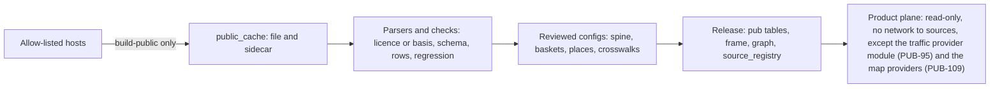

# 04 — Public Data Pack

| | |
|---|---|
| Status | Draft v0.3, amended by decisions 0016, 0017 and 0019 on 2026-11-12, and by decisions 0022 and 0023 on 2026-11-13, and by decision 0026 on 2026-11-14; amended by decision 0030 on 2026-11-14 (proposed) |
| Date | 2026-11-14 |
| Owner | albarami |
| Purpose | Define every public source the product uses, how it is fetched, licensed, checked, crosswalked and attributed, and what public data cannot give. |
| Read first | [01 Project brief](01_PROJECT_BRIEF.md), [02 Architecture](02_ARCHITECTURE.md), [03 Data contracts](03_DATA_CONTRACTS.md), [decision 0016](decisions/0016-version-1-covers-the-whole-initiative.md), [decision 0017](decisions/0017-public-data-additions-and-public-splits.md), [decision 0019](decisions/0019-forecasts-estimates-scenarios-and-self-serve-sources.md), [decision 0022](decisions/0022-real-register-companies-with-a-synthetic-world.md), [decision 0023](decisions/0023-ten-additions-and-the-data-rule.md) |

## In brief

- Every figure marked Public comes from a source in the registry below, with URL, licence (or
  basis of use), retrieval date and SHA-256 recorded at fetch time. Nothing is fetched at run time,
  with named exceptions that store nothing of a response: the optional live traffic provider of
  PUB-95, off by default, and the two map providers of decision 0023 item A7 (PUB-109), used only
  by the map mode or the address search that needs them.
- Fetchers run only in `./eii build-public`, only against an allow-list of hosts, and fail loudly.
  The traffic provider module is not a fetcher of `build-public` and has its own list of hosts
  (PUB-95); neither are the product server's routes to the map providers (PUB-109).
- [Decision 0017](decisions/0017-public-data-additions-and-public-splits.md) adds 77 portal
  datasets in seventeen groups (property sales, venue visits, building permits, employer scale,
  manufacturing, trade, logistics, population, workforce, pay, students and visitors), which the
  registry holds as eighteen source-id families because the decision's group of museum and
  health-centre visits uses two, and two investment sources: the FDI projects dashboard, read on
  every build, and the sector, opportunity, incentive, set-up and law pages of the national
  investment promotion agency. Projects are shown in full with their source on every card, list and map legend.
  Capex and jobs are labelled announced estimates, with the page's own caveat (PUB-87);
  its reproduction notice is recorded in PUB-12.
- [Decision 0019](decisions/0019-forecasts-estimates-scenarios-and-self-serve-sources.md) adds
  seven source ids beside the eighteen families: `traffic_tomtom_flow` and `traffic_tomtom_range`
  (a live traffic provider, used only in a session, nothing cached) and five that `./eii build-public` fetches: `busy_besttime` (relative busyness by hour of named venues),
  `ntl_blackmarble` (night-time radiance), `places_fsq` (a further source of the places layer,
  read from its public copy on Source Cooperative without an account), `worldpop_qat_agesex` (population by age and sex on a 100 m
  grid) and `weather_openmeteo` (hourly weather history). The series that tested code forecasts, and
  the source table that holds each, are listed in section 12 (PUB-103), with the released monthly
  series that the same code also forecasts.
- [Decision 0022](decisions/0022-real-register-companies-with-a-synthetic-world.md) adds two
  Public sources: the public business register (`biz_register`) and the financial centre's public
  register (`fc_register`). Their companies are the register companies. S2-T36 adds a company-only public-page
  fetch seam for the financial-centre name inventory; activation awaits the lead. Each
  register's file of public records is collected outside the build, kept outside the repository and
  read only through its own setting, `EII_REGISTER_FILE` for `biz_register` and
  `EII_FC_REGISTER_FILE` for `fc_register`. Firm counts and firm density come from the register.
- [decision 0023](decisions/0023-ten-additions-and-the-data-rule.md) adds the public layers of the national GIS centre's map service, read with no sign-in and
  used as public data under the owner's decision for a personal, local project (PUB-105); two open sources of
  building heights (PUB-106); the measures of the two sales bulletins (PUB-107); bank credit by
  activity, public tenders, district-cooling capacity and the ten open-data families of its item
  A10 (PUB-108). All are fetched in S2-T19 and S2-T20. Under its data rule no synthetic data
  stands in for rents, vacancy, card spending, permit or approval status, school capacity or
  surveys, and a plot is shown only as permitted by zoning and looking empty. Its map modes add
  two online providers, reached only by the product's own server (PUB-109): the satellite imagery
  provider of the map and of address search, which has no registry row yet (section 2.1), and the
  photorealistic 3D tiles of Google's Map Tiles API, the one paid service, which the owner caps at
  USD 20 in total.
- Version 1 is a personal, local project that nobody outside the owner's organisation sees. Every
  source a visitor can read under PUB-12 is used and shown in full, whatever its reuse terms
  ([decision 0026](decisions/0026-public-sources-used-in-full-locally.md)). Terms are recorded truthfully; permissions for real use belong on document 17's single list.
  Nothing from a source without an open licence is committed (PUB-12, PUB-13).
- Official figures split by sex or nationality are Public facts, shown only as published, with
  source and year. They are never joined to a worker, residence or company record, used to segment
  those records, combined with a protected figure or apportioned to a drawn area; SYN-89's cited movement anchors remain, and decision 0040 item 6 adds only the cited worker-nationality draw anchor, public first and private cross-check, summed over source categories (PUB-90). Public sex splits never supply the worker gender draw of decision 0037. The one case that is not an
  apportionment is the sum of whole cells of the published age-and-sex population grid over a
  chosen area, for display only (PUB-99).
- A drawn area counts Public points inside it exactly. A statistic published on an official
  geography stays on that geography, or is labelled Inferred where it is apportioned to the shape.
- The verified figures of the master design are regression examples: each has a dataset and an
  exact check. The national mean pay pair remains blocked until reconciled; the restaurant item is closed because production value is not published (OI-03, section 11).
- Work in slice S2 also builds the frame (zones, districts, municipalities, gazetteer, crosswalks), the
  activity spine, the customs baskets, the hand-verified places of four showcase areas, the venue
  crosswalk, the two page parsers and the candidate record for the flagship building. Slice S2 also
  builds the fetchers and release tables of the five sources of decision 0019 that `build-public`
  fetches. The pooled hourly anchor, the weather profiles
  and the population grid as weights belong to the simulation slice S4; the provider switch, the
  layers and the 3D view belong to the map and journey slices ([TASKS.md](../TASKS.md),
  [14](14_IMPLEMENTATION_PLAN.md)).

## 1. Scope

This document owns the public half of the custodian plane: `custodian/publicdata/` (fetchers, page
parsers and review files) and the release tables whose names start `pub_`, plus `fdi_projects`, the
frame tables `zone`, `municipality`, `gazetteer` and the public parts of `graph_node`, `graph_edge`
and `source_registry`. Methods that compute on these tables (location quotients, pay decomposition,
break-even, bulk-month rule, co-location, apportioning to a drawn shape) are owned by
[07 Economic methods](07_ECONOMIC_METHODS.md). Fact fields, release-table columns and provenance
rules are owned by [03 Data contracts](03_DATA_CONTRACTS.md). The synthetic world reads this pack
but is specified in [05 Synthetic world and simulation](05_SYNTHETIC_WORLD_AND_SIMULATION.md).

Terms used here:

- **Portal**: the Qatar Open Data Portal, `www.data.gov.qa`, which serves datasets through an
  Explore API (version 2.1) and states a licence based on CC BY 4.0 (portal licence page, retrieved
  2026-11-11). The same portal answers the same API and slugs at `www.data.qa`
  ([decision 0017](decisions/0017-public-data-additions-and-public-splits.md)).
- **Public cache**: `data/public_cache/`, the local, uncommitted store of fetched files.
- **Registry**: the committed list of sources (`custodian/publicdata/sources.yaml`) and its copy in
  the release table `source_registry`.
- **Licence-activity count**: one activity on one commercial licence. It is not a firm, an
  establishment or a job.
- **Investment sources**: `fdi_projects` (the FDI projects dashboard) and `investqa_pages` (the
  sector, opportunity, incentive, set-up and law pages of the national investment promotion
  agency), used under the owner's decision for a personal, local project; the publisher's terms
  are recorded in its own words with the date read (PUB-12).
- **Public split**: an official figure split by sex or nationality. It is only ever a Public fact
  (PUB-90).
- **Traffic provider**: the optional live source of traffic flow tiles and traffic-aware
  drive-time areas, used only in a session when `EII_TRAFFIC_PROVIDER` is `tomtom` (PUB-95).
- **Map providers**: the two online providers of the map modes of
  [decision 0023](decisions/0023-ten-additions-and-the-data-rule.md) item A7: the imagery provider
  of the satellite mode and of address search (`ESRI_API_KEY`), and the photorealistic 3D tiles of
  Google's Map Tiles API (`MAPTILE_API_KEY`), the one paid service. Only the product's own server
  reaches them, and nothing of a response is stored (PUB-109).
- **Relative busyness**: the published relative index (0 to 100) of how busy a named venue is by
  day of week and hour. It is a Public fact of the venue and never a count of people (PUB-101).



## 2. Source registry

S2-T28 records the advisor’s reading of 2026-11-16 and the lead’s catalogue-metadata reading
of the same date (ruling L-701), not a worker’s live fetch. The latter uses the portal endpoint
`https://www.data.gov.qa/api/explore/v2.1/catalog/datasets/{dataset}`. The eight scoped portal
rows carry every supplied field, mapping date and text to string, int to integer and double
to number; municipality point and polygon columns use the closed geometry types. Exact
minimum and maximum counts follow the active portal convention. The lead confirms these
metadata again when fetching; retrieval hashes belong to the local receipts.

The accident partition implementation plans year exports from a hashed aggregate response
and checks their counts against the hashed catalogue total. Activation remains blocked by
`partition_byte_bound_unconfirmed`: ruling L-707 K1 defers activation to S2-T29, after
S2-T25 supplies the shared bounded transport reader and the lead supplies live partition
byte spans. This task invents no bound and copies no reader. Its nationality and birth-year attributes stay
Public on the source’s own geography and categories, never joined to synthetic records,
used to segment worker, residence or company records, or combined with protected figures.
No release table or card consumes them here; later use needs the lead’s ruling. The existing
schema check inspects the first record of each response; this task retains that scope.

The Overture parent rows check anonymous HTTPS listings for the pinned release prefix,
including continuation pages, against the existing registered part sizes and ETags. Receipts
hash each listing page and retain its exact bytes as base64 in the cached listing envelope.
The envelope and its receipt use separate cache keys `places_ovt/listing` and
`bldg_ovt/listing`. Parent keys keep their Parquet extension, rows and receipts unchanged
for existing readers (ruling L-707 K2); listing evidence never substitutes for those rows.
Existing whole-file part retrieval stays unchanged; selecting parts for a later release is
outside this task. Listing and direct-file row-count bounds stay empty because they are
not portal record tables. Under ruling L-707 K4, the lead's live fetch waits for S2-T27's
archive to merge; this task performs no live fetch.

The archived workbook file name as found is `Qatar_Census_2022_Final_Results.xlsx`.
The year in the name is unresolved. The row retains its Census 2020 identity and title;
the lead opens its fetched title sheet after merge before deciding how to consume it.

Every source the master design and decisions 0016, 0017, 0019, 0022 and 0023 rely on is listed here. The key (first
column) is the `source_id` used in the registry, in lineage and in the evidence drawer. Portal
dataset identifiers are the slugs after `/explore/dataset/` in the URLs given by the project
research (retrieved 2026-11-11). Publisher names are those reported by the research; the fetcher
copies the publisher from the portal metadata at fetch time and fails if it differs (PUB-09).

[Decision 0017](decisions/0017-public-data-additions-and-public-splits.md) adds the rows from
`prop_resi_units` onwards: 77 portal datasets in the seventeen groups of the decision, represented
by eighteen source-id families because its group of museum and health-centre visits uses two
(`visits_museum` and `visits_phcc`), then the two investment sources. A source-id family is one
`source_id` with one registry entry per slug. The slugs, publishers, rows, coverage and modified
dates of the 77 datasets were read from the portal's catalogue and records on 2026-11-12, and the
fetcher records them again at every fetch (PUB-85).

[Decision 0019](decisions/0019-forecasts-estimates-scenarios-and-self-serve-sources.md) adds seven
source ids as the last rows of sections 2.1 and 2.2. Their facts were read from the publishers'
pages on 2026-11-12, without any key; a field those pages did not give is written "to be recorded
at the first fetch". The two ids of the live traffic provider (`traffic_tomtom_flow` and
`traffic_tomtom_range`) are not cached sources: they are listed here for their terms and attribution, and have no row in
`source_registry` and no file, because nothing of the provider is fetched into the cache (PUB-95).

[Decision 0022](decisions/0022-real-register-companies-with-a-synthetic-world.md) adds two source
ids after them: `biz_register`, the public business register, and `fc_register`, the financial
centre's public register. They are Public sources. No fetcher reads `biz_register`; S2-T36 supplies a
company-only page fetcher for `fc_register`, held pending the lead's activation review. The owner's advisor
collects each register's file of public records as a visitor's browser receives it under PUB-12; each file is
kept outside the repository and read only through its own setting, `EII_REGISTER_FILE` for
`biz_register` and `EII_FC_REGISTER_FILE` for `fc_register`, by the lead's own shell (the world
build run there included), the release build and the running product, each read-only. Neither file
is ever committed, or put in a brief, a fixture, a worker tool's or a reviewer's hands; tests and continuous
integration use an invented stand-in of the same shape (decision 0022 items 1 and 8). Their
publisher citation, licence, retrieval date, hash and columns are recorded in `source_registry`
when the file is first read (open questions below). Terms are recorded in the publisher's own words with the date read,
without limiting version 1; any permission or licence needed for real use goes on document 17's
single list (PUB-12).

[decision 0023](decisions/0023-ten-additions-and-the-data-rule.md) adds the source ids after `fc_register`: the layers of the national GIS centre's public map
service by service name, the two height sources, bank credit by activity, tenders, district
cooling and the ten open-data families of its item A10. Their retrieval is "to fetch in S2-T19" (or
S2-T20 for the heights): publisher, coverage, slugs and hashes are recorded at the first fetch, and
an unconfirmed host, file, publisher or schema blocks its source until then (PUB-03, PUB-07, PUB-09); terms are recorded under PUB-12 and do not block use. Its last id,
`tiles3d_google`, names the photorealistic 3D tiles of the third map mode (item A7): like the two ids
of the live traffic provider, it is listed for its terms, price and attribution, has no row in
`source_registry` and no file, and nothing of it is cached (PUB-109).

### 2.1 Identity, fetch and licence

| source_id | Dataset | Publisher | How fetched | Licence |
|---|---|---|---|---|
| `lic_active` | Active certificates by municipality and business activity | Ministry of Commerce and Industry | portal `moci-active-certificates-by-municipality-and-business-activity` | CC BY (portal) |
| `lic_cancelled` | Cancelled certificates by municipality and business activity | Ministry of Commerce and Industry | portal `moci-canceled-certificates-by-municipality-and-business-activity` | CC BY (portal) |
| `lic_issued` | Issued certificates by municipality and business activity (incomplete) | Ministry of Commerce and Industry | portal `moci-issued-certificates-by-municipality-and-business-activity` | CC BY (portal) |
| `cus_imp_2025` | Qatar Imports 2025-2026 | National Planning Council | portal `qatar-imports-2025-2026` | CC BY (portal) |
| `cus_imp_2019` | Qatar Imports 2019-2024 | National Planning Council | portal `qatar-imports-2019-2024-copy` | CC BY (portal) |
| `sec_hr_ind` | Hotels and restaurants: economic indicators by activity | National Planning Council | portal `hotels-and-restaurants-statistics-economic-indicators-in-hotels-and-restaurants-by-activity1` | CC BY (portal) |
| `sec_hr_goods` | Hotels and restaurants: intermediate goods by type | National Planning Council | portal `hotels-and-restaurants-statistics-estimates-of-intermediate-goods-value-in-hotels-and-restaurants-by0` | CC BY (portal) |
| `sec_hr_serv` | Hotels and restaurants: intermediate services by type | National Planning Council | portal `hotels-and-restaurants-statistics-estimates-of-intermediate-services-value-in-hotels-and-restaurants0` | CC BY (portal) |
| `sec_hr_size` | Hotels and restaurants: establishments and employees by size | National Planning Council | portal `hotels-and-restaurants-number-establishments-employees-by-size-of-establishment-economic-activity` | CC BY (portal) |
| `sec_hr_comp_occ` | Hotels and restaurants: compensation by occupation | National Planning Council | portal `hotels-and-restaurants-statistics-estimates-of-compensation-in-hotels-and-restaurants-by-occupation1` | CC BY (portal) |
| `wage_occ` | Workers in paid employment and monthly average wage by gender and occupation | National Planning Council | portal `workers-in-paid-employment-15-years-and-above-and-monthly-average-wage-q1` | CC BY (portal) |
| `wage_act` | Workers in paid employment and monthly average wage by gender and economic activity | National Planning Council | portal `workers-in-paid-employment-15-years-and-above-and-monthly-average-wage-q` | CC BY (portal) |
| `wage_sector` | Workers in paid employment and average monthly wage by gender and sector | National Planning Council (advisor reading and lead catalogue-metadata reading, 2026-11-16; fetch confirmation pending) | portal `workers-in-paid-employment-and-average-monthly-wage-by-gender-and-sector` | CC BY (dataset); complete columns and mapped types recorded in the registry from the lead’s reading |
| `wage_bands_priv` | Average monthly wage for workers in the private sector | Ministry of Labour (advisor reading and lead catalogue-metadata reading, 2026-11-16; fetch confirmation pending) | portal `average-monthly-wage-q-r-for-workers-in-private-sector-in-qatar-2021-2025` | CC BY (dataset); complete columns and mapped types recorded in the registry from the lead’s reading |
| `work_hours_act` | Employed persons and average work hours by gender and economic activity | National Planning Council (advisor reading and lead catalogue-metadata reading, 2026-11-16; fetch confirmation pending) | portal `employed-persons-15-years-and-above-and-average-work-hours-by-gender-and-economic-activity` | CC BY (dataset); complete columns and mapped types recorded in the registry from the lead’s reading |
| `util_elec` | Electricity total consumption by zone number | Kahramaa | portal `electricity-total-consumption-by-zone-number` | CC BY (portal) |
| `util_water` | Water total consumption by zone number | Kahramaa | portal `water-total-consumption-by-zone-number` | CC BY (portal) |
| `transit_monthly` | Public Transport Users | Ministry of Transport | portal `public-transport-users` | CC BY (portal) |
| `hotel_segment` | Accommodation data by segment (supply, demand, occupancy, ADR, RevPAR) | Qatar Tourism | portal `accommodation-data-by-segment-date-and-key-metrics-supply-demand-occupancy-adr-revpar` | CC BY (portal) |
| `cpi_group` | Consumer price index by expenditure group, monthly | National Planning Council (advisor reading and lead catalogue-metadata reading, 2026-11-16; fetch confirmation pending) | portal `consumer-price-index-cpi-by-expenditure-group-monthly` | CC BY (dataset); complete columns and mapped types recorded in the registry from the lead’s reading |
| `prop_sales` | Weekly Real Estates Sales Bulletin | Ministry of Justice | portal `weekly-real-estates-sales-bulletin` | CC BY (portal) |
| `pop_muni` | Population and labour force by municipality | National Planning Council | portal `population-and-labour-force-by-municipality` | CC BY (portal) |
| `zone_population` | Population, area and population density by zone | National Planning Council (advisor reading and lead catalogue-metadata reading, 2026-11-16; fetch confirmation pending) | portal `population-area-and-population-density-per-square-kilometers-by-zone` | CC BY (dataset); complete columns and mapped types recorded in the registry from the lead’s reading |
| `est_census` | Number of business establishments by economic activity in census (2010, 2020) | to be confirmed at slice S2 | portal `number-of-business-establishments-by-economic-activity-in-census-2010-2020` | CC BY (portal) |
| `census_hh_type_2020` | Population by type of household, gender and place of residence on the census night, December 2020 | National Planning Council (advisor reading and lead catalogue-metadata reading, 2026-11-16; fetch confirmation pending) | portal `population-by-type-of-household-gender-and-place-of-residence-on-the-census-night-december-2020` | CC BY (dataset); complete columns and mapped types recorded in the registry from the lead’s reading |
| `accident` | Accident | Ministry of Interior (advisor reading and lead catalogue-metadata reading, 2026-11-16; fetch confirmation pending) | portal `accident` | CC BY (dataset); complete columns and mapped types recorded in the registry from the lead’s reading |
| `census_2020_workbook` | Census 2020 detailed results workbook, Tables 1, 2, 76, 151 and 152 | Planning and Statistics Authority | raw archived copy (advisor reading, 2026-11-16; lead live confirmation pending) at `web.archive.org/web/20240422094401id_/https://www.psa.gov.qa/Style%20Library/PSA/CensusDetailedResults/documents/Qatar_Census_2022_Final_Results.xlsx` | publisher's terms in its own words with the date read, to be recorded at fetch; basis of use: the owner's decision for a personal, local project (PUB-12) |
| `worldpop_qat_2020` | Constrained 100 m gridded population, 2020 | WorldPop | `https://data.worldpop.org/GIS/Population/Global_2015_2030/R2025A/2020/QAT/v1/100m/constrained/qat_pop_2020_CN_100m_R2025A_v1.tif` (direct file supplied by the advisor, 2026-11-16; lead live confirmation pending) | CC BY 4.0 |
| `census_zone_sector` | Census 2020 employed population by major economic sector, by zone | statistics authority public map service | `services7.arcgis.com/mffQJB8rpVa5We20/arcgis/rest/services/Population_by_Major_Economic_Sectors_by_Zone_2020_WFL1/FeatureServer` | publisher's terms in its own words with the date read, to be recorded at fetch; basis of use: the owner's decision for a personal, local project (PUB-12) |
| `census_zone_occ` | Census 2020 employed population by occupation, by zone | statistics authority public map service | `.../Employed_Population_by_Occupation_by_Zone_2020_WFL1/FeatureServer` | publisher's terms in its own words with the date read, to be recorded at fetch; basis of use: the owner's decision for a personal, local project (PUB-12) |
| `census_zone_hh` | Census 2020 residence for households, by zone | statistics authority public map service | `.../Residence_for_Households_by_Zone_2020_WFL1/FeatureServer` | publisher's terms in its own words with the date read, to be recorded at fetch; basis of use: the owner's decision for a personal, local project (PUB-12) |
| `census_zone_lab` | Census 2020 residence for workers (labourer groups), by zone | statistics authority public map service | `.../Residence_for_Workers_Labourer_Groups_by_Zone_2020_WFL1/FeatureServer` | publisher's terms in its own words with the date read, to be recorded at fetch; basis of use: the owner's decision for a personal, local project (PUB-12) |
| `census_district_pop` | Census 2020 population, district level | statistics authority public map service | `.../Population_2020_District_Level/FeatureServer` | publisher's terms in its own words with the date read, to be recorded at fetch; basis of use: the owner's decision for a personal, local project (PUB-12) |
| `bnd_zone_2020` | Zone_Boundary_2020 (map layer) | statistics authority public map service | `.../Zone_Boundary_2020/FeatureServer` | publisher's terms in its own words with the date read, to be recorded at fetch; basis of use: the owner's decision for a personal, local project (PUB-12) |
| `bnd_district_2020` | District_2020 (map layer) | statistics authority public map service | `.../District_2020/FeatureServer`; the registry records `layer` 12, the id of District_Boundary_2020, the only layer of this service (the other six map services each have one layer, at id 0) | publisher's terms in its own words with the date read, to be recorded at fetch; basis of use: the owner's decision for a personal, local project (PUB-12) |
| `bnd_hdx` | Qatar Subnational Administrative Boundaries (COD-AB) | HDX, source Planning and Statistics Authority | landing page `https://data.humdata.org/dataset/cod-ab-qat`; direct machine-readable URL to be confirmed at slice S2 | CC BY-IGO |
| `bnd_muni_2025` | Municipalities in Qatar 2025 | National open data portal (dataset publisher field empty, read 2026-11-16) | portal `municipalities-in-qatar-2025`; name, point and polygon fields recorded from the lead’s metadata reading | dataset licence absent in that reading; portal terms read 2026-11-19, basis `portal_terms`; publisher words, evidence and hash in section 4, "S2-T21 part B terms readings" |
| `bnd_geob` | geoBoundaries Qatar ADM1, ADM2 (fallback only) | geoBoundaries | `https://www.geoboundaries.org/api/current/gbOpen/QAT/ALL/` | ADM1/ADM2: "Creative Commons Attribution 4.0 International (CC BY 4.0)"; the ALL metadata also holds ADM0: "Open Data Commons Open Database License 1.0". Read 2026-11-19; basis `dataset`; exact per-level evidence and hash in section 4, "S2-T21 part B terms readings". |
| `places_ovt` | Overture Places, release 2026-10-21.0, schema 2.0.0 | Overture Maps Foundation (per-record sources) | `https://overturemaps-us-west-2.s3.us-west-2.amazonaws.com/release/2026-10-21.0/theme=places/type=place/part-00014-dcceff87-235e-5a0e-a4b4-5f25ccb873e7-c000.zstd.parquet`, STAC `https://stac.overturemaps.org/2026-10-21.0/places/place/collection.json`; anonymous HTTPS release-prefix listing check; existing registered whole-file parts fetched separately | STAC `other`. "The theme is published under the CDLA Permissive 2.0 and Apache 2.0 licenses." Per-record lines are in section 4<br>the advisor's reading of 2026-11-16 reports that a release is removed after at most 60 days; not yet confirmed from a public page |
| `bldg_ovt` | Overture Buildings, release 2026-10-21.0 (national inventory and gazetteer; decision 0077) | Overture Maps Foundation | `https://overturemaps-us-west-2.s3.us-west-2.amazonaws.com/release/2026-10-21.0/theme=buildings/type=building/part-00288-28a3d046-de24-53bb-bd50-0444cb513967-c000.zstd.parquet`, `part-00384-3eb496b1-cc75-5748-a633-0449cf44f528-c000.zstd.parquet`, `part-00385-82be6408-14fb-51c1-89b0-93ae23c9516a-c000.zstd.parquet`, STAC `https://stac.overturemaps.org/2026-10-21.0/buildings/building/collection.json`; anonymous HTTPS release-prefix listing check; existing registered whole-file parts fetched separately | STAC `ODbL-1.0`. "License for theme: ODbL"<br>the advisor's reading of 2026-11-16 reports that a release is removed after at most 60 days; not yet confirmed from a public page |
| `roads_osm` | OpenStreetMap Qatar extract (road network) | OpenStreetMap contributors | `https://download.openstreetmap.fr/extracts/asia/qatar-latest.osm.pbf` | ODbL 1.0 |
| `cls_isic4` | ISIC Rev.4 structure (English titles) | United Nations Statistics Division | landing page `https://unstats.un.org/unsd/classifications/Econ`; `https://unstats.un.org/unsd/classifications/Econ/Download/In%20Text/ISIC_Rev_4_english_structure.Txt` | "for the User’s personal, non-commercial use, without any right to resell or redistribute them or to compile or create derivative works therefrom"; read 2026-11-19; basis `owner_decision`; per-key evidence and hash in section 4, "S2-T21 part B terms readings". |
| `ref_min_wage` | Qatar minimum wage (Law No. 17 of 2020), reference page | International Labour Organization | citation only: `https://www.ilo.org/resource/news/qatar-adopts-non-discriminatory-minimum-wage` | to be confirmed at slice S2 |
| `ref_wps_report` | Wage Protection Systems in the Gulf Cooperation Council Countries, November 2025 | International Labour Organization | citation only: `https://www.ilo.org/sites/default/files/2025-11/ILO_Beirut_Wage-Protection_Report_R10.pdf` | to be confirmed at slice S2 |
| `ref_expansion_method` | Mobility study methodology v3 | Spanish Ministry of Transport | citation only: `https://ropenspain.github.io/spanishoddata/codebooks/mitma_-_estudio_movilidad_covid-19_informe_metodologico_v3_en.pdf` | to be confirmed at slice S2 |
| `ref_gov_hours` | Flexible working system for the government sector | The Peninsula | citation only: `https://thepeninsulaqatar.com/article/04/09/2024/cgb-announces-flexible-remote-work-system-for-qatar-government-sector` | to be confirmed at slice S2 |
| `ref_friday_closure` | Services exempted from closure during Friday prayers | The Peninsula | citation only: `https://thepeninsulaqatar.com/article/17/08/2025/over-10-services-in-qatar-exempted-from-closure-during-friday-prayers-gazette` | to be confirmed at slice S2 |
| `ref_transit_hours` | Metro and tram service hours from 1 January | Qatar Tribune | citation only: `https://qatar-tribune.com/article/156642/front/metro-tram-service-hours-extended-from-january-1` | to be confirmed at slice S2 |
| `ref_summer_work` | Regulated outdoor summer working hours from 1 June | The Peninsula | citation only: `https://www.thepeninsulaqatar.com/article/31/05/2026/regulated-outdoor-summer-working-hours-come-into-force-on-june-1-in-qatar` | to be confirmed at slice S2 |
| `ref_truck_hours` | Restriction on trucks and large buses within Doha | The Peninsula | citation only: `https://thepeninsulaqatar.com/article/01/06/2024/restriction-on-movement-of-trucks-and-large-buses-within-doha:-traffic-department` | to be confirmed at slice S2 |
| `ref_ramadan_public_hours` | Reduced public-sector hours during Ramadan | Qatar News Agency | citation only: `https://qna.org.qa/en/News-Area/News/2026-2/16/qatar-sets-reduced-working-hours-for-public-sector-during-ramadan` | to be confirmed at slice S2 |
| `ref_ramadan_private_hours` | Ramadan working hours for the private sector | The Peninsula | citation only: `https://s.thepeninsula.qa/article/14/02/2026/ministry-of-labour-announces-ramadan-working-hours-for-private-sector` | to be confirmed at slice S2 |
| `ref_ramadan_transit_hours` | Metro and tram Ramadan hours | The Peninsula | citation only: `https://s.thepeninsula.qa/article/17/02/2026/doha-metro-and-lusail-tram-announce-operating-hours-in-ramadan` | to be confirmed at slice S2 |
| `ref_traffic_index` | Doha Traffic Index 2025 | TomTom | citation only: `https://www.tomtom.com/traffic-index/city/doha/` | publisher's terms and date read to be recorded under PUB-12; citation-only is its plausibility-comparison role, not a terms restriction |
| `prop_resi_units` | Residential unit sales, weekly bulletin | Ministry of Justice | portal `weekly-residential-units-sales-bulletin` | CC BY (portal) |
| `visits_museum` | Visitors of museums and exhibitions by month and museum | National Planning Council | portal `visitors-of-museums-and-exhibition-by-month-and-museum` | CC BY (portal) |
| `visits_phcc` | Patient visits by health centre and region | Primary Health Care Corporation | portal `phcc-patient-visits-by-health-center-and-region` | CC BY (portal) |
| `permits_muni` | Building permits and completion certificates: totals by municipality and building type, and monthly permits by type for each municipality | National Planning Council | portal `total-building-permits-issued-by-municipality-and-type-of-building-type-of-permit`, `total-building-completion-certificates-issued-by-municipality-and-type-of-building-type-of`, `building-permits-issued-by-type-of-permit-and-month-al-daayen-municipality`, `building-permits-issued-by-type-of-permit-and-month-al-khor-and-al-thakhira-municipality`, `building-permits-issued-by-type-of-permit-and-month-al-rayyan-municipality`, `building-permits-issued-by-type-of-permit-and-month-al-shahhaniya-municipality`, `building-permits-issued-by-type-of-permit-and-month-al-shamal-municipality`, `building-permits-issued-by-type-of-permit-and-month-al-wakrah-municipality`, `building-permits-issued-by-type-of-permit-and-month-doha-municipality`, `building-permits-issued-by-type-of-permit-and-month-umm-slal-municipality` | CC BY (portal) |
| `est_size_act` | Establishments and employees by size of establishment and activity, with compensation | National Planning Council | portal `number-of-establishments-and-employees-by-size-of-establishment-and-main-economic-activity-two`, `number-of-establishments-and-employees-by-size-of-establishment-and-main-economic-activity-wholesale-and-retail-trade-four-digits`, `number-of-establishments-and-employees-by-size-of-establishment-and-main-economic-activity-transport`, `number-of-establishments-and-employees-by-size-of-establishment-and-main-economic-activity-social-and-personal-services-two-digits`, `number-of-establishments-and-employees-by-size-of-establishment-and-main-economic-activity-energy`, `number-of-establishments-and-employees-by-size-of-establishment-and-main-economic-activity-one`, `establishments-employees-and-compensation-of-employees-by-economic-activity-business-services` | CC BY (portal) |
| `mfg_industry` | Manufacturing industries (one dataset per industry) and main manufacturing products | Ministry of Commerce and Industry (industry datasets); National Planning Council (`main-manufacturing-products`) | portal `manufacture-of-basic-metals`, `manufacture-of-basic-pharmaceutical-products-and-pharmaceutical-preparations`, `manufacture-of-beverages`, `manufacture-of-chemicals-and-chemical-products`, `manufacture-of-coke-and-refined-petroleum-products`, `manufacture-of-computer-electronic-and-optical-products`, `manufacture-of-electrical-equipment`, `manufacture-of-fabricated-metal-products-except-machinery-and-equipment`, `manufacture-of-food-products`, `manufacture-of-furniture`, `manufacture-of-leather-and-related-products`, `manufacture-of-machinery-and-equipment-nec`, `manufacture-of-manufacture-of-wood-and-of-products-of-wood-and-cork-except-furniture-manufacture`, `manufacture-of-motor-vehicles-trailers-and-semi-trailers`, `manufacture-of-other-non-metallic-mineral-products`, `manufacture-of-other-transport-equipment`, `manufacture-of-paper-and-paper-products`, `manufacture-of-rubber-and-plastics-products`, `manufacture-of-textiles`, `manufacture-of-wearing-apparel`, `main-manufacturing-products` | CC BY (portal) |
| `trade_wr` | Purchases, sales and stocks during the year by type of trade, wholesale and retail | National Planning Council | portal `purchases-sales-and-stocks-during-the-year-by-type-of-trade-wholesale-and-retail-trade-all` | CC BY (portal) |
| `pop_muni_age` | Population by municipality and age groups | National Planning Council | portal `population-by-municipality-and-age-groups` | CC BY (portal) |
| `hotels_muni` | Hotels and hotel apartments by municipality | National Planning Council | portal `hotels-and-hotel-apartments-by-municipality` | CC BY (portal) |
| `trade_logistics` | Certificates of origin by importing country; arriving vessels by previous port and by registration | Qatar Chamber of Commerce & Industry (certificates of origin); National Planning Council (vessels) | portal `annual-certificates-of-origin-by-type-and-importing-country`, `arriving-vessels-gross-and-net-tonnage-by-type-of-vessel-and-country-of-previous-port`, `arriving-vessels-gross-and-net-tonnage-by-type-of-vessel-and-country-of-registration-hamad-port0` | CC BY (portal) |
| `est_census_2015_muni` | Business establishments and employees by municipality, census 2015 | National Planning Council | portal `distribution-of-business-establishments-and-employees-by-municipalities-according-to-census-2015` | CC BY (portal) |
| `lf_muni_sex` | Population, labour force, employed and unemployed persons by sex and municipality | National Planning Council | portal `female-population-and-labour-force-by-municipality`, `male-population-and-labour-force-by-municipality`, `employed-persons-15-years-and-above-by-gender-and-municipality`, `unemployed-persons-15-years-and-above-by-gender-and-municipality` | CC BY (portal) |
| `pop_muni_age_sex` | Population by municipality, age group and sex | National Planning Council | portal `females-population-by-municipality-and-age-groups-december-2020`, `males-population-by-municipality-and-age-groups-december-2020` | CC BY (portal) |
| `active_sex_age_act` | Economically active females and males by age group and economic activity | National Planning Council | portal `economically-active-females-15-years-and-above-by-age-group-and-economic-activity`, `economically-active-males-15-years-and-above-by-age-group-and-economic-activity` | CC BY (portal) |
| `active_nat_occ_act` | Economically active Qatari and non-Qatari population by occupation and economic activity (all, males, females) | National Planning Council | portal `economically-active-non-qatari-females-15-years-and-above-by-occupation-and-economic-activity`, `economically-active-non-qatari-males-15-years-and-above-by-occupation-and-economic-activity`, `economically-active-non-qatari-population-15-years-and-above-by-occupation-and-economic-activity`, `economically-active-qatari-females-15-years-and-above-by-occupation-and-economic-activity`, `economically-active-qatari-males-15-years-and-above-by-occupation-and-economic-activity`, `economically-active-qatari-population-15-years-and-above-by-occupation-and-economic-activity` | CC BY (portal) |
| `comp_nat_act` | Employees and compensation of employees by nationality and main economic activity (one dataset per survey sector) | National Planning Council | portal `number-of-employees-and-compensation-of-employees-by-nationality-and-main-economic-activity`, `number-of-employees-and-compensation-of-employees-by-nationality-and-main-economic-activity-building`, `number-of-employees-and-compensation-of-employees-by-nationality-and-main-economic-activity-business`, `number-of-employees-and-compensation-of-employees-by-nationality-and-main-economic-activity-energy`, `number-of-employees-and-compensation-of-employees-by-nationality-and-main-economic-activity-energy0`, `number-of-employees-and-compensation-of-employees-by-nationality-and-main-economic-activity-energy1`, `number-of-employees-and-compensation-of-employees-by-nationality-and-main-economic-activity-one`, `number-of-employees-and-compensation-of-employees-by-nationality-and-main-economic-activity-social`, `number-of-employees-and-compensation-of-employees-by-nationality-and-main-economic-activity-social0`, `number-of-employees-and-compensation-of-employees-by-nationality-and-main-economic-activity-social1` | CC BY (portal) |
| `students_muni` | Students by level of education, municipality, sex, type of education and nationality | Ministry of Education and Higher Education | portal `students-by-level-of-education-municipality-gender-type-of-education-and-nationality-2025-2026` | CC BY (portal) |
| `visitors_markets` | Hotel guests by nationality, hotel rating and stays; visitor arrivals | National Planning Council (hotel guests; arrivals by mode of entry and by region); Qatar Tourism (arrival trends by mode of transport) | portal `hotel-guests-by-nationality-hotel-rating-and-hotel-stays`, `visitor-arrivals-by-mode-of-entry`, `visitor-arrivals-by-region`, `visitor-arrivals-trends-by-mode-of-transport-air-land-sea` | CC BY (portal) |
| `fdi_projects` | FDI projects dashboard: announced investment projects, data from fDi Markets | National investment promotion agency | page `https://fdiprojects.invest.qa/`, read on every build and parsed by the FDI page parser (PUB-86, PUB-87) | Footer notice: "Reproduction of these pages, whether in whole or in part, is only permissible with the prior written authorization of Investment Promotion Agency LLC. These pages are to be used for information purposes only", read 2026-11-14 from the fetch of 2026-11-13; the data gatherer's terms, as the page names it, are to be read and recorded with the date read; basis of use: the owner's decision for a personal, local project (PUB-12); the terms of use (`https://www.invest.qa/en/terms-and-conditions?tab=terms-of-use`), read on 2026-11-13, allow copies for personal and non-commercial use while viewing and say that the material should not be copied, modified or reproduced in whole or in part without the publisher's prior written permission and an acknowledgement of the source |
| `investqa_pages` | Sector, opportunity, incentive, set-up and law pages | National investment promotion agency | pages of `https://www.invest.qa/`, parsed by the agency page parsers (PUB-86, PUB-88); page list confirmed at slice S2 | "The prior written permission of" [...] "acknowledging the source, by using appropriate words or by copyright notice (© Investment Promotion Agency LLC)."; read 2026-11-19; basis `owner_decision`; exact stored excerpts and evidence in section 4, "S2-T21 part B terms readings". |
| `traffic_tomtom_flow` | Traffic flow tiles (live layer; nothing cached) | TomTom | live session only, by the traffic provider module (PUB-95) when `EII_TRAFFIC_PROVIDER` is `tomtom`, with `TOMTOM_API_KEY` from the environment; documentation `https://docs.tomtom.com/traffic-api/` and pricing page `https://docs.tomtom.com/pricing`, read 2026-11-12; the provider's host is fixed by the task that builds the module and added to the module's own list by a reviewed registry change | provider terms (`licence_basis: provider_terms`): free monthly allowance of 200,000 tile requests (read 2026-11-12); attribution "© TomTom" while the layer is on; the provider's terms (`https://docs.tomtom.com/legal/terms-and-conditions`, no date or version on the page; read in full on 2026-11-13) license the free plan "for Evaluation Use only", "internal evaluation and testing by you of the Licensed Products" (clause 2.2 and its definitions); they prohibit caching or storing any results except in a client under the result's cache-control headers and never to serve several users (clause 11.4), and nothing is stored; the logos and copyright notices the provider's interfaces generate are kept and other attribution comes from its copyright interface (clause 17.3); the page says nothing on showing the layer beside other map data; showing the layer to others is settled by [decision 0064](decisions/0064-the-narrowing-rows-decided.md) item 2: the provider's paid plan, a spend choice listed for the owner (OI-304), the layer off by default and never needed by a test, gate, command or the guided story |
| `traffic_tomtom_range` | Traffic-aware drive-time areas (reachable range; live, nothing cached) | TomTom | as `traffic_tomtom_flow` | provider terms: free monthly allowance of 2,500 reachable-range requests (read 2026-11-12); attribution and storage as `traffic_tomtom_flow` |
| `busy_besttime` | BestTime relative busyness: relative busyness by hour of named venues | BestTime (the provider) | the project's own reader of the provider's interface inside `./eii build-public`, for the named venues of a build-time list, never at run time, with at most one forecast request and one stored-forecast query per venue in a run and its two keys read from the environment in the lead's shell only (PUB-101, [decision 0031](decisions/0031-venue-busyness-from-a-provider-interface.md)); interface documentation read 2026-11-14; addresses and host recorded by task S2-T16 | The provider's terms, read 2026-11-14, recorded truthfully as the licence text: data may be used "within your commercial applications, products, or services"; redistribution, resale or sublicensing "as a standalone product or on a data marketplace" is prohibited without written permission; the terms state nothing on attribution or on storing. Origin of the figures, held as two fragments: "derived from anonymized mobile signals" and "based on aggregated and anonymized signals from external, third-party sources"; the whole sentence of the terms page is copied here at the lead's terms read before the first fetch. `licence_basis: provider_terms` (PUB-12) |
| `satellite_cdse_backup` | Owner-requested Sentinel-2 L2A true-colour backup via CDSE Process interface | Pending provider-page confirmation | Optional lead-shell `./eii build-public --cdse-backup`; exact hosts and paths pending review under PUB-03; receipt per tile | Imagery notice and interface terms read 2026-11-20 (CDSE README D15/D12, fetched-body hashes recorded); complete attribution pending: the read pages supply no complete service-specific display line; `provider_terms`, empty decision_record, commit false; proposed decision 0066 |
| `ntl_blackmarble` | NASA Black Marble VNP46A3: night-time lights, monthly, on a 15 arc-second grid (about 500 m) | NASA | inside `./eii build-public` with the Earthdata token `EARTHDATA_API_KEY` from the environment; product page `https://ladsweb.modaps.eosdis.nasa.gov/missions-and-measurements/products/VNP46A3/` (DOI 10.5067/VIIRS/VNP46A3.002), read 2026-11-12; download host ladsweb.modaps.eosdis.nasa.gov (S2-T14) | NASA Data Use and Citation Guidance (`https://www.earthdata.nasa.gov/engage/open-data-services-software-policies/data-use-guidance`, read by the lead 2026-11-14) states CC0 for NASA-led mission data and asks that NASA be acknowledged; the LAADS citation policy (`https://modaps.modaps.eosdis.nasa.gov/services/faq/LAADS_Data-Use_Citation_Policies.pdf`, read by the lead 2026-11-14) asks for the product DOI |
| `places_fsq` | Foursquare Open Source Places (public copy on Source Cooperative) | Foursquare | inside `./eii build-public`, from the public copy on Source Cooperative, `https://data.source.coop/fused/fsq-os-places/` (host `data.source.coop`, PUB-03), geospatially partitioned GeoParquet, read without an account; each refresh selects the newest dated release through the root listing, then only the files that cover Qatar are fetched from its `places/_metadata` file by the row-group statistics of longitude and latitude against the frame box; a file's own geographic bounding box is not the extent and is not used; the whole of each file found is fetched; runtime registry evidence records the actual release date and the places are shown with it; the copy's README `https://data.source.coop/fused/fsq-os-places/README.md` and the access page `https://docs.foursquare.com/data-products/docs/access-fsq-os-places`, read 2026-11-12 | Apache License, Version 2.0, with the publisher's copyright line, as the copy's README states them (read 2026-11-14); the release identifier of a row comes from the selected folder name, and every earlier dated snapshot is retained (decision 0064 item 14) |
| `worldpop_qat_agesex` | WorldPop age and sex structures, 100 m grids, Qatar | WorldPop | inside `./eii build-public`; pages `https://hub.worldpop.org/project/categories?id=8` and `https://hub.worldpop.org/geodata/listing?id=138`, read 2026-11-12; host data.worldpop.org (S2-T14) | CC BY 4.0 (DOI 10.5258/SOTON/WP00841) |
| `weather_openmeteo` | Open-Meteo historical weather, hourly | Open-Meteo | inside `./eii build-public`, into the public cache as a hashed file; documentation `https://open-meteo.com/en/docs/historical-weather-api`, terms `https://open-meteo.com/en/terms` and licence page `https://open-meteo.com/en/licence`, read 2026-11-12; host archive-api.open-meteo.com (S2-T14); location and variables to be recorded at the first fetch | free interface for non-commercial use (`licence_basis: provider_terms`); data CC BY 4.0, with the attribution the publisher asks for |
| `un_comtrade` | UN Comtrade reporter imports and exports, and partner-mirror tables | United Nations Statistics Division | registry row `un_comtrade`; landing lead `https://uncomtrade.org/docs/un-comtrade-tools/`; documentation host uncomtrade.org and licence host comtradeplus.un.org remain reading-only under L-1270; API source and redirect hosts stay off PUB-03 pending a reviewed fetch configuration | "any copying, automated browsing or downloading, redistribution, publication, or commercial exploitation" [...] "is strictly prohibited without the prior written permission of the United Nations." [...] "Internal use, including the use of UN Comtrade data for the AI model"; read 2026-11-19; basis `provider_terms`; per-key evidence and hash in section 4, "S2-T21 part B terms readings". |
| `biz_register` | Public establishment records of the public business register: each field its public card shows, person names excluded ([decision 0022](decisions/0022-real-register-companies-with-a-synthetic-world.md)) | to be recorded in `source_registry` when the file is first read | not fetched: one file collected by the owner's advisor as a visitor's browser receives it, kept outside the repository and read only through `EII_REGISTER_FILE`; no fetcher for the register's site is in the repository (decision 0022 item 1) | publisher's terms in its own words with the date read, recorded when the file is first read; basis of use: the owner's decision for a personal, local project; permission needs for real use go on document 17's list (PUB-12) |
| `fc_register` | Public company records of the financial centre's public register (S2-T36) | Qatar Financial Centre Authority (QFCA), READ-T36 R5 | `https://eservices.qfc.qa/qfcpublicregister/publicregister.aspx`, company-only cards through `./eii build-public`; reviewed pin, byte bound and live activation pending. The separate geocoded file still enters through `EII_FC_REGISTER_FILE` | Main-site terms `https://www.qfc.qa/en/terms-of-use/`, read 2026-11-19: “may only be used for personal viewing purposes”; “Any rights not expressly granted in these Terms are reserved.” The Site definition does not name the register host. `licence_id: none-stated`, basis `owner_decision`, decision 0026; terms are records under decision 0059; nothing fetched is committed |
| `company_web` | Company-level name, address, website and activity from visitor-readable company pages, S2-T48 | Per-host publisher recorded on each uncommitted receipt | Lead-shell-only `./eii build-public --company-web`, with one reviewed keyless provider and a run-scoped, hash-pinned host manifest narrowed to each company’s exact addresses; [decision 0076](decisions/0076-company-web-pages-search-fetch-review-and-storage.md) | `terms to be read`, family metadata checked 2026-11-20; per-host dated publisher words and robots file, or verified "none found", stay cached; `licence_basis: owner_decision`, `decision_record: 0026`, nothing fetched committed; live provider verification and S2-T36 capture pending |
| `gis_land_price` | Land pricing by district, 2026 guide prices (`LandPricing2026`: residential, city-centre residential, flats, villas and commercial) | national GIS centre | `https://services.gisqatar.org.qa/server/rest/services/Vector/LandPricing2026/MapServer`; layer `0`; additional layers and fields in the S2-T19 reading below | `terms to be read`, checked 2026-11-15; `owner_decision`, decision 0026 (PUB-12) |
| `gis_rail` | Rail lines with planned stations and protection zones (`QRAIL_NO_OPERATION`) | national GIS centre | `https://services.gisqatar.org.qa/server/rest/services/Vector/QRAIL_NO_OPERATION/MapServer`; layer `2`; additional layers and fields in the S2-T19 reading below | `terms to be read`, checked 2026-11-15; `owner_decision`, decision 0026 (PUB-12) |
| `gis_phcc` | Health centres and their catchments (`PHCC_LOCATION_2026`, `PHCC_CATCHMENT_2026_Q`) | national GIS centre | `https://services.gisqatar.org.qa/server/rest/services/Vector/PHCC_LOCATION_2026/MapServer`; layer `1`; additional layers and fields in the S2-T19 reading below | `terms to be read`, checked 2026-11-15; `owner_decision`, decision 0026 (PUB-12) |
| `gis_landmarks` | Landmarks in Arabic and English (`Landmarks`) | national GIS centre | `https://services.gisqatar.org.qa/server/rest/services/Vector/Landmarks/MapServer`; layer `0`; additional layers and fields in the S2-T19 reading below | `terms to be read`, checked 2026-11-15; `owner_decision`, decision 0026 (PUB-12) |
| `gis_locator` | Address locator (`QARS_Custom_Locator`) | national GIS centre | registered in S2-T19; first call by the task that has numbers to resolve | `terms to be read`, checked 2026-11-15; `owner_decision`, decision 0026 (PUB-12) |
| `gis_zoning` | Land use and zoning (`Zoning`: permitted uses, height and setbacks) | national GIS centre | `https://services.gisqatar.org.qa/server/rest/services/Vector/Zoning/MapServer`; layer `1`; additional layers and fields in the S2-T19 reading below | `terms to be read`, checked 2026-11-15; `owner_decision`, decision 0026 (PUB-12) |
| `gis_address` | Official address points (`QARS`): zone, street and building numbers, parcel number, building subtype, survey date and point only (PUB-105) | national GIS centre | `https://services.gisqatar.org.qa/server/rest/services/Vector/QARS/MapServer`; layer `0`; additional layers and fields in the S2-T19 reading below | `terms to be read`, checked 2026-11-15; `owner_decision`, decision 0026 (PUB-12) |
| `gis_parcels` | Land parcel outlines (`CadastrePlots`): parcel number, area and dates only; no approval claim | national GIS centre | `https://services.gisqatar.org.qa/server/rest/services/Vector/CadastrePlots/MapServer`; layer `0`; additional layers and fields in the S2-T19 reading below | `terms to be read`, checked 2026-11-15; `owner_decision`, decision 0026 (PUB-12) |
| `gis_poi_comm` | Commercial points (`POIs_COMM`) | national GIS centre | `https://services.gisqatar.org.qa/server/rest/services/Vector/POIs_COMM/MapServer`; layer `0`; additional layers and fields in the S2-T19 reading below | `terms to be read`, checked 2026-11-15; `owner_decision`, decision 0026 (PUB-12) |
| `gis_boundaries` | Official district and zone boundaries (service names recorded at the first fetch) | national GIS centre | absent: `direct_url_unconfirmed`; no service path or layer invented | `terms to be read`, checked 2026-11-15; `owner_decision`, decision 0026 (PUB-12) |
| `gis_context` | Street centre lines (`ROADFlowlnA`, layer 0); class and names, no traffic figure | national GIS centre | `https://services.gisqatar.org.qa/server/rest/services/Vector/ROADFlowlnA/MapServer`; layer `0`; additional layers and fields in the S2-T19 reading below | `terms to be read`, checked 2026-11-15; `owner_decision`, decision 0026 (PUB-12) |
| `gis_imagery_history` | Imagery history: satellite 2003 to 2024 and aerial 1995 to 2022, for a few fixed before-and-after views | national GIS centre | absent: `direct_url_unconfirmed`; no service path or layer invented | `terms to be read`, checked 2026-11-15; `owner_decision`, decision 0026 (PUB-12) |
| `bldg_3dglobfp` | 3D-GloBFP: open 3D building heights (footprints with estimated heights) | Che et al. 2024 | inside `./eii build-public`; two tile files of the figshare item, `https://ndownloader.figshare.com/files/54052157` and `https://ndownloader.figshare.com/files/54051971` (host `ndownloader.figshare.com`, redirect host `44c1cec316ec56bca76dfd65d2882b20.r2.cloudflarestorage.com`, PUB-03), each a flat zip holding one shapefile's five members; heights estimated, read as decimal text | CC BY 4.0, credit "Che et al. 2024" (decision 0023 item A2); "CC BY 4.0" on the figshare item; "Rights License Creative Commons Attribution 4.0 International" on the Zenodo record (read 2026-11-15) |
| `bldg_wsf3d` | WSF 3D: building height, 90 m cell mean | German Aerospace Center (DLR) | inside `./eii build-public`; the one global file `https://download.geoservice.dlr.de/WSF3D/files/global/WSF3D_V02_BuildingHeight.tif` (host `download.geoservice.dlr.de`, PUB-03), a GeoTIFF storing tenths of a metre; only the cells over the building table's bounds are read | CC BY 4.0: "License: CC-BY-4.0" on the landing page; "The WSF3D is licensed under CC-BY-4.0."; "Copyright DLR (year of production)"; "DLR not liable for damage resulting from use." (read 2026-11-15) |
| `bank_credit_act` | Banks' credit by economic activity | National Planning Council | portal `www.data.gov.qa`; confirmed slugs and coverage in the S2-T19 reading below; registered in S2-T19 | CC BY per dataset, checked at fetch; portal passages below, read 2026-11-15 |
| `tenders_pub` | Public tenders by buying entity and category | Ministry of Finance | `monaqasat.mof.gov.qa`; six visitor-readable lists, two languages; registered in S2-T19; acquired in its own lead-shell run under decision 0084 and picked up by a later ordinary assembly; awarded list incremental against the verified workbook intake under proposed decision 0069, other five read in full (reading below) | "If not stated otherwise, it must not reproduce, republish, upload, send, distribute or publicly display or edit the contents of this website without the prior written consent of through the Ministry of Finance", read 2026-11-14; basis of use: the owner's decision for a personal, local project (PUB-12); terms are not a condition of fetching or showing; any permission need for real use goes on document 17's list (PUB-108) |
| `dcool_capacity` | District-cooling capacity by municipality and sector | National Planning Council | portal `www.data.gov.qa`; confirmed slugs and coverage in the S2-T19 reading below; registered in S2-T19 | CC BY per dataset, checked at fetch; portal passages below, read 2026-11-15 |
| `trade_ext` | Trade by product, with imports by origin and by nature and use ([decision 0023](decisions/0023-ten-additions-and-the-data-rule.md) item A10) | National Planning Council | portal `www.data.gov.qa`; confirmed slugs and coverage in the S2-T19 reading below; registered in S2-T19 | CC BY per dataset, checked at fetch; portal passages below, read 2026-11-15 |
| `survey_ext` | The planning council's sector surveys, among them hotels-and-restaurants revenue (decision 0023 item A10) | National Planning Council | portal `www.data.gov.qa`; confirmed slugs and coverage in the S2-T19 reading below; registered in S2-T19 | CC BY per dataset, checked at fetch; portal passages below, read 2026-11-15 |
| `price_ext` | The producer and machinery price indices (decision 0023 item A10) | National Planning Council | portal `www.data.gov.qa`; confirmed slugs and coverage in the S2-T19 reading below; registered in S2-T19 | CC BY per dataset, checked at fetch; portal passages below, read 2026-11-15; `producer-price-index-ppi` alone has an empty dataset licence and basis `portal_terms` |
| `hotel_ext` | Hotels by class, with guests and nights (decision 0023 item A10): rooms and beds by class, guests and nights by month | National Planning Council | portal `www.data.gov.qa`; confirmed slugs and coverage in the S2-T19 reading below; registered in S2-T19 | CC BY per dataset, checked at fetch; portal passages below, read 2026-11-15 |
| `talent_ext` | Graduates, scholarships and private training (decision 0023 item A10) | National Planning Council | portal `www.data.gov.qa`; confirmed slugs and coverage in the S2-T19 reading below; registered in S2-T19 | CC BY per dataset, checked at fetch; portal passages below, read 2026-11-15 |
| `jobseekers` | Unemployed Qataris, as the publisher labels them (decision 0023 item A10 family) | National Planning Council | portal `www.data.gov.qa`; confirmed slugs and coverage in the S2-T19 reading below; registered in S2-T19 | CC BY per dataset, checked at fetch; portal passages below, read 2026-11-15 |
| `utilities_ext` | Electricity and water by sector, and peak district cooling (decision 0023 item A10) | KAHRAMAA | portal `www.data.gov.qa`; confirmed slugs and coverage in the S2-T19 reading below; registered in S2-T19 | CC BY per dataset, checked at fetch; portal passages below, read 2026-11-15 |
| `coverage_ext` | Network coverage and mobile coverage (decision 0023 item A10) | Communications Regulatory Authority, KAHRAMAA, National Planning Council | portal `www.data.gov.qa`; confirmed slugs and coverage in the S2-T19 reading below; registered in S2-T19 | CC BY per dataset, checked at fetch; portal passages below, read 2026-11-15 |
| `fdi_stats` | National FDI inflows (decision 0023 item A10), beside the projects of `fdi_projects` | National Planning Council | portal `www.data.gov.qa`; confirmed slugs and coverage in the S2-T19 reading below; registered in S2-T19 | CC BY per dataset, checked at fetch; portal passages below, read 2026-11-15 |
| `completions_ext` | Building completion certificates (decision 0023 item A10), beyond the totals of `permits_muni` | National Planning Council | portal `www.data.gov.qa`; confirmed slugs and coverage in the S2-T19 reading below; registered in S2-T19 | CC BY per dataset, checked at fetch; portal passages below, read 2026-11-15 |
| `tiles3d_google` | Photorealistic 3D tiles of the Map Tiles API (live map mode; nothing cached; [decision 0023](decisions/0023-ten-additions-and-the-data-rule.md) item A7) | Google | live session only, through the product's own server on a same-origin route, while the photorealistic 3D mode is on, `MAPTILE_API_KEY` is present in the environment and the presenter's offline control is not set (PUB-109); the provider's terms and price read 2026-11-13; the provider's host is fixed by the task that builds the mode and added to the server's own list by a reviewed registry change | provider terms (`licence_basis: provider_terms`), paid: the billable event is a request that returns a 3D tile, at USD 6.00 per 1,000 at the first paid tier (read 2026-11-13); the owner caps the spend at USD 20 in total (PUB-109); the attribution the tiles carry while the mode is on; nothing stored |

The `.../` prefix in census and boundary rows is
`https://services7.arcgis.com/mffQJB8rpVa5We20/arcgis/rest/services/`. A portal identifier is
fetched as `https://<host>/api/explore/v2.1/catalog/datasets/<id>/exports/json`, and its
metadata (licence, modified date, publisher) from
`https://<host>/api/explore/v2.1/catalog/datasets/<id>`, where `<host>` is `www.data.gov.qa` or
`www.data.qa` (URL pattern as used by the project research, 2026-11-11; the second host by
decision 0017). A slug names the same dataset on either host, and the registry records the host
that served each file (PUB-03). The investment sources are fetched as pages from their own hosts
and parsed by the page parsers of section 3.2. The sources of decision 0019 are fetched as PUB-95
to PUB-97, PUB-101 and PUB-102 say, and those of decision 0023 as PUB-105 to PUB-109 say.

The satellite imagery provider of the map's satellite mode and of address search (decision 0023
item A7, setting `ESRI_API_KEY`) has no row here yet: the owner's attribution note is received
(ruling L-151; OI-132), and its row is added once the documentation check's place-scoped exception,
built by task S1-T14, is in force. Like the traffic provider of PUB-95 and the photorealistic
3D tiles of `tiles3d_google`, it is reached only by the product's own server, outside the
allow-list of PUB-03, and nothing of it is cached or stored (PUB-109).

### Landmark citation publisher rows (S2-P53-cit)

The supplied research reading of 2026-11-22 supplies these citation metadata rows.
Each source ID has one distinct `page-<SHA-256 of exact URL>` key per cited page;
the concrete URLs are in `custodian/publicdata/sources.yaml`, with matching
`citation_snapshot` declarations in `custodian/publicdata/review/s2_t29_sources.yaml`.
These are page citations only; no landmark name, height or excerpt is copied
from a source record into the repository.

| source_id | Pages | Publisher | Page host | Licence basis |
|---|---|---|---|---|
| `landmark_business_destinations` | 1 | Business Destinations | `www.businessdestinations.com` | `owner_decision`; decision 0026 item 3 |
| `landmark_dezzzme` | 1 | Dezzzme | `dezzzme.wordpress.com` | `owner_decision`; decision 0026 item 3 |
| `landmark_fifa` | 1 | FIFA | `inside.fifa.com` | `owner_decision`; decision 0026 item 3 |
| `landmark_megatalls` | 1 | Megatalls | `megatalls.com` | `owner_decision`; decision 0026 item 3 |
| `landmark_nabk_mast_climber_rental_qatar` | 1 | NABK Mast Climber Rental Qatar | `nabkmastclimber.com` | `owner_decision`; decision 0026 item 3 |
| `landmark_qatar_museums` | 2 | Qatar Museums | `qm.org.qa` | `owner_decision`; decision 0026 item 3 |
| `landmark_scraperbase_com` | 1 | Scraperbase.com | `www.scraperbase.com` | `owner_decision`; decision 0026 item 3 |
| `landmark_skyscraperpage_com` | 1 | SkyscraperPage.com | `skyscraperpage.com` | `owner_decision`; decision 0026 item 3 |
| `landmark_stadiumdb_com` | 1 | StadiumDB.com | `stadiumdb.com` | `owner_decision`; decision 0026 item 3 |
| `landmark_the_national` | 1 | The National | `www.thenationalnews.com` | `owner_decision`; decision 0026 item 3 |
| `landmark_the_skyscraper_center_council_on_vertical_urbanism` | 36 | The Skyscraper Center — Council on Vertical Urbanism | `www.skyscrapercenter.com` | `owner_decision`; decision 0026 item 3 |
| `landmark_visit_qatar` | 1 | Visit Qatar | `visitqatar.com` | `owner_decision`; decision 0026 item 3 |
| `landmark_werner_sobek_ag` | 1 | Werner Sobek AG | `www.wernersobek.com` | `owner_decision`; decision 0026 item 3 |
| `landmark_wikiarquitectura` | 2 | WikiArquitectura | `en.wikiarquitectura.com` | `owner_decision`; decision 0026 item 3 |
| `landmark_wikipedia` | 19 | Wikipedia | `en.wikipedia.org` | `dataset`; CC-BY-SA-4.0 text |

### 2.2 Coverage, use and traps

Coverage facts of the rows above `prop_resi_units` are from the project research, retrieved
2026-11-11. Those of the eighteen source-id families of decision 0017 were read from the portal's
catalogue and records on 2026-11-12; where a family holds several slugs, rows are given per slug,
and modified dates per slug or as the range they span. Those of the two investment sources come
from the dashboard page, read 2026-11-12, and from
[decision 0017](decisions/0017-public-data-additions-and-public-splits.md). Those of the seven
sources of decision 0019 come from the publishers' pages read on 2026-11-12 (section 2.1). All must
be re-recorded by the fetcher. The business register of decision 0022 has no fetcher: its coverage
facts are recorded when its file is first read. S2-T36 records the financial-centre
company-page count only after paging to terminal; later-page live coverage is pending. The sources of decision 0023 have their
coverage recorded at the first fetch in S2-T19 or S2-T20. [03](03_DATA_CONTRACTS.md) catalogues the
release tables named for them below, with their columns (sections 7.2 and 7.3, DAT-167 and
DAT-168), and S2-T19 confirms those columns at the first fetch. The tables of the ten open-data
families of its item A10 are named in S2-T19, which adds their rows and columns to document 03
before their first load. The photorealistic 3D tiles (`tiles3d_google`) have no stored period and
no table (PUB-109).

| source_id | Coverage, grain, last period | Product use | Release table | Known traps |
|---|---|---|---|---|
| `lic_active` | Snapshot "as of May 2025"; municipality x activity code; 13,189 rows; modified 2025-08-04 | capability M3 licences against national rate; capability S1 context; capability S8 denominator; spine input; stock count for the denominator of a base rate where card C31 allows it (PUB-104) | `pub_licence_active` | Arabic names only; 8 municipalities, nothing inside one; 6-digit legacy codes do not follow ISIC; codes predate the June 2026 recoding; not comparable with census establishments |
| `lic_cancelled` | 2015 to May 2025; year-month x municipality x code; 40,472 rows | capability S8 churn with bulk months flagged; D6 licence cancellations over time on the map (PUB-94); forecast input (card C30) and numerator of the licence cancellation rate (card C31), by activity and municipality (PUB-103, PUB-104) | `pub_licence_cancelled` | 1,221 rows (7,386 licences) undated; July 2020 holds 40,791 cancellations; three months hold 43% of dated cancellations, so the backtest and the rates handle the bulk months by the stated rule of the method cards, never silently |
| `lic_issued` | to May 2025; 8,259 rows; 610 codes only | D6 licence issues over time on the map, only for the codes it covers and always with its incompleteness note (PUB-94, [decision 0016](decisions/0016-version-1-covers-the-whole-initiative.md) item 11); audit of incompleteness; forecast input (card C30) and numerator of the licence issue rate (card C31), only for the codes it covers, otherwise `NO_DATA` with the existing note (PUB-103, PUB-104) | `pub_licence_issued` | sums to 12,533; restaurants (5610101), cafeteria (5610201), general contracting (4100001) and foodstuff trade (4630901) absent; never compute net formation |
| `cus_imp_2025` | Jan 2025 to Feb 2026; 12-digit tariff line x origin x month; 252,048 rows; modified 2026-10-19 | capability S5 supplier lens; basket unit values; D7 import context and imports against local production with `mfg_industry`; forecast input (card C30) for imports by product, as one series with `cus_imp_2019` by the roll-up of PUB-44 | `pub_customs_import` | quantity units are not all kg; descriptions vary by year; bilingual origin names; the 2025 file alone holds 14 months |
| `cus_imp_2019` | 2019 to 2024; 8-digit lines; 830,494 rows | capability S5 trend before 2025; D7 imports against local production with `mfg_industry`; the earlier part of the forecast series of `cus_imp_2025` | `pub_customs_import` | coarser code than 2025 data: basket lines must roll up (PUB-44), and a forecast series built across the two files rolls the 12-digit lines up to the 8-digit code the same way and says so; slug ends in `-copy` |
| `sec_hr_ind`, `sec_hr_goods`, `sec_hr_serv`, `sec_hr_size` | annual 2018 to 2022; national; activities 551, 561, 562, 563 | capability M6 unit economics and break-even; `sec_hr_size` also employer scale by size class for restaurants and the other hotel and restaurant activities ([07](07_ECONOMIC_METHODS.md) C24); the shares of output of card C4, whose break-even point card C35 shows: published fields and shares of output computed from published figures only, by activity (PUB-64); production value and output per establishment are neither derived nor shown, and cards C33 and C35 show no survey benchmark | `pub_sector_accounts`; `sec_hr_size` also `pub_establishment_size`, under its own `table_code` | latest year 2022 (a World Cup year); national averages over all outlet types; surplus share jumped after 2019 for an unexplained reason; R1 is closed because production value is not a field of the present datasets; the earlier restaurant revenue figure is never the benchmark (PUB-75), and every range built on these tables says that it is national, of 2022 and over all outlet types |
| `sec_hr_comp_occ` | to 2022; national; occupation classes | capability S2 staffing context | `pub_wage_table` | national only |
| `wage_occ` | 2020 to 2025; national; 9 occupation groups x sex | capability S3 national pay card; capability S2 public mean | `pub_wage_table` | means only, no percentiles or area; implies a different 2020 mean from `wage_act` (OI-03) |
| `wage_act` | 2020 to 2023; national; 21 activity sections x sex | capability S2 context; D5 national wage trends by economic activity, with the split of the national change into within-sector and employment-mix components ([07](07_ECONOMIC_METHODS.md) C19, indicator 6 by sector); the only source of wage trends by sector in version 1, which holds no protected split by sector, so national by sector is the finest sector view ([decision 0016](decisions/0016-version-1-covers-the-whole-initiative.md) item 9) | `pub_wage_table` | as above; includes government and domestic work |
| `wage_sector` | 2017 to 2023; national; sector x sex | capability S2 context: covered private pay versus government pay | `pub_wage_table` | national only |
| `wage_bands_priv` | 2021 to 2025; private-sector wage bands | wage-band boundary source and calibration check | `pub_wage_table` | counts occupations, not workers; columns and types recorded from the lead’s metadata reading, 2026-11-16 |
| `work_hours_act` | published years and activity grain to be confirmed at slice S2 | simulated schedule anchor | none | columns and types recorded from the lead’s metadata reading, 2026-11-16; coverage and last period remain for the consumer |
| `util_elec`, `util_water` | annual 2021 to 2026 (2026 = Jan to Aug); about 91 zones | capability M3 zone momentum; opening scene | `pub_zone_utility` | activity proxy, not population; mixes residential, commercial, industrial and district-cooling load; zone numbers 10 and 11 have no 2020 polygon; 2026 partial |
| `transit_monthly` | Jan 2024 to Feb 2026; national by mode (bus, Metro, Lusail Tram) | capability M3; capability M2 public context | `pub_transit_monthly` | no station or hourly detail; Lusail Tram Jan 2026 (132,609) is far below neighbouring months: flag, do not explain |
| `hotel_segment` | Jan 2014 to Mar 2025; monthly by star class | capability M2 public context; forecast input (card C30) for hotel demand and room rate (PUB-103) | `pub_hotel_monthly` | ends March 2025; sample and census properties mixed; the series spans 2020 and the 2022 World Cup year, and the backtest, not a person, decides which model copes (card C30) |
| `cpi_group` | monthly 2020 to 2025 | capability M2 public context (restaurant and hotel prices); forecast input (card C30) for consumer prices; producer prices have no source table yet (open, section 12) | `pub_price_index` | seasonal; confirm the group code at fetch (research records "group 011"); a short series, so the backtest minimum of card C30 decides whether a forecast is returned |
| `prop_sales` | 5 Jul 2020 to 31 Dec 2025; transaction rows (26,719; 25,673 dated); 161 district names; modified 2026-08-31 | capability M3 sale price per square metre with deal count; forecast input (card C30) for the price per district, every forecast shown beside the deal count of its series (PUB-103); with decision 0023 item A8, the price per square foot by district, use and quarter with deal counts and values, a forecast input (card C30) of its own for that quarterly price (PUB-103), and the guide price of `gis_land_price` beside the median deal price of land without a building in the same district, in the cost and site views of journeys D2 and D5 (PUB-107) | `pub_property_sale` (aggregates only); with decision 0023 item A8, `pub_property_quarter` (aggregates only, PUB-107) | district names change after 2023 ('Lusail' becomes 'Lusail 69'); English property type mistranslated, use the Arabic field; few deals in Lusail; rows carry encrypted transaction and parcel identifiers that must not enter the release; a district series below the backtest minimum returns `NO_DATA` (reason key `series_too_short`) |
| `pop_muni` | 2020 to 2025; municipality | denominator for licences per 10,000 residents | `pub_population_municipality` | survey estimate; spelling variants of municipality names |
| `zone_population` | zone population snapshot; coverage and period to be confirmed at slice S2 | calibration cross-check | none assigned by this fetch task; terms recorded under PUB-12 | no unconfirmed value enters a release |
| `est_census` | 2010 and 2020; national by activity group; 2020 total 71,203 | places coverage note; calibration ([05](05_SYNTHETIC_WORLD_AND_SIMULATION.md)) | `pub_census_national` | national only |
| `census_hh_type_2020` | Census night, December 2020; household type and place of residence | housing-class calibration | none assigned by this fetch task; terms recorded under PUB-12 | source schema recorded from the lead’s metadata reading, 2026-11-16 |
| `census_2020_workbook` | Census 2020; Tables 1, 2, 76, 151 and 152 | zone totals, establishment size classes and municipal establishment counts; Table 76 private-employer share of employed residents for C8 | `pub_census_national`: C8 Table 76 producer `frame.census.table76.v1`, `private_employed_residents`/`persons` and `employed_residents`/`persons` (decision 0089); other tables pending schema confirmation at slice S2 | used and shown in full under PUB-12; terms recorded in the publisher's words with the date read; C8 uses sheet `76`, the uniquely labelled Both Sexes block row in column B, Private / Total, period `2020`; both indicators are national-only additions outside the unchanged PUB-84 and DAT-128 audit-count pairs; missing sheet, label or count and unknown indicator/unit refuse; real pinned-file replay and different-maker acceptance remain owed (PO-S2-48) |
| `worldpop_qat_2020` | constrained 100 m grid, 2020 | relative within-zone family-housing weights, rescaled to separately anchored totals; relative weights for apportioning counts of people to a drawn shape ([07](07_ECONOMIC_METHODS.md) C18) and the free-flow demand layer of reachable access (C12), the only one in public-only mode, both confirmed at slice S2 | for C12, `access_score_grid` (the cell weights and free-flow scores of [03](03_DATA_CONTRACTS.md) DAT-154), once slice S2 confirms the file; terms recorded under PUB-12; for C18, none until slice S2 fixes, with the apportioning weight, how the weights enter the release | raster schema to be confirmed at slice S2; direct file URL supplied by the advisor on 2026-11-16; never treated as a 2025 population total; weights only, never a population figure on screen |
| `accident` | year-partitioned records with zone field; table only, never map points | simulation plausibility hold-out | none | publisher, licence, columns and types recorded from the lead’s metadata reading, 2026-11-16; partition byte bound pending |
| `census_zone_*`, `census_district_pop` | December 2020; zone or district; source counts recorded only in the uncommitted cache | coverage geography and calibration; `census_district_pop` writes `pub_census_district` | `pub_census_zone`, `pub_census_district` | terms recorded in the publisher's words with the date read; used in full under the owner's decision for a personal, local project (PUB-12), each figure with its source and retrieval date, never committed (PUB-13); every release includes both tables |
| `bnd_zone_2020`, `bnd_district_2020` | zone and district boundaries; source counts recorded only in the uncommitted cache | check of frame geometry | none: the frame uses `bnd_hdx` | used under PUB-12 with no terms restriction; its role stays the build-time check of the frame geometry by zone keys (PUB-24), with no release table; terms recorded in the publisher's words with the date read; never committed |
| `bnd_hdx` | 8 municipalities, 91 zones, 781 districts in the files; geometry dated 2015-11-30; modified 2026-08-19 | bilingual names; frame geometry | `zone`, `municipality`, `gazetteer` | description says 87 zones and 718 districts, files hold 91 and 781; 2015 geometry: check Lusail against the 2020 layer |
| `bnd_muni_2025` | municipality polygons; count recorded locally at fetch | municipality geometry | `municipality` | no dataset-level licence metadata |
| `bnd_geob` | 8 municipalities, 79 zones (some merged, e.g. '18-19') | fallback if no usable zone geometry | `zone` (fallback) | coarser, 2015 |
| `places_ovt` | 26,383 records with country QA (26,404 in the bounding box) | capability M3 named places with network distances; capability S9 neighbours; showcase verification; real business points on the map (PUB-92); venue points (PUB-89) | `pub_place` | incomplete (PUB-50); duplicates and junk records; Meta-dominated; taxonomy changed in late 2026; 'Italian' includes pizza through the category hierarchy; a further places source (`places_fsq`) brings its own categories, which map through a reviewed category mapping (PUB-102)<br>the advisor's reading of 2026-11-16 reports that a release is removed after at most 60 days; not yet confirmed from a public page |
| `bldg_ovt` | 4,400 footprints in the Lusail box; 73 with a height | canonical national building footprints, plus flagship and showcase building points (decision 0077) | `assets/buildings/buildings.geojson` and its manifest; `gazetteer` | optional recorded-height and floor mappings off, with counted null reasons; most heights unknown; ODbL<br>the advisor's reading of 2026-11-16 reports that a release is removed after at most 60 days; not yet confirmed from a public page |
| `roads_osm` | Qatar; about 24.5 MB; changes daily | pyvalhalla graph for `walk` and `drive` areas and network distances; the real road network for simulated congestion by hour and for drive-time areas that change with the hour ([05](05_SYNTHETIC_WORLD_AND_SIMULATION.md), decision 0016); with the traffic provider switched on, traffic-aware drive-time areas also come from `traffic_tomtom_range` as areas of the session (PUB-95) | none (routing graph is a build artefact) | free-flow only; "latest" URL is not a version: the hash is the pin; ODbL share-alike |
| `cls_isic4` | ISIC Rev.4 classes (now a previous ISIC version on the UNSD page) | spine validity check; English class titles | `graph_node` | "for the User’s personal, non-commercial use, without any right to resell or redistribute them or to compile or create derivative works therefrom"; read 2026-11-19; basis `owner_decision`; per-key evidence and hash in section 4, "S2-T21 part B terms readings". |
| `ref_min_wage` | QAR 1,000 basic plus at least 500 housing and 300 food when not provided in kind | capability S2 statutory minimum line | `pub_wage_table` (one reference row) | a legal fact, not a survey figure; `public_document`, citation-only |
| `ref_wps_report`, `ref_expansion_method`, `ref_gov_hours`, `ref_friday_closure`, `ref_transit_hours`, `ref_summer_work`, `ref_truck_hours`, `ref_ramadan_public_hours`, `ref_ramadan_private_hours`, `ref_ramadan_transit_hours`, `ref_traffic_index` | citation-only public documents | calibration rules or plausibility context in [05](05_SYNTHETIC_WORLD_AND_SIMULATION.md) | none | registry metadata only; no fetched file or dataset schema; H4 road speed is a plausibility comparison, not a hold-out |
| `prop_resi_units` | 2025-08-24 to 2025-12-31; weekly bulletin rows of residential unit sales; 570 rows; modified 2026-08-31 | D2 district price layer beside the pay cards; D6; the reverse location view for property owners and developers; with decision 0023 item A8, the measures of PUB-107: the price per square foot by district, use and quarter from its deals of price basis `per_m2`, the median price of each unit type with its deal count, and affordability as years of pay, from a median of price basis `per_unit` only, against a Public national mean monthly wage by occupation group, with the released pay bands of residents and workers beside it and never in one number with a price, in the cost and site views of journeys D2 and D5 ([07](07_ECONOMIC_METHODS.md) MTH-116) | `pub_property_resi` (aggregates only); with decision 0023 item A8, its kept deals also enter `pub_property_quarter` (aggregates only, PUB-107), whose median price per square foot takes only those of price basis `per_m2` | encrypted transaction and parcel numbers are dropped before the release (PUB-14); few rows: every price shows its deal count; area names go through the district crosswalk (PUB-28); not the same dataset as `prop_sales`; 570 rows from 2025-08-24 only, so it is expected to fall below the backtest minimum of card C30 and a forecast then returns `NO_DATA` (reason key `series_too_short`) |
| `visits_museum` | 2013 to 2024; monthly by museum or exhibition; 1,372 rows; modified 2026-06-24 | published visitor counts of named public venues (`place_public`, PUB-91); the monthly shape calibrates and checks the simulated footfall ([05](05_SYNTHETIC_WORLD_AND_SIMULATION.md)) | `pub_venue_visits` | the count field is text: parsed by the build, and a value that does not parse fails it; venue names change between years: normalised through the venue crosswalk (PUB-89), never by hand |
| `visits_phcc` | 2020 to 2024, annual, years as columns; by health centre and region; 35 rows; modified 2025-05-28 | published patient visits of named health centres (`place_public`, PUB-91); annual cross-check of simulated presence near them | `pub_venue_visits` | annual only: no monthly shape; the build reads the year columns as periods |
| `permits_muni` | totals by municipality, building type and permit type, 2021 to 2023: permits 264 rows, completion certificates 240 rows, both modified 2026-06-05; monthly permits by type, one dataset per municipality, 2016 to 2023 with 288 rows each, except Al Shahhaniya (2017 to 2023, 252 rows); modified 2026-09-02, except Doha and Umm Slal (2026-08-31) | construction pipeline by municipality: D6, what changed, the reverse location view; forecast input (card C30) for the construction pipeline, the permits side of the expected new households and workers (PUB-103) | `pub_building_permits` | monthly series by municipality end in 2023, so any forecast starts from that last period (PUB-08, PUB-16); Al Shahhaniya starts in 2017; municipality spelling variants (PUB-27); the parameters that turn permits into households and workers have no registered source table yet (open, section 12) |
| `est_size_act` | national; establishments and employees by size of establishment and activity, one survey bulletin per sector; 2015 to 2022, except transport (2014 to 2019) and business services with compensation (2015 to 2021); rows: slug ending `-two` 556, wholesale and retail (four digits) 1,840, transport 356, social and personal services (two digits) 316, energy 2,912, slug ending `-one` 160, business services 324; modified 2026-08-27 to 2026-11-02 | employer scale and wage bill by activity: D1 market entry pack, D3 customer finder, S1, cases C1 and C2 | `pub_establishment_size` | survey bulletins by sector with different last years (transport ends 2019); national only; size-class labels differ between bulletins |
| `mfg_industry` | one dataset per manufacturing industry, rows by licence type, 2019 to 2025, 14 rows each (computer, electronic and optical products: 7), modified 2025-05-27 to 2026-11-03; main manufacturing products, 2016 to 2022, 35 rows, modified 2026-07-25 | industrial capacity per industry: D4 partner and supplier finder, S3, D7 imports against local production (with `cus_imp_2025` and `cus_imp_2019`), case C1 | `pub_manufacturing` | licence-type rows, not plants; investment in QAR million is cumulative licensed investment; one slug repeats 'manufacture-of-'; field names differ slightly between industries |
| `trade_wr` | 2015 to 2022; national; by type of trade, wholesale and retail; 864 rows; modified 2026-11-01 | market context in the market entry pack (D1, S1) | `pub_trade_wr` | context only, never a forecast; national |
| `pop_muni_age` | 2014 to 2024; municipality x age group; 1,584 rows; modified 2026-08-19 | customer segments by area and age (D3) | `pub_population_age` | estimates; spelling variants of municipality names (PUB-27) |
| `hotels_muni` | 2022 to 2024; municipality; 48 rows; modified 2026-08-02 | visitor accommodation supply (D1); calibrates the visitor share of the simulated footfall ([05](05_SYNTHETIC_WORLD_AND_SIMULATION.md)) | `pub_hotels_municipality` | counts of facilities, not rooms or guests |
| `trade_logistics` | certificates of origin by type and importing country, 2019 to 2024, 1,162 rows, modified 2025-05-29; arriving vessels, gross and net tonnage by type of vessel and country of previous port, 2016 to 2022, 1,890 rows, modified 2026-06-20; the same by country of registration (Hamad Port), 2019 to 2023, 717 rows, modified 2026-04-27 | serving the region and logistics access (D7) | `pub_trade_logistics` | a second certificates dataset with fewer rows exists on the portal and is not used; vessel series end in 2022 and 2023 |
| `est_census_2015_muni` | census 2015; municipality; 8 rows; modified 2025-06-02 | the fidelity report by municipality ([05](05_SYNTHETIC_WORLD_AND_SIMULATION.md)); firm counts and firm density come from the public business register (`biz_register`, [decision 0022](decisions/0022-real-register-companies-with-a-synthetic-world.md)) | `pub_census_2015_municipality` | dated 2015: every use says so; carries municipality geometry, which the frame does not use (section 5) |
| `lf_muni_sex` | 2020 to 2025; municipality x sex; female and male population and labour force, 240 rows each, modified 2026-09-30; employed persons 15 years and above, 96 rows, modified 2026-09-10; unemployed persons 15 years and above, 96 rows, modified 2026-09-06 | workforce available by area and sex, including the unemployed pool: D5 staffing; services aimed at women | `pub_labour_sex_municipality` | survey estimates (Labour Force Sample Survey); Public split by sex on the source's municipality geography only (PUB-90) |
| `pop_muni_age_sex` | 2014 to 2023; municipality x age group x sex; 1,440 rows each; modified 2025-06-02 (females) and 2025-05-07 (males) | customer segments by area, age and sex (D3), for example women aged 25 to 44; cited anchor for the movement generator's age and gender shares, summed over the source's own categories ([05](05_SYNTHETIC_WORLD_AND_SIMULATION.md) SYN-89, `mob.split_anchor.population_age_sex`) | `pub_population_age_sex` | titled December 2020 but holding 2014 to 2023; both files hold the year as four-digit text in `years`; Public split by sex (PUB-90) |
| `active_sex_age_act` | 2017 to 2023; national; sex x age group x economic activity; females 1,551 rows, males 1,617 rows; modified 2026-11-04 | workforce by sex and age for each sector (D5) | `pub_active_sex_age` | national; Public split by sex (PUB-90) |
| `active_nat_occ_act` | national; Qatari and non-Qatari by occupation and economic activity, for all, males and females; 2017 to 2023, except Qatari males and the Qatari population (2017 to 2024); rows: non-Qatari females 1,269, non-Qatari males 1,323, non-Qatari population 1,323, Qatari females 1,206, Qatari males 1,440, Qatari population 1,440; modified 2026-11-04 | the economically active Qatari population by occupation and sector, as published: staffing and Qatarization context (D5), never the talent pool of [decision 0023](decisions/0023-ten-additions-and-the-data-rule.md) item A1 | `pub_active_nationality_occupation` | national; Public split by nationality in the published Qatari and non-Qatari categories only (PUB-90); last year differs (2023 or 2024) |
| `comp_nat_act` | national; employees and annual compensation by nationality and main economic activity, one dataset per survey sector; 2015 to 2022, except the base slug (2016 to 2021) and the slug ending `-building` (2017 to 2022); rows by slug ending: base 72, `-building` 72, `-business` 556, `-energy` 2,872, `-energy0` 1,040, `-energy1` 2,904, `-one` 160, `-social` 1,092, `-social0` 1,072, `-social1` 1,092; modified 2025-08-17 to 2026-11-01 | Qatari and non-Qatari employment and pay per activity: pay benchmarks and Qatarization context (D5, D1) | `pub_compensation_nationality` | one dataset per survey bulletin with different field names; compensation is annual; national; Public split by nationality (PUB-90), never combined with a protected pay figure |
| `students_muni` | school years 2020-2021 to 2025-2026; municipality x level of education x sex x type of education x nationality; 1,570 rows; modified 2026-09-29 | students by area: training providers, family services, the future workforce (D3, D5) | `pub_students` | school years as text ('2025-2026'); Public splits by sex and nationality as published (PUB-90) |
| `visitors_markets` | hotel guests by nationality, hotel rating and stays, 2020 to 2022, 192 rows, modified 2026-06-20; visitor arrivals by mode of entry (3 rows) and by region (6 rows), June to November 2024 with the months as columns, modified 2026-11-04; arrival trends by mode of transport (air, land, sea), 2019 to 2025, 20 rows, modified 2026-10-19 | visitor source markets for hospitality decisions (D1, D3); cited anchor for the movement generator's share of `international_visitors` ([05](05_SYNTHETIC_WORLD_AND_SIMULATION.md) SYN-89, `mob.split_anchor.visitor_arrivals`) | `pub_visitor_markets` | two arrival tables hold June to November 2024 as columns; hotel guests end in 2022; Public split by nationality as published (PUB-90) |
| `fdi_projects` | 1,597 records on four fetches and 1,600 on the fifth, the lead's measurement of 2026-11-13, announcement years 2017 to 2026, one record per announced project embedded in the page; fields: company, source country, sector, sub-sector, function, project type, capex, jobs, date, location and any further field the page holds; the page is a framed stream of 46 fields and has no project table; period range 2017 to 2026 on the announced date | a Public source on the map and in D1, D4, D6 and D7, the market entry pack (S1) and the expansion comparison (S2); announced investment by sector as a forecast input (card C30, PUB-103) | `fdi_projects` (contract in [03](03_DATA_CONTRACTS.md)) | every field may appear on the project card, in lists and on the map, with the credits of PUB-87; capex and jobs are announced estimates, never added to measured figures or shown beside them without that label; the page states that the data "includes estimates of publicly announced projects" and "does not capture all investment projects", and is subject to change; each project names a real investing company: Public-only subject `fdi_project` (PUB-87); page structure and location precision confirmed at slice S2; the parser is confirmed against a hand-made page of shape `fdi-dashboard-v2`: push scripts whose payload is a row stream, one chunk list, and 46 fields, compared by the lead on 2026-11-13; capex is stored as `Mn USD` when the page's currency is `USD`, with no conversion; location is kept as the page's text, and latitude and longitude load only when the page gives a point that is not 0 and 0; municipality and place stay unmapped until a reviewed crosswalk; the snapshot identity is that page's SHA-256; the release key is the hash of all 46 published fields and the page's own identifier is loaded as `project_id`; the declared row-count range is 1,400 to 2,500 and the period is 2017 to 2026, from the lead's measurement of that date; `live_page_compared` is true: the lead compared the readers with the live pages on 2026-11-14; a forecast of a sector's series carries both notes and has the subject of its series, never a project (PUB-87) |
| `investqa_pages` | the sector, opportunity, incentive, set-up and law pages, read as heading-led blocks; the page list is the site's own sitemap as read on 2026-11-14; the lead compared the reader with the live pages on 2026-11-14 (all pages of the list read); the reader is tested on hand-made pages addressed on the reserved test domain | sector context (D1), the market entry pack (S1), the set-up steps, and the incentive packages as optional inputs of the break-even calculator ([07](07_ECONOMIC_METHODS.md)) | `pub_investqa_record` | "The prior written permission of" [...] "acknowledging the source, by using appropriate words or by copyright notice (© Investment Promotion Agency LLC)."; read 2026-11-19; basis `owner_decision`; exact stored excerpts and evidence in section 4, "S2-T21 part B terms readings". |
| `traffic_tomtom_flow` | live; no stored period; allowance of 200,000 tile requests a month (read 2026-11-12) | optional live flow tiles as a picture layer when `EII_TRAFFIC_PROVIDER` is `tomtom`; the default is the simulated congestion by hour | none: the provider's tiles are in no table | not a fact: no numeral is read from a tile; attribution "© TomTom" visible while the layer is on; nothing stored, logged or committed; the browser never holds the key or contacts the provider; caveat key `live_traffic_provider`; the provider's terms, read on 2026-11-13, license the free plan for internal evaluation and testing only and prohibit storing results (OI-130; PUB-95) |
| `traffic_tomtom_range` | live; no stored period; allowance of 2,500 reachable-range requests a month (read 2026-11-12) | optional traffic-aware drive-time areas of a session, beside the simulated hour-varying areas | none: the areas are session geometry | bound to the session and seat like a drawn shape and marked with the provider and its retrieval time; the minutes are the user's own request; figures over the area carry the least-real class of their inputs; nothing stored; caveat key `live_traffic_provider` (PUB-95) |
| `busy_besttime` | relative busyness by day of week and hour (index 0 to 100) for the named venues of a build-time list; period as retrieved | Public facts of `place_public` subjects, worded "BestTime relative busyness, retrieved {date}, provider update {update_date}" (card C37, PUB-101); a venue for which the provider publishes no figure shows no figure, with that reason; the hour-of-day shape pooled over the named venues of a place category is an anchor of the simulation ([05](05_SYNTHETIC_WORLD_AND_SIMULATION.md)) | `pub_venue_busyness` | a relative index, never a count of people, and never in one component with an estimated-people figure (caveat key `relative_busyness_not_people`); no venue's own level or shape enters a generator; the provider's terms recorded truthfully as the licence text with the date read; basis of use: `provider_terms` (PUB-12, [decision 0031](decisions/0031-venue-busyness-from-a-provider-interface.md)); only the venue's own seven days of 24 hourly values and its update date are taken; the provider's day convention: provider day 0 is Monday, each provider day runs from 06:00 to 05:00 the next morning, the value at position i of a day belongs to hour (6 + i) mod 24, and the hours 0 to 5 stay with that provider day, not the next calendar day; values stay in the uncommitted public cache, never in a fixture; left out of the nightly live fetch |
| `ntl_blackmarble` | monthly; 15 arc-second grid (about 500 m); period from the file's own fields | Public layer of night-time radiance by area and month (card C36, PUB-100); the night lights of the 3D clock at dusk, drawn from the same table for its own month (decision 0023 item A2, S3-T16) | `pub_night_lights` | worded as night-time radiance, not as a measure of business activity (caveat key `night_lights_not_activity`); fetched with the Earthdata token when present (when absent, `build-public` continues and leaves the layer out); NASA acknowledged and the product DOI cited |
| `places_fsq` | the newest dated release is selected from the root listing at each refresh; the release identifier of a row comes from the selected folder name, every earlier dated snapshot is retained, and the stable registry evidence is checked against that actual release; no update rhythm is assumed; size, coverage and last period are recorded from each selected release | a further source of the places layer, for competitors and typical neighbours (PUB-102); the places are shown with the actual release date | `pub_place_fsq` | each release runs de-duplication, the reviewed mapping of every non-empty source category identifier and the complete real-name inventory again; `places_ovt` already carries Foursquare-sourced records, so the de-duplication of PUB-51 applies across the two, and the newer source wins where a place of the copy disagrees with OpenStreetMap or Overture (PUB-102, decision 0064 item 14) |
| `worldpop_qat_agesex` | 100 m grids by age band and sex; year to be recorded at the first fetch | Public population by age and sex, shown with its source and year; whole cells summed over a chosen area (card C38, PUB-99); in the site answer of journey D2, the age profile of people living here, shown as its own Public component after the two blocks ([decision 0023](decisions/0023-ten-additions-and-the-data-rule.md) item 11, an ASSUMPTION of that record); the generator reads it only collapsed across age and sex, as weights | `pub_pop_agesex_grid` | `public_splits: [sex]`; display only: never a criterion of a ranking, never combined with or charted with a protected or Simulated figure (caveat key `grid_cells_summed`); a cell counts when its centre lies inside the area and none is split; no worker, residence or company record carries sex or age; the 2020 grid without age and sex stays `worldpop_qat_2020` |
| `weather_openmeteo` | hourly history; place and period to be recorded at the first fetch | typical hourly profiles by season read by the generator, never a dated day ([05](05_SYNTHETIC_WORLD_AND_SIMULATION.md)); the constants of the modulation are manifest entries with ranges and a sweep | none: a generator input in the public cache and the calibration manifest | non-commercial use and CC BY 4.0 attribution; heat and the summer switch (`ref_summer_work`) are kept from counting twice, as the method of 05 states; off if the demonstrator is hosted publicly or commercially until the owner decides, following document 17's single list of permissions for real use ([17](17_DEPLOYMENT_HARDENING.md)) |
| `biz_register` | one file of the register's public establishment records, as collected; schema metadata declared under Register file declarations (S2-T49), with actual-file size, date and verification still waiting; from 2026-11, a snapshot of the file kept each month beside it, outside the repository, and read through the same setting ([decision 0023](decisions/0023-ten-additions-and-the-data-rule.md) item 12) | the register companies ([decision 0022](decisions/0022-real-register-companies-with-a-synthetic-world.md)): the company card's published fields, the map's establishment points that open the card, firm counts and firm density, the prospect, partner and supplier lists (D3, D4, S3), the registration number that attaches the synthetic labour and residence records to each company (decision 0022 item 2), and the name-collision test of the fictional seat and case labels; the openings and closures of register companies by area and month, from the register's own dates and its monthly snapshots, never generated (decision 0023 item 12; DAT-164 in [03](03_DATA_CONTRACTS.md)) | `pub_register_company`; `pub_register_snapshot` (the monthly snapshots, decision 0023 item 12) | the file, every register row and every registration, licence and tax number stay out of the repository, briefs, fixtures, logs and model requests (decision 0022 item 8); a monthly snapshot follows the same rules as the file; person names are excluded; the employee count shown on a card comes from the attached records, which are Synthetic, never from this source; one registration may cover several establishments ([03](03_DATA_CONTRACTS.md), open questions) |
| `fc_register` | S2-T36 company-only page snapshots feed the complete name inventory, with retrieval date and hashes on their receipts; separately, one file of the financial centre's public company records, as collected; schema metadata declared under Register file declarations (S2-T49), with actual-file size, date and verification still waiting; its monthly snapshots as for `biz_register` | the same uses as `biz_register` for the companies of the financial centre's public register; with [decision 0023](decisions/0023-ten-additions-and-the-data-rule.md) item A6, a map layer beside the companies of `biz_register`, with firms counted per tower, from the geocoded file read through `EII_FC_REGISTER_FILE` | `pub_register_company`; `pub_register_snapshot` | the same rules as `biz_register`; whether their attached jobs are covered is open ([05](05_SYNTHETIC_WORLD_AND_SIMULATION.md) Q19) |
| `gis_land_price` | 2026 guide prices; district polygons, five text price fields; basis per_ft2 | what land costs in an area: the cost views of journeys D2 and D5 and the map; the guide price beside the recorded deal price of the same district (PUB-107) | `pub_land_price` | a guide price, never a deal price and never a rent; terms recorded in the publisher's words with the date read; used under the owner's decision for a personal, local project (PUB-12, PUB-13), every figure with its publisher, service, retrieval date and hash, nothing fetched committed; a layer that asks for a sign-in loads nothing |
| `gis_rail` | Planned station points, track lines and protection polygons; layers 2, 0 and 1 | how near a planned station or a protection zone is: journeys D2 and D5 and the map | `pub_rail_plan` | planned stations are plans, never shown as operating; terms recorded in the publisher's words with the date read; used under the owner's decision for a personal, local project (PUB-12, PUB-13), every figure with its publisher, service, retrieval date and hash, nothing fetched committed; a layer that asks for a sign-in loads nothing |
| `gis_phcc` | 2026 centre points and catchment polygons, each layer 1 | health centres and their catchments on the map and in the site context of D2 and D5 | `pub_health_centre` | terms recorded in the publisher's words with the date read; used under the owner's decision for a personal, local project (PUB-12, PUB-13), every figure with its publisher, service, retrieval date and hash, nothing fetched committed; a layer that asks for a sign-in loads nothing |
| `gis_landmarks` | Arabic and English names with source points only | bilingual landmark names for the gazetteer and place resolution | `gazetteer` | names are not a licence to show an attribute of the place (PUB-48); terms recorded in the publisher's words with the date read; used under the owner's decision for a personal, local project (PUB-12, PUB-13), every figure with its publisher, service, retrieval date and hash, nothing fetched committed; a layer that asks for a sign-in loads nothing |
| `gis_locator` | Registered only; no locator call in S2-T19 | build-time resolution of published zone, street and building numbers to points; never a run-time search | none | no query or result is committed or logged; terms recorded in the publisher's words with the date read; used under the owner's decision for a personal, local project (PUB-12, PUB-13), every figure with its publisher, service, retrieval date and hash, nothing fetched committed; a layer that asks for a sign-in loads nothing |
| `gis_zoning` | Layers 0 and 1; layer 0 has no uses, height or setbacks | site fit (the reverse of D2) and a ranking criterion; with the parcels and address points, the only basis for showing a plot as "permitted by zoning and looks empty" (PUB-108) | `pub_zoning` | never shown as an approval, a permit or availability; terms recorded in the publisher's words with the date read; used under the owner's decision for a personal, local project (PUB-12, PUB-13), every figure with its publisher, service, retrieval date and hash, nothing fetched committed; a layer that asks for a sign-in loads nothing |
| `gis_address` | QARS points; zone, street, building, subtype, survey date; PIN in cache only | official address points on the map, joined on zone, street and building numbers; the "looks empty" test of a parcel (PUB-108) | `pub_address_point` | the utility account numbers and the internal editing fields are never taken: they identify households or add nothing; the parcel number is a join key inside the build only and is dropped before the release (PUB-105, PUB-14); terms recorded in the publisher's words with the date read; used under the owner's decision for a personal, local project (PUB-12, PUB-13), every figure with its publisher, service, retrieval date and hash, nothing fetched committed; a layer that asks for a sign-in loads nothing |
| `gis_parcels` | Parcel outlines; SHAPE.AREA, STARTDATE and ENDDATE; PIN in cache only | parcel outlines for site fit and the "looks empty" test (PUB-108) | `pub_parcel` | the parcel number is a join key inside the build only and is dropped before the release (PUB-14); terms recorded in the publisher's words with the date read; used under the owner's decision for a personal, local project (PUB-12, PUB-13), every figure with its publisher, service, retrieval date and hash, nothing fetched committed; a layer that asks for a sign-in loads nothing |
| `gis_poi_comm` | Published names and address fields; no category published | a further public listing of real businesses: competitors as counts and distances (PUB-92) | `pub_poi_comm` | enters only through the reviewed registry change of PUB-92; Public facts only on a named business; terms recorded in the publisher's words with the date read; used under the owner's decision for a personal, local project (PUB-12, PUB-13), every figure with its publisher, service, retrieval date and hash, nothing fetched committed; a layer that asks for a sign-in loads nothing |
| `gis_boundaries` | Absent: direct_url_unconfirmed; frame geometry stays PUB-24 | a check of the frame geometry and official boundaries on the map (PUB-24 fixes which geometry the frame uses) | none; PUB-24 frame geometry unchanged | terms recorded in the publisher's words with the date read; used under the owner's decision for a personal, local project (PUB-12, PUB-13), every figure with its publisher, service, retrieval date and hash, nothing fetched committed; a layer that asks for a sign-in loads nothing |
| `gis_context` | ROADFlowlnA layer 0 Street; class and names, no traffic figure | Street-centre-line map context only; no traffic figure (OI-133) | none; street centre lines with class and names, no traffic figure | terms recorded in the publisher's words with the date read; used under the owner's decision for a personal, local project (PUB-12, PUB-13), every figure with its publisher, service, retrieval date and hash, nothing fetched committed; a layer that asks for a sign-in loads nothing |
| `gis_imagery_history` | Absent: direct_url_unconfirmed; the committed list `custodian/publicdata/review/gis_imagery_views.yaml` is empty, the export reader builds a request only for a view of that list in web Mercator and refuses any other, and the two visitor readings of 2026-11-15 found no imagery service listed | a few fixed before-and-after views of how a place changed (journey D6); the satellite base of the map stays the imagery provider's (decision 0023 item A7) | none in this pass | a picture, not a fact: no numeral is read from it; only the views of the committed list are exported; terms recorded in the publisher's words with the date read; used under the owner's decision for a personal, local project (PUB-12, PUB-13), every figure with its publisher, service, retrieval date and hash, nothing fetched committed; a layer that asks for a sign-in loads nothing |
| `bldg_3dglobfp` | global footprints with estimated heights; coverage of Qatar recorded at the first fetch | the third step of the height order for all of Qatar in 3D (PUB-106; S3-T16) | none: the asset pipeline's height step | under-reads towers, so a recorded height always wins; its error against recorded heights is measured and shown behind "More evidence"; heights stay estimates (FE-52) |
| `bldg_wsf3d` | 90 m cells; period recorded at the first fetch | the last step of the height order (PUB-106) | none: the asset pipeline's height step | a cell mean, never a building's own height; its error is measured like the other fallbacks |
| `bldg_gba/e050_n25_e055_n20` | GlobalBuildingAtlas GeoParquet mirror tile `e050_n25_e055_n20` on Source Cooperative; frame-filtered coverage recorded at first fetch; no published building class | calibration against recorded heights pending the owner's height-order decision (OI-310; decision 0064 item 25) | none: the asset pipeline's height step reads it for calibration only | CC BY-NC 4.0 terms recorded; ODbL polygon component notice quoted (terms record); tested error overall and single declared class `all` (`class_basis: none_published`), outside the PUB-106 order until the owner decides |
| `bldg_gba/e050_n30_e055_n25` | GlobalBuildingAtlas GeoParquet mirror tile `e050_n30_e055_n25` on Source Cooperative; frame-filtered coverage recorded at first fetch; no published building class | calibration against recorded heights pending the owner's height-order decision (OI-310; decision 0064 item 25) | none: the asset pipeline's height step reads it for calibration only | CC BY-NC 4.0 terms recorded; ODbL polygon component notice quoted (terms record); tested error overall and single declared class `all` (`class_basis: none_published`), outside the PUB-106 order until the owner decides |
| `bank_credit_act` | Lead catalogue reading 2026-11-15; per-slug period labels and counts below; export not yet fetched | bank credit by sector against the sector's growth (decision 0023 item A8; card C41): banks, insurers and investors in D1; the Public series of each sector's growth that card C41 sets beside it has no registered source yet (open questions); a candidate series of card C30 once document 07 lists it | `pub_bank_credit` | national by activity; no area figure |
| `tenders_pub` | Six lists, Arabic and English; no published total; awarded list stops against the verified workbook cut-off under proposed decision 0069; other five lists read in full; date bounds measured from fetched pages | public tenders by buying entity and category: the demand signal for business suppliers in D4 (PUB-93) | `pub_tender` | no Synthetic or Simulated figure is attached to a tender; a buying entity is shown as published, never looked up |
| `dcool_capacity` | Lead catalogue reading 2026-11-15; per-slug period labels and counts below; export not yet fetched | district-cooling capacity by municipality and sector: D1 and D6 context, beside the utility series | `pub_district_cooling` | on the source's own geography; capacity, not consumption |
| `trade_ext` | Lead catalogue reading 2026-11-15; per-slug period labels and counts below; export not yet fetched | trade context in D1 and D7 | `pub_trade_ext` | context only unless document 07 lists a series |
| `survey_ext` | Lead catalogue reading 2026-11-15; per-slug period labels and counts below; export not yet fetched | sector context in D1 and the cost views; a series enters a method card only through [07](07_ECONOMIC_METHODS.md); card C33 shows no survey benchmark | `pub_survey_ext` | national survey figures; never a prefill of the user's inputs (decision 0023 item 12) |
| `price_ext` | Lead catalogue reading 2026-11-15; per-slug period labels and counts below; export not yet fetched | price context in D1; a candidate source of producer prices (section 12) | `pub_price_ext` | a series enters card C30 only through document 07 |
| `hotel_ext` | Lead catalogue reading 2026-11-15; per-slug period labels and counts below; export not yet fetched | hotel supply and demand in D1 and D3; it enters the simulation only if [05](05_SYNTHETIC_WORLD_AND_SIMULATION.md) lists it, and that document takes hotel supply only as facility counts by municipality (SYN-76) | `pub_hotel_ext` | on the source's own geography |
| `talent_ext` | Lead catalogue reading 2026-11-15; per-slug period labels and counts below; export not yet fetched | Public context in D5, beside the answer "Talent available near this site" ([decision 0023](decisions/0023-ten-additions-and-the-data-rule.md) item A1) and never in one number with its released figures ([06](06_PRIVACY_AND_DISCLOSURE_CONTROL.md) PRV-41) | `pub_talent_ext` | a split by sex or nationality is a Public split only (PUB-90) |
| `jobseekers` | Lead catalogue reading 2026-11-15; per-slug period labels and counts below; export not yet fetched | Unemployed Qataris as published; Public context in D5, never combined with a protected talent figure | `pub_jobseekers` | a figure for one nationality category of the source, so a Public split only (PUB-90) |
| `utilities_ext` | Lead catalogue reading 2026-11-15; per-slug period labels and counts below; export not yet fetched | utility context by area in D6, beside `util_elec` and `util_water` | `pub_utilities_ext` | an activity proxy, not population |
| `coverage_ext` | Lead catalogue reading 2026-11-15; per-slug period labels and counts below; export not yet fetched | coverage context on the map and in D2 | `pub_coverage_ext` | what each dataset covers is recorded at the first fetch |
| `fdi_stats` | Lead catalogue reading 2026-11-15; per-slug period labels and counts below; export not yet fetched | national FDI inflows in D1, beside the announced projects of `fdi_projects` | `pub_fdi_stats` | never joined to a project or a register company |
| `completions_ext` | Lead catalogue reading 2026-11-15; per-slug period labels and counts below; export not yet fetched | the construction pipeline of D6, beside `permits_muni` | `pub_completions_ext` | on the source's own geography |
| `tiles3d_google` | live; no stored period; paid per billable request, within the owner's cap of USD 20 in total | the photorealistic 3D map mode of [decision 0023](decisions/0023-ten-additions-and-the-data-rule.md) item A7, one of the three map modes; never the default, and never needed by the guided story, a test or a gate (PUB-109) | none: the provider's tiles are in no table | not a fact: no numeral is read from a tile; never mixed with another basemap in one view; the attribution its tiles carry visible while the mode is on; nothing stored, logged or committed; the browser never holds the key and contacts only its own origin; requests are refused once the project-wide count of billable requests reaches 3,333, and one view loads at most 600 tiles (PUB-109) |

The structure inventory of `prop_resi_units` records one unit type, `Residential Unit`, both a per-square-metre price and a property value on every row, and 27 transaction numbers that repeat across 80 rows. `pub_property_resi` is built only on the per-square-metre basis, because the contract key does not hold two bases; the per-unit aggregate is not built. A repeated transaction number is one deal: one agreed per-square-metre price is kept once, disagreeing prices block that deal, and `property_value` is never summed. `pub_property_quarter` stays with the task that owns PUB-107.

The same inventory records that `visits_museum` has no 2016 rows inside the span 2013 to 2024. The lead's review (L-1141) of the National Planning Council's data.gov.qa Explore API v2.1 JSON export of `visitors-of-museums-and-exhibition-by-month-and-museum`, retrieved 2026-11-19 (1,372 rows; SHA-256 `8a89835ea0587994cdaff627395e66935ae1dabf8caceae8e20640be77d8a040`; CC-BY-4.0 as recorded in the source registry), confirms 95 = 60 + 26 + 9 non-numeric `number` cells: `--` (60), `-` (26), and four exact closure or restricted-opening notes, `مغلق` (4), `مغلق للتجديد Closed of Renovation` (2), `مغلق للتجديد Closed For Renovation` (2), and `يفتح للزوار الرسميين Only Open ToOfficial Visitors` (1). All six forms are reviewed missing values for that registry key's `number` field only: no number and never zero; omitted cells are counted in missing-measure coverage and their periods remain in the observed span. Every other text, including a changed or trailing space, stops the build with `measure_unparsed`. The `pub_venue_visits` contract has `value int` and no closure-status column; a separate status needs the decision recorded in PO-S2-116 of OPEN_ITEMS.md. A null year column of `visits_phcc` is a missing value, not a zero and not a month.

Under [decision 0040](decisions/0040-public-trade-sources-and-held-tables-in-use.md) items 1 and 3, UN Comtrade, finished Harvard Growth Lab Atlas downloads and World Bank/ILOSTAT benchmarks enter version 1, with BACI, Gravity, UNCTADstat and IMF WEO, subject to the named source tasks below. The 2014 to 2018 imports remain a research-only source without a confirmed table; OpenStreetMap points of interest remain a cross-check aid only (PUB-55). L9 no longer defers these source inputs or their measured product-space context. Imports against local production (formerly L3) is now in
version 1 ([decision 0016](decisions/0016-version-1-covers-the-whole-initiative.md)); it uses the
customs data (`cus_imp_2025`, `cus_imp_2019`) with the manufacturing datasets (`mfg_industry`).
GADM's licence is recorded in its publisher's words with the date read; its terms do not exclude
it from local use under PUB-12. Any permission needed for real use belongs on document 17's list.
This does not add a source or change the frame geometry of PUB-24.

#### BACI pending identity and coverage (S2-T24)

`cepii_baci` identifies CEPII BACI. The lead's supplied publisher-page reading of
2026-11-20 records the selected HS 2017 edition, release 202601, published period
2017-2024 and the exact words "Licence: Etalab 2.0". The lead's supplied
licence-link reading identifies the saved page's link on "Etalab 2.0" as
`https://www.etalab.gouv.fr/wp-content/uploads/2018/11/open-licence.pdf`;
`licence_url` records that publisher-link target, not an independently read PDF.
The selected archive is
`https://www.cepii.fr/DATA_DOWNLOAD/baci/data/BACI_HS17_V202601.zip`.
The page URL, date and supplied SHA-256 are in section 4,
"S2-T21 part B terms readings"; this is never an archive receipt.

The lead's byte-range reading of the central directory and member starts on
2026-11-20 supplies the closed eleven-member inventory, native trade header
`t,i,j,k,v,q`, product header `code,description`, country header
`country_code,country_name,country_iso2,country_iso3` and `Readme.txt`.
`baci.yaml` records each exact compressed and expanded byte size as equal lower
and upper bounds and the archive Content-Length as its exact byte bounds.
The supplied inventory evidence SHA-256 is
`c05558932651ca22915f5fca081f8c5ce30697ffcc845553e15763e84226d49f`;
it is not an archive or member checksum. The Readme supplies year/exporter/
importer/product grain, six-digit HS products, values in thousand USD and
quantities in metric tons. No row count was read; counts remain null for recording
at the first fetch, and no count bound is invented.

This reviewed registry change admits `www.cepii.fr` under PUB-03 for the listed
page and archive. BACI checks every request and redirect against its exact
`reviewed_urls`; only the literal page selector `id=37` is allowed as a query.
Other selectors, extra parameters, credentials and unreviewed redirects fail;
the generic query prohibition is unchanged. No redirect host is newly admitted.
The registry retains `baci_metadata_unconfirmed`, `commit_allowed: false` and
`nightly_live_fetch: true`. The lead access reading of 2026-11-21 records no
registration, key or paid tier and free direct download under Etalab 2.0.
Target/country representation, missing-quantity tokens, decimal limits and
bounded first-fetch row accounting remain unresolved loader preconditions,
with `confirmed: false`.
Input 4 stays `pending_fetch: true` with no hash. The first full fetch and selected
manifest remain lead work. BACI keeps a separate series; no portal or Comtrade
figure is replaced or averaged and every coverage gap stays explicit.

#### Gravity pending identity and coverage (S2-T25)

`cepii_gravity` identifies the CEPII Gravity lead of decision 0040. Its
registry row retains `gravity_metadata_unconfirmed`, `commit_allowed: false`
and `nightly_live_fetch: true`. The lead read the live publisher page on
2026-11-21: version 202211, `Licence: Etalab 2.0`, no registration, key or paid
tier, and free direct download. The former `presentation.asp?id=8` URL cited
below returned HTTP 404; `bdd_modele_item.asp?id=8` is the live page. Country
keys, units, coverage, schema, rows, members, year selection, digits and exact
bounds remain pending with `confirmed: false`. No Gravity fetch host is
admitted under PUB-03 yet. Qatar origin or destination selection does not
replace another series. Missing coverage stays explicit and is not zero.

#### Atlas pending identity and coverage (S2-T25)

`atlas_complexity` identifies the Harvard Growth Lab Atlas lead of decision
0040. Its registry row retains `atlas_metadata_unconfirmed`,
`commit_allowed: false` and `nightly_live_fetch: true`. The lead access
reading of 2026-11-21 records the data-downloads sentences as the terms,
quoted in section 4, and the Dataverse API licence value "CC0 1.0"
separately. Scope and access observations are in the registry basis note.
Each download's specific citation requirement remains to be recorded. The row
names two finished downloads, country-product-year and
country-partner-product-year, and refuses a rebuild input. No file vintage,
data URL, redirect or native finished-measure schema is selected, and no Atlas
fetch host is admitted under PUB-03. A narrower year selection records the
excluded coverage and infers no concordance.

#### Publisher metadata readings (S2-P18)

Read on 2026-11-20, with BACI, Gravity and Atlas access readings added on
2026-11-21, from each publisher's own dataset, documentation and terms
pages only. The registry's eight `basis_note` records resolve to
[custodian/publicdata/review/trade_publisher_readings.yaml](../custodian/publicdata/review/trade_publisher_readings.yaml).
Each record holds publisher, URL, date read, SHA-256 of the complete response
body and the exact words used. HTTP error bodies are labelled as errors and
never support a confirmed fact. An incomplete reading has no complete-body
hash. Confirmed metadata facts are distinct from a confirmed download policy.
This dated record supersedes the earlier NOT READ descriptions only for the
individual facts it confirms; every source's download policy remains unconfirmed.

L-1270 separates reading evidence from fetch admission. All eight P18 host
admissions are withdrawn: none has a configured fetch in these registry rows or
policies, and the Atlas data host has unreviewed redirects. PUB-03 retains its
pre-P18 hosts. The exact host-set guard derives read hosts from this review and
fetch hosts from the registry and policies, with extra-host and read-only-host
plants; reading a page alone never admits its host.

- Comtrade: the subscription page states "data download of 100K records per call,
  and data API access for up to 500 calls/day" for a registered free account,
  and "Limited to 500 records and 1 single period and product per call"; the
  tier of each per-call limit, the reset rule and the quota scope remain
  unverified. S2-T23 criterion 4 stays open. Registration is required for the
  keyed route; no account or key was used for this reading. The documentation
  and licence hosts remain reading-only, outside PUB-03 (L-1270). The attempted
  API documentation path returned HTTP 404; the API host and redirects remain unreviewed. No data
  request, measured gap, schema confirmation or owner selection is claimed.
- BACI: the named dataset page exceeded the fixed metadata intake ceiling.
  Alternative documentation paths returned HTTP 404. No complete page hash,
  publisher version, Etalab licence, unit, reconciliation or byte bound is
  confirmed, and no CEPII host is added.
- Gravity: the named page in both path casings and an attempted README returned
  HTTP 404. Version, Etalab licence, country keys, units and exact bounds remain
  pending; no CEPII host is added.
- Atlas: the current download page and the legacy index were read separately.
  The legacy index explicitly describes four-digit country-product-year and
  country-partner-product-year files, HS 1992 and SITC revision 2. Its displayed
  MB sizes are rounded descriptions, never exact byte bounds. The current page
  lists HS 1992, HS 2012 and HS 2022 histories and USD trade values. These
  statements do not establish a selected file's vintage, native measure schema,
  country key or coverage. The terms route returned an application shell and
  Dataverse returned an empty HTTP 202; file-specific licence and citation
  remain pending. The two read dataset/index hosts remain outside PUB-03;
  the data host has no reviewed download redirects (L-1270).
- WDI: DataBank and the dataset catalogue identify World Development Indicators.
  The catalogue labels its metadata version and update date and states CC BY 4.0;
  the general dataset terms retain indicator-specific third-party exceptions.
  A catalogue metadata version is not a selected file vintage. The Qatar page
  returned HTTP 403, so selected indicator histories, Qatar keys, status fields,
  native schema and bounds remain pending. The successful dataset/catalogue and
  terms hosts remain reading-only, outside PUB-03; the denied country-page
  host is also absent (L-1270).
- UNCTAD: the portal terms state CC BY 3.0 IGO and its attribution requirement;
  the FAQ states free access with no registration and defines inward/outward FDI
  flows. This establishes neither Qatar FDI coverage nor a dataset vintage,
  period/status mapping, schema or bound. The read portal host remains outside
  PUB-03 until a registry row or policy fetches from it with reviewed redirects
  (L-1270). Flows stay separate from announced projects.
- IMF WEO and ILOSTAT: the attempted dataset/documentation pages returned
  HTTP 403. The original ILO address also attempted an unreviewed redirect,
  which was not followed. No access challenge was bypassed, no new host is
  admitted and neither source's metadata or Qatar coverage is confirmed.

The Comtrade registry retains the two-page terms words and date of 2026-11-19
from **S2-T21 part B terms readings**, including the re-dissemination excerpt.
The 2026-11-20 licence-agreement reading remains supplementary evidence in the
review and registry basis note; it does not replace the two-page record.
Document 17 retains that record and its application/re-dissemination distinction.

Current registry terms, read 2026-11-20 (body hashes and URLs in the linked review):

- `wb_wdi`, World Bank: "Unless specifically labeled otherwise, these Datasets are provided to you under a Creative Commons Attribution 4.0 International License (CC BY 4.0), with the additional terms below."
- `unctad_fdi`, UNCTAD: "All materials provided on this website are copyrighted under the Creative Commons Attribution 3.0 IGO license. All data and metadata provided on the UNCTAD Data Hub may be copied freely, duplicated and further distributed provided that United Nations Trade and Development Data Hub is cited as the source."

The PUB-03 and review-integrity plants are in
`custodian/tests/test_trade_publisher_readings.py`. Tests use invented mutations
and read only committed metadata; they never request a publisher page. Existing
BACI, Gravity/Atlas, Comtrade and benchmark fixture tests remain technical
contract evidence, not proof of a live download. No raw publisher body or bulk
file is added to the repository. Missing terms alone fail nothing under decision
0059. The zero bounds, inactive policies and `trade_reconciliation.yaml` selection
are unchanged; OI-309, PO-S2-79 and PO-S2-80 remain open.

### 2.3 Trade and benchmark source plan — decision 0040

[decision 0040](decisions/0040-public-trade-sources-and-held-tables-in-use.md) items 1 to 9 govern this addition. Pending registry rows for the named trade sources do not confirm that a file is held or that a page was read. Their full fetch/security contract is in that decision; S2-T23 to S2-T26 own implementation.

Historical leads recorded for decision 0040; current readings are in **Publisher metadata readings (S2-P18)** above. The advisor's 20:43 note supplies these addresses and descriptions. No external page was opened in the decision 0040 documentation task. “The page states” below means the supplied lead, **to be verified by the named task**, not a confirmed licence, version, schema or availability. Except for the BACI page reading recorded under **BACI pending identity and coverage (S2-T24)**, pending trade registry rows record their planned identity only. The other addresses in this table remain unverified leads. A Gravity page lead that carries a query string is not stored as a reviewed data URL. S2-T23 adds the `un_comtrade` registry row with metadata unconfirmed; `wb_wdi`, `unctad_fdi`, `imf_weo` and `ilostat_qat` are not registry rows yet.

| Planned source_id | Publisher, dataset and page address | Page lead and verification task | Intended use |
|---|---|---|---|
| `un_comtrade` | United Nations Statistics Division, UN Comtrade; https://comtradeapi.un.org/public/v1 ; https://comtradeapi.un.org/data/v1 ; https://comtradeapi.un.org/tools/v1 ; https://uncomtrade.org/docs/un-comtrade-tools/ | Registry row added by S2-T23 with `licence_basis` `provider_terms`, empty `decision_record`, `commit_allowed` false and `skip_reason` `metadata_unconfirmed`. Free API limits, licence words, hosts, schema and the selection remain to be verified by the lead; nothing is committed | "any copying, automated browsing or downloading, redistribution, publication, or commercial exploitation" [...] "is strictly prohibited without the prior written permission of the United Nations." [...] "Internal use, including the use of UN Comtrade data for the AI model"; read 2026-11-19; basis `provider_terms`; per-key evidence and hash in section 4, "S2-T21 part B terms readings". |
| `cepii_baci` | CEPII, BACI; https://www.cepii.fr/CEPII/en/bdd_modele/bdd_modele_item.asp?id=37 | Lead page reading 2026-11-20: selected HS 2017 edition, release 202601, published period 2017-2024, "Licence: Etalab 2.0"; supplied archive reading records native headers, units and exact member byte bounds. Access reading 2026-11-21: no registration, no key, no paid tier; free direct download under Etalab 2.0; row counts, remaining loader preconditions and file receipt remain pending under S2-T24 | Free substitute for Comtrade bulk files; separate comparison series |
| `cepii_gravity` | CEPII, Gravity; https://www.cepii.fr/CEPII/en/bdd_modele/bdd_modele_item.asp?id=8 | Lead page reading 2026-11-21: version 202211, "Licence: Etalab 2.0"; no registration, no key, no paid tier; free direct download under Etalab 2.0. The former presentation.asp URL returned HTTP 404; rows, members, schema, year selection and exact bounds remain pending under S2-T25 | Bilateral gravity and relatedness covariates; not local catchment observations |
| `atlas_complexity` | Harvard Growth Lab, Atlas of Economic Complexity; https://atlas.hks.harvard.edu/data-downloads ; https://intl-atlas-downloads.s3.amazonaws.com/index.html ; https://dataverse.harvard.edu/dataverse/atlas | Lead access reading 2026-11-21: the data-downloads sentences are the terms quoted in section 4; Dataverse API licence value "CC0 1.0" is recorded separately; file selections and native schema remain pending under S2-T25 | Finished files only, product/country relatedness comparison and RCA |
| `wb_wdi` | World Bank, World Development Indicators; https://data.worldbank.org/ | The page states a free benchmark route, to be verified by S2-T26; version and licence words not verified | National economic benchmarks in D1 |
| `unctad_fdi` | UNCTAD, UNCTADstat; https://unctadstat.unctad.org/ | The page states FDI flows and country profiles, to be verified by S2-T26; version and licence words not verified | FDI flows separate from project announcements |
| `imf_weo` | International Monetary Fund, World Economic Outlook; https://www.imf.org/ | The page states a free benchmark route, to be verified by S2-T26; version and licence words not verified | Historical macroeconomic benchmark; a publisher forecast is not a project forecast |
| `ilostat_qat` | International Labour Organization, ILOSTAT; https://www.ilo.org/ilostat | Qatar labour-series availability not confirmed by the advisor; page, version and licence to be verified by S2-T26 | National labour context only if confirmed |


Comtrade fetches use only the free plan (500 daily calls; 100,000 records per keyed call; 500 per no-key Public API call), the header `Ocp-Apim-Subscription-Key` and environment variables `COMTRADE_PRIMARY_API_KEY` and `COMTRADE_SECONDARY_API_KEY`. The lead alone executes keyed fetches; automated tests and CI use invented recorded responses with no network or key. Split by year, flow and chapter and split again at the exact count limit. Track daily calls and spread large pulls over days; secondary only after the primary's daily limit. No Deliver, Bulk or Async; an unmet free-plan table becomes an owner open item with gap size and plan price. No key or keyed address appears in a receipt, log, fixture, error or document. Read Comtrade terms before committing any values (decision 0040 items 1, 2 and 8).

S2-T26 compares portal imports, Comtrade reporter/mirror and BACI by partner and year, preserving each published figure with its source, period, unit and valuation basis; gaps and known causes are recorded, never averaged into a replacement figure. BACI/Comtrade supply exports and partners first, Gravity/Atlas model context next, then benchmarks. Registration or a paid tier for a new download is an owner open item, not a workaround. Decision 0034, PUB-11 and PUB-12 keep unlicensed values out of the repository and existing registry flags unchanged; confirmed open licences permit only the use and attribution they state.

The held-table usage inventory is decision 0040, **Held public tables and their use**: every registry key and every section 2.1 family has its fetch state and declared consumer. It is not an inventory of cache contents. Public Qatari shares, compatible mean pay and source size classes lead private calibration where they publish the same target; only the unprovided detail comes from private calibration. S4-T11/T12 own the comparison and source-category checks; private values never enter a report.

### 2.4 Public pages outside the registry — decision 0046

These are planned source IDs and fetch assignments under S2-T29, not claims that a page or file has been fetched. Each receives a normal registry row with publisher, page, licence or documented basis of use, terms read with their date, retrieval date and SHA-256, and is fetched only through `./eii build-public` with a receipt. Terms uncertainty does not block a visitor-readable source; PUB-12, PUB-13 and decision 0034 keep every value in the uncommitted cache and enforce the commit boundary.

| Planned source ID | Publisher and page | Snapshot and use limits |
|---|---|---|
| `insurance_tables` | The insurance regulator's public tables | Dated Public tables on their published categories and geography; no helper-read count becomes a declared bound before fetch. |
| `events_visit_qatar` | Visit Qatar events calendar | Dated event-table snapshot with daily re-fetch under decision 0045 item 4; source and "as of" on every event, no complete-events claim. |
| `events_qncc` | Qatar National Convention Centre events calendar | The same dated daily snapshot treatment; coverage is measured only after fetch, and no complete-calendar claim is made; N4 and OI-137 are settled by [decision 0064](decisions/0064-the-narrowing-rows-decided.md) item 12. |
| `suppliers_tawteen` | QatarEnergy ICV guest supplier page | Refusal-recording row only (L-899, decision 0026 item 2); no connection, token or paging; weekly credential cadence is retained as a declaration, N6 stays open. |
| `manateq_tariffs` | Manateq tariff page | Dated Public tariff table; a fitting closed cadence is recorded, or `none` with `frequency_unconfirmed` where none fits. |
| `monaqasat_classified` | Monaqasat classified-company list | Dated supplier-classification snapshot with weekly re-fetch for supplier credentials; the server omits its intermediate certificate (advisor's reading of 2026-11-16), so a host-scoped pin of that intermediate and another-maker security review precede its fetch, with TLS verification always enabled; its record count is taken after the first fetch. |
| `schools_private_directory` | Education ministry private-school directory | Dated Public directory under the same reviewed TLS rule; the connection was reset with verification on and off (advisor's reading of 2026-11-16), so a normal browser user agent and then a browser-driven capture are tried, and an access failure is recorded with its date; the press-reported seat figure is no feed: no press-reported capacity or seat figure is registered, fetched or shown; it supplies no capacity, enrolment or catchment; N7 and OI-139 are settled by [decision 0064](decisions/0064-the-narrowing-rows-decided.md) items 12 and 46: its school-level count fields are taken as published, and the director, telephone and e-mail fields are kept out as personal data. |
| `awards_owner_scrape` | State procurement portal's public award reports: the owner's own scrape, retrieved 2026-11-03 | Public under decision 0026, never an official table; one row per award with its `report_url` as proof link and the original column names; completeness unknown, so no total is stated as all state awards; blank cells stay blank; a 30-link seeded sample, derived without another fetch from the all-link check of decision 0064 item 41, records the sample match rate, and `award_links` records every link's outcome, closed reason and all-link match rate; awarded values by company are never turnover or sales; it serves the supplier-certification gap (N6, OI-138) as evidence, without closing it; dated snapshot taken as is; the complementary portal lists carry buying entity, category, tender type and company size; the awarded list alone is read incrementally under proposed decision 0069. The existing weekly family remains declared; a keep-updated mechanism belongs to deployment and remains open. |

The age-and-sex grid already has the `worldpop_qat_agesex` row and `pub_pop_agesex_grid` contract, with S2-T14 owning its fetch. S2-T29 confirms and integrates the supplied age-and-sex file folder through that row and reader, never a second source ID. PUB-90, PUB-97 and PUB-99 remain whole: Public splits stay on source categories and geography, only whole grid cells may be summed over an area, and no split joins to or segments worker, residence or company records. S2-T29 also confirms the direct URLs of S2-T19's existing `gis_boundaries` and `gis_imagery_history` rows after that task, lifting only `direct_url_unconfirmed`; it clears no schema or other skip reason.

Calendar and list pages enter S2-T27's immutable archive as dated table snapshots. Their parsing follows PUB-86's deterministic cached-page contract and hand-made fixtures. No network or key enters an automated test, no live response is committed, and no helper-read count is a fact until fetched and recorded.

### S2-T29 offline implementation and lead evidence holds

Build pass 5 uses the supplied second-round shape evidence and lead rulings
L-892 and L-895 to L-900. The eight registry rows keep `commit_allowed: false`,
owner-decision basis and unconfirmed row bounds. Closed declarations in
`custodian/publicdata/review/s2_t29_sources.yaml` cite the evidence for every row.
The parser-kind declarations do not prove access, completeness or successful
normal-seam acquisition. No live data was read for this implementation.

Insurance binds Tables 5 to 8 independently, their different end-of-period cells,
headers, merges, annual/quarter rows and stored formula results. Discovery uses
`File.ServerRelativeUrl` and string `File.Length`, never empty `Link`. Visit
Qatar uses an HTML parser for the two `vq-event-listing` attribute arrays, which
must agree even when an attribute contains raw > characters. QNCC uses the
second-round `events/events` record path and sibling `hasMore` terminal flag;
there is no total or evidenced next-page request. A true continuation flag holds
with `paging_incomplete`; no complete-coverage claim follows from a false flag.
Its incomplete nested registration/array schema and token-bearing script keep
`schema_evidence_pending` until reviewed evidence and a safe input shape arrive.

The supplier row is NOT READ under decision 0026 item 2 and L-899. Its guest
and terms URLs are non-fetched evidence metadata only; L-914 removes
`www.tawteen.com.qa` and `icv.qa` from PUB-03 and removes `icv.qa` from the
active page pin host set. Only refusal metadata is exempt from the host
allow-list check; fetching rows and all other checks remain subject to it.
No endpoint parser, token handling or paging is built.
It records `anonymous_access_not_approved`, observed at 2026-11-17T23:09:19Z,
without a connection, including when the normal build skips the row. N6 remains
open. Manateq declares both Pricing block layouts and all reviewed location
pages; `no tariff on page` is coverage, never a rate. The classified list reads
the default Arabic page, binds sibling sections by modal number, reconciles its
stated total and last page, and preserves unexplained registration pairs.
The school query names only the seventeen L-892 item 3 fields, orders by
objectid, ends at the count with false exceededTransferLimit and never requests
or archives contact attributes. The awards proof parser preserves all winners
from the heading-bound awarded-company table; it reads the date span and keeps
the opened-bids table separate. Its invalid div-inside-tr listing shape is tested
without adding a crawl.

The five historical issuing-intermediate declarations retain the supplied DER
hashes and exact hosts, including the supplier's unused evidence. Four page pin
hosts remain active: `www.qcb.gov.qa`, `monaqasat.mof.gov.qa`,
`www.edu.gov.qa` and `myschools.edu.gov.qa`. Without a page scope or valid
legacy pin, an initial request or redirect to these hosts refuses with
`certificate_chain_incomplete` before constructing an opener or redirected
request. The stream and attempt openers refuse these hosts unconditionally.
DER filenames and independent security approval for each of the four active
records remain pending. The fifth, `icv.qa`, record is retired from active pin
selection and stays PENDING; reviving it needs a new ruling and issuer check.
Initial, redirected and terms requests each select their own verifying context;
an unpinned full-chain host receives fresh ordinary trust. Each of these contexts, pinned or not, and the
tender context offer ALPN `http/1.1`, as the standard library's own HTTPS context does (S2-P77). A page pin must belong
to the row's reviewed URL hosts and decode as exactly one non-self-signed
certificate authority. It completes the chain rather than restricting the issuer.
The retained version-1 capture seam is unreachable from the eight version-2
declarations; their normal fetch path has no capture intake.
There is no AIA fetch, partial-chain trust, verification fallback or cookie jar.
The existing tender PEM convention is unchanged. The source and redirect hosts
reviewed by L-892, as narrowed by L-914, join PUB-03; a request still needs its
exact reviewed path.

Other open lead inputs are the awards aggregate profile, proof-to-intake column
mapping, intake hash and seed; accepted accident partition byte spans; WorldPop
confirmation through the existing reader; and per-source acquisition maxima and
observed bounds. Measurements in the supplied evidence remain leads. The dated
`as_of` is the selected snapshot's own retrieval date, a publisher date stays
separate, and both period bounds are null without an observed period field.
The two GIS direct-URL flags alone lift to `schema_unconfirmed`. The reviewed
configuration records ZonesA layer 0, MunicipalityA and DistrictsAr layer 1,
both alternate scale ranges and the evidenced imagery URLs; no schema, view,
export job or fetched value is activated. The earlier S2-T19 confirmation record
remains historical.

Terms below were read by the lead's evidence helper on 2026-11-17 (second-round
O10); the builder read that supplied evidence only. Restrictive wording remains
recorded under owner decision 0026. Unread education-policy text stays unread;
no signed document URL is copied. Runtime terms receipts still require a normal
fetch and hash. Recorded registry wording, including absence scope:

`insurance_tables`: For personal use, that is not for the purpose of private or commercial gains, any information, data or documents posted herein may be viewed, reproduced or stored in.

`events_visit_qatar`: reproduce any Content from our Website(s) without our express written permission, which we may withhold or grant (on terms acceptable to us), in our absolute discretion;

`events_qncc`: Permission is granted to temporarily download one copy of the materials (information or software) on Qatar National Convention Centre's website for personal, non-commercial transitory viewing only.

`suppliers_tawteen`: Reuse wording not found in the page read; Terms of Use mentioned but not saved. Source NOT READ under decision 0026 item 2 (L-899).

`manateq_tariffs`: Copyrights © 2025 Manateq All rights reserved. Reuse clause not found in the page read.

`monaqasat_classified`: إن لم ينص علي خلاف ذلك، فإنه لا يجب إعادة إنتاج أو إعادة نشر أو تحميل أو إرسال أو توزيع أو عرض بشكل علني أو تعديل لمحتويات هذا الموقع بدون موافقة خطية مسبقة من طريق وزارة المالية

`schools_private_directory`: terms to be read; education policy PDF not read (no text tool); reuse clause not found in the saved HTML pages.

`awards_owner_scrape`: إن لم ينص علي خلاف ذلك، فإنه لا يجب إعادة إنتاج أو إعادة نشر أو تحميل أو إرسال أو توزيع أو عرض بشكل علني أو تعديل لمحتويات هذا الموقع بدون موافقة خطية مسبقة من طريق وزارة المالية

The grid cache consumer selects reviewed archive identities and rechecks their
hashes and file metadata; it uses the existing decoder and native grid cells.
No second WorldPop source or reader is added. The known native-grid-key wording
difference remains for the owning contract review.

The awards registration-name check is exact equality after Unicode NFKC, case
fold, whitespace collapse and punctuation removal, in that order (L-790(a)).
There is no fuzzy score or tolerance. Missing/ambiguous registration and name
disagreement retain unmatched rows with reasons. The awards check rate follows
the denominator and incomplete rules of document 03, S2-T29 cached page and
awards contracts (L-801). School access failure is recorded with UTC date;
the lead's one-line advisor notice is still required after real attempts.
No offline pass closes N4/OI-137, N6/OI-138, N7/OI-139, the birth-year-use ruling,
or the source-completion gate. No live fetch is claimed by this implementation.

Decision 0064 item 41 adds a separate all-link background check on this same
award path. Each distinct nonblank `report_url` is read once through the existing bounded retry reader;
the source receipt's `award_links` retains every outcome, a closed failure reason,
totals and matched/checked rate. The existing seeded sample is derived from those
outcomes and stays labelled `sample`. Document 03, S2-T29 cached page and awards
contracts, specifies the full record and assembly refusals. The lead still records
the live all-link rate and registration-match evidence under OI-277.

[Decision 0088](decisions/0088-award-proof-check-over-the-real-formats.md) items 2
to 5 amend the proof check over the lead's real formats, leaving the separate
awards-to-register join and its name-consistency check unchanged. Intake values
use the strict two-decimal, optional comma-group format ending in ` QAR`; proof
values retain their strict two-decimal ` رق` format. Suffix-only or blank cells
stay absent, never zero. Other malformed proof-page text refuses `schema_missing`;
malformed intake strings yield `proof_mismatch`. Proof registrations compare as
nonempty equal sets of stripped tokens split on literal ` | `. Normalised names
are `arabic` when every Unicode letter's name contains `ARABIC`, `latin` when
every letter's name contains `LATIN`, `none` when there are no letters, and
`mixed` otherwise, including other-script letters. Nonletters are ignored for
classification. Exact name comparison applies only to equal non-`none` classes.
The closed match reasons are `matched` and `matched_name_not_compared`; mismatch
reasons, in fixed precedence, are `intake_value_absent`, `proof_value_absent` and
`proof_mismatch`. Fetch reasons remain `proof_fetch_failed`, `unreachable`,
`http_status` and `body_bytes`. Both checks and summaries retain reason counts;
`matched_name_not_compared` stays inside `matched` and is shown separately on the
card. No fuzzy score, transliteration, tolerance or passing threshold is added.

### S2-T19 source reading and collection boundary

The lead's structure readings of 2026-11-15 confirm the declarations below (PUB-07,
PUB-105 and PUB-108). They are metadata readings, not a completed `build-public` run.
The registry block is delimited by `BEGIN S2-T19 sources` and `END S2-T19 sources`.
Retrieval times and SHA-256 hashes are written only by an actual fetch; none is invented here.
The confirmation record at `custodian/publicdata/review/s2_t19_confirmation.yaml` distinguishes
registered, not yet fetched sources from the two technically absent sources.

The GIS folder list omitted `Zoning`, `QARS`, `CadastrePlots`, `POIs_COMM` and
`ROADFlowlnA`; their direct count requests answered without a token. A later sign-in or
token demand still means unavailable, with nothing loaded (PUB-105). The check on this host
found empty copyright text, descriptions of length zero and a landing page linking no terms.
This is a finding of that check, not a statement that the publisher has no terms. Every GIS
row records `terms to be read`, checked 2026-11-15. The centre's other public site remains
for the lead's terms reading. `QARSJobs` is not a source. The boundary and imagery paths
remain unconfirmed; no replacement boundary, imagery view or export is invented.

Feature paging uses the layer's own `maxRecordCount`, offset and the object-id field identified
by type `esriFieldTypeOID` as `orderByFields`; that field never enters `outFields`, cache or
release. Catchment layer 1 names it `OBJECTID_1`. The kept lists below are exclusive;
`EMP_NUM`, `SURVEYED_BY`, `JOB`, `GFCODE`, `REMARKS`, `COMMENTS`, utility account fields,
internal editing fields and contact fields are not requested (PUB-105).

| Source | Service and layer | Kept fields and role |
|---|---|---|
| `gis_address` | `https://services.gisqatar.org.qa/server/rest/services/Vector/QARS/MapServer` layer 0 | `ZONE_NO`, `STREET_NO`, `BUILDING_NO`, `PIN`, `BUILDING_NO_SUBTYPE`, `SURVEYED_DATE`, `SHAPE` |
| `gis_boundaries` | `direct_url_unconfirmed` | none |
| `gis_context` | `https://services.gisqatar.org.qa/server/rest/services/Vector/ROADFlowlnA/MapServer` layer 0 | `STREET_NO`, `ZONE_NO`, `ROAD_CLASS`, `CLASS_ARABIC`, `RD_ENAME`, `RD_ANAME`, `SHAPE`, `SHAPE.LEN`; LR-G11: street centre lines with class and names; no flow, volume, speed or direction field. |
| `gis_imagery_history` | `direct_url_unconfirmed` | none |
| `gis_land_price` | `https://services.gisqatar.org.qa/server/rest/services/Vector/LandPricing2026/MapServer` layer 0 | `DIST_NO`, `District_No`, `ANAME`, `ENAME`, `ResidentialPrices`, `ResidentialCityCenter`, `ResidentialPriceFlats`, `ResidentialPriceVillas`, `CommercialPrices`, `Shape` |
| `gis_landmarks` | `https://services.gisqatar.org.qa/server/rest/services/Vector/Landmarks/MapServer` layer 0 | `ENAME`, `ANAME`, `SHAPE` |
| `gis_locator` | `https://services.gisqatar.org.qa/server/rest/services/Vector/QARS_Custom_Locator/GeocodeServer` | none |
| `gis_parcels` | `https://services.gisqatar.org.qa/server/rest/services/Vector/CadastrePlots/MapServer` layer 0 | `PIN`, `SHAPE.AREA`, `STARTDATE`, `ENDDATE`, `SHAPE` |
| `gis_phcc` | `https://services.gisqatar.org.qa/server/rest/services/Vector/PHCC_LOCATION_2026/MapServer` layer 1 | `HC_NAME`, `A_HC_NAME`, `HC_CODE`, `HC_ZONE`, `SHAPE`; B2: also Vector/PHCC_CATCHMENT_2026_Q/MapServer layer 1; per-layer declarations in gis_layer_fields.yaml. |
| `gis_poi_comm` | `https://services.gisqatar.org.qa/server/rest/services/Vector/POIs_COMM/MapServer` layer 0 | `ENAME`, `ANAME`, `ZONE_NO`, `STREET_NO`, `BUILDING_NO`, `SHAPE` |
| `gis_rail` | `https://services.gisqatar.org.qa/server/rest/services/Vector/QRAIL_NO_OPERATION/MapServer` layer 2 | `STATION_NAME_ENGLISH`, `STATION_NAME_ARABIC`, `PHASE`, `LINE`, `RED_LINE_PHASE`, `GREEN_LINE_PHASE`, `GOLD_LINE_PHASE`, `BLUE_LINE_PHASE`, `BLACK_LINE_PHASE`, `SHAPE`; B2: also layers 0 QRAIL.Metro_Tracks_Detailed and 1 QRAIL.Rail_Protection_Zones; per-layer declarations in gis_layer_fields.yaml. |
| `gis_zoning` | `https://services.gisqatar.org.qa/server/rest/services/Vector/Zoning/MapServer` layer 1 | `ZONING_COD`, `LU_ENG`, `LU_ARB`, `P_COM_SHOP`, `P_COM_OFF`, `P_RES_VIL`, `P_RES_APA`, `P_RES_HOT`, `HEIGHT`, `HEIGHTS`, `SET_NOW_FR`, `SET_NOW_RE`, `SET_NOW_S1`, `SET_NOW_S2`, `SET_W_FR`, `SET_W_RE`, `SET_W_S1`, `SET_W_S2`, `BUILD_COV`, `ENTRANCE`, `MINIMUM_LO`, `LANDUSE`, `SUB_LANDUS`, `ZONE_ID`, `SHAPE`; LR-G8: also layer 0 Zoning; per-layer declarations in gis_layer_fields.yaml. |

Additional declared layers of the same source (B2 of the lead's S2-T19 brief, PUB-105):

- `gis_rail`, `QRAIL_NO_OPERATION/MapServer`: layer 0 `QRAIL.Metro_Tracks_Detailed`
  keeps `TRACK_NAME`, `LINE`, `PHASE`, `RED_LINE_PHASE`, `GREEN_LINE_PHASE`, `GOLD_LINE_PHASE`,
  `BLUE_LINE_PHASE`, `BLACK_LINE_PHASE`, `SHAPE`, `SHAPE.LEN`; layer 1 `QRAIL.Rail_Protection_Zones`
  keeps `PHASE`, `SHAPE`, `SHAPE.AREA`, `SHAPE.LEN`. Layer 2 is the planned-station layer above.
  No operational-date or operational-status field is taken.
- `gis_phcc`, `PHCC_CATCHMENT_2026_Q/MapServer`, layer 1 `PHCC.PHCC_CATCHMENT_2026_Q`:
  `HC_CODE`, `ENAME`, `ANAME`, `NAME`, `HC_REGION`, `REGION_NAM`, `DIST_KEY`, `SHAPE`.
- `gis_zoning`, layer 0 `Zoning`: `ZONING`, `CODE`, `RULEID`, `STARTDATE`, `SHAPE`.
  Uses, height and setbacks are null on this layer. Layer 1 is `Khor_Wakra_Zoning`.
  `RULEID` is a rule identifier, never a permit or approval. Unnamed release fields stay cache only.

The stated page limits are 2000 for land price, rail, health centres, zoning, parcels and
Street; 10000 for landmarks, 20000 for QARS and 1000 for commercial points. The reader uses
the value the layer answers, not these observations as a fixed limit. GIS coordinates are
published in wkid 2932 (metres); the build asks for them in EPSG:4326 and refuses a
response in any other spatial reference, never projecting them itself; release geometry
is the geometry library's own WKB of the requested coordinates (J18: the frame's release
function serves only the three boundary levels and carries a geometry object, it does
not encode bytes), WKB in EPSG:4326 as document 03 section 1.2 states. `PIN` as the
parcel number on QARS and CadastrePlots is an **ASSUMPTION** of the
lead (LR-G4): no alias says parcel. It is a cache-only join key, never a release column or
input to `feature_key`. Parcel area is `SHAPE.AREA`, not `PDAREA`; both `STARTDATE` and
`ENDDATE` are retained. The build reports the share of address points inside the same-PIN
parcel as the build-report line `address_points_inside_same_pin: inside/total`, computed
by tested code over the cached features, without setting a threshold. Land-price fields
are text converted by tested code; the alias states `per_ft2`. Two fields share an
Arabic alias; field names distinguish them.
The commercial-point layer has no category; `POI_KEY` does not fill it.

Portal terms, read 2026-11-15 from `https://www.data.gov.qa/pages/license/` (first two
sentences) and `https://www.data.gov.qa/pages/terms-of-use` (last clause), verbatim:

The Open Data License outlines the terms and conditions governing the use, reuse, and sharing of datasets published through the State of Qatar's Open Data Platform.
The license is based on the Creative Commons Attribution 4.0 International (CC BY 4.0) license, allowing users to access, download, analyze, modify, and reuse open data for both commercial and non-commercial purposes, provided that proper attribution to the data source is maintained.
Except as otherwise provided, the contents of this website shall not be reproduced, republished, uploaded, posted, transmitted or otherwise distributed in any way, without the prior written permission of National Planning Council.

The two pages differ. The policy file the licence page points to has not been read; the
lead reads it before completing document 17's permissions list. Dataset CC BY remains the
basis where the dataset states it. `producer-price-index-ppi` states neither a licence nor
a licence URL: its basis is `portal_terms`, its terms are the second sentence above, and the
empty dataset fields stay empty. No quarterly producer table or unit-value index is registered.

The following is the exact confirmed portal-slug list. Counts and bounds are the lead's
catalogue observations, checked again at fetch; date-field labels are preserved. The closed
form `published_label` keeps the published label as text exactly as published; it has no
canonical period and no bound is computed from it; a family receipt carries the count of
distinct labels. It is declared on one `fdi_stats` row, one `hotel_ext` row, eight
`survey_ext` rows and four `talent_ext` rows.
The recorded last label must be present at fetch. A modified
date never extends the period. No export has been fetched by the builder. A dash means bounds
were not read, not zero coverage. The registry declares all cache columns from the same
reading, including geometry objects on district cooling. Ten-family files stay as published,
wide where published wide; they receive cache files and provenance receipts, no release table
or catalogue row in this task (decision 0023 item A10). The eight survey slugs are revenue
items; the insurer-nationality candidate and the other title matches are excluded. The nine
`jobseekers` slugs retain the publisher's category, unemployed Qataris. Copy slugs are excluded.

| Source / slug | Publisher | Rows at reading | Period field; first and last labels | Public splits |
|---|---|---|---|---|
| `bank_credit_act/local-banks-credit-by-economic-activity` | National Planning Council | 88 | `year`; 2012-01-01; 2022-01-01 | none |
| `completions_ext/building-completion-certificates-issued-by-type-of-certificate-and-month` | National Planning Council | 72 | `year`; 2021-01-01; 2023-01-01 | none |
| `completions_ext/building-completion-certificates-issued-by-type-of-certificate-and-month-al-daayen-municipality` | National Planning Council | 120 | `year`; 2019-01-01; 2023-01-01 | none |
| `completions_ext/building-completion-certificates-issued-by-type-of-certificate-and-month-al-khor-and-al-thakhira` | National Planning Council | 120 | `year`; 2019-01-01; 2023-01-01 | none |
| `completions_ext/building-completion-certificates-issued-by-type-of-certificate-and-month-al-rayyan-municipality` | National Planning Council | 120 | `year`; 2019-01-01; 2023-01-01 | none |
| `completions_ext/building-completion-certificates-issued-by-type-of-certificate-and-month-al-shahhaniya-municipality` | National Planning Council | 120 | `year`; 2019-01-01; 2023-01-01 | none |
| `completions_ext/building-completion-certificates-issued-by-type-of-certificate-and-month-al-shamal-municipality` | National Planning Council | 120 | `year`; 2019-01-01; 2023-01-01 | none |
| `completions_ext/building-completion-certificates-issued-by-type-of-certificate-and-month-al-wakrah-municipality` | National Planning Council | 120 | `year`; 2019-01-01; 2023-01-01 | none |
| `completions_ext/building-completion-certificates-issued-by-type-of-certificate-and-month-doha-municipality` | National Planning Council | 120 | `year`; 2019-01-01; 2023-01-01 | none |
| `completions_ext/building-completion-certificates-issued-by-type-of-certificate-and-month-umm-slal-municipality0` | National Planning Council | 120 | `year`; 2019-01-01; 2023-01-01 | none |
| `coverage_ext/electricity-network-coverage` | KAHRAMAA | 7 | `year`; 2019-01-01; 2025-01-01 | none |
| `coverage_ext/electricity-network-coverage-by-municipality` | KAHRAMAA | 56 | `year`; 2019-01-01; 2025-01-01 | none |
| `coverage_ext/proportion-of-mobile-network-coverage-at-least-2g-and-at-least-3g-by-gender` | Communications Regulatory Authority | 24 | `year`; 2020-01-01; 2025-01-01 | sex |
| `coverage_ext/proportion-of-mobile-network-coverage-at-least-2g-and-at-least-3g-by-gender-and-municipality` | Communications Regulatory Authority | 192 | `year`; 2020-01-01; 2025-01-01 | sex |
| `coverage_ext/sdg-9-c-1-proportion-of-population-covered-by-a-mobile-network-by-technology` | National Planning Council | 24 | `year`; 2016-01-01; 2021-01-01 | none |
| `coverage_ext/water-supply-coverage` | KAHRAMAA | 21 | `year`; 2019-01-01; 2025-01-01 | none |
| `coverage_ext/water-supply-coverage-by-municipality` | KAHRAMAA | 56 | `year`; 2019-01-01; 2025-01-01 | none |
| `dcool_capacity/design-cooling-capacity-by-status-municipality-and-sector-tr` | National Planning Council | 69 | `year`; 2019-01-01; 2023-01-01 | none |
| `fdi_stats/foreign-direct-investment` | National Planning Council | 6 | `period`; 2025; Q3-2025 | none |
| `fdi_stats/sdg-17-3-1-foreign-direct-investment-inflows` | National Planning Council | 35 | `year`; 1990-01-01; 2024-01-01 | none |
| `hotel_ext/number-of-hotel-beds-by-hotel-class` | National Planning Council | 5 | `year`; 2019-01-01; 2023-01-01 | none |
| `hotel_ext/number-of-hotel-guests-and-nights-of-stay-by-month` | National Planning Council | 120 | `year`; 2019 Guests; 2023 Nights | none |
| `hotel_ext/number-of-hotel-guests-and-nights-of-stay-by-nationality` | National Planning Council | 5 | `year`; 2018-01-01; 2022-01-01 | nationality |
| `hotel_ext/number-of-hotel-rooms-by-hotel-class` | National Planning Council | 5 | `year`; 2019-01-01; 2023-01-01 | none |
| `hotel_ext/number-of-hotels-by-hotel-class` | National Planning Council | 5 | `year`; 2019-01-01; 2023-01-01 | none |
| `hotel_ext/number-of-hotels-rooms-and-beds-by-hotel-type` | National Planning Council | 32 | `year`; 2015-01-01; 2022-01-01 | none |
| `jobseekers/qatari-unemployed-15-by-gender-and-willingness-to-work-quarterly` | National Planning Council | 128 | `year`; 2018-01-01; 2025-01-01 | nationality, sex |
| `jobseekers/qatari-unemployed-15-not-willing-to-work-by-reason-quarterly` | National Planning Council | 121 | `year`; 2018-01-01; 2025-01-01 | nationality |
| `jobseekers/qatari-unemployed-15-with-secondary-education-and-training-quarterly` | National Planning Council | 158 | `year`; 2018-01-01; 2025-01-01 | nationality, sex |
| `jobseekers/unemployed-qataris-15-years-and-above-by-gender-and-whether-offered-work-in-private-sector` | National Planning Council | 28 | `year`; 2017-01-01; 2023-01-01 | nationality, sex |
| `jobseekers/unemployed-qataris-15-years-and-above-by-gender-and-willingness-to-work-in-private-sector` | National Planning Council | 32 | `year`; 2017-01-01; 2024-01-01 | nationality, sex |
| `jobseekers/unemployed-qataris-15-years-and-above-with-secondary-education-who-attended-training-programs-by` | National Planning Council | 46 | `year`; 2017-01-01; 2023-01-01 | nationality, sex |
| `jobseekers/unemployed-qataris-less-than-secondary-by-gender-and-readiness-to-train-for-craft-work0` | National Planning Council | 24 | `year`; 2017-01-01; 2023-01-01 | nationality, sex |
| `jobseekers/unemployed-qataris-not-willing-to-work-in-the-private-sector-by-gender-and-reasons` | National Planning Council | 54 | `year`; 2017-01-01; 2023-01-01 | nationality, sex |
| `jobseekers/unemployed-qataris-with-secondary-education-and-training-courses-refusing-work-in-private-sector-by` | National Planning Council | 84 | `year`; 2017-01-01; 2023-01-01 | nationality, sex |
| `price_ext/machinery-and-equipment-price-index-mepi` | National Planning Council | 10 | no period field; column labels H1-20 to H2-24 | none |
| `price_ext/producer-price-index-ppi` | National Planning Council | 1292 | `year`; 2020-01-01; 2026-01-01 | none |
| `price_ext/producer-price-index-ppi-by-activity-monthly` | National Planning Council | 1224 | `year`; 2020-01-01; 2025-01-01 | none |
| `survey_ext/hotels-and-restaurants-statistics-production-value-by-type-of-revenue-and-main-economic-activity` | National Planning Council | 40 | bounds not read | none |
| `survey_ext/hotels-and-restaurants-statistics-transformational-revenues-by-revenue-item-and-main-activity` | National Planning Council | 126 | bounds not read | none |
| `survey_ext/hotels-and-restaurants-statistics-transformational-revenues-by-revenue-item-and-main-activity0` | National Planning Council | 162 | bounds not read | none |
| `survey_ext/production-value-hotels-and-restaurants-type-of-revenue-and-main-economic-activity-less-10-employees` | National Planning Council | 40 | bounds not read | none |
| `survey_ext/production-value-of-hotels-and-restaurants-type-revenue-economic-activity-10-employees-and-more` | National Planning Council | 40 | bounds not read | none |
| `survey_ext/revenues-hotels-restaurants-current-activity-by-revenue-item-and-main-activity-10-employees-and-more` | National Planning Council | 50 | bounds not read | none |
| `survey_ext/revenues-of-current-activity-by-revenue-item-and-main-activity-hotels-and-restaurants` | National Planning Council | 90 | bounds not read | none |
| `survey_ext/transformational-revenues-by-revenue-item-and-main-activity-establishments-with-10-employees-or-more` | National Planning Council | 162 | bounds not read | none |
| `talent_ext/education-statistics-number-of-graduates-of-private-colleges-and-universities-by-educational` | National Planning Council | 56 | `academic_year`; 2018/2019; 2023/2024 | nationality, sex |
| `talent_ext/education-statistics-number-of-graduates-of-public-colleges-and-universities-by-academic-degree` | National Planning Council | 635 | `academic_year`; 2011/2012; 2023/2024 | nationality, sex |
| `talent_ext/education-statistics-number-of-graduates-of-public-colleges-and-universities-by-educational` | National Planning Council | 550 | `year`; 2018/2019; 2022/2023 | nationality |
| `talent_ext/education-statistics-number-of-graduates-on-scholarships-abroad-by-field-of-study-and-gender` | National Planning Council | 568 | `year`; 2010-01-01; 2023-01-01 | sex |
| `talent_ext/total-students-on-scholarships-at-home-and-abroad-by-degree-and-gender` | National Planning Council | 80 | `year`; 2018/2019; 2022/2023 | sex |
| `talent_ext/trainees-at-the-private-training-centers-by-employment-status-gender-nationality-and-field-of` | National Planning Council | 120 | `year`; 2018-01-01; 2022-01-01 | nationality, sex |
| `talent_ext/trainees-at-the-private-training-centers-by-field-of-training-gender-nationality-and-age-groups` | National Planning Council | 240 | `year`; 2018-01-01; 2022-01-01 | nationality, sex |
| `trade_ext/imports-by-nature-of-items-and-year` | National Planning Council | 30 | `year`; 2013-01-01; 2022-01-01 | none |
| `trade_ext/imports-by-utilization-of-items-and-year` | National Planning Council | 30 | `year`; 2013-01-01; 2022-01-01 | none |
| `trade_ext/qatar-export-statistics-2019-2024` | National Planning Council | 142720 | `year`; 2014-01-01; 2026-01-01 | none |
| `trade_ext/qatar-imports-2014-2018` | National Planning Council | 644486 | `year`; 2014; 2018 | none |
| `utilities_ext/operational-peak-district-cooling-load` | KAHRAMAA | 6 | `year`; 2019-01-01; 2024-01-01 | none |
| `utilities_ext/sectoral-electricity-consumption-mwh` | KAHRAMAA | 2 | `year`; 2023-01-01; 2024-01-01 | none |
| `utilities_ext/total-electricity-consumption-by-sectors` | KAHRAMAA | 576 | `year`; 2020-01-01; 2025-01-01 | none |
| `utilities_ext/total-water-consumption-by-sectors` | KAHRAMAA | 648 | `year`; 2020-01-01; 2025-01-01 | none |

The by-month hotel file's `year` is text, kept unsplit. The machinery index has no period
field: receipt bounds are null; H1-20 and H2-24 are column labels. The two large detailed trade
exports use `year`, not the title's dates. Import years 2012 and 2013 on the copy record are
not fetched. The source's other aggregate import tables retain their own published years.
`operational-peak-district-cooling-load` is registered once under `utilities_ext`: both columns
stay in the cache and its national capacity is not a municipality figure. The sole release
source for `pub_district_cooling` is `design-cooling-capacity-by-status-municipality-and-sector-tr`;
`culture` is text and other sector columns are integers. `geo_point` and `geo_shape` stay cache
only. Bank credit uses `year` (2012 to 2022); its publisher metadata says National Planning
Council. Credit is national, not an area figure.

Tender structure, read by the lead on 2026-11-15 (PUB-93, PUB-108): the host is
`monaqasat.mof.gov.qa`. The six paths, each with a final page number starting at 1, are
`/TendersOnlineServices/AvailableMinistriesTenders/<n>`, `/TendersOnlineServices/ClosedTenders/<n>`,
`/TendersOnlineServices/TechnicallyOpenedTenders/<n>`,
`/TendersOnlineServices/FinanciallyOpenedTenders/<n>`, `/TendersOnlineServices/AwardedTenders/<n>`
and `/TendersOnlineServices/CancelledTenders/<n>`. Every list is read in English with
`Accept-Language: en-US,en;q=0.5` and in Arabic without that header. Requests are sequential,
with at least three seconds from the end of one to the start of the next, and retries as
PUB-06. Each non-last page must hold 20 cards; the last holds between 1 and 20. The pager's
largest integer at the end of an `a.page-link` href gives the last page. No total is published,
so completeness cannot be proved by a count. Each fetched page is kept in the uncommitted
public cache as fetched. Each list and language has one receipt, recording the last page
number stated at the first request and at the last request, and the hour of each; changed
bounds are reported, never silently re-read.

The lists are merged by the internal integer inside the build; it and the displayed tender
number are dropped before release. Missing language columns stay null and are counted in the
coverage note. Publication dates are never filled from award, cancel or retrieval dates.
Conflicting values of a column in one language fail by column and lists, without logging values.
The card's Requested Sector Type is category; no detail page is read. The list reader excludes report pages, bidders,
award suppliers and award amounts: its demand signal counts tenders and carries
no award value. The separate workbook intake reads its own proof links as described below; it supplies awarded company, registration number and approved value without filling list fields or claiming complete coverage. Future tenders, bids, search, files, signed-in services, language-switch links
and the second sitemap host are not read. Free titles and cancel reasons have contact-shaped
text removed under LR-T13, with `text_cleaned` recorded; screen wording belongs to the product.

List pages sent `Cache-Control: no-cache, no-store` at that reading. The server sent its own
certificate without its issuer's intermediate. Verification and hostname checking remain on.
No certificate file is committed. The runner places `tenders_pub.intermediate.pem` once under
uncommitted `data/public_chain/`: read the CA Issuers address from the server certificate,
fetch the intermediate, verify it against system roots, then compare the file's SHA-256 with
the reviewed `chain_intermediate_sha256` registry pin. The build never fetches that file;
the issuing host is not allowed by PUB-03. The pin holds the SHA-256 of the intermediate the lead
placed in the live run of 2026-11-19, not an invented digest. The default verifying SSL context loads only that intermediate in
addition to system roots. Missing file, mismatched hash or changed chain leaves this source
absent with `certificate_chain_incomplete`; the remedy is a reviewed registry change, never
relaxed verification. The lead read the intermediate's validity ending in March 2031.
At live run 5 the server accepted TLS 1.2 with RSA key exchange only (suite
`AES128-GCM-SHA256`), which the interpreter's default list does not hold, so every handshake
closed. The tender context alone appends that one suite after the default suites, keeping their
order, the security level, the TLS 1.2 floor and certificate verification; a list that grew by
anything else is refused with `certificate_chain_incomplete`. Requests on the tender path pass no token and add no cookie or authorization header; the only header the reader adds is the English `Accept-Language` named above (Arabic requests add none), beside the standard library's default request headers; the pages are public.
The tender terms remain the quotation in section 2.1, read 2026-11-14.


### Award workbook intake and incremental awarded list — proposed decision 0069

The owner's aggregate profile relayed on 2026-11-20 supplies the declaration; no source row was supplied to the builder. Only `Awarded Contracts ` (trailing space significant) is read. Its ten original columns, in order, are `tender_name`, `ministry`, `award_date`, `report_url`, `Company name`, `Commercial Registration Number`, `Approved Value`, `Approved Value Number`, `Financial Result` and `Approved Items`. `Approved Value Number` is stored as formula cells; each is read by its cached value as stored, nothing is evaluated, and a formula cell without a cached value refuses the intake. The proof mapping uses `Company name`, `Commercial Registration Number` and `Approved Value`; source report headings remain Arabic as reviewed. Blank cells stay blank, never zero.

The lead's measured file size is 2 534 256 bytes, rounded up to the next power-of-two MiB, 4 MiB. This bounds intake and individual proof responses, not row counts. The aggregate profile reports 9048 data rows, 5453 day/month/year text dates, 3592 stored date cells and 3 blanks, with dated range 2022-12-19 to 2025-09-24. **Lead ASSUMPTION:** stored dates' day and month were swapped on import; read day = stored month and month = stored day. The parser preserves original cell values, records that assumption, counts stored cells separately and reports unparsed dates by physical worksheet row number. A stored date cell that fails to parse counts in both `stored_date_cells` and `unparsed_date_rows`, so those counts are not disjoint. Profile counts and dates never replace build observations or supply a constant cut-off.

The lead places the workbook and `intake.json` in uncommitted `data/public_cache/intake/awards_owner_scrape/`. The manifest has exactly this shape; replace the digest placeholder with the actual lowercase workbook SHA-256. The seed is illustrative and must match `./eii build-public --seed N`:

```json
{
  "file": "awards.xlsx",
  "sha256": "SHA256_OF_WORKBOOK_BYTES",
  "seed": 73,
  "register_selections": []
}
```

`file` is relative to this intake, never an escaping path or symlink. The array explicitly selects archived public-register inputs for the registration/name check; an empty array selects none and retains unmatched rows. Each selection has exactly five string fields: `key` (`biz_register` or `fc_register`, optionally with a source subpath), `identity` (reviewed snapshot identity), `format` (`json_records` or `csv_records`), `registration_column` and `name_column`. Each selected archive is hash-verified and keeps its receipt lineage. The seeded proof sample and decision 0064 item 41's separate background re-check requirement remain unchanged.

Only workbook-delivered proof links on `monaqasat.mof.gov.qa` under `/TendersOnlineServices/TenderCompaniesDetails/`, with one ASCII alphanumeric, hyphen or underscore identifier segment and no query or fragment, extend the reviewed exact-URL frame. Redirects stay in that frame. The awards pin filename `tenders_pub.intermediate.pem` explicitly reuses uncommitted `data/public_chain/tenders_pub.intermediate.pem` for this source and host only. The loader verifies the registry's PEM-byte hash, converts its single inspected intermediate and verifies the declaration's DER hash and approval. System roots, hostname checks, the no-partial-chain rule and the tender host's exact single-suite addition remain enforced. Missing or changed bytes refuse; no certificate is fetched or committed.

At build time the list reader takes the latest parsed award date from the same bounded, hash-verified intake, validating its explicit register selections. In each language it checks newest-first order within and across fetched awarded pages. The first page whose every tender has an award date on or before the cut-off is `stop_page`; the read continues for the fixed `AWARD_CONTINUITY_PAGES = 2` margin, or to the list end if sooner. Mixed pages continue; a missing date refuses with `award_date_missing`, a newer date following an older one refuses with `award_order_invalid`, and a margin card newer than the cut-off refuses with `award_after_stop`. Other lists retain full reads and page-count checks. Per-language receipts and the immutable page envelope record workbook hash, cut-off, `pages_read`, `stop_page`, actual margin count `continuity_pages` and `last_page_read`; an early list end is visible in the margin count and `last_page_read == first_stated_last`. The archive re-verifies the stop, exact margin length and every margin page against the intake and fetched pages; stale pages outside the recorded read are not archive inputs.

Newest-first order is an assumption supported by the lead's saved-page evidence, recorded in proposed decision 0069 item 3; the two-page tripwire detects violations but proves nothing about unread pages. The full older-page read after the S2 gate re-checks order over the whole list under the owner's decision of 2026-11-20 on the join test. The workbook is incomplete within its own date range (decision 0069 item 4): the cut-off is the newest date it reaches, never a claim that everything earlier is held. Later enrichment adds list fields for tenders the workbook lacks.

Absent or refused intake means no cut-off: the awarded list is read in full and records its closed intake reason. The workbook refusal remains blocking for its own snapshot and for successful assembly; recording it before the independent fetch phase never admits the failed workbook. The sources remain complementary dated snapshots with unknown completeness. The existing weekly family declaration is not a working keep-updated mechanism; deployment upkeep remains open under proposed decision 0069 item 5.

P24 official-page evidence is recorded in `custodian/src/eii_custodian/publicdata/cdse/README.md`, Official pages read for P24 and Exact words used and the resulting contract. Those readings document endpoint identities, the closed Process schema, same-response metadata and nominal general-user quotas; they do not activate the source, verify the real frame or establish an account balance or complete bulk costing.

Optional `satellite_cdse_backup` covers Qatar at the owner-targeted resolution with exact request window and contributing acquisition dates in each receipt. It is an unread cache with no analytical table, release or map adapter. Gaps remain explicit. EOxCloudless 2016 is the owner-selected fallback if free bulk allowance is insufficient; no automatic fallback fetch or display.

## 3. Fetcher rules

| ID | Requirement |
|---|---|
| PUB-01 | Public sources are fetched only by `./eii build-public`, including the closed lead-shell `--tenders-only` form of decision 0084 item 1. The lead-shell-only `./eii build-public --company-web` form selects company web searches and fetches under [decision 0076](decisions/0076-company-web-pages-search-fetch-review-and-storage.md); ordinary build-public never selects that source. No other command, test or product code opens a network connection to a source host, except the traffic provider module of PUB-95 (the optional live traffic provider, off by default) and the product server's routes to the two map providers of PUB-109 ([decision 0023](decisions/0023-ten-additions-and-the-data-rule.md) item A7). [decision 0079](decisions/0079-dated-gis-snapshot-and-structured-address-search.md) adds the dedicated snapshot mode to the same build-public command; the GIS centre's imagery and structured search are served from verified released artifacts only, with no run-time source-host request. |
| PUB-02 | The product plane (`product/`, `web/`) contains no code path that contacts a source host, except the traffic provider module of PUB-95, which has its own list of hosts and is used only in a session with the provider switched on, and the API process's routes to the map providers of PUB-109 ([decision 0023](decisions/0023-ten-additions-and-the-data-rule.md) item A7), used only by the satellite and photorealistic 3D modes and by address search while their keys are present; the browser contacts only its own origin. A test asserts that the product imports no fetcher module and that the API process makes no request to any source host during the guided story, which runs with the provider off and on the open map. [decision 0079](decisions/0079-dated-gis-snapshot-and-structured-address-search.md) adds the dedicated snapshot mode to the same build-public command; the GIS centre's imagery and structured search are served from verified released artifacts only, with no run-time source-host request. |
| PUB-03 | The fetcher accepts only HTTPS, or S3 for Overture, to `www.data.gov.qa`, `www.data.qa`, `services7.arcgis.com`, `data.humdata.org`, `s3.us-east-1.amazonaws.com`, `www.geoboundaries.org`, `github.com`, `raw.githubusercontent.com`, `stac.overturemaps.org`, `overturemaps-us-west-2.s3.us-west-2.amazonaws.com`, `download.openstreetmap.fr`, `unstats.un.org`, `data.worldpop.org`, `web.archive.org`, `fdiprojects.invest.qa`, `www.invest.qa`, `services.gisqatar.org.qa`, `monaqasat.mof.gov.qa` and `data.source.coop` (the public copy of `places_fsq`, [decision 0019](decisions/0019-forecasts-estimates-scenarios-and-self-serve-sources.md) item 21), `ladsweb.modaps.eosdis.nasa.gov` and `archive-api.open-meteo.com` (the archive host of `ntl_blackmarble` and the host of `weather_openmeteo`, S2-T14), `ndownloader.figshare.com` and `44c1cec316ec56bca76dfd65d2882b20.r2.cloudflarestorage.com` (the file host of `bldg_3dglobfp` and the storage host its addresses answer with, S2-T20) and `download.geoservice.dlr.de` (the file host of `bldg_wsf3d`, S2-T20). `www.data.gov.qa` and `www.data.qa` serve the same portal and the same slugs ([decision 0017](decisions/0017-public-data-additions-and-public-splits.md)): a dataset is identified by its slug whichever host served it, and the registry records the host each file came from (`fetch_host`). S2-T36 adds `eservices.qfc.qa` for the public register and `www.qfc.qa` for its recorded terms. The register path is exact and `/View` is refused. Redirect and storage hosts are checked too. A source whose direct URL or redirect host is still marked to be confirmed at slice S2 is blocked. Adding a host needs a reviewed registry change: the hosts of the sources of decision 0019 that `build-public` fetches (`busy_besttime`, the provider's interface host of [decision 0031](decisions/0031-venue-busyness-from-a-provider-interface.md), `ntl_blackmarble`, `weather_openmeteo` and the file host of `worldpop_qat_agesex`) are fixed by the tasks that build their fetchers and are added here that way. S2-T14 adds `ladsweb.modaps.eosdis.nasa.gov` for `ntl_blackmarble` and `archive-api.open-meteo.com` for `weather_openmeteo`; the file host of `worldpop_qat_agesex` is `data.worldpop.org`, already on this list. `besttime.app` is the provider interface host added by S2-T16 for `busy_besttime`. The hosts of the sources of [decision 0023](decisions/0023-ten-additions-and-the-data-rule.md) (the national GIS centre's `services.gisqatar.org.qa`, the hosts of the two height sources and of the tender portal) are fixed by S2-T19 and S2-T20 and added here the same way, and each such source is blocked until then. The hosts of the traffic provider and of the two map providers of decision 0023 item A7 are never added to this list (PUB-95, PUB-109). S2-T29 adds the L-892 reviewed hosts `www.qcb.gov.qa`, `visitqatar.com`, `www.qncc.qa`, `manateq.qa`, `www.edu.gov.qa`, `myschool.edu.gov.qa` and `myschools.edu.gov.qa`, subject to exact reviewed paths and host-scoped pin approval where required. S2-T23 to S2-T26 add the verified source and redirect hosts of decision 0040 only through reviewed registry changes; a listed page address is not an already-approved fetch host. S2-P29 fix round 1 makes that reviewed registry change for `www.cepii.fr`, based on the lead readings recorded under **BACI pending identity and coverage (S2-T24)**: BACI admits only its exact reviewed publisher page and HS17 archive URL, with the single literal `id=37` page selector and exact URL review of every redirect. No other CEPII selector or redirect is approved by this change. Under proposed decision 0066, `CDSE_CLIENT_ID` and `CDSE_CLIENT_SECRET` are tooling-only, environment-only, never disclosed or passed to product, generators, release or sandbox; defaults, tests, gates and the guided story need neither value nor cache. Only the lead-shell `./eii build-public --cdse-backup` form selects the optional unread backup; ordinary build-public never selects it. Provider hosts, request contracts, publisher and quota remain pending verification; no unverified host is admitted. The narrow unread CDSE public-cache exception changes no other provider storage rule. Under [decision 0076](decisions/0076-company-web-pages-search-fetch-review-and-storage.md) item 3, only `company_web` uses a lead-reviewed, uncommitted, hash-pinned run host manifest in a scoped transport context, narrowed to each company’s exact reviewed URLs and redirects. Other sources retain the static policy. [decision 0079](decisions/0079-dated-gis-snapshot-and-structured-address-search.md) item 2 closes national imagery requests to the eleven exact service paths in `custodian/publicdata/review/gis_snapshot.json`, metadata `?f=json` and `/tile/{level}/{row}/{column}` only, with levels through 10. Every redirect is refused before another request; the national locator is not admitted. S2-P53-cit adds `dezzzme.wordpress.com`, `en.wikiarquitectura.com`, `en.wikipedia.org`, `foundation.wikimedia.org`, `inside.fifa.com`, `megatalls.com`, `nabkmastclimber.com`, `qm.org.qa`, `skyscraperpage.com`, `stadiumdb.com`, `www.businessdestinations.com`, `www.scraperbase.com`, `www.skyscrapercenter.com`, `www.thenationalnews.com`, `www.wernersobek.com` (page-and-terms hosts recorded under **S2-P53-cit terms readings and PUB-03 hosts**), with concrete landmark citation rows and exact reviewed page URLs; the existing `visitqatar.com` admission is reused. |
| PUB-04 | Every ordinary fetched file is stored under `data/public_cache/<source_id>/` using S2-T27's immutable archive layout of section 3.1: body at `<retrieval-date>/<sha256>.<ext>`, receipt at `<retrieval-date>/<identity>.meta.json`, and `index/<identity>.json` holding source id, entry key, retrieval UTC, byte size, body SHA-256, extension and paths ([decision 0045](decisions/0045-eiis-own-capabilities-and-the-snapshot-archive.md) item 4). Hash-addressed compatibility names are hard links only, never latest selections. Under decision 0084 items 1 and 3, the tender own run keeps pages, terms and immutable archive in uncommitted `data/public_cache_tenders/tenders_pub/`; the reviewed hash remains in the main cache’s `snapshot_pins.json`, and assembly reads exactly that hash from the separate cache. An entry with `kind: public_document` and `fetch_mode: citation_only` opens no network request, requires no cached file, and writes `citation.json` registry metadata with `sha256: "CITATION_ONLY"`. [Decision 0064](decisions/0064-the-narrowing-rows-decided.md) item 24 requires each of the 13 citation-only rows to be archived as a dated, hashed snapshot under this layout, each host added by a reviewed registry change; that S2-T27 amendment is still open and no such snapshot is written yet. The traffic provider (`fetch_mode: live_session`, PUB-95) is not an entry of the registry: it is listed in section 2 for its terms and attribution, stores no response, has no sidecar and has no row in `source_registry`. The sole storage exception of [decision 0079](decisions/0079-dated-gis-snapshot-and-structured-address-search.md) item 3 is this dedicated mode's configured external root, a D: sibling of the existing data folder. Each service/level/shard namespace keeps section 3.1's dated body, receipt and identity index. Ordinary reads still use the ordinary cache; unset, wrong-drive and escaping roots refuse with no fallback. |
| PUB-05 | Writes are atomic: a file enters the cache only after its download completes, its SHA-256 is computed and its checks pass. An interrupted run leaves no partial entry. |
| PUB-06 | A failed request is retried at most three times with back-off, then the build exits non-zero with a message naming the `source_id`, the URL and the failed check. There is no silent fallback to an older file. |
| PUB-07 | Each fetched dataset declares its expected column names and types. A source whose schema is marked to be confirmed at slice S2 is blocked; a missing, renamed or retyped column fails the build. Citation-only public documents have no dataset schema. The snapshot tile contract of [decision 0079](decisions/0079-dated-gis-snapshot-and-structured-address-search.md) item 2 validates QNG EPSG:2932, origin, extent, all levels through 10 and decreasing resolutions, with approximately 0.53 m at level 10, and 512-pixel JPEG tiles; hashes pin the metadata, national land boundary, enumeration and members. Export scales are never treated as tile levels. |
| PUB-08 | Each source declares an expected row-count range and last period. A count outside the range or a last period earlier than recorded fails the build. |
| PUB-09 | For portal sources, the fetcher reads the dataset metadata and records licence, publisher and modified date. A publisher different from the named publisher fails the build; a publisher marked to be confirmed at slice S2 blocks the source until a reviewer records the exact metadata. A missing licence is recorded truthfully and does not block use. A licence different from the registry is recorded with the date read, pending a reviewer's record of the changed metadata under PUB-10, and fails nothing ([decision 0059](decisions/0059-publisher-terms-are-a-record-not-a-gate.md)); the terms themselves do not exclude the source (PUB-12). |
| PUB-10 | When an upstream file changes (new SHA-256), the new version is stored beside the old one. The release manifest names exactly one hash per source, and changing it is a reviewed registry change. |
| PUB-11 | No file is committed unless its licence is stated and permits redistribution. `data/` is never committed. Committed derived files (section 6 configs, test fixtures) record the `source_id` they derive from. |
| PUB-12 | Version 1 is a personal, local project that nobody outside the owner's organisation sees. Every source readable as a visitor is used and shown in full, whoever owns it, under [decision 0026](decisions/0026-public-sources-used-in-full-locally.md). Public means what a visitor's browser receives: no sign-in, paywall, robot check passed or back-end call with a key or token found in its pages, and at a visitor's pace. A source needing any of these is not read. A provider's interface admitted by a decision record and read with the project's own key in the lead's shell ([decision 0019](decisions/0019-forecasts-estimates-scenarios-and-self-serve-sources.md), [decision 0040](decisions/0040-public-trade-sources-and-held-tables-in-use.md) item 2 and [decision 0031](decisions/0031-venue-busyness-from-a-provider-interface.md)) is not a visitor reading and is not barred by this rule; it gives no permission to find a page token or pass an access control. PUB-03 and every fetch rule stay. Reuse terms never switch a source off, make it validation-only, bar it from a release or limit display. Each source's terms are read and recorded here in the publisher's own words with the date read; the registry's licence fields state what the publisher states. `licence_basis: dataset` records a dataset's open licence; `portal_terms` records portal terms where only those exist; `provider_terms` records a provider's interface used under its own terms (PUB-95, PUB-97, and the Comtrade keyed interface `un_comtrade` under decision 0040 item 2, and the relative-busyness source of PUB-101 under [decision 0031](decisions/0031-venue-busyness-from-a-provider-interface.md)); for every other source without an open licence covering the use, `owner_decision` means the owner's decision for a personal, local project, with `decision_record: 0026`. No source needs its own decision record. The `fdi_projects` footer states: "Reproduction of these pages, whether in whole or in part, is only permissible with the prior written authorization of Investment Promotion Agency LLC. These pages are to be used for information purposes only", read 2026-11-14 from the fetch of 2026-11-13. A changed terms page is a reviewed registry change (PUB-10). Sources without an open licence are never committed: no record, name or value enters the repository, tests, fixtures, committed screenshots, briefs or documents. Fetched data stays in the uncommitted cache; tests use stand-ins of the same shape with invented values. Document [17](17_DEPLOYMENT_HARDENING.md) keeps one list of sources needing permission or a licence before real use, with the publisher's words and the date read. Real use means access by anyone outside the owner's organisation, publication of a page showing the records, or commercial use. Nothing on that list holds back version 1. Decision 0040 items 1 to 3 add a narrow provider-interface exception for Comtrade using the already-authorised header keys in the lead's shell; [decision 0031](decisions/0031-venue-busyness-from-a-provider-interface.md) admits the relative-busyness provider's two keys, read in the lead's shell, on the owner's paid plan within the owner's written monthly credit cap; no other registration or paid access is authorised. New download tasks read and record their own pages before fetching. Under proposed decision 0066, `CDSE_CLIENT_ID` and `CDSE_CLIENT_SECRET` are tooling-only, environment-only, never disclosed or passed to product, generators, release or sandbox; defaults, tests, gates and the guided story need neither value nor cache. Only the lead-shell `./eii build-public --cdse-backup` form selects the optional unread backup; ordinary build-public never selects it. Provider hosts, request contracts, publisher and quota remain pending verification; no unverified host is admitted. The narrow unread CDSE public-cache exception changes no other provider storage rule. |
| PUB-13 | The census map layers, the archived census workbook, the boundary layers, the classification source, the population grid, the investment sources, relative busyness and the national GIS layers follow PUB-12 like every other source; none is a terms-based exception. Publicly readable sources are used and shown in full. The frame's geometry still comes from `bnd_hdx`, checked against the 2020 layers by keys (PUB-24). A source remains absent, with `NO_DATA` and its own caveat, if not fetched, if its file, address or schema is unconfirmed, if its checks fail or if it is not visitor-readable. Terms alone never cause that result. Every figure keeps its source, date and publisher's own caveat; estimates are labelled. Records, names and values of a source without an open licence are never committed (PUB-12). |
| PUB-14 | Transaction and parcel identifiers in `prop_sales` and `prop_resi_units`, and any other identifier column in a public source, are dropped before the release; only aggregates with their deal counts are stored. This identifier-dropping rule does not apply to `fdi_projects`: every project field is kept and may appear on its card, in lists and on the map (PUB-87). |
| PUB-15 | `./eii build-public` prints, for the slice S2 gate, 20 randomly drawn stored figures, each with its `source_id`, URL, filter and value, so a reviewer can check them against the source. The seed and the list are saved with the build log. |
| PUB-16 | Fetchers record retrieval time in UTC and never use a file date or a portal "modified" date as the reference period of the data. The reference period comes from the data's own period fields. |
| PUB-17 | Under [decision 0077](decisions/0077-overture-footprints-as-the-national-building-table.md), the three building parts are the canonical national building inventory as well as gazetteer inputs. The building producer refuses unless every required part is registered, unskipped, explicitly pinned and verified. The release STAC collection and all linked item metadata must be registered and pinned through the existing HTTPS transport; unresolved item addresses remain explicitly unconfirmed. Its offline guard checks that every part of the national municipality union lies inside the frame box (50.7 to 51.7 E, 24.4 to 26.2 N) or wholly outside it, that the wholly-outside parts are exactly those listed by the committed review file `custodian/publicdata/review/national_boundary_outside.json` bound to the pinned `bnd_hdx` hash, and that the selected building part set equals the assets of the STAC items whose boxes meet `in_box_bounds`, the bounds of the inside parts ([decision 0090](decisions/0090-reviewed-outside-boundary-parts-and-the-required-building-part-set.md), accepted by the owner on 2026-11-22); a failed guard never claims national completeness. It counts kept, outside-frame-box and in-box-outside-boundary rows separately, with the last awaiting lead review of the dated boundary and possible reclaimed land. Selection uses the unrounded point on surface and retains the whole footprint. Invalid footprints are excluded and listed, never repaired; entirely underground footprints are excluded by their source flag. The original concrete extract is the four files described by the pack as having STAC item boxes meeting the frame: places part 00014 and buildings parts 00288, 00384 and 00385 of release 2026-10-21.0. Under [decision 0090](decisions/0090-reviewed-outside-boundary-parts-and-the-required-building-part-set.md), the required building parts are 00384 and 00385; part 00288, whose item lies south of the boundary and whose 204 frame-box rows lie outside it, is no longer read. There is no `country = 'QA'` filter. A places row is kept when its point lies inside the national boundary, and a buildings row when the point on its footprint's surface does. The files are local Parquet, read with the pinned DuckDB and no extension loaded. Geometry is WKB, decoded with Shapely; an absent GeoParquet CRS means OGC:CRS84, longitude then latitude. `enable_geoparquet_conversion` is set off before the read. |
| PUB-18 | ArcGIS feature services are paged at the server's stated maximum (2,000 features per request per research) until the reported total is reached; a short final total fails the build. |
| PUB-80 | Every number and comparison emitted from this pack is produced by a deterministic tested release-build function or by `eii_core.calc`, with a method card and worked regression example. The browser only formats returned facts and never calculates a displayed value. A forecast, base rate, estimate or scenario figure of cards C30 to C35 is such a number: each candidate model, the backtest, the interval and the error measure have a method card and a worked regression example, with seeds where randomness enters. |
| PUB-85 | The seventeen groups of [decision 0017](decisions/0017-public-data-additions-and-public-splits.md) are represented by eighteen source-id families, because the decision's group of museum and health-centre visits uses two (`visits_museum` and `visits_phcc`). Each family keeps one `source_id` and has one registry entry per slug, keyed `<source_id>/<slug>`. Each slug is a dataset of its own for PUB-04 to PUB-10 and PUB-16: its own sidecar, hash, host, declared columns and types, row-count range, last period, and publisher and licence checks. The release manifest names exactly one hash per slug, and lineage and the evidence drawer name the slug. The coverage facts in section 2.2 for these families were read from the portal's catalogue and records on 2026-11-12 and are recorded again at every fetch. Every figure from them is shown as Public with its source, its reference year (or month) and its retrieval date. |
| PUB-95 | The traffic provider module is the one named exception to PUB-01 and PUB-02. It is a module of the API process and is off by default: the setting `EII_TRAFFIC_PROVIDER` is `simulated` unless it is set to `tomtom`, and the module fetches only when the setting is `tomtom`, `TOMTOM_API_KEY` is present in the environment and the presenter's offline control is not set. It opens connections only to the hosts of its own list, which is separate from PUB-03 so that `./eii build-public` cannot reach them; each host is added by a reviewed registry change, fixed by the task that builds the module. It serves live flow tiles (`traffic_tomtom_flow`) and traffic-aware drive-time areas (`traffic_tomtom_range`) and passes them on; the browser never holds the key and contacts only its own origin. Nothing of a response is written to disk, to the release, to the ledger or to a log: the run-time lineage keeps the request, the retrieval time and the response hash, and the provider has no row in `source_registry`, because nothing of it is fetched into the cache: section 2 lists it for its terms and attribution (`fetch_mode: live_session`, `licence_basis: provider_terms`). A live tile is a picture layer with the attribution "© TomTom" visible while the layer is on, and no numeral is read from a tile. A traffic-aware drive-time area is an area of the session: it enters through the adapter, is bound to the session and seat like a drawn shape, and is marked with the provider and its retrieval time; its minutes are the user's own request, and figures over it follow the rules of a drawn shape and carry the least-real class of their inputs (PUB-20, PUB-29). No provider number is a fact: a tile and an area are not release facts, and the source chain of PUB-19 is not claimed for them. Tests never call a live service: their fixtures are made by hand in the documented response format, and no response of a live service is committed. No test, gate, command or the guided story needs the provider, and the test of PUB-02 runs with it off. The provider's developer terms were not read on 2026-11-12, so its rule on storing responses is not verified, and nothing is stored. |
| PUB-96 | `TOMTOM_API_KEY` and `EARTHDATA_API_KEY` may be used by the build now, within the free allowances ([decision 0019](decisions/0019-forecasts-estimates-scenarios-and-self-serve-sources.md) item 16). They lie outside the keys of [decision 0018](decisions/0018-priorities-and-amendments-to-decision-0015.md) item 12, which stay unused. Each is read only from the environment and is never printed, logged, committed or put into a work tree, a brief or a sandbox; it appears in no sidecar, registry entry, fixture or error text. `EARTHDATA_API_KEY` serves `ntl_blackmarble` inside `./eii build-public` (`./eii build-public` never fails because `EARTHDATA_API_KEY` is absent: it continues and leaves the night-lights layer out); `TOMTOM_API_KEY` serves only the provider of PUB-95. No test, gate or command and not the guided story needs either key: the fetchers are tested on hand-made fixtures in the documented response format, and no response of a live service is committed. No key or other secret is added for `places_fsq`. The nightly live fetch leaves out `busy_besttime` and every source that needs a key (`ntl_blackmarble`). Under proposed decision 0066, `CDSE_CLIENT_ID` and `CDSE_CLIENT_SECRET` are tooling-only, environment-only, never disclosed or passed to product, generators, release or sandbox; defaults, tests, gates and the guided story need neither value nor cache. Only the lead-shell `./eii build-public --cdse-backup` form selects the optional unread backup; ordinary build-public never selects it. Provider hosts, request contracts, publisher and quota remain pending verification; no unverified host is admitted. The narrow unread CDSE public-cache exception changes no other provider storage rule. |
| PUB-97 | `ntl_blackmarble`, `worldpop_qat_agesex`, `weather_openmeteo` and `places_fsq` are fetched only by `./eii build-public`, into `data/public_cache/<source_id>/` with the sidecar of section 3.1, so that the data input of the generators stays the public cache. These publishers are not portals, so PUB-09 does not apply to them: the registry entry records instead the publisher's terms or licence page as read at the fetch (page, retrieval date and hash, in `terms_sha256`), and a licence different from the registry is recorded with the date read, pending a reviewer's record of the changed metadata under PUB-10, and fails nothing ([decision 0059](decisions/0059-publisher-terms-are-a-record-not-a-gate.md)); the terms themselves do not exclude the source (PUB-12). The reference month or period of each comes from the file's own fields (PUB-16), and a changed product version is a reviewed registry change (PUB-10). The weather file is read by the generator only as typical hourly profiles by season, never as a dated day. `places_fsq` is read without an account, only from the files of its public copy that cover Qatar, and its entry records the release used (PUB-102). The non-commercial condition of `weather_openmeteo` is recorded in the publisher's words with the date read on document 17's single list for real use (PUB-12); it does not hold back version 1. |
| PUB-105 | The national GIS centre's layers ([decision 0023](decisions/0023-ten-additions-and-the-data-rule.md) item A3). `./eii build-public` reads the layers of section 2.1 whose ids start `gis_` from the centre's public map service (`services.gisqatar.org.qa`) under the visitor-reading conditions of PUB-12; a layer that needs sign-in, a paywall, a robot check passed or a back-end key or token found in a page is recorded as unavailable and loads nothing. The host joins the allow-list of PUB-03 by the reviewed registry change of S2-T19, and each layer is blocked until then. Each layer's terms are recorded in the publisher's own words with the date read; no terms found is recorded only if that is what the check found. The basis of use is the owner's decision for a personal, local project, with `licence_basis: owner_decision` and `decision_record: 0026` where no open licence covers the use (PUB-12), cited with publisher, service, retrieval date and hash (AGENTS.md rule 5). Each layer declares the fields it keeps, and an undeclared field fails the build. `QARS` keeps only the zone, street and building numbers, the parcel number, the building subtype, the survey date and the point; its utility account numbers and its internal editing fields are never taken, because they identify households or add nothing, and a planted one fails the build. `CadastrePlots` keeps only the parcel number, area and dates. The parcel number is a join key inside the build and is dropped before the release (PUB-14). The imagery history follows [decision 0079](decisions/0079-dated-gis-snapshot-and-structured-address-search.md) items 1 to 4: all eleven dates in the closed registry are snapshotted through level 10 over the national land polygon, including islands and coastal intersections, in Qatar National Grid. The archive replaces the fixed-view restriction for selected verified snapshots; unselected legacy fixed views retain their own guards. Imagery is a credited picture, never numerical evidence. Zone/street/building search reads released `pub_address_point` locally; the national free-text locator and levels 11 and 12 have no enabled path and belong to S3-T29 after go live. The keyed provider of PUB-109 is separate and unchanged. The paging rule of PUB-18 applies. Every derived file stays under `data/`, except the dedicated external snapshot root of decision 0079 item 3, and is never committed (PUB-11). |
| PUB-106 | Building heights for all of Qatar ([decision 0023](decisions/0023-ten-additions-and-the-data-rule.md) item A2). Under decision 0077, each building of the canonical Overture table takes its height in this order: its recorded height (including heights from the single uncommitted, independently reviewed `review/landmark_heights.yaml` record under the public cache, each with its cited public page, publisher and retrieval date; under decision 0093 item 1, `custodian/publicdata/review/landmark_heights.yaml` is only the empty format sample); its floor count times one stated storey height; the open heights of `bldg_3dglobfp` (CC BY 4.0, credit "Che et al. 2024"); the WSF 3D 90 m cell mean (`bldg_wsf3d`). 3D-GloBFP under-reads towers, so a recorded height always wins. The source of each height is kept with it. The error of each fallback against the recorded heights of the buildings that hold both is computed by tested code and shown behind "More evidence"; heights stay estimates and never encode a data value ([10](10_FRONTEND.md) FE-50, FE-52). A non-commercial licence does not exclude a height source from version 1. Terms are recorded in the publisher's own words with the date read, and any permission needed for real use goes on document 17's list (PUB-12). `bldg_gba` (GlobalBuildingAtlas on Source Cooperative, CC BY-NC 4.0) is registered and fetched by `./eii build-public` for calibration only: its terms are recorded as a record (decision 0059), its measured error against recorded heights overall and for the single declared class `all` (`class_basis: none_published`) is computed by tested code in the asset manifest, and its place in this order is for the owner to decide (OI-310; decision 0064 item 25). WSF 3D follows the visitor-reading conditions of PUB-12. All three raster or vector height sources and the calibration source are fetched by `./eii build-public` in S2-T20. The heights step is required; a missing table refuses `building_table_absent` (decision 0064 item 25), never a skip. Before reading it, heights verifies the building manifest method and output hash against the table, and its input identities, body and receipt hashes against the current run pins, including `bnd_hdx`. Under decision 0077, Overture height and floor slots remain null while their mapping is off, with present, usable, unusable and absent counts and reason `recorded_field_unconfirmed`. Activation requires a reviewed recorded-origin dataset list and live counts; C47 numerical refusals remain unchanged. The companion manifest carries the source chain; every refreshed landmark ID must exist or refuse `landmark_building_absent`. |
| PUB-107 | Property sale measures ([decision 0023](decisions/0023-ten-additions-and-the-data-rule.md) item A8). From `prop_sales` and `prop_resi_units`, tested code gives the price per square foot by district, use and quarter with deal counts and deal values; its trend and its forecast with the backtest interval of card C30 (PUB-103); the 2026 guide price of `gis_land_price` beside the recorded deal price of the same district; and affordability as years of pay against a Public national mean monthly wage by occupation group, with the released pay bands of residents and workers beside it as their own facts and never in one number with a price ([06](06_PRIVACY_AND_DISCLOSURE_CONTROL.md) PRV-41), whose method and wording are in [07](07_ECONOMIC_METHODS.md) (MTH-116, MTH-117). Property type and use are read from the Arabic label and the usage field and mapped in a reviewed, committed table (`custodian/publicdata/review/property_use_map.csv`), because the English labels are unreliable; an unmapped label fails the build. Every price shows its deal count. A guide price is never shown as a deal price, and neither is ever labelled a rent; rents have no open source (section 12). |
| PUB-108 | Under decision 0084, `tenders_pub` is acquired in the separate lead-shell build-public form, while the ordinary assembly either records the exact technical `own_run_pending` absence or verifies and picks up the pinned archive; its terms and basis remain recorded and do not withhold use.  The other sources of [decision 0023](decisions/0023-ten-additions-and-the-data-rule.md) (items A8 and A10): `bank_credit_act`, `tenders_pub`, `dcool_capacity` and the ten open-data families of item A10, `trade_ext`, `survey_ext`, `price_ext`, `hotel_ext`, `talent_ext`, `jobseekers`, `utilities_ext`, `coverage_ext`, `fdi_stats` and `completions_ext`, fetched in S2-T19 under PUB-01 to PUB-16. A portal family has one registry entry per slug, as PUB-85 states. The tender portal's public pages are read under PUB-12 and tenders are shown in full. Its terms are read and recorded in the publisher's words with the date read; reading them is not a condition of fetching or showing. Any permission or licence needed for real use goes on document 17's single list (PUB-12, PUB-93). A source published by sex or nationality enters only as a Public split declared in its registry entry (PUB-90). Under the data rule (item 12), no synthetic data stands in for rents or tenancies, vacancy, card spending, permit or approval status, school capacity or surveys; no price is relabelled as a rent; and a plot is shown only as "permitted by zoning and looks empty" (a parcel of `gis_parcels` whose use `gis_zoning` permits, with no address point of `gis_address` and no building), never as approved or available. The data is collected first; any use beyond those of section 2.2 waits for the owner's session on value extraction (item A10). |
| PUB-109 | The map providers of [decision 0023](decisions/0023-ten-additions-and-the-data-rule.md) item A7, two further named exceptions to PUB-01 and PUB-02 beside PUB-95. The imagery provider serves the satellite mode's imagery and live address search, read with `ESRI_API_KEY` within its free tier on an account with pay-as-you-go disabled, so no spend is possible; it has no row in section 2.1 until the documentation check's place-scoped exception for its name, built by task S1-T14, is in force; the owner's attribution note is received (ruling L-151; OI-132). The photorealistic 3D tiles of Google's Map Tiles API (`tiles3d_google`) are read with `MAPTILE_API_KEY`; they are the one paid service of the decision, and the owner caps their spend at USD 20 in total. Each key is read from the environment at run time only by the product's own server, and only while it is present and the presenter's offline control is not set; the server adds it to each request on a same-origin route, so the browser never holds a key and contacts only its own origin. A key is never printed, logged or committed, never reaches a work tree, a brief, a prompt, a worker or a sandbox, and appears in no sidecar, registry entry, fixture or error text. The hosts of both providers stay off the allow-list of PUB-03, so `./eii build-public` cannot reach them; each is fixed by the task that builds its mode. Nothing of a response is cached or stored: no tile and no address-search result is written to a file, the database, the release or a log. A tile is a picture, never a fact, and no numeral is read from it; an address-search result only places the map and the place picker (PUB-19). The satellite mode shows the attribution of the provider's imagery style, and the photorealistic 3D mode the attribution its tiles carry, each while the mode is on (PUB-110); the 3D tiles are never mixed with another basemap in one view. For the 3D tiles, the billable event is a request that returns a 3D tile, at USD 6.00 per 1,000 at the first paid tier (terms read 2026-11-13): every billable request is counted project-wide, free use is ignored, requests are refused once the count reaches 3,333, and one view loads at most 600 tiles. The task that builds the mode reads the price again, and a higher price lowers the count so that the spend stays within USD 20. Both modes run online only. No test, continuous-integration run, gate, command or the guided story calls either provider or needs either key: the open map stays the default and the mode of the guided story, every test and every gate. A planted test fails on any request to the imagery provider's hosts without the key, and planted tests prove the refusal of the 3D tiles at the project-wide count and at the view budget. |

### 3.1 Registry and sidecar record

The dedicated national imagery archive follows [decision 0079](decisions/0079-dated-gis-snapshot-and-structured-address-search.md) item 3 and `custodian/src/eii_custodian/publicdata/gis/SNAPSHOT.md`: its closed registry is `custodian/publicdata/review/gis_snapshot.json`, with ordinary and nightly eligibility false. A shard receipt includes imagery date, metadata/boundary/enumeration hashes, member names and hashes, publisher, terms/basis, retrieval UTC, byte size and generator version. Completion is published last after every enumerated key is accounted for as a verified tile or a recorded gap; staging is never complete. Resume verifies every skipped shard and its receipt. A release selects a reviewed all-date manifest hash explicitly; it never selects the newest directory.

S2-T51 uses one boundary-chain check at resume and selection over source id/key,
publisher, URL, licence basis/id and decision record, comparing the projected receipt
with the retained original. Resume also holds upstream hash and method version constant,
without comparing later retrieval times or terms readings. `pin_boundary` therefore
refuses a changed chain under an unchanged identity; review requires a new namespace.
The shared shard-lineage check holds metadata, boundary and enumeration hashes and shard
number against the verified enumeration at both read stages. Assembly carries the selected
all-date manifest and receipt exactly once, even when all selected keys are gaps.
Only HTTP 404/410 with one attempt permits a `request_failed` gap; body refusals require
HTTP 200 with one attempt. Other reason/status/attempt combinations refuse. The bounded
JPEG check forces a full rasterio/GDAL JPEG pixel read after validating the frame size,
inside `rasterio.Env(GDAL_ERROR_ON_LIBJPEG_WARNING="TRUE")` so libjpeg warnings become
errors. Missing scan/quantization structure and decoder-reported invalid or truncated
scans become HTTP-200 invalid-tile gaps under L-1303. No live coverage or successful
acquisition is established by these rules.


The fetch registry kinds are `portal_dataset`, `paged_layer`, `https_file`, `terms_page`,
`citation_only` and `paged_cards` (S2-T19's six paged tender-card lists, PUB-108). These are
fetch kinds; the source registry's public-dataset/document classification below is separate.
`paged_cards` carries `chain_intermediate_sha256`; an empty pin is unconfirmed, never permission
to disable certificate verification. A technically absent `paged_layer` may omit its unconfirmed
`layer`; an available row must declare a non-negative layer id (LA-2 of S2-T19).

Terms reads for the host with the existing tender-chain pin reuse the tender
adapter's registry hash, chain inspection and verifying context. The command
supplies that chain only for that host's registered terms URLs. A `PinError` at
the shared bounded URL reader becomes an attempt failure with code `1` and its
own closed reason: `certificate_chain_incomplete`, `certificate_host_mismatch`,
`certificate_review_pending` or `tls_verification_disabled`; an unknown reason
is clamped to `certificate_chain_incomplete`. There is no retry or upstream
error text. Terms advisories and terms-attempt records retain that same closed
reason without changing the recorded reading date. In the version-one `fetch_page`
adapter, a certificate error on the row's own terms read is recorded as
`terms_unread`, archives no terms bytes and does not block the page (PUB-12).
Data fetches still fail on a certificate error with their existing exit code;
reviewed page and proof adapters still enforce the closed diagnostic on data
requests before any capture or unavailable-proof path. The version-two
`page_acquire.fetch` guarded reader also keeps its certificate refusal on its
reviewed terms requests. Invented offline tests in
`custodian/tests/test_terms_pin_failures.py` cover these paths;
they establish no live acquisition or slice-gate result (PUB-12, PUB-97).

S2-T29 keeps the `public_page` and `awards_intake` dispatch kinds; reviewed
parser kinds are separate and closed. Its v2 `as_of` is the retrieval date,
`publisher_date` is optional provenance and observation periods come from parsed
rows only (PUB-16). Input representations, original and archived hashes, atomic
publication and explicit selection are specified in document 03, **S2-T29 cached
page and awards contracts**. A duplicate attribute in a snapshot page keeps its
first value, except on `input`, `form`, `meta` and `base`, whose duplicates
still refuse `schema_missing`; every shape parser keeps the refusing default.
On a citation snapshot page a `sign in`/`sign-in` word alone does not refuse:
the credentials obstacle is a rendered `input` of `type=password`, the page
requires exactly status 200 with any other status refusing `http_status`,
and `robot check`/`paywall` words still refuse every kind.
A bare sign-in wall this scan admits — a sign-in link and button with no
password field — still refuses `excerpt_absent` under the landmark row's
verbatim excerpt check when the page holds no height text (decision 0093).
The field-limited school query never requests contact or capacity fields;
source terms never relax that restriction.

S2-P46 separates award proof acquisition from source publication under
[proposed decision 0091](decisions/0091-award-proof-acquisition-and-offline-replay.md)
items 1 to 6. Each exact URL has an independently verified immutable dated
acquisition receipt under `proof_store`; only its operational selection is
mutable. Missing receipts or changed bytes invalidate that link alone and a live
read creates a fresh archive without overwriting the old one. Shape/comparison
changes reuse bytes after rehashing and rerun all checks. Closed shape refusals
continue through the frame, survive in a `proof_checks` receipt and still block
publication. The declaration's `max_readers` is an integer one through four,
currently four; a transport refusal reduces the remaining run to one, recorded
in the receipt. Offline replay has no transport and refuses a missing proof.

S2-T27's local archive extends this cache. An immutable `index/<identity>.json`
records source id, entry key, retrieval UTC, byte size, body SHA-256, extension,
relative body and receipt paths, receipt SHA-256 and publisher modification/version
when supplied. The index is published after the body and receipt. Equal bytes
reuse the original dated body across receipt identities; a distinct identity keeps
its own receipt and index, with `body_date` naming the reused body's date when it
differs from the receipt's retrieval date. An unchanged identity keeps its receipt.
Immutable `checks/<sha256>.json` records a later successful check. Different bytes
retain both objects. Existing
hash-addressed compatibility names are hard links, never latest selections or
additional byte copies. Comtrade child receipt identities remain distinct from
body hashes. Complete manifests are retained by hash. `state.json` and `state.lock`
are mutable Comtrade operational files; coverage is an archived fetch output.

Every registry row has an explicit `refetch` mapping: `value` is `daily`, `weekly`,
`monthly`, `quarterly`, `annual`, `as_published` or `none`. A periodic or publication
date rule requires recorded publisher evidence or an EII schedule family; `none` requires a reason.
Unconfirmed frequencies use `none` with `frequency_unconfirmed`. A source's
observation period is not evidence of its publication frequency. The weekly sales
bulletins are weekly. `fetch.cadence.due_registry` is an offline Python interface
with an injected UTC clock: daily is due at the first 00:00 UTC boundary
(03:00 Asia/Qatar) strictly after the latest successful check, including when
that check is exactly at midnight (lead ruling L-1324); weekly means elapsed weeks;
monthly, quarterly and annual mean calendar anniversaries with end-of-month clamping. A successful
identical-byte check resets the anniversary. Never fetched is due;
`as_published` returns `publication_check_required`; `none` returns an exclusion
and its reason. The schedule does not select release inputs or change nightly
source eligibility.

The optional closed `family` inside `refetch` records EII's check schedule,
not publisher frequency (S2-T27, decision 0045 item 4 as supplied in the task).
`investment_pages` is daily for `fdi_projects` and `investqa_pages`;
`registers` is weekly for `biz_register`, `fc_register`, `lic_active`,
`lic_cancelled` and `lic_issued`;
`overture_release` is monthly for every `places_ovt` and `bldg_ovt` row.
`event_pages` is daily for `events_visit_qatar` and `events_qncc`;
`supplier_credentials` is weekly for `suppliers_tawteen` and `monaqasat_classified`;
`award_reports` is weekly for `awards_owner_scrape`.
The closed families `tender_notices`, `incentive_windows` (daily),
`gis_layers` (weekly) and `register_snapshots` (monthly) have no registry rows yet.
`statistical_series` requires a publisher-stated
publication-driven schedule with `as_published`; none is recorded for a current
row. Statistical rows retain `none`, `frequency_unconfirmed` and no family.
Weekly sales bulletins retain weekly with no family. No other row takes a family.

The code-only FDI municipality target is a derived file at
`data/public_cache/review/municipality_codes.csv`, alongside other local review
files such as district aliases. It is never committed (decision 0026 item 5,
decision 0034 item 2; lead ruling L-1324). Its `target_sha256` in each reviewed
`fdi_crosswalks.yaml` mapping pins the exact CSV bytes. The reader verifies that
hash on every read and never substitutes a file beside the committed crosswalk.
The public build and release assembly pass their cache root to the reader;
standalone specification reads use the repository's public cache. The empty
mapping list needs no target file and continues to leave those slots null.

The lead alone produces the local target through
`investment_crosswalk.write_municipality_codes(cache, entry, digest=identity)`,
where `entry` is the `bnd_zone_2020` registry row and `identity` is its reviewed
snapshot identity from `fetch.snapshots.reviewed_selections(cache)`. This offline
code path reads the named snapshot through the verified frame cache reader,
extracts distinct `MUNICIPAL_CODE` values without names, sorts them and atomically
writes the CSV under `cache/review/`. Each row carries the source ID, the verified
source body hash and its recorded retrieval UTC. The function returns the CSV's
SHA-256 for the lead's review; it does not create or approve a mapping. Tests use
invented source snapshots and invented code-only CSVs of this shape. The commit
policy check also inspects source declarations in tracked review CSV rows and
refuses rows whose declared source is absent from the registry or is not allowed
for an open dataset.

The lead supplies `snapshot_pins.json` in the public cache as an explicit map
from registry entry key to reviewed hash for frame, activity/graph, places and
spine-triage readers. Series and method readers accept an explicit digest; trade
readers accept a manifest hash. No reader chooses the newest file. Missing or
ambiguous legacy provenance requires a reviewed migration; no date is invented.

The investment readers (`fdi_projects`, `investqa_pages`) bind each page of the
pinned evidence manifest to its archived receipt by URL. A sub-page receipt keeps
its requested URL exactly. The landing page is the entry's own fetch, whose
receipt keeps the final address of the response: a redirect on the entry's own
host is accepted for the landing page only, bound to the entry's key and to the
pinned landing identity (S2-P45); a redirect to another host refuses with
`assembly_investment_refused`. The archive keeps the first receipt of a body, so
a landing whose bytes equal another page's would carry that page's receipt, in
this run's manifest or an earlier one's: the redirect is accepted only on the
entry fetch's own receipt (the ordinary fetch writes the registry `terms_url` on
an investment receipt and the sub-page writer never does), when its final
address names no page of the manifest and no other page of the manifest has the
landing's digest.

The archive remains in the uncommitted local cache. Off-machine survival is not
yet proved. Open item for the lead: arrange an owner-managed copy to separately
held storage, then restore into the documented cache and verify every hash. This
build adds no remote path, key or network integration. Publisher frequencies
marked `frequency_unconfirmed` remain an open item for the lead's live reading.


```yaml
source_id: util_elec            # decision 0017 source-id families: one entry per slug, <source_id>/<slug> (PUB-85)
kind: public_dataset            # public_dataset | public_document
fetch_mode: fetch               # fetch | citation_only (live_session names the traffic provider in the listing of section 2 only, PUB-95)
title_en: Electricity Total Consumption by Zone Number
publisher: Kahramaa            # copied from portal metadata at fetch
fetch_host: www.data.gov.qa    # host that served the file; portal: www.data.gov.qa or www.data.qa (PUB-03)
fetch_url: https://www.data.gov.qa/api/explore/v2.1/catalog/datasets/electricity-total-consumption-by-zone-number/exports/json
landing_url: https://www.data.gov.qa/explore/dataset/electricity-total-consumption-by-zone-number/
licence_id: CC-BY-4.0          # one of the ids in section 4
licence_basis: dataset         # dataset | portal_terms | owner_decision (personal, local project, PUB-12) | provider_terms (PUB-95, PUB-97, and the Comtrade keyed interface un_comtrade under decision 0040 item 2)
licence_url: https://www.data.gov.qa/pages/license/annexes
terms_sha256: null             # hash of every source's terms or licence page: SHA-256 of the terms or licence page's normalised visible text (scripts, styles, comments and tags removed; entities decoded; white space collapsed; Unicode NFC). The build log records terms_fingerprint visible_text beside it; a previous raw-byte digest has no such kind and is not compared; its own wording and date read are recorded in document 04 (PUB-12). The `tenders_pub` assembled archive body and receipt carry the verified visible-text SHA-256 reviewed by S2-T13, taken from this run's archived terms read (proposed decision 0083), so equal page bytes with changed terms get a new archive identity; its build-log record also keeps the raw-body digest that authenticates the immutable terms snapshot. A benchmark receipt reuses this field for kind recorded_terms, defined with the S2-T26 benchmark mappings; that kind is not visible_text and is not compared as a page hash.
terms_words: "terms to be read" # the publisher's own words, or the marker `terms to be read` (PUB-12, decision 0026 item 3)
terms_read_on: "2026-11-14"     # example value; the date read, or the date checked (PUB-12, decision 0026 item 3)
decision_record: null          # owner_decision only: 0026, the personal, local basis; no per-source grant (PUB-12)
public_splits: []              # split dimensions this Public source may carry: sex, nationality (PUB-90)
commit_allowed: false          # true only for small derived configs and fixtures
retrieved_utc: 2026-11-11T09:00:00Z   # example value
sha256: <64 hex characters>
bytes: <integer>
source_modified: 2026-..       # portal metadata, provenance only
period_first: 2021
period_last: 2026-08
row_count: <integer>
columns: [{name: year, type: integer}, {name: zone_number, type: integer}, {name: value, type: number}]
reconciliation: none           # none | open | resolved:<decision record>
release_tables: [pub_zone_utility]
caveat_keys: [proxy_not_population, partial_latest_year]
```

For a decision-0017 family slug, `period_first` and `period_last` are the first and last period observed in the file. `source_modified` stays portal metadata and is never used as a period. When the period field is still unnamed, both period values are null rather than copies of the registry declaration.

#### BACI archive receipt (S2-T24)

The closed configuration and immutable complete manifest bind one source version,
one HS revision, reviewed URLs, page hash, exact member inventory, ordered
headers, inclusive expanded and, where reviewed, compressed byte limits, row-count limits, dictionaries, source units, missing tokens,
attribution and evidence reference. Decimal limits of 18 total and 6 fractional
digits are an ASSUMPTION from invented fixtures, pending the lead's verification.
Null row counts are pending metadata, never activation bounds. Confirmed parsing requires row bounds; bounded first-fetch row accounting remains lead work. The exact native header variants obtain HS revision from the reviewed configuration; the country ISO2 field is validated and is not added to the release schema. `Readme.txt` is size-checked and hashed as text, with no fabricated row count. All data member rows pass validation before Qatar selection, including excluded rows.
The manifest records local archive/member/output hashes separately from optional
publisher checksums, retrieval UTC, terms visible-text fingerprint and unread
state, raw/selected/excluded counts and coverage. Completion is published last;
S2-T08 must select an explicitly reviewed hash, never a latest file. Archive,
outputs and manifests stay in the uncommitted source cache. Live source-page,
licence, format and access verification and the first actual archive checks remain
lead work. No invented response proves those live acceptance criteria.

#### Gravity and Atlas archive receipt (S2-T25)

Each source has its own closed configuration and its own reviewed-address
binding. Gravity binds one finished archive. Atlas binds the two finished
downloads in order and refuses a rebuild member or a third grain. Inclusive
bounds for the compressed file, each expanded member, the inventory count, the
dictionaries and the raw rows are required before a confirmed configuration can
activate. A missing bound is a closed-schema failure. Pending rows keep zero
bounds and `bound_origin: pending`, which cannot activate a download. Digit
limits in the configuration notes are an ASSUMPTION from invented fixtures.
Completion is published last. An interrupted write leaves the previous complete
manifest readable. Registration, a sign-in, a robot check or a paid tier
returns `access_obstacle` and `NO_DATA` and fetches nothing. Unread, absent or
restrictive terms text does not by itself block a confirmed visitor-readable
source. Failures name the source and a fixed reason. Invented sentinels are not
copied into the result.

A completed `un_comtrade` child adds, on that same sidecar, `policy_sha256`, `source_version`, `partition_key`, `parent_key`, `api_class`, `applied_limit`, `count`, `budget_period` and `daily_counts` for the primary and secondary slots. Those counts are call counts. The sidecar has no credential, no request header and no address that is not the canonical allow-listed URL. A complete manifest records the selection hash, the policy hash, the ordered child hashes, coverage and the parser method and version. The release pins that one manifest hash and keeps every child hash (PUB-10, PUB-19). Assembly refuses with `lineage_missing` when a child's `api_class` is not a string or names no `data` template in the activated policy; it never defaults the expected fetch host to an empty string.

### 3.2 Investment sources and page parsers

The two investment sources are pages, not portal datasets. On 2026-11-12 the owner decided to use
them in full for this personal internal project
([decision 0017](decisions/0017-public-data-additions-and-public-splits.md)). PUB-12 sets their
basis of use under [decision 0026](decisions/0026-public-sources-used-in-full-locally.md) for a personal, local project and records the footer's reproduction notice. PUB-87 requires the source line on every card, list and map legend; their fetch follows PUB-01 to PUB-10 like every other source.

| ID | Requirement |
|---|---|
| PUB-86 | The FDI page parser and the agency page parsers are deterministic functions in `custodian/publicdata/` that turn a cached page into typed records. They read only the cached file of PUB-04, never a live page. Each declares the page structure it expects, confirmed at slice S2 ([decision 0017](decisions/0017-public-data-additions-and-public-splits.md)); a missing or changed element fails the build, naming the `source_id`, URL and element, and nothing is loaded in part. Their tests use only a small synthetic page shaped like the real one, whose names, figures and text are invented and copy no value or text from the real page. Nothing fetched is committed: the pages and the parsed records stay in the uncommitted `data/` folder (PUB-11), and only the fetchers, the parsers, the contracts and their tests are committed. The publisher's name and terms are recorded from the site at each fetch (PUB-12). |
| PUB-87 | `fdi_projects` is read from the dashboard page `https://fdiprojects.invest.qa/` (data from fDi Markets) on every `./eii build-public`. Every project field the page holds is loaded into the contract `fdi_projects` ([03](03_DATA_CONTRACTS.md)); a field the contract does not declare fails the build until the contract adds it, so no field is dropped at loading. Every field may appear on the project card, in lists and on the map: investing company and parent, origin country and city, sector and sub-sector, business function, project type, date, city, free zone, address, map point, capital, jobs and short description. A changed page is stored under its new hash and enters a release through the reviewed registry change of PUB-10. Capex keeps the currency and unit the page states; nothing is converted. Every card, list and map legend credits the national investment promotion agency as publisher, the data gatherer as the page names it, the date read and a link to the dashboard, in the existing collapsed map-credits style. The page's caveat appears with it in its own words: the data "includes estimates of publicly announced projects" and "does not capture all investment projects"; its data is subject to change. Capital and jobs are always labelled announced estimates, never added to measured figures or shown beside them without that label; a forecast of announced investment by sector (card C30) carries both notes in its fact and its chip, and has the subject of its series, never that of a project. The subject `fdi_project` accepts Public slots only: no Synthetic or Simulated fact is attached to it, it is never joined to synthetic data, the attached records of a register company included ([decision 0022](decisions/0022-real-register-companies-with-a-synthetic-world.md)), and it is shown as a published announcement with its source and the estimate note, never as a lookup of a firm ([AGENTS.md](../AGENTS.md) rule 24); no named query filters projects by company name ([03](03_DATA_CONTRACTS.md) DAT-142). A project is placed only at the location the page gives, resolved to an official geography through the gazetteer: a location given as a city or municipality is shown on that geography, never at an invented point, and is never counted as inside a drawn shape; an unresolved location has no map position. Its company names are real business names in the public cache, so the name-collision check of SYN-20 covers them. |
| PUB-88 | `investqa_pages` loads the sector, opportunity, incentive, set-up and law pages of `https://www.invest.qa/` into `pub_investqa_record`: one typed record per sector, opportunity, incentive package (with its parameters), set-up step and law (with its link), each with its page URL and retrieval date. Screens show these records only through application templates, with a link to each page. Every number parsed from a page (an incentive parameter, for example) is a typed field shown only as a Public fact; a record whose page states no period is shown as read on its retrieval date. A forecast stated on a page (of revenue, demand, market size or growth) is not loaded as a figure; the record links to the page instead; the verbatim quotation of decision 0029 may show it as the publisher's own words, never as a figure, fact or forecast of this product, because a publisher's forecast has no tested method, backtest or lineage of this project ([AGENTS.md](../AGENTS.md) rules 7 and 16, PUB-80). Incentive packages are optional scenario inputs of the break-even calculator of [07](07_ECONOMIC_METHODS.md), tagged "your inputs" with their source page; they never change a Public figure. |

### Investment acquisition and identifier review (S2-T39 part A)

`investment_pages.v2` declares each agency page's language and its extraction bounds.
The inventory lists the English pages, confirmed by the lead, and the Arabic pages at the
site's own Arabic language path, one for each English page; the Arabic list stays unconfirmed
(every `language_confirmation.ar` field false) until the lead's reading date, confirmed shapes
and live comparison under decision 0064 item 32 and OI-181. No Arabic bound, shape or
confirmation is inferred from an English page, and a listed page whose language path segment
differs from its declared language is refused (`page_language`). The gate requires
separate Arabic evidence covering every page family. Offline invented bilingual fixtures
exercise the normal publisher, including refusal without replacing an earlier batch.

Original HTML bytes remain in the immutable archive with each page's URL, language, inventory
order, original retrieval UTC and SHA-256. `investment_quotation.read_quotation` reads an
explicitly selected archived manifest and verified page receipt, preserving introductory
prose, lists, spacing and punctuation in those bytes. The heading-led blocks are a lossy
cache index and are never used to reconstruct a complete quotation. This acquisition
interface supplies no screen-delivery proof and adds no release column: the
`pub_investqa_record` release columns and DAT-143 remain unchanged until part B after
accepted decision record 0029. Only the agency envelope uses `AGENCY_PARSER_VERSION`;
the dashboard and milestone parser versions remain unchanged.

`review/fdi_crosswalks.yaml` is the committed empty review template. Invented crosswalks
in parser tests establish mechanics only. The lead supplies real mappings from the selected
cache snapshot and another maker confirms them before AC3 can close (OI-182). Each mapping
uses the source-issued `project_id`, snapshot hash and content-derived `project_key`, names
one of the three derived columns, and pins its selected Public target resource and key.
Target resources are direct CSV or YAML files beside the review file; their typed key
column is `iso3`, `municipality_code` or `place_key`. Names are never lookup keys;
`municipality_names.csv` is explicitly refused in this route. Per-mapping lead role, date
and reference are the review evidence for both sides, independently of shared target review
flags. Missing review, changed hashes or source values, absent targets and duplicate or
conflicting mappings refuse. Misses retain null columns and cache coverage reasons;
no coordinate or drawn-shape membership is generated. Every Public row still belongs in
the PRV-115 applicability inventory when S2-T08 assembles its release.

### Announced-project evidence history (S2-T30)

The tracker reads only explicitly selected S2-T27 snapshots through the cache-only adapter called by the production investment fetch path. Existing parsers derive every accepted row and source assertion from the verified bytes; separately supplied values, dates, correction flags or terms do not override them. Project, milestone and receipt-lineage validation resolves the selected snapshot through `read_snapshot` again, so coordinated or sidecar-only caller substitutions and receipt tampering cannot replace its verified lineage. Project validation refuses conflicting supplied values of verified receipt fields, and each project revision takes its raw-page checksum, original retrieval UTC and source grouping from that verified snapshot. It also retains the receipt, parser method and version, terms chain, schema and its own source geography. Different project locations coexist in one snapshot, and unstated geography remains null with `not_stated_by_source`, separately from snapshot coverage metadata. Observation, publication and correction assertions retain source precision; a present date's parsed granularity equals that precision. When the source does not state one, the value is null with its absence reason. A successful recheck and `source_modified` remain separate and never supply those assertions. Changed bytes add history, equal bytes retain the original receipt and add only a verified check, and no latest-file or mutable-pointer fallback selects evidence.

No independently registered real milestone page, confirmed real milestone schema or real identity crosswalk is added or claimed here. The cached parser refuses an unconfirmed shape or undeclared field. Tests use an invented closed shape and invented direct and crosswalk links. For any future independently registered Public page, validation requires its archived source, complete lineage, explicit source assertions, reviewed independence and either its source-ID/project-ID link or a lead-reviewed crosswalk. The adapter reads that crosswalk through the verified archive and checks its receipt, hash, registry key, receipt and body review references and unique exact candidate-to-project mapping. Real crosswalk values stay in the uncommitted public cache under decision 0034. No automatic or name matching is allowed. Without that evidence the candidate stays visible as missing evidence; a publisher's own announcement, syndicated copy or registry/citation-only row is not independent evidence.

Announced capex, jobs and stated intent stay labelled as announcements. Neither a milestone nor an announcement supplies observed investment, an invented completion or an inferred invested amount. The projection returned to S2-T08 retains every revision, disappearance, reappearance, unvalidated candidate, failed retrieval and unattempted input with Public provenance and its exact evidence state. The standalone audit derives those expected contents from verified, parsed archives and rejects omitted records and missing or tampered archive objects. A successful registration matches source ID, registry key, kind and snapshot identity to the verified archive metadata. Positive empty coverage uses an empty milestone page accepted by its parser; an empty dashboard project batch remains refused. Attempt audits are archived apart from raw-source checks, so they do not reset cadence or present failure as closure; S2-T08 still owns bundle assembly.

## 4. Licences and attribution

CDSE complete attribution is pending the lead’s official-page reading (URL, read date, page hash and provider wording). Decision 0023 item 13 supplies no verified complete credit. A separately assigned display task must show the verified credit while imagery is shown (PUB-110); S2-T41 renders nothing.

Attribution is shown in three places: the evidence drawer of every Public fact chip, the Trust
centre source list, and every export (briefing pack, reviewer's GIS mirror). Attribution names the
publisher of a public dataset or page; it never presents a publisher as a supplier or endorser of
the POC. The carve-outs are the attributions that the terms of the online providers require: the
traffic provider's names it as the source of the live traffic layer, while that layer is on
(PUB-95), and those of the two map providers of decision 0023 item A7 name each as the source of
its map mode, while that mode is on (PUB-109). Each appears nowhere else, and no endorsement is
implied.

| Licence | Sources | Text on screen and in exports (template) | Extra duty |
|---|---|---|---|
| CC BY 4.0 (portal licence) | portal sources whose recorded terms state CC BY 4.0, from either host | "Source: {publisher}, {dataset title}, Qatar Open Data Portal, retrieved {date}. Licensed under CC BY 4.0. {Modified: aggregated by EII.} No endorsement implied." | link to the dataset page; state modifications |
| CC BY-IGO | `bnd_hdx` | "Boundaries: Planning and Statistics Authority via HDX (COD-AB Qatar), CC BY-IGO, retrieved {date}." | link to the HDX page |
| CC BY 4.0 for ADM1/ADM2; ADM0 metadata states ODbL 1.0 | `bnd_geob` (fallback: ADM1/ADM2) | "Boundaries: geoBoundaries, CC BY 4.0, retrieved {date}." | link |
| CDLA Permissive 2.0 | `places_ovt` records from Meta, Microsoft, PinMeTo, Krick, RenderSEO, DAC, BrightQuery, Birdeye, Uberall and OpenTravel Alliance | "Data from {provider}. Available under CDLA Permissive 2.0." plus "Overture Maps Foundation, overturemaps.org, release 2026-10-21.0, accessed {date}." | any shared copy of place data carries the full CDLA Permissive 2.0 text (agreement section 2.1, cdla.dev, checked 2026-11-11) |
| Apache 2.0 | `places_ovt` records sourced from Foursquare; `places_fsq` | for `places_ovt`: "Data from Foursquare. Copyright 2024 Foursquare Labs, Inc. All rights reserved. Available under Apache 2.0. Foursquare data was transformed to the Overture schema. Changed: 2026-03-18. NOTICE.txt." `places_fsq`: "Copyright 2024 Foursquare Labs, Inc. All rights reserved. Licensed under Apache 2.0; transformed to the Overture schema." (for `places_fsq`, the publisher's copyright line as the README of the public copy states it, read 2026-11-14: Copyright 2024 Foursquare Labs, Inc. All rights reserved. Licensed under the Apache License, Version 2.0. No NOTICE file was in the copy) | link the Foursquare NOTICE file as Overture's attribution page directs; for `places_fsq`, the copyright line and the Apache License, Version 2.0, with the actual date of the newest dated release selected at each refresh; runtime registry evidence records that newest dated release, and no NOTICE file was in the copy |
| CC0 1.0 | `places_ovt` records from AllThePlaces | "Data from AllThePlaces. Available under CC0 1.0." | none |
| ODbL 1.0 | `roads_osm`, `bldg_ovt` | "© OpenStreetMap contributors. Available under the Open Database License." with a link to `https://www.openstreetmap.org/copyright`. For `bldg_ovt` the publisher also states "License for theme: ODbL", "Global ML Building Footprints. Licensed by Microsoft under the Open Database License.", "Google Open Buildings. Available under CC BY 4.0.", "USGS 3D Elevation Program Digital Elevation Program.", "Qian Shi, et al. A First High-quality Vector Data of Buildings in East Asian Countries Based on a Comprehensive Large-scale Mapping Framework. Zenodo, 22 July 2023, doi:10.5281/zenodo.8174931. Available under CC BY 4.0." and "Work derived from BTN 2024 ign.es. Available under CC BY 4.0" | any distributed database derived from these (for example the routing graph) is offered under ODbL |
| Footer: "Reproduction of these pages, whether in whole or in part, is only permissible with the prior written authorization of Investment Promotion Agency LLC. These pages are to be used for information purposes only", read 2026-11-14 from the fetch of 2026-11-13; basis: the owner's decision for a personal, local project (PUB-12) | `fdi_projects` | "Source: {agency publisher}, FDI Projects dashboard, data from {data gatherer as named on the page}, read {date}. The data includes estimates of publicly announced projects and does not capture all investment projects; its data is subject to change. Capital and jobs are announced estimates. No endorsement implied." | link to the dashboard on every card, list and map legend, in collapsed credits (PUB-87); capital and jobs are never added to measured figures or shown beside them without the announced-estimate label; the Trust centre shows the terms in the publisher's words with the date read and the basis of use |
| Publisher terms read 2026-11-19; exact words in "S2-T21 part B terms readings" below; basis: `owner_decision` (PUB-12) | `investqa_pages` | "Source: {publisher}, {page title}, retrieved {date}. No endorsement implied." | link to each page; the Trust centre shows the terms as read at fetch and the basis of use |
| Publisher's terms in its own words and date read, to be recorded; basis: the owner's decision for a personal, local project (PUB-12) | census map layers (`census_zone_*`, `census_district_pop`) | "Source: {publisher}, {layer title}, public map service, retrieved {date}. {Terms as recorded from the publisher, read on the recorded date}. No endorsement implied." | every figure shows its source and retrieval date; nothing fetched is committed (PUB-13) |
| CC BY 4.0 | `worldpop_qat_agesex` (and `worldpop_qat_2020` where it is cited) | "Source: WorldPop, {dataset title}, {year}, CC BY 4.0, DOI 10.5258/SOTON/WP00841, retrieved {date}. No endorsement implied." (wording confirmed from the publisher's page at the first fetch) | link; state modifications (whole cells summed over the chosen area) |
| CC BY 4.0 (data); free interface for non-commercial use | `weather_openmeteo` | "{Attribution as the publisher's licence page asks, recorded at the first fetch}, retrieved {date}. Licensed under CC BY 4.0." | link to the licence page |
| NASA data and information guidance | `ntl_blackmarble` | "Night-time lights: NASA Black Marble VNP46A3, DOI 10.5067/VIIRS/VNP46A3.002, retrieved {date}. NASA is acknowledged as the source. No endorsement implied." (wording confirmed at the first fetch) | acknowledge NASA and cite the product DOI |
| Provider terms | `traffic_tomtom_flow`, `traffic_tomtom_range` | "© TomTom", visible while the live layer is on | nothing stored; no endorsement implied (PUB-95) |
| Public usage agreement and redistribution help page read 2026-11-19; exact words below; basis `provider_terms` for the keyed interface (decision 0040 item 2) | `un_comtrade` | "Source: United Nations Statistics Division, UN Comtrade, retrieved {date}. {Terms as recorded}. No endorsement implied." | nothing fetched is committed until an open licence is confirmed; reporter and mirror series stay separate |
| The provider's terms, read 2026-11-14, recorded truthfully as the licence text; basis: `provider_terms` (PUB-12, [decision 0031](decisions/0031-venue-busyness-from-a-provider-interface.md)) | `busy_besttime` | "BestTime relative busyness, retrieved {date}, provider update {update_date}. A relative index, not a count of people. No endorsement implied." | the Trust centre shows the terms as read at fetch and the basis of use; nothing fetched is committed (PUB-12, PUB-101) |
| Publisher's terms in its own words and date read, to be recorded; basis: the owner's decision for a personal, local project (PUB-12) | `gis_*` layers of the national GIS centre | "Source: {publisher}, {service name}, public map service, retrieved {date}. {Terms as recorded from the publisher, read on the recorded date}. No endorsement implied." | every figure shows its source and retrieval date; nothing fetched is committed (PUB-105) |
| CC BY 4.0 | `bldg_3dglobfp` | "Building heights: 3D-GloBFP, Che et al. 2024, CC BY 4.0, retrieved {date}. Heights are estimates." | the credit "Che et al. 2024"; state modifications (used as a fallback height, PUB-106) |
| CC BY 4.0 | `bldg_wsf3d` | "Building heights: WSF 3D, German Aerospace Center (DLR), CC BY 4.0, retrieved {date}. Heights are estimates." | the catalogue record's credit "Copyright DLR (year of production)"; state modifications (a fallback height, PUB-106); link to the landing page |
| the tender portal's terms in its own words with the date read; basis: the owner's decision for a personal, local project (PUB-12) | `tenders_pub` | "Source: {publisher}, {page title}, retrieved {date}. No endorsement implied." | the Trust centre shows the terms in the publisher's words with the date read and the basis of use; terms do not limit fetching or showing (PUB-12, PUB-108) |
| Provider terms, paid within the owner's cap ([decision 0023](decisions/0023-ten-additions-and-the-data-rule.md) item A7) | `tiles3d_google` | the attribution the photorealistic 3D tiles carry, visible while that mode is on | nothing stored; never mixed with another basemap in one view; no endorsement implied (PUB-109) |
| Provider terms, free tier ([decision 0023](decisions/0023-ten-additions-and-the-data-rule.md) item A7) | the imagery provider of the satellite mode and of address search (no source id until OI-132) | the attribution its imagery style carries, visible while the satellite mode is on; its name appears in committed text only in the map attribution line and in this document's source rows, per the owner's note (ruling L-151; OI-132) | nothing stored; no endorsement implied (PUB-109) |
| Terms in the publisher's own words and date read, to be recorded; basis: the owner's decision for a personal, local project (PUB-12) | 2020 boundary layers, archived census workbook | "Source: {publisher}, {dataset title}, retrieved {date}. {Terms as recorded from the publisher, read on the recorded date}. No endorsement implied." | no terms restriction under PUB-12; never committed; the 2020 layers stay a build-time check under PUB-24 |
| UN terms of use read 2026-11-19; exact wording below; basis: `owner_decision` (PUB-12) | `cls_isic4` | "Source: United Nations Statistics Division, ISIC Rev.4, retrieved {date}. {Terms as recorded from the publisher, read on the recorded date}. No endorsement implied." | titles and mappings may enter a release; any permission needed for real use goes on document 17's list |
| citation-only | `ref_*` | "{Publisher}, {document title}, retrieved {date}." | registry metadata only; no fetched file |

| ID | Requirement |
|---|---|
| PUB-19 | Each Public fact opens an evidence drawer labelled "Source chain" and resolves fact → release table → deterministic method and version → publisher, dataset or page, licence, retrieval date and file hash. The proposed Arabic label remains pending the owner's review. A live provider response is not a fact and has no such chain: a tile is a picture layer and no numeral is read from it, a traffic-aware drive-time area is session geometry with a provenance note (provider, request, retrieval time, response hash), and the minutes of the area are the user's own request (PUB-95). The same holds for the map providers of [decision 0023](decisions/0023-ten-additions-and-the-data-rule.md) item A7: a satellite or photorealistic 3D tile is a picture, and an address-search result only places the map and the place picker and is never stored (PUB-109). |
| PUB-20 | A composite fact lists every input and takes the least-real provenance class of those inputs. A fact without a complete source chain is not a fact: the release build fails, the validator rejects it and the Fact chip refuses to render it. |
| PUB-21 | The briefing pack and every export carry an attribution block for every source used in them; exports containing place records include the full CDLA Permissive 2.0 text and the Foursquare notice link when such records are present. |
| PUB-22 | The Trust centre lists every source in the registry with licence, the publisher's terms in its own words and the date read, basis of use, retrieval date, hash prefix and the release tables it feeds. `owner_decision` means the owner's decision for a personal, local project (PUB-12). |
| PUB-23 | Place attribution is computed per displayed record from the record-level `sources[].dataset` token, through the attribution table keyed on that token, and from the source of a `pub_place_fsq` record. `sources[].license` is not the key. A record with no record-level source, or whose token has no attribution entry, is not displayed. |
| PUB-98 | The sources of decision 0019 follow the attribution table above. The mark of the live traffic layer is shown while the layer is on. `ntl_blackmarble` is acknowledged to NASA with the product DOI, `weather_openmeteo` with the attribution the publisher asks for, `worldpop_qat_agesex` with its source and year, and `busy_besttime` with its label, retrieval date and the provider's update date, in the evidence drawer, the Trust centre list and every export that uses them (PUB-21). The exact text of each is recorded from the publisher's page at the first fetch. |
| PUB-110 | The sources of [decision 0023](decisions/0023-ten-additions-and-the-data-rule.md) follow the attribution table above. Each map credit is shown while its layer, view or mode is on: under decision 0077, Overture, ODbL and the recorded contributor notices while canonical building footprints are drawn, using the manifest's counts by record-level footprint dataset; the 3D-GloBFP credit "Che et al. 2024", and the wording recorded for WSF 3D, while buildings with a fallback height from them are drawn (PUB-106); the GIS centre's source line while a `gis_` layer or an imagery-history view is on (PUB-105); NASA's acknowledgement while the night lights of the 3D clock are on (PUB-98); and the attribution of each map provider while its mode is on (PUB-109). Every source used in an answer or an export is also credited in the evidence drawer, the Trust centre list and that export (PUB-21). The exact text of each is recorded from the publisher's page at the first fetch; that of the imagery provider follows the owner's note, received (ruling L-151; OI-132): the provider's name appears only in the map attribution line and in this document's source rows. Under proposed decision 0066, `CDSE_CLIENT_ID` and `CDSE_CLIENT_SECRET` are tooling-only, environment-only, never disclosed or passed to product, generators, release or sandbox; defaults, tests, gates and the guided story need neither value nor cache. Only the lead-shell `./eii build-public --cdse-backup` form selects the optional unread backup; ordinary build-public never selects it. Provider hosts, request contracts, publisher and quota remain pending verification; no unverified host is admitted. The narrow unread CDSE public-cache exception changes no other provider storage rule. |

### S2-T21 part B terms readings

Read on 2026-11-19 from the supplied, saved publisher-page and metadata evidence. Each key below identifies one registry row; repeated family keys do not transfer a licence to another dataset. Quoted words retain their order, spelling and punctuation; only whitespace runs are collapsed to a single space (ruling L-1153 item 1). Square-bracket ellipses mark omitted text. The basis names follow PUB-12, PUB-95, PUB-97 and decision 0026 item 3. A pending reading remains usable under decision 0059 items 1 and 2.

Evidence references name rows of the supplied `rows_map.tsv`, `terms_pages.tsv` and `dataset_licences.tsv`; HDX uses `validation_rows_addendum.tsv` and `validation_terms_addendum.tsv`, and geoBoundaries uses `validation_licence_fields.tsv`. The SHA-256 values below identify the saved publisher representations, including the evidence pass's declared privacy redactions. Copies of metadata bodies and some page bodies are absent from this workspace: their hashes and quotation checks are carried from the supplied `validation_detail.json`, rather than represented as independent rehashes here. No data export was fetched in this pass.

The BACI row is updated from the lead's supplied publisher-page reading on
2026-11-20 (S2-P29 round B). Its SHA-256 is the page digest supplied with that
reading; this worker neither fetched nor independently rehashed the page.

| Registry key | Publisher terms, verbatim excerpts | Read on / checked on | Basis of use | Evidence rows and saved SHA-256 |
|---|---|---|---|---|
| `lic_active` | "CC BY" [...] "You must give appropriate credit, provide a link to the license, and indicate if changes were made." | 2026-11-19 | `dataset` | dataset_licences.tsv#lic_active; terms_pages.tsv#cc-by; 409cf13f9d92110bbea68c994727e08097cd62ecfaff050553be20cdf0638835; cbdb3a0b06a4c944119de328290aa7aa6a3cc37e706a33cc60c65b4f8cda2528; https://creativecommons.org/licenses/by/4.0/ |
| `lic_cancelled` | "CC BY" [...] "You must give appropriate credit, provide a link to the license, and indicate if changes were made." | 2026-11-19 | `dataset` | dataset_licences.tsv#lic_cancelled; terms_pages.tsv#cc-by; 2f2464e67ab176a996d4182a740813831b5072f92149f601223c6fceb7cd2824; cbdb3a0b06a4c944119de328290aa7aa6a3cc37e706a33cc60c65b4f8cda2528; https://creativecommons.org/licenses/by/4.0/ |
| `lic_issued` | "CC BY" [...] "You must give appropriate credit, provide a link to the license, and indicate if changes were made." | 2026-11-19 | `dataset` | dataset_licences.tsv#lic_issued; terms_pages.tsv#cc-by; 11ef829c3f48c8e22b5a06e129fcd2726d280452dea012c392fb1ca28d9c563d; cbdb3a0b06a4c944119de328290aa7aa6a3cc37e706a33cc60c65b4f8cda2528; https://creativecommons.org/licenses/by/4.0/ |
| `cus_imp_2025` | "CC BY" [...] "You must give appropriate credit, provide a link to the license, and indicate if changes were made." | 2026-11-19 | `dataset` | dataset_licences.tsv#cus_imp_2025; terms_pages.tsv#cc-by; 04be1732e7ef19278040ca0fe202167421e5aebd3a3986458b46502989753ad0; cbdb3a0b06a4c944119de328290aa7aa6a3cc37e706a33cc60c65b4f8cda2528; https://creativecommons.org/licenses/by/4.0/ |
| `cus_imp_2019` | "CC BY" [...] "You must give appropriate credit, provide a link to the license, and indicate if changes were made." | 2026-11-19 | `dataset` | dataset_licences.tsv#cus_imp_2019; terms_pages.tsv#cc-by; 40ebd753a292bf1b9a34de55609f5a5e1a19d4d1e50f4becb4fa979708985631; cbdb3a0b06a4c944119de328290aa7aa6a3cc37e706a33cc60c65b4f8cda2528; https://creativecommons.org/licenses/by/4.0/ |
| `sec_hr_ind` | "CC BY" [...] "You must give appropriate credit, provide a link to the license, and indicate if changes were made." | 2026-11-19 | `dataset` | dataset_licences.tsv#sec_hr_ind; terms_pages.tsv#cc-by; 6a690a35ea0b3700d05af5bc065d50bbd08c60822a1dfcc9b8376602b00e1a0e; cbdb3a0b06a4c944119de328290aa7aa6a3cc37e706a33cc60c65b4f8cda2528; https://creativecommons.org/licenses/by/4.0/ |
| `sec_hr_goods` | "CC BY" [...] "You must give appropriate credit, provide a link to the license, and indicate if changes were made." | 2026-11-19 | `dataset` | dataset_licences.tsv#sec_hr_goods; terms_pages.tsv#cc-by; 9609b60604c20d4bfb666e474dcb8e39772d203246b6ea71f48eb7e1e404239f; cbdb3a0b06a4c944119de328290aa7aa6a3cc37e706a33cc60c65b4f8cda2528; https://creativecommons.org/licenses/by/4.0/ |
| `sec_hr_serv` | "CC BY" [...] "You must give appropriate credit, provide a link to the license, and indicate if changes were made." | 2026-11-19 | `dataset` | dataset_licences.tsv#sec_hr_serv; terms_pages.tsv#cc-by; 5d8600acf016a491e9a78e4a3e6dcc8357f80a9852ea7411b34247e499a42735; cbdb3a0b06a4c944119de328290aa7aa6a3cc37e706a33cc60c65b4f8cda2528; https://creativecommons.org/licenses/by/4.0/ |
| `sec_hr_size` | "CC BY" [...] "You must give appropriate credit, provide a link to the license, and indicate if changes were made." | 2026-11-19 | `dataset` | dataset_licences.tsv#sec_hr_size; terms_pages.tsv#cc-by; d6ce9934a3124c1cb1dc36e289b3727d4e4f6542bf4bfdb872abd234aae28af6; cbdb3a0b06a4c944119de328290aa7aa6a3cc37e706a33cc60c65b4f8cda2528; https://creativecommons.org/licenses/by/4.0/ |
| `sec_hr_comp_occ` | "CC BY" [...] "You must give appropriate credit, provide a link to the license, and indicate if changes were made." | 2026-11-19 | `dataset` | dataset_licences.tsv#sec_hr_comp_occ; terms_pages.tsv#cc-by; 5e10b5d3a9078bf906171f76661aaa79f5913f3b9d1efc30d742e7ef17cc2b1a; cbdb3a0b06a4c944119de328290aa7aa6a3cc37e706a33cc60c65b4f8cda2528; https://creativecommons.org/licenses/by/4.0/ |
| `wage_occ` | "CC BY" [...] "You must give appropriate credit, provide a link to the license, and indicate if changes were made." | 2026-11-19 | `dataset` | dataset_licences.tsv#wage_occ; terms_pages.tsv#cc-by; 9c42f704718a9a4644f0bfcf7177085d19daab6f036d33054fc49ef63c28f3b2; cbdb3a0b06a4c944119de328290aa7aa6a3cc37e706a33cc60c65b4f8cda2528; https://creativecommons.org/licenses/by/4.0/ |
| `wage_act` | "CC BY" [...] "You must give appropriate credit, provide a link to the license, and indicate if changes were made." | 2026-11-19 | `dataset` | dataset_licences.tsv#wage_act; terms_pages.tsv#cc-by; ec0c2686e855b8d499c3da553b36f096e75f67a962277eb92a3f4d4da722370b; cbdb3a0b06a4c944119de328290aa7aa6a3cc37e706a33cc60c65b4f8cda2528; https://creativecommons.org/licenses/by/4.0/ |
| `wage_sector` | "CC BY" [...] "You must give appropriate credit, provide a link to the license, and indicate if changes were made." | 2026-11-19 | `dataset` | dataset_licences.tsv#wage_sector; terms_pages.tsv#cc-by; 03a6e5ce44a5e96c3274067744e18cf761726ebaf1703fa48af257a2ea5942af; cbdb3a0b06a4c944119de328290aa7aa6a3cc37e706a33cc60c65b4f8cda2528; https://creativecommons.org/licenses/by/4.0/ |
| `wage_bands_priv` | "CC BY" [...] "You must give appropriate credit, provide a link to the license, and indicate if changes were made." | 2026-11-19 | `dataset` | dataset_licences.tsv#wage_bands_priv; terms_pages.tsv#cc-by; af273e08febe8ca499d76df9d5305e17c25de373d073a462720bb4d0dbbf1438; cbdb3a0b06a4c944119de328290aa7aa6a3cc37e706a33cc60c65b4f8cda2528; https://creativecommons.org/licenses/by/4.0/ |
| `work_hours_act` | "CC BY" [...] "You must give appropriate credit, provide a link to the license, and indicate if changes were made." | 2026-11-19 | `dataset` | dataset_licences.tsv#work_hours_act; terms_pages.tsv#cc-by; e1c1d891596ee7c2a51f8927aa1cd458d21fff40628a597e288665b23bed316c; cbdb3a0b06a4c944119de328290aa7aa6a3cc37e706a33cc60c65b4f8cda2528; https://creativecommons.org/licenses/by/4.0/ |
| `util_elec` | "CC BY" [...] "You must give appropriate credit, provide a link to the license, and indicate if changes were made." | 2026-11-19 | `dataset` | dataset_licences.tsv#util_elec; terms_pages.tsv#cc-by; f48f2cd42efe7cce59919cb22f7b3c48c182566f44866f504ffc13c6d4a9acb0; cbdb3a0b06a4c944119de328290aa7aa6a3cc37e706a33cc60c65b4f8cda2528; https://creativecommons.org/licenses/by/4.0/ |
| `util_water` | "CC BY" [...] "You must give appropriate credit, provide a link to the license, and indicate if changes were made." | 2026-11-19 | `dataset` | dataset_licences.tsv#util_water; terms_pages.tsv#cc-by; 3875a5a12ca2ca648a0743d4ce76f0b0b6a7233ddf8389357037dd562bea0b82; cbdb3a0b06a4c944119de328290aa7aa6a3cc37e706a33cc60c65b4f8cda2528; https://creativecommons.org/licenses/by/4.0/ |
| `transit_monthly` | "CC BY" [...] "You must give appropriate credit, provide a link to the license, and indicate if changes were made." | 2026-11-19 | `dataset` | dataset_licences.tsv#transit_monthly; terms_pages.tsv#cc-by; 2b7cb1a41e61f500176306bbd091da43b30826f7382fc7b6d482c68d6ec8e1bc; cbdb3a0b06a4c944119de328290aa7aa6a3cc37e706a33cc60c65b4f8cda2528; https://creativecommons.org/licenses/by/4.0/ |
| `hotel_segment` | "CC BY" [...] "You must give appropriate credit, provide a link to the license, and indicate if changes were made." | 2026-11-19 | `dataset` | dataset_licences.tsv#hotel_segment; terms_pages.tsv#cc-by; 5e9de0ca9cbaa104dcebe51cbbdf9e51e9a7a598926d5df93bde0f50df7a5ad0; cbdb3a0b06a4c944119de328290aa7aa6a3cc37e706a33cc60c65b4f8cda2528; https://creativecommons.org/licenses/by/4.0/ |
| `cpi_group` | "CC BY" [...] "You must give appropriate credit, provide a link to the license, and indicate if changes were made." | 2026-11-19 | `dataset` | dataset_licences.tsv#cpi_group; terms_pages.tsv#cc-by; b192ceefbc9fbb141e0ab1e0b063c7efa32a6e86518c1d4a7c3c147b06eaf79c; cbdb3a0b06a4c944119de328290aa7aa6a3cc37e706a33cc60c65b4f8cda2528; https://creativecommons.org/licenses/by/4.0/ |
| `prop_sales` | "CC BY" [...] "You must give appropriate credit, provide a link to the license, and indicate if changes were made." | 2026-11-19 | `dataset` | dataset_licences.tsv#prop_sales; terms_pages.tsv#cc-by; 12b1f29fc84fb6dad3bc191913714eb73f18ffce0dc968c033ece77d81655f43; cbdb3a0b06a4c944119de328290aa7aa6a3cc37e706a33cc60c65b4f8cda2528; https://creativecommons.org/licenses/by/4.0/ |
| `pop_muni` | "CC BY" [...] "You must give appropriate credit, provide a link to the license, and indicate if changes were made." | 2026-11-19 | `dataset` | dataset_licences.tsv#pop_muni; terms_pages.tsv#cc-by; 6fe9fe793ba28c9ab5aa37ef039f69539da10fcac4d318459a1ba07b0cf834ad; cbdb3a0b06a4c944119de328290aa7aa6a3cc37e706a33cc60c65b4f8cda2528; https://creativecommons.org/licenses/by/4.0/ |
| `zone_population` | "CC BY" [...] "You must give appropriate credit, provide a link to the license, and indicate if changes were made." | 2026-11-19 | `dataset` | dataset_licences.tsv#zone_population; terms_pages.tsv#cc-by; 41c6799f218109c16cbe74d041955580e3a5aa148505eb754da0267c8b808980; cbdb3a0b06a4c944119de328290aa7aa6a3cc37e706a33cc60c65b4f8cda2528; https://creativecommons.org/licenses/by/4.0/ |
| `est_census` | "CC BY" [...] "You must give appropriate credit, provide a link to the license, and indicate if changes were made." | 2026-11-19 | `dataset` | dataset_licences.tsv#est_census; terms_pages.tsv#cc-by; d30ee2cb4f6b55a8f15c15b05f2d084f15587b7a1530dd619e2913db2a0c7fd6; cbdb3a0b06a4c944119de328290aa7aa6a3cc37e706a33cc60c65b4f8cda2528; https://creativecommons.org/licenses/by/4.0/ |
| `census_hh_type_2020` | "CC BY" [...] "You must give appropriate credit, provide a link to the license, and indicate if changes were made." | 2026-11-19 | `dataset` | dataset_licences.tsv#census_hh_type_2020; terms_pages.tsv#cc-by; 04926ebc37cf3e228bd43f1f4297fef8abf7c93395cbe71b41b9ba63883a2f49; cbdb3a0b06a4c944119de328290aa7aa6a3cc37e706a33cc60c65b4f8cda2528; https://creativecommons.org/licenses/by/4.0/ |
| `accident` | "CC BY" [...] "You must give appropriate credit, provide a link to the license, and indicate if changes were made." | 2026-11-19 | `dataset` | dataset_licences.tsv#accident; terms_pages.tsv#cc-by; e8623d117e11c30cd16e4b30faae1cd01fc60ac8599e39538c7e5769fef06cbd; cbdb3a0b06a4c944119de328290aa7aa6a3cc37e706a33cc60c65b4f8cda2528; https://creativecommons.org/licenses/by/4.0/ |
| `census_2020_workbook` | terms to be read. Pending reason: Archive platform terms are not a licence for the archived publisher workbook; the original publisher terms read timed out. | Pending; checked 2026-11-19 (not a publisher terms reading) | `owner_decision` | terms_pages.tsv#archive-workbook-terms; cb8461c3c6bbd294acc89b31c173ed6e4b7efca6ba2d9febed7aadb506be87c9 |
| `worldpop_qat_2020` | "Creative Commons Attribution 4.0 International License" [...] "Users are free to use, copy, distribute, transmit, and adapt the work for commercial and non-commercial purposes, without restriction, as long as clear attribution of the source is provided." | 2026-11-19 | `dataset` | dataset_licences.tsv#worldpop_qat_2020; terms_pages.tsv#worldpop-license; terms_pages.tsv#worldpop-faq; 87a4bd465c40a63eb33e999d096400884b5f2579b8b0bf8d96e246331adb620e; cb0b6ac8fb7d24e900d3bcba5474cf022a6fef3646fa5b94e6019b54f63be25f; 009eb79523e9838d256da8a027dcb3a146526390c4e55734fd65f6132e5f66d0; https://www.worldpop.org/faq/ |
| `census_zone_sector` | terms to be read. Pending reason: The robots request returned HTTP 403; no service request or access workaround was made. | Pending; checked 2026-11-19 (not a publisher terms reading) | `owner_decision` | terms_pages.tsv#census-robots; dataset_licences.tsv#census_zone_sector; 82e45382e7d625da9fd553fe7ffad1cc3723573f619e00b822f856bfa7919749 |
| `census_zone_occ` | terms to be read. Pending reason: The robots request returned HTTP 403; no service request or access workaround was made. | Pending; checked 2026-11-19 (not a publisher terms reading) | `owner_decision` | terms_pages.tsv#census-robots; dataset_licences.tsv#census_zone_occ; 82e45382e7d625da9fd553fe7ffad1cc3723573f619e00b822f856bfa7919749 |
| `census_zone_hh` | terms to be read. Pending reason: The robots request returned HTTP 403; no service request or access workaround was made. | Pending; checked 2026-11-19 (not a publisher terms reading) | `owner_decision` | terms_pages.tsv#census-robots; dataset_licences.tsv#census_zone_hh; 82e45382e7d625da9fd553fe7ffad1cc3723573f619e00b822f856bfa7919749 |
| `census_zone_lab` | terms to be read. Pending reason: The robots request returned HTTP 403; no service request or access workaround was made. | Pending; checked 2026-11-19 (not a publisher terms reading) | `owner_decision` | terms_pages.tsv#census-robots; dataset_licences.tsv#census_zone_lab; 82e45382e7d625da9fd553fe7ffad1cc3723573f619e00b822f856bfa7919749 |
| `census_district_pop` | terms to be read. Pending reason: The robots request returned HTTP 403; no service request or access workaround was made. | Pending; checked 2026-11-19 (not a publisher terms reading) | `owner_decision` | terms_pages.tsv#census-robots; dataset_licences.tsv#census_district_pop; 82e45382e7d625da9fd553fe7ffad1cc3723573f619e00b822f856bfa7919749 |
| `bnd_zone_2020` | terms to be read. Pending reason: The robots request returned HTTP 403; no service request or access workaround was made. | Pending; checked 2026-11-19 (not a publisher terms reading) | `owner_decision` | terms_pages.tsv#census-robots; dataset_licences.tsv#bnd_zone_2020; 82e45382e7d625da9fd553fe7ffad1cc3723573f619e00b822f856bfa7919749 |
| `bnd_district_2020` | terms to be read. Pending reason: The robots request returned HTTP 403; no service request or access workaround was made. | Pending; checked 2026-11-19 (not a publisher terms reading) | `owner_decision` | terms_pages.tsv#census-robots; dataset_licences.tsv#bnd_district_2020; 82e45382e7d625da9fd553fe7ffad1cc3723573f619e00b822f856bfa7919749 |
| `bnd_hdx` | "Attribution 3.0 IGO" [...] "You must include a copy of, or the Uniform Resource Identifier (URI) for, this License with every copy of the Work You Distribute or Publicly Perform." [...] "any attributions that the Licensor indicates be associated with the Work as indicated in a copyright notice" | 2026-11-19 | `dataset` | dataset_licences.tsv#bnd_hdx; terms_pages.tsv#hdx-dataset; validation_terms_addendum.tsv#hdx-igo-legalcode-validation; 40df5ea68849f991782734ef8a5fc3038e6da8ae1fe587da150393fc56c542d5; ea75c9c1fdb189b48409f12c32d298f046beb2ecf0b0f297ddff63082aed82ca; https://creativecommons.org/licenses/by/3.0/igo/legalcode |
| `bnd_muni_2025` | "Creative Commons Attribution 4.0 International (CC BY 4.0)" [...] "provided that proper attribution to the data source is maintained." | 2026-11-19 | `portal_terms` | dataset_licences.tsv#bnd_muni_2025; terms_pages.tsv#portal-license; 0e11114b6d72bc38af413fa49ac3c943b86dbecf726c7a15ec1463a0800bcfe9; 3cf036a6dd085e096dda2a098573e83bedd1b6239b0ed89707b7723be87a1578; https://www.data.gov.qa/pages/license/annexes |
| `bnd_geob` | ADM0: "Open Data Commons Open Database License 1.0"; ADM1: "Creative Commons Attribution 4.0 International (CC BY 4.0)"; ADM2: "Creative Commons Attribution 4.0 International (CC BY 4.0)" [...] "You must give appropriate credit, provide a link to the license, and indicate if changes were made." | 2026-11-19 | `dataset` | dataset_licences.tsv#bnd_geob; terms_pages.tsv#geob-dataset; terms_pages.tsv#odbl; terms_pages.tsv#cc-by; e3cbeacb6497b9edab587c979122b74fc8c240da23e34051640d418ec5546d3c; b8d8aebb21bf405f93f6e21bbf0d8f0a749844f9812ec58692f189add6402b47; cbdb3a0b06a4c944119de328290aa7aa6a3cc37e706a33cc60c65b4f8cda2528; https://www.geoboundaries.org/api/current/gbOpen/QAT/ALL/ |
| `places_ovt` | "other" [...] "Data from Meta. Available under CDLA Permissive 2.0." [...] "Available under Apache 2.0." [...] "Data from AllThePlaces. Available under CC0 1.0." | 2026-11-19 | `dataset` | dataset_licences.tsv#places_ovt; terms_pages.tsv#overture-attribution; terms_pages.tsv#cdla; terms_pages.tsv#apache; f566f71324483098464b20e64ec0743e2030c13832fcabcd9b17ba5298f00d82; e96cc650c5439c9ae4233b365cfe5f58da79f494d96b360197e75e6a69e58ad7; 415cc13b0f3597a785fd908d04da860067434ca698183731c449ab0ef451ec99; cfc7749b96f63bd31c3c42b5c471bf756814053e847c10f3eb003417bc523d30; https://docs.overturemaps.org/attribution/ |
| `bldg_ovt` | "ODbL-1.0" [...] "Keep intact any copyright or Database Right notices and notices that refer to this License." | 2026-11-19 | `dataset` | dataset_licences.tsv#bldg_ovt; terms_pages.tsv#odbl; c8ff42de270b52b7fc6ec754d26f3279c2dca32172b0f7afbdbbed3de4716e10; b8d8aebb21bf405f93f6e21bbf0d8f0a749844f9812ec58692f189add6402b47; https://opendatacommons.org/licenses/odbl/1-0/ |
| `roads_osm` | "Open Data Commons Open Database License (ODbL)" [...] "You are free to copy, distribute, transmit and adapt our data, as long as you credit OpenStreetMap and its contributors. If you alter or build upon our data, you may distribute the result only under the same license." | 2026-11-19 | `dataset` | terms_pages.tsv#osm; 73ebb628ac7a2c79358f990c69c4cd4df7ef658d768acb524c2fd51e668c4bed; https://www.openstreetmap.org/copyright |
| `cls_isic4` | "for the User’s personal, non-commercial use, without any right to resell or redistribute them or to compile or create derivative works therefrom" | 2026-11-19 | `owner_decision` | terms_pages.tsv#un-terms; f7a1a2a910162b4be62c4b70378de41be87d470afaa85cbf0e0d094d6aa97085; https://www.un.org/en/about-us/terms-of-use |
| `ref_min_wage` | terms to be read. Pending reason: Citation-only news reference; the ILO policy grants reuse of press releases, but coverage of this particular news page was not established. | Pending; checked 2026-11-19 (not a publisher terms reading) | `owner_decision` | terms_pages.tsv#reference-unread; no terms-page hash established |
| `ref_wps_report` | terms to be read. Pending reason: Citation-only report PDF; its own copyright page was not read. The general policy explicitly requires checking each work. | Pending; checked 2026-11-19 (not a publisher terms reading) | `owner_decision` | terms_pages.tsv#ilo-rights; 0734b20da8a0a0758328d5afbee19dc0ae63af74fdd6448890542edf8d24f544 |
| `ref_expansion_method` | terms to be read. Pending reason: Citation-only methodology PDF; do not transfer the package MIT software licence to this third-party PDF. | Pending; checked 2026-11-19 (not a publisher terms reading) | `owner_decision` | terms_pages.tsv#method-license-unconfirmed; 0e79a3320c261aad34875374089df0fe30c6db90fbefafc8fb8ffc169d7bb6dd |
| `ref_gov_hours` | terms to be read. Pending reason: Citation-only reference page; no applicable publisher terms were read for this item (not a manual intake file). | Pending; checked 2026-11-19 (not a publisher terms reading) | `owner_decision` | terms_pages.tsv#peninsula-robots; 316393bf61f61108cf6951587e133774cb7fee8cb900697d7ec64878fb37661e |
| `ref_friday_closure` | terms to be read. Pending reason: Citation-only reference page; no applicable publisher terms were read for this item (not a manual intake file). | Pending; checked 2026-11-19 (not a publisher terms reading) | `owner_decision` | terms_pages.tsv#peninsula-robots; 316393bf61f61108cf6951587e133774cb7fee8cb900697d7ec64878fb37661e |
| `ref_transit_hours` | terms to be read. Pending reason: Citation-only reference page; no applicable publisher terms were read for this item (not a manual intake file). | Pending; checked 2026-11-19 (not a publisher terms reading) | `owner_decision` | terms_pages.tsv#reference-unread; no terms-page hash established |
| `ref_summer_work` | terms to be read. Pending reason: Citation-only reference page; no applicable publisher terms were read for this item (not a manual intake file). | Pending; checked 2026-11-19 (not a publisher terms reading) | `owner_decision` | terms_pages.tsv#peninsula-robots; 316393bf61f61108cf6951587e133774cb7fee8cb900697d7ec64878fb37661e |
| `ref_truck_hours` | terms to be read. Pending reason: Citation-only reference page; no applicable publisher terms were read for this item (not a manual intake file). | Pending; checked 2026-11-19 (not a publisher terms reading) | `owner_decision` | terms_pages.tsv#peninsula-robots; 316393bf61f61108cf6951587e133774cb7fee8cb900697d7ec64878fb37661e |
| `ref_ramadan_public_hours` | "All contents of the Qatar News Agency Web Site are: All rights reserved for Qatar News Agency © 2021 and/or its suppliers. All rights reserved." | 2026-11-19 | `owner_decision` | terms_pages.tsv#qna-terms; 703f8ac0c74934a878944db5cb12ff433a04f29787fd0a0ac33de34a540329c8; https://qna.org.qa/en/pages/terms-of-use |
| `ref_ramadan_private_hours` | terms to be read. Pending reason: Citation-only reference page; no applicable publisher terms were read for this item (not a manual intake file). | Pending; checked 2026-11-19 (not a publisher terms reading) | `owner_decision` | terms_pages.tsv#peninsula-robots; 316393bf61f61108cf6951587e133774cb7fee8cb900697d7ec64878fb37661e |
| `ref_ramadan_transit_hours` | terms to be read. Pending reason: Citation-only reference page; no applicable publisher terms were read for this item (not a manual intake file). | Pending; checked 2026-11-19 (not a publisher terms reading) | `owner_decision` | terms_pages.tsv#peninsula-robots; 316393bf61f61108cf6951587e133774cb7fee8cb900697d7ec64878fb37661e |
| `ref_traffic_index` | terms to be read. Pending reason: Citation-only public traffic-index page; the generic purchase-terms page is not evidence of the index-data terms or developer terms. | Pending; checked 2026-11-19 (not a publisher terms reading) | `owner_decision` | terms_pages.tsv#reference-unread; no terms-page hash established |
| `prop_resi_units/weekly-residential-units-sales-bulletin` | "CC BY" [...] "You must give appropriate credit, provide a link to the license, and indicate if changes were made." | 2026-11-19 | `dataset` | dataset_licences.tsv#prop_resi_units/weekly-residential-units-sales-bulletin; terms_pages.tsv#cc-by; 5f796bfeccfb52b648a0e37ca6643cedf8c7181cbdd2648ec4b3ed025a7474be; cbdb3a0b06a4c944119de328290aa7aa6a3cc37e706a33cc60c65b4f8cda2528; https://creativecommons.org/licenses/by/4.0/ |
| `visits_museum/visitors-of-museums-and-exhibition-by-month-and-museum` | "CC BY" [...] "You must give appropriate credit, provide a link to the license, and indicate if changes were made." | 2026-11-19 | `dataset` | dataset_licences.tsv#visits_museum/visitors-of-museums-and-exhibition-by-month-and-museum; terms_pages.tsv#cc-by; acb3956e295b11b1b3fe3ff3199e2231400dc3e2603e254041e8f52a387c6c41; cbdb3a0b06a4c944119de328290aa7aa6a3cc37e706a33cc60c65b4f8cda2528; https://creativecommons.org/licenses/by/4.0/ |
| `visits_phcc/phcc-patient-visits-by-health-center-and-region` | "CC BY" [...] "You must give appropriate credit, provide a link to the license, and indicate if changes were made." | 2026-11-19 | `dataset` | dataset_licences.tsv#visits_phcc/phcc-patient-visits-by-health-center-and-region; terms_pages.tsv#cc-by; fcf180492c1da8b97e052158d547955514d253335479c577bde9f8370a618e46; cbdb3a0b06a4c944119de328290aa7aa6a3cc37e706a33cc60c65b4f8cda2528; https://creativecommons.org/licenses/by/4.0/ |
| `permits_muni/total-building-permits-issued-by-municipality-and-type-of-building-type-of-permit` | "CC BY" [...] "You must give appropriate credit, provide a link to the license, and indicate if changes were made." | 2026-11-19 | `dataset` | dataset_licences.tsv#permits_muni/total-building-permits-issued-by-municipality-and-type-of-building-type-of-permit; terms_pages.tsv#cc-by; 5eb05c4622903ea70ad480d153c4324e670246602f282dc1c2ff1cf35400bee2; cbdb3a0b06a4c944119de328290aa7aa6a3cc37e706a33cc60c65b4f8cda2528; https://creativecommons.org/licenses/by/4.0/ |
| `permits_muni/total-building-completion-certificates-issued-by-municipality-and-type-of-building-type-of` | "CC BY" [...] "You must give appropriate credit, provide a link to the license, and indicate if changes were made." | 2026-11-19 | `dataset` | dataset_licences.tsv#permits_muni/total-building-completion-certificates-issued-by-municipality-and-type-of-building-type-of; terms_pages.tsv#cc-by; d2f175a68aa209ee8ea75a6ef836cbbcf6a1879c4539ff5e22731d8b9461cbdb; cbdb3a0b06a4c944119de328290aa7aa6a3cc37e706a33cc60c65b4f8cda2528; https://creativecommons.org/licenses/by/4.0/ |
| `permits_muni/building-permits-issued-by-type-of-permit-and-month-al-daayen-municipality` | "CC BY" [...] "You must give appropriate credit, provide a link to the license, and indicate if changes were made." | 2026-11-19 | `dataset` | dataset_licences.tsv#permits_muni/building-permits-issued-by-type-of-permit-and-month-al-daayen-municipality; terms_pages.tsv#cc-by; a4ee6d4b9558708aa1f04ed7ebf73abd73090d28e01708206bd1e5e801df5c17; cbdb3a0b06a4c944119de328290aa7aa6a3cc37e706a33cc60c65b4f8cda2528; https://creativecommons.org/licenses/by/4.0/ |
| `permits_muni/building-permits-issued-by-type-of-permit-and-month-al-khor-and-al-thakhira-municipality` | "CC BY" [...] "You must give appropriate credit, provide a link to the license, and indicate if changes were made." | 2026-11-19 | `dataset` | dataset_licences.tsv#permits_muni/building-permits-issued-by-type-of-permit-and-month-al-khor-and-al-thakhira-municipality; terms_pages.tsv#cc-by; 7690cbe0d64fe03f2fcc556c817816de2582d2b9c15370f7726eee5b09a310c8; cbdb3a0b06a4c944119de328290aa7aa6a3cc37e706a33cc60c65b4f8cda2528; https://creativecommons.org/licenses/by/4.0/ |
| `permits_muni/building-permits-issued-by-type-of-permit-and-month-al-rayyan-municipality` | "CC BY" [...] "You must give appropriate credit, provide a link to the license, and indicate if changes were made." | 2026-11-19 | `dataset` | dataset_licences.tsv#permits_muni/building-permits-issued-by-type-of-permit-and-month-al-rayyan-municipality; terms_pages.tsv#cc-by; d9be92f270e9079b7b994d2e981e64fad7136e6c5fc21feb9ec0a09cd8e57445; cbdb3a0b06a4c944119de328290aa7aa6a3cc37e706a33cc60c65b4f8cda2528; https://creativecommons.org/licenses/by/4.0/ |
| `permits_muni/building-permits-issued-by-type-of-permit-and-month-al-shahhaniya-municipality` | "CC BY" [...] "You must give appropriate credit, provide a link to the license, and indicate if changes were made." | 2026-11-19 | `dataset` | dataset_licences.tsv#permits_muni/building-permits-issued-by-type-of-permit-and-month-al-shahhaniya-municipality; terms_pages.tsv#cc-by; 2e2ac510024d7f0b65f17e23b1e8132a90887d900de30c6508f2886743f6fa04; cbdb3a0b06a4c944119de328290aa7aa6a3cc37e706a33cc60c65b4f8cda2528; https://creativecommons.org/licenses/by/4.0/ |
| `permits_muni/building-permits-issued-by-type-of-permit-and-month-al-shamal-municipality` | "CC BY" [...] "You must give appropriate credit, provide a link to the license, and indicate if changes were made." | 2026-11-19 | `dataset` | dataset_licences.tsv#permits_muni/building-permits-issued-by-type-of-permit-and-month-al-shamal-municipality; terms_pages.tsv#cc-by; e4f5b9ed5b33059f648e4c3e1302d5896ca8ef9bad1acd074fa87718696a5bbf; cbdb3a0b06a4c944119de328290aa7aa6a3cc37e706a33cc60c65b4f8cda2528; https://creativecommons.org/licenses/by/4.0/ |
| `permits_muni/building-permits-issued-by-type-of-permit-and-month-al-wakrah-municipality` | "CC BY" [...] "You must give appropriate credit, provide a link to the license, and indicate if changes were made." | 2026-11-19 | `dataset` | dataset_licences.tsv#permits_muni/building-permits-issued-by-type-of-permit-and-month-al-wakrah-municipality; terms_pages.tsv#cc-by; 4017cb8c3a69fe7b2e373f005d7bd73117a08c32ecb81ff8c1704a98c600072e; cbdb3a0b06a4c944119de328290aa7aa6a3cc37e706a33cc60c65b4f8cda2528; https://creativecommons.org/licenses/by/4.0/ |
| `permits_muni/building-permits-issued-by-type-of-permit-and-month-doha-municipality` | "CC BY" [...] "You must give appropriate credit, provide a link to the license, and indicate if changes were made." | 2026-11-19 | `dataset` | dataset_licences.tsv#permits_muni/building-permits-issued-by-type-of-permit-and-month-doha-municipality; terms_pages.tsv#cc-by; 383f3fb9907be821dcd92310c12242752a6f5c2e4c84d3caed7cd4b693bd59a4; cbdb3a0b06a4c944119de328290aa7aa6a3cc37e706a33cc60c65b4f8cda2528; https://creativecommons.org/licenses/by/4.0/ |
| `permits_muni/building-permits-issued-by-type-of-permit-and-month-umm-slal-municipality` | "CC BY" [...] "You must give appropriate credit, provide a link to the license, and indicate if changes were made." | 2026-11-19 | `dataset` | dataset_licences.tsv#permits_muni/building-permits-issued-by-type-of-permit-and-month-umm-slal-municipality; terms_pages.tsv#cc-by; 54483729b22fb2f696613ff9c8ca56d415613bc905ac0b0806de0136cbeee6e1; cbdb3a0b06a4c944119de328290aa7aa6a3cc37e706a33cc60c65b4f8cda2528; https://creativecommons.org/licenses/by/4.0/ |
| `est_size_act/number-of-establishments-and-employees-by-size-of-establishment-and-main-economic-activity-two` | "CC BY" [...] "You must give appropriate credit, provide a link to the license, and indicate if changes were made." | 2026-11-19 | `dataset` | dataset_licences.tsv#est_size_act/number-of-establishments-and-employees-by-size-of-establishment-and-main-economic-activity-two; terms_pages.tsv#cc-by; 3d739c54d1230b743f117946d454e47be3380094651b02eadb95789f512c9d68; cbdb3a0b06a4c944119de328290aa7aa6a3cc37e706a33cc60c65b4f8cda2528; https://creativecommons.org/licenses/by/4.0/ |
| `est_size_act/number-of-establishments-and-employees-by-size-of-establishment-and-main-economic-activity-wholesale-and-retail-trade-four-digits` | "CC BY" [...] "You must give appropriate credit, provide a link to the license, and indicate if changes were made." | 2026-11-19 | `dataset` | dataset_licences.tsv#est_size_act/number-of-establishments-and-employees-by-size-of-establishment-and-main-economic-activity-wholesale-and-retail-trade-four-digits; terms_pages.tsv#cc-by; a8d454ea269b13bef65537fbab4d9b70ad31a3dcac56b7cf98aba36a18f6d79d; cbdb3a0b06a4c944119de328290aa7aa6a3cc37e706a33cc60c65b4f8cda2528; https://creativecommons.org/licenses/by/4.0/ |
| `est_size_act/number-of-establishments-and-employees-by-size-of-establishment-and-main-economic-activity-transport` | "CC BY" [...] "You must give appropriate credit, provide a link to the license, and indicate if changes were made." | 2026-11-19 | `dataset` | dataset_licences.tsv#est_size_act/number-of-establishments-and-employees-by-size-of-establishment-and-main-economic-activity-transport; terms_pages.tsv#cc-by; 5bfac2a588238917110689488b9a7ce740ea7412383a37ee9f1523d72ac1a819; cbdb3a0b06a4c944119de328290aa7aa6a3cc37e706a33cc60c65b4f8cda2528; https://creativecommons.org/licenses/by/4.0/ |
| `est_size_act/number-of-establishments-and-employees-by-size-of-establishment-and-main-economic-activity-social-and-personal-services-two-digits` | "CC BY" [...] "You must give appropriate credit, provide a link to the license, and indicate if changes were made." | 2026-11-19 | `dataset` | dataset_licences.tsv#est_size_act/number-of-establishments-and-employees-by-size-of-establishment-and-main-economic-activity-social-and-personal-services-two-digits; terms_pages.tsv#cc-by; e636df166251c02b152faef97d992ef92b96c6fd9528c17920f0abc0a79b7658; cbdb3a0b06a4c944119de328290aa7aa6a3cc37e706a33cc60c65b4f8cda2528; https://creativecommons.org/licenses/by/4.0/ |
| `est_size_act/number-of-establishments-and-employees-by-size-of-establishment-and-main-economic-activity-energy` | "CC BY" [...] "You must give appropriate credit, provide a link to the license, and indicate if changes were made." | 2026-11-19 | `dataset` | dataset_licences.tsv#est_size_act/number-of-establishments-and-employees-by-size-of-establishment-and-main-economic-activity-energy; terms_pages.tsv#cc-by; 747eb6a84deac46d30011a29e9fdfacffd6a53e6090fb6ff075aa1fca95c8154; cbdb3a0b06a4c944119de328290aa7aa6a3cc37e706a33cc60c65b4f8cda2528; https://creativecommons.org/licenses/by/4.0/ |
| `est_size_act/number-of-establishments-and-employees-by-size-of-establishment-and-main-economic-activity-one` | "CC BY" [...] "You must give appropriate credit, provide a link to the license, and indicate if changes were made." | 2026-11-19 | `dataset` | dataset_licences.tsv#est_size_act/number-of-establishments-and-employees-by-size-of-establishment-and-main-economic-activity-one; terms_pages.tsv#cc-by; c70897b8f983500dbfd00690deac9aab73e76b2ec1842aba99aef47973255784; cbdb3a0b06a4c944119de328290aa7aa6a3cc37e706a33cc60c65b4f8cda2528; https://creativecommons.org/licenses/by/4.0/ |
| `est_size_act/establishments-employees-and-compensation-of-employees-by-economic-activity-business-services` | "CC BY" [...] "You must give appropriate credit, provide a link to the license, and indicate if changes were made." | 2026-11-19 | `dataset` | dataset_licences.tsv#est_size_act/establishments-employees-and-compensation-of-employees-by-economic-activity-business-services; terms_pages.tsv#cc-by; ffa03fbe4dc1b6015f734c1945d44ef5f0899094e81a25f23f7106d3ea4e10c8; cbdb3a0b06a4c944119de328290aa7aa6a3cc37e706a33cc60c65b4f8cda2528; https://creativecommons.org/licenses/by/4.0/ |
| `mfg_industry/manufacture-of-basic-metals` | "CC BY" [...] "You must give appropriate credit, provide a link to the license, and indicate if changes were made." | 2026-11-19 | `dataset` | dataset_licences.tsv#mfg_industry/manufacture-of-basic-metals; terms_pages.tsv#cc-by; 31caee39b30650eb37473a55df3504a037534d2b15fd1ae12b28fe35e3cedaf6; cbdb3a0b06a4c944119de328290aa7aa6a3cc37e706a33cc60c65b4f8cda2528; https://creativecommons.org/licenses/by/4.0/ |
| `mfg_industry/manufacture-of-basic-pharmaceutical-products-and-pharmaceutical-preparations` | "CC BY" [...] "You must give appropriate credit, provide a link to the license, and indicate if changes were made." | 2026-11-19 | `dataset` | dataset_licences.tsv#mfg_industry/manufacture-of-basic-pharmaceutical-products-and-pharmaceutical-preparations; terms_pages.tsv#cc-by; 53e0b677b0421c4a78af32dcb2e5a08833c93665a4c006dc0a83e51629fb4575; cbdb3a0b06a4c944119de328290aa7aa6a3cc37e706a33cc60c65b4f8cda2528; https://creativecommons.org/licenses/by/4.0/ |
| `mfg_industry/manufacture-of-beverages` | "CC BY" [...] "You must give appropriate credit, provide a link to the license, and indicate if changes were made." | 2026-11-19 | `dataset` | dataset_licences.tsv#mfg_industry/manufacture-of-beverages; terms_pages.tsv#cc-by; 87d4c3b4c63d76cf552f9cc309758ead3591dbcb910d1a33cf9aca78c9ef06f9; cbdb3a0b06a4c944119de328290aa7aa6a3cc37e706a33cc60c65b4f8cda2528; https://creativecommons.org/licenses/by/4.0/ |
| `mfg_industry/manufacture-of-chemicals-and-chemical-products` | "CC BY" [...] "You must give appropriate credit, provide a link to the license, and indicate if changes were made." | 2026-11-19 | `dataset` | dataset_licences.tsv#mfg_industry/manufacture-of-chemicals-and-chemical-products; terms_pages.tsv#cc-by; cf4b0f51404455782ad1dfaf5f51933715948d0bd25d6a658d72b8e3c30a6f50; cbdb3a0b06a4c944119de328290aa7aa6a3cc37e706a33cc60c65b4f8cda2528; https://creativecommons.org/licenses/by/4.0/ |
| `mfg_industry/manufacture-of-coke-and-refined-petroleum-products` | "CC BY" [...] "You must give appropriate credit, provide a link to the license, and indicate if changes were made." | 2026-11-19 | `dataset` | dataset_licences.tsv#mfg_industry/manufacture-of-coke-and-refined-petroleum-products; terms_pages.tsv#cc-by; fa1d097e01e43871188df147885eb40d6fa433a2b46ced33f20de9ae03277518; cbdb3a0b06a4c944119de328290aa7aa6a3cc37e706a33cc60c65b4f8cda2528; https://creativecommons.org/licenses/by/4.0/ |
| `mfg_industry/manufacture-of-computer-electronic-and-optical-products` | "CC BY" [...] "You must give appropriate credit, provide a link to the license, and indicate if changes were made." | 2026-11-19 | `dataset` | dataset_licences.tsv#mfg_industry/manufacture-of-computer-electronic-and-optical-products; terms_pages.tsv#cc-by; bbb099924b4f304aa632b13998f0d533bacd83e65dec89348b6358eb9461711a; cbdb3a0b06a4c944119de328290aa7aa6a3cc37e706a33cc60c65b4f8cda2528; https://creativecommons.org/licenses/by/4.0/ |
| `mfg_industry/manufacture-of-electrical-equipment` | "CC BY" [...] "You must give appropriate credit, provide a link to the license, and indicate if changes were made." | 2026-11-19 | `dataset` | dataset_licences.tsv#mfg_industry/manufacture-of-electrical-equipment; terms_pages.tsv#cc-by; 3a58ce25226f389af20533d98e56abdc127c18dbde6a5a9c68f86975eb65a7c3; cbdb3a0b06a4c944119de328290aa7aa6a3cc37e706a33cc60c65b4f8cda2528; https://creativecommons.org/licenses/by/4.0/ |
| `mfg_industry/manufacture-of-fabricated-metal-products-except-machinery-and-equipment` | "CC BY" [...] "You must give appropriate credit, provide a link to the license, and indicate if changes were made." | 2026-11-19 | `dataset` | dataset_licences.tsv#mfg_industry/manufacture-of-fabricated-metal-products-except-machinery-and-equipment; terms_pages.tsv#cc-by; 5d0378a4e74579b557ffb6b3c318c605f8386ef9c903bb332213158eb3eb4bbc; cbdb3a0b06a4c944119de328290aa7aa6a3cc37e706a33cc60c65b4f8cda2528; https://creativecommons.org/licenses/by/4.0/ |
| `mfg_industry/manufacture-of-food-products` | "CC BY" [...] "You must give appropriate credit, provide a link to the license, and indicate if changes were made." | 2026-11-19 | `dataset` | dataset_licences.tsv#mfg_industry/manufacture-of-food-products; terms_pages.tsv#cc-by; 2d2391522e9389a9a9bc0a6b9790397d066e1bb7a11a1880044e025d87003d4c; cbdb3a0b06a4c944119de328290aa7aa6a3cc37e706a33cc60c65b4f8cda2528; https://creativecommons.org/licenses/by/4.0/ |
| `mfg_industry/manufacture-of-furniture` | "CC BY" [...] "You must give appropriate credit, provide a link to the license, and indicate if changes were made." | 2026-11-19 | `dataset` | dataset_licences.tsv#mfg_industry/manufacture-of-furniture; terms_pages.tsv#cc-by; db7bfe239dda56fb488da4d1085b8beb6a4d4151b793969904248cd8b99fd6b2; cbdb3a0b06a4c944119de328290aa7aa6a3cc37e706a33cc60c65b4f8cda2528; https://creativecommons.org/licenses/by/4.0/ |
| `mfg_industry/manufacture-of-leather-and-related-products` | "CC BY" [...] "You must give appropriate credit, provide a link to the license, and indicate if changes were made." | 2026-11-19 | `dataset` | dataset_licences.tsv#mfg_industry/manufacture-of-leather-and-related-products; terms_pages.tsv#cc-by; 4af879bb9fd63f420da1a147da78ab90a33fea8479d91a2ff7c05396fb219a89; cbdb3a0b06a4c944119de328290aa7aa6a3cc37e706a33cc60c65b4f8cda2528; https://creativecommons.org/licenses/by/4.0/ |
| `mfg_industry/manufacture-of-machinery-and-equipment-nec` | "CC BY" [...] "You must give appropriate credit, provide a link to the license, and indicate if changes were made." | 2026-11-19 | `dataset` | dataset_licences.tsv#mfg_industry/manufacture-of-machinery-and-equipment-nec; terms_pages.tsv#cc-by; 90b341bf59a7b38ce21a40faafcafc3cdfe23d3952804b6f9ddac0e958189079; cbdb3a0b06a4c944119de328290aa7aa6a3cc37e706a33cc60c65b4f8cda2528; https://creativecommons.org/licenses/by/4.0/ |
| `mfg_industry/manufacture-of-manufacture-of-wood-and-of-products-of-wood-and-cork-except-furniture-manufacture` | "CC BY" [...] "You must give appropriate credit, provide a link to the license, and indicate if changes were made." | 2026-11-19 | `dataset` | dataset_licences.tsv#mfg_industry/manufacture-of-manufacture-of-wood-and-of-products-of-wood-and-cork-except-furniture-manufacture; terms_pages.tsv#cc-by; 881a76945d834cf870f400a252a066f45e14ab73f774ae70dfc21fd904fe771b; cbdb3a0b06a4c944119de328290aa7aa6a3cc37e706a33cc60c65b4f8cda2528; https://creativecommons.org/licenses/by/4.0/ |
| `mfg_industry/manufacture-of-motor-vehicles-trailers-and-semi-trailers` | "CC BY" [...] "You must give appropriate credit, provide a link to the license, and indicate if changes were made." | 2026-11-19 | `dataset` | dataset_licences.tsv#mfg_industry/manufacture-of-motor-vehicles-trailers-and-semi-trailers; terms_pages.tsv#cc-by; dd57b3f6e7882177cf1d97f9d9c70937b024027fb7d78380f5d421ca936ccdd6; cbdb3a0b06a4c944119de328290aa7aa6a3cc37e706a33cc60c65b4f8cda2528; https://creativecommons.org/licenses/by/4.0/ |
| `mfg_industry/manufacture-of-other-non-metallic-mineral-products` | "CC BY" [...] "You must give appropriate credit, provide a link to the license, and indicate if changes were made." | 2026-11-19 | `dataset` | dataset_licences.tsv#mfg_industry/manufacture-of-other-non-metallic-mineral-products; terms_pages.tsv#cc-by; 854fb7a2987a8a0e2f8bba6c12a3bc756c54ca00cc96ada22746b468eededffe; cbdb3a0b06a4c944119de328290aa7aa6a3cc37e706a33cc60c65b4f8cda2528; https://creativecommons.org/licenses/by/4.0/ |
| `mfg_industry/manufacture-of-other-transport-equipment` | "CC BY" [...] "You must give appropriate credit, provide a link to the license, and indicate if changes were made." | 2026-11-19 | `dataset` | dataset_licences.tsv#mfg_industry/manufacture-of-other-transport-equipment; terms_pages.tsv#cc-by; 2761b16566cdaedc41d85c3ece814a142b765918062bc79b80cbbf9525ea6142; cbdb3a0b06a4c944119de328290aa7aa6a3cc37e706a33cc60c65b4f8cda2528; https://creativecommons.org/licenses/by/4.0/ |
| `mfg_industry/manufacture-of-paper-and-paper-products` | "CC BY" [...] "You must give appropriate credit, provide a link to the license, and indicate if changes were made." | 2026-11-19 | `dataset` | dataset_licences.tsv#mfg_industry/manufacture-of-paper-and-paper-products; terms_pages.tsv#cc-by; eb1f4e3b319d63471de5495578959edea16620399d75318e391a51e079dc7165; cbdb3a0b06a4c944119de328290aa7aa6a3cc37e706a33cc60c65b4f8cda2528; https://creativecommons.org/licenses/by/4.0/ |
| `mfg_industry/manufacture-of-rubber-and-plastics-products` | "CC BY" [...] "You must give appropriate credit, provide a link to the license, and indicate if changes were made." | 2026-11-19 | `dataset` | dataset_licences.tsv#mfg_industry/manufacture-of-rubber-and-plastics-products; terms_pages.tsv#cc-by; 2488a7b4ea8d7a004a8f6b012a9dfa89855a8591955a39ff5245e54329da45c9; cbdb3a0b06a4c944119de328290aa7aa6a3cc37e706a33cc60c65b4f8cda2528; https://creativecommons.org/licenses/by/4.0/ |
| `mfg_industry/manufacture-of-textiles` | "CC BY" [...] "You must give appropriate credit, provide a link to the license, and indicate if changes were made." | 2026-11-19 | `dataset` | dataset_licences.tsv#mfg_industry/manufacture-of-textiles; terms_pages.tsv#cc-by; 67a77f6d7aad3dcaf4bd1b202c8f2dc22e80783e42aba5701f889a98a5b69fb9; cbdb3a0b06a4c944119de328290aa7aa6a3cc37e706a33cc60c65b4f8cda2528; https://creativecommons.org/licenses/by/4.0/ |
| `mfg_industry/manufacture-of-wearing-apparel` | "CC BY" [...] "You must give appropriate credit, provide a link to the license, and indicate if changes were made." | 2026-11-19 | `dataset` | dataset_licences.tsv#mfg_industry/manufacture-of-wearing-apparel; terms_pages.tsv#cc-by; ab1c274f386f909592a3915b941ef5b936f04d0bc3a56c5388fd3db95a2c28f9; cbdb3a0b06a4c944119de328290aa7aa6a3cc37e706a33cc60c65b4f8cda2528; https://creativecommons.org/licenses/by/4.0/ |
| `mfg_industry/main-manufacturing-products` | "CC BY" [...] "You must give appropriate credit, provide a link to the license, and indicate if changes were made." | 2026-11-19 | `dataset` | dataset_licences.tsv#mfg_industry/main-manufacturing-products; terms_pages.tsv#cc-by; a2bbd24fd88296d379d3a22d8e27184132fec9f9d82da45d19328e2a247c3e03; cbdb3a0b06a4c944119de328290aa7aa6a3cc37e706a33cc60c65b4f8cda2528; https://creativecommons.org/licenses/by/4.0/ |
| `trade_wr/purchases-sales-and-stocks-during-the-year-by-type-of-trade-wholesale-and-retail-trade-all` | "CC BY" [...] "You must give appropriate credit, provide a link to the license, and indicate if changes were made." | 2026-11-19 | `dataset` | dataset_licences.tsv#trade_wr/purchases-sales-and-stocks-during-the-year-by-type-of-trade-wholesale-and-retail-trade-all; terms_pages.tsv#cc-by; 71f99ebf1548d544224346fd88de765cba15c2d661ce7342d5c394214355dcdf; cbdb3a0b06a4c944119de328290aa7aa6a3cc37e706a33cc60c65b4f8cda2528; https://creativecommons.org/licenses/by/4.0/ |
| `pop_muni_age/population-by-municipality-and-age-groups` | "CC BY" [...] "You must give appropriate credit, provide a link to the license, and indicate if changes were made." | 2026-11-19 | `dataset` | dataset_licences.tsv#pop_muni_age/population-by-municipality-and-age-groups; terms_pages.tsv#cc-by; d5dd73e645255260d8ee4d43af7774e97374eb3a47fbfcb737798857f910e7af; cbdb3a0b06a4c944119de328290aa7aa6a3cc37e706a33cc60c65b4f8cda2528; https://creativecommons.org/licenses/by/4.0/ |
| `hotels_muni/hotels-and-hotel-apartments-by-municipality` | "CC BY" [...] "You must give appropriate credit, provide a link to the license, and indicate if changes were made." | 2026-11-19 | `dataset` | dataset_licences.tsv#hotels_muni/hotels-and-hotel-apartments-by-municipality; terms_pages.tsv#cc-by; 4f96f43184d2a3cd17de8491356c7cf1fbd46e59c50ede0376abb3af1212dd2c; cbdb3a0b06a4c944119de328290aa7aa6a3cc37e706a33cc60c65b4f8cda2528; https://creativecommons.org/licenses/by/4.0/ |
| `trade_logistics/annual-certificates-of-origin-by-type-and-importing-country` | "CC BY" [...] "You must give appropriate credit, provide a link to the license, and indicate if changes were made." | 2026-11-19 | `dataset` | dataset_licences.tsv#trade_logistics/annual-certificates-of-origin-by-type-and-importing-country; terms_pages.tsv#cc-by; 32436216356cf4dfee8307356cc1f1eaba31b2d9a82a77487f116c842f603db0; cbdb3a0b06a4c944119de328290aa7aa6a3cc37e706a33cc60c65b4f8cda2528; https://creativecommons.org/licenses/by/4.0/ |
| `trade_logistics/arriving-vessels-gross-and-net-tonnage-by-type-of-vessel-and-country-of-previous-port` | "CC BY" [...] "You must give appropriate credit, provide a link to the license, and indicate if changes were made." | 2026-11-19 | `dataset` | dataset_licences.tsv#trade_logistics/arriving-vessels-gross-and-net-tonnage-by-type-of-vessel-and-country-of-previous-port; terms_pages.tsv#cc-by; 8d99c92c354a8ea82e3c40c10eb7ea0a06cc48b19f875ccf7ebed44920a54782; cbdb3a0b06a4c944119de328290aa7aa6a3cc37e706a33cc60c65b4f8cda2528; https://creativecommons.org/licenses/by/4.0/ |
| `trade_logistics/arriving-vessels-gross-and-net-tonnage-by-type-of-vessel-and-country-of-registration-hamad-port0` | "CC BY" [...] "You must give appropriate credit, provide a link to the license, and indicate if changes were made." | 2026-11-19 | `dataset` | dataset_licences.tsv#trade_logistics/arriving-vessels-gross-and-net-tonnage-by-type-of-vessel-and-country-of-registration-hamad-port0; terms_pages.tsv#cc-by; 9a7e57edeef2cbe8f8ed0f49e69692c6122115219b8debc0bad4993618656cc3; cbdb3a0b06a4c944119de328290aa7aa6a3cc37e706a33cc60c65b4f8cda2528; https://creativecommons.org/licenses/by/4.0/ |
| `est_census_2015_muni/distribution-of-business-establishments-and-employees-by-municipalities-according-to-census-2015` | "CC BY" [...] "You must give appropriate credit, provide a link to the license, and indicate if changes were made." | 2026-11-19 | `dataset` | dataset_licences.tsv#est_census_2015_muni/distribution-of-business-establishments-and-employees-by-municipalities-according-to-census-2015; terms_pages.tsv#cc-by; d3e586bf1bcadffadd0404bdd8cac911a5c7956492be85781eca9cfb28c35130; cbdb3a0b06a4c944119de328290aa7aa6a3cc37e706a33cc60c65b4f8cda2528; https://creativecommons.org/licenses/by/4.0/ |
| `lf_muni_sex/female-population-and-labour-force-by-municipality` | "CC BY" [...] "You must give appropriate credit, provide a link to the license, and indicate if changes were made." | 2026-11-19 | `dataset` | dataset_licences.tsv#lf_muni_sex/female-population-and-labour-force-by-municipality; terms_pages.tsv#cc-by; f21fde9ef294673720e80f8d917eac8f8e0d98da18914783728623697197408b; cbdb3a0b06a4c944119de328290aa7aa6a3cc37e706a33cc60c65b4f8cda2528; https://creativecommons.org/licenses/by/4.0/ |
| `lf_muni_sex/male-population-and-labour-force-by-municipality` | "CC BY" [...] "You must give appropriate credit, provide a link to the license, and indicate if changes were made." | 2026-11-19 | `dataset` | dataset_licences.tsv#lf_muni_sex/male-population-and-labour-force-by-municipality; terms_pages.tsv#cc-by; 480fc929aaa86b015f23ecf56abfde40df3b87471053124759000dd04651135a; cbdb3a0b06a4c944119de328290aa7aa6a3cc37e706a33cc60c65b4f8cda2528; https://creativecommons.org/licenses/by/4.0/ |
| `lf_muni_sex/employed-persons-15-years-and-above-by-gender-and-municipality` | "CC BY" [...] "You must give appropriate credit, provide a link to the license, and indicate if changes were made." | 2026-11-19 | `dataset` | dataset_licences.tsv#lf_muni_sex/employed-persons-15-years-and-above-by-gender-and-municipality; terms_pages.tsv#cc-by; 240442bfe1605f2a1fb893f8d5af8851f8de2ff44a0d3203ad44bcf9ab71ba07; cbdb3a0b06a4c944119de328290aa7aa6a3cc37e706a33cc60c65b4f8cda2528; https://creativecommons.org/licenses/by/4.0/ |
| `lf_muni_sex/unemployed-persons-15-years-and-above-by-gender-and-municipality` | "CC BY" [...] "You must give appropriate credit, provide a link to the license, and indicate if changes were made." | 2026-11-19 | `dataset` | dataset_licences.tsv#lf_muni_sex/unemployed-persons-15-years-and-above-by-gender-and-municipality; terms_pages.tsv#cc-by; 7dadcab051dece481b3849c3fcd1992bc24d42796cd2e4bbaa8a57b73d52d9c6; cbdb3a0b06a4c944119de328290aa7aa6a3cc37e706a33cc60c65b4f8cda2528; https://creativecommons.org/licenses/by/4.0/ |
| `pop_muni_age_sex/females-population-by-municipality-and-age-groups-december-2020` | "CC BY" [...] "You must give appropriate credit, provide a link to the license, and indicate if changes were made." | 2026-11-19 | `dataset` | dataset_licences.tsv#pop_muni_age_sex/females-population-by-municipality-and-age-groups-december-2020; terms_pages.tsv#cc-by; a281ed9df514cb2f1c715a487546de96c1265b6670fceb31c73f593d4ef91a14; cbdb3a0b06a4c944119de328290aa7aa6a3cc37e706a33cc60c65b4f8cda2528; https://creativecommons.org/licenses/by/4.0/ |
| `pop_muni_age_sex/males-population-by-municipality-and-age-groups-december-2020` | "CC BY" [...] "You must give appropriate credit, provide a link to the license, and indicate if changes were made." | 2026-11-19 | `dataset` | dataset_licences.tsv#pop_muni_age_sex/males-population-by-municipality-and-age-groups-december-2020; terms_pages.tsv#cc-by; e8ae8eeccc6afb220e30832cc4ceb662b3afeb53242a65ad8fd49a67f9b9cd84; cbdb3a0b06a4c944119de328290aa7aa6a3cc37e706a33cc60c65b4f8cda2528; https://creativecommons.org/licenses/by/4.0/ |
| `active_sex_age_act/economically-active-females-15-years-and-above-by-age-group-and-economic-activity` | "CC BY" [...] "You must give appropriate credit, provide a link to the license, and indicate if changes were made." | 2026-11-19 | `dataset` | dataset_licences.tsv#active_sex_age_act/economically-active-females-15-years-and-above-by-age-group-and-economic-activity; terms_pages.tsv#cc-by; a4115c6d409c54043265d8934e8ac9ca011890055d37e8789abc61ba80cf183f; cbdb3a0b06a4c944119de328290aa7aa6a3cc37e706a33cc60c65b4f8cda2528; https://creativecommons.org/licenses/by/4.0/ |
| `active_sex_age_act/economically-active-males-15-years-and-above-by-age-group-and-economic-activity` | "CC BY" [...] "You must give appropriate credit, provide a link to the license, and indicate if changes were made." | 2026-11-19 | `dataset` | dataset_licences.tsv#active_sex_age_act/economically-active-males-15-years-and-above-by-age-group-and-economic-activity; terms_pages.tsv#cc-by; 8793e55c59f38e4c12f4996470a7b6693b451f4d4e31f05e33ea7a3c845c850c; cbdb3a0b06a4c944119de328290aa7aa6a3cc37e706a33cc60c65b4f8cda2528; https://creativecommons.org/licenses/by/4.0/ |
| `active_nat_occ_act/economically-active-non-qatari-females-15-years-and-above-by-occupation-and-economic-activity` | "CC BY" [...] "You must give appropriate credit, provide a link to the license, and indicate if changes were made." | 2026-11-19 | `dataset` | dataset_licences.tsv#active_nat_occ_act/economically-active-non-qatari-females-15-years-and-above-by-occupation-and-economic-activity; terms_pages.tsv#cc-by; 8a66ab2915686f52c5573c47d47581939c93bb697e3c4a8362a4938c959c3e6b; cbdb3a0b06a4c944119de328290aa7aa6a3cc37e706a33cc60c65b4f8cda2528; https://creativecommons.org/licenses/by/4.0/ |
| `active_nat_occ_act/economically-active-non-qatari-males-15-years-and-above-by-occupation-and-economic-activity` | "CC BY" [...] "You must give appropriate credit, provide a link to the license, and indicate if changes were made." | 2026-11-19 | `dataset` | dataset_licences.tsv#active_nat_occ_act/economically-active-non-qatari-males-15-years-and-above-by-occupation-and-economic-activity; terms_pages.tsv#cc-by; 79a53eade4c9b52c367fd2bf586882c21ef5ab5547fc33487822e62f9067dfdc; cbdb3a0b06a4c944119de328290aa7aa6a3cc37e706a33cc60c65b4f8cda2528; https://creativecommons.org/licenses/by/4.0/ |
| `active_nat_occ_act/economically-active-non-qatari-population-15-years-and-above-by-occupation-and-economic-activity` | "CC BY" [...] "You must give appropriate credit, provide a link to the license, and indicate if changes were made." | 2026-11-19 | `dataset` | dataset_licences.tsv#active_nat_occ_act/economically-active-non-qatari-population-15-years-and-above-by-occupation-and-economic-activity; terms_pages.tsv#cc-by; 83d934ebdac5a72f0e1e987aa68fc9563fcbdb313d9909d9f6dd58dfffde8edf; cbdb3a0b06a4c944119de328290aa7aa6a3cc37e706a33cc60c65b4f8cda2528; https://creativecommons.org/licenses/by/4.0/ |
| `active_nat_occ_act/economically-active-qatari-females-15-years-and-above-by-occupation-and-economic-activity` | "CC BY" [...] "You must give appropriate credit, provide a link to the license, and indicate if changes were made." | 2026-11-19 | `dataset` | dataset_licences.tsv#active_nat_occ_act/economically-active-qatari-females-15-years-and-above-by-occupation-and-economic-activity; terms_pages.tsv#cc-by; fa15294e31dfd84e43306b2d2a170c89c357b114fecf5e9f9b20bb303fb7dd15; cbdb3a0b06a4c944119de328290aa7aa6a3cc37e706a33cc60c65b4f8cda2528; https://creativecommons.org/licenses/by/4.0/ |
| `active_nat_occ_act/economically-active-qatari-males-15-years-and-above-by-occupation-and-economic-activity` | "CC BY" [...] "You must give appropriate credit, provide a link to the license, and indicate if changes were made." | 2026-11-19 | `dataset` | dataset_licences.tsv#active_nat_occ_act/economically-active-qatari-males-15-years-and-above-by-occupation-and-economic-activity; terms_pages.tsv#cc-by; 873ce6cbcff99a04603567d1f1161a03c76db7cb359b03e0046711019b6ca9c1; cbdb3a0b06a4c944119de328290aa7aa6a3cc37e706a33cc60c65b4f8cda2528; https://creativecommons.org/licenses/by/4.0/ |
| `active_nat_occ_act/economically-active-qatari-population-15-years-and-above-by-occupation-and-economic-activity` | "CC BY" [...] "You must give appropriate credit, provide a link to the license, and indicate if changes were made." | 2026-11-19 | `dataset` | dataset_licences.tsv#active_nat_occ_act/economically-active-qatari-population-15-years-and-above-by-occupation-and-economic-activity; terms_pages.tsv#cc-by; 296898ed64b1125e2bdbc50bfee6a6c5a489051a3250e56494b83772edb8bd91; cbdb3a0b06a4c944119de328290aa7aa6a3cc37e706a33cc60c65b4f8cda2528; https://creativecommons.org/licenses/by/4.0/ |
| `comp_nat_act/number-of-employees-and-compensation-of-employees-by-nationality-and-main-economic-activity` | "CC BY" [...] "You must give appropriate credit, provide a link to the license, and indicate if changes were made." | 2026-11-19 | `dataset` | dataset_licences.tsv#comp_nat_act/number-of-employees-and-compensation-of-employees-by-nationality-and-main-economic-activity; terms_pages.tsv#cc-by; 01e7d0955ce528fe8bc7096bdebdb4f5a0d60bc541120bdea91c7b10e107b37a; cbdb3a0b06a4c944119de328290aa7aa6a3cc37e706a33cc60c65b4f8cda2528; https://creativecommons.org/licenses/by/4.0/ |
| `comp_nat_act/number-of-employees-and-compensation-of-employees-by-nationality-and-main-economic-activity-building` | "CC BY" [...] "You must give appropriate credit, provide a link to the license, and indicate if changes were made." | 2026-11-19 | `dataset` | dataset_licences.tsv#comp_nat_act/number-of-employees-and-compensation-of-employees-by-nationality-and-main-economic-activity-building; terms_pages.tsv#cc-by; 32d52b6d78dd9c46a64d9900c85749158f7ac1ec6a93116adc2468330f0c4406; cbdb3a0b06a4c944119de328290aa7aa6a3cc37e706a33cc60c65b4f8cda2528; https://creativecommons.org/licenses/by/4.0/ |
| `comp_nat_act/number-of-employees-and-compensation-of-employees-by-nationality-and-main-economic-activity-business` | "CC BY" [...] "You must give appropriate credit, provide a link to the license, and indicate if changes were made." | 2026-11-19 | `dataset` | dataset_licences.tsv#comp_nat_act/number-of-employees-and-compensation-of-employees-by-nationality-and-main-economic-activity-business; terms_pages.tsv#cc-by; 3582ff6f639d2a5d626b0e7dee9a2d818ffd4a95b1333020c0c5e6a9f4b7c031; cbdb3a0b06a4c944119de328290aa7aa6a3cc37e706a33cc60c65b4f8cda2528; https://creativecommons.org/licenses/by/4.0/ |
| `comp_nat_act/number-of-employees-and-compensation-of-employees-by-nationality-and-main-economic-activity-energy` | "CC BY" [...] "You must give appropriate credit, provide a link to the license, and indicate if changes were made." | 2026-11-19 | `dataset` | dataset_licences.tsv#comp_nat_act/number-of-employees-and-compensation-of-employees-by-nationality-and-main-economic-activity-energy; terms_pages.tsv#cc-by; 59bbe21b7bc12a2649b49b9a9934c1cd693bfac433f50be2987081f46f77e38f; cbdb3a0b06a4c944119de328290aa7aa6a3cc37e706a33cc60c65b4f8cda2528; https://creativecommons.org/licenses/by/4.0/ |
| `comp_nat_act/number-of-employees-and-compensation-of-employees-by-nationality-and-main-economic-activity-energy0` | "CC BY" [...] "You must give appropriate credit, provide a link to the license, and indicate if changes were made." | 2026-11-19 | `dataset` | dataset_licences.tsv#comp_nat_act/number-of-employees-and-compensation-of-employees-by-nationality-and-main-economic-activity-energy0; terms_pages.tsv#cc-by; a2ebfc99a12995050783694c1b2f20cb43c40b7ac3e51e2126ac867efb795648; cbdb3a0b06a4c944119de328290aa7aa6a3cc37e706a33cc60c65b4f8cda2528; https://creativecommons.org/licenses/by/4.0/ |
| `comp_nat_act/number-of-employees-and-compensation-of-employees-by-nationality-and-main-economic-activity-energy1` | "CC BY" [...] "You must give appropriate credit, provide a link to the license, and indicate if changes were made." | 2026-11-19 | `dataset` | dataset_licences.tsv#comp_nat_act/number-of-employees-and-compensation-of-employees-by-nationality-and-main-economic-activity-energy1; terms_pages.tsv#cc-by; 3cf8ce257f95bf890c9ed49706bbc8a9540017eec31b1b4c1929d1cbc505f96f; cbdb3a0b06a4c944119de328290aa7aa6a3cc37e706a33cc60c65b4f8cda2528; https://creativecommons.org/licenses/by/4.0/ |
| `comp_nat_act/number-of-employees-and-compensation-of-employees-by-nationality-and-main-economic-activity-one` | "CC BY" [...] "You must give appropriate credit, provide a link to the license, and indicate if changes were made." | 2026-11-19 | `dataset` | dataset_licences.tsv#comp_nat_act/number-of-employees-and-compensation-of-employees-by-nationality-and-main-economic-activity-one; terms_pages.tsv#cc-by; 12db6def2eb427926bb30938589caac3b5ea4e746db726e15586085dc1c10ac7; cbdb3a0b06a4c944119de328290aa7aa6a3cc37e706a33cc60c65b4f8cda2528; https://creativecommons.org/licenses/by/4.0/ |
| `comp_nat_act/number-of-employees-and-compensation-of-employees-by-nationality-and-main-economic-activity-social` | "CC BY" [...] "You must give appropriate credit, provide a link to the license, and indicate if changes were made." | 2026-11-19 | `dataset` | dataset_licences.tsv#comp_nat_act/number-of-employees-and-compensation-of-employees-by-nationality-and-main-economic-activity-social; terms_pages.tsv#cc-by; 6d173a310f244fa772b2c43747c4c8432d1740ed314a08e4aba2a5006381b7db; cbdb3a0b06a4c944119de328290aa7aa6a3cc37e706a33cc60c65b4f8cda2528; https://creativecommons.org/licenses/by/4.0/ |
| `comp_nat_act/number-of-employees-and-compensation-of-employees-by-nationality-and-main-economic-activity-social0` | "CC BY" [...] "You must give appropriate credit, provide a link to the license, and indicate if changes were made." | 2026-11-19 | `dataset` | dataset_licences.tsv#comp_nat_act/number-of-employees-and-compensation-of-employees-by-nationality-and-main-economic-activity-social0; terms_pages.tsv#cc-by; 988c1e26f9e9cab0c189dab559ea9e294ff935bbfc00ddbdd4bb5bcd49c5a96a; cbdb3a0b06a4c944119de328290aa7aa6a3cc37e706a33cc60c65b4f8cda2528; https://creativecommons.org/licenses/by/4.0/ |
| `comp_nat_act/number-of-employees-and-compensation-of-employees-by-nationality-and-main-economic-activity-social1` | "CC BY" [...] "You must give appropriate credit, provide a link to the license, and indicate if changes were made." | 2026-11-19 | `dataset` | dataset_licences.tsv#comp_nat_act/number-of-employees-and-compensation-of-employees-by-nationality-and-main-economic-activity-social1; terms_pages.tsv#cc-by; 8a3f534b5946456ca88c0941b975da2fc728141afd1e80be526e31533a595f25; cbdb3a0b06a4c944119de328290aa7aa6a3cc37e706a33cc60c65b4f8cda2528; https://creativecommons.org/licenses/by/4.0/ |
| `students_muni/students-by-level-of-education-municipality-gender-type-of-education-and-nationality-2025-2026` | "CC BY" [...] "You must give appropriate credit, provide a link to the license, and indicate if changes were made." | 2026-11-19 | `dataset` | dataset_licences.tsv#students_muni/students-by-level-of-education-municipality-gender-type-of-education-and-nationality-2025-2026; terms_pages.tsv#cc-by; d07d833aa2e1b6d1306892afa6c6412c202623014da61cfe79ef2df0caf7de81; cbdb3a0b06a4c944119de328290aa7aa6a3cc37e706a33cc60c65b4f8cda2528; https://creativecommons.org/licenses/by/4.0/ |
| `visitors_markets/hotel-guests-by-nationality-hotel-rating-and-hotel-stays` | "CC BY" [...] "You must give appropriate credit, provide a link to the license, and indicate if changes were made." | 2026-11-19 | `dataset` | dataset_licences.tsv#visitors_markets/hotel-guests-by-nationality-hotel-rating-and-hotel-stays; terms_pages.tsv#cc-by; 2d95e93abfcce0d3904e4f11cd704ad9030defe25e12c9fb5685af3a6ec4d322; cbdb3a0b06a4c944119de328290aa7aa6a3cc37e706a33cc60c65b4f8cda2528; https://creativecommons.org/licenses/by/4.0/ |
| `visitors_markets/visitor-arrivals-by-mode-of-entry` | "CC BY" [...] "You must give appropriate credit, provide a link to the license, and indicate if changes were made." | 2026-11-19 | `dataset` | dataset_licences.tsv#visitors_markets/visitor-arrivals-by-mode-of-entry; terms_pages.tsv#cc-by; f8031666931c3f7aa4e77ae37b20072f483b57b06946ede704ea2a08414e3e8d; cbdb3a0b06a4c944119de328290aa7aa6a3cc37e706a33cc60c65b4f8cda2528; https://creativecommons.org/licenses/by/4.0/ |
| `visitors_markets/visitor-arrivals-by-region` | "CC BY" [...] "You must give appropriate credit, provide a link to the license, and indicate if changes were made." | 2026-11-19 | `dataset` | dataset_licences.tsv#visitors_markets/visitor-arrivals-by-region; terms_pages.tsv#cc-by; 870ea177c9c3c2ab9f8f3947dbc897f65eb60055af257b223598f626ebdf00e4; cbdb3a0b06a4c944119de328290aa7aa6a3cc37e706a33cc60c65b4f8cda2528; https://creativecommons.org/licenses/by/4.0/ |
| `visitors_markets/visitor-arrivals-trends-by-mode-of-transport-air-land-sea` | "CC BY" [...] "You must give appropriate credit, provide a link to the license, and indicate if changes were made." | 2026-11-19 | `dataset` | dataset_licences.tsv#visitors_markets/visitor-arrivals-trends-by-mode-of-transport-air-land-sea; terms_pages.tsv#cc-by; 983d698b4f1d20d66f731780f5d39934b474f99c2c2954da5145dd807687d3a3; cbdb3a0b06a4c944119de328290aa7aa6a3cc37e706a33cc60c65b4f8cda2528; https://creativecommons.org/licenses/by/4.0/ |
| `investqa_pages` | "the material should not be copied or modified or re-produced in whole or in part without:" [...] "The prior written permission of" [...] "acknowledging the source, by using appropriate words or by copyright notice (© Investment Promotion Agency LLC)." | 2026-11-19 | `owner_decision` | terms_pages.tsv#agency-terms; 45de364e55221429d89eddd18efabc0cb620b2ae28213036c59d181a055f4ea4; https://www.invest.qa/en/terms-and-conditions?tab=terms-of-use |
| `ntl_blackmarble` | "Unless the content is marked with a use restriction or license, data provided from a NASA-led mission are licensed as Creative Commons Zero (CC0)." [...] "NASA should be acknowledged as the source of the material." | 2026-11-19 | `dataset` | terms_pages.tsv#nasa-policy; c8784d0c92becbef175cad0dbb3df557f294be70b5c59c4ea0179e705886708e; https://www.earthdata.nasa.gov/engage/open-data-services-software-policies/data-use-guidance |
| `places_fsq` | Licensed under the Apache License, Version 2.0 (the "License"); you may not use this file except in compliance with the License. | 2026-11-19 | `dataset` | terms_pages.tsv#fsq-readme; terms_pages.tsv#apache; 34b2187a764d64d800fa2073ae9c58d72ee0ab7a205ae47dedcb046cc9add643; cfc7749b96f63bd31c3c42b5c471bf756814053e847c10f3eb003417bc523d30; https://data.source.coop/fused/fsq-os-places/README.md |
| `worldpop_qat_agesex` | "Creative Commons Attribution 4.0 International License" [...] "Users are free to use, copy, distribute, transmit, and adapt the work for commercial and non-commercial purposes, without restriction, as long as clear attribution of the source is provided." | 2026-11-19 | `dataset` | terms_pages.tsv#worldpop-faq; 009eb79523e9838d256da8a027dcb3a146526390c4e55734fd65f6132e5f66d0; https://www.worldpop.org/faq/ |
| `weather_openmeteo` | "You may only use the free API services for non-commercial purposes." [...] "API data are offered under Attribution 4.0 International (CC BY 4.0)" [...] "You must give appropriate credit, provide a link to the licence, and indicate if changes were made." | 2026-11-19 | `provider_terms` | terms_pages.tsv#weather-service; terms_pages.tsv#weather-data; adeb5a61105ca2a86cc17fe502ba31d6cbfd3c68d3335832decf1b4dd03423fe; d5ad9eec02c41530e434242f390f8f92eea2c5083b1e3f3c75f8281186f9bdc7; https://open-meteo.com/en/terms |
| `places_fsq/copy` | Licensed under the Apache License, Version 2.0 (the "License"); you may not use this file except in compliance with the License. | 2026-11-19 | `dataset` | terms_pages.tsv#fsq-readme; terms_pages.tsv#apache; 34b2187a764d64d800fa2073ae9c58d72ee0ab7a205ae47dedcb046cc9add643; cfc7749b96f63bd31c3c42b5c471bf756814053e847c10f3eb003417bc523d30; https://data.source.coop/fused/fsq-os-places/README.md |
| `places_ovt/part-00014` | "other" [...] "Data from Meta. Available under CDLA Permissive 2.0." [...] "Available under Apache 2.0." [...] "Data from AllThePlaces. Available under CC0 1.0." | 2026-11-19 | `dataset` | dataset_licences.tsv#places_ovt/part-00014; terms_pages.tsv#overture-attribution; terms_pages.tsv#cdla; terms_pages.tsv#apache; f566f71324483098464b20e64ec0743e2030c13832fcabcd9b17ba5298f00d82; e96cc650c5439c9ae4233b365cfe5f58da79f494d96b360197e75e6a69e58ad7; 415cc13b0f3597a785fd908d04da860067434ca698183731c449ab0ef451ec99; cfc7749b96f63bd31c3c42b5c471bf756814053e847c10f3eb003417bc523d30; https://docs.overturemaps.org/attribution/ |
| `bldg_ovt/part-00288` | "ODbL-1.0" [...] "Keep intact any copyright or Database Right notices and notices that refer to this License." | 2026-11-19 | `dataset` | dataset_licences.tsv#bldg_ovt/part-00288; terms_pages.tsv#odbl; c8ff42de270b52b7fc6ec754d26f3279c2dca32172b0f7afbdbbed3de4716e10; b8d8aebb21bf405f93f6e21bbf0d8f0a749844f9812ec58692f189add6402b47; https://opendatacommons.org/licenses/odbl/1-0/ |
| `bldg_ovt/part-00384` | "ODbL-1.0" [...] "Keep intact any copyright or Database Right notices and notices that refer to this License." | 2026-11-19 | `dataset` | dataset_licences.tsv#bldg_ovt/part-00384; terms_pages.tsv#odbl; c8ff42de270b52b7fc6ec754d26f3279c2dca32172b0f7afbdbbed3de4716e10; b8d8aebb21bf405f93f6e21bbf0d8f0a749844f9812ec58692f189add6402b47; https://opendatacommons.org/licenses/odbl/1-0/ |
| `bldg_ovt/part-00385` | "ODbL-1.0" [...] "Keep intact any copyright or Database Right notices and notices that refer to this License." | 2026-11-19 | `dataset` | dataset_licences.tsv#bldg_ovt/part-00385; terms_pages.tsv#odbl; c8ff42de270b52b7fc6ec754d26f3279c2dca32172b0f7afbdbbed3de4716e10; b8d8aebb21bf405f93f6e21bbf0d8f0a749844f9812ec58692f189add6402b47; https://opendatacommons.org/licenses/odbl/1-0/ |
| `ntl_blackmarble/2024-01` | "Unless the content is marked with a use restriction or license, data provided from a NASA-led mission are licensed as Creative Commons Zero (CC0)." [...] "NASA should be acknowledged as the source of the material." | 2026-11-19 | `dataset` | dataset_licences.tsv#ntl_blackmarble/2024-01; terms_pages.tsv#nasa-policy; 05b6de7b5bd4f669e4e79aecafad8ddb664ecd0eb8f5d2307a0956457ad2d3ee; c8784d0c92becbef175cad0dbb3df557f294be70b5c59c4ea0179e705886708e; https://www.earthdata.nasa.gov/engage/open-data-services-software-policies/data-use-guidance |
| `ntl_blackmarble/2024-02` | "Unless the content is marked with a use restriction or license, data provided from a NASA-led mission are licensed as Creative Commons Zero (CC0)." [...] "NASA should be acknowledged as the source of the material." | 2026-11-19 | `dataset` | dataset_licences.tsv#ntl_blackmarble/2024-02; terms_pages.tsv#nasa-policy; 05b6de7b5bd4f669e4e79aecafad8ddb664ecd0eb8f5d2307a0956457ad2d3ee; c8784d0c92becbef175cad0dbb3df557f294be70b5c59c4ea0179e705886708e; https://www.earthdata.nasa.gov/engage/open-data-services-software-policies/data-use-guidance |
| `ntl_blackmarble/2024-03` | "Unless the content is marked with a use restriction or license, data provided from a NASA-led mission are licensed as Creative Commons Zero (CC0)." [...] "NASA should be acknowledged as the source of the material." | 2026-11-19 | `dataset` | dataset_licences.tsv#ntl_blackmarble/2024-03; terms_pages.tsv#nasa-policy; 05b6de7b5bd4f669e4e79aecafad8ddb664ecd0eb8f5d2307a0956457ad2d3ee; c8784d0c92becbef175cad0dbb3df557f294be70b5c59c4ea0179e705886708e; https://www.earthdata.nasa.gov/engage/open-data-services-software-policies/data-use-guidance |
| `ntl_blackmarble/2024-04` | "Unless the content is marked with a use restriction or license, data provided from a NASA-led mission are licensed as Creative Commons Zero (CC0)." [...] "NASA should be acknowledged as the source of the material." | 2026-11-19 | `dataset` | dataset_licences.tsv#ntl_blackmarble/2024-04; terms_pages.tsv#nasa-policy; 05b6de7b5bd4f669e4e79aecafad8ddb664ecd0eb8f5d2307a0956457ad2d3ee; c8784d0c92becbef175cad0dbb3df557f294be70b5c59c4ea0179e705886708e; https://www.earthdata.nasa.gov/engage/open-data-services-software-policies/data-use-guidance |
| `ntl_blackmarble/2024-05` | "Unless the content is marked with a use restriction or license, data provided from a NASA-led mission are licensed as Creative Commons Zero (CC0)." [...] "NASA should be acknowledged as the source of the material." | 2026-11-19 | `dataset` | dataset_licences.tsv#ntl_blackmarble/2024-05; terms_pages.tsv#nasa-policy; 05b6de7b5bd4f669e4e79aecafad8ddb664ecd0eb8f5d2307a0956457ad2d3ee; c8784d0c92becbef175cad0dbb3df557f294be70b5c59c4ea0179e705886708e; https://www.earthdata.nasa.gov/engage/open-data-services-software-policies/data-use-guidance |
| `ntl_blackmarble/2024-06` | "Unless the content is marked with a use restriction or license, data provided from a NASA-led mission are licensed as Creative Commons Zero (CC0)." [...] "NASA should be acknowledged as the source of the material." | 2026-11-19 | `dataset` | dataset_licences.tsv#ntl_blackmarble/2024-06; terms_pages.tsv#nasa-policy; 05b6de7b5bd4f669e4e79aecafad8ddb664ecd0eb8f5d2307a0956457ad2d3ee; c8784d0c92becbef175cad0dbb3df557f294be70b5c59c4ea0179e705886708e; https://www.earthdata.nasa.gov/engage/open-data-services-software-policies/data-use-guidance |
| `ntl_blackmarble/2024-07` | "Unless the content is marked with a use restriction or license, data provided from a NASA-led mission are licensed as Creative Commons Zero (CC0)." [...] "NASA should be acknowledged as the source of the material." | 2026-11-19 | `dataset` | dataset_licences.tsv#ntl_blackmarble/2024-07; terms_pages.tsv#nasa-policy; 05b6de7b5bd4f669e4e79aecafad8ddb664ecd0eb8f5d2307a0956457ad2d3ee; c8784d0c92becbef175cad0dbb3df557f294be70b5c59c4ea0179e705886708e; https://www.earthdata.nasa.gov/engage/open-data-services-software-policies/data-use-guidance |
| `ntl_blackmarble/2024-08` | "Unless the content is marked with a use restriction or license, data provided from a NASA-led mission are licensed as Creative Commons Zero (CC0)." [...] "NASA should be acknowledged as the source of the material." | 2026-11-19 | `dataset` | dataset_licences.tsv#ntl_blackmarble/2024-08; terms_pages.tsv#nasa-policy; 05b6de7b5bd4f669e4e79aecafad8ddb664ecd0eb8f5d2307a0956457ad2d3ee; c8784d0c92becbef175cad0dbb3df557f294be70b5c59c4ea0179e705886708e; https://www.earthdata.nasa.gov/engage/open-data-services-software-policies/data-use-guidance |
| `ntl_blackmarble/2024-09` | "Unless the content is marked with a use restriction or license, data provided from a NASA-led mission are licensed as Creative Commons Zero (CC0)." [...] "NASA should be acknowledged as the source of the material." | 2026-11-19 | `dataset` | dataset_licences.tsv#ntl_blackmarble/2024-09; terms_pages.tsv#nasa-policy; 05b6de7b5bd4f669e4e79aecafad8ddb664ecd0eb8f5d2307a0956457ad2d3ee; c8784d0c92becbef175cad0dbb3df557f294be70b5c59c4ea0179e705886708e; https://www.earthdata.nasa.gov/engage/open-data-services-software-policies/data-use-guidance |
| `ntl_blackmarble/2024-10` | "Unless the content is marked with a use restriction or license, data provided from a NASA-led mission are licensed as Creative Commons Zero (CC0)." [...] "NASA should be acknowledged as the source of the material." | 2026-11-19 | `dataset` | dataset_licences.tsv#ntl_blackmarble/2024-10; terms_pages.tsv#nasa-policy; 05b6de7b5bd4f669e4e79aecafad8ddb664ecd0eb8f5d2307a0956457ad2d3ee; c8784d0c92becbef175cad0dbb3df557f294be70b5c59c4ea0179e705886708e; https://www.earthdata.nasa.gov/engage/open-data-services-software-policies/data-use-guidance |
| `ntl_blackmarble/2024-11` | "Unless the content is marked with a use restriction or license, data provided from a NASA-led mission are licensed as Creative Commons Zero (CC0)." [...] "NASA should be acknowledged as the source of the material." | 2026-11-19 | `dataset` | dataset_licences.tsv#ntl_blackmarble/2024-11; terms_pages.tsv#nasa-policy; 05b6de7b5bd4f669e4e79aecafad8ddb664ecd0eb8f5d2307a0956457ad2d3ee; c8784d0c92becbef175cad0dbb3df557f294be70b5c59c4ea0179e705886708e; https://www.earthdata.nasa.gov/engage/open-data-services-software-policies/data-use-guidance |
| `ntl_blackmarble/2024-12` | "Unless the content is marked with a use restriction or license, data provided from a NASA-led mission are licensed as Creative Commons Zero (CC0)." [...] "NASA should be acknowledged as the source of the material." | 2026-11-19 | `dataset` | dataset_licences.tsv#ntl_blackmarble/2024-12; terms_pages.tsv#nasa-policy; 05b6de7b5bd4f669e4e79aecafad8ddb664ecd0eb8f5d2307a0956457ad2d3ee; c8784d0c92becbef175cad0dbb3df557f294be70b5c59c4ea0179e705886708e; https://www.earthdata.nasa.gov/engage/open-data-services-software-policies/data-use-guidance |
| `ntl_blackmarble/2025-01` | "Unless the content is marked with a use restriction or license, data provided from a NASA-led mission are licensed as Creative Commons Zero (CC0)." [...] "NASA should be acknowledged as the source of the material." | 2026-11-19 | `dataset` | dataset_licences.tsv#ntl_blackmarble/2025-01; terms_pages.tsv#nasa-policy; 05b6de7b5bd4f669e4e79aecafad8ddb664ecd0eb8f5d2307a0956457ad2d3ee; c8784d0c92becbef175cad0dbb3df557f294be70b5c59c4ea0179e705886708e; https://www.earthdata.nasa.gov/engage/open-data-services-software-policies/data-use-guidance |
| `ntl_blackmarble/2025-02` | "Unless the content is marked with a use restriction or license, data provided from a NASA-led mission are licensed as Creative Commons Zero (CC0)." [...] "NASA should be acknowledged as the source of the material." | 2026-11-19 | `dataset` | dataset_licences.tsv#ntl_blackmarble/2025-02; terms_pages.tsv#nasa-policy; 05b6de7b5bd4f669e4e79aecafad8ddb664ecd0eb8f5d2307a0956457ad2d3ee; c8784d0c92becbef175cad0dbb3df557f294be70b5c59c4ea0179e705886708e; https://www.earthdata.nasa.gov/engage/open-data-services-software-policies/data-use-guidance |
| `ntl_blackmarble/2025-03` | "Unless the content is marked with a use restriction or license, data provided from a NASA-led mission are licensed as Creative Commons Zero (CC0)." [...] "NASA should be acknowledged as the source of the material." | 2026-11-19 | `dataset` | dataset_licences.tsv#ntl_blackmarble/2025-03; terms_pages.tsv#nasa-policy; 05b6de7b5bd4f669e4e79aecafad8ddb664ecd0eb8f5d2307a0956457ad2d3ee; c8784d0c92becbef175cad0dbb3df557f294be70b5c59c4ea0179e705886708e; https://www.earthdata.nasa.gov/engage/open-data-services-software-policies/data-use-guidance |
| `ntl_blackmarble/2025-04` | "Unless the content is marked with a use restriction or license, data provided from a NASA-led mission are licensed as Creative Commons Zero (CC0)." [...] "NASA should be acknowledged as the source of the material." | 2026-11-19 | `dataset` | dataset_licences.tsv#ntl_blackmarble/2025-04; terms_pages.tsv#nasa-policy; 05b6de7b5bd4f669e4e79aecafad8ddb664ecd0eb8f5d2307a0956457ad2d3ee; c8784d0c92becbef175cad0dbb3df557f294be70b5c59c4ea0179e705886708e; https://www.earthdata.nasa.gov/engage/open-data-services-software-policies/data-use-guidance |
| `ntl_blackmarble/2025-05` | "Unless the content is marked with a use restriction or license, data provided from a NASA-led mission are licensed as Creative Commons Zero (CC0)." [...] "NASA should be acknowledged as the source of the material." | 2026-11-19 | `dataset` | dataset_licences.tsv#ntl_blackmarble/2025-05; terms_pages.tsv#nasa-policy; 05b6de7b5bd4f669e4e79aecafad8ddb664ecd0eb8f5d2307a0956457ad2d3ee; c8784d0c92becbef175cad0dbb3df557f294be70b5c59c4ea0179e705886708e; https://www.earthdata.nasa.gov/engage/open-data-services-software-policies/data-use-guidance |
| `ntl_blackmarble/2025-06` | "Unless the content is marked with a use restriction or license, data provided from a NASA-led mission are licensed as Creative Commons Zero (CC0)." [...] "NASA should be acknowledged as the source of the material." | 2026-11-19 | `dataset` | dataset_licences.tsv#ntl_blackmarble/2025-06; terms_pages.tsv#nasa-policy; 05b6de7b5bd4f669e4e79aecafad8ddb664ecd0eb8f5d2307a0956457ad2d3ee; c8784d0c92becbef175cad0dbb3df557f294be70b5c59c4ea0179e705886708e; https://www.earthdata.nasa.gov/engage/open-data-services-software-policies/data-use-guidance |
| `ntl_blackmarble/2025-07` | "Unless the content is marked with a use restriction or license, data provided from a NASA-led mission are licensed as Creative Commons Zero (CC0)." [...] "NASA should be acknowledged as the source of the material." | 2026-11-19 | `dataset` | dataset_licences.tsv#ntl_blackmarble/2025-07; terms_pages.tsv#nasa-policy; 05b6de7b5bd4f669e4e79aecafad8ddb664ecd0eb8f5d2307a0956457ad2d3ee; c8784d0c92becbef175cad0dbb3df557f294be70b5c59c4ea0179e705886708e; https://www.earthdata.nasa.gov/engage/open-data-services-software-policies/data-use-guidance |
| `ntl_blackmarble/2025-08` | "Unless the content is marked with a use restriction or license, data provided from a NASA-led mission are licensed as Creative Commons Zero (CC0)." [...] "NASA should be acknowledged as the source of the material." | 2026-11-19 | `dataset` | dataset_licences.tsv#ntl_blackmarble/2025-08; terms_pages.tsv#nasa-policy; 05b6de7b5bd4f669e4e79aecafad8ddb664ecd0eb8f5d2307a0956457ad2d3ee; c8784d0c92becbef175cad0dbb3df557f294be70b5c59c4ea0179e705886708e; https://www.earthdata.nasa.gov/engage/open-data-services-software-policies/data-use-guidance |
| `ntl_blackmarble/2025-09` | "Unless the content is marked with a use restriction or license, data provided from a NASA-led mission are licensed as Creative Commons Zero (CC0)." [...] "NASA should be acknowledged as the source of the material." | 2026-11-19 | `dataset` | dataset_licences.tsv#ntl_blackmarble/2025-09; terms_pages.tsv#nasa-policy; 05b6de7b5bd4f669e4e79aecafad8ddb664ecd0eb8f5d2307a0956457ad2d3ee; c8784d0c92becbef175cad0dbb3df557f294be70b5c59c4ea0179e705886708e; https://www.earthdata.nasa.gov/engage/open-data-services-software-policies/data-use-guidance |
| `ntl_blackmarble/2025-10` | "Unless the content is marked with a use restriction or license, data provided from a NASA-led mission are licensed as Creative Commons Zero (CC0)." [...] "NASA should be acknowledged as the source of the material." | 2026-11-19 | `dataset` | dataset_licences.tsv#ntl_blackmarble/2025-10; terms_pages.tsv#nasa-policy; 05b6de7b5bd4f669e4e79aecafad8ddb664ecd0eb8f5d2307a0956457ad2d3ee; c8784d0c92becbef175cad0dbb3df557f294be70b5c59c4ea0179e705886708e; https://www.earthdata.nasa.gov/engage/open-data-services-software-policies/data-use-guidance |
| `ntl_blackmarble/2025-11` | "Unless the content is marked with a use restriction or license, data provided from a NASA-led mission are licensed as Creative Commons Zero (CC0)." [...] "NASA should be acknowledged as the source of the material." | 2026-11-19 | `dataset` | dataset_licences.tsv#ntl_blackmarble/2025-11; terms_pages.tsv#nasa-policy; 05b6de7b5bd4f669e4e79aecafad8ddb664ecd0eb8f5d2307a0956457ad2d3ee; c8784d0c92becbef175cad0dbb3df557f294be70b5c59c4ea0179e705886708e; https://www.earthdata.nasa.gov/engage/open-data-services-software-policies/data-use-guidance |
| `ntl_blackmarble/2025-12` | "Unless the content is marked with a use restriction or license, data provided from a NASA-led mission are licensed as Creative Commons Zero (CC0)." [...] "NASA should be acknowledged as the source of the material." | 2026-11-19 | `dataset` | dataset_licences.tsv#ntl_blackmarble/2025-12; terms_pages.tsv#nasa-policy; 05b6de7b5bd4f669e4e79aecafad8ddb664ecd0eb8f5d2307a0956457ad2d3ee; c8784d0c92becbef175cad0dbb3df557f294be70b5c59c4ea0179e705886708e; https://www.earthdata.nasa.gov/engage/open-data-services-software-policies/data-use-guidance |
| `worldpop_qat_agesex/2025/f/00` | "Creative Commons Attribution 4.0 International License" [...] "Users are free to use, copy, distribute, transmit, and adapt the work for commercial and non-commercial purposes, without restriction, as long as clear attribution of the source is provided." | 2026-11-19 | `dataset` | dataset_licences.tsv#worldpop_qat_agesex/2025/f/00; terms_pages.tsv#worldpop-license; terms_pages.tsv#worldpop-faq; add3ba5075d35ae7d61e5b87669e875305ca9515babe64fcf00a97e4c967922c; cb0b6ac8fb7d24e900d3bcba5474cf022a6fef3646fa5b94e6019b54f63be25f; 009eb79523e9838d256da8a027dcb3a146526390c4e55734fd65f6132e5f66d0; https://www.worldpop.org/faq/ |
| `worldpop_qat_agesex/2025/f/01` | "Creative Commons Attribution 4.0 International License" [...] "Users are free to use, copy, distribute, transmit, and adapt the work for commercial and non-commercial purposes, without restriction, as long as clear attribution of the source is provided." | 2026-11-19 | `dataset` | dataset_licences.tsv#worldpop_qat_agesex/2025/f/01; terms_pages.tsv#worldpop-license; terms_pages.tsv#worldpop-faq; add3ba5075d35ae7d61e5b87669e875305ca9515babe64fcf00a97e4c967922c; cb0b6ac8fb7d24e900d3bcba5474cf022a6fef3646fa5b94e6019b54f63be25f; 009eb79523e9838d256da8a027dcb3a146526390c4e55734fd65f6132e5f66d0; https://www.worldpop.org/faq/ |
| `worldpop_qat_agesex/2025/f/05` | "Creative Commons Attribution 4.0 International License" [...] "Users are free to use, copy, distribute, transmit, and adapt the work for commercial and non-commercial purposes, without restriction, as long as clear attribution of the source is provided." | 2026-11-19 | `dataset` | dataset_licences.tsv#worldpop_qat_agesex/2025/f/05; terms_pages.tsv#worldpop-license; terms_pages.tsv#worldpop-faq; add3ba5075d35ae7d61e5b87669e875305ca9515babe64fcf00a97e4c967922c; cb0b6ac8fb7d24e900d3bcba5474cf022a6fef3646fa5b94e6019b54f63be25f; 009eb79523e9838d256da8a027dcb3a146526390c4e55734fd65f6132e5f66d0; https://www.worldpop.org/faq/ |
| `worldpop_qat_agesex/2025/f/10` | "Creative Commons Attribution 4.0 International License" [...] "Users are free to use, copy, distribute, transmit, and adapt the work for commercial and non-commercial purposes, without restriction, as long as clear attribution of the source is provided." | 2026-11-19 | `dataset` | dataset_licences.tsv#worldpop_qat_agesex/2025/f/10; terms_pages.tsv#worldpop-license; terms_pages.tsv#worldpop-faq; add3ba5075d35ae7d61e5b87669e875305ca9515babe64fcf00a97e4c967922c; cb0b6ac8fb7d24e900d3bcba5474cf022a6fef3646fa5b94e6019b54f63be25f; 009eb79523e9838d256da8a027dcb3a146526390c4e55734fd65f6132e5f66d0; https://www.worldpop.org/faq/ |
| `worldpop_qat_agesex/2025/f/15` | "Creative Commons Attribution 4.0 International License" [...] "Users are free to use, copy, distribute, transmit, and adapt the work for commercial and non-commercial purposes, without restriction, as long as clear attribution of the source is provided." | 2026-11-19 | `dataset` | dataset_licences.tsv#worldpop_qat_agesex/2025/f/15; terms_pages.tsv#worldpop-license; terms_pages.tsv#worldpop-faq; add3ba5075d35ae7d61e5b87669e875305ca9515babe64fcf00a97e4c967922c; cb0b6ac8fb7d24e900d3bcba5474cf022a6fef3646fa5b94e6019b54f63be25f; 009eb79523e9838d256da8a027dcb3a146526390c4e55734fd65f6132e5f66d0; https://www.worldpop.org/faq/ |
| `worldpop_qat_agesex/2025/f/20` | "Creative Commons Attribution 4.0 International License" [...] "Users are free to use, copy, distribute, transmit, and adapt the work for commercial and non-commercial purposes, without restriction, as long as clear attribution of the source is provided." | 2026-11-19 | `dataset` | dataset_licences.tsv#worldpop_qat_agesex/2025/f/20; terms_pages.tsv#worldpop-license; terms_pages.tsv#worldpop-faq; add3ba5075d35ae7d61e5b87669e875305ca9515babe64fcf00a97e4c967922c; cb0b6ac8fb7d24e900d3bcba5474cf022a6fef3646fa5b94e6019b54f63be25f; 009eb79523e9838d256da8a027dcb3a146526390c4e55734fd65f6132e5f66d0; https://www.worldpop.org/faq/ |
| `worldpop_qat_agesex/2025/f/25` | "Creative Commons Attribution 4.0 International License" [...] "Users are free to use, copy, distribute, transmit, and adapt the work for commercial and non-commercial purposes, without restriction, as long as clear attribution of the source is provided." | 2026-11-19 | `dataset` | dataset_licences.tsv#worldpop_qat_agesex/2025/f/25; terms_pages.tsv#worldpop-license; terms_pages.tsv#worldpop-faq; add3ba5075d35ae7d61e5b87669e875305ca9515babe64fcf00a97e4c967922c; cb0b6ac8fb7d24e900d3bcba5474cf022a6fef3646fa5b94e6019b54f63be25f; 009eb79523e9838d256da8a027dcb3a146526390c4e55734fd65f6132e5f66d0; https://www.worldpop.org/faq/ |
| `worldpop_qat_agesex/2025/f/30` | "Creative Commons Attribution 4.0 International License" [...] "Users are free to use, copy, distribute, transmit, and adapt the work for commercial and non-commercial purposes, without restriction, as long as clear attribution of the source is provided." | 2026-11-19 | `dataset` | dataset_licences.tsv#worldpop_qat_agesex/2025/f/30; terms_pages.tsv#worldpop-license; terms_pages.tsv#worldpop-faq; add3ba5075d35ae7d61e5b87669e875305ca9515babe64fcf00a97e4c967922c; cb0b6ac8fb7d24e900d3bcba5474cf022a6fef3646fa5b94e6019b54f63be25f; 009eb79523e9838d256da8a027dcb3a146526390c4e55734fd65f6132e5f66d0; https://www.worldpop.org/faq/ |
| `worldpop_qat_agesex/2025/f/35` | "Creative Commons Attribution 4.0 International License" [...] "Users are free to use, copy, distribute, transmit, and adapt the work for commercial and non-commercial purposes, without restriction, as long as clear attribution of the source is provided." | 2026-11-19 | `dataset` | dataset_licences.tsv#worldpop_qat_agesex/2025/f/35; terms_pages.tsv#worldpop-license; terms_pages.tsv#worldpop-faq; add3ba5075d35ae7d61e5b87669e875305ca9515babe64fcf00a97e4c967922c; cb0b6ac8fb7d24e900d3bcba5474cf022a6fef3646fa5b94e6019b54f63be25f; 009eb79523e9838d256da8a027dcb3a146526390c4e55734fd65f6132e5f66d0; https://www.worldpop.org/faq/ |
| `worldpop_qat_agesex/2025/f/40` | "Creative Commons Attribution 4.0 International License" [...] "Users are free to use, copy, distribute, transmit, and adapt the work for commercial and non-commercial purposes, without restriction, as long as clear attribution of the source is provided." | 2026-11-19 | `dataset` | dataset_licences.tsv#worldpop_qat_agesex/2025/f/40; terms_pages.tsv#worldpop-license; terms_pages.tsv#worldpop-faq; add3ba5075d35ae7d61e5b87669e875305ca9515babe64fcf00a97e4c967922c; cb0b6ac8fb7d24e900d3bcba5474cf022a6fef3646fa5b94e6019b54f63be25f; 009eb79523e9838d256da8a027dcb3a146526390c4e55734fd65f6132e5f66d0; https://www.worldpop.org/faq/ |
| `worldpop_qat_agesex/2025/f/45` | "Creative Commons Attribution 4.0 International License" [...] "Users are free to use, copy, distribute, transmit, and adapt the work for commercial and non-commercial purposes, without restriction, as long as clear attribution of the source is provided." | 2026-11-19 | `dataset` | dataset_licences.tsv#worldpop_qat_agesex/2025/f/45; terms_pages.tsv#worldpop-license; terms_pages.tsv#worldpop-faq; add3ba5075d35ae7d61e5b87669e875305ca9515babe64fcf00a97e4c967922c; cb0b6ac8fb7d24e900d3bcba5474cf022a6fef3646fa5b94e6019b54f63be25f; 009eb79523e9838d256da8a027dcb3a146526390c4e55734fd65f6132e5f66d0; https://www.worldpop.org/faq/ |
| `worldpop_qat_agesex/2025/f/50` | "Creative Commons Attribution 4.0 International License" [...] "Users are free to use, copy, distribute, transmit, and adapt the work for commercial and non-commercial purposes, without restriction, as long as clear attribution of the source is provided." | 2026-11-19 | `dataset` | dataset_licences.tsv#worldpop_qat_agesex/2025/f/50; terms_pages.tsv#worldpop-license; terms_pages.tsv#worldpop-faq; add3ba5075d35ae7d61e5b87669e875305ca9515babe64fcf00a97e4c967922c; cb0b6ac8fb7d24e900d3bcba5474cf022a6fef3646fa5b94e6019b54f63be25f; 009eb79523e9838d256da8a027dcb3a146526390c4e55734fd65f6132e5f66d0; https://www.worldpop.org/faq/ |
| `worldpop_qat_agesex/2025/f/55` | "Creative Commons Attribution 4.0 International License" [...] "Users are free to use, copy, distribute, transmit, and adapt the work for commercial and non-commercial purposes, without restriction, as long as clear attribution of the source is provided." | 2026-11-19 | `dataset` | dataset_licences.tsv#worldpop_qat_agesex/2025/f/55; terms_pages.tsv#worldpop-license; terms_pages.tsv#worldpop-faq; add3ba5075d35ae7d61e5b87669e875305ca9515babe64fcf00a97e4c967922c; cb0b6ac8fb7d24e900d3bcba5474cf022a6fef3646fa5b94e6019b54f63be25f; 009eb79523e9838d256da8a027dcb3a146526390c4e55734fd65f6132e5f66d0; https://www.worldpop.org/faq/ |
| `worldpop_qat_agesex/2025/f/60` | "Creative Commons Attribution 4.0 International License" [...] "Users are free to use, copy, distribute, transmit, and adapt the work for commercial and non-commercial purposes, without restriction, as long as clear attribution of the source is provided." | 2026-11-19 | `dataset` | dataset_licences.tsv#worldpop_qat_agesex/2025/f/60; terms_pages.tsv#worldpop-license; terms_pages.tsv#worldpop-faq; add3ba5075d35ae7d61e5b87669e875305ca9515babe64fcf00a97e4c967922c; cb0b6ac8fb7d24e900d3bcba5474cf022a6fef3646fa5b94e6019b54f63be25f; 009eb79523e9838d256da8a027dcb3a146526390c4e55734fd65f6132e5f66d0; https://www.worldpop.org/faq/ |
| `worldpop_qat_agesex/2025/f/65` | "Creative Commons Attribution 4.0 International License" [...] "Users are free to use, copy, distribute, transmit, and adapt the work for commercial and non-commercial purposes, without restriction, as long as clear attribution of the source is provided." | 2026-11-19 | `dataset` | dataset_licences.tsv#worldpop_qat_agesex/2025/f/65; terms_pages.tsv#worldpop-license; terms_pages.tsv#worldpop-faq; add3ba5075d35ae7d61e5b87669e875305ca9515babe64fcf00a97e4c967922c; cb0b6ac8fb7d24e900d3bcba5474cf022a6fef3646fa5b94e6019b54f63be25f; 009eb79523e9838d256da8a027dcb3a146526390c4e55734fd65f6132e5f66d0; https://www.worldpop.org/faq/ |
| `worldpop_qat_agesex/2025/f/70` | "Creative Commons Attribution 4.0 International License" [...] "Users are free to use, copy, distribute, transmit, and adapt the work for commercial and non-commercial purposes, without restriction, as long as clear attribution of the source is provided." | 2026-11-19 | `dataset` | dataset_licences.tsv#worldpop_qat_agesex/2025/f/70; terms_pages.tsv#worldpop-license; terms_pages.tsv#worldpop-faq; add3ba5075d35ae7d61e5b87669e875305ca9515babe64fcf00a97e4c967922c; cb0b6ac8fb7d24e900d3bcba5474cf022a6fef3646fa5b94e6019b54f63be25f; 009eb79523e9838d256da8a027dcb3a146526390c4e55734fd65f6132e5f66d0; https://www.worldpop.org/faq/ |
| `worldpop_qat_agesex/2025/f/75` | "Creative Commons Attribution 4.0 International License" [...] "Users are free to use, copy, distribute, transmit, and adapt the work for commercial and non-commercial purposes, without restriction, as long as clear attribution of the source is provided." | 2026-11-19 | `dataset` | dataset_licences.tsv#worldpop_qat_agesex/2025/f/75; terms_pages.tsv#worldpop-license; terms_pages.tsv#worldpop-faq; add3ba5075d35ae7d61e5b87669e875305ca9515babe64fcf00a97e4c967922c; cb0b6ac8fb7d24e900d3bcba5474cf022a6fef3646fa5b94e6019b54f63be25f; 009eb79523e9838d256da8a027dcb3a146526390c4e55734fd65f6132e5f66d0; https://www.worldpop.org/faq/ |
| `worldpop_qat_agesex/2025/f/80` | "Creative Commons Attribution 4.0 International License" [...] "Users are free to use, copy, distribute, transmit, and adapt the work for commercial and non-commercial purposes, without restriction, as long as clear attribution of the source is provided." | 2026-11-19 | `dataset` | dataset_licences.tsv#worldpop_qat_agesex/2025/f/80; terms_pages.tsv#worldpop-license; terms_pages.tsv#worldpop-faq; add3ba5075d35ae7d61e5b87669e875305ca9515babe64fcf00a97e4c967922c; cb0b6ac8fb7d24e900d3bcba5474cf022a6fef3646fa5b94e6019b54f63be25f; 009eb79523e9838d256da8a027dcb3a146526390c4e55734fd65f6132e5f66d0; https://www.worldpop.org/faq/ |
| `worldpop_qat_agesex/2025/f/85` | "Creative Commons Attribution 4.0 International License" [...] "Users are free to use, copy, distribute, transmit, and adapt the work for commercial and non-commercial purposes, without restriction, as long as clear attribution of the source is provided." | 2026-11-19 | `dataset` | dataset_licences.tsv#worldpop_qat_agesex/2025/f/85; terms_pages.tsv#worldpop-license; terms_pages.tsv#worldpop-faq; add3ba5075d35ae7d61e5b87669e875305ca9515babe64fcf00a97e4c967922c; cb0b6ac8fb7d24e900d3bcba5474cf022a6fef3646fa5b94e6019b54f63be25f; 009eb79523e9838d256da8a027dcb3a146526390c4e55734fd65f6132e5f66d0; https://www.worldpop.org/faq/ |
| `worldpop_qat_agesex/2025/f/90` | "Creative Commons Attribution 4.0 International License" [...] "Users are free to use, copy, distribute, transmit, and adapt the work for commercial and non-commercial purposes, without restriction, as long as clear attribution of the source is provided." | 2026-11-19 | `dataset` | dataset_licences.tsv#worldpop_qat_agesex/2025/f/90; terms_pages.tsv#worldpop-license; terms_pages.tsv#worldpop-faq; add3ba5075d35ae7d61e5b87669e875305ca9515babe64fcf00a97e4c967922c; cb0b6ac8fb7d24e900d3bcba5474cf022a6fef3646fa5b94e6019b54f63be25f; 009eb79523e9838d256da8a027dcb3a146526390c4e55734fd65f6132e5f66d0; https://www.worldpop.org/faq/ |
| `worldpop_qat_agesex/2025/m/00` | "Creative Commons Attribution 4.0 International License" [...] "Users are free to use, copy, distribute, transmit, and adapt the work for commercial and non-commercial purposes, without restriction, as long as clear attribution of the source is provided." | 2026-11-19 | `dataset` | dataset_licences.tsv#worldpop_qat_agesex/2025/m/00; terms_pages.tsv#worldpop-license; terms_pages.tsv#worldpop-faq; add3ba5075d35ae7d61e5b87669e875305ca9515babe64fcf00a97e4c967922c; cb0b6ac8fb7d24e900d3bcba5474cf022a6fef3646fa5b94e6019b54f63be25f; 009eb79523e9838d256da8a027dcb3a146526390c4e55734fd65f6132e5f66d0; https://www.worldpop.org/faq/ |
| `worldpop_qat_agesex/2025/m/01` | "Creative Commons Attribution 4.0 International License" [...] "Users are free to use, copy, distribute, transmit, and adapt the work for commercial and non-commercial purposes, without restriction, as long as clear attribution of the source is provided." | 2026-11-19 | `dataset` | dataset_licences.tsv#worldpop_qat_agesex/2025/m/01; terms_pages.tsv#worldpop-license; terms_pages.tsv#worldpop-faq; add3ba5075d35ae7d61e5b87669e875305ca9515babe64fcf00a97e4c967922c; cb0b6ac8fb7d24e900d3bcba5474cf022a6fef3646fa5b94e6019b54f63be25f; 009eb79523e9838d256da8a027dcb3a146526390c4e55734fd65f6132e5f66d0; https://www.worldpop.org/faq/ |
| `worldpop_qat_agesex/2025/m/05` | "Creative Commons Attribution 4.0 International License" [...] "Users are free to use, copy, distribute, transmit, and adapt the work for commercial and non-commercial purposes, without restriction, as long as clear attribution of the source is provided." | 2026-11-19 | `dataset` | dataset_licences.tsv#worldpop_qat_agesex/2025/m/05; terms_pages.tsv#worldpop-license; terms_pages.tsv#worldpop-faq; add3ba5075d35ae7d61e5b87669e875305ca9515babe64fcf00a97e4c967922c; cb0b6ac8fb7d24e900d3bcba5474cf022a6fef3646fa5b94e6019b54f63be25f; 009eb79523e9838d256da8a027dcb3a146526390c4e55734fd65f6132e5f66d0; https://www.worldpop.org/faq/ |
| `worldpop_qat_agesex/2025/m/10` | "Creative Commons Attribution 4.0 International License" [...] "Users are free to use, copy, distribute, transmit, and adapt the work for commercial and non-commercial purposes, without restriction, as long as clear attribution of the source is provided." | 2026-11-19 | `dataset` | dataset_licences.tsv#worldpop_qat_agesex/2025/m/10; terms_pages.tsv#worldpop-license; terms_pages.tsv#worldpop-faq; add3ba5075d35ae7d61e5b87669e875305ca9515babe64fcf00a97e4c967922c; cb0b6ac8fb7d24e900d3bcba5474cf022a6fef3646fa5b94e6019b54f63be25f; 009eb79523e9838d256da8a027dcb3a146526390c4e55734fd65f6132e5f66d0; https://www.worldpop.org/faq/ |
| `worldpop_qat_agesex/2025/m/15` | "Creative Commons Attribution 4.0 International License" [...] "Users are free to use, copy, distribute, transmit, and adapt the work for commercial and non-commercial purposes, without restriction, as long as clear attribution of the source is provided." | 2026-11-19 | `dataset` | dataset_licences.tsv#worldpop_qat_agesex/2025/m/15; terms_pages.tsv#worldpop-license; terms_pages.tsv#worldpop-faq; add3ba5075d35ae7d61e5b87669e875305ca9515babe64fcf00a97e4c967922c; cb0b6ac8fb7d24e900d3bcba5474cf022a6fef3646fa5b94e6019b54f63be25f; 009eb79523e9838d256da8a027dcb3a146526390c4e55734fd65f6132e5f66d0; https://www.worldpop.org/faq/ |
| `worldpop_qat_agesex/2025/m/20` | "Creative Commons Attribution 4.0 International License" [...] "Users are free to use, copy, distribute, transmit, and adapt the work for commercial and non-commercial purposes, without restriction, as long as clear attribution of the source is provided." | 2026-11-19 | `dataset` | dataset_licences.tsv#worldpop_qat_agesex/2025/m/20; terms_pages.tsv#worldpop-license; terms_pages.tsv#worldpop-faq; add3ba5075d35ae7d61e5b87669e875305ca9515babe64fcf00a97e4c967922c; cb0b6ac8fb7d24e900d3bcba5474cf022a6fef3646fa5b94e6019b54f63be25f; 009eb79523e9838d256da8a027dcb3a146526390c4e55734fd65f6132e5f66d0; https://www.worldpop.org/faq/ |
| `worldpop_qat_agesex/2025/m/25` | "Creative Commons Attribution 4.0 International License" [...] "Users are free to use, copy, distribute, transmit, and adapt the work for commercial and non-commercial purposes, without restriction, as long as clear attribution of the source is provided." | 2026-11-19 | `dataset` | dataset_licences.tsv#worldpop_qat_agesex/2025/m/25; terms_pages.tsv#worldpop-license; terms_pages.tsv#worldpop-faq; add3ba5075d35ae7d61e5b87669e875305ca9515babe64fcf00a97e4c967922c; cb0b6ac8fb7d24e900d3bcba5474cf022a6fef3646fa5b94e6019b54f63be25f; 009eb79523e9838d256da8a027dcb3a146526390c4e55734fd65f6132e5f66d0; https://www.worldpop.org/faq/ |
| `worldpop_qat_agesex/2025/m/30` | "Creative Commons Attribution 4.0 International License" [...] "Users are free to use, copy, distribute, transmit, and adapt the work for commercial and non-commercial purposes, without restriction, as long as clear attribution of the source is provided." | 2026-11-19 | `dataset` | dataset_licences.tsv#worldpop_qat_agesex/2025/m/30; terms_pages.tsv#worldpop-license; terms_pages.tsv#worldpop-faq; add3ba5075d35ae7d61e5b87669e875305ca9515babe64fcf00a97e4c967922c; cb0b6ac8fb7d24e900d3bcba5474cf022a6fef3646fa5b94e6019b54f63be25f; 009eb79523e9838d256da8a027dcb3a146526390c4e55734fd65f6132e5f66d0; https://www.worldpop.org/faq/ |
| `worldpop_qat_agesex/2025/m/35` | "Creative Commons Attribution 4.0 International License" [...] "Users are free to use, copy, distribute, transmit, and adapt the work for commercial and non-commercial purposes, without restriction, as long as clear attribution of the source is provided." | 2026-11-19 | `dataset` | dataset_licences.tsv#worldpop_qat_agesex/2025/m/35; terms_pages.tsv#worldpop-license; terms_pages.tsv#worldpop-faq; add3ba5075d35ae7d61e5b87669e875305ca9515babe64fcf00a97e4c967922c; cb0b6ac8fb7d24e900d3bcba5474cf022a6fef3646fa5b94e6019b54f63be25f; 009eb79523e9838d256da8a027dcb3a146526390c4e55734fd65f6132e5f66d0; https://www.worldpop.org/faq/ |
| `worldpop_qat_agesex/2025/m/40` | "Creative Commons Attribution 4.0 International License" [...] "Users are free to use, copy, distribute, transmit, and adapt the work for commercial and non-commercial purposes, without restriction, as long as clear attribution of the source is provided." | 2026-11-19 | `dataset` | dataset_licences.tsv#worldpop_qat_agesex/2025/m/40; terms_pages.tsv#worldpop-license; terms_pages.tsv#worldpop-faq; add3ba5075d35ae7d61e5b87669e875305ca9515babe64fcf00a97e4c967922c; cb0b6ac8fb7d24e900d3bcba5474cf022a6fef3646fa5b94e6019b54f63be25f; 009eb79523e9838d256da8a027dcb3a146526390c4e55734fd65f6132e5f66d0; https://www.worldpop.org/faq/ |
| `worldpop_qat_agesex/2025/m/45` | "Creative Commons Attribution 4.0 International License" [...] "Users are free to use, copy, distribute, transmit, and adapt the work for commercial and non-commercial purposes, without restriction, as long as clear attribution of the source is provided." | 2026-11-19 | `dataset` | dataset_licences.tsv#worldpop_qat_agesex/2025/m/45; terms_pages.tsv#worldpop-license; terms_pages.tsv#worldpop-faq; add3ba5075d35ae7d61e5b87669e875305ca9515babe64fcf00a97e4c967922c; cb0b6ac8fb7d24e900d3bcba5474cf022a6fef3646fa5b94e6019b54f63be25f; 009eb79523e9838d256da8a027dcb3a146526390c4e55734fd65f6132e5f66d0; https://www.worldpop.org/faq/ |
| `worldpop_qat_agesex/2025/m/50` | "Creative Commons Attribution 4.0 International License" [...] "Users are free to use, copy, distribute, transmit, and adapt the work for commercial and non-commercial purposes, without restriction, as long as clear attribution of the source is provided." | 2026-11-19 | `dataset` | dataset_licences.tsv#worldpop_qat_agesex/2025/m/50; terms_pages.tsv#worldpop-license; terms_pages.tsv#worldpop-faq; add3ba5075d35ae7d61e5b87669e875305ca9515babe64fcf00a97e4c967922c; cb0b6ac8fb7d24e900d3bcba5474cf022a6fef3646fa5b94e6019b54f63be25f; 009eb79523e9838d256da8a027dcb3a146526390c4e55734fd65f6132e5f66d0; https://www.worldpop.org/faq/ |
| `worldpop_qat_agesex/2025/m/55` | "Creative Commons Attribution 4.0 International License" [...] "Users are free to use, copy, distribute, transmit, and adapt the work for commercial and non-commercial purposes, without restriction, as long as clear attribution of the source is provided." | 2026-11-19 | `dataset` | dataset_licences.tsv#worldpop_qat_agesex/2025/m/55; terms_pages.tsv#worldpop-license; terms_pages.tsv#worldpop-faq; add3ba5075d35ae7d61e5b87669e875305ca9515babe64fcf00a97e4c967922c; cb0b6ac8fb7d24e900d3bcba5474cf022a6fef3646fa5b94e6019b54f63be25f; 009eb79523e9838d256da8a027dcb3a146526390c4e55734fd65f6132e5f66d0; https://www.worldpop.org/faq/ |
| `worldpop_qat_agesex/2025/m/60` | "Creative Commons Attribution 4.0 International License" [...] "Users are free to use, copy, distribute, transmit, and adapt the work for commercial and non-commercial purposes, without restriction, as long as clear attribution of the source is provided." | 2026-11-19 | `dataset` | dataset_licences.tsv#worldpop_qat_agesex/2025/m/60; terms_pages.tsv#worldpop-license; terms_pages.tsv#worldpop-faq; add3ba5075d35ae7d61e5b87669e875305ca9515babe64fcf00a97e4c967922c; cb0b6ac8fb7d24e900d3bcba5474cf022a6fef3646fa5b94e6019b54f63be25f; 009eb79523e9838d256da8a027dcb3a146526390c4e55734fd65f6132e5f66d0; https://www.worldpop.org/faq/ |
| `worldpop_qat_agesex/2025/m/65` | "Creative Commons Attribution 4.0 International License" [...] "Users are free to use, copy, distribute, transmit, and adapt the work for commercial and non-commercial purposes, without restriction, as long as clear attribution of the source is provided." | 2026-11-19 | `dataset` | dataset_licences.tsv#worldpop_qat_agesex/2025/m/65; terms_pages.tsv#worldpop-license; terms_pages.tsv#worldpop-faq; add3ba5075d35ae7d61e5b87669e875305ca9515babe64fcf00a97e4c967922c; cb0b6ac8fb7d24e900d3bcba5474cf022a6fef3646fa5b94e6019b54f63be25f; 009eb79523e9838d256da8a027dcb3a146526390c4e55734fd65f6132e5f66d0; https://www.worldpop.org/faq/ |
| `worldpop_qat_agesex/2025/m/70` | "Creative Commons Attribution 4.0 International License" [...] "Users are free to use, copy, distribute, transmit, and adapt the work for commercial and non-commercial purposes, without restriction, as long as clear attribution of the source is provided." | 2026-11-19 | `dataset` | dataset_licences.tsv#worldpop_qat_agesex/2025/m/70; terms_pages.tsv#worldpop-license; terms_pages.tsv#worldpop-faq; add3ba5075d35ae7d61e5b87669e875305ca9515babe64fcf00a97e4c967922c; cb0b6ac8fb7d24e900d3bcba5474cf022a6fef3646fa5b94e6019b54f63be25f; 009eb79523e9838d256da8a027dcb3a146526390c4e55734fd65f6132e5f66d0; https://www.worldpop.org/faq/ |
| `worldpop_qat_agesex/2025/m/75` | "Creative Commons Attribution 4.0 International License" [...] "Users are free to use, copy, distribute, transmit, and adapt the work for commercial and non-commercial purposes, without restriction, as long as clear attribution of the source is provided." | 2026-11-19 | `dataset` | dataset_licences.tsv#worldpop_qat_agesex/2025/m/75; terms_pages.tsv#worldpop-license; terms_pages.tsv#worldpop-faq; add3ba5075d35ae7d61e5b87669e875305ca9515babe64fcf00a97e4c967922c; cb0b6ac8fb7d24e900d3bcba5474cf022a6fef3646fa5b94e6019b54f63be25f; 009eb79523e9838d256da8a027dcb3a146526390c4e55734fd65f6132e5f66d0; https://www.worldpop.org/faq/ |
| `worldpop_qat_agesex/2025/m/80` | "Creative Commons Attribution 4.0 International License" [...] "Users are free to use, copy, distribute, transmit, and adapt the work for commercial and non-commercial purposes, without restriction, as long as clear attribution of the source is provided." | 2026-11-19 | `dataset` | dataset_licences.tsv#worldpop_qat_agesex/2025/m/80; terms_pages.tsv#worldpop-license; terms_pages.tsv#worldpop-faq; add3ba5075d35ae7d61e5b87669e875305ca9515babe64fcf00a97e4c967922c; cb0b6ac8fb7d24e900d3bcba5474cf022a6fef3646fa5b94e6019b54f63be25f; 009eb79523e9838d256da8a027dcb3a146526390c4e55734fd65f6132e5f66d0; https://www.worldpop.org/faq/ |
| `worldpop_qat_agesex/2025/m/85` | "Creative Commons Attribution 4.0 International License" [...] "Users are free to use, copy, distribute, transmit, and adapt the work for commercial and non-commercial purposes, without restriction, as long as clear attribution of the source is provided." | 2026-11-19 | `dataset` | dataset_licences.tsv#worldpop_qat_agesex/2025/m/85; terms_pages.tsv#worldpop-license; terms_pages.tsv#worldpop-faq; add3ba5075d35ae7d61e5b87669e875305ca9515babe64fcf00a97e4c967922c; cb0b6ac8fb7d24e900d3bcba5474cf022a6fef3646fa5b94e6019b54f63be25f; 009eb79523e9838d256da8a027dcb3a146526390c4e55734fd65f6132e5f66d0; https://www.worldpop.org/faq/ |
| `worldpop_qat_agesex/2025/m/90` | "Creative Commons Attribution 4.0 International License" [...] "Users are free to use, copy, distribute, transmit, and adapt the work for commercial and non-commercial purposes, without restriction, as long as clear attribution of the source is provided." | 2026-11-19 | `dataset` | dataset_licences.tsv#worldpop_qat_agesex/2025/m/90; terms_pages.tsv#worldpop-license; terms_pages.tsv#worldpop-faq; add3ba5075d35ae7d61e5b87669e875305ca9515babe64fcf00a97e4c967922c; cb0b6ac8fb7d24e900d3bcba5474cf022a6fef3646fa5b94e6019b54f63be25f; 009eb79523e9838d256da8a027dcb3a146526390c4e55734fd65f6132e5f66d0; https://www.worldpop.org/faq/ |
| `weather_openmeteo/2024-2025/point` | "You may only use the free API services for non-commercial purposes." [...] "API data are offered under Attribution 4.0 International (CC BY 4.0)" [...] "You must give appropriate credit, provide a link to the licence, and indicate if changes were made." | 2026-11-19 | `provider_terms` | terms_pages.tsv#weather-service; terms_pages.tsv#weather-data; adeb5a61105ca2a86cc17fe502ba31d6cbfd3c68d3335832decf1b4dd03423fe; d5ad9eec02c41530e434242f390f8f92eea2c5083b1e3f3c75f8281186f9bdc7; https://open-meteo.com/en/terms |
| `gis_address` | terms to be read. Pending reason: The service metadata is readable but provides no licence or reuse clause; copyrightText and descriptions are empty where present. | Pending; checked 2026-11-19 (not a publisher terms reading) | `owner_decision` | terms_pages.tsv#gis-gis_address; dataset_licences.tsv#gis_address; e89191108e3f7c7815fcc23ef8e26b4225ce6094d4312ca8358b9d15ad93639b |
| `gis_boundaries` | terms to be read. Pending reason: The service metadata is readable but provides no licence or reuse clause; copyrightText and descriptions are empty where present. | Pending; checked 2026-11-19 (not a publisher terms reading) | `owner_decision` | terms_pages.tsv#gis-gis_boundaries; dataset_licences.tsv#gis_boundaries; 4f896d0765891647d95dcd17afdf762ecb1a3d990449d8be50ddec3b406ed84a |
| `gis_context` | terms to be read. Pending reason: The service metadata is readable but provides no licence or reuse clause; copyrightText and descriptions are empty where present. | Pending; checked 2026-11-19 (not a publisher terms reading) | `owner_decision` | terms_pages.tsv#gis-gis_context; dataset_licences.tsv#gis_context; 5052baf0308b27cee3ba77469fd46f79e8526973c6b75d8f782e90883a464af6 |
| `gis_imagery_history` | terms to be read. Pending reason: The service metadata is readable but provides no licence or reuse clause; copyrightText and descriptions are empty where present. | Pending; checked 2026-11-19 (not a publisher terms reading) | `owner_decision` | terms_pages.tsv#gis-gis_imagery_history; dataset_licences.tsv#gis_imagery_history; 3bb73078224d1cc7b6dd91f831b3130dd735dcef65dfa73ba682905b1f993263 |
| `gis_land_price` | terms to be read. Pending reason: The service metadata is readable but provides no licence or reuse clause; copyrightText and descriptions are empty where present. | Pending; checked 2026-11-19 (not a publisher terms reading) | `owner_decision` | terms_pages.tsv#gis-gis_land_price; dataset_licences.tsv#gis_land_price; fe6ef2ddc9c075282d4a8e5bea988e8809db577e67abc6968f13ae7fa6f09272 |
| `gis_landmarks` | terms to be read. Pending reason: The service metadata is readable but provides no licence or reuse clause; copyrightText and descriptions are empty where present. | Pending; checked 2026-11-19 (not a publisher terms reading) | `owner_decision` | terms_pages.tsv#gis-gis_landmarks; dataset_licences.tsv#gis_landmarks; 87e2b4a171f09334f34718a4b1d59f6d38139bb1e795343504215462b699d530 |
| `gis_locator` | terms to be read. Pending reason: The service metadata is readable but provides no licence or reuse clause; copyrightText and descriptions are empty where present. | Pending; checked 2026-11-19 (not a publisher terms reading) | `owner_decision` | terms_pages.tsv#gis-gis_locator; dataset_licences.tsv#gis_locator; eb33fd9fbdfbce5634c3300c4af1bac21cf94a867e8c6938badb18c04e6ab19c |
| `gis_parcels` | terms to be read. Pending reason: The service metadata is readable but provides no licence or reuse clause; copyrightText and descriptions are empty where present. | Pending; checked 2026-11-19 (not a publisher terms reading) | `owner_decision` | terms_pages.tsv#gis-gis_parcels; dataset_licences.tsv#gis_parcels; 424ab7dbefd668310351e0245d91743e6a114f7beab816894f77d5963c6f5f60 |
| `gis_phcc` | terms to be read. Pending reason: The service metadata is readable but provides no licence or reuse clause; copyrightText and descriptions are empty where present. | Pending; checked 2026-11-19 (not a publisher terms reading) | `owner_decision` | terms_pages.tsv#gis-gis_phcc; dataset_licences.tsv#gis_phcc; 330b413f84fdc9e3f633cc215a65f3cee477812e2bc07a8d56a07c40147fc025 |
| `gis_poi_comm` | terms to be read. Pending reason: The service metadata is readable but provides no licence or reuse clause; copyrightText and descriptions are empty where present. | Pending; checked 2026-11-19 (not a publisher terms reading) | `owner_decision` | terms_pages.tsv#gis-gis_poi_comm; dataset_licences.tsv#gis_poi_comm; 59c7cdcebbd2bf1eebeea92ca90118d1bbeed09e9025b7636f27aaea35004473 |
| `gis_rail` | terms to be read. Pending reason: The service metadata is readable but provides no licence or reuse clause; copyrightText and descriptions are empty where present. | Pending; checked 2026-11-19 (not a publisher terms reading) | `owner_decision` | terms_pages.tsv#gis-gis_rail; dataset_licences.tsv#gis_rail; f99c3f091578f44ced168679c7483bd6f32086ff905b772802eab271e2d8bebc |
| `gis_zoning` | terms to be read. Pending reason: The service metadata is readable but provides no licence or reuse clause; copyrightText and descriptions are empty where present. | Pending; checked 2026-11-19 (not a publisher terms reading) | `owner_decision` | terms_pages.tsv#gis-gis_zoning; dataset_licences.tsv#gis_zoning; cf353bab16e92d7c06fff674d7aeb5ccedcece35fa509a30eefbcd269ff5be3d |
| `cepii_baci` | "Licence: Etalab 2.0" | 2026-11-20 | `dataset` | S2-P29 round B supplied lead page reading; https://www.cepii.fr/CEPII/en/bdd_modele/bdd_modele_item.asp?id=37; 0689cf69a963eb0ca6ef05731482b04898bcef215a90127edeb2a78ff4990c60; supplied lead link reading: the saved publisher page links "Etalab 2.0" to https://www.etalab.gouv.fr/wp-content/uploads/2018/11/open-licence.pdf (publisher-link target; PDF text not read here) |
| `cepii_gravity` | "Licence: Etalab 2.0" | 2026-11-21 | `dataset` | S2-P35 lead page reading; https://www.cepii.fr/CEPII/en/bdd_modele/bdd_modele_item.asp?id=8; 7d9a401b1714f633fecc8bf35b66bb81f9bd1ade15ee3d5ea8d1747cf87da6e6 |
| `atlas_complexity` | "The Atlas of Economic Complexity is a freely available public resource. Its data and tools are widely used in research, policy analysis, and applied projects. We encourage reuse and adaptation, provided that users cite the Atlas and underlying data sources appropriately." [...] "Each downloadable data file includes specific citation requirements." [...] "Atlas users can query data directly through our GraphQL API." | 2026-11-21 | `dataset` | S2-P35 lead page and anonymous API readings; Dataverse API licence value "CC0 1.0"; https://atlas.hks.harvard.edu/data-downloads; c880b9e92765c8d5fe42c776da6fe29a2ba6b840ffa5df78e660f60c84fb2b5b; https://dataverse.harvard.edu/api/dataverses/atlas/contents; 08dc40ed5ce9d861caac4e2c0feaadb078ef6edc49b566b4e3c87889b928ffb1 |
| `un_comtrade` | "any copying, automated browsing or downloading, redistribution, publication, or commercial exploitation" [...] "is strictly prohibited without the prior written permission of the United Nations." [...] "Internal use, including the use of UN Comtrade data for the AI model" | 2026-11-19 | `provider_terms` | terms_pages.tsv#comtrade-license; terms_pages.tsv#comtrade-redistribution; 5c6facb2c8be4836318bba9d490fc52bf397dee12fab6f79da95a4bc0772dc56; 288fbf7e96a4421c76b5bdb5551cc93968343d2833598ed1ced421f79fad64ba; https://comtradeplus.un.org/en/license-agreement |
| `wb_wdi` | "Unless specifically labeled otherwise, these Datasets are provided to you under a Creative Commons Attribution 4.0 International License (CC BY 4.0), with the additional terms below." | 2026-11-19 | `portal_terms` | terms_pages.tsv#wb-datasets; f41bff86be36b973d7e013fbedd7541694c9fdede7a6412adb6456d56870a619; https://www.worldbank.org/ext/en/legal/terms-conditions/datasets |
| `unctad_fdi` | "Creative Commons Attribution 3.0 IGO license" [...] "All data and metadata provided on the UNCTAD Data Hub may be copied freely, duplicated and further distributed provided that United Nations Trade and Development Data Hub is cited as the source." | 2026-11-19 | `portal_terms` | terms_pages.tsv#unctad; terms_pages.tsv#unctad-faq; e162327eb25dce401980e29cf2b2040fac30f7fd058803d913235370820a7a17; cb54eb415156532df6fb8273f41d9a30aac0b305d5d5f53f9885a87bcdd493d3; https://unctadstat.unctad.org/EN/About.html#TERMS_OF_USE |
| `bldg_gba/e050_n25_e055_n20` | "The GlobalBuildingAtlas dataset is provided under the Creative Commons Attribution-NonCommercial 4.0 International (CC BY-NC 4.0) license. This dataset is provided in three parts: ODbL-licensed polygons (GBA.ODbLPolygon), CC BY-NC 4.0 polygons and LoD1 building models (GBA.Polygon and GBA.LoD1), and CC BY-NC 4.0 height maps (GBA.Height)." | 2026-11-20 | `dataset` | the lead's reading of the terms page on 2026-11-20; fd9e477cd14ceee3083b7a6ebcb9de51469344b785b821334b4c717d8bdafa57; https://tubvsig-so2sat-vm1.srv.mwn.de/terms_of_use.html; the second sentence is the License Notice of the original repository (https://github.com/zhu-xlab/GlobalBuildingAtlas#license-notice), read by the lead on 2026-11-22, README sha256 457739ed96b61d3eaa8eb085942b1d67727974f6b869bd564fd1921e45d26f0b |
| `bldg_gba/e050_n30_e055_n25` | "The GlobalBuildingAtlas dataset is provided under the Creative Commons Attribution-NonCommercial 4.0 International (CC BY-NC 4.0) license. This dataset is provided in three parts: ODbL-licensed polygons (GBA.ODbLPolygon), CC BY-NC 4.0 polygons and LoD1 building models (GBA.Polygon and GBA.LoD1), and CC BY-NC 4.0 height maps (GBA.Height)." | 2026-11-20 | `dataset` | the lead's reading of the terms page on 2026-11-20; fd9e477cd14ceee3083b7a6ebcb9de51469344b785b821334b4c717d8bdafa57; https://tubvsig-so2sat-vm1.srv.mwn.de/terms_of_use.html; the second sentence is the License Notice of the original repository (https://github.com/zhu-xlab/GlobalBuildingAtlas#license-notice), read by the lead on 2026-11-22, README sha256 457739ed96b61d3eaa8eb085942b1d67727974f6b869bd564fd1921e45d26f0b |
| `imf_weo` | terms to be read. Pending reason: Unconfirmed benchmark family; the moved old terms address and current access challenge were recorded; no WEO-specific terms were read. | Pending; checked 2026-11-19 (not a publisher terms reading) | `owner_decision` | terms_pages.tsv#imf-unread; 2771ea2b53c7503eb92a9189b384f33e890e6db231026a5c7565576990567cc2 |
| `ilostat_qat` | terms to be read. Pending reason: Unconfirmed benchmark family; terms-host robots returned HTTP 403; the general ILO policy does not identify a selected dataset or its publication date. | Pending; checked 2026-11-19 (not a publisher terms reading) | `owner_decision` | terms_pages.tsv#ilostat-robots; 0799b3e24e24dfdaa1b46b7a69d7baa9367a56172b388fc4ef2759bdd8511cb7 |
| `satellite_cdse_backup` | Interface: Terms and Conditions of the Copernicus Data Space Ecosystem; imagery: separate Sentinel data legal notice, with the adapted-data notice recorded in the package README. Additional service-specific attribution remains pending because no complete display line was found in those pages. Live admission and acquisition remain pending for the technical/quota reasons recorded there. | Read 2026-11-20; no account or processing call | `provider_terms` | `custodian/src/eii_custodian/publicdata/cdse/README.md`, Official pages read for P24, D12/D15: URLs, exact words and fetched-body hashes; registry/sidecars remain unactivated |

For `bnd_geob`, the saved ALL response contains ADM0 under ODbL and ADM1/ADM2 under CC BY 4.0. The registry describes its intended fallback as ADM1/ADM2; its existing `licence_id` describes those levels only, not the entire ALL response. ADM0 retains its separate licence in the terms record and is not relabelled. The applicable attribution clause above comes from the CC BY 4.0 deed; the ADM0 label is the metadata field, not a claim that the CC BY clause applies to ADM0. `bnd_hdx` uses the linked CC BY 3.0 IGO legal code; the rejected CC BY 4.0 clause is not retained.

For OI-210, `wage_sector`, `wage_bands_priv`, `work_hours_act`, `cpi_group` and `bnd_muni_2025` already have empty skip reasons on the base commit. `accident` retains `partition_byte_bound_unconfirmed`. The saved visitor landing-page metadata matches the declared fields under the evidence pass's type mapping. The export requests were not made because the saved robots policy disallows `/api/`; no export parsing, inner geoshape format or partition byte bound is proved by that metadata. Source: the six `oi210.tsv` rows and their recorded landing-page and extracted-metadata hashes.

## 5. The frame: geographies, gazetteer and crosswalks

Public statistics stay on their official geographies and are never blended into a protected figure
(master design section 6). Where one is apportioned to a drawn shape, the result is Inferred
(PUB-29). The frame lets a pin or a drawn area find its zones, districts and municipalities, lets
sources join, and lets the user type a place name in either language. Counts below come from
the openly licensed HDX files (section 2.2), not from the census map layers.

| Level | Count (research, 2026-11-11) | Geometry source | Names source | Used by |
|---|---|---|---|---|
| Municipality | 8 | `bnd_muni_2025`, check against `bnd_hdx` | `bnd_hdx` (Arabic and English) | licences, population, cancellations, and the municipality tables of decision 0017 (permits, population by age and sex, labour force, hotels, students) |
| Zone | 91 polygons in `bnd_hdx` | `bnd_hdx` checked against `bnd_zone_2020` | `bnd_hdx` | utility series, census shares |
| District | 781 polygons in `bnd_hdx` | `bnd_hdx`, checked against `bnd_district_2020` | `bnd_hdx`; `prop_sales` and `prop_resi_units` names via crosswalk | property sales, residential unit sales |
| Grid cell | The fixed base grid defined in [03](03_DATA_CONTRACTS.md) section 1.1 ([decision 0030](decisions/0030-frame-grid-by-index-ownership-and-two-nullable-keys.md)) | computed | none | protected and simulated statistics only ([06](06_PRIVACY_AND_DISCLOSURE_CONTROL.md)); no public figure is apportioned to it (the raster aggregation of PUB-100 is not an apportionment) |

Greater Doha means the five whole municipalities of the frame's review file for version 1, the
lead's assumption kept there under OI-151. Wherever that name appears on a screen or card,
its definition appears with the five municipalities by name. Their names are those recorded by
S2-T02; this document does not list them before that task merges ([decision 0026](decisions/0026-public-sources-used-in-full-locally.md)).

Municipalities and zones each cover the mapped land area exactly, with no overlap of positive area.
Districts are valid polygons that do not overlap, each wholly inside exactly one zone with
consistent municipality membership. Each zone is either covered exactly by its districts, or has no
district and is listed in the reviewed `custodian/publicdata/review/zones_without_districts.csv`
with its source-backed reason (version 1: zone 99, `no_district_in_boundary_source`). A partly
covered zone, an unlisted district-free zone and a listed zone that has a district each fail the
build. A district without a base-cell centre stays in `district` and is reported (`no_cell_centre`);
a zone without one fails. The grid is selected, owned and drawn under [03](03_DATA_CONTRACTS.md)
section 1.1. The build proves four things, each with a planted violation: no stored cell has a
stored ancestor; no resolution-9 place has two owners; on fixtures, no two cell shapes overlap with
positive area; and every sampled point inside a cell's shape is owned by that cell. The lead's run
of 2026-11-14 on the real boundaries stored 71,867 cells: 63,163 of H3 resolution 9 and 8,704 of
resolution 8. The centre rule leaves stated limits
([decision 0030](decisions/0030-frame-grid-by-index-ownership-and-two-nullable-keys.md) item 12). In
the lead's probe, 1,640 and 112 of 318,893 random points of the mapped land area, in two groups, had
no base cell, and 473 owned resolution-9 places (about 49.82 km² as whole places) have their centre
outside it. 2 districts hold no cell centre, and 5 district points of the gazetteer have no base
cell. The frame is not an exact cover of the land.

| ID | Requirement |
|---|---|
| PUB-24 | Release zone geometry comes from `bnd_hdx` (CC BY-IGO). The 2020 layer is used at build time only to test that every `bnd_hdx` zone matches a 2020 zone number and that Lusail's zone 69 boundary agrees; disagreements are listed in the build report. |
| PUB-25 | A committed `custodian/publicdata/review/zone_crosswalk.csv` lists every zone number seen in any source with one column per source (`bnd_zone_2020`, `bnd_hdx`, `util_elec`, census tables, `bnd_geob`) and a status: `matched`, `absent_in_source`, `merged`, `no_polygon`. Zone numbers 10 and 11 in the utility series and the merged geoBoundaries zones (for example '18-19') must appear with an explicit status. |
| PUB-26 | A utility row whose zone has no polygon is kept in national totals and listed as "zone without boundary" in the coverage note; it is never assigned to a neighbouring zone. |
| PUB-27 | A committed `municipality_names.csv` maps every spelling seen in sources (for example Al Sheehaniya and Al Shahaniya, Umm Slal and Umm Salal, Al Khor and Al Thakhira) to one municipality key. An unmapped spelling fails the build. |
| PUB-28 | A committed `district_crosswalk.csv` maps each `prop_sales` and `prop_resi_units` district name (Arabic and English) to one or more boundary districts, including renamed districts such as 'Lusail' and 'Lusail 69'. Unmatched names are listed and excluded from district figures, never guessed. |
| PUB-29 | A pin finds its zone, district and municipality by point-in-polygon on the pin itself. A pin in a reviewed district-free zone has no district and carries the reason key `zone_without_district`, never a neighbouring or invented district. A pin whose point has no base cell ([03](03_DATA_CONTRACTS.md) section 1.1) gets this Public context, and the Public layers of its exact `distance`, `walk` or free-flow `drive` outline only, with no protected or Simulated figure ([decision 0030](decisions/0030-frame-grid-by-index-ownership-and-two-nullable-keys.md) item 10). A drawn area (a drawn shape, a radius, or a walk or drive time from a point) finds every official geography its shape overlaps, by polygon intersection, not only those that hold its vertices. Public point layers (places, venues, and FDI projects with a point location) are counted inside the drawn shape exactly, by point-in-polygon; a count of places is a count of listed records with the note of PUB-50, never a count of businesses. A statistic published on an official geography is shown on that geography, which is named. Where it is apportioned to the drawn shape, the result is labelled Inferred, names the apportioning method of [07 Economic methods](07_ECONOMIC_METHODS.md) and the source geography, and takes its provenance under PUB-20. Public splits by sex or nationality are never apportioned (PUB-90); the one case that is not an apportionment is the sum of whole cells of a published population grid over a chosen area (PUB-99). No public figure is apportioned to grid cells or release units, or blended into a protected figure; the aggregation of a raster measurement by whole pixels (PUB-100) and that whole-cell sum are not apportionments. Figures from the protected record types (business register, employment, residence, wages) snap to whole release units, with the snap sentence, before any figure is read ([decision 0016](decisions/0016-version-1-covers-the-whole-initiative.md)). |
| PUB-30 | The `gazetteer` table uses the contract fields `place_key`, `kind`, `name_en`, `name_ar`, `aliases`, `lon`, `lat`, `cell`, `showcase_verified` and `source_id` for every municipality, zone, district, showcase area and flagship building. A row's point is never moved to find a cell. `cell` is null only where [03](03_DATA_CONTRACTS.md) section 7.3 allows it, and a row of any other kind without a base cell fails the build. |
| PUB-31 | Arabic search keys remove diacritics and tatweel, unify alef forms, map final ta marbuta to ha and alef maqsura to ya; English keys are lower-cased with punctuation removed. The same function is used by `resolve`; keys are computed in memory and are not release columns. |
| PUB-32 | Arabic names come from `bnd_hdx` or another visitor-readable source with its terms recorded under PUB-12. Names the team writes (showcase areas, the flagship building, activity labels) are marked "pending native review" until signed off under OI-09. |
| PUB-81 | In public-only mode, `make_area` uses the fixed base-cell frame, reads no privacy-derived release unit and no Protected or Simulated table, and emits the snap report as technical metadata rather than a Synthetic fact. For a pin without a base cell, PRV-135 applies: no cell set or snap report is emitted. |
| PUB-82 | The coverage bar uses the finest geography available from a visitor-readable source under PUB-12 and PUB-13: zone, otherwise municipality, otherwise national. It names that geography. Terms never exclude a value or derivative. |
| PUB-83 | `pop_muni` writes `pub_population_municipality` (`municipality_code`, `period`, `indicator`, `value`, `unit`, `source_id`); `est_census` and `census_2020_workbook` Table 76 write `pub_census_national` (`period`, `indicator`, `value`, `unit`, `source_id`), with the latter using the C8 national census indicator vocabulary beside DAT-128 in document 03 (decision 0089); `census_district_pop` writes `pub_census_district` (`district_key`, `period`, `indicator`, `value`, `unit`, `source_id`). `pub_census_zone` and `pub_census_district` are present in every release and hold the rows of the census map layers used under PUB-12 and PUB-13; a table has zero rows only when its source is absent for the technical or visitor-access reasons of PUB-13, never because of its terms. Each figure keeps its source, date and caveat. National or district census population rows never enter `pub_census_zone` as national aggregates, and population lineage never enters a geometry table. |
| PUB-84 | The closed count `indicator` names and `unit` values for the attacker-view audit (PRV-115) in `pub_population_municipality`, `pub_census_national`, `pub_census_district` and `pub_census_zone` are exactly: `residents` (`persons`), `households` (`households`), `establishments` (`establishments`), `employees` (`persons`). Indicator names are lower snake case. No other indicator is a count for audit selectors until a contract revision adds it. PUB-15 regression values not pinned in [07_ECONOMIC_METHODS.md](07_ECONOMIC_METHODS.md) at slice S2 are produced by `./eii build-public`, checked against the source by the reviewer, and pinned by a slice S2 task; only values from openly licensed sources are written into committed method cards, while other source values remain in the uncommitted cache under PUB-12. Slice S7 fails while any remain unpinned (MTH-03). |
| PUB-89 | A committed `custodian/publicdata/review/venue_crosswalk.csv` maps every venue name seen in `visits_museum`, in every year, to one venue key, and each venue key to the `pub_place` record of that venue where a reviewer finds one, with reviewer role and date; health-centre names in `visits_phcc` are mapped the same way. Its columns are `source_key`, `published_name`, `venue_key`, `place_id`, `reviewer_role` and `reviewed_on`. The committed file is the header only until a reviewer adds a row. An unmapped name fails the build, and a venue with no reviewed match has no map point. A name matches only the exact published text: no case-folding, prefix or similarity. A venue with no reviewed place link has a null `place_id` and no map point. The build normalises names only through this crosswalk and never edits a value by hand ([decision 0017](decisions/0017-public-data-additions-and-public-splits.md)). |
| PUB-90 | Official figures split by sex or nationality are Public facts, shown only as published: on the source's own geography and categories (the workforce and pay tables publish Qatari and non-Qatari), each with its source and reference year ([decision 0017](decisions/0017-public-data-additions-and-public-splits.md)). A `pub_` table may carry a `sex` or `nationality_group` split column only when its source's registry entry declares that dimension in `public_splits` (section 3.1); `pub_register_company.establishment_nationality` is a company attribute of the register's card, not a split (DAT-141). The schema tests keep their full strength on every worker, residence and company contract and every protected table derived from them: they reject a sex or gender column, and a nationality column other than the two fields DAT-141 permits and the movement split columns of DAT-169 (TST-208). No Public split is joined to a worker, residence or company record, used to segment those records or to derive an attribute for them, apportioned to a drawn area (the sum of whole cells of `pub_pop_agesex_grid` over a chosen area under PUB-99 is not an apportionment), or combined with a protected figure, or with a Synthetic or Simulated figure in any fact, ratio or weight other than SYN-89's cited movement anchors and decision 0040 item 6's worker-nationality calibration anchor. A calibration input that carries such a split uses only its totals over the split, except decision 0040 item 6's nationality-draw anchor and the movement generator's cited Public anchors of [05_SYNTHETIC_WORLD_AND_SIMULATION.md](05_SYNTHETIC_WORLD_AND_SIMULATION.md) SYN-89 (`mob.split_anchor.population_age_sex` and `mob.split_anchor.visitor_arrivals`), which may sum the source's own categories into the age and gender shares and the share of `international_visitors` ([decision 0023](decisions/0023-ten-additions-and-the-data-rule.md) item 16; TST-209 passing movement-anchor case); the other nationality groups follow the simulated people (`mob.split_nationality_from_simulated`). The generator reads the age-and-sex grid only collapsed across age and sex, as weights. The registry entries of `wage_occ`, `wage_act`, `wage_sector` and `work_hours_act` declare their national sex split the same way. Decision 0040 item 6 additionally permits the world build's cited public-nationality calibration anchor, summed over source categories into existing worker nationality groups, with source and year, public first and private cross-check only. No record join, drawn-area apportionment, protected-figure combination, sex/gender anchor or new attribute is allowed. The schema exception for employment gender and authorised releases remains decision 0037, not a Public-sex draw. |
| PUB-99 | `pub_pop_agesex_grid` holds the Public grid of `worldpop_qat_agesex` by grid cell, age band, sex, people and year ([decision 0019](decisions/0019-forecasts-estimates-scenarios-and-self-serve-sources.md) item 22, card C38). For an area the user chooses, tested code in `eii_core.calc` sums whole cells: a cell counts when its centre lies inside the area, and no cell is split. The sum is Public with its source and year, is for display only, and carries the caveat key `grid_cells_summed`. It is never a criterion of a ranking, is never combined with a protected, Synthetic or Simulated figure, and is never on one chart with one. It is not an apportionment, and a tabulated split stays on its own geography (PUB-90). `worldpop_qat_2020` keeps its role as weights; only `worldpop_qat_agesex` is shown as population. No worker, residence or company record carries sex or age. |
| PUB-100 | The public-data build aggregates the monthly raster of `ntl_blackmarble` to the frame by a stated whole-pixel rule: a pixel counts in the base cell that owns its centre by index ([03](03_DATA_CONTRACTS.md) section 1.1), which is the cell whose stored shape holds it, never a native resolution-8 hexagon, and no pixel is split; a pixel whose centre has no base cell counts in no cell and is counted in the build report ([decision 0030](decisions/0030-frame-grid-by-index-ownership-and-two-nullable-keys.md) items 2 and 3). `pub_night_lights` holds the radiance by frame cell and month, from whole pixels, and is never keyed by release unit, as the contract in [03](03_DATA_CONTRACTS.md) fixes it. The month comes from the file's own period (PUB-16). It is a Public layer worded as night-time radiance (card C36) with the caveat key `night_lights_not_activity`, never as a measure of business activity, and never set beside a protected figure as one number. |

## 6. The activity spine

The spine links the licence activity code, the ISIC Rev.4 class, the Overture place category and,
for playbook activities, the customs basket. It powers the "We understood your question as…" chips
(capability M8) and every join between licence, survey, customs and places facts.

The May 2025 active table holds 4,755 codes. Of 249,622 licence-activity counts, 211,277 (84.6%;
2,035 codes) sit under seven-digit codes whose first four digits are an ISIC class, 11,276 (4.5%;
1,363 codes, mostly a `20xxxxx` series) under other seven-digit codes, 26,844 (10.8%; 1,336
codes) under six-digit legacy codes, and 225 (0.1%; 169 under 13 five-digit codes and 56 under
eight eight-digit codes). Among the legacy codes, 138 codes (3,163 counts) have a
prefix that only looks like an ISIC class; every mapping needs a meaning check and sign-off under [decision 0075](decisions/0075-activity-mappings-signed-by-model-review.md).

**The legacy trap, worked example.** The 6-digit code 561000 is named for trade in spare parts and
561050 for electronic spare parts. A mapper that takes the first four digits would file both under
ISIC 5610 Restaurants. The correct result is the "not mappable" bucket. By contrast, 7-digit
5610101 (restaurant) and 5610201 (cafeteria) map to ISIC 5610 after review.

| ID | Requirement |
|---|---|
| PUB-33 | Only 7-digit codes are candidates for an ISIC mapping. A candidate maps to the ISIC class given by its first four digits only if that class exists in `cls_isic4` and a reviewer approves that the Arabic activity name fits the class title, either a person or an expert persona model under decision 0075 items 2 to 4, with a different-maker seeded audit at zero errors before a model-signed batch is admitted. |
| PUB-34 | The review scope for v1 is: the 200 codes with the largest national active counts; every 7-digit code whose first two digits are 56 (food service); and every playbook code (the codes of the playbook activities and of their basket supplier activities, PUB-41). Codes outside the scope keep the status `unreviewed`. Codes that appear only in `lic_cancelled` follow the same rules. |
| PUB-35 | Offline `spine_match` proposals may use the decision-0014 gateway only to order and pre-fill the human review queue. The provider defaults to `none`; no mapping is automatic, no gateway result is a fact, and every released mapping requires recorded sign-off under decision 0075. Model sign-off is code by code, distinct from gateway suggestions, and requires its independent audited batch and bound audit hash (decision 0075 items 2 to 4). The gateway has no run-time role and no screen presence except the Proof-room lineage line. The approved list is committed as `custodian/publicdata/review/activity_spine.csv` with `code`, `code_length`, `name_ar`, `isic_class`, `status`, `reason`, `reviewed_by_role` and `reviewed_on`; ISIC titles are joined at build time. |
| PUB-36 | Status values are exactly `mapped`, `unreviewed`, `not_mappable_legacy` (6-digit and other lengths), `not_mappable_invalid_prefix`, `not_mappable_rejected`. |
| PUB-37 | ISIC-level figures include only `mapped` codes. The share of licence-activity counts in `unreviewed` and `not_mappable_*` codes is published as a coverage fact beside every ISIC-level figure, and the not-mappable bucket is visible in the spine chips. |
| PUB-38 | Each mapped ISIC class used by a playbook links to Overture categories through a reviewed allow-list (for example ISIC 5610 to `restaurant` and its Italian subcategory). Pizza is included in "Italian" only when the label on screen says "Italian or pizza". |
| PUB-39 | The spine records its code system version (`licence_codes_2025_05`). The commerce ministry began recoding activities to the GCC unified classification from 1 June 2026 (Qatar News Agency, 1 June 2026); a later snapshot with new codes needs a new reviewed version, never a silent remap. |
| PUB-40 | English labels for codes come from the ISIC class title, marked as the class title, not as a translation of the Arabic activity name. |

Assembly derives playbook and supplier membership from the reviewed `baskets.yaml` and hash-verified licence feeds, binds the baskets hash in its stage record and requires no separate membership file.

S2-T04 builds the offline activity spine from `custodian/publicdata/review/activity_spine.csv` and `custodian/publicdata/review/category_allowlist.csv`, with coverage method `activity_spine.v1`, and titles and mappings may enter a release under decision 0026. The publisher's terms words remain to be read and recorded (OI-204); that pending reading does not bar release (PUB-12, PUB-13).

The committed `activity_spine_audits.json` beside the spine is initially an empty audit list and admits no model decision. When the first model-signed batch is committed, the lead writes `activity_spine.binding.json` with the class-title inputs and the exact audit-file SHA-256 as `audit_sha256`; until then no binding file is committed. The signed-row canonical hash, deterministic seed draw, closed batch schema and independent-maker requirements are fixed by decision 0075 item 4. Person-signed decisions retain their existing version/title binding path. OI-203 still owns real signing and audit. Offline re-audits retain refused batches separately in the committed `activity_spine_refusals.json`, under lead rulings L-1471, L-1472 and L-1489 reading decision 0075 item 3: the tooling verifies committed bytes and historical seed/row-hash chains, derives the next seed from the latest same-code refusal's closed projection and exports only zero-error batches to the admission history. The [offline procedure](../scripts/spine_triage.md) makes assembly append the identical generated refusal to the working-tree archive, retaining earlier record bytes; every later prepare, draw or assemble refuses `refusal_history_uncommitted` until the lead commits it. The lead then prepares again before the new draw; the fabrication and deliberate-revert residuals remain recorded under OI-203.

S2-T05's [offline triage command](../scripts/spine_triage.md) reuses the S2-T04 loader and refuses a stale queue before requesting evidence. Provider `none` preserves the baseline order; recorded or exactly qualified evidence may order and pre-fill only a separate suggestions file. The candidate binding is a title/version snapshot, never sign-off: a person or audited model reviewer signs every mapping through PUB-35 and decision 0075, and the decision records stay under eval artefacts (DAT-126).

## 7. Playbook activities and customs baskets

The master design names the restaurant and "the other playbook activities" without listing them.
**ASSUMPTION:** the v1 playbook activities are ISIC 5610 Restaurants (flagship), ISIC 5630 Beverage
serving (coffee shops) and ISIC 5510 Short-term accommodation, because all three are covered by the
same published hotels-and-restaurants survey tables (activities 551, 561, 562, 563 per research),
so capability M6 can use one verified source family. The owner may change the list in a decision record.

Baskets answer "which countries supply this input, at what calculated unit value". A basket is an
editorial choice by the EII team, not an official classification.

| ID | Requirement |
|---|---|
| PUB-41 | Each playbook activity has one basket in `custodian/publicdata/review/baskets.yaml` with at most eight inputs (estimate from research: three activities, eight inputs each). Each input lists its tariff lines, an inclusion reason, excluded lines with reasons, the supplier ISIC class for licensed wholesale depth (for example ISIC 4630), reviewer role and date. |
| PUB-42 | At build time, every included or excluded basket line must be a twelve-digit code in the customs source of 2025 onward; each included bilingual description pair must equal a source pair for that code after trimming whitespace at both ends only. Every source line under the eight-digit parent of an included line must be listed in that input, included or excluded with a reason; an unseen line refuses with `basket_line_unreviewed`, naming activity, input and code. A code may appear only once inside one activity. |
| PUB-43 | Tariff codes in committed files are written in dotted form (digit groups separated by dots) so no bare 8-digit or 11-digit token appears in the repository; the loader strips the dots. |
| PUB-44 | For periods covered only by `cus_imp_2019` (8-digit), a 12-digit basket line rolls up to its 8-digit parent; if that parent also holds lines excluded from the basket, the earlier-period value is marked "includes excluded lines" or not shown. |
| PUB-45 | Unit value is computed as value in QAR divided by net kg, only over rows with kg greater than zero, and labelled "calculated". Rows in other quantity units are counted separately and never converted. The valuation basis is shown as the source states it, or "not stated by the source". |
| PUB-46 | Every basket card carries the label "Basket chosen by the EII team (editorial choice)" and answers "which countries supply this", never "which company to buy from". |

**Pasta example.** Heading 1902 holds pasta and also instant noodles: in 2025, Italian goods under
the heading arrived at QAR 8.69 per kg and Saudi goods at QAR 11.45 (master design section 9), while
a judge's query of the same heading found South Korean goods at QAR 19.56 per kg (feasibility judge,
2026-11-11), consistent with noodles in the mix. A heading-level unit value therefore blends
products. The Italian-restaurant basket records the reviewer's included and excluded lines;
the build checks every input against the source under PUB-42, without a keyword gate. The heading-level
8.69 and 11.45 are regression checks (section 10), never displayed figures.

## 8. Places, named public venues and real businesses

| ID | Requirement |
|---|---|
| PUB-47 | `pub_place` is built only from Overture release 2026-10-21.0, schema 2.0.0. The places layer also takes `places_fsq` as a third source, in a table of its own (`pub_place_fsq`, PUB-102), never merged into `pub_place`; OpenStreetMap points are still never merged (PUB-55). Changing the release is a reviewed registry change that re-runs place verification for the showcase areas. |
| PUB-48 | `pub_place` holds only source-given `place_id`, names, category, coordinates, cell, source release, `source_provider`, `licence`, `confidence` and reviewed `merged_ids`. Verification is separate in `pub_place_verification`, keyed to `pub_place`, with check date, reviewer role, verification link and status. No synthetic or invented attribute (staffing, licence status, sales, footfall, survival or rating) is ever joined to a named place. A register company is not a `pub_place` record: its card fields come from `pub_register_company`, the employee count of its attached records is shown only on its company card and in lists of register companies (PUB-92, [decision 0022](decisions/0022-real-register-companies-with-a-synthetic-world.md)), and no attached record is joined to a `pub_place` or `pub_place_fsq` record. Published visitor counts of named public venues are Public facts in `pub_venue_visits` (PUB-91) and their relative busyness by hour is a Public fact in `pub_venue_busyness` (PUB-101), never columns of `pub_place` and never footfall. |
| PUB-49 | The display threshold is confidence of at least 0.7 outside showcase areas (**ASSUMPTION:** research counts about 11,400 such records; it trims junk while keeping most named places). Inside showcase areas, the verification status overrides confidence. |
| PUB-50 | Every places answer carries the standing note "Open listings are incomplete": about 26,000 Qatar records against 71,203 establishments counted in Census 2020 (`places_ovt`, `est_census`). Places are named points, never a count of businesses; an absent category reads "not found in public places data". |
| PUB-51 | De-duplication: two records are duplicate candidates when their normalised names match in either language and they lie within 50 m (**ASSUMPTION:** a typical mall-unit spacing). Outside showcase areas the higher-confidence record is kept and the other recorded in `merged_ids`; inside showcase areas the reviewer decides. |
| PUB-52 | Each showcase area (Lusail, West Bay, Msheireb, The Pearl) is defined in `showcase_areas.yaml` by a pin at a named public landmark and the 10-minute `walk` area from it (**ASSUMPTION:** covers the flagship default of walk 5 minutes with margin). Verification covers every place in food-service categories and every place named in a prepared story answer. |
| PUB-53 | Each verified place has a status (`verified_open`, `closed_or_moved`, `not_found`, `duplicate`), check date, reviewer role and verification link in `pub_place_verification`. Results are committed as `verified_places.csv` with the licence texts of the sources it derives from (PUB-21). |
| PUB-54 | Acceptable verification sources are official directories: the tenant directory of the development, mall or district operator, the place's own official website, or a public-authority listing (**ASSUMPTION** on the last two). For this verification check, review sites, delivery or booking platforms and map-search listings are not authoritative evidence, and no site is scraped for verification; checks are made by hand. The page parsers of section 3.2 read only the two investment sources of [decision 0017](decisions/0017-public-data-additions-and-public-splits.md) and are not verification sources; neither is the reader of `busy_besttime` (PUB-101). |
| PUB-55 | OpenStreetMap points of interest may be viewed by the reviewer as a cross-check aid but are never merged into `pub_place` or `pub_place_fsq` (a table-scope choice under PUB-47, not a terms restriction on local use; ODbL duties for real use belong on document 17's list). |
| PUB-56 | A verified place that is `closed_or_moved` or `not_found` is hidden in showcase answers; the count of hidden records is shown in the coverage note. |
| PUB-91 | `pub_venue_visits` holds the published monthly visitors of museums and exhibitions (`visits_museum`) and the annual patient visits of health centres (`visits_phcc`), keyed by the venue key of PUB-89. They are Public facts of `place_public` subjects, each with its source and year (or month), worded as published visitor counts, never as presence estimates or footfall. The relative busyness of the same venues is a separate Public measure (PUB-101); neither a visitor count nor a relative index ever shares a component with an estimated-people figure. Their monthly shape (each month's share of its year), computed by tested code, is the public shape against which [05](05_SYNTHETIC_WORLD_AND_SIMULATION.md) calibrates and checks the seasonal profile of simulated visitors; the health-centre series serves only as an annual cross-check. A named place's level is never transferred to a Simulated figure, no Simulated figure is attached to a named place, and simulated presence near a venue is worded "estimated people around this location", never "footfall of" the venue ([decision 0017](decisions/0017-public-data-additions-and-public-splits.md)). |
| PUB-92 | Real businesses appear only as points from public places data (`pub_place`, PUB-47 to PUB-56), from public listings registered in section 2 with a licence or basis of use, and from the two public registers of [decision 0022](decisions/0022-real-register-companies-with-a-synthetic-world.md) (`biz_register`, `fc_register`: the register companies, whose establishment points open their company card), plus the FDI projects of PUB-87 ([decision 0016](decisions/0016-version-1-covers-the-whole-initiative.md) item 13). A public listing enters only through a reviewed registry change naming its source, licence, release table and attribution; until one is recorded, real business points come from `pub_place` and the two registers alone. A real business keeps only its source-given fields: no Synthetic or Simulated figure, and no fit, rank, score, estimate or share computed with a Synthetic or Simulated input, is attached to it, and it is never joined to synthetic data. The one exception is a register company: its card shows every field the register publishes for it, person names excluded, and its employee count from the synthetic labour and residence records attached to it, and a list of register companies is ordered only by tested code over criteria the user can see and change, never by a company's wages or another unreleased labour or residence value ([06](06_PRIVACY_AND_DISCLOSURE_CONTROL.md) PRV-125); its wages and other labour and residence details appear only as released aggregates, and no Simulated figure, estimate, share or score is attached to it (decision 0022 items 4 and 5). The relative busyness of a venue (PUB-101) is a source-given Public slot of its `place_public` subject. Competitors from public listings enter the site estimate (card C33) as counts and distances only, and the catchment-share scenario (card C34) as the share of the user's outlet and the share of the competitors split by competitor category and distance band, never per named business: no figure for a named competitor is computed for display, shown, stored or logged, and a named competitor that is a register company keeps only its card, with its employee count (PRV-65). [Decision 0019](decisions/0019-forecasts-estimates-scenarios-and-self-serve-sources.md) registers `places_fsq` (PUB-102) and the venues of `busy_besttime` (PUB-101) by this route. |
| PUB-93 | Public tenders appear in full in D4 from the tender portal's public pages, read under PUB-12. The public source is registered in section 2 with its reference period and confirmed at slice S2 ([decision 0016](decisions/0016-version-1-covers-the-whole-initiative.md)); while no public source readable as a visitor is recorded, no tender is shown and a request returns `NO_DATA` with its caveat (section 12). Under decision 0084 items 2 and 3, the registered source also remains `NO_DATA` with caveat `tender_fetch_own_run` while its own-run archive is pending; a pinned archive must pass the full binding and main-intake checks before `pub_tender` is built. No Synthetic or Simulated figure is attached to a tender. [decision 0023](decisions/0023-ten-additions-and-the-data-rule.md) item A10 collects public tenders by buying entity and category (`tenders_pub`, S2-T19, PUB-108). Terms are read and recorded in the publisher's words with the date read, but their permission wording is not a condition of fetching or showing. The S2-T13 handoff binds the fresh archive receipt to the registry and the confirmed visible-text terms hash, after authenticating the raw terms-body snapshot, under proposed [decision 0083](decisions/0083-tender-review-binding-for-fresh-fetches.md); changed or missing terms evidence refuses that handoff. Any permission needed for real use goes on document 17's list; it does not hold back version 1. |
| PUB-101 | Relative busyness of named venues ([decision 0019](decisions/0019-forecasts-estimates-scenarios-and-self-serve-sources.md) item 19, card C37). `pub_venue_busyness` holds, for each venue of a build-time list, the relative index from 0 to 100 by day of week and hour with its retrieval date. It is a Public fact of a `place_public` subject, with the provider as publisher, labelled "BestTime relative busyness, retrieved {date}, provider update {update_date}", never a count of people and never called a forecast or foot traffic, and it never shares a component with an estimated-people figure or a published visitor count (PUB-91). Only the venue's own relative hourly figures, seven days of 24 values, and their update date are taken; no person, device, trip or count enters ([decision 0031](decisions/0031-venue-busyness-from-a-provider-interface.md)). The project's own reader of the provider's interface fetches it inside `./eii build-public` only, for the named venues of the build-time list, never at run time and never from a user's choice of site; in a run it sends at most one forecast request and one stored-forecast query per venue, never a second of either kind, and stops before a request that would pass the run's credit limit; an answer of a changed shape fails the build and nothing is loaded from it. Its two keys are read from the environment in the lead's shell only; an address that carries a key is never written to a log, receipt, error, cache name, fixture or file, and every failure message names a key-free form of the address (PUB-06). Its fixtures are invented answers (PUB-86). A venue for which the provider publishes no figure shows no figure, with that reason, and nothing is filled in from another venue ([decision 0031](decisions/0031-venue-busyness-from-a-provider-interface.md)). A second crosswalk, `custodian/publicdata/review/venue_busyness_crosswalk.csv`, maps each venue seen in the source to one venue key and to the `pub_place` record that a reviewer finds, with reviewer role and date, like PUB-89: an unmapped name fails the build and a venue with no reviewed match has no map point. Source names and values in this crosswalk stay uncommitted under PUB-12; only its schema and invented stand-ins are committed. The live crosswalk is the cache’s `review/venue_busyness_crosswalk.csv`. Its closed states are `matched`, `no_match` and `pending`; only `pending` has an empty provider key and it never counts as matched. The lead explicitly selects `./eii build-public --busyness-bootstrap` for pending identities; ordinary build-public never selects that phase and skips pending rows. Bootstrap uses the same reservation-before-send, one-forecast-at-most, no-retry and stop-before-cap policy, sends no stored-forecast query, and retains only place id, returned venue id and name, answer hash and retrieval time in the uncommitted cache’s `busy_besttime/identity-handoff.json`. It publishes no value and retains no raw answer or hourly arrays. After personally reviewing those exact bytes, the lead runs `./eii build-public --busyness-confirm SHA256 ROLE DATE`, using the handoff file’s SHA-256, functional reviewer role and ISO review date. Confirmation checks the unchanged places and crosswalk hashes and every requested-versus-returned name, then atomically turns the pending cache rows into matched rows; a name mismatch leaves the crosswalk unchanged. Bootstrap and production are separate recorded runs; production fetches values only after that confirmation. The bootstrap record retains permitted usage counts and hashes only, never account details. Bootstrap selection and handoff bytes are bound into the fetch fingerprint; a changed handoff cannot reuse an earlier entry. Bootstrap does not accept resume or seed flags. L-1661 supersedes L-1646 item 1’s proposed no_match bootstrap; the live capped run and scheduled refresh remain open. The values stay in the uncommitted public cache and never enter the repository or a test fixture, and the source is left out of the nightly live fetch. The fetch is no verification of a place and no evidence that it exists (PUB-54). The registry records the provider's terms truthfully as the licence text with the date read; while that text is empty it is recorded as pending and fails nothing ([decision 0059](decisions/0059-publisher-terms-are-a-record-not-a-gate.md)). `licence_basis: provider_terms` (PUB-12), with no decision record; the reading is a provider's interface admitted by [decision 0031](decisions/0031-venue-busyness-from-a-provider-interface.md) under PUB-12; any permission needed for real use goes on document 17's list. Only the hour-of-day shape pooled over the named venues of a place category may calibrate the simulation ([05](05_SYNTHETIC_WORLD_AND_SIMULATION.md)): no venue's own level or shape enters a generator, no Simulated figure takes its level from a named place, and a venue card with its busyness chart shows no estimated-people figure (PUB-61). |
| PUB-102 | Foursquare Open Source Places ([decision 0019](decisions/0019-forecasts-estimates-scenarios-and-self-serve-sources.md) item 21). `places_fsq` is a further source of the places layer, for competitors and typical neighbours. It has a table of its own, `pub_place_fsq`, which holds the source-given fields only and is never merged into `pub_place`; its attribution is its own (PUB-23, section 4). Its categories enter the activity spine only through a reviewed category mapping (PUB-38): every non-empty source category identifier must be mapped, and an unmapped or partly mapped list refuses the build. The real-name collision checks of PUB-61 and SYN-20 extend to it and run again on every release. A place is shown when it has a name, a point in the frame and no closing date; the source has no confidence field and none is added. De-duplication against `pub_place` follows PUB-51 (normalised names in either language, within 50 m: the copy's `name` is compared with `pub_place.name` and `pub_place.name_ar` after trimming, collapsing inner white space and case-folding). The table holds `category_ids` and `category_labels`, each the source's list in the source's order joined by a semicolon, and `name_ar` is null on every row because the source gives no Arabic or other-language name. It is fetched inside `./eii build-public` from the public copy on Source Cooperative, `https://data.source.coop/fused/fsq-os-places/` (host `data.source.coop`, PUB-03), geospatially partitioned GeoParquet, read without an account; only the files that cover Qatar are fetched (confirmed by S2-T15: found through the release folder's `places/_metadata` file, by the row-group statistics of longitude and latitude against the frame box; a file's own geographic bounding box is not the extent and is not used; the whole of each file found is fetched). The copy's README states the Apache License, Version 2.0 and the publisher's copyright line (read 2026-11-14). Each refresh selects the newest dated release through the copy's root listing. The release identifier of a row comes from the selected folder name. Runtime registry evidence records the actual release date, the places are shown with that date, and every earlier dated snapshot is retained (decision 0064 item 14). Where a place of the copy disagrees with OpenStreetMap or Overture, which are current, the newer source wins. In the de-duplication of the copy against the places layer (PUB-49, PUB-51) the record of the newer source is kept, and the copy's row for that place is not shown or counted against it; OpenStreetMap points are still not merged (PUB-55), and where the reviewer's cross-check against them disagrees with the copy, the reviewer follows OpenStreetMap. No variable or secret is added for this source. The competitor categories of the catchment-share scenario (card C34) come from the reviewed category mapping of this layer. OpenStreetMap points are not merged (PUB-55). |

## 9. Flagship building selection

Story scene 3 places the Italian restaurant at "the chosen Lusail building". slice S2 verifies and
shortlists candidates; the owner confirms the pin and default cut-offs only after the slice S5
survival report exists. The open extract varies sharply between buildings: one candidate tower had
no restaurant within 250 m while another Lusail landmark had fifteen (master design section 6,
from a judge's check on 2026-11-11).

**Candidate list (initial):** named Lusail buildings found in the Overture buildings theme by the
project research: Manarat Lusail, Burj Al Fardan, Marina Twin Towers, Place Vendôme, Q Tower,
QiG Tower, Sendian Tower. The slice S2 builder may add candidates; each needs a footprint in `bldg_ovt`.

| ID | Requirement |
|---|---|
| PUB-57 | A candidate passes only if all checks hold: (a) named footprint in `bldg_ovt` inside zone 69 or zone 70 (Al Daayen); (b) at least 8 `verified_open` restaurants within the 5-minute walk area; (c) at least 2 `verified_open` Italian restaurants within the 10-minute walk area; (d) `make_area` builds the walk 5 and drive 10 areas without error; (e) the building is a public, commercial or mixed-use landmark, not a private residence. Thresholds (b) and (c) are **ASSUMPTION:** the minimum that makes scene 3's competitor card non-trivial. |
| PUB-58 | slice S2 records passing candidates. After the slice S5 survival report exists, the owner confirms the pin and default cut-offs. The snap and survival reports state any coarsening honestly; no privacy rule is tuned to make the area look finer. If no candidate passes, candidates are added; thresholds change only through a decision record. |
| PUB-59 | The final choice is recorded after the slice S5 survival report in `docs/decisions/NNNN-flagship-building.md`, with every candidate and check result, the places release, verification date, reviewer role, survival result, chosen building and reason, and in `custodian/publicdata/review/flagship.yaml`, which the build reads. |
| PUB-60 | The flagship record also stores the district deal count for sale prices near the building, shown on screen with any median (the 'Lusail 69' medians rest on 6 and 13 deals for 2024 and 2025 per research). |
| PUB-61 | A grid cell may hold register companies and Public places, but no attached record of a register company carries the key, name or coordinates of a `pub_place`, gazetteer, venue or `fdi_projects` entry. Named synthetic firms are retired ([decision 0022](decisions/0022-real-register-companies-with-a-synthetic-world.md)); the labels of the two fictional company seats and the four cases never resemble a real place or business name, the names of the register companies included (the build fails on a collision, BRF-31). No screen places a Synthetic or Simulated attribute, or an estimate, share or score, on a Public place, a named public venue or an FDI project, and a register company carries only what PUB-92 allows. The build checks all three rules over the complete tables. |

## 10. Regression examples (master design section 9)

Each row is a test in `custodian/tests/` marked `public_data`. These tests run at the end
of every `./eii build-public` against the cached files and block the build on failure. The property and venue checks of S2-T11 use invented exports of those families' shapes; they do not replace the cached-file regressions in this section. Census rows
run only there, because their files are never committed (PUB-13). Comparisons use unrounded source
values and round only at the end. When an upstream revision changes an expected value, the build
fails until a reviewer updates the value with a note naming the new hash (PUB-10).

| ID | Requirement: the test asserts | Dataset(s) |
|---|---|---|
| PUB-62 | Zone 69 electricity 2021 to 2025: zone 69 value for 2021 equals 429,964,072 and for 2025 equals 1,436,402,796; their ratio rounds (2 dp) to 3.34; the sum over all zones 2025 divided by 2021 rounds to 1.34 | `util_elec` |
| PUB-63 | Mean monthly pay 2020 to 2025 and its split: worker-weighted mean over populated occupation-by-sex groups (17 groups) rounds to 10,084 (2020) and 11,855 (2025); rise 1,771 and 17.6% (1 dp); Kitagawa split with average weights gives 38 within groups and 1,733 from mix; mix share from unrounded parts rounds to 97.8% (1,733 ÷ 1,771 on rounded values gives 97.9%: do not use rounded parts) | `wage_occ` |
| PUB-64 | Restaurants, activity 561, 2022: establishments 2,086; employees 41,458; compensation 1,308,140 (QAR thousand); operating surplus 1,247,422 (QAR thousand); published average annual wage 31,579; published output per employee 152,875; published intermediate goods to output 40.6% and intermediate services to output 16.5%. Production value is not a field of the present datasets and is neither derived nor shown. Card C4 computes shares from published figures only: a component value divided by its group total times the publisher's percentage of that group to output; compensation or operating surplus divided by employees and the published output per employee. For 2022: 1,308,140 thousand ÷ 41,458 ÷ 152,875 = 20.6%; 1,247,422 thousand ÷ 41,458 ÷ 152,875 = 19.7%; food 29.3%, beverages 5.6% and building rent 11.6% by the component rule; goods 40.6% and services 16.5% as published. The slice S2 builder records the exact field and table for each value in the registry. The average wage is read, not derived: compensation ÷ employees gives about 31,553 (arithmetic check), so derivation would fail. The norms table has no Production value or Output per establishment row ([decision 0026](decisions/0026-public-sources-used-in-full-locally.md)) | `sec_hr_ind`, `sec_hr_goods`, `sec_hr_serv`, `sec_hr_size` |
| PUB-65 | Pasta calculated import unit value (QAR per kg), 2025: over rows with positive kg and tariff code beginning 1902, Italy Σvalue ÷ Σkg rounds (2 dp) to 8.69 and Saudi Arabia to 11.45; the Italian-restaurant basket's pasta input contains no line the basket marks as noodles; the valuation basis is shown as the source states it or as "not stated by the source" | `cus_imp_2025` |
| PUB-66 | Imports 2025: rows with year 2025 number 216,073 and their QAR value sums to 138.53 bn (2 dp in billions) | `cus_imp_2025` |
| PUB-67 | Active licence-activity counts, May 2025: 13,189 rows; Σ count 249,622; 4,755 distinct codes; the four groups reconcile to the total: 84.6% (211,277) under seven-digit codes with an ISIC-class prefix, 4.5% (11,276) under other seven-digit codes, 10.8% (26,844) under six-digit legacy codes and 0.1% (225: 169 under 13 five-digit codes and 56 under eight eight-digit codes); exactly 138 six-digit codes have a first-four-digit match to an existing ISIC class but remain `not_mappable_legacy`; the spine maps 5610101 to ISIC 5610; code 5610101 counts 361 in Al Daayen and 4,782 nationally | `lic_active` |
| PUB-68 | Cancellations 2015 to 2025: Σ count 161,055, of which 7,386 undated; July 2020 (40,791), June 2022 (14,212) and September 2024 (11,232) together divided by the dated total (153,669) round to 43%; the bulk-month rule of [07 Economic methods](07_ECONOMIC_METHODS.md) flags all three | `lic_cancelled` |
| PUB-69 | Issued series incomplete: Σ count 12,533; 610 distinct codes; zero rows for 5610101 in the source and in `pub_licence_issued`; every fact from `pub_licence_issued` carries the incompleteness note, and no net formation is built from it (PUB-94) | `lic_issued` |
| PUB-70 | Metro riders, December 2025: Metro December 2025 equals 7,375,367 and December 2024 equals 5,529,167; growth rounds (0 dp) to 33% | `transit_monthly` |
| PUB-71 | Private-employer share: tested code divides private by all employed residents on the source's own geography. The cached source check records its inputs and expected rounded results locally; none of its values is committed. Committed tests use invented stand-ins of the same shape (PUB-12) | `census_zone_sector` |
| PUB-72 | Restaurant licences per 10,000 residents: use the 2025 `pop_muni` values, 111,282 for Al Daayen and 3,219,982 nationally, for the May 2025 snapshot; 361 ÷ 111,282 × 10,000 rounds (0 dp) to 32 and 4,782 ÷ 3,219,982 × 10,000 rounds to 15; the period `2025` is carried on the fact | `lic_active`, `pop_muni` |
| PUB-73 | Open places extract and establishments: records with country QA in release 2026-10-21.0 number 26,383; the 2020 census establishment total equals 71,203 | `places_ovt`, `est_census` |

PUB-67's four count groups use structural code length and membership in the
selected `cls_isic4` classes through `class_bucket_counts`, independent of
mapping approval. All six-digit codes stay legacy; every other digit length
enters `other_lengths` (five/eight-digit diagnostics remain in the shared
calculator). Al Daayen is resolved through the reviewed municipality-name group,
retaining the actual frame key; absent or ambiguous targets, unparsed codes and
unresolved licence names refuse. The anchors above remain comparison inputs
only. Supporting lineage follows document 03, **PUB-67 supporting provenance**;
no separate slug or release table is assigned to the classification.

## 11. Reconciliation before display (OI-03)

R1 is closed: production value is not a field of the present restaurant datasets. The record is
the reconciliation record of task S2-T03, not yet merged; registry closure awaits its merge and
the owner's sign-off under PUB-77. R2 remains open; neither figure of that
pair may be displayed until its record is resolved.

| Item | Figure A | Figure B | Known so far (research, 2026-11-11) |
|---|---|---|---|
| R1 Restaurant size | Earlier restaurant revenue figure, not used | Production value is not a field of the present datasets | closed by that fact; neither derived nor shown; see the reconciliation record of task S2-T03 (not yet merged), PUB-75 and [decision 0026](decisions/0026-public-sources-used-in-full-locally.md) |
| R2 National mean pay, 2020 | QAR 10,084 from `wage_occ` | QAR 10,352 from `wage_act` | both tables report the same paid workers (2,120,841 in 2020; 2,171,062 in 2023) yet imply different means (2023: 11,714 against 11,025); cause unknown |

| ID | Requirement |
|---|---|
| PUB-74 | Sources and facts touched by an unresolved item of R1 or R2 carry `reconciliation: open`. R1 is closed by the fact as PUB-75 states; its registry closure awaits the record and sign-off under PUB-77. R2 remains open. The release build refuses to emit any fact whose lineage includes an open item. |
| PUB-75 | R1 is closed because production value is not a field of the present datasets ([decision 0026](decisions/0026-public-sources-used-in-full-locally.md)). It is neither derived nor shown, and the earlier restaurant revenue figure is not used. The record is the reconciliation record of task S2-T03, not yet merged; when it merges and the owner signs it off, the registry sets `reconciliation: resolved:<record>` for R1 (PUB-77). The unit-economics card keeps its shares of output computed by tested code from published figures only, as PUB-64 states; output per employee is a published field, and Production value and Output per establishment leave its norms table. |
| PUB-76 | R2 procedure: (1) recompute both weighted means from the fetched tables and confirm the worker totals agree; (2) record both means for every year both tables cover; (3) the national pay card uses `wage_occ` (its decomposition is by occupation; **ASSUMPTION** pending owner sign-off), names the table on the chip and shows both means in the evidence drawer; (4) the two tables are never shown as the same measure side by side; (5) optionally, a query is sent to the publisher through the portal and its answer is added to the record. |
| PUB-77 | An item closes only when its decision record exists and the owner has signed it off; the registry then sets `reconciliation: resolved:<record>`. |

## 12. What public data cannot give, and how the product says so

| Gap | Evidence (research, 2026-11-11, unless stated) | What the product shows |
|---|---|---|
| Rent by district | no official open rent dataset found; the real-estate regulator's weekly press releases give rent contracts by municipality only | break-even and the "how sure" runs take the user's own rent; the 2026 guide prices and the recorded sale prices are prices and are never relabelled as rents, and no synthetic rent or tenancy stands in (PUB-107, [decision 0023](decisions/0023-ten-additions-and-the-data-rule.md) item 12; OI-136); caveat "No official rent data by district is published" |
| Openings for restaurant codes | `lic_issued` excludes restaurant codes and sums to 12,533 against 161,055 cancellations | churn shows cancellations only, with "Openings are not published for this activity; net change is unknown" |
| An official input-output table | none found for Qatar; OECD ICIO 2025 covers the UAE and Saudi Arabia but not Qatar | first-round purchases from survey cost shares only; no multiplier anywhere (dropped, master section 3.3) |
| Licences below municipality | open tables are municipality by code | "Municipality figure: Al Daayen is wider than Lusail" |
| Zone population after 2020 | the portal zone table repeats one census snapshot | census shares dated "Census 2020" |
| Cuisine in licences | one restaurant code; no cuisine code | cuisine only from public places, labelled incomplete |
| Station or hourly ridership | national monthly totals only | monthly Public context, never hourly counts |
| Pay percentiles or pay by area | public wage tables give national means only | public means beside Synthetic bands, each marked |
| Public tenders | [decision 0016](decisions/0016-version-1-covers-the-whole-initiative.md) (2026-11-12) leaves the public source open until slice S2; [decision 0023](decisions/0023-ten-additions-and-the-data-rule.md) item A10 collects it in S2-T19 | tenders are shown in full once a visitor-readable source is registered and fetched (PUB-93, PUB-108); while no such source is recorded, `NO_DATA` with caveat "No public tender source is recorded"; while the registered source awaits its separate archive under decision 0084, `NO_DATA` with caveat "Public tenders are fetched in a separate run and are not yet in this build" (`tender_fetch_own_run`); terms never prevent fetching or showing |
| Plot availability, permit or approval status | no open source; [decision 0023](decisions/0023-ten-additions-and-the-data-rule.md) item 12 forbids a synthetic one | a plot is shown only as "permitted by zoning and looks empty" (PUB-108), never as approved or available; caveat "Permitted by zoning and looks empty; not shown as approved or available" |
| Vacancy of premises or of jobs | no public vacancy series of either kind is registered in this pack ([07](07_ECONOMIC_METHODS.md) records no public job-vacancy series); [decision 0023](decisions/0023-ten-additions-and-the-data-rule.md) item 12 forbids a synthetic one | no vacancy figure is shown, estimated or simulated, and no building's tenants or vacancy are stated; caveat "No vacancy data is recorded" |
| Card spending | no confirmed source holds card spending ([07](07_ECONOMIC_METHODS.md) C33), and no public source is registered in this pack; [decision 0023](decisions/0023-ten-additions-and-the-data-rule.md) item 12 forbids a synthetic one | the site estimate of card C33 takes the user's own share who buy and spend per purchase, with no prefill, and returns `NO_DATA` with reason `inputs_not_entered` until they are entered; caveat "No card-spending data is recorded; the spend per purchase is your own input" |
| School capacity | no capacity source is registered; S2-T29 plans the education ministry private-school directory, which supplies no capacity, enrolment or catchment, and no press-reported seat figure is a feed; N7 has the owner's yes ([decision 0064](decisions/0064-the-narrowing-rows-decided.md) items 12 and 46; OI-139 closed): S2-T29 reads the directory by its retry route and takes its school-level count fields as published, keeping the director, telephone and e-mail fields out as personal data; and [decision 0023](decisions/0023-ten-additions-and-the-data-rule.md) item 12 forbids a synthetic one | the directory, its published school-level count fields and published students by municipality (`students_muni`) may appear only as their own dated Public facts with source and year; no capacity, seat or place count is estimated, and none is shown unless the directory publishes it as a field; caveat "No school capacity data is recorded" while no published capacity field is read |
| An events calendar | [decision 0046](decisions/0046-drop-hiring-flows-and-fetch-every-public-source.md) item 5 assigns the Visit Qatar and Qatar National Convention Centre pages to S2-T29 as planned dated Public snapshots, whose actual coverage is recorded at the fetch; N4 has the owner's yes ([decision 0064](decisions/0064-the-narrowing-rows-decided.md) item 12; OI-137 closed), and the snapshots also feed the event model of S4-T08 (item 36) | once fetched, only dated events from those snapshots are shown with source and "as of"; a missing source or uncovered event returns `NO_DATA`, the simulation keeps its own event days ([05](05_SYNTHETIC_WORLD_AND_SIMULATION.md) section 12.7) and adds only the dated events of those snapshots (S4-T08), and no complete-events claim is made |
| Supplier certifications | S2-T29 plans Tawteen supplier and Manateq tariff pages, but no source of the certification answers of question-bank gap N6 is established yet; N6 has the owner's yes ([decision 0064](decisions/0064-the-narrowing-rows-decided.md) items 12 and 28; OI-138 closed), and S2-T29's browser-capture route is tried on such a page before any dated skip stands; and [decision 0023](decisions/0023-ten-additions-and-the-data-rule.md) item 12 forbids a synthetic one | supplier and tariff snapshots show only fields actually published; the partner and supplier finder shows no certification without that published field and coverage, and no gap closure is inferred from a company appearing on a page |
| A series too short to forecast | the backtest of card C30 needs a minimum series length, fixed in [07](07_ECONOMIC_METHODS.md); several listed series are short, for example `prop_resi_units` (570 rows from 2025-08-24) | `NO_DATA` with reason key `series_too_short`, shown as "not enough history"; never a model without a backtest |
| A base rate without its denominator | the Public tables carry a count for some activities, areas and periods only; the Public licence tables do not link a cancellation to its issue, so a survival base rate has no denominator; `lic_issued` lacks the restaurant, cafeteria, general contracting and foodstuff trade codes | `NO_DATA` with reason key `no_denominator` (PUB-104) |
| A listed series with no source table | producer prices, and the parameters that turn permits into expected new households and workers, have no registered source table (decision 0019 item 2) | listed as open in the table of PUB-103 and not on the list of card C30; no caveat key is made for it, and a question about a forecast of it is declined as a series that is not on the list (`forecast_not_offered`) |

| ID | Requirement |
|---|---|
| PUB-78 | Each gap above except the last (a series with no source table, which is not on the list of card C30) has a `caveat_key` with English and Arabic text (Arabic pending native review, OI-09), attached by the application, not by the model, whenever a question touches the gap; the reason keys `series_too_short` and `no_denominator` are caveat keys of the same kind. |
| PUB-79 | A tool asked for one of these gaps returns `NO_DATA` with the caveat key, never a zero, a proxy dressed as the figure, or an estimate from another economy. |
| PUB-94 | The Public part of the openings and closures view ([decision 0016](decisions/0016-version-1-covers-the-whole-initiative.md) item 11) shows licence issues from `lic_issued` and licence cancellations from `lic_cancelled` over time on their official geography, worded on screen as licence issues and cancellations, never as business openings or closures ([07 Economic methods](07_ECONOMIC_METHODS.md) C2 and C22). Issues are shown only for the codes the issued series covers, and every issue fact carries the note that the series is incomplete; no net formation (issues minus cancellations) is computed or shown. A code the issued series lacks reads "New licences for this activity are not published, so net change is unknown". Cancellations keep the bulk-month flag of C2. |
| PUB-103 | Forecasts of published series ([decision 0019](decisions/0019-forecasts-estimates-scenarios-and-self-serve-sources.md) items 2 to 6, card C30; MTH-98 in [07](07_ECONOMIC_METHODS.md) states the model rule). A Public series is forecast only when this pack holds its source table: the series of the first list, then the one series that [decision 0023](decisions/0023-ten-additions-and-the-data-rule.md) item A8 adds (the quarterly median price per square foot of card C41), and the table of each are in the first table below, and a named series without a table is listed there as open and is not on the list of card C30. Card C30 also takes the released monthly series of the window, listed in the second table: they are release tables of the custodian-type feeds, not Public sources, and a forecast of one is a fixed function of rows that are already released. The horizon of a Public series is counted from the source's recorded last period (PUB-08, PUB-16), never from a modified date; that of a released series, from the last released month. A series below the backtest minimum returns `NO_DATA` with reason key `series_too_short`, shown as "not enough history". A released series with a carried-forward month in its window is not forecast and returns the `CARRIED_FORWARD` suppression, as card C21 rules for projections. The provenance of a forecast is the least-real class of its input series (PUB-20): Public for a Public series, Synthetic for a released series, which carries the word "forecast" and the caveat keys `synthetic_not_evidence_about_qatar` and `synthetic_change` beside `forecast_backtest_range`. Its evidence status is Inferred, and its subject and geography are those of its series (the `area` of a released series). A released series is off in public-only mode as a ranking criterion. The licence series keep the names licence issues and licence cancellations (PUB-94): each is forecast on its own and never as a net series, and an issue forecast exists only for the codes the issued series covers. A forecast whose lineage includes an open item of section 11 is not emitted (PUB-74). A publisher's own forecast on a page (PUB-88) is not a forecast of this kind. Decision 0040 item 7 adds trade-source candidates through S6-T27's public trade forecast families sub-step; a source enters the closed list only after its release table, history, frequency and backtest admission are recorded. Comtrade, BACI and Atlas are separate series, never stitched together. |
| PUB-104 | Base rates ([decision 0019](decisions/0019-forecasts-estimates-scenarios-and-self-serve-sources.md) item 7, card C31). The closure and entry base rates are flows over the published active stock of the same activity and geography, computed from the Public licence tables by activity and on the source's own geography, never for a drawn area and never from the openings and closures of register companies ([decision 0023](decisions/0023-ten-additions-and-the-data-rule.md) item 12, which withdraws the Synthetic births and closures; [07](07_ECONOMIC_METHODS.md) MTH-102). Each is labelled approximate and shows its numerator, its denominator and its period, and is computed only where the Public tables carry the active stock for that activity, area and period; elsewhere the answer is `NO_DATA` with reason key `no_denominator`. The survival base rate returns `NO_DATA` with reason key `no_denominator`, because the Public licence tables do not link a cancellation to its issue, until a Public source does (OPEN, in the open questions below); no survival figure is promised. The screen words are the licence issue rate and the licence cancellation rate (PUB-94), and a rate is worded as a share of past licences of that activity and area, never as the chance that the user's own venture survives. A stock before the snapshot of `lic_active` is never rebuilt from issues and cancellations, and no net figure is computed or shown (PUB-94). The undated cancellations and the bulk months (PUB-68) are shown beside every rate that touches them, and the bulk-month rule of the method card applies. A code the issued series lacks has no issue rate (PUB-69). A base rate is a Public fact with evidence status Observed, the status of the churn rate of card C2 (fixed arithmetic over published counts, caveat `calculated`), and it carries the caveat key `base_rate_not_your_chance`. A regression test rejects a base-rate fact with a different provenance class, a different evidence status or a missing caveat. |

The series of the first list of decision 0019 item 2, then the one series that decision 0023 item
A8 adds, and the source table that holds each:

| Series | Source | Release table | State |
|---|---|---|---|
| Licence issues by activity and municipality | `lic_issued` | `pub_licence_issued` | held; only for the codes it covers (PUB-69) |
| Licence cancellations by activity and municipality | `lic_cancelled` | `pub_licence_cancelled` | held; to May 2025, with the bulk months flagged |
| Property prices by district | `prop_sales` | `pub_property_sale` | writer built and proved on invented fixtures; the real receipt and held-series confirmation remain pending; contract coverage to 31 December 2025, with the deal count |
| Hotel demand and room rates | `hotel_segment` | `pub_hotel_monthly` | held; to March 2025 |
| Consumer prices | `cpi_group` | `pub_price_index` | held; monthly 2020 to 2025 |
| Producer prices | none yet; the producer price indices of `price_ext` ([decision 0023](decisions/0023-ten-additions-and-the-data-rule.md) item A10) are collected in S2-T19 as its candidate source | none | open: no source table yet; the series joins the list of card C30 only through [07](07_ECONOMIC_METHODS.md) |
| Imports by product | `cus_imp_2025` and `cus_imp_2019` | `pub_customs_import` | held; one series by the roll-up of PUB-44 |
| Announced investment by sector | `fdi_projects` | `fdi_projects` | held; with the page's notes "includes estimates of publicly announced projects" and "does not capture all investment projects"; announced capital stays labelled an announced estimate and is never added to measured figures (PUB-87) |
| Construction pipeline by municipality (permits) | `permits_muni` | `pub_building_permits` | held; series end in 2023 |
| Expected new households and workers from the pipeline | none for the conversion parameters (`census_hh_type_2020` is registered but has no release table until slice S2 confirms its columns) | none | open: no source table yet |
| Median price per square foot by district and use, by quarter (card C41) | `prop_sales` and `prop_resi_units` (of the latter, the deals of price basis `per_m2` only) | `pub_property_quarter` | open: awaiting a reviewed use map and a reviewed district crosswalk, so the kept-deal count cannot be computed yet; when both exist the window is the trailing run of quarters with a kept deal and the entry holds only the count that run gives ([03](03_DATA_CONTRACTS.md) DAT-167 and open questions); each quarter with its deal count; a series of its own unit and period, never joined to the annual medians per square metre of `pub_property_sale` |

The released monthly series that card C30 also takes ([decision 0019](decisions/0019-forecasts-estimates-scenarios-and-self-serve-sources.md) item 6). They are release tables of the custodian-type feeds, not Public sources, and have no row in section 2:

| Series | State |
|---|---|
| Pay level, earner count and wage bill | released for each month of the window; Synthetic |
| Stayer index at municipality level | released for each month of the window; Synthetic |
| Employment by area | released for each month of the window; Synthetic |

Establishments by area are not a released series of this table: under [decision 0023](decisions/0023-ten-additions-and-the-data-rule.md) item 12 they are register companies by their own dates and monthly snapshots, a Public count (DAT-164 in [03](03_DATA_CONTRACTS.md)) rather than a released synthetic series; whether their forecast joins the closed list of card C30 as a Public series is fixed with that list at the slice that builds the card ([07](07_ECONOMIC_METHODS.md) C30).

## Open questions and assumptions

ASSUMPTIONS (each also listed in the return message):

1. Section 7 (used by PUB-34 and PUB-41): v1 playbook activities are ISIC 5610, 5630 and 5510, all covered by the
   hotels-and-restaurants survey tables.
2. PUB-49: display threshold of confidence at least 0.7 outside showcase areas.
3. PUB-51: 50 m and matching normalised names define duplicate candidates.
4. PUB-52: a showcase area is the 10-minute walk area from a named landmark pin.
5. PUB-54: operator websites and public-authority listings count as official directories.
6. PUB-57: flagship thresholds of 8 verified restaurants (walk 5) and 2 verified Italian
   restaurants (walk 10).
7. PUB-76: the national pay card uses `wage_occ`.
8. File paths under `custodian/publicdata/` (registry, `review/`, `tests/`) are this document's
   choice within the pinned layout.
9. PUB-85: a decision 0017 source-id family keeps one `source_id` and has one registry entry per
   slug, keyed `<source_id>/<slug>`. The key format is this document's choice; `source_id` stays
   the registry key of [03](03_DATA_CONTRACTS.md).
10. Section 2.2: the release-table names of the decision 0017 source-id families and
    `pub_investqa_record` are this document's choice; [03](03_DATA_CONTRACTS.md) holds their
    columns.
11. PUB-87: reading the dashboard on every build detects a changed page; the changed page enters a
    release only through the reviewed registry change of PUB-10.
12. PUB-89: health-centre names use the venue crosswalk too, and a venue links only to a `pub_place`
    record.
13. PUB-88, as stated by decision 0017: incentive packages are optional scenario inputs of the
    break-even calculator, tagged "your inputs" with their source page; they never change a Public
    figure.
14. PUB-94: the public licence issues of decision 0016 come from `lic_issued`, shown only for the
    codes it covers and always with its incompleteness note.
15. PUB-95 and PUB-97: `fetch_mode: live_session` (the listing of the traffic provider, which has
    no row in `source_registry`) and `licence_basis: provider_terms` (the traffic provider and the
    free Open-Meteo interface) are this document's choice.
16. PUB-100: a pixel counts in the frame cell that holds its centre, with none split, as item 22
    of decision 0019 does for the population grid; the rule is this document's choice, confirmed at
    slice S2.
17. PUB-101: the build-time list of venues is the named venues of the showcase areas (PUB-52) and
    the venues of PUB-89, and the crosswalk file is `venue_busyness_crosswalk.csv`; the owner may
    change either. The venues of the build-time list of `busy_besttime` are chosen for the pooled shapes first: more venues of the place types that answered in the coverage test (restaurants, malls, museums and culture, parks, hypermarkets), within the owner's monthly credit cap ([decision 0031](decisions/0031-venue-busyness-from-a-provider-interface.md) items 6 and 8).
18. Section 12: the reason keys `series_too_short` and `no_denominator` are those of decision 0019;
    a series of the owner's list for which this pack holds no source table is listed as open and is
    not on the list of card C30, and no caveat key is made for it.
19. PUB-102: settled by decision 0064 item 14. Each refresh reads the root listing and selects the
    newest dated release. The files that cover Qatar are then found through that release's
    `<release>/places/_metadata`, by the row-group statistics of longitude and latitude against the
    frame box (west 50.7, south 24.4, east 51.7, north 26.2, inclusive). A file's own geographic
    bounding box is not the data's extent and is not used. The whole of each file found is fetched,
    with the selected release recorded in runtime registry evidence and every earlier dated snapshot
    retained.
20. PUB-102: settled by decision 0064 item 14 (OI-96, closed): each refresh reads the newest dated
    `places_fsq` release without an account, de-duplication, reviewed mapping for every non-empty
    source category identifier and the complete real-name inventory run on each release, and the
    places show the actual release date. Where a place of the copy disagrees with OpenStreetMap or
    Overture, which are current, the newer source wins.
21. PUB-109: the source id `tiles3d_google`, its listing with `fetch_mode: live_session` and
    `licence_basis: provider_terms`, and its place in sections 2.1, 2.2 and 4 are this document's
    choice, as for the traffic provider (item 15).

Open items touching this document: OI-03 (section 11; cards C33 and C35 show no survey benchmark and use no production value;
while it is open C3, C4, the sector branch of C19, C33 and C35 stay off screen; R1 is closed
by the fact as PUB-75 states, with registry closure under PUB-77 still pending; R2 remains open
under PUB-74). OI-04: closed for version 1 ([decision 0017](decisions/0017-public-data-additions-and-public-splits.md) item 10, as history); the census map layers follow PUB-12 like every visitor-readable source under [decision 0026](decisions/0026-public-sources-used-in-full-locally.md), each figure with its source and retrieval date, and are never committed. OI-06 (source
labels for custodian record types; public attribution follows section 4), OI-09 (Arabic names and
caveats), OI-132 (the imagery provider's attribution in committed text, section 2.1 and PUB-109),
OI-133 (whether road traffic is part of the movement source; what the road flow lines of
`gis_context` hold bears on it), OI-136 to OI-139 (the gaps of the decision question bank that
section 12 lists), closed by [decision 0064](decisions/0064-the-narrowing-rows-decided.md) item 12 as OI-135 is by decision 0046, and
OI-309 and OI-311 (the registry rows not read by the live build, and how the GIS centre's imagery dates and locator
are served within OPS-65; [decision 0064](decisions/0064-the-narrowing-rows-decided.md) items 22, 24 and 30).

Open questions: whether UNSD publishes ISIC Rev.4 titles in Arabic (not confirmed on the UNSD page,
2026-11-11; otherwise reviewed team labels); the valuation basis of the customs values; and the
publisher, licence, direct URL or source schema entries explicitly marked to be confirmed at
slice S2.

- The parser's page structure is confirmed against hand-made pages of the same documented shape (decision 0017): dashboard shape `fdi-dashboard-v2` (a framed row stream of 46 fields, compared by the lead on 2026-11-13), and the agency's pages are read as heading-led blocks. The page list is the site's own sitemap as read on 2026-11-14, and the lead compared the reader with the live pages on 2026-11-14 (all pages of the list read). Location is kept as the page's text; the agency-page terms reading of 2026-11-19 is recorded in section 4, "S2-T21 part B terms readings". The dashboard's footer notice is already recorded in PUB-12, read 2026-11-14 from the fetch of 2026-11-13.
- SETTLED: every project field, including an identifier column if present, is kept and may appear
  on its card, in lists and on the map; PUB-14 does not drop project fields (PUB-87).
- The release key is `fdi_` plus the first 16 hexadecimal characters of the SHA-256 of the canonical JSON of all 46 published fields as published, and the page's own identifier is loaded as `project_id` and enters that hash (DAT-142). PUB-14 applies to that published text.
- OPEN: the public source of tenders is confirmed at slice S2, in S2-T19 (decision 0023 item A10,
  PUB-108); tenders are shown in full from a visitor-readable source once registered and fetched;
  while no such source is recorded, PUB-93 returns `NO_DATA` with its caveat. Terms are recorded
  under PUB-12 and any permission for real use goes on document 17's list.
- OPEN: the public listings beyond `places_ovt`, with their licences, are confirmed at slice S2
  (PUB-92).
- OPEN: the apportioning weight for drawn shapes (area, or a visitor-readable public population grid such
  as `worldpop_qat_2020`) is fixed in [07](07_ECONOMIC_METHODS.md) and confirmed at slice S2
  (decision 0016).
- For `fdi_projects` the declared range is 1,400 to 2,500 rows and the period is 2017 to 2026 on `announced`. Those figures are the lead's measurement of 2026-11-13: 1,597 records on four fetches and 1,600 on the fifth, announcement years 2017 to 2026. For `investqa_pages` the pages are read as heading-led blocks, the page list is the site's own sitemap as read on 2026-11-14, the declared range is 20 to 5,000 records, and the lead compared the reader with the live pages on 2026-11-14 (all pages of the list read). The expected row-count range and last period of each other new slug, one regression example per new source-id family (section 10), and each source of decision 0019 that `build-public` fetches, remain open at the slice S2 gate.
- OPEN: the hosts, file URLs, schemas, last periods and exact terms and attribution text of the
  sources of decision 0019 that `build-public` fetches are recorded at their first fetch.
- Settled by [decision 0064](decisions/0064-the-narrowing-rows-decided.md) item 2 (OI-130, closed): the traffic provider's terms, read in full on 2026-11-13, license the
  free plan for internal evaluation and testing only and prohibit storing results; nothing is stored (PUB-95). The
  live layer may be shown to others under the provider's paid plan, a spend choice listed for the owner (OI-304);
  until the owner holds it, the layer stays the owner's own evaluation, off by default and never needed by a test, a
  gate, a command or the guided story.
- OPEN: the Public source of each series of decision 0019 item 2 for which section 12 lists no
  table: producer prices, and the parameters that turn permits into expected new households and
  workers.
- OPEN: a Public source that links a cancellation to its issue, so that a survival base rate has a
  denominator; until then it returns `NO_DATA` with reason key `no_denominator` (PUB-104).
- OPEN (decision 0022): the publisher citation and page of `biz_register`
  (AGENTS.md rule 5) are recorded when its file is first read. S2-T36 records the
  financial-centre publisher and page above; its live receipt is still pending.
- OPEN (decision 0022): each register's terms are recorded in the publisher's words with the date
  read when its file is first read. The basis of use follows PUB-12; terms do not switch it off,
  and permission needs for real use go on document 17's single list.
- OPEN (decision 0022): the retrieval date and SHA-256 of the register file are recorded in
  `source_registry` when the file is first read; the file itself never enters the repository.
- S2-T49 fixes metadata-only input declarations and the closed Public projection in
  **Register file declarations (S2-T49)** and document 03 **Register file projections (S2-T49)**.
  OPEN: the lead's actual-file verification and the named key, notice and published-tower
  dispositions; no source file or field value is committed.
- OPEN (decision 0022): whether the standing note "Open listings are incomplete" (PUB-50) is
  restated against the register's count of establishments once the register file is read.
- Settled by [decision 0023](decisions/0023-ten-additions-and-the-data-rule.md) item 12: the released series "Establishments and employment by area" of section 12 is now "Employment by area"; establishments by area are register companies by their own dates and monthly snapshots, a Public count (DAT-164 in [03](03_DATA_CONTRACTS.md)), and whether their forecast joins the list of card C30 is fixed with that list (the forecast of BRF-84 in [01](01_PROJECT_BRIEF.md)).
- OPEN (decision 0022): whether a `pub_place` or `pub_place_fsq` record and a register company that
  are the same business are matched on the map or shown as two points; until it is decided, no
  attached record is joined to a places record (PUB-48, PUB-92).
- OPEN (S2-T19): the confirmed declarations and catalogue period labels are recorded in the source reading above. Full exports, unobserved survey period bounds, the boundary and imagery paths, and the portal policy file remain for the lead's live reading; the families remain cache only.
- OPEN ([decision 0023](decisions/0023-ten-additions-and-the-data-rule.md) item A8): no source of the Public series of each sector's growth that card C41 sets beside bank credit is registered yet ([07](07_ECONOMIC_METHODS.md) C41). S2-T19 registers one with its release table, matched to the credit's sectors through the reviewed crosswalk of that card; until then that measure returns `NO_DATA`.
- Answered in S2-T20 ([decision 0023](decisions/0023-ten-additions-and-the-data-rule.md)): `bldg_3dglobfp` fetches its two tile files from `ndownloader.figshare.com` (answering with the storage host `44c1cec316ec56bca76dfd65d2882b20.r2.cloudflarestorage.com`), and `bldg_wsf3d` fetches the global height file of `download.geoservice.dlr.de`; its publisher is the German Aerospace Center (DLR). Three dataset statements, read 2026-11-15: the landing page "License: CC-BY-4.0"; the README "The WSF3D is licensed under CC-BY-4.0."; the catalogue record "Nutzungsbedingungen: Lizenz, https://creativecommons.org/licenses/by/4.0 / terms of use: https://creativecommons.org/licenses/by/4.0/". The site terms say: "If expressly stated (e.g. in a caption, on a text section, under "Information" for the respective work), certain images, videos, images and texts are licensed to you under a Creative Commons license. ... the most frequently used version is CC-BY . This means that you may reproduce, distribute and make the work or content publicly available, make modifications and adaptations of the work or content and use the respective work commercially if you reproduce the licenser's legal notice concerning the rights required in the license text AND make the content available under the same license CC-BY 3.0." The statements and the terms sentence stand side by side; the reading is the owner's (document 17).
- OPEN (S2-T19): the tender host and structure are recorded above; the intermediate pin and the complete live run remain for the lead. Its recorded terms never gate visitor-readable use (PUB-12).
- OPEN ([decision 0023](decisions/0023-ten-additions-and-the-data-rule.md)): the owner's attribution note is received (ruling L-151; OI-132); the registry row of the satellite imagery provider is added once the documentation check's place-scoped exception, built by task S1-T14, is in force.
- OPEN ([decision 0023](decisions/0023-ten-additions-and-the-data-rule.md) item A7): the host of the photorealistic 3D tiles (`tiles3d_google`), the pages of its terms and price with their hashes, and its exact attribution are recorded by the task that builds the mode, which reads the price again; a higher price lowers the count of PUB-109 so that the spend stays within USD 20.
- OPEN ([decision 0023](decisions/0023-ten-additions-and-the-data-rule.md) item 13): the sources of the additions made if time allows, among them the Copernicus Sentinel-2 imagery of the offline opening shot (credit "Contains modified Copernicus Sentinel data"), are registered in section 2 with their licence, retrieval date and attribution when their task starts.
- OPEN ([decision 0023](decisions/0023-ten-additions-and-the-data-rule.md), as [decision 0046](decisions/0046-drop-hiring-flows-and-fetch-every-public-source.md) item 1 retires N1): the caveat keys of the six remaining gap rows that the decision added to section 12 (plot availability, permit or approval status; vacancy; card spending; school capacity; an events calendar; and supplier certifications) are named in [03](03_DATA_CONTRACTS.md) with the other keys of that decision (PUB-78); for the plot row, [09](09_AI_ASSISTANT.md) section 5.1 proposes `plot_not_approved`.
- ASSUMPTION ([decision 0023](decisions/0023-ten-additions-and-the-data-rule.md)): each of the ten open-data families of item A10 is a portal dataset under the portal's CC BY licence; S2-T19 confirms it, and a family that is not is registered with its own publisher and licence.
- The records of `fc_register` come in a file of their own, read through the setting
  `EII_FC_REGISTER_FILE` (decision 0022 item 1); they carry a free-text registered address and no
  position, so placing them on the map is done in the lead's own shell.

## Sources

All retrieved 2026-11-11 unless stated.

- Qatar Open Data Portal, dataset pages and Explore API v2.1, `https://www.data.gov.qa/`, for every
  portal `source_id` in section 2; licence page `https://www.data.gov.qa/pages/license/annexes`.
- Qatar Open Data Portal, catalogue export and record queries (Explore API v2.1),
  `https://www.data.gov.qa/api/explore/v2.1/`, for the 77 datasets of decision 0017 (slug,
  publisher, licence, modified date, rows, first and latest period), retrieved 2026-11-12; the same
  portal answers at `https://www.data.qa/`.
- National investment promotion agency, FDI Projects dashboard, `https://fdiprojects.invest.qa/`
  (data from fDi Markets, as the page names the data gatherer), first read 2026-11-12. Its caveat,
  that the data "includes estimates of publicly announced projects" and "does not capture all
  investment projects" and is subject to change, and its footer notice were read 2026-11-14
  from the fetch of 2026-11-13: "Reproduction of these pages, whether in whole or in part, is only permissible with the prior written authorization of Investment Promotion Agency LLC. These pages are to be used for information purposes only".
- The national investment promotion agency's site, `https://www.invest.qa/` (sector, opportunity,
  incentive, set-up and law pages), read at each fetch; its page list and structure are confirmed
  at slice S2.
- [Decision 0016](decisions/0016-version-1-covers-the-whole-initiative.md),
  [decision 0017](decisions/0017-public-data-additions-and-public-splits.md) and
  [decision 0019](decisions/0019-forecasts-estimates-scenarios-and-self-serve-sources.md),
  recording the owner's decisions of 2026-11-12.
- [Decision 0022](decisions/0022-real-register-companies-with-a-synthetic-world.md), recording the
  owner's decisions of 2026-11-13 on the two public registers.
- TomTom, Traffic API documentation and pricing page, `https://docs.tomtom.com/traffic-api/` and
  `https://docs.tomtom.com/pricing`; copyright page of the map service,
  `https://developer.tomtom.com/tomtom-orbis-maps/documentation/copyright`; read 2026-11-12.
- BestTime, interface documentation, terms of service and questions page, read 2026-11-14; their addresses and hashes are recorded in the source registry by task S2-T16 ([decision 0031](decisions/0031-venue-busyness-from-a-provider-interface.md)). The earlier page source and its terms are recorded in decision 0019, Sources.
- NASA, product page of VNP46A3,
  `https://ladsweb.modaps.eosdis.nasa.gov/missions-and-measurements/products/VNP46A3/` (DOI
  10.5067/VIIRS/VNP46A3.002), and data and information guidance,
  `https://www.earthdata.nasa.gov/engage/open-data-services-software-policies/data-information-policy`;
  read 2026-11-12.
- Foursquare, access page of the places dataset,
  `https://docs.foursquare.com/data-products/docs/access-fsq-os-places` (Apache 2.0); the public copy
  on Source Cooperative, `https://data.source.coop/fused/fsq-os-places/` with its README and its
  listing; read 2026-11-12.
- WorldPop, age and sex structures, `https://hub.worldpop.org/project/categories?id=8` and
  `https://hub.worldpop.org/geodata/listing?id=138` (CC BY 4.0; DOI 10.5258/SOTON/WP00841); read
  2026-11-12.
- Open-Meteo, terms, licence page and historical weather documentation,
  `https://open-meteo.com/en/terms`, `https://open-meteo.com/en/licence` and
  `https://open-meteo.com/en/docs/historical-weather-api`; read 2026-11-12.
- [decision 0023](decisions/0023-ten-additions-and-the-data-rule.md), recording the owner's decisions of 2026-11-13: the national GIS centre's layers, the height sources, the property measures, bank credit, tenders, district cooling, the ten open-data families of item A10, the map modes of item A7 with the photorealistic 3D mode and its spend cap, and the data rule.
- Google, Map Tiles API, photorealistic 3D tiles: the provider's terms and price, read 2026-11-13 (the billable event and the price of the first paid tier as the lead's brief of 2026-11-14 states them, recorded in decision 0023's evidence); the pages and their hashes are recorded by the task that builds the mode.
- The national GIS centre's public map service, `https://services.gisqatar.org.qa/`, service names as given in section 2.1 (named by decision 0023; read at the first fetch in S2-T19).
- 3D-GloBFP, Che et al. 2024, CC BY 4.0, and WSF 3D, German Aerospace Center (DLR), CC BY 4.0, as named by decision 0023 item A2; both licences as the publishers state them, read 2026-11-15 in S2-T20.
- Statistics authority public ArcGIS services,
  `https://services7.arcgis.com/mffQJB8rpVa5We20/arcgis/rest/services`.
- HDX, Qatar Subnational Administrative Boundaries, `https://data.humdata.org/dataset/cod-ab-qat`.
- geoBoundaries, `https://www.geoboundaries.org/api/current/gbOpen/QAT/ALL/`.
- GADM licence, `https://gadm.org/license.html` (publisher wording and date read to be recorded;
  permission needs for real use belong on document 17's list, PUB-12).
- Overture Maps Foundation: release catalogue `https://stac.overturemaps.org/2026-10-21.0/catalog.json`;
  places guide `https://docs.overturemaps.org/guides/places`; attribution page
  `https://docs.overturemaps.org/attribution/`.
  The committed collection and its 512 item rows, generated from the pinned
  collection by the lead's records step of S2-P47, follow the
  same release's `bldg_ovt` licence fields exactly, including terms wording and
  date read; `commit_allowed` remains false. S2-P47 part A adds the offline
  `scripts/stac_item_rows.py` write/check helper and the literal `BLDG_OVT_KEYS`
  tuple consumed by `SOURCE_COMPONENTS`. On invented absolute href/rel/type
  links it replaces placeholders, emits reviewed `https_file` JSON rows and
  checks exact committed field/key equality. The lead supplies the observed
  filename regex; no default filename shape or item address is guessed. The
  lead's records step wrote the real collection's 512 item rows with the
  observed name pattern `(?P<part>[0-9]{5})/(?P=part)\.json`; its `--check`
  form passes on the committed registry. The helper
  binds each row's basis note to the pinned collection's SHA-256 and decision
  0077 item 2, uses the item address as its landing URL, and preserves the
  collection template's fetch cadence and nightly flag. The companion
  `scripts/stac_item_pins.py` verifies indexed snapshots and writes new-key
  proposals only to a new file outside the cache. An equal existing pin is
  untouched; ambiguity, damaged receipts and conflicting pins refuse. Only
  the lead's subsequent review makes a proposal a pin. Rule 44 lists both
  commands; neither contacts a source. No national-completeness ruling is
  changed by this fixture-only work.
- Community Data License Agreement Permissive 2.0, `https://cdla.dev/permissive-2-0/`.
- OpenStreetMap copyright and licence, `https://www.openstreetmap.org/copyright`; Qatar extract
  `https://download.openstreetmap.fr/extracts/asia/qatar-latest.osm.pbf`.
- United Nations Statistics Division, classifications, `https://unstats.un.org/unsd/classifications/Econ`
  and `https://unstats.un.org/unsd/classifications/Econ/isic`.
- International Labour Organization, "Qatar adopts non-discriminatory minimum wage",
  `https://www.ilo.org/resource/news/qatar-adopts-non-discriminatory-minimum-wage`.
- Planning and Statistics Authority, Census 2020 detailed results workbook, archived at the URL
  recorded for `census_2020_workbook` in section 2.1.
- WorldPop, constrained 100 m population and method note, URLs recorded for `worldpop_qat_2020`
  in section 2.1 and in [05](05_SYNTHETIC_WORLD_AND_SIMULATION.md).
- Citation-only public documents `ref_*`: publisher, title and URL are recorded in section 2.1.
- Qatar News Agency, activity classification update, 1 June 2026,
  `https://qna.org.qa/en/News-Area/News/2026-6/1/moci-launches-commercial-activity-classification-update-for-registered-companies`.
- Qatar News Agency, weekly real-estate press release (rent by municipality only), 18 October 2026,
  `https://qna.org.qa/en/News-Area/News/2026-10/18/aqarat-real-estate-sales-value-rises-in-42nd-week-of-2026`.
- OECD ICIO 2025 annex country list,
  `https://www.iioa.org/conferences/32nd/papers/files/5640_ICIO-tiva-ghg2025annex.pdf`.
- Project research and judges' checks of 2026-11-11 (public economic data, graph value, economic
  methods, public geography and statistics, feasibility and cost) for all counts and figures not
  re-fetched by the author.

### S2-T26 pending benchmark mappings

| Source | Identity lead from decision 0040 | Table | Verification |
|---|---|---|---|
| wb_wdi | World Bank, World Development Indicators | pub_wdi_benchmark | Pending independent page, Qatar coverage, native schema, version, terms and tier review |
| unctad_fdi | UNCTAD, UNCTADstat | pub_unctad_fdi_benchmark | Pending independent review; flows remain separate from announcements |
| imf_weo | International Monetary Fund, World Economic Outlook | pub_weo_benchmark | Pending independent review of vintage and temporal status |
| ilostat_qat | International Labour Organization, ILOSTAT | pub_ilostat_benchmark | Qatar availability unconfirmed; no replacement data |

These inactive technical mappings have commit_allowed false. At registration
their terms were pending, checked on 2026-11-16; that date was not a publisher
retrieval. S2-T21 part B records World Bank and UNCTAD portal terms read on
2026-11-19 in section 4, "S2-T21 part B terms readings"; IMF and ILOSTAT remain
pending with their recorded reasons. S2-P18 independently records later dataset/documentation readings and eight metadata-host additions in **Publisher metadata readings (S2-P18)**; no download policy or data redirect is thereby confirmed.
Native schemas, live receipts, selected-dataset terms and count/byte evidence
remain lead-owned work.
The offline adapter and its limitations are recorded in the benchmarks README.

The offline benchmark receipts now include raw/excluded coverage, per-series last
periods and ZIP member hashes. Their terms digest is kind `recorded_terms`: the
SHA-256 of the canonical JSON of the recorded registry terms fields (terms words,
date read, licence basis, licence id, terms URL and licence URL). That kind is
not the visible-text page digest of section 3.1, whose kind is `visible_text`.
A benchmark receipt whose `terms_fingerprint` is `visible_text` or any other
kind fails. The reconciliation
selection is owner-confirmed on 2026-11-20 (PO-S2-80), with supplied portal hashes
and the other selected inputs explicitly pending fetch. Confirmation alone
produces no comparison: input 2 is retained separately in closed `deferred_inputs` and never materialised or paired until 2025 is activated with international coverage and reviewed bindings; pending active inputs or unresolved coverage directives block
it with a named reason. A fetched, explicitly bound reviewed selection produces
cache-only input/comparison tables and a replay-verified manifest with owner obstacles. These
technical fixture paths do not establish a successful live fetch (PUB-19).


### S2-T36 register acquisition boundary

READ-T36 R2/R3 establishes the company-card selectors and the two Company pagers;
it does not establish later-page behaviour, a total, or delivered hidden-state
names. The registry declaration remains held for reviewed pin, bound, form fields
and live activation. The offline fixtures assume a closed hidden-state list and
reuse the same next target with changing preceding state, as required by L-1051.
The reader pages only the public Company next control, reconstructs approved
fields in memory before writing, and retains no other response markup or form
state. Captures use the same projection before intake. Progress and predecessor
bindings refuse an incomplete chain without publishing a partial inventory.
The capture intake must hold exactly the continuation receipts: ordinals after
any live prefix already fetched. A full producer output 1..N kept beside that
live prefix refuses `paging_incomplete`; the operator presents continuation
receipts only.

Robots read 2026-11-19 are records: the register host returned `Disallow: /View`;
the main site returned `User-agent: *` and `Disallow: /umbraco/` (READ-T36 R4).
No register-specific permission or later-page coverage is inferred. Terms do not
hold the source; the technical activation evidence does. The FC adapter README
specifies the closed transport-failure table, producer procedure, capture receipts
and selected-snapshot name adapter. Only the lead runs the live/capture session.

## Register file declarations (S2-T49)

The closed file kind is `register_file`. Registry key `biz_register` maps to
released `source_id: biz_register`; distinct key `fc_register/file` maps to
released `source_id: fc_register`. The existing `fc_register` public-page row,
its page-card columns and `fc_activation_review_pending` hold are unchanged.
Receipts are key-scoped and verify `kind` as well as released source id; a page
receipt cannot satisfy a file input. Source-wide nightly selection considers all
declarations, with any disabled declaration preventing an ambiguous source-wide
fetch, independently of row order.

Both file declarations contain every required registry field, no fetch URL,
fetch host, landing URL or terms URL, `nightly_live_fetch: false`,
`commit_allowed: false`, the `registers` family with a weekly check schedule
(decision 0045 item 4; ruling L-1304), and the technical dispatch reason
`lead_shell_file_input`. `prepare` refuses transport for this kind and the fetch
build skips it before any network dispatch. This is not a terms-based refusal.
The rows record the owner's local-use basis, decision 0026. Publisher placeholders
explicitly require the lead's receipt, and terms stay pending until read; neither
is described as a completed reading. Actual publisher, dataset/page, licence,
retrieval timestamp, hash, terms words/date and basis note come from the complete
file receipt, never from a guessed attribution. The lead's real-file check is
waiting. No fetched or file-input record belongs in this repository.

`custodian/publicdata/sources.yaml` declares each admitted primary CSV column as a
string lexeme. The commerce source headers `nationality_group` and
`nationality_group_ar` are required at intake and their values dropped before
parsing; neither column is declared in a registry or release schema (DAT-141;
ruling L-1304). The schema-only type and format per column for the commerce file and all
three financial-centre companion roles are in
`custodian/src/eii_custodian/publicdata/registers/contracts.py`, `SCHEMAS`.
The declarations are UTF-8, comma-separated, headered CSV. They distinguish
text, optional text, fixed hexadecimal row key, registration shapes, ISO
calendar date, decimal longitude/latitude, integer, year, empty-only branch and
the declared tax flag. Undeclared categorical sets stay open text with an
invented unseen-category test. No source values or counts supply a closed set.

The resulting columns are documented in document 03 **Register file projections
(S2-T49)**. The read-only, hash-bound sibling selection and receipt shape are
specified in the [register adapter README](../custodian/src/eii_custodian/publicdata/registers/README.md),
**Sibling intake protocol**. This protocol is an interface for the lead to
prepare and verify, not evidence that monthly files already exist. It introduces
no further environment setting. Separate lead-reviewed byte hashes pin both
sibling indexes, so an index overwrite cannot silently change historical
selection. Who retains future monthly files remains open.

The release assembly consumes these projections only through a lead-staged,
pin-verified `register_bundle/` (the published `current/` output) plus
`register_bundle_pin.json` in the allowed cache: the `register_tables` phase
re-checks pin, manifest, receipts, table bytes and released rows against the
run's own frame before crediting both keys, and a symlinked bundle component
is refused as missing (S2-T49, S2-P64). Assembly never opens a register path
or setting. The receipt list is bound to the released tables only through the
lead's manifest pin: raw register files are not retained, so a stale receipt
list repacked under a fresh pin cannot be detected by the reader; the pin
review is the sole control over that binding.


### S2-P52 GeoParquet intake record

The two `bldg_gba/…` rows name direct Parquet objects of the hosted conversion,
not original publisher Parquet releases. The supplied dated footer research
confirms CRS84 with an omitted CRS key, WKB Polygon geometry, a DOUBLE `height`
and a four-DOUBLE `bbox`; no class column is published. The height reader uses
bbox intersection only; an incorrect bbox can omit an intersecting footprint.
The declared `-999` nodata meaning remains unconfirmed by the publisher.

The component notice alongside CC BY-NC 4.0 is quoted verbatim in both terms
records above: its sentence is the License Notice of the original repository (https://github.com/zhu-xlab/GlobalBuildingAtlas#license-notice), read by the lead on 2026-11-22, README sha256 457739ed96b61d3eaa8eb085942b1d67727974f6b869bd564fd1921e45d26f0b. No blanket mirror licence is
asserted. Neither tile has been fetched by this
fixture-only task; each first fetch must bind its own receipt, complete body
hash and reviewed selection. Source citations: original dataset repository
https://github.com/zhu-xlab/GlobalBuildingAtlas/ and hosted conversion
https://source.coop/tge-labs/globalbuildingatlas-lod1, supplied research reading
2026-11-22; original terms reading and page hash remain in the terms rows.
## S2-P53 landmark hand-list placement and citation snapshots

Accepted [decision 0093](decisions/0093-landmark-hand-list-in-one-reviewed-cache-record.md)
item 1 amends PUB-106's committed-list sentence: the hand list is one
uncommitted, independently reviewed `review/landmark_heights.yaml` beneath
the public cache, for every publisher. The committed file is an empty format
sample only. Every entry carries `roof` or `architectural`, the cited public
page, publisher, retrieval date, snapshot hash and verbatim height excerpt.
No value or source is removed by placement, and no licence admission is added.
Decision 0026 item 5 and decision 0059 item 3 remain in force.

Citation source rows use one source per publisher and one key per page,
`landmark_<publisher-key>/<page-key>`, kind `public_page`, version-two
`citation_snapshot` declaration, no columns or release tables and
`commit_allowed: false`. The normal fetch path retains the page input and
receipt with zero parsed rows. Publisher terms and basis remain records.
S2-P53-cit installs the concrete citation metadata under lead ruling L-1475
(owner acceptance of decision 0093, relayed 2026-11-22 at 20:14). The registry
and page declarations hold 70 distinct pages across 15 publishers. PUB-03
admits their page and terms hosts as listed below; `visitqatar.com` was
already admitted. Unknown publishers refuse generation; an unadmitted page
or terms host refuses landmark registry loading. Missing citation rows
refuse `landmark_heights_citation` / `registry_row`. This offline metadata
change establishes no acquisition, page hash, live reachability, building tie
or height selection. S2-T20 and C-20 remain unclaimed.


### S2-P53-cit terms readings and PUB-03 hosts

PUB-03 adds `dezzzme.wordpress.com`, `en.wikiarquitectura.com`, `en.wikipedia.org`, `foundation.wikimedia.org`, `inside.fifa.com`, `megatalls.com`, `nabkmastclimber.com`, `qm.org.qa`, `skyscraperpage.com`, `stadiumdb.com`, `www.businessdestinations.com`, `www.scraperbase.com`, `www.skyscrapercenter.com`, `www.thenationalnews.com`, `www.wernersobek.com`. Together with the existing `visitqatar.com` admission, these are the exact page-and-terms hosts of this metadata change. `foundation.wikimedia.org` is a terms host; it is not a height page. No redirect host is inferred or pre-approved.

Publisher words below are transcribed from the supplied research, checked
2026-11-22; this worker made no network request. `terms_not_found` becomes
the existing registry marker `terms to be read`, retaining that check date.
That marker establishes no permission or prohibition. All snapshots remain
uncommitted, including openly licensed text, under decision 0093 item 3.

The S2-P53-cit3 regression check binds the fetch-host delta to the exact
landmark page-and-terms review frames and this host admission record.
The earlier trade-source checks and their extra-host plants remain in force;
unlisted landmark hosts refuse with `host_refused` in each registry URL slot.
The invented CDSE cache fixture validates its own source declaration under
its isolated host policy, without loading unrelated landmark declarations.

| Publisher | Terms page | Publisher words or unread record | Checked on |
|---|---|---|---|
| Business Destinations | Not located in the supplied research | terms to be read | 2026-11-22 |
| Dezzzme | Not located in the supplied research | terms to be read | 2026-11-22 |
| FIFA | Not located in the supplied research | terms to be read | 2026-11-22 |
| Megatalls | `https://megatalls.com/cities/doha/` | © 2026 Megatalls. All rights reserved. | 2026-11-22 |
| NABK Mast Climber Rental Qatar | `https://nabkmastclimber.com/terms` | terms to be read | 2026-11-22 |
| Qatar Museums | `https://qm.org.qa/en/terms-and-conditions/` | The Materials available on this Website may not be adapted, copied, reproduced, published or distributed without QM’s prior written permission. | 2026-11-22 |
| Scraperbase.com | Not located in the supplied research | terms to be read | 2026-11-22 |
| SkyscraperPage.com | `https://skyscraperpage.com/site/copyright/` | Reproduction of content in whole or in part is not permitted without prior written permission by Skyscraper Source Media. | 2026-11-22 |
| StadiumDB.com | Not located in the supplied research | terms to be read | 2026-11-22 |
| The National | `https://www.thenationalnews.com/terms-and-conditions/` | Material on these platforms is solely for your personal, non-commercial use. | 2026-11-22 |
| The Skyscraper Center — Council on Vertical Urbanism | `https://www.skyscrapercenter.com/index.php/faq` | if applicable citations referencing the Council on Tall Buildings and Urban Habitat (CTBUH) are made. | 2026-11-22 |
| Visit Qatar | `https://visitqatar.com/intl-en/legal/terms-and-conditions` | reproduce any Content from our Website(s) without our express written permission, | 2026-11-22 |
| Werner Sobek AG | Not located in the supplied research | terms to be read | 2026-11-22 |
| WikiArquitectura | `https://en.wikiarquitectura.com/disclaimer/` | being specially forbiden any reproduction, communication, distribution and processing of except those protected by the express consent OWNER. | 2026-11-22 |
| Wikipedia | `https://foundation.wikimedia.org/wiki/Policy:Terms_of_Use` | Text is available under the Creative Commons Attribution-ShareAlike 4.0 License; additional terms may apply. | 2026-11-22 |
