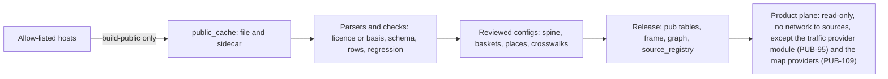

# 04 — Public Data Pack

| | |
|---|---|
| Status | Draft v0.3, amended by decisions 0016, 0017 and 0019 on 2026-11-12, and by decisions 0022 and 0023 on 2026-11-13, and by decision 0026 on 2026-11-14 |
| Date | 2026-11-14 |
| Owner | albarami |
| Purpose | Define every public source the product uses, how it is fetched, licensed, checked, crosswalked and attributed, and what public data cannot give. |
| Read first | [01 Project brief](01_PROJECT_BRIEF.md), [02 Architecture](02_ARCHITECTURE.md), [03 Data contracts](03_DATA_CONTRACTS.md), [decision 0016](decisions/0016-version-1-covers-the-whole-initiative.md), [decision 0017](decisions/0017-public-data-additions-and-public-splits.md), [decision 0019](decisions/0019-forecasts-estimates-scenarios-and-self-serve-sources.md), [decision 0022](decisions/0022-real-register-companies-with-a-synthetic-world.md), [decision 0023](decisions/0023-ten-additions-and-the-data-rule.md) |

## In brief

- Every figure marked Public comes from a source in the registry below, with URL, licence (or
  basis of use), retrieval date and SHA-256 recorded at fetch time. Nothing is fetched at run time,
  with named exceptions that store nothing of a response: the optional live traffic provider of
  PUB-95, off by default, and the two map providers of decision 0023 item A7 (PUB-109), used only
  by the map mode or the address search that needs them.
- Fetchers run only in `./eii build-public`, only against an allow-list of hosts, and fail loudly.
  The traffic provider module is not a fetcher of `build-public` and has its own list of hosts
  (PUB-95); neither are the product server's routes to the map providers (PUB-109).
- [Decision 0017](decisions/0017-public-data-additions-and-public-splits.md) adds 77 portal
  datasets in seventeen groups (property sales, venue visits, building permits, employer scale,
  manufacturing, trade, logistics, population, workforce, pay, students and visitors), which the
  registry holds as eighteen source-id families because the decision's group of museum and
  health-centre visits uses two, and two investment sources: the FDI projects dashboard, read on
  every build, and the sector, opportunity, incentive, set-up and law pages of the national
  investment promotion agency. Projects are shown in full with their source on every card, list and map legend.
  Capex and jobs are labelled announced estimates, with the page's own caveat (PUB-87);
  its reproduction notice is recorded in PUB-12.
- [Decision 0019](decisions/0019-forecasts-estimates-scenarios-and-self-serve-sources.md) adds
  seven source ids beside the eighteen families: `traffic_tomtom_flow` and `traffic_tomtom_range`
  (a live traffic provider, used only in a session, nothing cached) and five that
  `./eii build-public` fetches: `busy_gmaps` (relative busyness by hour of named venues),
  `ntl_blackmarble` (night-time radiance), `places_fsq` (a further source of the places layer,
  read from its public copy on Source Cooperative without an account), `worldpop_qat_agesex` (population by age and sex on a 100 m
  grid) and `weather_openmeteo` (hourly weather history). The series that tested code forecasts, and
  the source table that holds each, are listed in section 12 (PUB-103), with the released monthly
  series that the same code also forecasts.
- [Decision 0022](decisions/0022-real-register-companies-with-a-synthetic-world.md) adds two
  Public sources: the public business register (`biz_register`) and the financial centre's public
  register (`fc_register`). Their companies are the register companies. Neither is fetched: each
  register's file of public records is collected outside the build, kept outside the repository and
  read only through its own setting, `EII_REGISTER_FILE` for `biz_register` and
  `EII_FC_REGISTER_FILE` for `fc_register`. Firm counts and firm density come from the register.
- [decision 0023](decisions/0023-ten-additions-and-the-data-rule.md) adds the public layers of the national GIS centre's map service, read with no sign-in and
  used as public data under the owner's decision for a personal, local project (PUB-105); two open sources of
  building heights (PUB-106); the measures of the two sales bulletins (PUB-107); bank credit by
  activity, public tenders, district-cooling capacity and the ten open-data families of its item
  A10 (PUB-108). All are fetched in S2-T19 and S2-T20. Under its data rule no synthetic data
  stands in for rents, vacancy, card spending, permit or approval status, school capacity or
  surveys, and a plot is shown only as permitted by zoning and looking empty. Its map modes add
  two online providers, reached only by the product's own server (PUB-109): the satellite imagery
  provider of the map and of address search, which has no registry row yet (section 2.1), and the
  photorealistic 3D tiles of Google's Map Tiles API, the one paid service, which the owner caps at
  USD 20 in total.
- Version 1 is a personal, local project that nobody outside the owner's organisation sees. Every
  source a visitor can read under PUB-12 is used and shown in full, whatever its reuse terms
  ([decision 0026](decisions/0026-public-sources-used-in-full-locally.md)). Terms are recorded truthfully; permissions for real use belong on document 17's single list.
  Nothing from a source without an open licence is committed (PUB-12, PUB-13).
- Official figures split by sex or nationality are Public facts, shown only as published, with
  source and year. They are never joined to a worker, residence or company record, used to segment
  those records, combined with a protected figure or apportioned to a drawn area; their one use on
  simulated movement is SYN-89's cited aggregate anchors, summed over the source's own categories
  (PUB-90). The one case that is not an
  apportionment is the sum of whole cells of the published age-and-sex population grid over a
  chosen area, for display only (PUB-99).
- A drawn area counts Public points inside it exactly. A statistic published on an official
  geography stays on that geography, or is labelled Inferred where it is apportioned to the shape.
- The verified figures of the master design are regression examples: each has a dataset and an
  exact check. The national mean pay pair remains blocked until reconciled; the restaurant item is closed because production value is not published (OI-03, section 11).
- Work in slice S2 also builds the frame (zones, districts, municipalities, gazetteer, crosswalks), the
  activity spine, the customs baskets, the hand-verified places of four showcase areas, the venue
  crosswalk, the two page parsers and the candidate record for the flagship building. Slice S2 also
  builds the fetchers and release tables of the five sources of decision 0019 that `build-public`
  fetches. The pooled hourly anchor, the weather profiles
  and the population grid as weights belong to the simulation slice S4; the provider switch, the
  layers and the 3D view belong to the map and journey slices ([TASKS.md](../TASKS.md),
  [14](14_IMPLEMENTATION_PLAN.md)).

## 1. Scope

This document owns the public half of the custodian plane: `custodian/publicdata/` (fetchers, page
parsers and review files) and the release tables whose names start `pub_`, plus `fdi_projects`, the
frame tables `zone`, `municipality`, `gazetteer` and the public parts of `graph_node`, `graph_edge`
and `source_registry`. Methods that compute on these tables (location quotients, pay decomposition,
break-even, bulk-month rule, co-location, apportioning to a drawn shape) are owned by
[07 Economic methods](07_ECONOMIC_METHODS.md). Fact fields, release-table columns and provenance
rules are owned by [03 Data contracts](03_DATA_CONTRACTS.md). The synthetic world reads this pack
but is specified in [05 Synthetic world and simulation](05_SYNTHETIC_WORLD_AND_SIMULATION.md).

Terms used here:

- **Portal**: the Qatar Open Data Portal, `www.data.gov.qa`, which serves datasets through an
  Explore API (version 2.1) and states a licence based on CC BY 4.0 (portal licence page, retrieved
  2026-11-11). The same portal answers the same API and slugs at `www.data.qa`
  ([decision 0017](decisions/0017-public-data-additions-and-public-splits.md)).
- **Public cache**: `data/public_cache/`, the local, uncommitted store of fetched files.
- **Registry**: the committed list of sources (`custodian/publicdata/sources.yaml`) and its copy in
  the release table `source_registry`.
- **Licence-activity count**: one activity on one commercial licence. It is not a firm, an
  establishment or a job.
- **Investment sources**: `fdi_projects` (the FDI projects dashboard) and `investqa_pages` (the
  sector, opportunity, incentive, set-up and law pages of the national investment promotion
  agency), used under the owner's decision for a personal, local project; the publisher's terms
  are recorded in its own words with the date read (PUB-12).
- **Public split**: an official figure split by sex or nationality. It is only ever a Public fact
  (PUB-90).
- **Traffic provider**: the optional live source of traffic flow tiles and traffic-aware
  drive-time areas, used only in a session when `EII_TRAFFIC_PROVIDER` is `tomtom` (PUB-95).
- **Map providers**: the two online providers of the map modes of
  [decision 0023](decisions/0023-ten-additions-and-the-data-rule.md) item A7: the imagery provider
  of the satellite mode and of address search (`ESRI_API_KEY`), and the photorealistic 3D tiles of
  Google's Map Tiles API (`MAPTILE_API_KEY`), the one paid service. Only the product's own server
  reaches them, and nothing of a response is stored (PUB-109).
- **Relative busyness**: the published relative index (0 to 100) of how busy a named venue is by
  day of week and hour. It is a Public fact of the venue and never a count of people (PUB-101).



## 2. Source registry

Every source the master design and decisions 0016, 0017, 0019, 0022 and 0023 rely on is listed here. The key (first
column) is the `source_id` used in the registry, in lineage and in the evidence drawer. Portal
dataset identifiers are the slugs after `/explore/dataset/` in the URLs given by the project
research (retrieved 2026-11-11). Publisher names are those reported by the research; the fetcher
copies the publisher from the portal metadata at fetch time and fails if it differs (PUB-09).

[Decision 0017](decisions/0017-public-data-additions-and-public-splits.md) adds the rows from
`prop_resi_units` onwards: 77 portal datasets in the seventeen groups of the decision, represented
by eighteen source-id families because its group of museum and health-centre visits uses two
(`visits_museum` and `visits_phcc`), then the two investment sources. A source-id family is one
`source_id` with one registry entry per slug. The slugs, publishers, rows, coverage and modified
dates of the 77 datasets were read from the portal's catalogue and records on 2026-11-12, and the
fetcher records them again at every fetch (PUB-85).

[Decision 0019](decisions/0019-forecasts-estimates-scenarios-and-self-serve-sources.md) adds seven
source ids as the last rows of sections 2.1 and 2.2. Their facts were read from the publishers'
pages on 2026-11-12, without any key; a field those pages did not give is written "to be recorded
at the first fetch". The two ids of the live traffic provider (`traffic_tomtom_flow` and
`traffic_tomtom_range`) are not cached sources: they are listed here for their terms and attribution, and have no row in
`source_registry` and no file, because nothing of the provider is fetched into the cache (PUB-95).

[Decision 0022](decisions/0022-real-register-companies-with-a-synthetic-world.md) adds two source
ids after them: `biz_register`, the public business register, and `fc_register`, the financial
centre's public register. They are Public sources, but no fetcher reads them. The owner's advisor
collects each register's file of public records as a visitor's browser receives it under PUB-12; each file is
kept outside the repository and read only through its own setting, `EII_REGISTER_FILE` for
`biz_register` and `EII_FC_REGISTER_FILE` for `fc_register`, by the lead's own shell (the world
build run there included), the release build and the running product, each read-only. Neither file
is ever committed, or put in a brief, a fixture, a worker tool's or a reviewer's hands; tests and continuous
integration use an invented stand-in of the same shape (decision 0022 items 1 and 8). Their
publisher citation, licence, retrieval date, hash and columns are recorded in `source_registry`
when the file is first read (open questions below). Terms are recorded in the publisher's own words with the date read,
without limiting version 1; any permission or licence needed for real use goes on document 17's
single list (PUB-12).

[decision 0023](decisions/0023-ten-additions-and-the-data-rule.md) adds the source ids after `fc_register`: the layers of the national GIS centre's public map
service by service name, the two height sources, bank credit by activity, tenders, district
cooling and the ten open-data families of its item A10. Their retrieval is "to fetch in S2-T19" (or
S2-T20 for the heights): publisher, coverage, slugs and hashes are recorded at the first fetch, and
an unconfirmed host, file, publisher or schema blocks its source until then (PUB-03, PUB-07, PUB-09); terms are recorded under PUB-12 and do not block use. Its last id,
`tiles3d_google`, names the photorealistic 3D tiles of the third map mode (item A7): like the two ids
of the live traffic provider, it is listed for its terms, price and attribution, has no row in
`source_registry` and no file, and nothing of it is cached (PUB-109).

### 2.1 Identity, fetch and licence

| source_id | Dataset | Publisher | How fetched | Licence |
|---|---|---|---|---|
| `lic_active` | Active certificates by municipality and business activity | Ministry of Commerce and Industry | portal `moci-active-certificates-by-municipality-and-business-activity` | CC BY (portal) |
| `lic_cancelled` | Cancelled certificates by municipality and business activity | Ministry of Commerce and Industry | portal `moci-canceled-certificates-by-municipality-and-business-activity` | CC BY (portal) |
| `lic_issued` | Issued certificates by municipality and business activity (incomplete) | Ministry of Commerce and Industry | portal `moci-issued-certificates-by-municipality-and-business-activity` | CC BY (portal) |
| `cus_imp_2025` | Qatar Imports 2025-2026 | National Planning Council | portal `qatar-imports-2025-2026` | CC BY (portal) |
| `cus_imp_2019` | Qatar Imports 2019-2024 | National Planning Council | portal `qatar-imports-2019-2024-copy` | CC BY (portal) |
| `sec_hr_ind` | Hotels and restaurants: economic indicators by activity | National Planning Council | portal `hotels-and-restaurants-statistics-economic-indicators-in-hotels-and-restaurants-by-activity1` | CC BY (portal) |
| `sec_hr_goods` | Hotels and restaurants: intermediate goods by type | National Planning Council | portal `hotels-and-restaurants-statistics-estimates-of-intermediate-goods-value-in-hotels-and-restaurants-by0` | CC BY (portal) |
| `sec_hr_serv` | Hotels and restaurants: intermediate services by type | National Planning Council | portal `hotels-and-restaurants-statistics-estimates-of-intermediate-services-value-in-hotels-and-restaurants0` | CC BY (portal) |
| `sec_hr_size` | Hotels and restaurants: establishments and employees by size | National Planning Council | portal `hotels-and-restaurants-number-establishments-employees-by-size-of-establishment-economic-activity` | CC BY (portal) |
| `sec_hr_comp_occ` | Hotels and restaurants: compensation by occupation | National Planning Council | portal `hotels-and-restaurants-statistics-estimates-of-compensation-in-hotels-and-restaurants-by-occupation1` | CC BY (portal) |
| `wage_occ` | Workers in paid employment and monthly average wage by gender and occupation | National Planning Council | portal `workers-in-paid-employment-15-years-and-above-and-monthly-average-wage-q1` | CC BY (portal) |
| `wage_act` | Workers in paid employment and monthly average wage by gender and economic activity | National Planning Council | portal `workers-in-paid-employment-15-years-and-above-and-monthly-average-wage-q` | CC BY (portal) |
| `wage_sector` | Workers in paid employment and average monthly wage by gender and sector | to be confirmed at slice S2 | portal `workers-in-paid-employment-and-average-monthly-wage-by-gender-and-sector` | CC BY (portal) |
| `wage_bands_priv` | Average monthly wage for workers in the private sector | to be confirmed at slice S2 | portal `average-monthly-wage-q-r-for-workers-in-private-sector-in-qatar-2021-2025` | to be confirmed at slice S2 |
| `work_hours_act` | Employed persons and average work hours by gender and economic activity | to be confirmed at slice S2 | portal `employed-persons-15-years-and-above-and-average-work-hours-by-gender-and-economic-activity` | to be confirmed at slice S2 |
| `util_elec` | Electricity total consumption by zone number | Kahramaa | portal `electricity-total-consumption-by-zone-number` | CC BY (portal) |
| `util_water` | Water total consumption by zone number | Kahramaa | portal `water-total-consumption-by-zone-number` | CC BY (portal) |
| `transit_monthly` | Public Transport Users | Ministry of Transport | portal `public-transport-users` | CC BY (portal) |
| `hotel_segment` | Accommodation data by segment (supply, demand, occupancy, ADR, RevPAR) | Qatar Tourism | portal `accommodation-data-by-segment-date-and-key-metrics-supply-demand-occupancy-adr-revpar` | CC BY (portal) |
| `cpi_group` | Consumer price index by expenditure group, monthly | to be confirmed at slice S2 | portal `consumer-price-index-cpi-by-expenditure-group-monthly` | CC BY (portal) |
| `prop_sales` | Weekly Real Estates Sales Bulletin | Ministry of Justice | portal `weekly-real-estates-sales-bulletin` | CC BY (portal) |
| `pop_muni` | Population and labour force by municipality | National Planning Council | portal `population-and-labour-force-by-municipality` | CC BY (portal) |
| `zone_population` | Population, area and population density by zone | to be confirmed at slice S2 | portal `population-area-and-population-density-per-square-kilometers-by-zone` | to be confirmed at slice S2 |
| `est_census` | Number of business establishments by economic activity in census (2010, 2020) | to be confirmed at slice S2 | portal `number-of-business-establishments-by-economic-activity-in-census-2010-2020` | CC BY (portal) |
| `census_hh_type_2020` | Population by type of household, gender and place of residence on the census night, December 2020 | to be confirmed at slice S2 | portal `population-by-type-of-household-gender-and-place-of-residence-on-the-census-night-december-2020` | to be confirmed at slice S2 |
| `accident` | Accident | to be confirmed at slice S2 | portal `accident` | to be confirmed at slice S2 |
| `census_2020_workbook` | Census 2020 detailed results workbook, Tables 1, 2, 151 and 152 | Planning and Statistics Authority | archived copy at `web.archive.org/web/20240422094401/https://www.psa.gov.qa/Style%20Library/PSA/CensusDetailedResults/documents/Qatar_Census_2022_Final_Results.xlsx` | publisher's terms in its own words with the date read, to be recorded at fetch; basis of use: the owner's decision for a personal, local project (PUB-12) |
| `worldpop_qat_2020` | Constrained 100 m gridded population, 2020 | WorldPop | `https://data.worldpop.org/GIS/Population/Global_2015_2030/R2025A/2020/QAT/v1/100m/constrained/` | CC BY 4.0 |
| `census_zone_sector` | Census 2020 employed population by major economic sector, by zone | statistics authority public map service | `services7.arcgis.com/mffQJB8rpVa5We20/arcgis/rest/services/Population_by_Major_Economic_Sectors_by_Zone_2020_WFL1/FeatureServer` | publisher's terms in its own words with the date read, to be recorded at fetch; basis of use: the owner's decision for a personal, local project (PUB-12) |
| `census_zone_occ` | Census 2020 employed population by occupation, by zone | statistics authority public map service | `.../Employed_Population_by_Occupation_by_Zone_2020_WFL1/FeatureServer` | publisher's terms in its own words with the date read, to be recorded at fetch; basis of use: the owner's decision for a personal, local project (PUB-12) |
| `census_zone_hh` | Census 2020 residence for households, by zone | statistics authority public map service | `.../Residence_for_Households_by_Zone_2020_WFL1/FeatureServer` | publisher's terms in its own words with the date read, to be recorded at fetch; basis of use: the owner's decision for a personal, local project (PUB-12) |
| `census_zone_lab` | Census 2020 residence for workers (labourer groups), by zone | statistics authority public map service | `.../Residence_for_Workers_Labourer_Groups_by_Zone_2020_WFL1/FeatureServer` | publisher's terms in its own words with the date read, to be recorded at fetch; basis of use: the owner's decision for a personal, local project (PUB-12) |
| `census_district_pop` | Census 2020 population, district level | statistics authority public map service | `.../Population_2020_District_Level/FeatureServer` | publisher's terms in its own words with the date read, to be recorded at fetch; basis of use: the owner's decision for a personal, local project (PUB-12) |
| `bnd_zone_2020` | Zone_Boundary_2020 (map layer) | statistics authority public map service | `.../Zone_Boundary_2020/FeatureServer` | publisher's terms in its own words with the date read, to be recorded at fetch; basis of use: the owner's decision for a personal, local project (PUB-12) |
| `bnd_district_2020` | District_2020 (map layer) | statistics authority public map service | `.../District_2020/FeatureServer`; the registry records `layer` 12, the id of District_Boundary_2020, the only layer of this service (the other six map services each have one layer, at id 0) | publisher's terms in its own words with the date read, to be recorded at fetch; basis of use: the owner's decision for a personal, local project (PUB-12) |
| `bnd_hdx` | Qatar Subnational Administrative Boundaries (COD-AB) | HDX, source Planning and Statistics Authority | landing page `https://data.humdata.org/dataset/cod-ab-qat`; direct machine-readable URL to be confirmed at slice S2 | CC BY-IGO |
| `bnd_muni_2025` | Municipalities in Qatar 2025 | to be confirmed at slice S2 | portal `municipalities-in-qatar-2025` | portal terms, exact publisher wording and date read to be recorded; `licence_basis: owner_decision` where no open licence covers the use (PUB-12) |
| `bnd_geob` | geoBoundaries Qatar ADM1, ADM2 (fallback only) | geoBoundaries | `https://www.geoboundaries.org/api/current/gbOpen/QAT/ALL/` | CC BY 4.0 |
| `places_ovt` | Overture Places, release 2026-10-21.0, schema 2.0.0 | Overture Maps Foundation (per-record sources) | `s3://overturemaps-us-west-2/release/2026-10-21.0/theme=places/type=place/`, STAC `https://stac.overturemaps.org/2026-10-21.0/catalog.json` | CDLA Permissive 2.0 per source; Foursquare records Apache 2.0; AllThePlaces CC0 1.0 |
| `bldg_ovt` | Overture Buildings, release 2026-10-21.0 (named showcase buildings only) | Overture Maps Foundation | same release, `theme=buildings` | ODbL (theme licence) |
| `roads_osm` | OpenStreetMap Qatar extract (road network) | OpenStreetMap contributors | `https://download.openstreetmap.fr/extracts/asia/qatar-latest.osm.pbf` | ODbL 1.0 |
| `cls_isic4` | ISIC Rev.4 structure (English titles) | United Nations Statistics Division | landing page `https://unstats.un.org/unsd/classifications/Econ`; direct machine-readable URL to be confirmed at slice S2 | UN terms of use; exact publisher wording and date read to be recorded; basis: the owner's decision for a personal, local project (PUB-12) |
| `ref_min_wage` | Qatar minimum wage (Law No. 17 of 2020), reference page | International Labour Organization | citation only: `https://www.ilo.org/resource/news/qatar-adopts-non-discriminatory-minimum-wage` | to be confirmed at slice S2 |
| `ref_wps_report` | Wage Protection Systems in the Gulf Cooperation Council Countries, November 2025 | International Labour Organization | citation only: `https://www.ilo.org/sites/default/files/2025-11/ILO_Beirut_Wage-Protection_Report_R10.pdf` | to be confirmed at slice S2 |
| `ref_expansion_method` | Mobility study methodology v3 | Spanish Ministry of Transport | citation only: `https://ropenspain.github.io/spanishoddata/codebooks/mitma_-_estudio_movilidad_covid-19_informe_metodologico_v3_en.pdf` | to be confirmed at slice S2 |
| `ref_gov_hours` | Flexible working system for the government sector | The Peninsula | citation only: `https://thepeninsulaqatar.com/article/04/09/2024/cgb-announces-flexible-remote-work-system-for-qatar-government-sector` | to be confirmed at slice S2 |
| `ref_friday_closure` | Services exempted from closure during Friday prayers | The Peninsula | citation only: `https://thepeninsulaqatar.com/article/17/08/2025/over-10-services-in-qatar-exempted-from-closure-during-friday-prayers-gazette` | to be confirmed at slice S2 |
| `ref_transit_hours` | Metro and tram service hours from 1 January | Qatar Tribune | citation only: `https://qatar-tribune.com/article/156642/front/metro-tram-service-hours-extended-from-january-1` | to be confirmed at slice S2 |
| `ref_summer_work` | Regulated outdoor summer working hours from 1 June | The Peninsula | citation only: `https://www.thepeninsulaqatar.com/article/31/05/2026/regulated-outdoor-summer-working-hours-come-into-force-on-june-1-in-qatar` | to be confirmed at slice S2 |
| `ref_truck_hours` | Restriction on trucks and large buses within Doha | The Peninsula | citation only: `https://thepeninsulaqatar.com/article/01/06/2024/restriction-on-movement-of-trucks-and-large-buses-within-doha:-traffic-department` | to be confirmed at slice S2 |
| `ref_ramadan_public_hours` | Reduced public-sector hours during Ramadan | Qatar News Agency | citation only: `https://qna.org.qa/en/News-Area/News/2026-2/16/qatar-sets-reduced-working-hours-for-public-sector-during-ramadan` | to be confirmed at slice S2 |
| `ref_ramadan_private_hours` | Ramadan working hours for the private sector | The Peninsula | citation only: `https://s.thepeninsula.qa/article/14/02/2026/ministry-of-labour-announces-ramadan-working-hours-for-private-sector` | to be confirmed at slice S2 |
| `ref_ramadan_transit_hours` | Metro and tram Ramadan hours | The Peninsula | citation only: `https://s.thepeninsula.qa/article/17/02/2026/doha-metro-and-lusail-tram-announce-operating-hours-in-ramadan` | to be confirmed at slice S2 |
| `ref_traffic_index` | Doha Traffic Index 2025 | TomTom | citation only: `https://www.tomtom.com/traffic-index/city/doha/` | publisher's terms and date read to be recorded under PUB-12; citation-only is its plausibility-comparison role, not a terms restriction |
| `prop_resi_units` | Residential unit sales, weekly bulletin | Ministry of Justice | portal `weekly-residential-units-sales-bulletin` | CC BY (portal) |
| `visits_museum` | Visitors of museums and exhibitions by month and museum | National Planning Council | portal `visitors-of-museums-and-exhibition-by-month-and-museum` | CC BY (portal) |
| `visits_phcc` | Patient visits by health centre and region | Primary Health Care Corporation | portal `phcc-patient-visits-by-health-center-and-region` | CC BY (portal) |
| `permits_muni` | Building permits and completion certificates: totals by municipality and building type, and monthly permits by type for each municipality | National Planning Council | portal `total-building-permits-issued-by-municipality-and-type-of-building-type-of-permit`, `total-building-completion-certificates-issued-by-municipality-and-type-of-building-type-of`, `building-permits-issued-by-type-of-permit-and-month-al-daayen-municipality`, `building-permits-issued-by-type-of-permit-and-month-al-khor-and-al-thakhira-municipality`, `building-permits-issued-by-type-of-permit-and-month-al-rayyan-municipality`, `building-permits-issued-by-type-of-permit-and-month-al-shahhaniya-municipality`, `building-permits-issued-by-type-of-permit-and-month-al-shamal-municipality`, `building-permits-issued-by-type-of-permit-and-month-al-wakrah-municipality`, `building-permits-issued-by-type-of-permit-and-month-doha-municipality`, `building-permits-issued-by-type-of-permit-and-month-umm-slal-municipality` | CC BY (portal) |
| `est_size_act` | Establishments and employees by size of establishment and activity, with compensation | National Planning Council | portal `number-of-establishments-and-employees-by-size-of-establishment-and-main-economic-activity-two`, `number-of-establishments-and-employees-by-size-of-establishment-and-main-economic-activity-wholesale-and-retail-trade-four-digits`, `number-of-establishments-and-employees-by-size-of-establishment-and-main-economic-activity-transport`, `number-of-establishments-and-employees-by-size-of-establishment-and-main-economic-activity-social-and-personal-services-two-digits`, `number-of-establishments-and-employees-by-size-of-establishment-and-main-economic-activity-energy`, `number-of-establishments-and-employees-by-size-of-establishment-and-main-economic-activity-one`, `establishments-employees-and-compensation-of-employees-by-economic-activity-business-services` | CC BY (portal) |
| `mfg_industry` | Manufacturing industries (one dataset per industry) and main manufacturing products | Ministry of Commerce and Industry (industry datasets); National Planning Council (`main-manufacturing-products`) | portal `manufacture-of-basic-metals`, `manufacture-of-basic-pharmaceutical-products-and-pharmaceutical-preparations`, `manufacture-of-beverages`, `manufacture-of-chemicals-and-chemical-products`, `manufacture-of-coke-and-refined-petroleum-products`, `manufacture-of-computer-electronic-and-optical-products`, `manufacture-of-electrical-equipment`, `manufacture-of-fabricated-metal-products-except-machinery-and-equipment`, `manufacture-of-food-products`, `manufacture-of-furniture`, `manufacture-of-leather-and-related-products`, `manufacture-of-machinery-and-equipment-nec`, `manufacture-of-manufacture-of-wood-and-of-products-of-wood-and-cork-except-furniture-manufacture`, `manufacture-of-motor-vehicles-trailers-and-semi-trailers`, `manufacture-of-other-non-metallic-mineral-products`, `manufacture-of-other-transport-equipment`, `manufacture-of-paper-and-paper-products`, `manufacture-of-rubber-and-plastics-products`, `manufacture-of-textiles`, `manufacture-of-wearing-apparel`, `main-manufacturing-products` | CC BY (portal) |
| `trade_wr` | Purchases, sales and stocks during the year by type of trade, wholesale and retail | National Planning Council | portal `purchases-sales-and-stocks-during-the-year-by-type-of-trade-wholesale-and-retail-trade-all` | CC BY (portal) |
| `pop_muni_age` | Population by municipality and age groups | National Planning Council | portal `population-by-municipality-and-age-groups` | CC BY (portal) |
| `hotels_muni` | Hotels and hotel apartments by municipality | National Planning Council | portal `hotels-and-hotel-apartments-by-municipality` | CC BY (portal) |
| `trade_logistics` | Certificates of origin by importing country; arriving vessels by previous port and by registration | Qatar Chamber of Commerce & Industry (certificates of origin); National Planning Council (vessels) | portal `annual-certificates-of-origin-by-type-and-importing-country`, `arriving-vessels-gross-and-net-tonnage-by-type-of-vessel-and-country-of-previous-port`, `arriving-vessels-gross-and-net-tonnage-by-type-of-vessel-and-country-of-registration-hamad-port0` | CC BY (portal) |
| `est_census_2015_muni` | Business establishments and employees by municipality, census 2015 | National Planning Council | portal `distribution-of-business-establishments-and-employees-by-municipalities-according-to-census-2015` | CC BY (portal) |
| `lf_muni_sex` | Population, labour force, employed and unemployed persons by sex and municipality | National Planning Council | portal `female-population-and-labour-force-by-municipality`, `male-population-and-labour-force-by-municipality`, `employed-persons-15-years-and-above-by-gender-and-municipality`, `unemployed-persons-15-years-and-above-by-gender-and-municipality` | CC BY (portal) |
| `pop_muni_age_sex` | Population by municipality, age group and sex | National Planning Council | portal `females-population-by-municipality-and-age-groups-december-2020`, `males-population-by-municipality-and-age-groups-december-2020` | CC BY (portal) |
| `active_sex_age_act` | Economically active females and males by age group and economic activity | National Planning Council | portal `economically-active-females-15-years-and-above-by-age-group-and-economic-activity`, `economically-active-males-15-years-and-above-by-age-group-and-economic-activity` | CC BY (portal) |
| `active_nat_occ_act` | Economically active Qatari and non-Qatari population by occupation and economic activity (all, males, females) | National Planning Council | portal `economically-active-non-qatari-females-15-years-and-above-by-occupation-and-economic-activity`, `economically-active-non-qatari-males-15-years-and-above-by-occupation-and-economic-activity`, `economically-active-non-qatari-population-15-years-and-above-by-occupation-and-economic-activity`, `economically-active-qatari-females-15-years-and-above-by-occupation-and-economic-activity`, `economically-active-qatari-males-15-years-and-above-by-occupation-and-economic-activity`, `economically-active-qatari-population-15-years-and-above-by-occupation-and-economic-activity` | CC BY (portal) |
| `comp_nat_act` | Employees and compensation of employees by nationality and main economic activity (one dataset per survey sector) | National Planning Council | portal `number-of-employees-and-compensation-of-employees-by-nationality-and-main-economic-activity`, `number-of-employees-and-compensation-of-employees-by-nationality-and-main-economic-activity-building`, `number-of-employees-and-compensation-of-employees-by-nationality-and-main-economic-activity-business`, `number-of-employees-and-compensation-of-employees-by-nationality-and-main-economic-activity-energy`, `number-of-employees-and-compensation-of-employees-by-nationality-and-main-economic-activity-energy0`, `number-of-employees-and-compensation-of-employees-by-nationality-and-main-economic-activity-energy1`, `number-of-employees-and-compensation-of-employees-by-nationality-and-main-economic-activity-one`, `number-of-employees-and-compensation-of-employees-by-nationality-and-main-economic-activity-social`, `number-of-employees-and-compensation-of-employees-by-nationality-and-main-economic-activity-social0`, `number-of-employees-and-compensation-of-employees-by-nationality-and-main-economic-activity-social1` | CC BY (portal) |
| `students_muni` | Students by level of education, municipality, sex, type of education and nationality | Ministry of Education and Higher Education | portal `students-by-level-of-education-municipality-gender-type-of-education-and-nationality-2025-2026` | CC BY (portal) |
| `visitors_markets` | Hotel guests by nationality, hotel rating and stays; visitor arrivals | National Planning Council (hotel guests; arrivals by mode of entry and by region); Qatar Tourism (arrival trends by mode of transport) | portal `hotel-guests-by-nationality-hotel-rating-and-hotel-stays`, `visitor-arrivals-by-mode-of-entry`, `visitor-arrivals-by-region`, `visitor-arrivals-trends-by-mode-of-transport-air-land-sea` | CC BY (portal) |
| `fdi_projects` | FDI projects dashboard: announced investment projects, data from fDi Markets | National investment promotion agency | page `https://fdiprojects.invest.qa/`, read on every build and parsed by the FDI page parser (PUB-86, PUB-87) | Footer notice: "Reproduction of these pages, whether in whole or in part, is only permissible with the prior written authorization of Investment Promotion Agency LLC. These pages are to be used for information purposes only", read 2026-11-14 from the fetch of 2026-11-13; the data gatherer's terms, as the page names it, are to be read and recorded with the date read; basis of use: the owner's decision for a personal, local project (PUB-12); the terms of use (`https://www.invest.qa/en/terms-and-conditions?tab=terms-of-use`), read on 2026-11-13, allow copies for personal and non-commercial use while viewing and say that the material should not be copied, modified or reproduced in whole or in part without the publisher's prior written permission and an acknowledgement of the source |
| `investqa_pages` | Sector, opportunity, incentive, set-up and law pages | National investment promotion agency | pages of `https://www.invest.qa/`, parsed by the agency page parsers (PUB-86, PUB-88); page list confirmed at slice S2 | publisher's terms in its own words with the date read, to be recorded at fetch; basis of use: the owner's decision for a personal, local project (PUB-12) |
| `traffic_tomtom_flow` | Traffic flow tiles (live layer; nothing cached) | TomTom | live session only, by the traffic provider module (PUB-95) when `EII_TRAFFIC_PROVIDER` is `tomtom`, with `TOMTOM_API_KEY` from the environment; documentation `https://docs.tomtom.com/traffic-api/` and pricing page `https://docs.tomtom.com/pricing`, read 2026-11-12; the provider's host is fixed by the task that builds the module and added to the module's own list by a reviewed registry change | provider terms (`licence_basis: provider_terms`): free monthly allowance of 200,000 tile requests (read 2026-11-12); attribution "© TomTom" while the layer is on; the provider's terms (`https://docs.tomtom.com/legal/terms-and-conditions`, no date or version on the page; read in full on 2026-11-13) license the free plan "for Evaluation Use only", "internal evaluation and testing by you of the Licensed Products" (clause 2.2 and its definitions); they prohibit caching or storing any results except in a client under the result's cache-control headers and never to serve several users (clause 11.4), and nothing is stored; the logos and copyright notices the provider's interfaces generate are kept and other attribution comes from its copyright interface (clause 17.3); the page says nothing on showing the layer beside other map data; showing the layer outside internal evaluation is the owner's decision (OI-130) |
| `traffic_tomtom_range` | Traffic-aware drive-time areas (reachable range; live, nothing cached) | TomTom | as `traffic_tomtom_flow` | provider terms: free monthly allowance of 2,500 reachable-range requests (read 2026-11-12); attribution and storage as `traffic_tomtom_flow` |
| `busy_gmaps` | Google Maps popular times: relative busyness by hour of named venues | Google | the project's own page reader inside `./eii build-public`, for the named venues of a build-time list, never at run time (PUB-101); publisher page "About popular times, wait times and visit duration data", `https://support.google.com/business/answer/6263531`, read 2026-11-12; host to be recorded at the first fetch | Publisher terms (`https://policies.google.com/terms` and Maps additional terms `https://www.google.com/intl/en/help/terms_maps/`, read 2026-11-12); Terms of Service: "using automated means to access content from any of our services in violation of the machine-readable instructions on our web pages"; Maps additional terms: "mass download or create bulk feeds of the content" (decision 0019, Sources); `licence_basis: owner_decision` means the owner's decision for a personal, local project (PUB-12) |
| `ntl_blackmarble` | NASA Black Marble VNP46A3: night-time lights, monthly, on a 15 arc-second grid (about 500 m) | NASA | inside `./eii build-public` with the Earthdata token `EARTHDATA_API_KEY` from the environment; product page `https://ladsweb.modaps.eosdis.nasa.gov/missions-and-measurements/products/VNP46A3/` (DOI 10.5067/VIIRS/VNP46A3.002), read 2026-11-12; download host to be recorded at the first fetch | NASA data and information guidance (`https://www.earthdata.nasa.gov/engage/open-data-services-software-policies/data-information-policy`, read 2026-11-12): NASA acknowledged as the source and the product DOI cited; further terms to be recorded at the first fetch |
| `places_fsq` | Foursquare Open Source Places (public copy on Source Cooperative) | Foursquare | inside `./eii build-public`, from the public copy on Source Cooperative, `https://data.source.coop/fused/fsq-os-places/` (host `data.source.coop`, PUB-03), geospatially partitioned GeoParquet, read without an account; only the files that cover Qatar are fetched (**ASSUMPTION**: found through the dataset's own metadata file; the task that builds the fetcher confirms it); the release used is recorded in the registry and shown with the places; the copy's README `https://data.source.coop/fused/fsq-os-places/README.md` and the access page `https://docs.foursquare.com/data-products/docs/access-fsq-os-places`, read 2026-11-12 | Apache License, Version 2.0, with the publisher's copyright line, as the copy's README states them (read 2026-11-12); the listing holds three dated releases, the newest dated 2025-01-10, and states no update rhythm |
| `worldpop_qat_agesex` | WorldPop age and sex structures, 100 m grids, Qatar | WorldPop | inside `./eii build-public`; pages `https://hub.worldpop.org/project/categories?id=8` and `https://hub.worldpop.org/geodata/listing?id=138`, read 2026-11-12; file URL, host and year to be recorded at the first fetch | CC BY 4.0 (DOI 10.5258/SOTON/WP00841) |
| `weather_openmeteo` | Open-Meteo historical weather, hourly | Open-Meteo | inside `./eii build-public`, into the public cache as a hashed file; documentation `https://open-meteo.com/en/docs/historical-weather-api`, terms `https://open-meteo.com/en/terms` and licence page `https://open-meteo.com/en/licence`, read 2026-11-12; host, location and variables to be recorded at the first fetch | free interface for non-commercial use (`licence_basis: provider_terms`); data CC BY 4.0, with the attribution the publisher asks for |
| `biz_register` | Public establishment records of the public business register: each field its public card shows, person names excluded ([decision 0022](decisions/0022-real-register-companies-with-a-synthetic-world.md)) | to be recorded in `source_registry` when the file is first read | not fetched: one file collected by the owner's advisor as a visitor's browser receives it, kept outside the repository and read only through `EII_REGISTER_FILE`; no fetcher for the register's site is in the repository (decision 0022 item 1) | publisher's terms in its own words with the date read, recorded when the file is first read; basis of use: the owner's decision for a personal, local project; permission needs for real use go on document 17's list (PUB-12) |
| `fc_register` | Public company records of the financial centre's public register, under the same rules as `biz_register` ([decision 0022](decisions/0022-real-register-companies-with-a-synthetic-world.md) item 1) | to be recorded in `source_registry` when the file is first read | as `biz_register`: not fetched; a file of its own, kept outside the repository and opened read-only only through `EII_FC_REGISTER_FILE` (decision 0022 item 1) | publisher's terms in its own words with the date read, recorded when the file is first read; basis of use: the owner's decision for a personal, local project; permission needs for real use go on document 17's list (PUB-12) |
| `gis_land_price` | Land pricing by district, 2026 guide prices (`LandPricing2026`: residential, city-centre residential, flats, villas and commercial) | national GIS centre | public map service `services.gisqatar.org.qa`, no sign-in; to fetch in S2-T19 | publisher's terms in its own words with the date read, to be recorded at fetch; basis of use: the owner's decision for a personal, local project (PUB-12) |
| `gis_rail` | Rail lines with planned stations and protection zones (`QRAIL_NO_OPERATION`) | national GIS centre | public map service `services.gisqatar.org.qa`, no sign-in; to fetch in S2-T19 | publisher's terms in its own words with the date read, to be recorded at fetch; basis of use: the owner's decision for a personal, local project (PUB-12) |
| `gis_phcc` | Health centres and their catchments (`PHCC_LOCATION_2026`, `PHCC_CATCHMENT_2026_Q`) | national GIS centre | public map service `services.gisqatar.org.qa`, no sign-in; to fetch in S2-T19 | publisher's terms in its own words with the date read, to be recorded at fetch; basis of use: the owner's decision for a personal, local project (PUB-12) |
| `gis_landmarks` | Landmarks in Arabic and English (`Landmarks`) | national GIS centre | public map service `services.gisqatar.org.qa`, no sign-in; to fetch in S2-T19 | publisher's terms in its own words with the date read, to be recorded at fetch; basis of use: the owner's decision for a personal, local project (PUB-12) |
| `gis_locator` | Address locator (`QARS_Custom_Locator`) | national GIS centre | public map service `services.gisqatar.org.qa`, no sign-in; called only inside `./eii build-public`, never at run time; to fetch in S2-T19 | publisher's terms in its own words with the date read, to be recorded at fetch; basis of use: the owner's decision for a personal, local project (PUB-12) |
| `gis_zoning` | Land use and zoning (`Zoning`: permitted uses, height and setbacks) | national GIS centre | public map service `services.gisqatar.org.qa`, no sign-in; to fetch in S2-T19 | publisher's terms in its own words with the date read, to be recorded at fetch; basis of use: the owner's decision for a personal, local project (PUB-12) |
| `gis_address` | Official address points (`QARS`): zone, street and building numbers, parcel number, building subtype, survey date and point only (PUB-105) | national GIS centre | public map service `services.gisqatar.org.qa`, no sign-in; to fetch in S2-T19 | publisher's terms in its own words with the date read, to be recorded at fetch; basis of use: the owner's decision for a personal, local project (PUB-12) |
| `gis_parcels` | Approved land parcels (`CadastrePlots`): parcel number, area and dates only | national GIS centre | public map service `services.gisqatar.org.qa`, no sign-in; to fetch in S2-T19 | publisher's terms in its own words with the date read, to be recorded at fetch; basis of use: the owner's decision for a personal, local project (PUB-12) |
| `gis_poi_comm` | Commercial points (`POIs_COMM`) | national GIS centre | public map service `services.gisqatar.org.qa`, no sign-in; to fetch in S2-T19 | publisher's terms in its own words with the date read, to be recorded at fetch; basis of use: the owner's decision for a personal, local project (PUB-12) |
| `gis_boundaries` | Official district and zone boundaries (service names recorded at the first fetch) | national GIS centre | public map service `services.gisqatar.org.qa`, no sign-in; to fetch in S2-T19 | publisher's terms in its own words with the date read, to be recorded at fetch; basis of use: the owner's decision for a personal, local project (PUB-12) |
| `gis_context` | Protected areas, geographic names and road flow lines (`ROADFlowlnA`; the other service names recorded at the first fetch), taken as useful | national GIS centre | public map service `services.gisqatar.org.qa`, no sign-in; to fetch in S2-T19 | publisher's terms in its own words with the date read, to be recorded at fetch; basis of use: the owner's decision for a personal, local project (PUB-12) |
| `gis_imagery_history` | Imagery history: satellite 2003 to 2024 and aerial 1995 to 2022, for a few fixed before-and-after views | national GIS centre | public map service `services.gisqatar.org.qa`, no sign-in, read through the service's export operation in web Mercator for the committed list of fixed views only (PUB-105); to fetch in S2-T19 | publisher's terms in its own words with the date read, to be recorded at fetch; basis of use: the owner's decision for a personal, local project (PUB-12) |
| `bldg_3dglobfp` | 3D-GloBFP: open 3D building heights (footprints with estimated heights) | Che et al. 2024 (publisher and host recorded at the first fetch) | inside `./eii build-public`; to fetch in S2-T20 | CC BY 4.0, credit "Che et al. 2024" (decision 0023 item A2; checked again at the first fetch) |
| `bldg_wsf3d` | WSF 3D: building height, 90 m cell mean | publisher recorded at the first fetch | inside `./eii build-public`; to fetch in S2-T20 | publisher's terms in its own words with the date read, to be recorded at fetch; basis of use: the owner's decision for a personal, local project (PUB-12); any non-commercial condition goes on document 17's list for real use (PUB-106) |
| `bank_credit_act` | Banks' credit by economic activity | recorded at the first fetch (PUB-09) | portal; slug recorded in S2-T19; to fetch in S2-T19 | CC BY (portal) per decision 0023 item A8; checked at fetch (PUB-09) |
| `tenders_pub` | Public tenders by buying entity and category | recorded at the first fetch (PUB-09) | the tender portal's public pages; host recorded and added to PUB-03 in S2-T19; to fetch in S2-T19 | "If not stated otherwise, it must not reproduce, republish, upload, send, distribute or publicly display or edit the contents of this website without the prior written consent of through the Ministry of Finance", read 2026-11-14; basis of use: the owner's decision for a personal, local project (PUB-12); terms are not a condition of fetching or showing; any permission need for real use goes on document 17's list (PUB-108) |
| `dcool_capacity` | District-cooling capacity by municipality and sector | recorded at the first fetch (PUB-09) | portal; slug recorded in S2-T19; to fetch in S2-T19 | CC BY (portal) per decision 0023 item A10; checked at fetch (PUB-09) |
| `trade_ext` | Trade by product, with imports by origin and by nature and use ([decision 0023](decisions/0023-ten-additions-and-the-data-rule.md) item A10) | recorded at the first fetch (PUB-09) | portal (**ASSUMPTION**: each is a portal dataset; confirmed in S2-T19); slugs recorded in S2-T19; to fetch in S2-T19 | CC BY (portal); checked at fetch (PUB-09) |
| `survey_ext` | The planning council's sector surveys, among them hotels-and-restaurants revenue (decision 0023 item A10) | National Planning Council, as item A10 names it; confirmed at the first fetch (PUB-09) | portal (**ASSUMPTION**: each is a portal dataset; confirmed in S2-T19); slugs recorded in S2-T19; to fetch in S2-T19 | CC BY (portal); checked at fetch (PUB-09) |
| `price_ext` | The producer and machinery price indices (decision 0023 item A10) | recorded at the first fetch (PUB-09) | portal (**ASSUMPTION**: each is a portal dataset; confirmed in S2-T19); slugs recorded in S2-T19; to fetch in S2-T19 | CC BY (portal); checked at fetch (PUB-09) |
| `hotel_ext` | Hotels by class, with guests and nights (decision 0023 item A10): rooms and beds by class, guests and nights by month | recorded at the first fetch (PUB-09) | portal (**ASSUMPTION**: each is a portal dataset; confirmed in S2-T19); slugs recorded in S2-T19; to fetch in S2-T19 | CC BY (portal); checked at fetch (PUB-09) |
| `talent_ext` | Graduates, scholarships and private training (decision 0023 item A10) | recorded at the first fetch (PUB-09) | portal (**ASSUMPTION**: each is a portal dataset; confirmed in S2-T19); slugs recorded in S2-T19; to fetch in S2-T19 | CC BY (portal); checked at fetch (PUB-09) |
| `jobseekers` | Qatari jobseekers (decision 0023 item A10) | recorded at the first fetch (PUB-09) | portal (**ASSUMPTION**: each is a portal dataset; confirmed in S2-T19); slugs recorded in S2-T19; to fetch in S2-T19 | CC BY (portal); checked at fetch (PUB-09) |
| `utilities_ext` | Electricity and water by sector, and peak district cooling (decision 0023 item A10) | recorded at the first fetch (PUB-09) | portal (**ASSUMPTION**: each is a portal dataset; confirmed in S2-T19); slugs recorded in S2-T19; to fetch in S2-T19 | CC BY (portal); checked at fetch (PUB-09) |
| `coverage_ext` | Network coverage and mobile coverage (decision 0023 item A10) | recorded at the first fetch (PUB-09) | portal (**ASSUMPTION**: each is a portal dataset; confirmed in S2-T19); slugs recorded in S2-T19; to fetch in S2-T19 | CC BY (portal); checked at fetch (PUB-09) |
| `fdi_stats` | National FDI inflows (decision 0023 item A10), beside the projects of `fdi_projects` | recorded at the first fetch (PUB-09) | portal (**ASSUMPTION**: each is a portal dataset; confirmed in S2-T19); slugs recorded in S2-T19; to fetch in S2-T19 | CC BY (portal); checked at fetch (PUB-09) |
| `completions_ext` | Building completion certificates (decision 0023 item A10), beyond the totals of `permits_muni` | recorded at the first fetch (PUB-09) | portal (**ASSUMPTION**: each is a portal dataset; confirmed in S2-T19); slugs recorded in S2-T19; to fetch in S2-T19 | CC BY (portal); checked at fetch (PUB-09) |
| `tiles3d_google` | Photorealistic 3D tiles of the Map Tiles API (live map mode; nothing cached; [decision 0023](decisions/0023-ten-additions-and-the-data-rule.md) item A7) | Google | live session only, through the product's own server on a same-origin route, while the photorealistic 3D mode is on, `MAPTILE_API_KEY` is present in the environment and the presenter's offline control is not set (PUB-109); the provider's terms and price read 2026-11-13; the provider's host is fixed by the task that builds the mode and added to the server's own list by a reviewed registry change | provider terms (`licence_basis: provider_terms`), paid: the billable event is a request that returns a 3D tile, at USD 6.00 per 1,000 at the first paid tier (read 2026-11-13); the owner caps the spend at USD 20 in total (PUB-109); the attribution the tiles carry while the mode is on; nothing stored |

The `.../` prefix in census and boundary rows is
`https://services7.arcgis.com/mffQJB8rpVa5We20/arcgis/rest/services/`. A portal identifier is
fetched as `https://<host>/api/explore/v2.1/catalog/datasets/<id>/exports/json`, and its
metadata (licence, modified date, publisher) from
`https://<host>/api/explore/v2.1/catalog/datasets/<id>`, where `<host>` is `www.data.gov.qa` or
`www.data.qa` (URL pattern as used by the project research, 2026-11-11; the second host by
decision 0017). A slug names the same dataset on either host, and the registry records the host
that served each file (PUB-03). The investment sources are fetched as pages from their own hosts
and parsed by the page parsers of section 3.2. The sources of decision 0019 are fetched as PUB-95
to PUB-97, PUB-101 and PUB-102 say, and those of decision 0023 as PUB-105 to PUB-109 say.

The satellite imagery provider of the map's satellite mode and of address search (decision 0023
item A7, setting `ESRI_API_KEY`) has no row here yet: the owner's attribution note is received
(ruling L-151; OI-132), and its row is added once the documentation check's place-scoped exception,
built by task S1-T14, is in force. Like the traffic provider of PUB-95 and the photorealistic
3D tiles of `tiles3d_google`, it is reached only by the product's own server, outside the
allow-list of PUB-03, and nothing of it is cached or stored (PUB-109).

### 2.2 Coverage, use and traps

Coverage facts of the rows above `prop_resi_units` are from the project research, retrieved
2026-11-11. Those of the eighteen source-id families of decision 0017 were read from the portal's
catalogue and records on 2026-11-12; where a family holds several slugs, rows are given per slug,
and modified dates per slug or as the range they span. Those of the two investment sources come
from the dashboard page, read 2026-11-12, and from
[decision 0017](decisions/0017-public-data-additions-and-public-splits.md). Those of the seven
sources of decision 0019 come from the publishers' pages read on 2026-11-12 (section 2.1). All must
be re-recorded by the fetcher. The two registers of decision 0022 have no fetcher: their coverage
facts are recorded when the register file is first read. The sources of decision 0023 have their
coverage recorded at the first fetch in S2-T19 or S2-T20. [03](03_DATA_CONTRACTS.md) catalogues the
release tables named for them below, with their columns (sections 7.2 and 7.3, DAT-167 and
DAT-168), and S2-T19 confirms those columns at the first fetch. The tables of the ten open-data
families of its item A10 are named in S2-T19, which adds their rows and columns to document 03
before their first load. The photorealistic 3D tiles (`tiles3d_google`) have no stored period and
no table (PUB-109).

| source_id | Coverage, grain, last period | Product use | Release table | Known traps |
|---|---|---|---|---|
| `lic_active` | Snapshot "as of May 2025"; municipality x activity code; 13,189 rows; modified 2025-08-04 | capability M3 licences against national rate; capability S1 context; capability S8 denominator; spine input; stock count for the denominator of a base rate where card C31 allows it (PUB-104) | `pub_licence_active` | Arabic names only; 8 municipalities, nothing inside one; 6-digit legacy codes do not follow ISIC; codes predate the June 2026 recoding; not comparable with census establishments |
| `lic_cancelled` | 2015 to May 2025; year-month x municipality x code; 40,472 rows | capability S8 churn with bulk months flagged; D6 licence cancellations over time on the map (PUB-94); forecast input (card C30) and numerator of the licence cancellation rate (card C31), by activity and municipality (PUB-103, PUB-104) | `pub_licence_cancelled` | 1,221 rows (7,386 licences) undated; July 2020 holds 40,791 cancellations; three months hold 43% of dated cancellations, so the backtest and the rates handle the bulk months by the stated rule of the method cards, never silently |
| `lic_issued` | to May 2025; 8,259 rows; 610 codes only | D6 licence issues over time on the map, only for the codes it covers and always with its incompleteness note (PUB-94, [decision 0016](decisions/0016-version-1-covers-the-whole-initiative.md) item 11); audit of incompleteness; forecast input (card C30) and numerator of the licence issue rate (card C31), only for the codes it covers, otherwise `NO_DATA` with the existing note (PUB-103, PUB-104) | `pub_licence_issued` | sums to 12,533; restaurants (5610101), cafeteria (5610201), general contracting (4100001) and foodstuff trade (4630901) absent; never compute net formation |
| `cus_imp_2025` | Jan 2025 to Feb 2026; 12-digit tariff line x origin x month; 252,048 rows; modified 2026-10-19 | capability S5 supplier lens; basket unit values; D7 import context and imports against local production with `mfg_industry`; forecast input (card C30) for imports by product, as one series with `cus_imp_2019` by the roll-up of PUB-44 | `pub_customs_import` | quantity units are not all kg; descriptions vary by year; bilingual origin names; the 2025 file alone holds 14 months |
| `cus_imp_2019` | 2019 to 2024; 8-digit lines; 830,494 rows | capability S5 trend before 2025; D7 imports against local production with `mfg_industry`; the earlier part of the forecast series of `cus_imp_2025` | `pub_customs_import` | coarser code than 2025 data: basket lines must roll up (PUB-44), and a forecast series built across the two files rolls the 12-digit lines up to the 8-digit code the same way and says so; slug ends in `-copy` |
| `sec_hr_ind`, `sec_hr_goods`, `sec_hr_serv`, `sec_hr_size` | annual 2018 to 2022; national; activities 551, 561, 562, 563 | capability M6 unit economics and break-even; `sec_hr_size` also employer scale by size class for restaurants and the other hotel and restaurant activities ([07](07_ECONOMIC_METHODS.md) C24); the shares of output of card C4, whose break-even point card C35 shows: published fields and shares of output computed from published figures only, by activity (PUB-64); production value and output per establishment are neither derived nor shown, and cards C33 and C35 show no survey benchmark | `pub_sector_accounts`; `sec_hr_size` also `pub_establishment_size`, under its own `table_code` | latest year 2022 (a World Cup year); national averages over all outlet types; surplus share jumped after 2019 for an unexplained reason; R1 is closed because production value is not a field of the present datasets; the earlier restaurant revenue figure is never the benchmark (PUB-75), and every range built on these tables says that it is national, of 2022 and over all outlet types |
| `sec_hr_comp_occ` | to 2022; national; occupation classes | capability S2 staffing context | `pub_wage_table` | national only |
| `wage_occ` | 2020 to 2025; national; 9 occupation groups x sex | capability S3 national pay card; capability S2 public mean | `pub_wage_table` | means only, no percentiles or area; implies a different 2020 mean from `wage_act` (OI-03) |
| `wage_act` | 2020 to 2023; national; 21 activity sections x sex | capability S2 context; D5 national wage trends by economic activity, with the split of the national change into within-sector and employment-mix components ([07](07_ECONOMIC_METHODS.md) C19, indicator 6 by sector); the only source of wage trends by sector in version 1, which holds no protected split by sector, so national by sector is the finest sector view ([decision 0016](decisions/0016-version-1-covers-the-whole-initiative.md) item 9) | `pub_wage_table` | as above; includes government and domestic work |
| `wage_sector` | 2017 to 2023; national; sector x sex | capability S2 context: covered private pay versus government pay | `pub_wage_table` | national only |
| `wage_bands_priv` | 2021 to 2025; private-sector wage bands | wage-band boundary source and calibration check | `pub_wage_table` | counts occupations, not workers; exact source columns and types to be confirmed at slice S2 |
| `work_hours_act` | published years and activity grain to be confirmed at slice S2 | simulated schedule anchor | none | exact source columns, types, coverage and last period to be confirmed at slice S2 |
| `util_elec`, `util_water` | annual 2021 to 2026 (2026 = Jan to Aug); about 91 zones | capability M3 zone momentum; opening scene | `pub_zone_utility` | activity proxy, not population; mixes residential, commercial, industrial and district-cooling load; zone numbers 10 and 11 have no 2020 polygon; 2026 partial |
| `transit_monthly` | Jan 2024 to Feb 2026; national by mode (bus, Metro, Lusail Tram) | capability M3; capability M2 public context | `pub_transit_monthly` | no station or hourly detail; Lusail Tram Jan 2026 (132,609) is far below neighbouring months: flag, do not explain |
| `hotel_segment` | Jan 2014 to Mar 2025; monthly by star class | capability M2 public context; forecast input (card C30) for hotel demand and room rate (PUB-103) | `pub_hotel_monthly` | ends March 2025; sample and census properties mixed; the series spans 2020 and the 2022 World Cup year, and the backtest, not a person, decides which model copes (card C30) |
| `cpi_group` | monthly 2020 to 2025 | capability M2 public context (restaurant and hotel prices); forecast input (card C30) for consumer prices; producer prices have no source table yet (open, section 12) | `pub_price_index` | seasonal; confirm the group code at fetch (research records "group 011"); a short series, so the backtest minimum of card C30 decides whether a forecast is returned |
| `prop_sales` | 5 Jul 2020 to 31 Dec 2025; transaction rows (26,719; 25,673 dated); 161 district names; modified 2026-08-31 | capability M3 sale price per square metre with deal count; forecast input (card C30) for the price per district, every forecast shown beside the deal count of its series (PUB-103); with decision 0023 item A8, the price per square foot by district, use and quarter with deal counts and values, a forecast input (card C30) of its own for that quarterly price (PUB-103), and the guide price of `gis_land_price` beside the median deal price of land without a building in the same district, in the cost and site views of journeys D2 and D5 (PUB-107) | `pub_property_sale` (aggregates only); with decision 0023 item A8, `pub_property_quarter` (aggregates only, PUB-107) | district names change after 2023 ('Lusail' becomes 'Lusail 69'); English property type mistranslated, use the Arabic field; few deals in Lusail; rows carry encrypted transaction and parcel identifiers that must not enter the release; a district series below the backtest minimum returns `NO_DATA` (reason key `series_too_short`) |
| `pop_muni` | 2020 to 2025; municipality | denominator for licences per 10,000 residents | `pub_population_municipality` | survey estimate; spelling variants of municipality names |
| `zone_population` | zone population snapshot; coverage and period to be confirmed at slice S2 | calibration cross-check | none until publisher, columns and types are confirmed; terms recorded under PUB-12 | no unconfirmed value enters a release |
| `est_census` | 2010 and 2020; national by activity group; 2020 total 71,203 | places coverage note; calibration ([05](05_SYNTHETIC_WORLD_AND_SIMULATION.md)) | `pub_census_national` | national only |
| `census_hh_type_2020` | Census night, December 2020; household type and place of residence | housing-class calibration | none until publisher, columns and types are confirmed; terms recorded under PUB-12 | expected source schema to be confirmed at slice S2 |
| `census_2020_workbook` | Census 2020; Tables 1, 2, 151 and 152 | zone totals, establishment size classes and municipal establishment counts | not assigned pending schema confirmation at slice S2 | used and shown in full under PUB-12; terms recorded in the publisher's words with the date read; workbook sheet names, columns and types to be confirmed at slice S2 |
| `worldpop_qat_2020` | constrained 100 m grid, 2020 | relative within-zone family-housing weights, rescaled to separately anchored totals; relative weights for apportioning counts of people to a drawn shape ([07](07_ECONOMIC_METHODS.md) C18) and the free-flow demand layer of reachable access (C12), the only one in public-only mode, both confirmed at slice S2 | for C12, `access_score_grid` (the cell weights and free-flow scores of [03](03_DATA_CONTRACTS.md) DAT-154), once slice S2 confirms the file; terms recorded under PUB-12; for C18, none until slice S2 fixes, with the apportioning weight, how the weights enter the release | raster schema and file URL to be confirmed at slice S2; never treated as a 2025 population total; weights only, never a population figure on screen |
| `accident` | 2024 records with zone field | simulation plausibility hold-out | none | publisher, licence, exact source columns and types to be confirmed at slice S2 |
| `census_zone_*`, `census_district_pop` | December 2020; zone or district; source counts recorded only in the uncommitted cache | coverage geography and calibration; `census_district_pop` writes `pub_census_district` | `pub_census_zone`, `pub_census_district` | terms recorded in the publisher's words with the date read; used in full under the owner's decision for a personal, local project (PUB-12), each figure with its source and retrieval date, never committed (PUB-13); every release includes both tables |
| `bnd_zone_2020`, `bnd_district_2020` | zone and district boundaries; source counts recorded only in the uncommitted cache | check of frame geometry | none: the frame uses `bnd_hdx` | used under PUB-12 with no terms restriction; its role stays the build-time check of the frame geometry by zone keys (PUB-24), with no release table; terms recorded in the publisher's words with the date read; never committed |
| `bnd_hdx` | 8 municipalities, 91 zones, 781 districts in the files; geometry dated 2015-11-30; modified 2026-08-19 | bilingual names; frame geometry | `zone`, `municipality`, `gazetteer` | description says 87 zones and 718 districts, files hold 91 and 781; 2015 geometry: check Lusail against the 2020 layer |
| `bnd_muni_2025` | municipality polygons; count recorded locally at fetch | municipality geometry | `municipality` | no dataset-level licence metadata |
| `bnd_geob` | 8 municipalities, 79 zones (some merged, e.g. '18-19') | fallback if no usable zone geometry | `zone` (fallback) | coarser, 2015 |
| `places_ovt` | 26,383 records with country QA (26,404 in the bounding box) | capability M3 named places with network distances; capability S9 neighbours; showcase verification; real business points on the map (PUB-92); venue points (PUB-89) | `pub_place` | incomplete (PUB-50); duplicates and junk records; Meta-dominated; taxonomy changed in late 2026; 'Italian' includes pizza through the category hierarchy; a further places source (`places_fsq`) brings its own categories, which map through a reviewed category mapping (PUB-102) |
| `bldg_ovt` | 4,400 footprints in the Lusail box; 73 with a height | flagship and showcase building points | `gazetteer` | most heights unknown; ODbL |
| `roads_osm` | Qatar; about 24.5 MB; changes daily | pyvalhalla graph for `walk` and `drive` areas and network distances; the real road network for simulated congestion by hour and for drive-time areas that change with the hour ([05](05_SYNTHETIC_WORLD_AND_SIMULATION.md), decision 0016); with the traffic provider switched on, traffic-aware drive-time areas also come from `traffic_tomtom_range` as areas of the session (PUB-95) | none (routing graph is a build artefact) | free-flow only; "latest" URL is not a version: the hash is the pin; ODbL share-alike |
| `cls_isic4` | ISIC Rev.4 classes (now a previous ISIC version on the UNSD page) | spine validity check; English class titles | `graph_node` | no Arabic file confirmed (open question); not committed |
| `ref_min_wage` | QAR 1,000 basic plus at least 500 housing and 300 food when not provided in kind | capability S2 statutory minimum line | `pub_wage_table` (one reference row) | a legal fact, not a survey figure; `public_document`, citation-only |
| `ref_wps_report`, `ref_expansion_method`, `ref_gov_hours`, `ref_friday_closure`, `ref_transit_hours`, `ref_summer_work`, `ref_truck_hours`, `ref_ramadan_public_hours`, `ref_ramadan_private_hours`, `ref_ramadan_transit_hours`, `ref_traffic_index` | citation-only public documents | calibration rules or plausibility context in [05](05_SYNTHETIC_WORLD_AND_SIMULATION.md) | none | registry metadata only; no fetched file or dataset schema; H4 road speed is a plausibility comparison, not a hold-out |
| `prop_resi_units` | 2025-08-24 to 2025-12-31; weekly bulletin rows of residential unit sales; 570 rows; modified 2026-08-31 | D2 district price layer beside the pay cards; D6; the reverse location view for property owners and developers; with decision 0023 item A8, the measures of PUB-107: the price per square foot by district, use and quarter from its deals of price basis `per_m2`, the median price of each unit type with its deal count, and affordability as years of pay, from a median of price basis `per_unit` only, against a Public national mean monthly wage by occupation group, with the released pay bands of residents and workers beside it and never in one number with a price, in the cost and site views of journeys D2 and D5 ([07](07_ECONOMIC_METHODS.md) MTH-116) | `pub_property_resi` (aggregates only); with decision 0023 item A8, its kept deals also enter `pub_property_quarter` (aggregates only, PUB-107), whose median price per square foot takes only those of price basis `per_m2` | encrypted transaction and parcel numbers are dropped before the release (PUB-14); few rows: every price shows its deal count; area names go through the district crosswalk (PUB-28); not the same dataset as `prop_sales`; 570 rows from 2025-08-24 only, so it is expected to fall below the backtest minimum of card C30 and a forecast then returns `NO_DATA` (reason key `series_too_short`) |
| `visits_museum` | 2013 to 2024; monthly by museum or exhibition; 1,372 rows; modified 2026-06-24 | published visitor counts of named public venues (`place_public`, PUB-91); the monthly shape calibrates and checks the simulated footfall ([05](05_SYNTHETIC_WORLD_AND_SIMULATION.md)) | `pub_venue_visits` | the count field is text: parsed by the build, and a value that does not parse fails it; venue names change between years: normalised through the venue crosswalk (PUB-89), never by hand |
| `visits_phcc` | 2020 to 2024, annual, years as columns; by health centre and region; 35 rows; modified 2025-05-28 | published patient visits of named health centres (`place_public`, PUB-91); annual cross-check of simulated presence near them | `pub_venue_visits` | annual only: no monthly shape; the build reads the year columns as periods |
| `permits_muni` | totals by municipality, building type and permit type, 2021 to 2023: permits 264 rows, completion certificates 240 rows, both modified 2026-06-05; monthly permits by type, one dataset per municipality, 2016 to 2023 with 288 rows each, except Al Shahhaniya (2017 to 2023, 252 rows); modified 2026-09-02, except Doha and Umm Slal (2026-08-31) | construction pipeline by municipality: D6, what changed, the reverse location view; forecast input (card C30) for the construction pipeline, the permits side of the expected new households and workers (PUB-103) | `pub_building_permits` | monthly series by municipality end in 2023, so any forecast starts from that last period (PUB-08, PUB-16); Al Shahhaniya starts in 2017; municipality spelling variants (PUB-27); the parameters that turn permits into households and workers have no registered source table yet (open, section 12) |
| `est_size_act` | national; establishments and employees by size of establishment and activity, one survey bulletin per sector; 2015 to 2022, except transport (2014 to 2019) and business services with compensation (2015 to 2021); rows: slug ending `-two` 556, wholesale and retail (four digits) 1,840, transport 356, social and personal services (two digits) 316, energy 2,912, slug ending `-one` 160, business services 324; modified 2026-08-27 to 2026-11-02 | employer scale and wage bill by activity: D1 market entry pack, D3 customer finder, S1, cases C1 and C2 | `pub_establishment_size` | survey bulletins by sector with different last years (transport ends 2019); national only; size-class labels differ between bulletins |
| `mfg_industry` | one dataset per manufacturing industry, rows by licence type, 2019 to 2025, 14 rows each (computer, electronic and optical products: 7), modified 2025-05-27 to 2026-11-03; main manufacturing products, 2016 to 2022, 35 rows, modified 2026-07-25 | industrial capacity per industry: D4 partner and supplier finder, S3, D7 imports against local production (with `cus_imp_2025` and `cus_imp_2019`), case C1 | `pub_manufacturing` | licence-type rows, not plants; investment in QAR million is cumulative licensed investment; one slug repeats 'manufacture-of-'; field names differ slightly between industries |
| `trade_wr` | 2015 to 2022; national; by type of trade, wholesale and retail; 864 rows; modified 2026-11-01 | market context in the market entry pack (D1, S1) | `pub_trade_wr` | context only, never a forecast; national |
| `pop_muni_age` | 2014 to 2024; municipality x age group; 1,584 rows; modified 2026-08-19 | customer segments by area and age (D3) | `pub_population_age` | estimates; spelling variants of municipality names (PUB-27) |
| `hotels_muni` | 2022 to 2024; municipality; 48 rows; modified 2026-08-02 | visitor accommodation supply (D1); calibrates the visitor share of the simulated footfall ([05](05_SYNTHETIC_WORLD_AND_SIMULATION.md)) | `pub_hotels_municipality` | counts of facilities, not rooms or guests |
| `trade_logistics` | certificates of origin by type and importing country, 2019 to 2024, 1,162 rows, modified 2025-05-29; arriving vessels, gross and net tonnage by type of vessel and country of previous port, 2016 to 2022, 1,890 rows, modified 2026-06-20; the same by country of registration (Hamad Port), 2019 to 2023, 717 rows, modified 2026-04-27 | serving the region and logistics access (D7) | `pub_trade_logistics` | a second certificates dataset with fewer rows exists on the portal and is not used; vessel series end in 2022 and 2023 |
| `est_census_2015_muni` | census 2015; municipality; 8 rows; modified 2025-06-02 | the fidelity report by municipality ([05](05_SYNTHETIC_WORLD_AND_SIMULATION.md)); firm counts and firm density come from the public business register (`biz_register`, [decision 0022](decisions/0022-real-register-companies-with-a-synthetic-world.md)) | `pub_census_2015_municipality` | dated 2015: every use says so; carries municipality geometry, which the frame does not use (section 5) |
| `lf_muni_sex` | 2020 to 2025; municipality x sex; female and male population and labour force, 240 rows each, modified 2026-09-30; employed persons 15 years and above, 96 rows, modified 2026-09-10; unemployed persons 15 years and above, 96 rows, modified 2026-09-06 | workforce available by area and sex, including the unemployed pool: D5 staffing; services aimed at women | `pub_labour_sex_municipality` | survey estimates (Labour Force Sample Survey); Public split by sex on the source's municipality geography only (PUB-90) |
| `pop_muni_age_sex` | 2014 to 2023; municipality x age group x sex; 1,440 rows each; modified 2025-06-02 (females) and 2025-05-07 (males) | customer segments by area, age and sex (D3), for example women aged 25 to 44; cited anchor for the movement generator's age and gender shares, summed over the source's own categories ([05](05_SYNTHETIC_WORLD_AND_SIMULATION.md) SYN-89, `mob.split_anchor.population_age_sex`) | `pub_population_age_sex` | titled December 2020 but holding 2014 to 2023; the year field is a date in one and text in the other; Public split by sex (PUB-90) |
| `active_sex_age_act` | 2017 to 2023; national; sex x age group x economic activity; females 1,551 rows, males 1,617 rows; modified 2026-11-04 | workforce by sex and age for each sector (D5) | `pub_active_sex_age` | national; Public split by sex (PUB-90) |
| `active_nat_occ_act` | national; Qatari and non-Qatari by occupation and economic activity, for all, males and females; 2017 to 2023, except Qatari males and the Qatari population (2017 to 2024); rows: non-Qatari females 1,269, non-Qatari males 1,323, non-Qatari population 1,323, Qatari females 1,206, Qatari males 1,440, Qatari population 1,440; modified 2026-11-04 | the economically active Qatari population by occupation and sector, as published: staffing and Qatarization context (D5), never the talent pool of [decision 0023](decisions/0023-ten-additions-and-the-data-rule.md) item A1 | `pub_active_nationality_occupation` | national; Public split by nationality in the published Qatari and non-Qatari categories only (PUB-90); last year differs (2023 or 2024) |
| `comp_nat_act` | national; employees and annual compensation by nationality and main economic activity, one dataset per survey sector; 2015 to 2022, except the base slug (2016 to 2021) and the slug ending `-building` (2017 to 2022); rows by slug ending: base 72, `-building` 72, `-business` 556, `-energy` 2,872, `-energy0` 1,040, `-energy1` 2,904, `-one` 160, `-social` 1,092, `-social0` 1,072, `-social1` 1,092; modified 2025-08-17 to 2026-11-01 | Qatari and non-Qatari employment and pay per activity: pay benchmarks and Qatarization context (D5, D1) | `pub_compensation_nationality` | one dataset per survey bulletin with different field names; compensation is annual; national; Public split by nationality (PUB-90), never combined with a protected pay figure |
| `students_muni` | school years 2020-2021 to 2025-2026; municipality x level of education x sex x type of education x nationality; 1,570 rows; modified 2026-09-29 | students by area: training providers, family services, the future workforce (D3, D5) | `pub_students` | school years as text ('2025-2026'); Public splits by sex and nationality as published (PUB-90) |
| `visitors_markets` | hotel guests by nationality, hotel rating and stays, 2020 to 2022, 192 rows, modified 2026-06-20; visitor arrivals by mode of entry (3 rows) and by region (6 rows), June to November 2024 with the months as columns, modified 2026-11-04; arrival trends by mode of transport (air, land, sea), 2019 to 2025, 20 rows, modified 2026-10-19 | visitor source markets for hospitality decisions (D1, D3); cited anchor for the movement generator's share of `international_visitors` ([05](05_SYNTHETIC_WORLD_AND_SIMULATION.md) SYN-89, `mob.split_anchor.visitor_arrivals`) | `pub_visitor_markets` | two arrival tables hold June to November 2024 as columns; hotel guests end in 2022; Public split by nationality as published (PUB-90) |
| `fdi_projects` | one record per announced project embedded in the page; fields: company, source country, sector, sub-sector, function, project type, capex, jobs, date, location and any further field the page holds; period range from the project dates at fetch | a Public source on the map and in D1, D4, D6 and D7, the market entry pack (S1) and the expansion comparison (S2); announced investment by sector as a forecast input (card C30, PUB-103) | `fdi_projects` (contract in [03](03_DATA_CONTRACTS.md)) | every field may appear on the project card, in lists and on the map, with the credits of PUB-87; capex and jobs are announced estimates, never added to measured figures or shown beside them without that label; the page states that the data "includes estimates of publicly announced projects" and "does not capture all investment projects", and is subject to change; each project names a real investing company: Public-only subject `fdi_project` (PUB-87); page structure and location precision confirmed at slice S2; a forecast of a sector's series carries both notes and has the subject of its series, never a project (PUB-87) |
| `investqa_pages` | the sector, opportunity, incentive, set-up and law pages; parsed into records: sector, opportunity, incentive package with its parameters, set-up step, law with its link; page list confirmed at slice S2 | sector context (D1), the market entry pack (S1), the set-up steps, and the incentive packages as optional inputs of the break-even calculator ([07](07_ECONOMIC_METHODS.md)) | `pub_investqa_record` | page structure confirmed at slice S2; a forecast stated on a page is not loaded as a figure (PUB-88); a page that states no period is shown as read on its retrieval date |
| `traffic_tomtom_flow` | live; no stored period; allowance of 200,000 tile requests a month (read 2026-11-12) | optional live flow tiles as a picture layer when `EII_TRAFFIC_PROVIDER` is `tomtom`; the default is the simulated congestion by hour | none: the provider's tiles are in no table | not a fact: no numeral is read from a tile; attribution "© TomTom" visible while the layer is on; nothing stored, logged or committed; the browser never holds the key or contacts the provider; caveat key `live_traffic_provider`; the provider's terms, read on 2026-11-13, license the free plan for internal evaluation and testing only and prohibit storing results (OI-130; PUB-95) |
| `traffic_tomtom_range` | live; no stored period; allowance of 2,500 reachable-range requests a month (read 2026-11-12) | optional traffic-aware drive-time areas of a session, beside the simulated hour-varying areas | none: the areas are session geometry | bound to the session and seat like a drawn shape and marked with the provider and its retrieval time; the minutes are the user's own request; figures over the area carry the least-real class of their inputs; nothing stored; caveat key `live_traffic_provider` (PUB-95) |
| `busy_gmaps` | relative busyness by day of week and hour (index 0 to 100) for the named venues of a build-time list; period as retrieved | Public facts of `place_public` subjects, worded "Google Maps popular times, relative busyness, retrieved {date}" (card C37, PUB-101); the hour-of-day shape pooled over the named venues of a place category is an anchor of the simulation ([05](05_SYNTHETIC_WORLD_AND_SIMULATION.md)) | `pub_venue_busyness` | a relative index, never a count of people, and never in one component with an estimated-people figure (caveat key `relative_busyness_not_people`); no venue's own level or shape enters a generator; publisher's terms recorded in its own words with the date read; basis of use: the owner's decision for a personal, local project (PUB-12); values stay in the uncommitted public cache, never in a fixture; left out of the nightly live fetch |
| `ntl_blackmarble` | monthly; 15 arc-second grid (about 500 m); period from the file's own fields | Public layer of night-time radiance by area and month (card C36, PUB-100); the night lights of the 3D clock at dusk, drawn from the same table for its own month (decision 0023 item A2, S3-T16) | `pub_night_lights` | worded as night-time radiance, not as a measure of business activity (caveat key `night_lights_not_activity`); fetched with the Earthdata token when present (when absent, `build-public` continues and leaves the layer out); NASA acknowledged and the product DOI cited |
| `places_fsq` | three dated releases in the public copy (read 2026-11-12), the newest dated 2025-01-10, no update rhythm stated; size, coverage and last period of the release used to be recorded at the first fetch | a further source of the places layer, for competitors and typical neighbours (PUB-102); the places are shown with the date of the release used | `pub_place_fsq` | the owner decided on 2026-11-12 that this copy, dated 2025-01-10, is used for version 1 as it is, with no account and no newer release for now, and that the newer source wins where a place of the copy disagrees with OpenStreetMap or Overture (PUB-102); `places_ovt` already carries Foursquare-sourced records, so the de-duplication of PUB-51 applies across the two; categories map through a reviewed category mapping; the real-name collision checks extend to it |
| `worldpop_qat_agesex` | 100 m grids by age band and sex; year to be recorded at the first fetch | Public population by age and sex, shown with its source and year; whole cells summed over a chosen area (card C38, PUB-99); in the site answer of journey D2, the age profile of people living here, shown as its own Public component after the two blocks ([decision 0023](decisions/0023-ten-additions-and-the-data-rule.md) item 11, an ASSUMPTION of that record); the generator reads it only collapsed across age and sex, as weights | `pub_pop_agesex_grid` | `public_splits: [sex]`; display only: never a criterion of a ranking, never combined with or charted with a protected or Simulated figure (caveat key `grid_cells_summed`); a cell counts when its centre lies inside the area and none is split; no worker, residence or company record carries sex or age; the 2020 grid without age and sex stays `worldpop_qat_2020` |
| `weather_openmeteo` | hourly history; place and period to be recorded at the first fetch | typical hourly profiles by season read by the generator, never a dated day ([05](05_SYNTHETIC_WORLD_AND_SIMULATION.md)); the constants of the modulation are manifest entries with ranges and a sweep | none: a generator input in the public cache and the calibration manifest | non-commercial use and CC BY 4.0 attribution; heat and the summer switch (`ref_summer_work`) are kept from counting twice, as the method of 05 states; off if the demonstrator is hosted publicly or commercially until the owner decides, following document 17's single list of permissions for real use ([17](17_DEPLOYMENT_HARDENING.md)) |
| `biz_register` | one file of the register's public establishment records, as collected; size, fields and date to be recorded when the file is first read; from 2026-11, a snapshot of the file kept each month beside it, outside the repository, and read through the same setting ([decision 0023](decisions/0023-ten-additions-and-the-data-rule.md) item 12) | the register companies ([decision 0022](decisions/0022-real-register-companies-with-a-synthetic-world.md)): the company card's published fields, the map's establishment points that open the card, firm counts and firm density, the prospect, partner and supplier lists (D3, D4, S3), the registration number that attaches the synthetic labour and residence records to each company (decision 0022 item 2), and the name-collision test of the fictional seat and case labels; the openings and closures of register companies by area and month, from the register's own dates and its monthly snapshots, never generated (decision 0023 item 12; DAT-164 in [03](03_DATA_CONTRACTS.md)) | `pub_register_company`; `pub_register_snapshot` (the monthly snapshots, decision 0023 item 12) | the file, every register row and every registration, licence and tax number stay out of the repository, briefs, fixtures, logs and model requests (decision 0022 item 8); a monthly snapshot follows the same rules as the file; person names are excluded; the employee count shown on a card comes from the attached records, which are Synthetic, never from this source; one registration may cover several establishments ([03](03_DATA_CONTRACTS.md), open questions) |
| `fc_register` | one file of the financial centre's public company records, as collected; size, fields and date to be recorded when the file is first read; its monthly snapshots as for `biz_register` | the same uses as `biz_register` for the companies of the financial centre's public register; with [decision 0023](decisions/0023-ten-additions-and-the-data-rule.md) item A6, a map layer beside the companies of `biz_register`, with firms counted per tower, from the geocoded file read through `EII_FC_REGISTER_FILE` | `pub_register_company`; `pub_register_snapshot` | the same rules as `biz_register`; whether their attached jobs are covered is open ([05](05_SYNTHETIC_WORLD_AND_SIMULATION.md) Q19) |
| `gis_land_price` | 2026 guide prices by district; grain recorded at the first fetch | what land costs in an area: the cost views of journeys D2 and D5 and the map; the guide price beside the recorded deal price of the same district (PUB-107) | `pub_land_price` | a guide price, never a deal price and never a rent; terms recorded in the publisher's words with the date read; used under the owner's decision for a personal, local project (PUB-12, PUB-13), every figure with its publisher, service, retrieval date and hash, nothing fetched committed; a layer that asks for a sign-in loads nothing |
| `gis_rail` | coverage, grain and last period recorded at the first fetch | how near a planned station or a protection zone is: journeys D2 and D5 and the map | `pub_rail_plan` | planned stations are plans, never shown as operating; terms recorded in the publisher's words with the date read; used under the owner's decision for a personal, local project (PUB-12, PUB-13), every figure with its publisher, service, retrieval date and hash, nothing fetched committed; a layer that asks for a sign-in loads nothing |
| `gis_phcc` | 2026 locations and catchments; grain recorded at the first fetch | health centres and their catchments on the map and in the site context of D2 and D5 | `pub_health_centre` | terms recorded in the publisher's words with the date read; used under the owner's decision for a personal, local project (PUB-12, PUB-13), every figure with its publisher, service, retrieval date and hash, nothing fetched committed; a layer that asks for a sign-in loads nothing |
| `gis_landmarks` | names in Arabic and English | bilingual landmark names for the gazetteer and place resolution | `gazetteer` | names are not a licence to show an attribute of the place (PUB-48); terms recorded in the publisher's words with the date read; used under the owner's decision for a personal, local project (PUB-12, PUB-13), every figure with its publisher, service, retrieval date and hash, nothing fetched committed; a layer that asks for a sign-in loads nothing |
| `gis_locator` | a locator service, no stored period | build-time resolution of published zone, street and building numbers to points; never a run-time search | none | no query or result is committed or logged; terms recorded in the publisher's words with the date read; used under the owner's decision for a personal, local project (PUB-12, PUB-13), every figure with its publisher, service, retrieval date and hash, nothing fetched committed; a layer that asks for a sign-in loads nothing |
| `gis_zoning` | permitted uses, height and setbacks; grain recorded at the first fetch | site fit (the reverse of D2) and a ranking criterion; with the parcels and address points, the only basis for showing a plot as "permitted by zoning and looks empty" (PUB-108) | `pub_zoning` | never shown as an approval, a permit or availability; terms recorded in the publisher's words with the date read; used under the owner's decision for a personal, local project (PUB-12, PUB-13), every figure with its publisher, service, retrieval date and hash, nothing fetched committed; a layer that asks for a sign-in loads nothing |
| `gis_address` | address points with survey dates | official address points on the map, joined on zone, street and building numbers; the "looks empty" test of a parcel (PUB-108) | `pub_address_point` | the utility account numbers and the internal editing fields are never taken: they identify households or add nothing; the parcel number is a join key inside the build only and is dropped before the release (PUB-105, PUB-14); terms recorded in the publisher's words with the date read; used under the owner's decision for a personal, local project (PUB-12, PUB-13), every figure with its publisher, service, retrieval date and hash, nothing fetched committed; a layer that asks for a sign-in loads nothing |
| `gis_parcels` | approved parcels with their dates | parcel outlines for site fit and the "looks empty" test (PUB-108) | `pub_parcel` | the parcel number is a join key inside the build only and is dropped before the release (PUB-14); terms recorded in the publisher's words with the date read; used under the owner's decision for a personal, local project (PUB-12, PUB-13), every figure with its publisher, service, retrieval date and hash, nothing fetched committed; a layer that asks for a sign-in loads nothing |
| `gis_poi_comm` | commercial points; date recorded at the first fetch | a further public listing of real businesses: competitors as counts and distances (PUB-92) | `pub_poi_comm` | enters only through the reviewed registry change of PUB-92; Public facts only on a named business; terms recorded in the publisher's words with the date read; used under the owner's decision for a personal, local project (PUB-12, PUB-13), every figure with its publisher, service, retrieval date and hash, nothing fetched committed; a layer that asks for a sign-in loads nothing |
| `gis_boundaries` | official district and zone boundaries | a check of the frame geometry and official boundaries on the map (PUB-24 fixes which geometry the frame uses) | none until S2-T19 records its role | terms recorded in the publisher's words with the date read; used under the owner's decision for a personal, local project (PUB-12, PUB-13), every figure with its publisher, service, retrieval date and hash, nothing fetched committed; a layer that asks for a sign-in loads nothing |
| `gis_context` | per layer, recorded at the first fetch | map context; what the road flow lines hold is recorded at the first fetch and bears on OI-133 | none until S2-T19 records each layer's role | terms recorded in the publisher's words with the date read; used under the owner's decision for a personal, local project (PUB-12, PUB-13), every figure with its publisher, service, retrieval date and hash, nothing fetched committed; a layer that asks for a sign-in loads nothing |
| `gis_imagery_history` | satellite 2003 to 2024, aerial 1995 to 2022 | a few fixed before-and-after views of how a place changed (journey D6); the satellite base of the map stays the imagery provider's (decision 0023 item A7) | none: picture files under `data/` | a picture, not a fact: no numeral is read from it; only the views of the committed list are exported; terms recorded in the publisher's words with the date read; used under the owner's decision for a personal, local project (PUB-12, PUB-13), every figure with its publisher, service, retrieval date and hash, nothing fetched committed; a layer that asks for a sign-in loads nothing |
| `bldg_3dglobfp` | global footprints with estimated heights; coverage of Qatar recorded at the first fetch | the third step of the height order for all of Qatar in 3D (PUB-106; S3-T16) | none: the asset pipeline's height step | under-reads towers, so a recorded height always wins; its error against recorded heights is measured and shown behind "More evidence"; heights stay estimates (FE-52) |
| `bldg_wsf3d` | 90 m cells; period recorded at the first fetch | the last step of the height order (PUB-106) | none: the asset pipeline's height step | a cell mean, never a building's own height; its error is measured like the other fallbacks |
| `bank_credit_act` | coverage, grain and last period recorded at the first fetch in S2-T19 | bank credit by sector against the sector's growth (decision 0023 item A8; card C41): banks, insurers and investors in D1; the Public series of each sector's growth that card C41 sets beside it has no registered source yet (open questions); a candidate series of card C30 once document 07 lists it | `pub_bank_credit` | national by activity; no area figure |
| `tenders_pub` | coverage, grain and last period recorded at the first fetch in S2-T19 | public tenders by buying entity and category: the demand signal for business suppliers in D4 (PUB-93) | `pub_tender` | no Synthetic or Simulated figure is attached to a tender; a buying entity is shown as published, never looked up |
| `dcool_capacity` | coverage, grain and last period recorded at the first fetch in S2-T19 | district-cooling capacity by municipality and sector: D1 and D6 context, beside the utility series | `pub_district_cooling` | on the source's own geography; capacity, not consumption |
| `trade_ext` | coverage, grain and last period recorded at the first fetch in S2-T19 | trade context in D1 and D7 | named in S2-T19 | context only unless document 07 lists a series |
| `survey_ext` | coverage, grain and last period recorded at the first fetch in S2-T19 | sector context in D1 and the cost views; a series enters a method card only through [07](07_ECONOMIC_METHODS.md); card C33 shows no survey benchmark | named in S2-T19 | national survey figures; never a prefill of the user's inputs (decision 0023 item 12) |
| `price_ext` | coverage, grain and last period recorded at the first fetch in S2-T19 | price context in D1; a candidate source of producer prices (section 12) | named in S2-T19 | a series enters card C30 only through document 07 |
| `hotel_ext` | coverage, grain and last period recorded at the first fetch in S2-T19 | hotel supply and demand in D1 and D3; it enters the simulation only if [05](05_SYNTHETIC_WORLD_AND_SIMULATION.md) lists it, and that document takes hotel supply only as facility counts by municipality (SYN-76) | named in S2-T19 | on the source's own geography |
| `talent_ext` | coverage, grain and last period recorded at the first fetch in S2-T19 | Public context in D5, beside the answer "Talent available near this site" ([decision 0023](decisions/0023-ten-additions-and-the-data-rule.md) item A1) and never in one number with its released figures ([06](06_PRIVACY_AND_DISCLOSURE_CONTROL.md) PRV-41) | named in S2-T19 | a split by sex or nationality is a Public split only (PUB-90) |
| `jobseekers` | coverage, grain and last period recorded at the first fetch in S2-T19 | Qatari jobseekers as published, Public context in D5, never in one number with a released figure of the talent answer ([06](06_PRIVACY_AND_DISCLOSURE_CONTROL.md) PRV-41) | named in S2-T19 | a figure for one nationality category of the source, so a Public split only (PUB-90) |
| `utilities_ext` | coverage, grain and last period recorded at the first fetch in S2-T19 | utility context by area in D6, beside `util_elec` and `util_water` | named in S2-T19 | an activity proxy, not population |
| `coverage_ext` | coverage, grain and last period recorded at the first fetch in S2-T19 | coverage context on the map and in D2 | named in S2-T19 | what each dataset covers is recorded at the first fetch |
| `fdi_stats` | coverage, grain and last period recorded at the first fetch in S2-T19 | national FDI inflows in D1, beside the announced projects of `fdi_projects` | named in S2-T19 | never joined to a project or a register company |
| `completions_ext` | coverage, grain and last period recorded at the first fetch in S2-T19 | the construction pipeline of D6, beside `permits_muni` | named in S2-T19 | on the source's own geography |
| `tiles3d_google` | live; no stored period; paid per billable request, within the owner's cap of USD 20 in total | the photorealistic 3D map mode of [decision 0023](decisions/0023-ten-additions-and-the-data-rule.md) item A7, one of the three map modes; never the default, and never needed by the guided story, a test or a gate (PUB-109) | none: the provider's tiles are in no table | not a fact: no numeral is read from a tile; never mixed with another basemap in one view; the attribution its tiles carry visible while the mode is on; nothing stored, logged or committed; the browser never holds the key and contacts only its own origin; requests are refused once the project-wide count of billable requests reaches 3,333, and one view loads at most 600 tiles (PUB-109) |

Sources mentioned in research but **not in v1**: the 2014 to 2018 imports, Harvard Growth Lab Atlas
files (Later, L9), UN Comtrade, World Bank and ILOSTAT benchmarks, and OpenStreetMap points of
interest (cross-check aid only, PUB-55). Imports against local production (formerly L3) is now in
version 1 ([decision 0016](decisions/0016-version-1-covers-the-whole-initiative.md)); it uses the
customs data (`cus_imp_2025`, `cus_imp_2019`) with the manufacturing datasets (`mfg_industry`).
GADM's licence is recorded in its publisher's words with the date read; its terms do not exclude
it from local use under PUB-12. Any permission needed for real use belongs on document 17's list.
This does not add a source or change the frame geometry of PUB-24.

## 3. Fetcher rules

| ID | Requirement |
|---|---|
| PUB-01 | Public sources are fetched only by `./eii build-public`. No other command, test or product code opens a network connection to a source host, except the traffic provider module of PUB-95 (the optional live traffic provider, off by default) and the product server's routes to the two map providers of PUB-109 ([decision 0023](decisions/0023-ten-additions-and-the-data-rule.md) item A7). |
| PUB-02 | The product plane (`product/`, `web/`) contains no code path that contacts a source host, except the traffic provider module of PUB-95, which has its own list of hosts and is used only in a session with the provider switched on, and the API process's routes to the map providers of PUB-109 ([decision 0023](decisions/0023-ten-additions-and-the-data-rule.md) item A7), used only by the satellite and photorealistic 3D modes and by address search while their keys are present; the browser contacts only its own origin. A test asserts that the product imports no fetcher module and that the API process makes no request to any source host during the guided story, which runs with the provider off and on the open map. |
| PUB-03 | The fetcher accepts only HTTPS, or S3 for Overture, to `www.data.gov.qa`, `www.data.qa`, `services7.arcgis.com`, `data.humdata.org`, `s3.us-east-1.amazonaws.com`, `www.geoboundaries.org`, `github.com`, `raw.githubusercontent.com`, `stac.overturemaps.org`, `overturemaps-us-west-2.s3.us-west-2.amazonaws.com`, `download.openstreetmap.fr`, `unstats.un.org`, `data.worldpop.org`, `web.archive.org`, `fdiprojects.invest.qa`, `www.invest.qa` and `data.source.coop` (the public copy of `places_fsq`, [decision 0019](decisions/0019-forecasts-estimates-scenarios-and-self-serve-sources.md) item 21). `www.data.gov.qa` and `www.data.qa` serve the same portal and the same slugs ([decision 0017](decisions/0017-public-data-additions-and-public-splits.md)): a dataset is identified by its slug whichever host served it, and the registry records the host each file came from (`fetch_host`). Redirect and storage hosts are checked too. A source whose direct URL or redirect host is still marked to be confirmed at slice S2 is blocked. Adding a host needs a reviewed registry change: the hosts of the sources of decision 0019 that `build-public` fetches (`busy_gmaps`, `ntl_blackmarble`, `weather_openmeteo` and the file host of `worldpop_qat_agesex`) are fixed by the tasks that build their fetchers and are added here that way, and each such source is blocked until then. The hosts of the sources of [decision 0023](decisions/0023-ten-additions-and-the-data-rule.md) (the national GIS centre's `services.gisqatar.org.qa`, the hosts of the two height sources and of the tender portal) are fixed by S2-T19 and S2-T20 and added here the same way, and each such source is blocked until then. The hosts of the traffic provider and of the two map providers of decision 0023 item A7 are never added to this list (PUB-95, PUB-109). |
| PUB-04 | Every fetched file is stored in `data/public_cache/<source_id>/<sha256>.<ext>` with a complete sidecar holding the fields of section 3.1. An entry with `kind: public_document` and `fetch_mode: citation_only` opens no network request, requires no cached file, and writes registry metadata with `sha256: "CITATION_ONLY"`. The traffic provider (`fetch_mode: live_session`, PUB-95) is not an entry of the registry: it is listed in section 2 for its terms and attribution, stores no response, has no sidecar and has no row in `source_registry`. |
| PUB-05 | Writes are atomic: a file enters the cache only after its download completes, its SHA-256 is computed and its checks pass. An interrupted run leaves no partial entry. |
| PUB-06 | A failed request is retried at most three times with back-off, then the build exits non-zero with a message naming the `source_id`, the URL and the failed check. There is no silent fallback to an older file. |
| PUB-07 | Each fetched dataset declares its expected column names and types. A source whose schema is marked to be confirmed at slice S2 is blocked; a missing, renamed or retyped column fails the build. Citation-only public documents have no dataset schema. |
| PUB-08 | Each source declares an expected row-count range and last period. A count outside the range or a last period earlier than recorded fails the build. |
| PUB-09 | For portal sources, the fetcher reads the dataset metadata and records licence, publisher and modified date. A publisher different from the named publisher fails the build; a publisher marked to be confirmed at slice S2 blocks the source until a reviewer records the exact metadata. A missing licence is recorded truthfully and does not block use. A licence different from the registry fails the build until a reviewer records the changed metadata under PUB-10; the terms themselves do not exclude the source (PUB-12). |
| PUB-10 | When an upstream file changes (new SHA-256), the new version is stored beside the old one. The release manifest names exactly one hash per source, and changing it is a reviewed registry change. |
| PUB-11 | No file is committed unless its licence is stated and permits redistribution. `data/` is never committed. Committed derived files (section 6 configs, test fixtures) record the `source_id` they derive from. |
| PUB-12 | Version 1 is a personal, local project that nobody outside the owner's organisation sees. Every source readable as a visitor is used and shown in full, whoever owns it, under [decision 0026](decisions/0026-public-sources-used-in-full-locally.md). Public means what a visitor's browser receives: no sign-in, paywall, robot check passed or back-end call with a key or token found in its pages, and at a visitor's pace. A source needing any of these is not read. PUB-03 and every fetch rule stay. Reuse terms never switch a source off, make it validation-only, bar it from a release or limit display. Each source's terms are read and recorded here in the publisher's own words with the date read; the registry's licence fields state what the publisher states. `licence_basis: dataset` records a dataset's open licence; `portal_terms` records portal terms where only those exist; `provider_terms` records a provider's interface used under its own terms (PUB-95, PUB-97); for every other source without an open licence covering the use, `owner_decision` means the owner's decision for a personal, local project, with `decision_record: 0026`. No source needs its own decision record. The `fdi_projects` footer states: "Reproduction of these pages, whether in whole or in part, is only permissible with the prior written authorization of Investment Promotion Agency LLC. These pages are to be used for information purposes only", read 2026-11-14 from the fetch of 2026-11-13. A changed terms page is a reviewed registry change (PUB-10). Sources without an open licence are never committed: no record, name or value enters the repository, tests, fixtures, committed screenshots, briefs or documents. Fetched data stays in the uncommitted cache; tests use stand-ins of the same shape with invented values. Document [17](17_DEPLOYMENT_HARDENING.md) keeps one list of sources needing permission or a licence before real use, with the publisher's words and the date read. Real use means access by anyone outside the owner's organisation, publication of a page showing the records, or commercial use. Nothing on that list holds back version 1. |
| PUB-13 | The census map layers, the archived census workbook, the boundary layers, the classification source, the population grid, the investment sources, relative busyness and the national GIS layers follow PUB-12 like every other source; none is a terms-based exception. Publicly readable sources are used and shown in full. The frame's geometry still comes from `bnd_hdx`, checked against the 2020 layers by keys (PUB-24). A source remains absent, with `NO_DATA` and its own caveat, if not fetched, if its file, address or schema is unconfirmed, if its checks fail or if it is not visitor-readable. Terms alone never cause that result. Every figure keeps its source, date and publisher's own caveat; estimates are labelled. Records, names and values of a source without an open licence are never committed (PUB-12). |
| PUB-14 | Transaction and parcel identifiers in `prop_sales` and `prop_resi_units`, and any other identifier column in a public source, are dropped before the release; only aggregates with their deal counts are stored. This identifier-dropping rule does not apply to `fdi_projects`: every project field is kept and may appear on its card, in lists and on the map (PUB-87). |
| PUB-15 | `./eii build-public` prints, for the slice S2 gate, 20 randomly drawn stored figures, each with its `source_id`, URL, filter and value, so a reviewer can check them against the source. The seed and the list are saved with the build log. |
| PUB-16 | Fetchers record retrieval time in UTC and never use a file date or a portal "modified" date as the reference period of the data. The reference period comes from the data's own period fields. |
| PUB-17 | The Overture extract is read with DuckDB from the pinned release path, filtered to the Qatar bounding box and `country = 'QA'`, and stored as Parquet. DuckDB 2.x needs `SET geometry_always_xy=true` (research note); read the current DuckDB spatial documentation before writing this step. |
| PUB-18 | ArcGIS feature services are paged at the server's stated maximum (2,000 features per request per research) until the reported total is reached; a short final total fails the build. |
| PUB-80 | Every number and comparison emitted from this pack is produced by a deterministic tested release-build function or by `eii_core.calc`, with a method card and worked regression example. The browser only formats returned facts and never calculates a displayed value. A forecast, base rate, estimate or scenario figure of cards C30 to C35 is such a number: each candidate model, the backtest, the interval and the error measure have a method card and a worked regression example, with seeds where randomness enters. |
| PUB-85 | The seventeen groups of [decision 0017](decisions/0017-public-data-additions-and-public-splits.md) are represented by eighteen source-id families, because the decision's group of museum and health-centre visits uses two (`visits_museum` and `visits_phcc`). Each family keeps one `source_id` and has one registry entry per slug, keyed `<source_id>/<slug>`. Each slug is a dataset of its own for PUB-04 to PUB-10 and PUB-16: its own sidecar, hash, host, declared columns and types, row-count range, last period, and publisher and licence checks. The release manifest names exactly one hash per slug, and lineage and the evidence drawer name the slug. The coverage facts in section 2.2 for these families were read from the portal's catalogue and records on 2026-11-12 and are recorded again at every fetch. Every figure from them is shown as Public with its source, its reference year (or month) and its retrieval date. |
| PUB-95 | The traffic provider module is the one named exception to PUB-01 and PUB-02. It is a module of the API process and is off by default: the setting `EII_TRAFFIC_PROVIDER` is `simulated` unless it is set to `tomtom`, and the module fetches only when the setting is `tomtom`, `TOMTOM_API_KEY` is present in the environment and the presenter's offline control is not set. It opens connections only to the hosts of its own list, which is separate from PUB-03 so that `./eii build-public` cannot reach them; each host is added by a reviewed registry change, fixed by the task that builds the module. It serves live flow tiles (`traffic_tomtom_flow`) and traffic-aware drive-time areas (`traffic_tomtom_range`) and passes them on; the browser never holds the key and contacts only its own origin. Nothing of a response is written to disk, to the release, to the ledger or to a log: the run-time lineage keeps the request, the retrieval time and the response hash, and the provider has no row in `source_registry`, because nothing of it is fetched into the cache: section 2 lists it for its terms and attribution (`fetch_mode: live_session`, `licence_basis: provider_terms`). A live tile is a picture layer with the attribution "© TomTom" visible while the layer is on, and no numeral is read from a tile. A traffic-aware drive-time area is an area of the session: it enters through the adapter, is bound to the session and seat like a drawn shape, and is marked with the provider and its retrieval time; its minutes are the user's own request, and figures over it follow the rules of a drawn shape and carry the least-real class of their inputs (PUB-20, PUB-29). No provider number is a fact: a tile and an area are not release facts, and the source chain of PUB-19 is not claimed for them. Tests never call a live service: their fixtures are made by hand in the documented response format, and no response of a live service is committed. No test, gate, command or the guided story needs the provider, and the test of PUB-02 runs with it off. The provider's developer terms were not read on 2026-11-12, so its rule on storing responses is not verified, and nothing is stored. |
| PUB-96 | `TOMTOM_API_KEY` and `EARTHDATA_API_KEY` may be used by the build now, within the free allowances ([decision 0019](decisions/0019-forecasts-estimates-scenarios-and-self-serve-sources.md) item 16). They lie outside the keys of [decision 0018](decisions/0018-priorities-and-amendments-to-decision-0015.md) item 12, which stay unused. Each is read only from the environment and is never printed, logged, committed or put into a work tree, a brief or a sandbox; it appears in no sidecar, registry entry, fixture or error text. `EARTHDATA_API_KEY` serves `ntl_blackmarble` inside `./eii build-public` (`./eii build-public` never fails because `EARTHDATA_API_KEY` is absent: it continues and leaves the night-lights layer out); `TOMTOM_API_KEY` serves only the provider of PUB-95. No test, gate or command and not the guided story needs either key: the fetchers are tested on hand-made fixtures in the documented response format, and no response of a live service is committed. No key or other secret is added for `places_fsq`. The nightly live fetch leaves out `busy_gmaps` and every source that needs a key (`ntl_blackmarble`). |
| PUB-97 | `ntl_blackmarble`, `worldpop_qat_agesex`, `weather_openmeteo` and `places_fsq` are fetched only by `./eii build-public`, into `data/public_cache/<source_id>/` with the sidecar of section 3.1, so that the data input of the generators stays the public cache. These publishers are not portals, so PUB-09 does not apply to them: the registry entry records instead the publisher's terms or licence page as read at the fetch (page, retrieval date and hash, in `terms_sha256`), and a licence different from the registry fails the build until a reviewer records the changed metadata under PUB-10; the terms themselves do not exclude the source (PUB-12). The reference month or period of each comes from the file's own fields (PUB-16), and a changed product version is a reviewed registry change (PUB-10). The weather file is read by the generator only as typical hourly profiles by season, never as a dated day. `places_fsq` is read without an account, only from the files of its public copy that cover Qatar, and its entry records the release used (PUB-102). The non-commercial condition of `weather_openmeteo` is recorded in the publisher's words with the date read on document 17's single list for real use (PUB-12); it does not hold back version 1. |
| PUB-105 | The national GIS centre's layers ([decision 0023](decisions/0023-ten-additions-and-the-data-rule.md) item A3). `./eii build-public` reads the layers of section 2.1 whose ids start `gis_` from the centre's public map service (`services.gisqatar.org.qa`) under the visitor-reading conditions of PUB-12; a layer that needs sign-in, a paywall, a robot check passed or a back-end key or token found in a page is recorded as unavailable and loads nothing. The host joins the allow-list of PUB-03 by the reviewed registry change of S2-T19, and each layer is blocked until then. Each layer's terms are recorded in the publisher's own words with the date read; no terms found is recorded only if that is what the check found. The basis of use is the owner's decision for a personal, local project, with `licence_basis: owner_decision` and `decision_record: 0026` where no open licence covers the use (PUB-12), cited with publisher, service, retrieval date and hash (AGENTS.md rule 5). Each layer declares the fields it keeps, and an undeclared field fails the build. `QARS` keeps only the zone, street and building numbers, the parcel number, the building subtype, the survey date and the point; its utility account numbers and its internal editing fields are never taken, because they identify households or add nothing, and a planted one fails the build. `CadastrePlots` keeps only the parcel number, area and dates. The parcel number is a join key inside the build and is dropped before the release (PUB-14). The imagery history (satellite 2003 to 2024, aerial 1995 to 2022) is read through the service's export operation in web Mercator only for the fixed before-and-after views of a committed list, and is a picture, never a fact. The address locator is called only inside the build, never at run time. The paging rule of PUB-18 applies. Every derived file stays under `data/` and is never committed (PUB-11). |
| PUB-106 | Building heights for all of Qatar ([decision 0023](decisions/0023-ten-additions-and-the-data-rule.md) item A2). Each building of the basemap takes its height in this order: its recorded height; its floor count times one stated storey height; the open heights of `bldg_3dglobfp` (CC BY 4.0, credit "Che et al. 2024"); the WSF 3D 90 m cell mean (`bldg_wsf3d`). 3D-GloBFP under-reads towers, so a recorded height always wins. The source of each height is kept with it. The error of each fallback against the recorded heights of the buildings that hold both is computed by tested code and shown behind "More evidence"; heights stay estimates and never encode a data value ([10](10_FRONTEND.md) FE-50, FE-52). A non-commercial licence does not exclude a height source from version 1. Terms are recorded in the publisher's own words with the date read, and any permission needed for real use goes on document 17's list (PUB-12). This does not add GlobalBuildingAtlas to the source registry or the height order. WSF 3D follows the visitor-reading conditions of PUB-12. Both sources are fetched by `./eii build-public` in S2-T20. |
| PUB-107 | Property sale measures ([decision 0023](decisions/0023-ten-additions-and-the-data-rule.md) item A8). From `prop_sales` and `prop_resi_units`, tested code gives the price per square foot by district, use and quarter with deal counts and deal values; its trend and its forecast with the backtest interval of card C30 (PUB-103); the 2026 guide price of `gis_land_price` beside the recorded deal price of the same district; and affordability as years of pay against a Public national mean monthly wage by occupation group, with the released pay bands of residents and workers beside it as their own facts and never in one number with a price ([06](06_PRIVACY_AND_DISCLOSURE_CONTROL.md) PRV-41), whose method and wording are in [07](07_ECONOMIC_METHODS.md) (MTH-116, MTH-117). Property type and use are read from the Arabic label and the usage field and mapped in a reviewed, committed table (`custodian/publicdata/review/property_use_map.csv`), because the English labels are unreliable; an unmapped label fails the build. Every price shows its deal count. A guide price is never shown as a deal price, and neither is ever labelled a rent; rents have no open source (section 12). |
| PUB-108 | The other sources of [decision 0023](decisions/0023-ten-additions-and-the-data-rule.md) (items A8 and A10): `bank_credit_act`, `tenders_pub`, `dcool_capacity` and the ten open-data families of item A10, `trade_ext`, `survey_ext`, `price_ext`, `hotel_ext`, `talent_ext`, `jobseekers`, `utilities_ext`, `coverage_ext`, `fdi_stats` and `completions_ext`, fetched in S2-T19 under PUB-01 to PUB-16. A portal family has one registry entry per slug, as PUB-85 states. The tender portal's public pages are read under PUB-12 and tenders are shown in full. Its terms are read and recorded in the publisher's words with the date read; reading them is not a condition of fetching or showing. Any permission or licence needed for real use goes on document 17's single list (PUB-12, PUB-93). A source published by sex or nationality enters only as a Public split declared in its registry entry (PUB-90). Under the data rule (item 12), no synthetic data stands in for rents or tenancies, vacancy, card spending, permit or approval status, school capacity or surveys; no price is relabelled as a rent; and a plot is shown only as "permitted by zoning and looks empty" (a parcel of `gis_parcels` whose use `gis_zoning` permits, with no address point of `gis_address` and no building), never as approved or available. The data is collected first; any use beyond those of section 2.2 waits for the owner's session on value extraction (item A10). |
| PUB-109 | The map providers of [decision 0023](decisions/0023-ten-additions-and-the-data-rule.md) item A7, two further named exceptions to PUB-01 and PUB-02 beside PUB-95. The imagery provider serves the satellite mode's imagery and live address search, read with `ESRI_API_KEY` within its free tier on an account with pay-as-you-go disabled, so no spend is possible; it has no row in section 2.1 until the documentation check's place-scoped exception for its name, built by task S1-T14, is in force; the owner's attribution note is received (ruling L-151; OI-132). The photorealistic 3D tiles of Google's Map Tiles API (`tiles3d_google`) are read with `MAPTILE_API_KEY`; they are the one paid service of the decision, and the owner caps their spend at USD 20 in total. Each key is read from the environment at run time only by the product's own server, and only while it is present and the presenter's offline control is not set; the server adds it to each request on a same-origin route, so the browser never holds a key and contacts only its own origin. A key is never printed, logged or committed, never reaches a work tree, a brief, a prompt, a worker or a sandbox, and appears in no sidecar, registry entry, fixture or error text. The hosts of both providers stay off the allow-list of PUB-03, so `./eii build-public` cannot reach them; each is fixed by the task that builds its mode. Nothing of a response is cached or stored: no tile and no address-search result is written to a file, the database, the release or a log. A tile is a picture, never a fact, and no numeral is read from it; an address-search result only places the map and the place picker (PUB-19). The satellite mode shows the attribution of the provider's imagery style, and the photorealistic 3D mode the attribution its tiles carry, each while the mode is on (PUB-110); the 3D tiles are never mixed with another basemap in one view. For the 3D tiles, the billable event is a request that returns a 3D tile, at USD 6.00 per 1,000 at the first paid tier (terms read 2026-11-13): every billable request is counted project-wide, free use is ignored, requests are refused once the count reaches 3,333, and one view loads at most 600 tiles. The task that builds the mode reads the price again, and a higher price lowers the count so that the spend stays within USD 20. Both modes run online only. No test, continuous-integration run, gate, command or the guided story calls either provider or needs either key: the open map stays the default and the mode of the guided story, every test and every gate. A planted test fails on any request to the imagery provider's hosts without the key, and planted tests prove the refusal of the 3D tiles at the project-wide count and at the view budget. |

### 3.1 Registry and sidecar record

```yaml
source_id: util_elec            # decision 0017 source-id families: one entry per slug, <source_id>/<slug> (PUB-85)
kind: public_dataset            # public_dataset | public_document
fetch_mode: fetch               # fetch | citation_only (live_session names the traffic provider in the listing of section 2 only, PUB-95)
title_en: Electricity Total Consumption by Zone Number
publisher: Kahramaa            # copied from portal metadata at fetch
fetch_host: www.data.gov.qa    # host that served the file; portal: www.data.gov.qa or www.data.qa (PUB-03)
fetch_url: https://www.data.gov.qa/api/explore/v2.1/catalog/datasets/electricity-total-consumption-by-zone-number/exports/json
landing_url: https://www.data.gov.qa/explore/dataset/electricity-total-consumption-by-zone-number/
licence_id: CC-BY-4.0          # one of the ids in section 4
licence_basis: dataset         # dataset | portal_terms | owner_decision (personal, local project, PUB-12) | provider_terms (PUB-95, PUB-97)
licence_url: https://www.data.gov.qa/pages/license/annexes
terms_sha256: null             # hash of every source's terms or licence page: SHA-256 of the terms or licence page's normalised visible text (scripts, styles, comments and tags removed; entities decoded; white space collapsed; Unicode NFC). The build log records terms_fingerprint visible_text beside it; a previous raw-byte digest has no such kind and is not compared; its own wording and date read are recorded in document 04 (PUB-12)
decision_record: null          # owner_decision only: 0026, the personal, local basis; no per-source grant (PUB-12)
public_splits: []              # split dimensions this Public source may carry: sex, nationality (PUB-90)
commit_allowed: false          # true only for small derived configs and fixtures
retrieved_utc: 2026-11-11T09:00:00Z   # example value
sha256: <64 hex characters>
bytes: <integer>
source_modified: 2026-..       # portal metadata, provenance only
period_first: 2021
period_last: 2026-08
row_count: <integer>
columns: [{name: year, type: integer}, {name: zone_number, type: integer}, {name: value, type: number}]
reconciliation: none           # none | open | resolved:<decision record>
release_tables: [pub_zone_utility]
caveat_keys: [proxy_not_population, partial_latest_year]
```

### 3.2 Investment sources and page parsers

The two investment sources are pages, not portal datasets. On 2026-11-12 the owner decided to use
them in full for this personal internal project
([decision 0017](decisions/0017-public-data-additions-and-public-splits.md)). PUB-12 sets their
basis of use under [decision 0026](decisions/0026-public-sources-used-in-full-locally.md) for a personal, local project and records the footer's reproduction notice. PUB-87 requires the source line on every card, list and map legend; their fetch follows PUB-01 to PUB-10 like every other source.

| ID | Requirement |
|---|---|
| PUB-86 | The FDI page parser and the agency page parsers are deterministic functions in `custodian/publicdata/` that turn a cached page into typed records. They read only the cached file of PUB-04, never a live page. Each declares the page structure it expects, confirmed at slice S2 ([decision 0017](decisions/0017-public-data-additions-and-public-splits.md)); a missing or changed element fails the build, naming the `source_id`, URL and element, and nothing is loaded in part. Their tests use only a small synthetic page shaped like the real one, whose names, figures and text are invented and copy no value or text from the real page. Nothing fetched is committed: the pages and the parsed records stay in the uncommitted `data/` folder (PUB-11), and only the fetchers, the parsers, the contracts and their tests are committed. The publisher's name and terms are recorded from the site at each fetch (PUB-12). |
| PUB-87 | `fdi_projects` is read from the dashboard page `https://fdiprojects.invest.qa/` (data from fDi Markets) on every `./eii build-public`. Every project field the page holds is loaded into the contract `fdi_projects` ([03](03_DATA_CONTRACTS.md)); a field the contract does not declare fails the build until the contract adds it, so no field is dropped at loading. Every field may appear on the project card, in lists and on the map: investing company and parent, origin country and city, sector and sub-sector, business function, project type, date, city, free zone, address, map point, capital, jobs and short description. A changed page is stored under its new hash and enters a release through the reviewed registry change of PUB-10. Capex keeps the currency and unit the page states; nothing is converted. Every card, list and map legend credits the national investment promotion agency as publisher, the data gatherer as the page names it, the date read and a link to the dashboard, in the existing collapsed map-credits style. The page's caveat appears with it in its own words: the data "includes estimates of publicly announced projects" and "does not capture all investment projects"; its data is subject to change. Capital and jobs are always labelled announced estimates, never added to measured figures or shown beside them without that label; a forecast of announced investment by sector (card C30) carries both notes in its fact and its chip, and has the subject of its series, never that of a project. The subject `fdi_project` accepts Public slots only: no Synthetic or Simulated fact is attached to it, it is never joined to synthetic data, the attached records of a register company included ([decision 0022](decisions/0022-real-register-companies-with-a-synthetic-world.md)), and it is shown as a published announcement with its source and the estimate note, never as a lookup of a firm ([AGENTS.md](../AGENTS.md) rule 24); no named query filters projects by company name ([03](03_DATA_CONTRACTS.md) DAT-142). A project is placed only at the location the page gives, resolved to an official geography through the gazetteer: a location given as a city or municipality is shown on that geography, never at an invented point, and is never counted as inside a drawn shape; an unresolved location has no map position. Its company names are real business names in the public cache, so the name-collision check of SYN-20 covers them. |
| PUB-88 | `investqa_pages` loads the sector, opportunity, incentive, set-up and law pages of `https://www.invest.qa/` into `pub_investqa_record`: one typed record per sector, opportunity, incentive package (with its parameters), set-up step and law (with its link), each with its page URL and retrieval date. Screens show these records only through application templates, with a link to each page. Every number parsed from a page (an incentive parameter, for example) is a typed field shown only as a Public fact; a record whose page states no period is shown as read on its retrieval date. A forecast stated on a page (of revenue, demand, market size or growth) is not loaded as a figure; the record links to the page instead, because a publisher's forecast has no tested method, backtest or lineage of this project ([AGENTS.md](../AGENTS.md) rules 7 and 16, PUB-80). Incentive packages are optional scenario inputs of the break-even calculator of [07](07_ECONOMIC_METHODS.md), tagged "your inputs" with their source page; they never change a Public figure. |

## 4. Licences and attribution

Attribution is shown in three places: the evidence drawer of every Public fact chip, the Trust
centre source list, and every export (briefing pack, reviewer's GIS mirror). Attribution names the
publisher of a public dataset or page; it never presents a publisher as a supplier or endorser of
the POC. The carve-outs are the attributions that the terms of the online providers require: the
traffic provider's names it as the source of the live traffic layer, while that layer is on
(PUB-95), and those of the two map providers of decision 0023 item A7 name each as the source of
its map mode, while that mode is on (PUB-109). Each appears nowhere else, and no endorsement is
implied.

| Licence | Sources | Text on screen and in exports (template) | Extra duty |
|---|---|---|---|
| CC BY 4.0 (portal licence) | portal sources whose recorded terms state CC BY 4.0, from either host | "Source: {publisher}, {dataset title}, Qatar Open Data Portal, retrieved {date}. Licensed under CC BY 4.0. {Modified: aggregated by EII.} No endorsement implied." | link to the dataset page; state modifications |
| CC BY-IGO | `bnd_hdx` | "Boundaries: Planning and Statistics Authority via HDX (COD-AB Qatar), CC BY-IGO, retrieved {date}." | link to the HDX page |
| CC BY 4.0 | `bnd_geob` (fallback) | "Boundaries: geoBoundaries, CC BY 4.0, retrieved {date}." | link |
| CDLA Permissive 2.0 | `places_ovt` records from Meta, Microsoft, PinMeTo, Uberall and other listed sources | "Data from {provider}. Available under CDLA Permissive 2.0." plus "Overture Maps Foundation, overturemaps.org, release 2026-10-21.0, accessed {date}." | any shared copy of place data carries the full CDLA Permissive 2.0 text (agreement section 2.1, cdla.dev, checked 2026-11-11) |
| Apache 2.0 | `places_ovt` records sourced from Foursquare; `places_fsq` | "Copyright 2024 Foursquare Labs, Inc. All rights reserved. Licensed under Apache 2.0; transformed to the Overture schema." (for `places_fsq`, the publisher's copyright line as the README of the public copy states it, read 2026-11-12, and the notice of the release used) | link the Foursquare NOTICE file as Overture's attribution page directs; for `places_fsq`, the notice and attribution of the publisher's release (year, link), with the date of the release used |
| CC0 1.0 | `places_ovt` records from AllThePlaces | "Data from AllThePlaces." | none |
| ODbL 1.0 | `roads_osm`, `bldg_ovt` | "© OpenStreetMap contributors. Available under the Open Database License." with a link to `https://www.openstreetmap.org/copyright` | any distributed database derived from these (for example the routing graph) is offered under ODbL |
| Footer: "Reproduction of these pages, whether in whole or in part, is only permissible with the prior written authorization of Investment Promotion Agency LLC. These pages are to be used for information purposes only", read 2026-11-14 from the fetch of 2026-11-13; basis: the owner's decision for a personal, local project (PUB-12) | `fdi_projects` | "Source: {agency publisher}, FDI Projects dashboard, data from {data gatherer as named on the page}, read {date}. The data includes estimates of publicly announced projects and does not capture all investment projects; its data is subject to change. Capital and jobs are announced estimates. No endorsement implied." | link to the dashboard on every card, list and map legend, in collapsed credits (PUB-87); capital and jobs are never added to measured figures or shown beside them without the announced-estimate label; the Trust centre shows the terms in the publisher's words with the date read and the basis of use |
| Publisher's terms in its own words and date read, to be recorded for each page; basis: the owner's decision for a personal, local project (PUB-12) | `investqa_pages` | "Source: {publisher}, {page title}, retrieved {date}. No endorsement implied." | link to each page; the Trust centre shows the terms as read at fetch and the basis of use |
| Publisher's terms in its own words and date read, to be recorded; basis: the owner's decision for a personal, local project (PUB-12) | census map layers (`census_zone_*`, `census_district_pop`) | "Source: {publisher}, {layer title}, public map service, retrieved {date}. {Terms as recorded from the publisher, read on the recorded date}. No endorsement implied." | every figure shows its source and retrieval date; nothing fetched is committed (PUB-13) |
| CC BY 4.0 | `worldpop_qat_agesex` (and `worldpop_qat_2020` where it is cited) | "Source: WorldPop, {dataset title}, {year}, CC BY 4.0, DOI 10.5258/SOTON/WP00841, retrieved {date}. No endorsement implied." (wording confirmed from the publisher's page at the first fetch) | link; state modifications (whole cells summed over the chosen area) |
| CC BY 4.0 (data); free interface for non-commercial use | `weather_openmeteo` | "{Attribution as the publisher's licence page asks, recorded at the first fetch}, retrieved {date}. Licensed under CC BY 4.0." | link to the licence page |
| NASA data and information guidance | `ntl_blackmarble` | "Night-time lights: NASA Black Marble VNP46A3, DOI 10.5067/VIIRS/VNP46A3.002, retrieved {date}. NASA is acknowledged as the source. No endorsement implied." (wording confirmed at the first fetch) | acknowledge NASA and cite the product DOI |
| Provider terms | `traffic_tomtom_flow`, `traffic_tomtom_range` | "© TomTom", visible while the live layer is on | nothing stored; no endorsement implied (PUB-95) |
| Publisher's terms in its own words and date read, to be recorded; basis: the owner's decision for a personal, local project (PUB-12) | `busy_gmaps` | "Google Maps popular times, relative busyness, retrieved {date}. A relative index, not a count of people. No endorsement implied." | the Trust centre shows the terms as read at fetch and the basis of use; nothing fetched is committed (PUB-12, PUB-101) |
| Publisher's terms in its own words and date read, to be recorded; basis: the owner's decision for a personal, local project (PUB-12) | `gis_*` layers of the national GIS centre | "Source: {publisher}, {service name}, public map service, retrieved {date}. {Terms as recorded from the publisher, read on the recorded date}. No endorsement implied." | every figure shows its source and retrieval date; nothing fetched is committed (PUB-105) |
| CC BY 4.0 | `bldg_3dglobfp` | "Building heights: 3D-GloBFP, Che et al. 2024, CC BY 4.0, retrieved {date}. Heights are estimates." | the credit "Che et al. 2024"; state modifications (used as a fallback height, PUB-106) |
| recorded at the first fetch | `bldg_wsf3d` | wording recorded with its licence at the first fetch | terms recorded in the publisher's own words with the date read; any permission needed for real use goes on document 17's list, without holding back version 1 (PUB-106) |
| the tender portal's terms in its own words with the date read; basis: the owner's decision for a personal, local project (PUB-12) | `tenders_pub` | "Source: {publisher}, {page title}, retrieved {date}. No endorsement implied." | the Trust centre shows the terms in the publisher's words with the date read and the basis of use; terms do not limit fetching or showing (PUB-12, PUB-108) |
| Provider terms, paid within the owner's cap ([decision 0023](decisions/0023-ten-additions-and-the-data-rule.md) item A7) | `tiles3d_google` | the attribution the photorealistic 3D tiles carry, visible while that mode is on | nothing stored; never mixed with another basemap in one view; no endorsement implied (PUB-109) |
| Provider terms, free tier ([decision 0023](decisions/0023-ten-additions-and-the-data-rule.md) item A7) | the imagery provider of the satellite mode and of address search (no source id until OI-132) | the attribution its imagery style carries, visible while the satellite mode is on; its name appears in committed text only in the map attribution line and in this document's source rows, per the owner's note (ruling L-151; OI-132) | nothing stored; no endorsement implied (PUB-109) |
| Terms in the publisher's own words and date read, to be recorded; basis: the owner's decision for a personal, local project (PUB-12) | 2020 boundary layers, archived census workbook | "Source: {publisher}, {dataset title}, retrieved {date}. {Terms as recorded from the publisher, read on the recorded date}. No endorsement implied." | no terms restriction under PUB-12; never committed; the 2020 layers stay a build-time check under PUB-24 |
| UN terms of use, exact wording and date read to be recorded; basis: the owner's decision for a personal, local project (PUB-12) | `cls_isic4` | "Source: United Nations Statistics Division, ISIC Rev.4, retrieved {date}. {Terms as recorded from the publisher, read on the recorded date}. No endorsement implied." | titles and mappings may enter a release; any permission needed for real use goes on document 17's list |
| citation-only | `ref_*` | "{Publisher}, {document title}, retrieved {date}." | registry metadata only; no fetched file |

| ID | Requirement |
|---|---|
| PUB-19 | Each Public fact opens an evidence drawer labelled "Source chain" and resolves fact → release table → deterministic method and version → publisher, dataset or page, licence, retrieval date and file hash. The proposed Arabic label remains pending the owner's review. A live provider response is not a fact and has no such chain: a tile is a picture layer and no numeral is read from it, a traffic-aware drive-time area is session geometry with a provenance note (provider, request, retrieval time, response hash), and the minutes of the area are the user's own request (PUB-95). The same holds for the map providers of [decision 0023](decisions/0023-ten-additions-and-the-data-rule.md) item A7: a satellite or photorealistic 3D tile is a picture, and an address-search result only places the map and the place picker and is never stored (PUB-109). |
| PUB-20 | A composite fact lists every input and takes the least-real provenance class of those inputs. A fact without a complete source chain is not a fact: the release build fails, the validator rejects it and the Fact chip refuses to render it. |
| PUB-21 | The briefing pack and every export carry an attribution block for every source used in them; exports containing place records include the full CDLA Permissive 2.0 text and the Foursquare notice link when such records are present. |
| PUB-22 | The Trust centre lists every source in the registry with licence, the publisher's terms in its own words and the date read, basis of use, retrieval date, hash prefix and the release tables it feeds. `owner_decision` means the owner's decision for a personal, local project (PUB-12). |
| PUB-23 | Place attribution is computed per displayed record from its source field (the Overture source field, or the source of a `pub_place_fsq` record); a record whose source has no attribution entry is not displayed. |
| PUB-98 | The sources of decision 0019 follow the attribution table above. The mark of the live traffic layer is shown while the layer is on. `ntl_blackmarble` is acknowledged to NASA with the product DOI, `weather_openmeteo` with the attribution the publisher asks for, `worldpop_qat_agesex` with its source and year, and `busy_gmaps` with its label and retrieval date, in the evidence drawer, the Trust centre list and every export that uses them (PUB-21). The exact text of each is recorded from the publisher's page at the first fetch. |
| PUB-110 | The sources of [decision 0023](decisions/0023-ten-additions-and-the-data-rule.md) follow the attribution table above. Each map credit is shown while its layer, view or mode is on: the 3D-GloBFP credit "Che et al. 2024", and the wording recorded for WSF 3D, while buildings with a fallback height from them are drawn (PUB-106); the GIS centre's source line while a `gis_` layer or an imagery-history view is on (PUB-105); NASA's acknowledgement while the night lights of the 3D clock are on (PUB-98); and the attribution of each map provider while its mode is on (PUB-109). Every source used in an answer or an export is also credited in the evidence drawer, the Trust centre list and that export (PUB-21). The exact text of each is recorded from the publisher's page at the first fetch; that of the imagery provider follows the owner's note, received (ruling L-151; OI-132): the provider's name appears only in the map attribution line and in this document's source rows. |

## 5. The frame: geographies, gazetteer and crosswalks

Public statistics stay on their official geographies and are never blended into a protected figure
(master design section 6). Where one is apportioned to a drawn shape, the result is Inferred
(PUB-29). The frame lets a pin or a drawn area find its zones, districts and municipalities, lets
sources join, and lets the user type a place name in either language. Counts below come from
the openly licensed HDX files (section 2.2), not from the census map layers.

| Level | Count (research, 2026-11-11) | Geometry source | Names source | Used by |
|---|---|---|---|---|
| Municipality | 8 | `bnd_muni_2025`, check against `bnd_hdx` | `bnd_hdx` (Arabic and English) | licences, population, cancellations, and the municipality tables of decision 0017 (permits, population by age and sex, labour force, hotels, students) |
| Zone | 91 polygons in `bnd_hdx` | `bnd_hdx` checked against `bnd_zone_2020` | `bnd_hdx` | utility series, census shares |
| District | 781 polygons in `bnd_hdx` | `bnd_hdx`, checked against `bnd_district_2020` | `bnd_hdx`; `prop_sales` and `prop_resi_units` names via crosswalk | property sales, residential unit sales |
| Grid cell | H3 resolution 9 (Greater Doha, the five whole municipalities of the frame's review file) and 8 elsewhere | computed | none | protected and simulated statistics only ([06](06_PRIVACY_AND_DISCLOSURE_CONTROL.md)); no public figure is apportioned to it (the raster aggregation of PUB-100 is not an apportionment) |

Greater Doha means the five whole municipalities of the frame's review file for version 1, the
lead's assumption kept there under OI-151. Wherever that name appears on a screen or card,
its definition appears with the five municipalities by name. Their names are those recorded by
S2-T02; this document does not list them before that task merges ([decision 0026](decisions/0026-public-sources-used-in-full-locally.md)).

| ID | Requirement |
|---|---|
| PUB-24 | Release zone geometry comes from `bnd_hdx` (CC BY-IGO). The 2020 layer is used at build time only to test that every `bnd_hdx` zone matches a 2020 zone number and that Lusail's zone 69 boundary agrees; disagreements are listed in the build report. |
| PUB-25 | A committed `custodian/publicdata/review/zone_crosswalk.csv` lists every zone number seen in any source with one column per source (`bnd_zone_2020`, `bnd_hdx`, `util_elec`, census tables, `bnd_geob`) and a status: `matched`, `absent_in_source`, `merged`, `no_polygon`. Zone numbers 10 and 11 in the utility series and the merged geoBoundaries zones (for example '18-19') must appear with an explicit status. |
| PUB-26 | A utility row whose zone has no polygon is kept in national totals and listed as "zone without boundary" in the coverage note; it is never assigned to a neighbouring zone. |
| PUB-27 | A committed `municipality_names.csv` maps every spelling seen in sources (for example Al Sheehaniya and Al Shahaniya, Umm Slal and Umm Salal, Al Khor and Al Thakhira) to one municipality key. An unmapped spelling fails the build. |
| PUB-28 | A committed `district_crosswalk.csv` maps each `prop_sales` and `prop_resi_units` district name (Arabic and English) to one or more boundary districts, including renamed districts such as 'Lusail' and 'Lusail 69'. Unmatched names are listed and excluded from district figures, never guessed. |
| PUB-29 | A pin finds its zone, district and municipality by point-in-polygon on the pin itself. A drawn area (a drawn shape, a radius, or a walk or drive time from a point) finds every official geography its shape overlaps, by polygon intersection, not only those that hold its vertices. Public point layers (places, venues, and FDI projects with a point location) are counted inside the drawn shape exactly, by point-in-polygon; a count of places is a count of listed records with the note of PUB-50, never a count of businesses. A statistic published on an official geography is shown on that geography, which is named. Where it is apportioned to the drawn shape, the result is labelled Inferred, names the apportioning method of [07 Economic methods](07_ECONOMIC_METHODS.md) and the source geography, and takes its provenance under PUB-20. Public splits by sex or nationality are never apportioned (PUB-90); the one case that is not an apportionment is the sum of whole cells of a published population grid over a chosen area (PUB-99). No public figure is apportioned to grid cells or release units, or blended into a protected figure; the aggregation of a raster measurement by whole pixels (PUB-100) and that whole-cell sum are not apportionments. Figures from the protected record types (business register, employment, residence, wages) snap to whole release units, with the snap sentence, before any figure is read ([decision 0016](decisions/0016-version-1-covers-the-whole-initiative.md)). |
| PUB-30 | The `gazetteer` table uses the contract fields `place_key`, `kind`, `name_en`, `name_ar`, `aliases`, `lon`, `lat`, `cell`, `showcase_verified` and `source_id` for every municipality, zone, district, showcase area and flagship building. |
| PUB-31 | Arabic search keys remove diacritics and tatweel, unify alef forms, map final ta marbuta to ha and alef maqsura to ya; English keys are lower-cased with punctuation removed. The same function is used by `resolve`; keys are computed in memory and are not release columns. |
| PUB-32 | Arabic names come from `bnd_hdx` or another visitor-readable source with its terms recorded under PUB-12. Names the team writes (showcase areas, the flagship building, activity labels) are marked "pending native review" until signed off under OI-09. |
| PUB-81 | In public-only mode, `make_area` uses the fixed base-cell frame, reads no privacy-derived release unit and no Protected or Simulated table, and emits the snap report as technical metadata rather than a Synthetic fact. |
| PUB-82 | The coverage bar uses the finest geography available from a visitor-readable source under PUB-12 and PUB-13: zone, otherwise municipality, otherwise national. It names that geography. Terms never exclude a value or derivative. |
| PUB-83 | `pop_muni` writes `pub_population_municipality` (`municipality_code`, `period`, `indicator`, `value`, `unit`, `source_id`); `est_census` writes `pub_census_national` (`period`, `indicator`, `value`, `unit`, `source_id`); `census_district_pop` writes `pub_census_district` (`district_key`, `period`, `indicator`, `value`, `unit`, `source_id`). `pub_census_zone` and `pub_census_district` are present in every release and hold the rows of the census map layers used under PUB-12 and PUB-13; a table has zero rows only when its source is absent for the technical or visitor-access reasons of PUB-13, never because of its terms. Each figure keeps its source, date and caveat. National or district census population rows never enter `pub_census_zone` as national aggregates, and population lineage never enters a geometry table. |
| PUB-84 | The closed count `indicator` names and `unit` values for the attacker-view audit (PRV-115) in `pub_population_municipality`, `pub_census_national`, `pub_census_district` and `pub_census_zone` are exactly: `residents` (`persons`), `households` (`households`), `establishments` (`establishments`), `employees` (`persons`). Indicator names are lower snake case. No other indicator is a count for audit selectors until a contract revision adds it. PUB-15 regression values not pinned in [07_ECONOMIC_METHODS.md](07_ECONOMIC_METHODS.md) at slice S2 are produced by `./eii build-public`, checked against the source by the reviewer, and pinned by a slice S2 task; only values from openly licensed sources are written into committed method cards, while other source values remain in the uncommitted cache under PUB-12. Slice S7 fails while any remain unpinned (MTH-03). |
| PUB-89 | A committed `custodian/publicdata/review/venue_crosswalk.csv` maps every venue name seen in `visits_museum`, in every year, to one venue key, and each venue key to the `pub_place` record of that venue where a reviewer finds one, with reviewer role and date; health-centre names in `visits_phcc` are mapped the same way. An unmapped name fails the build, and a venue with no reviewed match has no map point. The build normalises names only through this crosswalk and never edits a value by hand ([decision 0017](decisions/0017-public-data-additions-and-public-splits.md)). |
| PUB-90 | Official figures split by sex or nationality are Public facts, shown only as published: on the source's own geography and categories (the workforce and pay tables publish Qatari and non-Qatari), each with its source and reference year ([decision 0017](decisions/0017-public-data-additions-and-public-splits.md)). A `pub_` table may carry a `sex` or `nationality_group` split column only when its source's registry entry declares that dimension in `public_splits` (section 3.1); `pub_register_company.establishment_nationality` is a company attribute of the register's card, not a split (DAT-141). The schema tests keep their full strength on every worker, residence and company contract and every protected table derived from them: they reject a sex or gender column, and a nationality column other than the two fields DAT-141 permits and the movement split columns of DAT-169 (TST-208). No Public split is joined to a worker, residence or company record, used to segment those records or to derive an attribute for them, apportioned to a drawn area (the sum of whole cells of `pub_pop_agesex_grid` over a chosen area under PUB-99 is not an apportionment), or combined with a protected figure, or with a Synthetic or Simulated figure in any fact, ratio or weight other than SYN-89's cited movement anchors. A calibration input that carries such a split uses only its totals over the split, except the movement generator's cited Public anchors of [05_SYNTHETIC_WORLD_AND_SIMULATION.md](05_SYNTHETIC_WORLD_AND_SIMULATION.md) SYN-89 (`mob.split_anchor.population_age_sex` and `mob.split_anchor.visitor_arrivals`), which may sum the source's own categories into the age and gender shares and the share of `international_visitors` ([decision 0023](decisions/0023-ten-additions-and-the-data-rule.md) item 16; TST-209 passing movement-anchor case); the other nationality groups follow the simulated people (`mob.split_nationality_from_simulated`). The generator reads the age-and-sex grid only collapsed across age and sex, as weights. The registry entries of `wage_occ`, `wage_act`, `wage_sector` and `work_hours_act` declare their national sex split the same way. |
| PUB-99 | `pub_pop_agesex_grid` holds the Public grid of `worldpop_qat_agesex` by grid cell, age band, sex, people and year ([decision 0019](decisions/0019-forecasts-estimates-scenarios-and-self-serve-sources.md) item 22, card C38). For an area the user chooses, tested code in `eii_core.calc` sums whole cells: a cell counts when its centre lies inside the area, and no cell is split. The sum is Public with its source and year, is for display only, and carries the caveat key `grid_cells_summed`. It is never a criterion of a ranking, is never combined with a protected, Synthetic or Simulated figure, and is never on one chart with one. It is not an apportionment, and a tabulated split stays on its own geography (PUB-90). `worldpop_qat_2020` keeps its role as weights; only `worldpop_qat_agesex` is shown as population. No worker, residence or company record carries sex or age. |
| PUB-100 | The public-data build aggregates the monthly raster of `ntl_blackmarble` to the frame by a stated whole-pixel rule: a pixel counts in the frame cell that holds its centre, and no pixel is split. `pub_night_lights` holds the radiance by frame cell and month, from whole pixels, and is never keyed by release unit, as the contract in [03](03_DATA_CONTRACTS.md) fixes it. The month comes from the file's own period (PUB-16). It is a Public layer worded as night-time radiance (card C36) with the caveat key `night_lights_not_activity`, never as a measure of business activity, and never set beside a protected figure as one number. |

## 6. The activity spine

The spine links the licence activity code, the ISIC Rev.4 class, the Overture place category and,
for playbook activities, the customs basket. It powers the "We understood your question as…" chips
(capability M8) and every join between licence, survey, customs and places facts.

The May 2025 active table holds 4,755 codes. Of 249,622 licence-activity counts, 211,277 (84.6%;
2,035 codes) sit under seven-digit codes whose first four digits are an ISIC class, 11,276 (4.5%;
1,363 codes, mostly a `20xxxxx` series) under other seven-digit codes, 26,844 (10.8%; 1,336
codes) under six-digit legacy codes, and 225 (0.1%; 169 under 13 five-digit codes and 56 under
eight eight-digit codes). Among the legacy codes, 138 codes (3,163 counts) have a
prefix that only looks like an ISIC class; every mapping needs a meaning check and human sign-off.

**The legacy trap, worked example.** The 6-digit code 561000 is named for trade in spare parts and
561050 for electronic spare parts. A mapper that takes the first four digits would file both under
ISIC 5610 Restaurants. The correct result is the "not mappable" bucket. By contrast, 7-digit
5610101 (restaurant) and 5610201 (cafeteria) map to ISIC 5610 after review.

| ID | Requirement |
|---|---|
| PUB-33 | Only 7-digit codes are candidates for an ISIC mapping. A candidate maps to the ISIC class given by its first four digits only if that class exists in `cls_isic4` and a human reviewer approves that the Arabic activity name fits the class title. |
| PUB-34 | The review scope for v1 is: the 200 codes with the largest national active counts; every 7-digit code whose first two digits are 56 (food service); and every playbook code (the codes of the playbook activities and of their basket supplier activities, PUB-41). Codes outside the scope keep the status `unreviewed`. Codes that appear only in `lic_cancelled` follow the same rules. |
| PUB-35 | Offline `spine_match` proposals may use the decision-0014 gateway only to order and pre-fill the human review queue. The provider defaults to `none`; no mapping is automatic, no gateway result is a fact, and every released mapping requires recorded human sign-off. The gateway has no run-time role and no screen presence except the Proof-room lineage line. The approved list is committed as `custodian/publicdata/review/activity_spine.csv` with `code`, `code_length`, `name_ar`, `isic_class`, `status`, `reason`, `reviewed_by_role` and `reviewed_on`; ISIC titles are joined at build time. |
| PUB-36 | Status values are exactly `mapped`, `unreviewed`, `not_mappable_legacy` (6-digit and other lengths), `not_mappable_invalid_prefix`, `not_mappable_rejected`. |
| PUB-37 | ISIC-level figures include only `mapped` codes. The share of licence-activity counts in `unreviewed` and `not_mappable_*` codes is published as a coverage fact beside every ISIC-level figure, and the not-mappable bucket is visible in the spine chips. |
| PUB-38 | Each mapped ISIC class used by a playbook links to Overture categories through a reviewed allow-list (for example ISIC 5610 to `restaurant` and its Italian subcategory). Pizza is included in "Italian" only when the label on screen says "Italian or pizza". |
| PUB-39 | The spine records its code system version (`licence_codes_2025_05`). The commerce ministry began recoding activities to the GCC unified classification from 1 June 2026 (Qatar News Agency, 1 June 2026); a later snapshot with new codes needs a new reviewed version, never a silent remap. |
| PUB-40 | English labels for codes come from the ISIC class title, marked as the class title, not as a translation of the Arabic activity name. |

## 7. Playbook activities and customs baskets

The master design names the restaurant and "the other playbook activities" without listing them.
**ASSUMPTION:** the v1 playbook activities are ISIC 5610 Restaurants (flagship), ISIC 5630 Beverage
serving (coffee shops) and ISIC 5510 Short-term accommodation, because all three are covered by the
same published hotels-and-restaurants survey tables (activities 551, 561, 562, 563 per research),
so capability M6 can use one verified source family. The owner may change the list in a decision record.

Baskets answer "which countries supply this input, at what calculated unit value". A basket is an
editorial choice by the EII team, not an official classification.

| ID | Requirement |
|---|---|
| PUB-41 | Each playbook activity has one basket in `custodian/publicdata/review/baskets.yaml` with at most eight inputs (estimate from research: three activities, eight inputs each). Each input lists its tariff lines, an inclusion reason, excluded lines with reasons, the supplier ISIC class for licensed wholesale depth (for example ISIC 4630), reviewer role and date. |
| PUB-42 | Basket lines are defined at eight digits or finer, chosen from the dataset's own bilingual line descriptions. A 4-digit heading or 6-digit subheading is never a basket line. |
| PUB-43 | Tariff codes in committed files are written in dotted form (digit groups separated by dots) so no bare 8-digit or 11-digit token appears in the repository; the loader strips the dots. |
| PUB-44 | For periods covered only by `cus_imp_2019` (8-digit), a 12-digit basket line rolls up to its 8-digit parent; if that parent also holds lines excluded from the basket, the earlier-period value is marked "includes excluded lines" or not shown. |
| PUB-45 | Unit value is computed as value in QAR divided by net kg, only over rows with kg greater than zero, and labelled "calculated". Rows in other quantity units are counted separately and never converted. The valuation basis is shown as the source states it, or "not stated by the source". |
| PUB-46 | Every basket card carries the label "Basket chosen by the EII team (editorial choice)" and answers "which countries supply this", never "which company to buy from". |

**Pasta example.** Heading 1902 holds pasta and also instant noodles: in 2025, Italian goods under
the heading arrived at QAR 8.69 per kg and Saudi goods at QAR 11.45 (master design section 9), while
a judge's query of the same heading found South Korean goods at QAR 19.56 per kg (feasibility judge,
2026-11-11), consistent with noodles in the mix. A heading-level unit value therefore blends
products. The Italian-restaurant basket lists only lines whose descriptions name pasta (dry, filled
or fresh as the reviewer decides) and excludes lines that name instant noodles. The heading-level
8.69 and 11.45 are regression checks (section 10), never displayed figures.

## 8. Places, named public venues and real businesses

| ID | Requirement |
|---|---|
| PUB-47 | `pub_place` is built only from Overture release 2026-10-21.0, schema 2.0.0. The places layer also takes `places_fsq` as a third source, in a table of its own (`pub_place_fsq`, PUB-102), never merged into `pub_place`; OpenStreetMap points are still never merged (PUB-55). Changing the release is a reviewed registry change that re-runs place verification for the showcase areas. |
| PUB-48 | `pub_place` holds only source-given `place_id`, names, category, coordinates, cell, source release, `source_provider`, `licence`, `confidence` and reviewed `merged_ids`. Verification is separate in `pub_place_verification`, keyed to `pub_place`, with check date, reviewer role, verification link and status. No synthetic or invented attribute (staffing, licence status, sales, footfall, survival or rating) is ever joined to a named place. A register company is not a `pub_place` record: its card fields come from `pub_register_company`, the employee count of its attached records is shown only on its company card and in lists of register companies (PUB-92, [decision 0022](decisions/0022-real-register-companies-with-a-synthetic-world.md)), and no attached record is joined to a `pub_place` or `pub_place_fsq` record. Published visitor counts of named public venues are Public facts in `pub_venue_visits` (PUB-91) and their relative busyness by hour is a Public fact in `pub_venue_busyness` (PUB-101), never columns of `pub_place` and never footfall. |
| PUB-49 | The display threshold is confidence of at least 0.7 outside showcase areas (**ASSUMPTION:** research counts about 11,400 such records; it trims junk while keeping most named places). Inside showcase areas, the verification status overrides confidence. |
| PUB-50 | Every places answer carries the standing note "Open listings are incomplete": about 26,000 Qatar records against 71,203 establishments counted in Census 2020 (`places_ovt`, `est_census`). Places are named points, never a count of businesses; an absent category reads "not found in public places data". |
| PUB-51 | De-duplication: two records are duplicate candidates when their normalised names match in either language and they lie within 50 m (**ASSUMPTION:** a typical mall-unit spacing). Outside showcase areas the higher-confidence record is kept and the other recorded in `merged_ids`; inside showcase areas the reviewer decides. |
| PUB-52 | Each showcase area (Lusail, West Bay, Msheireb, The Pearl) is defined in `showcase_areas.yaml` by a pin at a named public landmark and the 10-minute `walk` area from it (**ASSUMPTION:** covers the flagship default of walk 5 minutes with margin). Verification covers every place in food-service categories and every place named in a prepared story answer. |
| PUB-53 | Each verified place has a status (`verified_open`, `closed_or_moved`, `not_found`, `duplicate`), check date, reviewer role and verification link in `pub_place_verification`. Results are committed as `verified_places.csv` with the licence texts of the sources it derives from (PUB-21). |
| PUB-54 | Acceptable verification sources are official directories: the tenant directory of the development, mall or district operator, the place's own official website, or a public-authority listing (**ASSUMPTION** on the last two). For this verification check, review sites, delivery or booking platforms and map-search listings are not authoritative evidence, and no site is scraped for verification; checks are made by hand. The page parsers of section 3.2 read only the two investment sources of [decision 0017](decisions/0017-public-data-additions-and-public-splits.md) and are not verification sources; neither is the page reader of `busy_gmaps` (PUB-101). |
| PUB-55 | OpenStreetMap points of interest may be viewed by the reviewer as a cross-check aid but are never merged into `pub_place` or `pub_place_fsq` (a table-scope choice under PUB-47, not a terms restriction on local use; ODbL duties for real use belong on document 17's list). |
| PUB-56 | A verified place that is `closed_or_moved` or `not_found` is hidden in showcase answers; the count of hidden records is shown in the coverage note. |
| PUB-91 | `pub_venue_visits` holds the published monthly visitors of museums and exhibitions (`visits_museum`) and the annual patient visits of health centres (`visits_phcc`), keyed by the venue key of PUB-89. They are Public facts of `place_public` subjects, each with its source and year (or month), worded as published visitor counts, never as presence estimates or footfall. The relative busyness of the same venues is a separate Public measure (PUB-101); neither a visitor count nor a relative index ever shares a component with an estimated-people figure. Their monthly shape (each month's share of its year), computed by tested code, is the public shape against which [05](05_SYNTHETIC_WORLD_AND_SIMULATION.md) calibrates and checks the seasonal profile of simulated visitors; the health-centre series serves only as an annual cross-check. A named place's level is never transferred to a Simulated figure, no Simulated figure is attached to a named place, and simulated presence near a venue is worded "estimated people around this location", never "footfall of" the venue ([decision 0017](decisions/0017-public-data-additions-and-public-splits.md)). |
| PUB-92 | Real businesses appear only as points from public places data (`pub_place`, PUB-47 to PUB-56), from public listings registered in section 2 with a licence or basis of use, and from the two public registers of [decision 0022](decisions/0022-real-register-companies-with-a-synthetic-world.md) (`biz_register`, `fc_register`: the register companies, whose establishment points open their company card), plus the FDI projects of PUB-87 ([decision 0016](decisions/0016-version-1-covers-the-whole-initiative.md) item 13). A public listing enters only through a reviewed registry change naming its source, licence, release table and attribution; until one is recorded, real business points come from `pub_place` and the two registers alone. A real business keeps only its source-given fields: no Synthetic or Simulated figure, and no fit, rank, score, estimate or share computed with a Synthetic or Simulated input, is attached to it, and it is never joined to synthetic data. The one exception is a register company: its card shows every field the register publishes for it, person names excluded, and its employee count from the synthetic labour and residence records attached to it, and a list of register companies is ordered only by tested code over criteria the user can see and change, never by a company's wages or another unreleased labour or residence value ([06](06_PRIVACY_AND_DISCLOSURE_CONTROL.md) PRV-125); its wages and other labour and residence details appear only as released aggregates, and no Simulated figure, estimate, share or score is attached to it (decision 0022 items 4 and 5). The relative busyness of a venue (PUB-101) is a source-given Public slot of its `place_public` subject. Competitors from public listings enter the site estimate (card C33) as counts and distances only, and the catchment-share scenario (card C34) as the share of the user's outlet and the share of the competitors split by competitor category and distance band, never per named business: no figure for a named competitor is computed for display, shown, stored or logged, and a named competitor that is a register company keeps only its card, with its employee count (PRV-65). [Decision 0019](decisions/0019-forecasts-estimates-scenarios-and-self-serve-sources.md) registers `places_fsq` (PUB-102) and the venues of `busy_gmaps` (PUB-101) by this route. |
| PUB-93 | Public tenders appear in full in D4 from the tender portal's public pages, read under PUB-12. The public source is registered in section 2 with its reference period and confirmed at slice S2 ([decision 0016](decisions/0016-version-1-covers-the-whole-initiative.md)); while no public source readable as a visitor is recorded, no tender is shown and a request returns `NO_DATA` with its caveat (section 12). No Synthetic or Simulated figure is attached to a tender. [decision 0023](decisions/0023-ten-additions-and-the-data-rule.md) item A10 collects public tenders by buying entity and category (`tenders_pub`, S2-T19, PUB-108). Terms are read and recorded in the publisher's words with the date read, but reading them is not a condition of fetching or showing. Any permission needed for real use goes on document 17's list; it does not hold back version 1. |
| PUB-101 | Relative busyness of named venues ([decision 0019](decisions/0019-forecasts-estimates-scenarios-and-self-serve-sources.md) item 19, card C37). `pub_venue_busyness` holds, for each venue of a build-time list, the relative index from 0 to 100 by day of week and hour with its retrieval date. It is a Public fact of a `place_public` subject, labelled "Google Maps popular times, relative busyness, retrieved {date}", never a count of people, and it never shares a component with an estimated-people figure or a published visitor count (PUB-91). The project's own page reader fetches it inside `./eii build-public` only, for the named venues of the build-time list, never at run time and never from a user's choice of site; it reads only what a visitor's browser receives, at a visitor's pace and under PUB-12, without passing a robot check; the fixtures of the page reader are invented pages (PUB-86). A second crosswalk, `custodian/publicdata/review/venue_busyness_crosswalk.csv`, maps each venue seen in the source to one venue key and to the `pub_place` record that a reviewer finds, with reviewer role and date, like PUB-89: an unmapped name fails the build and a venue with no reviewed match has no map point. Source names and values in this crosswalk stay uncommitted under PUB-12; only its schema and invented stand-ins are committed. The values stay in the uncommitted public cache and never enter the repository or a test fixture, and the source is left out of the nightly live fetch. The fetch is no verification of a place and no evidence that it exists (PUB-54). The registry records the publisher's terms in its own words with the date read. `licence_basis: owner_decision` and `decision_record: 0026` mean the owner's decision for a personal, local project (PUB-12); any permission needed for real use goes on document 17's list. Only the hour-of-day shape pooled over the named venues of a place category may calibrate the simulation ([05](05_SYNTHETIC_WORLD_AND_SIMULATION.md)): no venue's own level or shape enters a generator, no Simulated figure takes its level from a named place, and a venue card with its busyness chart shows no estimated-people figure (PUB-61). |
| PUB-102 | Foursquare Open Source Places ([decision 0019](decisions/0019-forecasts-estimates-scenarios-and-self-serve-sources.md) item 21). `places_fsq` is a further source of the places layer, for competitors and typical neighbours. It has a table of its own, `pub_place_fsq`, which holds the source-given fields only and is never merged into `pub_place`; its attribution is its own (PUB-23, section 4). Its categories enter the activity spine only through a reviewed category mapping (PUB-38), and the real-name collision checks of PUB-61 and SYN-20 extend to it. Its display threshold and its de-duplication against `pub_place` (PUB-49, PUB-51) are fixed at the first fetch, when its fields are known. It is fetched inside `./eii build-public` from the public copy on Source Cooperative, `https://data.source.coop/fused/fsq-os-places/` (host `data.source.coop`, PUB-03), geospatially partitioned GeoParquet, read without an account; only the files that cover Qatar are fetched (**ASSUMPTION**: found through the dataset's own metadata file; the task that builds the fetcher confirms it). The copy's README states the Apache License, Version 2.0 and the publisher's copyright line (read 2026-11-12). Its listing holds three dated releases, the newest dated 2025-01-10, and states no update rhythm: the registry records the release used and the places are shown with that date. The owner decided on 2026-11-12 that this copy, dated 2025-01-10, is used for version 1 as it is: no account is opened and no newer release is fetched for now. Where a place of the copy disagrees with OpenStreetMap or Overture, which are current, the newer source wins. In the de-duplication of the copy against the places layer (PUB-49, PUB-51) the record of the newer source is kept, and the copy's row for that place is not shown or counted against it; OpenStreetMap points are still not merged (PUB-55), and where the reviewer's cross-check against them disagrees with the copy, the reviewer follows OpenStreetMap. No variable or secret is added for this source. The competitor categories of the catchment-share scenario (card C34) come from the reviewed category mapping of this layer. OpenStreetMap points are not merged (PUB-55). |

## 9. Flagship building selection

Story scene 3 places the Italian restaurant at "the chosen Lusail building". slice S2 verifies and
shortlists candidates; the owner confirms the pin and default cut-offs only after the slice S5
survival report exists. The open extract varies sharply between buildings: one candidate tower had
no restaurant within 250 m while another Lusail landmark had fifteen (master design section 6,
from a judge's check on 2026-11-11).

**Candidate list (initial):** named Lusail buildings found in the Overture buildings theme by the
project research: Manarat Lusail, Burj Al Fardan, Marina Twin Towers, Place Vendôme, Q Tower,
QiG Tower, Sendian Tower. The slice S2 builder may add candidates; each needs a footprint in `bldg_ovt`.

| ID | Requirement |
|---|---|
| PUB-57 | A candidate passes only if all checks hold: (a) named footprint in `bldg_ovt` inside zone 69 or zone 70 (Al Daayen); (b) at least 8 `verified_open` restaurants within the 5-minute walk area; (c) at least 2 `verified_open` Italian restaurants within the 10-minute walk area; (d) `make_area` builds the walk 5 and drive 10 areas without error; (e) the building is a public, commercial or mixed-use landmark, not a private residence. Thresholds (b) and (c) are **ASSUMPTION:** the minimum that makes scene 3's competitor card non-trivial. |
| PUB-58 | slice S2 records passing candidates. After the slice S5 survival report exists, the owner confirms the pin and default cut-offs. The snap and survival reports state any coarsening honestly; no privacy rule is tuned to make the area look finer. If no candidate passes, candidates are added; thresholds change only through a decision record. |
| PUB-59 | The final choice is recorded after the slice S5 survival report in `docs/decisions/NNNN-flagship-building.md`, with every candidate and check result, the places release, verification date, reviewer role, survival result, chosen building and reason, and in `custodian/publicdata/review/flagship.yaml`, which the build reads. |
| PUB-60 | The flagship record also stores the district deal count for sale prices near the building, shown on screen with any median (the 'Lusail 69' medians rest on 6 and 13 deals for 2024 and 2025 per research). |
| PUB-61 | A grid cell may hold register companies and Public places, but no attached record of a register company carries the key, name or coordinates of a `pub_place`, gazetteer, venue or `fdi_projects` entry. Named synthetic firms are retired ([decision 0022](decisions/0022-real-register-companies-with-a-synthetic-world.md)); the labels of the two fictional company seats and the four cases never resemble a real place or business name, the names of the register companies included (the build fails on a collision, BRF-31). No screen places a Synthetic or Simulated attribute, or an estimate, share or score, on a Public place, a named public venue or an FDI project, and a register company carries only what PUB-92 allows. The build checks all three rules over the complete tables. |

## 10. Regression examples (master design section 9)

Each row is a test in `custodian/tests/` marked `public_data`. These tests run at the end
of every `./eii build-public` against the cached files and block the build on failure. Census rows
run only there, because their files are never committed (PUB-13). Comparisons use unrounded source
values and round only at the end. When an upstream revision changes an expected value, the build
fails until a reviewer updates the value with a note naming the new hash (PUB-10).

| ID | Requirement: the test asserts | Dataset(s) |
|---|---|---|
| PUB-62 | Zone 69 electricity 2021 to 2025: zone 69 value for 2021 equals 429,964,072 and for 2025 equals 1,436,402,796; their ratio rounds (2 dp) to 3.34; the sum over all zones 2025 divided by 2021 rounds to 1.34 | `util_elec` |
| PUB-63 | Mean monthly pay 2020 to 2025 and its split: worker-weighted mean over populated occupation-by-sex groups (17 groups) rounds to 10,084 (2020) and 11,855 (2025); rise 1,771 and 17.6% (1 dp); Kitagawa split with average weights gives 38 within groups and 1,733 from mix; mix share from unrounded parts rounds to 97.8% (1,733 ÷ 1,771 on rounded values gives 97.9%: do not use rounded parts) | `wage_occ` |
| PUB-64 | Restaurants, activity 561, 2022: establishments 2,086; employees 41,458; compensation 1,308,140 (QAR thousand); operating surplus 1,247,422 (QAR thousand); published average annual wage 31,579; published output per employee 152,875; published intermediate goods to output 40.6% and intermediate services to output 16.5%. Production value is not a field of the present datasets and is neither derived nor shown. Card C4 computes shares from published figures only: a component value divided by its group total times the publisher's percentage of that group to output; compensation or operating surplus divided by employees and the published output per employee. For 2022: 1,308,140 thousand ÷ 41,458 ÷ 152,875 = 20.6%; 1,247,422 thousand ÷ 41,458 ÷ 152,875 = 19.7%; food 29.3%, beverages 5.6% and building rent 11.6% by the component rule; goods 40.6% and services 16.5% as published. The slice S2 builder records the exact field and table for each value in the registry. The average wage is read, not derived: compensation ÷ employees gives about 31,553 (arithmetic check), so derivation would fail. The norms table has no Production value or Output per establishment row ([decision 0026](decisions/0026-public-sources-used-in-full-locally.md)) | `sec_hr_ind`, `sec_hr_goods`, `sec_hr_serv`, `sec_hr_size` |
| PUB-65 | Pasta calculated import unit value (QAR per kg), 2025: over rows with positive kg and tariff code beginning 1902, Italy Σvalue ÷ Σkg rounds (2 dp) to 8.69 and Saudi Arabia to 11.45; the Italian-restaurant basket's pasta input contains no line the basket marks as noodles; the valuation basis is shown as the source states it or as "not stated by the source" | `cus_imp_2025` |
| PUB-66 | Imports 2025: rows with year 2025 number 216,073 and their QAR value sums to 138.53 bn (2 dp in billions) | `cus_imp_2025` |
| PUB-67 | Active licence-activity counts, May 2025: 13,189 rows; Σ count 249,622; 4,755 distinct codes; the four groups reconcile to the total: 84.6% (211,277) under seven-digit codes with an ISIC-class prefix, 4.5% (11,276) under other seven-digit codes, 10.8% (26,844) under six-digit legacy codes and 0.1% (225: 169 under 13 five-digit codes and 56 under eight eight-digit codes); exactly 138 six-digit codes have a first-four-digit match to an existing ISIC class but remain `not_mappable_legacy`; the spine maps 5610101 to ISIC 5610; code 5610101 counts 361 in Al Daayen and 4,782 nationally | `lic_active` |
| PUB-68 | Cancellations 2015 to 2025: Σ count 161,055, of which 7,386 undated; July 2020 (40,791), June 2022 (14,212) and September 2024 (11,232) together divided by the dated total (153,669) round to 43%; the bulk-month rule of [07 Economic methods](07_ECONOMIC_METHODS.md) flags all three | `lic_cancelled` |
| PUB-69 | Issued series incomplete: Σ count 12,533; 610 distinct codes; zero rows for 5610101 in the source and in `pub_licence_issued`; every fact from `pub_licence_issued` carries the incompleteness note, and no net formation is built from it (PUB-94) | `lic_issued` |
| PUB-70 | Metro riders, December 2025: Metro December 2025 equals 7,375,367 and December 2024 equals 5,529,167; growth rounds (0 dp) to 33% | `transit_monthly` |
| PUB-71 | Private-employer share: tested code divides private by all employed residents on the source's own geography. The cached source check records its inputs and expected rounded results locally; none of its values is committed. Committed tests use invented stand-ins of the same shape (PUB-12) | `census_zone_sector` |
| PUB-72 | Restaurant licences per 10,000 residents: use the 2025 `pop_muni` values, 111,282 for Al Daayen and 3,219,982 nationally, for the May 2025 snapshot; 361 ÷ 111,282 × 10,000 rounds (0 dp) to 32 and 4,782 ÷ 3,219,982 × 10,000 rounds to 15; the period `2025` is carried on the fact | `lic_active`, `pop_muni` |
| PUB-73 | Open places extract and establishments: records with country QA in release 2026-10-21.0 number 26,383; the 2020 census establishment total equals 71,203 | `places_ovt`, `est_census` |

## 11. Reconciliation before display (OI-03)

R1 is closed: production value is not a field of the present restaurant datasets. The record is
the reconciliation record of task S2-T03, not yet merged; registry closure awaits its merge and
the owner's sign-off under PUB-77. R2 remains open; neither figure of that
pair may be displayed until its record is resolved.

| Item | Figure A | Figure B | Known so far (research, 2026-11-11) |
|---|---|---|---|
| R1 Restaurant size | Earlier restaurant revenue figure, not used | Production value is not a field of the present datasets | closed by that fact; neither derived nor shown; see the reconciliation record of task S2-T03 (not yet merged), PUB-75 and [decision 0026](decisions/0026-public-sources-used-in-full-locally.md) |
| R2 National mean pay, 2020 | QAR 10,084 from `wage_occ` | QAR 10,352 from `wage_act` | both tables report the same paid workers (2,120,841 in 2020; 2,171,062 in 2023) yet imply different means (2023: 11,714 against 11,025); cause unknown |

| ID | Requirement |
|---|---|
| PUB-74 | Sources and facts touched by an unresolved item of R1 or R2 carry `reconciliation: open`. R1 is closed by the fact as PUB-75 states; its registry closure awaits the record and sign-off under PUB-77. R2 remains open. The release build refuses to emit any fact whose lineage includes an open item. |
| PUB-75 | R1 is closed because production value is not a field of the present datasets ([decision 0026](decisions/0026-public-sources-used-in-full-locally.md)). It is neither derived nor shown, and the earlier restaurant revenue figure is not used. The record is the reconciliation record of task S2-T03, not yet merged; when it merges and the owner signs it off, the registry sets `reconciliation: resolved:<record>` for R1 (PUB-77). The unit-economics card keeps its shares of output computed by tested code from published figures only, as PUB-64 states; output per employee is a published field, and Production value and Output per establishment leave its norms table. |
| PUB-76 | R2 procedure: (1) recompute both weighted means from the fetched tables and confirm the worker totals agree; (2) record both means for every year both tables cover; (3) the national pay card uses `wage_occ` (its decomposition is by occupation; **ASSUMPTION** pending owner sign-off), names the table on the chip and shows both means in the evidence drawer; (4) the two tables are never shown as the same measure side by side; (5) optionally, a query is sent to the publisher through the portal and its answer is added to the record. |
| PUB-77 | An item closes only when its decision record exists and the owner has signed it off; the registry then sets `reconciliation: resolved:<record>`. |

## 12. What public data cannot give, and how the product says so

| Gap | Evidence (research, 2026-11-11, unless stated) | What the product shows |
|---|---|---|
| Rent by district | no official open rent dataset found; the real-estate regulator's weekly press releases give rent contracts by municipality only | break-even and the "how sure" runs take the user's own rent; the 2026 guide prices and the recorded sale prices are prices and are never relabelled as rents, and no synthetic rent or tenancy stands in (PUB-107, [decision 0023](decisions/0023-ten-additions-and-the-data-rule.md) item 12; OI-136); caveat "No official rent data by district is published" |
| Openings for restaurant codes | `lic_issued` excludes restaurant codes and sums to 12,533 against 161,055 cancellations | churn shows cancellations only, with "Openings are not published for this activity; net change is unknown" |
| An official input-output table | none found for Qatar; OECD ICIO 2025 covers the UAE and Saudi Arabia but not Qatar | first-round purchases from survey cost shares only; no multiplier anywhere (dropped, master section 3.3) |
| Licences below municipality | open tables are municipality by code | "Municipality figure: Al Daayen is wider than Lusail" |
| Zone population after 2020 | the portal zone table repeats one census snapshot | census shares dated "Census 2020" |
| Cuisine in licences | one restaurant code; no cuisine code | cuisine only from public places, labelled incomplete |
| Station or hourly ridership | national monthly totals only | monthly Public context, never hourly counts |
| Pay percentiles or pay by area | public wage tables give national means only | public means beside Synthetic bands, each marked |
| Public tenders | [decision 0016](decisions/0016-version-1-covers-the-whole-initiative.md) (2026-11-12) leaves the public source open until slice S2; [decision 0023](decisions/0023-ten-additions-and-the-data-rule.md) item A10 collects it in S2-T19 | tenders are shown in full once a visitor-readable source is registered and fetched (PUB-93, PUB-108); while no such source is recorded, `NO_DATA` with caveat "No public tender source is recorded"; terms never prevent fetching or showing |
| Plot availability, permit or approval status | no open source; [decision 0023](decisions/0023-ten-additions-and-the-data-rule.md) item 12 forbids a synthetic one | a plot is shown only as "permitted by zoning and looks empty" (PUB-108), never as approved or available; caveat "Permitted by zoning and looks empty; not shown as approved or available" |
| Vacancy of premises or of jobs | no public vacancy series of either kind is registered in this pack ([07](07_ECONOMIC_METHODS.md) records no public job-vacancy series); [decision 0023](decisions/0023-ten-additions-and-the-data-rule.md) item 12 forbids a synthetic one | no vacancy figure is shown, estimated or simulated, and no building's tenants or vacancy are stated; caveat "No vacancy data is recorded" |
| Card spending | no confirmed source holds card spending ([07](07_ECONOMIC_METHODS.md) C33), and no public source is registered in this pack; [decision 0023](decisions/0023-ten-additions-and-the-data-rule.md) item 12 forbids a synthetic one | the site estimate of card C33 takes the user's own share who buy and spend per purchase, with no prefill, and returns `NO_DATA` with reason `inputs_not_entered` until they are entered; caveat "No card-spending data is recorded; the spend per purchase is your own input" |
| School capacity | no source registered in this pack; a gap of the decision question bank ([decision 0023](decisions/0023-ten-additions-and-the-data-rule.md) item A9, gap N7; OI-139), and item 12 forbids a synthetic one | only the published students by municipality (`students_muni`) are shown, as Public facts with source and year; no capacity, seat or place count is shown or estimated; caveat "No school capacity data is recorded" |
| An events calendar | no source registered in this pack; a gap of the decision question bank ([decision 0023](decisions/0023-ten-additions-and-the-data-rule.md) item A9, gap N4; OI-137) | no calendar of named events is shown; the simulation keeps its own event days ([05](05_SYNTHETIC_WORLD_AND_SIMULATION.md) section 12.7); caveat "No public events calendar is recorded" |
| Supplier certifications | no source registered in this pack; a gap of the decision question bank ([decision 0023](decisions/0023-ten-additions-and-the-data-rule.md) item A9, gap N6; OI-138), and item 12 forbids a synthetic one | the partner and supplier finder shows no certification; caveat "No public source of supplier certifications is recorded" |
| Hiring and leaving flows | no public source; [decision 0023](decisions/0023-ten-additions-and-the-data-rule.md) items A9 and A10 record them as a gap of the decision question bank (gap N1) and as an analysis that waits for the owner's session on value extraction (OI-135) | no hiring or leaving flow is shown in this version; caveat "Hiring and leaving flows are not built in this version" |
| A series too short to forecast | the backtest of card C30 needs a minimum series length, fixed in [07](07_ECONOMIC_METHODS.md); several listed series are short, for example `prop_resi_units` (570 rows from 2025-08-24) | `NO_DATA` with reason key `series_too_short`, shown as "not enough history"; never a model without a backtest |
| A base rate without its denominator | the Public tables carry a count for some activities, areas and periods only; the Public licence tables do not link a cancellation to its issue, so a survival base rate has no denominator; `lic_issued` lacks the restaurant, cafeteria, general contracting and foodstuff trade codes | `NO_DATA` with reason key `no_denominator` (PUB-104) |
| A listed series with no source table | producer prices, and the parameters that turn permits into expected new households and workers, have no registered source table (decision 0019 item 2) | listed as open in the table of PUB-103 and not on the list of card C30; no caveat key is made for it, and a question about a forecast of it is declined as a series that is not on the list (`forecast_not_offered`) |

| ID | Requirement |
|---|---|
| PUB-78 | Each gap above except the last (a series with no source table, which is not on the list of card C30) has a `caveat_key` with English and Arabic text (Arabic pending native review, OI-09), attached by the application, not by the model, whenever a question touches the gap; the reason keys `series_too_short` and `no_denominator` are caveat keys of the same kind. |
| PUB-79 | A tool asked for one of these gaps returns `NO_DATA` with the caveat key, never a zero, a proxy dressed as the figure, or an estimate from another economy. |
| PUB-94 | The Public part of the openings and closures view ([decision 0016](decisions/0016-version-1-covers-the-whole-initiative.md) item 11) shows licence issues from `lic_issued` and licence cancellations from `lic_cancelled` over time on their official geography, worded on screen as licence issues and cancellations, never as business openings or closures ([07 Economic methods](07_ECONOMIC_METHODS.md) C2 and C22). Issues are shown only for the codes the issued series covers, and every issue fact carries the note that the series is incomplete; no net formation (issues minus cancellations) is computed or shown. A code the issued series lacks reads "New licences for this activity are not published, so net change is unknown". Cancellations keep the bulk-month flag of C2. |
| PUB-103 | Forecasts of published series ([decision 0019](decisions/0019-forecasts-estimates-scenarios-and-self-serve-sources.md) items 2 to 6, card C30; MTH-98 in [07](07_ECONOMIC_METHODS.md) states the model rule). A Public series is forecast only when this pack holds its source table: the series of the first list, then the one series that [decision 0023](decisions/0023-ten-additions-and-the-data-rule.md) item A8 adds (the quarterly median price per square foot of card C41), and the table of each are in the first table below, and a named series without a table is listed there as open and is not on the list of card C30. Card C30 also takes the released monthly series of the window, listed in the second table: they are release tables of the custodian-type feeds, not Public sources, and a forecast of one is a fixed function of rows that are already released. The horizon of a Public series is counted from the source's recorded last period (PUB-08, PUB-16), never from a modified date; that of a released series, from the last released month. A series below the backtest minimum returns `NO_DATA` with reason key `series_too_short`, shown as "not enough history". A released series with a carried-forward month in its window is not forecast and returns the `CARRIED_FORWARD` suppression, as card C21 rules for projections. The provenance of a forecast is the least-real class of its input series (PUB-20): Public for a Public series, Synthetic for a released series, which carries the word "forecast" and the caveat keys `synthetic_not_evidence_about_qatar` and `synthetic_change` beside `forecast_backtest_range`. Its evidence status is Inferred, and its subject and geography are those of its series (the `area` of a released series). A released series is off in public-only mode as a ranking criterion. The licence series keep the names licence issues and licence cancellations (PUB-94): each is forecast on its own and never as a net series, and an issue forecast exists only for the codes the issued series covers. A forecast whose lineage includes an open item of section 11 is not emitted (PUB-74). A publisher's own forecast on a page (PUB-88) is not a forecast of this kind. |
| PUB-104 | Base rates ([decision 0019](decisions/0019-forecasts-estimates-scenarios-and-self-serve-sources.md) item 7, card C31). The closure and entry base rates are flows over the published active stock of the same activity and geography, computed from the Public licence tables by activity and on the source's own geography, never for a drawn area and never from the openings and closures of register companies ([decision 0023](decisions/0023-ten-additions-and-the-data-rule.md) item 12, which withdraws the Synthetic births and closures; [07](07_ECONOMIC_METHODS.md) MTH-102). Each is labelled approximate and shows its numerator, its denominator and its period, and is computed only where the Public tables carry the active stock for that activity, area and period; elsewhere the answer is `NO_DATA` with reason key `no_denominator`. The survival base rate returns `NO_DATA` with reason key `no_denominator`, because the Public licence tables do not link a cancellation to its issue, until a Public source does (OPEN, in the open questions below); no survival figure is promised. The screen words are the licence issue rate and the licence cancellation rate (PUB-94), and a rate is worded as a share of past licences of that activity and area, never as the chance that the user's own venture survives. A stock before the snapshot of `lic_active` is never rebuilt from issues and cancellations, and no net figure is computed or shown (PUB-94). The undated cancellations and the bulk months (PUB-68) are shown beside every rate that touches them, and the bulk-month rule of the method card applies. A code the issued series lacks has no issue rate (PUB-69). A base rate is a Public fact with evidence status Observed, the status of the churn rate of card C2 (fixed arithmetic over published counts, caveat `calculated`), and it carries the caveat key `base_rate_not_your_chance`. A regression test rejects a base-rate fact with a different provenance class, a different evidence status or a missing caveat. |

The series of the first list of decision 0019 item 2, then the one series that decision 0023 item
A8 adds, and the source table that holds each:

| Series | Source | Release table | State |
|---|---|---|---|
| Licence issues by activity and municipality | `lic_issued` | `pub_licence_issued` | held; only for the codes it covers (PUB-69) |
| Licence cancellations by activity and municipality | `lic_cancelled` | `pub_licence_cancelled` | held; to May 2025, with the bulk months flagged |
| Property prices by district | `prop_sales` | `pub_property_sale` | held; to 31 December 2025, with the deal count |
| Hotel demand and room rates | `hotel_segment` | `pub_hotel_monthly` | held; to March 2025 |
| Consumer prices | `cpi_group` | `pub_price_index` | held; monthly 2020 to 2025 |
| Producer prices | none yet; the producer price indices of `price_ext` ([decision 0023](decisions/0023-ten-additions-and-the-data-rule.md) item A10) are collected in S2-T19 as its candidate source | none | open: no source table yet; the series joins the list of card C30 only through [07](07_ECONOMIC_METHODS.md) |
| Imports by product | `cus_imp_2025` and `cus_imp_2019` | `pub_customs_import` | held; one series by the roll-up of PUB-44 |
| Announced investment by sector | `fdi_projects` | `fdi_projects` | held; with the page's notes "includes estimates of publicly announced projects" and "does not capture all investment projects"; announced capital stays labelled an announced estimate and is never added to measured figures (PUB-87) |
| Construction pipeline by municipality (permits) | `permits_muni` | `pub_building_permits` | held; series end in 2023 |
| Expected new households and workers from the pipeline | none for the conversion parameters (`census_hh_type_2020` is registered but has no release table until slice S2 confirms its columns) | none | open: no source table yet |
| Median price per square foot by district and use, by quarter (card C41) | `prop_sales` and `prop_resi_units` (of the latter, the deals of price basis `per_m2` only) | `pub_property_quarter` | set by S2-T19, which confirms the table's columns at the first fetch ([03](03_DATA_CONTRACTS.md) DAT-167 and open questions); each quarter with its deal count; a series of its own unit and period, never joined to the annual medians per square metre of `pub_property_sale` |

The released monthly series that card C30 also takes ([decision 0019](decisions/0019-forecasts-estimates-scenarios-and-self-serve-sources.md) item 6). They are release tables of the custodian-type feeds, not Public sources, and have no row in section 2:

| Series | State |
|---|---|
| Pay level, earner count and wage bill | released for each month of the window; Synthetic |
| Stayer index at municipality level | released for each month of the window; Synthetic |
| Employment by area | released for each month of the window; Synthetic |

Establishments by area are not a released series of this table: under [decision 0023](decisions/0023-ten-additions-and-the-data-rule.md) item 12 they are register companies by their own dates and monthly snapshots, a Public count (DAT-164 in [03](03_DATA_CONTRACTS.md)) rather than a released synthetic series; whether their forecast joins the closed list of card C30 as a Public series is fixed with that list at the slice that builds the card ([07](07_ECONOMIC_METHODS.md) C30).

## Open questions and assumptions

ASSUMPTIONS (each also listed in the return message):

1. Section 7 (used by PUB-34 and PUB-41): v1 playbook activities are ISIC 5610, 5630 and 5510, all covered by the
   hotels-and-restaurants survey tables.
2. PUB-49: display threshold of confidence at least 0.7 outside showcase areas.
3. PUB-51: 50 m and matching normalised names define duplicate candidates.
4. PUB-52: a showcase area is the 10-minute walk area from a named landmark pin.
5. PUB-54: operator websites and public-authority listings count as official directories.
6. PUB-57: flagship thresholds of 8 verified restaurants (walk 5) and 2 verified Italian
   restaurants (walk 10).
7. PUB-76: the national pay card uses `wage_occ`.
8. File paths under `custodian/publicdata/` (registry, `review/`, `tests/`) are this document's
   choice within the pinned layout.
9. PUB-85: a decision 0017 source-id family keeps one `source_id` and has one registry entry per
   slug, keyed `<source_id>/<slug>`. The key format is this document's choice; `source_id` stays
   the registry key of [03](03_DATA_CONTRACTS.md).
10. Section 2.2: the release-table names of the decision 0017 source-id families and
    `pub_investqa_record` are this document's choice; [03](03_DATA_CONTRACTS.md) holds their
    columns.
11. PUB-87: reading the dashboard on every build detects a changed page; the changed page enters a
    release only through the reviewed registry change of PUB-10.
12. PUB-89: health-centre names use the venue crosswalk too, and a venue links only to a `pub_place`
    record.
13. PUB-88, as stated by decision 0017: incentive packages are optional scenario inputs of the
    break-even calculator, tagged "your inputs" with their source page; they never change a Public
    figure.
14. PUB-94: the public licence issues of decision 0016 come from `lic_issued`, shown only for the
    codes it covers and always with its incompleteness note.
15. PUB-95 and PUB-97: `fetch_mode: live_session` (the listing of the traffic provider, which has
    no row in `source_registry`) and `licence_basis: provider_terms` (the traffic provider and the
    free Open-Meteo interface) are this document's choice.
16. PUB-100: a pixel counts in the frame cell that holds its centre, with none split, as item 22
    of decision 0019 does for the population grid; the rule is this document's choice, confirmed at
    slice S2.
17. PUB-101: the build-time list of venues is the named venues of the showcase areas (PUB-52) and
    the venues of PUB-89, and the crosswalk file is `venue_busyness_crosswalk.csv`; the owner may
    change either.
18. Section 12: the reason keys `series_too_short` and `no_denominator` are those of decision 0019;
    a series of the owner's list for which this pack holds no source table is listed as open and is
    not on the list of card C30, and no caveat key is made for it.
19. PUB-102: the files of the `places_fsq` copy that cover Qatar are found through the dataset's own
    metadata file; the task that builds the fetcher confirms it ([decision 0019](decisions/0019-forecasts-estimates-scenarios-and-self-serve-sources.md) item 21).
20. PUB-102: decided, no longer an assumption (OI-96, closed): the owner decided on 2026-11-12 that
    the `places_fsq` copy, dated 2025-01-10, is used for version 1 as it is: no account is opened and
    no newer release is fetched for now. Where a place of the copy disagrees with OpenStreetMap or
    Overture, which are current, the newer source wins.
21. PUB-109: the source id `tiles3d_google`, its listing with `fetch_mode: live_session` and
    `licence_basis: provider_terms`, and its place in sections 2.1, 2.2 and 4 are this document's
    choice, as for the traffic provider (item 15).

Open items touching this document: OI-03 (section 11; cards C33 and C35 show no survey benchmark and use no production value;
while it is open C3, C4, the sector branch of C19, C33 and C35 stay off screen; R1 is closed
by the fact as PUB-75 states, with registry closure under PUB-77 still pending; R2 remains open
under PUB-74). OI-04: closed for version 1 ([decision 0017](decisions/0017-public-data-additions-and-public-splits.md) item 10, as history); the census map layers follow PUB-12 like every visitor-readable source under [decision 0026](decisions/0026-public-sources-used-in-full-locally.md), each figure with its source and retrieval date, and are never committed. OI-06 (source
labels for custodian record types; public attribution follows section 4), OI-09 (Arabic names and
caveats), OI-132 (the imagery provider's attribution in committed text, section 2.1 and PUB-109),
OI-133 (whether road traffic is part of the movement source; what the road flow lines of
`gis_context` hold bears on it) and OI-135 to OI-139 (the gaps of the decision question bank that
section 12 lists).

Open questions: whether UNSD publishes ISIC Rev.4 titles in Arabic (not confirmed on the UNSD page,
2026-11-11; otherwise reviewed team labels); the valuation basis of the customs values; and the
publisher, licence, direct URL or source schema entries explicitly marked to be confirmed at
slice S2.

- OPEN: the page structure of the dashboard and of the agency's pages, the agency's page list,
  the agency pages' terms, and whether a project's location is a point or a city are
  confirmed at slice S2, against a synthetic test page of the same shape (decision 0017). The dashboard's footer notice
  is already recorded in PUB-12, read 2026-11-14 from the fetch of 2026-11-13.
- SETTLED: every project field, including an identifier column if present, is kept and may appear
  on its card, in lists and on the map; PUB-14 does not drop project fields (PUB-87).
- OPEN: the public source of tenders is confirmed at slice S2, in S2-T19 (decision 0023 item A10,
  PUB-108); tenders are shown in full from a visitor-readable source once registered and fetched;
  while no such source is recorded, PUB-93 returns `NO_DATA` with its caveat. Terms are recorded
  under PUB-12 and any permission for real use goes on document 17's list.
- OPEN: the public listings beyond `places_ovt`, with their licences, are confirmed at slice S2
  (PUB-92).
- OPEN: the apportioning weight for drawn shapes (area, or a visitor-readable public population grid such
  as `worldpop_qat_2020`) is fixed in [07](07_ECONOMIC_METHODS.md) and confirmed at slice S2
  (decision 0016).
- OPEN: the expected row-count range and last period of each new slug and of `fdi_projects`
  (PUB-08), and one regression example per new source-id family (section 10), are fixed at the slice
  S2 gate; the same holds for each source of decision 0019 that `build-public` fetches.
- OPEN: the hosts, file URLs, schemas, last periods and exact terms and attribution text of the
  sources of decision 0019 that `build-public` fetches are recorded at their first fetch.
- OPEN: the traffic provider's terms, read in full on 2026-11-13, license the free plan for internal evaluation
  and testing only and prohibit storing results; nothing is stored (PUB-95); showing the live layer outside internal
  evaluation is the owner's decision (OI-130).
- OPEN: the Public source of each series of decision 0019 item 2 for which section 12 lists no
  table: producer prices, and the parameters that turn permits into expected new households and
  workers.
- OPEN: a Public source that links a cancellation to its issue, so that a survival base rate has a
  denominator; until then it returns `NO_DATA` with reason key `no_denominator` (PUB-104).
- OPEN (decision 0022): the publisher citation and the page of `biz_register` and of `fc_register`
  (AGENTS.md rule 5) are recorded in `source_registry` when the register file is first read.
- OPEN (decision 0022): each register's terms are recorded in the publisher's words with the date
  read when its file is first read. The basis of use follows PUB-12; terms do not switch it off,
  and permission needs for real use go on document 17's single list.
- OPEN (decision 0022): the retrieval date and SHA-256 of the register file are recorded in
  `source_registry` when the file is first read; the file itself never enters the repository.
- OPEN (decision 0022): the columns of `pub_register_company` and of the invented stand-in register
  are set when the register file is first read, without committing the file or a field value
  ([03](03_DATA_CONTRACTS.md), open questions).
- OPEN (decision 0022): whether the standing note "Open listings are incomplete" (PUB-50) is
  restated against the register's count of establishments once the register file is read.
- Settled by [decision 0023](decisions/0023-ten-additions-and-the-data-rule.md) item 12: the released series "Establishments and employment by area" of section 12 is now "Employment by area"; establishments by area are register companies by their own dates and monthly snapshots, a Public count (DAT-164 in [03](03_DATA_CONTRACTS.md)), and whether their forecast joins the list of card C30 is fixed with that list (the forecast of BRF-84 in [01](01_PROJECT_BRIEF.md)).
- OPEN (decision 0022): whether a `pub_place` or `pub_place_fsq` record and a register company that
  are the same business are matched on the map or shown as two points; until it is decided, no
  attached record is joined to a places record (PUB-48, PUB-92).
- OPEN ([decision 0023](decisions/0023-ten-additions-and-the-data-rule.md)): the slugs, publishers, coverage and last periods of the ten open-data families of item A10, of `bank_credit_act` and of `dcool_capacity`, and the service names of the boundary and context layers of the GIS centre, are recorded at the first fetch in S2-T19; the families are those that decision 0023 item A10 names.
- OPEN ([decision 0023](decisions/0023-ten-additions-and-the-data-rule.md) item A8): no source of the Public series of each sector's growth that card C41 sets beside bank credit is registered yet ([07](07_ECONOMIC_METHODS.md) C41). S2-T19 registers one with its release table, matched to the credit's sectors through the reviewed crosswalk of that card; until then that measure returns `NO_DATA`.
- OPEN ([decision 0023](decisions/0023-ten-additions-and-the-data-rule.md)): the publisher, host and licence of `bldg_wsf3d`, and the host of `bldg_3dglobfp`, are recorded at their first fetch in S2-T20; WSF 3D is used if visitor-readable under PUB-12; its terms are recorded in the publisher's words with the date read and any permission needed for real use goes on document 17's list.
- OPEN ([decision 0023](decisions/0023-ten-additions-and-the-data-rule.md)): the tender portal and its host are recorded in S2-T19 before its first fetch under PUB-03. Its terms are read and recorded under PUB-12; reading them is not a condition of fetching or showing.
- OPEN ([decision 0023](decisions/0023-ten-additions-and-the-data-rule.md)): the owner's attribution note is received (ruling L-151; OI-132); the registry row of the satellite imagery provider is added once the documentation check's place-scoped exception, built by task S1-T14, is in force.
- OPEN ([decision 0023](decisions/0023-ten-additions-and-the-data-rule.md) item A7): the host of the photorealistic 3D tiles (`tiles3d_google`), the pages of its terms and price with their hashes, and its exact attribution are recorded by the task that builds the mode, which reads the price again; a higher price lowers the count of PUB-109 so that the spend stays within USD 20.
- OPEN ([decision 0023](decisions/0023-ten-additions-and-the-data-rule.md) item 13): the sources of the additions made if time allows, among them the Copernicus Sentinel-2 imagery of the offline opening shot (credit "Contains modified Copernicus Sentinel data"), are registered in section 2 with their licence, retrieval date and attribution when their task starts.
- OPEN ([decision 0023](decisions/0023-ten-additions-and-the-data-rule.md)): the caveat keys of the seven gap rows that the decision adds to section 12 (plot availability, permit or approval status; vacancy; card spending; school capacity; an events calendar; supplier certifications; and hiring and leaving flows) are named in [03](03_DATA_CONTRACTS.md) with the other keys of that decision (PUB-78); for the plot row, [09](09_AI_ASSISTANT.md) section 5.1 proposes `plot_not_approved`.
- ASSUMPTION ([decision 0023](decisions/0023-ten-additions-and-the-data-rule.md)): each of the ten open-data families of item A10 is a portal dataset under the portal's CC BY licence; S2-T19 confirms it, and a family that is not is registered with its own publisher and licence.
- The records of `fc_register` come in a file of their own, read through the setting
  `EII_FC_REGISTER_FILE` (decision 0022 item 1); they carry a free-text registered address and no
  position, so placing them on the map is done in the lead's own shell.

## Sources

All retrieved 2026-11-11 unless stated.

- Qatar Open Data Portal, dataset pages and Explore API v2.1, `https://www.data.gov.qa/`, for every
  portal `source_id` in section 2; licence page `https://www.data.gov.qa/pages/license/annexes`.
- Qatar Open Data Portal, catalogue export and record queries (Explore API v2.1),
  `https://www.data.gov.qa/api/explore/v2.1/`, for the 77 datasets of decision 0017 (slug,
  publisher, licence, modified date, rows, first and latest period), retrieved 2026-11-12; the same
  portal answers at `https://www.data.qa/`.
- National investment promotion agency, FDI Projects dashboard, `https://fdiprojects.invest.qa/`
  (data from fDi Markets, as the page names the data gatherer), first read 2026-11-12. Its caveat,
  that the data "includes estimates of publicly announced projects" and "does not capture all
  investment projects" and is subject to change, and its footer notice were read 2026-11-14
  from the fetch of 2026-11-13: "Reproduction of these pages, whether in whole or in part, is only permissible with the prior written authorization of Investment Promotion Agency LLC. These pages are to be used for information purposes only".
- The national investment promotion agency's site, `https://www.invest.qa/` (sector, opportunity,
  incentive, set-up and law pages), read at each fetch; its page list and structure are confirmed
  at slice S2.
- [Decision 0016](decisions/0016-version-1-covers-the-whole-initiative.md),
  [decision 0017](decisions/0017-public-data-additions-and-public-splits.md) and
  [decision 0019](decisions/0019-forecasts-estimates-scenarios-and-self-serve-sources.md),
  recording the owner's decisions of 2026-11-12.
- [Decision 0022](decisions/0022-real-register-companies-with-a-synthetic-world.md), recording the
  owner's decisions of 2026-11-13 on the two public registers.
- TomTom, Traffic API documentation and pricing page, `https://docs.tomtom.com/traffic-api/` and
  `https://docs.tomtom.com/pricing`; copyright page of the map service,
  `https://developer.tomtom.com/tomtom-orbis-maps/documentation/copyright`; read 2026-11-12.
- Google, "About popular times, wait times and visit duration data",
  `https://support.google.com/business/answer/6263531`; Terms of Service,
  `https://policies.google.com/terms`; Maps additional terms,
  `https://www.google.com/intl/en/help/terms_maps/`; Places interface reference,
  `https://developers.google.com/maps/documentation/places/web-service/reference/rest/v1/places`
  (it lists no popular-times field); read 2026-11-12.
- NASA, product page of VNP46A3,
  `https://ladsweb.modaps.eosdis.nasa.gov/missions-and-measurements/products/VNP46A3/` (DOI
  10.5067/VIIRS/VNP46A3.002), and data and information guidance,
  `https://www.earthdata.nasa.gov/engage/open-data-services-software-policies/data-information-policy`;
  read 2026-11-12.
- Foursquare, access page of the places dataset,
  `https://docs.foursquare.com/data-products/docs/access-fsq-os-places` (Apache 2.0); the public copy
  on Source Cooperative, `https://data.source.coop/fused/fsq-os-places/` with its README and its
  listing; read 2026-11-12.
- WorldPop, age and sex structures, `https://hub.worldpop.org/project/categories?id=8` and
  `https://hub.worldpop.org/geodata/listing?id=138` (CC BY 4.0; DOI 10.5258/SOTON/WP00841); read
  2026-11-12.
- Open-Meteo, terms, licence page and historical weather documentation,
  `https://open-meteo.com/en/terms`, `https://open-meteo.com/en/licence` and
  `https://open-meteo.com/en/docs/historical-weather-api`; read 2026-11-12.
- [decision 0023](decisions/0023-ten-additions-and-the-data-rule.md), recording the owner's decisions of 2026-11-13: the national GIS centre's layers, the height sources, the property measures, bank credit, tenders, district cooling, the ten open-data families of item A10, the map modes of item A7 with the photorealistic 3D mode and its spend cap, and the data rule.
- Google, Map Tiles API, photorealistic 3D tiles: the provider's terms and price, read 2026-11-13 (the billable event and the price of the first paid tier as the lead's brief of 2026-11-14 states them, recorded in decision 0023's evidence); the pages and their hashes are recorded by the task that builds the mode.
- The national GIS centre's public map service, `https://services.gisqatar.org.qa/`, service names as given in section 2.1 (named by decision 0023; read at the first fetch in S2-T19).
- 3D-GloBFP, Che et al. 2024, CC BY 4.0, and WSF 3D, as named by decision 0023 item A2; licences checked again at the first fetch in S2-T20.
- Statistics authority public ArcGIS services,
  `https://services7.arcgis.com/mffQJB8rpVa5We20/arcgis/rest/services`.
- HDX, Qatar Subnational Administrative Boundaries, `https://data.humdata.org/dataset/cod-ab-qat`.
- geoBoundaries, `https://www.geoboundaries.org/api/current/gbOpen/QAT/ALL/`.
- GADM licence, `https://gadm.org/license.html` (publisher wording and date read to be recorded;
  permission needs for real use belong on document 17's list, PUB-12).
- Overture Maps Foundation: release catalogue `https://stac.overturemaps.org/2026-10-21.0/catalog.json`;
  places guide `https://docs.overturemaps.org/guides/places`; attribution page
  `https://docs.overturemaps.org/attribution/`.
- Community Data License Agreement Permissive 2.0, `https://cdla.dev/permissive-2-0/`.
- OpenStreetMap copyright and licence, `https://www.openstreetmap.org/copyright`; Qatar extract
  `https://download.openstreetmap.fr/extracts/asia/qatar-latest.osm.pbf`.
- United Nations Statistics Division, classifications, `https://unstats.un.org/unsd/classifications/Econ`
  and `https://unstats.un.org/unsd/classifications/Econ/isic`.
- International Labour Organization, "Qatar adopts non-discriminatory minimum wage",
  `https://www.ilo.org/resource/news/qatar-adopts-non-discriminatory-minimum-wage`.
- Planning and Statistics Authority, Census 2020 detailed results workbook, archived at the URL
  recorded for `census_2020_workbook` in section 2.1.
- WorldPop, constrained 100 m population and method note, URLs recorded for `worldpop_qat_2020`
  in section 2.1 and in [05](05_SYNTHETIC_WORLD_AND_SIMULATION.md).
- Citation-only public documents `ref_*`: publisher, title and URL are recorded in section 2.1.
- Qatar News Agency, activity classification update, 1 June 2026,
  `https://qna.org.qa/en/News-Area/News/2026-6/1/moci-launches-commercial-activity-classification-update-for-registered-companies`.
- Qatar News Agency, weekly real-estate press release (rent by municipality only), 18 October 2026,
  `https://qna.org.qa/en/News-Area/News/2026-10/18/aqarat-real-estate-sales-value-rises-in-42nd-week-of-2026`.
- OECD ICIO 2025 annex country list,
  `https://www.iioa.org/conferences/32nd/papers/files/5640_ICIO-tiva-ghg2025annex.pdf`.
- Project research and judges' checks of 2026-11-11 (public economic data, graph value, economic
  methods, public geography and statistics, feasibility and cost) for all counts and figures not
  re-fetched by the author.
