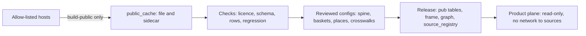

# 04 — Public Data Pack

| | |
|---|---|
| Status | Draft v0.2, corrected after independent review on 2026-11-11 (see PROGRESS.md) |
| Date | 2026-11-11 |
| Owner | albarami |
| Purpose | Define every public source the product uses, how it is fetched, licensed, checked, crosswalked and attributed, and what public data cannot give. |
| Read first | [01 Project brief](01_PROJECT_BRIEF.md), [02 Architecture](02_ARCHITECTURE.md), [03 Data contracts](03_DATA_CONTRACTS.md) |

## In brief

- Every figure marked Public comes from a source in the registry below, with URL, licence, retrieval
  date and SHA-256 recorded at fetch time. Nothing is fetched at run time.
- Fetchers run only in `./eii build-public`, only against an allow-list of hosts, and fail loudly.
- A source without stated reuse terms is validation-only: no value, derived share, title or
  geometry from it enters a release while OI-04 is open.
- The verified figures of the master design are regression examples: each has a dataset and an
  exact check. Two public figures conflict (OI-03) and are blocked from display until reconciled.
- Work in slice S2 also builds the frame (zones, districts, municipalities, gazetteer, crosswalks), the
  activity spine, the customs baskets, the hand-verified places of four showcase areas, and the
  candidate record for the flagship building.

## 1. Scope

This document owns the public half of the custodian plane: `custodian/publicdata/` and the release
tables whose names start `pub_`, plus the frame tables `zone`, `municipality`, `gazetteer` and the
public parts of `graph_node`, `graph_edge` and `source_registry`. Methods that compute on these
tables (location quotients, pay decomposition, break-even, bulk-month rule, co-location) are owned
by [07 Economic methods](07_ECONOMIC_METHODS.md). Fact fields and provenance rules are owned by
[03 Data contracts](03_DATA_CONTRACTS.md). The synthetic world reads this pack but is specified in
[05 Synthetic world and simulation](05_SYNTHETIC_WORLD_AND_SIMULATION.md).

Terms used here:

- **Portal**: the Qatar Open Data Portal, `www.data.gov.qa`, which serves datasets through an
  Explore API (version 2.1) and states a licence based on CC BY 4.0 (portal licence page, retrieved
  2026-11-11).
- **Public cache**: `data/public_cache/`, the local, uncommitted store of fetched files.
- **Registry**: the committed list of sources (`custodian/publicdata/sources.yaml`) and its copy in
  the release table `source_registry`.
- **Licence-activity count**: one activity on one commercial licence. It is not a firm, an
  establishment or a job.



## 2. Source registry

Every source the master design relies on is listed here. The key (first column) is the
`source_id` used in the registry, in lineage and in the evidence drawer. Portal dataset
identifiers are the slugs after `/explore/dataset/` in the URLs given by the project research
(retrieved 2026-11-11). Publisher names are those reported by the research; the fetcher copies the
publisher from the portal metadata at fetch time and fails if it differs (PUB-09).

### 2.1 Identity, fetch and licence

| source_id | Dataset | Publisher | How fetched | Licence |
|---|---|---|---|---|
| `lic_active` | Active certificates by municipality and business activity | Ministry of Commerce and Industry | portal `moci-active-certificates-by-municipality-and-business-activity` | CC BY (portal) |
| `lic_cancelled` | Cancelled certificates by municipality and business activity | Ministry of Commerce and Industry | portal `moci-canceled-certificates-by-municipality-and-business-activity` | CC BY (portal) |
| `lic_issued` | Issued certificates by municipality and business activity (incomplete) | Ministry of Commerce and Industry | portal `moci-issued-certificates-by-municipality-and-business-activity` | CC BY (portal) |
| `cus_imp_2025` | Qatar Imports 2025-2026 | National Planning Council | portal `qatar-imports-2025-2026` | CC BY (portal) |
| `cus_imp_2019` | Qatar Imports 2019-2024 | National Planning Council | portal `qatar-imports-2019-2024-copy` | CC BY (portal) |
| `sec_hr_ind` | Hotels and restaurants: economic indicators by activity | National Planning Council | portal `hotels-and-restaurants-statistics-economic-indicators-in-hotels-and-restaurants-by-activity1` | CC BY (portal) |
| `sec_hr_goods` | Hotels and restaurants: intermediate goods by type | National Planning Council | portal `hotels-and-restaurants-statistics-estimates-of-intermediate-goods-value-in-hotels-and-restaurants-by0` | CC BY (portal) |
| `sec_hr_serv` | Hotels and restaurants: intermediate services by type | National Planning Council | portal `hotels-and-restaurants-statistics-estimates-of-intermediate-services-value-in-hotels-and-restaurants0` | CC BY (portal) |
| `sec_hr_size` | Hotels and restaurants: establishments and employees by size | National Planning Council | portal `hotels-and-restaurants-number-establishments-employees-by-size-of-establishment-economic-activity` | CC BY (portal) |
| `sec_hr_comp_occ` | Hotels and restaurants: compensation by occupation | National Planning Council | portal `hotels-and-restaurants-statistics-estimates-of-compensation-in-hotels-and-restaurants-by-occupation1` | CC BY (portal) |
| `wage_occ` | Workers in paid employment and monthly average wage by gender and occupation | National Planning Council | portal `workers-in-paid-employment-15-years-and-above-and-monthly-average-wage-q1` | CC BY (portal) |
| `wage_act` | Workers in paid employment and monthly average wage by gender and economic activity | National Planning Council | portal `workers-in-paid-employment-15-years-and-above-and-monthly-average-wage-q` | CC BY (portal) |
| `wage_sector` | Workers in paid employment and average monthly wage by gender and sector | to be confirmed at slice S2 | portal `workers-in-paid-employment-and-average-monthly-wage-by-gender-and-sector` | CC BY (portal) |
| `wage_bands_priv` | Average monthly wage for workers in the private sector | to be confirmed at slice S2 | portal `average-monthly-wage-q-r-for-workers-in-private-sector-in-qatar-2021-2025` | to be confirmed at slice S2 |
| `work_hours_act` | Employed persons and average work hours by gender and economic activity | to be confirmed at slice S2 | portal `employed-persons-15-years-and-above-and-average-work-hours-by-gender-and-economic-activity` | to be confirmed at slice S2 |
| `util_elec` | Electricity total consumption by zone number | Kahramaa | portal `electricity-total-consumption-by-zone-number` | CC BY (portal) |
| `util_water` | Water total consumption by zone number | Kahramaa | portal `water-total-consumption-by-zone-number` | CC BY (portal) |
| `transit_monthly` | Public Transport Users | Ministry of Transport | portal `public-transport-users` | CC BY (portal) |
| `hotel_segment` | Accommodation data by segment (supply, demand, occupancy, ADR, RevPAR) | Qatar Tourism | portal `accommodation-data-by-segment-date-and-key-metrics-supply-demand-occupancy-adr-revpar` | CC BY (portal) |
| `cpi_group` | Consumer price index by expenditure group, monthly | to be confirmed at slice S2 | portal `consumer-price-index-cpi-by-expenditure-group-monthly` | CC BY (portal) |
| `prop_sales` | Weekly Real Estates Sales Bulletin | Ministry of Justice | portal `weekly-real-estates-sales-bulletin` | CC BY (portal) |
| `pop_muni` | Population and labour force by municipality | National Planning Council | portal `population-and-labour-force-by-municipality` | CC BY (portal) |
| `zone_population` | Population, area and population density by zone | to be confirmed at slice S2 | portal `population-area-and-population-density-per-square-kilometers-by-zone` | to be confirmed at slice S2 |
| `est_census` | Number of business establishments by economic activity in census (2010, 2020) | to be confirmed at slice S2 | portal `number-of-business-establishments-by-economic-activity-in-census-2010-2020` | CC BY (portal) |
| `census_hh_type_2020` | Population by type of household, gender and place of residence on the census night, December 2020 | to be confirmed at slice S2 | portal `population-by-type-of-household-gender-and-place-of-residence-on-the-census-night-december-2020` | to be confirmed at slice S2 |
| `accident` | Accident | to be confirmed at slice S2 | portal `accident` | to be confirmed at slice S2 |
| `census_2020_workbook` | Census 2020 detailed results workbook, Tables 1, 2, 151 and 152 | Planning and Statistics Authority | archived copy at `web.archive.org/web/20240422094401/https://www.psa.gov.qa/Style%20Library/PSA/CensusDetailedResults/documents/Qatar_Census_2022_Final_Results.xlsx` | none stated (OI-04) |
| `worldpop_qat_2020` | Constrained 100 m gridded population, 2020 | WorldPop | `https://data.worldpop.org/GIS/Population/Global_2015_2030/R2025A/2020/QAT/v1/100m/constrained/` | CC BY 4.0 |
| `census_zone_sector` | Census 2020 employed population by major economic sector, by zone | statistics authority public map service | `services7.arcgis.com/mffQJB8rpVa5We20/arcgis/rest/services/Population_by_Major_Economic_Sectors_by_Zone_2020_WFL1/FeatureServer` | none stated (OI-04) |
| `census_zone_occ` | Census 2020 employed population by occupation, by zone | statistics authority public map service | `.../Employed_Population_by_Occupation_by_Zone_2020_WFL1/FeatureServer` | none stated (OI-04) |
| `census_zone_hh` | Census 2020 residence for households, by zone | statistics authority public map service | `.../Residence_for_Households_by_Zone_2020_WFL1/FeatureServer` | none stated (OI-04) |
| `census_zone_lab` | Census 2020 residence for workers (labourer groups), by zone | statistics authority public map service | `.../Residence_for_Workers_Labourer_Groups_by_Zone_2020_WFL1/FeatureServer` | none stated (OI-04) |
| `census_district_pop` | Census 2020 population, district level | statistics authority public map service | `.../Population_2020_District_Level/FeatureServer` | none stated (OI-04) |
| `bnd_zone_2020` | Zone_Boundary_2020 (map layer) | statistics authority public map service | `.../Zone_Boundary_2020/FeatureServer` | none stated (OI-04) |
| `bnd_district_2020` | District_2020 (map layer) | statistics authority public map service | `.../District_2020/FeatureServer` | none stated (OI-04) |
| `bnd_hdx` | Qatar Subnational Administrative Boundaries (COD-AB) | HDX, source Planning and Statistics Authority | landing page `https://data.humdata.org/dataset/cod-ab-qat`; direct machine-readable URL to be confirmed at slice S2 | CC BY-IGO |
| `bnd_muni_2025` | Municipalities in Qatar 2025 | to be confirmed at slice S2 | portal `municipalities-in-qatar-2025` | portal terms only (PUB-12) |
| `bnd_geob` | geoBoundaries Qatar ADM1, ADM2 (fallback only) | geoBoundaries | `https://www.geoboundaries.org/api/current/gbOpen/QAT/ALL/` | CC BY 4.0 |
| `places_ovt` | Overture Places, release 2026-10-21.0, schema 2.0.0 | Overture Maps Foundation (per-record sources) | `s3://overturemaps-us-west-2/release/2026-10-21.0/theme=places/type=place/`, STAC `https://stac.overturemaps.org/2026-10-21.0/catalog.json` | CDLA Permissive 2.0 per source; Foursquare records Apache 2.0; AllThePlaces CC0 1.0 |
| `bldg_ovt` | Overture Buildings, release 2026-10-21.0 (named showcase buildings only) | Overture Maps Foundation | same release, `theme=buildings` | ODbL (theme licence) |
| `roads_osm` | OpenStreetMap Qatar extract (road network) | OpenStreetMap contributors | `https://download.openstreetmap.fr/extracts/asia/qatar-latest.osm.pbf` | ODbL 1.0 |
| `cls_isic4` | ISIC Rev.4 structure (English titles) | United Nations Statistics Division | landing page `https://unstats.un.org/unsd/classifications/Econ`; direct machine-readable URL to be confirmed at slice S2 | UN terms of use; no open licence stated |
| `ref_min_wage` | Qatar minimum wage (Law No. 17 of 2020), reference page | International Labour Organization | citation only: `https://www.ilo.org/resource/news/qatar-adopts-non-discriminatory-minimum-wage` | to be confirmed at slice S2 |
| `ref_wps_report` | Wage Protection Systems in the Gulf Cooperation Council Countries, November 2025 | International Labour Organization | citation only: `https://www.ilo.org/sites/default/files/2025-11/ILO_Beirut_Wage-Protection_Report_R10.pdf` | to be confirmed at slice S2 |
| `ref_expansion_method` | Mobility study methodology v3 | Spanish Ministry of Transport | citation only: `https://ropenspain.github.io/spanishoddata/codebooks/mitma_-_estudio_movilidad_covid-19_informe_metodologico_v3_en.pdf` | to be confirmed at slice S2 |
| `ref_gov_hours` | Flexible working system for the government sector | The Peninsula | citation only: `https://thepeninsulaqatar.com/article/04/09/2024/cgb-announces-flexible-remote-work-system-for-qatar-government-sector` | to be confirmed at slice S2 |
| `ref_friday_closure` | Services exempted from closure during Friday prayers | The Peninsula | citation only: `https://thepeninsulaqatar.com/article/17/08/2025/over-10-services-in-qatar-exempted-from-closure-during-friday-prayers-gazette` | to be confirmed at slice S2 |
| `ref_transit_hours` | Metro and tram service hours from 1 January | Qatar Tribune | citation only: `https://qatar-tribune.com/article/156642/front/metro-tram-service-hours-extended-from-january-1` | to be confirmed at slice S2 |
| `ref_summer_work` | Regulated outdoor summer working hours from 1 June | The Peninsula | citation only: `https://www.thepeninsulaqatar.com/article/31/05/2026/regulated-outdoor-summer-working-hours-come-into-force-on-june-1-in-qatar` | to be confirmed at slice S2 |
| `ref_truck_hours` | Restriction on trucks and large buses within Doha | The Peninsula | citation only: `https://thepeninsulaqatar.com/article/01/06/2024/restriction-on-movement-of-trucks-and-large-buses-within-doha:-traffic-department` | to be confirmed at slice S2 |
| `ref_ramadan_public_hours` | Reduced public-sector hours during Ramadan | Qatar News Agency | citation only: `https://qna.org.qa/en/News-Area/News/2026-2/16/qatar-sets-reduced-working-hours-for-public-sector-during-ramadan` | to be confirmed at slice S2 |
| `ref_ramadan_private_hours` | Ramadan working hours for the private sector | The Peninsula | citation only: `https://s.thepeninsula.qa/article/14/02/2026/ministry-of-labour-announces-ramadan-working-hours-for-private-sector` | to be confirmed at slice S2 |
| `ref_ramadan_transit_hours` | Metro and tram Ramadan hours | The Peninsula | citation only: `https://s.thepeninsula.qa/article/17/02/2026/doha-metro-and-lusail-tram-announce-operating-hours-in-ramadan` | to be confirmed at slice S2 |
| `ref_traffic_index` | Doha Traffic Index 2025 | TomTom | citation only: `https://www.tomtom.com/traffic-index/city/doha/` | proprietary publication; citation-only plausibility comparison |

The `.../` prefix in census and boundary rows is
`https://services7.arcgis.com/mffQJB8rpVa5We20/arcgis/rest/services/`. A portal identifier is
fetched as `https://www.data.gov.qa/api/explore/v2.1/catalog/datasets/<id>/exports/json`, and its
metadata (licence, modified date, publisher) from
`https://www.data.gov.qa/api/explore/v2.1/catalog/datasets/<id>` (URL pattern as used by the
project research, 2026-11-11).

### 2.2 Coverage, use and traps

All coverage facts below are from the project research, retrieved 2026-11-11, and must be
re-recorded by the fetcher.

| source_id | Coverage, grain, last period | Product use | Release table | Known traps |
|---|---|---|---|---|
| `lic_active` | Snapshot "as of May 2025"; municipality x activity code; 13,189 rows; modified 2025-08-04 | capability M3 licences against national rate; capability S1 context; capability S8 denominator; spine input | `pub_licence_active` | Arabic names only; 8 municipalities, nothing inside one; 6-digit legacy codes do not follow ISIC; codes predate the June 2026 recoding; not comparable with census establishments |
| `lic_cancelled` | 2015 to May 2025; year-month x municipality x code; 40,472 rows | capability S8 churn with bulk months flagged | `pub_licence_cancelled` | 1,221 rows (7,386 licences) undated; July 2020 holds 40,791 cancellations; three months hold 43% of dated cancellations |
| `lic_issued` | to May 2025; 8,259 rows; 610 codes only | none on screen; audit of incompleteness only | none | sums to 12,533; restaurants (5610101), cafeteria (5610201), general contracting (4100001) and foodstuff trade (4630901) absent; never compute net formation |
| `cus_imp_2025` | Jan 2025 to Feb 2026; 12-digit tariff line x origin x month; 252,048 rows; modified 2026-10-19 | capability S5 supplier lens; basket unit values | `pub_customs_import` | quantity units are not all kg; descriptions vary by year; bilingual origin names |
| `cus_imp_2019` | 2019 to 2024; 8-digit lines; 830,494 rows | capability S5 trend before 2025 | `pub_customs_import` | coarser code than 2025 data: basket lines must roll up (PUB-44); slug ends in `-copy` |
| `sec_hr_ind`, `sec_hr_goods`, `sec_hr_serv`, `sec_hr_size` | annual 2018 to 2022; national; activities 551, 561, 562, 563 | capability M6 unit economics and break-even | `pub_sector_accounts` | latest year 2022 (a World Cup year); national averages over all outlet types; surplus share jumped after 2019 for an unexplained reason; restaurant revenue conflict (OI-03) |
| `sec_hr_comp_occ` | to 2022; national; occupation classes | capability S2 staffing context | `pub_wage_table` | national only |
| `wage_occ` | 2020 to 2025; national; 9 occupation groups x sex | capability S3 national pay card; capability S2 public mean | `pub_wage_table` | means only, no percentiles or area; implies a different 2020 mean from `wage_act` (OI-03) |
| `wage_act` | 2020 to 2023; national; 21 activity sections x sex | capability S2 context | `pub_wage_table` | as above; includes government and domestic work |
| `wage_sector` | 2017 to 2023; national; sector x sex | capability S2 context: covered private pay versus government pay | `pub_wage_table` | national only |
| `wage_bands_priv` | 2021 to 2025; private-sector wage bands | wage-band boundary source and calibration check | `pub_wage_table` | counts occupations, not workers; exact source columns and types to be confirmed at slice S2 |
| `work_hours_act` | published years and activity grain to be confirmed at slice S2 | simulated schedule anchor | none | exact source columns, types, coverage and last period to be confirmed at slice S2 |
| `util_elec`, `util_water` | annual 2021 to 2026 (2026 = Jan to Aug); about 91 zones | capability M3 zone momentum; opening scene | `pub_zone_utility` | activity proxy, not population; mixes residential, commercial, industrial and district-cooling load; zone numbers 10 and 11 have no 2020 polygon; 2026 partial |
| `transit_monthly` | Jan 2024 to Feb 2026; national by mode (bus, Metro, Lusail Tram) | capability M3; capability M2 public context | `pub_transit_monthly` | no station or hourly detail; Lusail Tram Jan 2026 (132,609) is far below neighbouring months: flag, do not explain |
| `hotel_segment` | Jan 2014 to Mar 2025; monthly by star class | capability M2 public context | `pub_hotel_monthly` | ends March 2025; sample and census properties mixed |
| `cpi_group` | monthly 2020 to 2025 | capability M2 public context (restaurant and hotel prices) | `pub_price_index` | seasonal; confirm the group code at fetch (research records "group 011") |
| `prop_sales` | 5 Jul 2020 to 31 Dec 2025; transaction rows (26,719; 25,673 dated); 161 district names; modified 2026-08-31 | capability M3 sale price per square metre with deal count | `pub_property_sale` (aggregates only) | district names change after 2023 ('Lusail' becomes 'Lusail 69'); English property type mistranslated, use the Arabic field; few deals in Lusail; rows carry encrypted transaction and parcel identifiers that must not enter the release |
| `pop_muni` | 2020 to 2025; municipality | denominator for licences per 10,000 residents | `pub_population_municipality` | survey estimate; spelling variants of municipality names |
| `zone_population` | zone population snapshot; coverage and period to be confirmed at slice S2 | calibration cross-check | none until publisher, licence, columns and types are confirmed | no unconfirmed value enters a release |
| `est_census` | 2010 and 2020; national by activity group; 2020 total 71,203 | places coverage note; calibration ([05](05_SYNTHETIC_WORLD_AND_SIMULATION.md)) | `pub_census_national` | national only |
| `census_hh_type_2020` | Census night, December 2020; household type and place of residence | housing-class calibration | none until publisher, licence, columns and types are confirmed | expected source schema to be confirmed at slice S2 |
| `census_2020_workbook` | Census 2020; Tables 1, 2, 151 and 152 | zone totals, establishment size classes and municipal establishment counts for validation | none | no licence stated; validation-only; workbook sheet names, columns and types to be confirmed at slice S2 |
| `worldpop_qat_2020` | constrained 100 m grid, 2020 | relative within-zone family-housing weights, rescaled to separately anchored totals | none | raster schema and file URL to be confirmed at slice S2; never treated as a 2025 population total |
| `accident` | 2024 records with zone field | simulation plausibility hold-out | none | publisher, licence, exact source columns and types to be confirmed at slice S2 |
| `census_zone_*`, `census_district_pop` | December 2020; zone (91) or district (778 with population) | validation of coverage geography and calibration; `census_district_pop` writes `pub_census_district` when licensed | `pub_census_zone`, `pub_census_district` (zero rows while OI-04 is open) | no licence stated for the source; validation-only until terms are recorded (OI-04); every release still includes both tables, with zero rows until licensed |
| `bnd_zone_2020`, `bnd_district_2020` | 91 zones numbered within 1 to 99; 781 districts | validation of licensed frame geometry | none while OI-04 is open | no licence stated; validation-only; zone numbers 8, 9, 10, 11, 59, 87, 88, 89 unused |
| `bnd_hdx` | 8 municipalities, 91 zones, 781 districts in the files; geometry dated 2015-11-30; modified 2026-08-19 | bilingual names; licensed geometry | `zone`, `municipality`, `gazetteer` | description says 87 zones and 718 districts, files hold 91 and 781; 2015 geometry: check Lusail against the 2020 layer |
| `bnd_muni_2025` | 8 municipality polygons | municipality geometry | `municipality` | no dataset-level licence metadata |
| `bnd_geob` | 8 municipalities, 79 zones (some merged, e.g. '18-19') | fallback if no licensed zone geometry | `zone` (fallback) | coarser, 2015 |
| `places_ovt` | 26,383 records with country QA (26,404 in the bounding box) | capability M3 named places with network distances; capability S9 neighbours; showcase verification | `pub_place` | incomplete (PUB-50); duplicates and junk records; Meta-dominated; taxonomy changed in late 2026; 'Italian' includes pizza through the category hierarchy |
| `bldg_ovt` | 4,400 footprints in the Lusail box; 73 with a height | flagship and showcase building points | `gazetteer` | most heights unknown; ODbL |
| `roads_osm` | Qatar; about 24.5 MB; changes daily | pyvalhalla graph for `walk` and `drive` areas and network distances | none (routing graph is a build artefact) | free-flow only; "latest" URL is not a version: the hash is the pin; ODbL share-alike |
| `cls_isic4` | ISIC Rev.4 classes (now a previous ISIC version on the UNSD page) | spine validity check; English class titles | `graph_node` | no Arabic file confirmed (open question); not committed |
| `ref_min_wage` | QAR 1,000 basic plus at least 500 housing and 300 food when not provided in kind | capability S2 statutory minimum line | `pub_wage_table` (one reference row) | a legal fact, not a survey figure; `public_document`, citation-only |
| `ref_wps_report`, `ref_expansion_method`, `ref_gov_hours`, `ref_friday_closure`, `ref_transit_hours`, `ref_summer_work`, `ref_truck_hours`, `ref_ramadan_public_hours`, `ref_ramadan_private_hours`, `ref_ramadan_transit_hours`, `ref_traffic_index` | citation-only public documents | calibration rules or plausibility context in [05](05_SYNTHETIC_WORLD_AND_SIMULATION.md) | none | registry metadata only; no fetched file or dataset schema; H4 road speed is a plausibility comparison, not a hold-out |

Sources mentioned in research but **not in v1**: the 2014 to 2018 imports, Harvard Growth Lab Atlas
files (Later, L3 and L9), UN Comtrade, World Bank and ILOSTAT benchmarks, and OpenStreetMap points
of interest (cross-check aid only, PUB-55).
GADM is excluded: its licence forbids commercial use and redistribution (gadm.org licence page,
per research).

## 3. Fetcher rules

| ID | Requirement |
|---|---|
| PUB-01 | Public sources are fetched only by `./eii build-public`. No other command, test or product code opens a network connection to a source host. |
| PUB-02 | The product plane (`product/`, `web/`) contains no code path that contacts a source host; a test asserts that the product imports no fetcher module and that the API process makes no request to any source host during the guided story. |
| PUB-03 | The fetcher accepts only HTTPS, or S3 for Overture, to `www.data.gov.qa`, `services7.arcgis.com`, `data.humdata.org`, `s3.us-east-1.amazonaws.com`, `www.geoboundaries.org`, `github.com`, `raw.githubusercontent.com`, `stac.overturemaps.org`, `overturemaps-us-west-2.s3.us-west-2.amazonaws.com`, `download.openstreetmap.fr`, `unstats.un.org`, `data.worldpop.org` and `web.archive.org`. Redirect and storage hosts are checked too. A source whose direct URL or redirect host is still marked to be confirmed at slice S2 is blocked. Adding a host needs a reviewed registry change. |
| PUB-04 | Every fetched file is stored in `data/public_cache/<source_id>/<sha256>.<ext>` with a complete sidecar holding the fields of section 3.1. An entry with `kind: public_document` and `fetch_mode: citation_only` opens no network request, requires no cached file, and writes registry metadata with `sha256: "CITATION_ONLY"`. |
| PUB-05 | Writes are atomic: a file enters the cache only after its download completes, its SHA-256 is computed and its checks pass. An interrupted run leaves no partial entry. |
| PUB-06 | A failed request is retried at most three times with back-off, then the build exits non-zero with a message naming the `source_id`, the URL and the failed check. There is no silent fallback to an older file. |
| PUB-07 | Each fetched dataset declares its expected column names and types. A source whose schema is marked to be confirmed at slice S2 is blocked; a missing, renamed or retyped column fails the build. Citation-only public documents have no dataset schema. |
| PUB-08 | Each source declares an expected row-count range and last period. A count outside the range or a last period earlier than recorded fails the build. |
| PUB-09 | For portal sources, the fetcher reads the dataset metadata and records licence, publisher and modified date. A missing licence, a licence different from the registry, or a publisher different from the named publisher fails the build. A publisher or licence marked to be confirmed at slice S2 blocks that source until a reviewer records the exact metadata. |
| PUB-10 | When an upstream file changes (new SHA-256), the new version is stored beside the old one. The release manifest names exactly one hash per source, and changing it is a reviewed registry change. |
| PUB-11 | No file is committed unless its licence is stated and permits redistribution. `data/` is never committed. Committed derived files (section 6 configs, test fixtures) record the `source_id` they derive from. |
| PUB-12 | A portal dataset with no dataset-level licence metadata may be used only with `licence_basis: portal_terms` and a reviewer note in the registry; it is never committed. |
| PUB-13 | Until written terms or permission covering the intended use are recorded, sources marked `none stated` are validation-only. No raw value, derived share, title or geometry from them enters a release; affected tools return `NO_DATA`. The 2020 boundary layers are used only to check licensed HDX geometry. The same release-lineage block applies to unresolved UN classification terms. |
| PUB-14 | Transaction and parcel identifiers in `prop_sales`, and any other identifier column in a public source, are dropped before the release; only aggregates with their deal counts are stored. |
| PUB-15 | `./eii build-public` prints, for the slice S2 gate, 20 randomly drawn stored figures, each with its `source_id`, URL, filter and value, so a reviewer can check them against the source. The seed and the list are saved with the build log. |
| PUB-16 | Fetchers record retrieval time in UTC and never use a file date or a portal "modified" date as the reference period of the data. The reference period comes from the data's own period fields. |
| PUB-17 | The Overture extract is read with DuckDB from the pinned release path, filtered to the Qatar bounding box and `country = 'QA'`, and stored as Parquet. DuckDB 2.x needs `SET geometry_always_xy=true` (research note); read the current DuckDB spatial documentation before writing this step. |
| PUB-18 | ArcGIS feature services are paged at the server's stated maximum (2,000 features per request per research) until the reported total is reached; a short final total fails the build. |
| PUB-80 | Every number and comparison emitted from this pack is produced by a deterministic tested release-build function or by `eii_core.calc`, with a method card and worked regression example. The browser only formats returned facts and never calculates a displayed value. |

### 3.1 Registry and sidecar record

```yaml
source_id: util_elec
kind: public_dataset            # public_dataset | public_document
fetch_mode: fetch               # fetch | citation_only
title_en: Electricity Total Consumption by Zone Number
publisher: Kahramaa            # copied from portal metadata at fetch
fetch_url: https://www.data.gov.qa/api/explore/v2.1/catalog/datasets/electricity-total-consumption-by-zone-number/exports/json
landing_url: https://www.data.gov.qa/explore/dataset/electricity-total-consumption-by-zone-number/
licence_id: CC-BY-4.0          # one of the ids in section 4
licence_basis: dataset         # dataset | portal_terms | none_stated
licence_url: https://www.data.gov.qa/pages/license/annexes
commit_allowed: false          # true only for small derived configs and fixtures
retrieved_utc: 2026-11-11T09:00:00Z   # example value
sha256: <64 hex characters>
bytes: <integer>
source_modified: 2026-..       # portal metadata, provenance only
period_first: 2021
period_last: 2026-08
row_count: <integer>
columns: [{name: year, type: integer}, {name: zone_number, type: integer}, {name: value, type: number}]
reconciliation: none           # none | open | resolved:<decision record>
release_tables: [pub_zone_utility]
caveat_keys: [proxy_not_population, partial_latest_year]
```

## 4. Licences and attribution

Attribution is shown in three places: the evidence drawer of every Public fact chip, the Trust
centre source list, and every export (briefing pack, reviewer's GIS mirror). Attribution names the
publisher of a public dataset; it never presents a publisher as a supplier or endorser of the POC.

| Licence | Sources | Text on screen and in exports (template) | Extra duty |
|---|---|---|---|
| CC BY 4.0 (portal licence) | all portal sources | "Source: {publisher}, {dataset title}, Qatar Open Data Portal, retrieved {date}. Licensed under CC BY 4.0. {Modified: aggregated by EII.} No endorsement implied." | link to the dataset page; state modifications |
| CC BY-IGO | `bnd_hdx` | "Boundaries: Planning and Statistics Authority via HDX (COD-AB Qatar), CC BY-IGO, retrieved {date}." | link to the HDX page |
| CC BY 4.0 | `bnd_geob` (fallback) | "Boundaries: geoBoundaries, CC BY 4.0, retrieved {date}." | link |
| CDLA Permissive 2.0 | `places_ovt` records from Meta, Microsoft, PinMeTo, Uberall and other listed sources | "Data from {provider}. Available under CDLA Permissive 2.0." plus "Overture Maps Foundation, overturemaps.org, release 2026-10-21.0, accessed {date}." | any shared copy of place data carries the full CDLA Permissive 2.0 text (agreement section 2.1, cdla.dev, checked 2026-11-11) |
| Apache 2.0 | `places_ovt` records sourced from Foursquare | "Copyright 2024 Foursquare Labs, Inc. All rights reserved. Licensed under Apache 2.0; transformed to the Overture schema." | link the Foursquare NOTICE file as Overture's attribution page directs |
| CC0 1.0 | `places_ovt` records from AllThePlaces | "Data from AllThePlaces." | none |
| ODbL 1.0 | `roads_osm`, `bldg_ovt` | "© OpenStreetMap contributors. Available under the Open Database License." with a link to `https://www.openstreetmap.org/copyright` | any distributed database derived from these (for example the routing graph) is offered under ODbL |
| none stated (OI-04) | census layers, 2020 boundary layers, archived census workbook | validation-only; no release attribution is rendered | no raw value, derivative, title or geometry enters a release |
| UN terms unresolved | `cls_isic4` | validation-only until intended-use terms are recorded | no classification title or derived mapping enters a release |
| citation-only | `ref_*` | "{Publisher}, {document title}, retrieved {date}." | registry metadata only; no fetched file |

| ID | Requirement |
|---|---|
| PUB-19 | Each Public fact opens an evidence drawer labelled "Source chain" and resolves fact → release table → deterministic method and version → publisher, dataset or page, licence, retrieval date and file hash. The proposed Arabic label remains pending the owner's review. |
| PUB-20 | A composite fact lists every input and takes the least-real provenance class of those inputs. A fact without a complete source chain is not a fact: the release build fails, the validator rejects it and the Fact chip refuses to render it. |
| PUB-21 | The briefing pack and every export carry an attribution block for every source used in them; exports containing place records include the full CDLA Permissive 2.0 text and the Foursquare notice link when such records are present. |
| PUB-22 | The Trust centre lists every source in the registry with licence, retrieval date, hash prefix and the release tables it feeds. |
| PUB-23 | Place attribution is computed per displayed record from its Overture source field; a record whose source has no attribution entry is not displayed. |

## 5. The frame: geographies, gazetteer and crosswalks

Public statistics stay on their official geographies and are never blended into a protected figure
(master design section 6). The frame lets a pin find its zone, district and municipality, lets
sources join, and lets the user type a place name in either language.

| Level | Count (research, 2026-11-11) | Geometry source | Names source | Used by |
|---|---|---|---|---|
| Municipality | 8 | `bnd_muni_2025`, check against `bnd_hdx` | `bnd_hdx` (Arabic and English) | licences, population, cancellations |
| Zone | 91 polygons in the 2020 layer | `bnd_hdx` (licensed) checked against `bnd_zone_2020` | `bnd_hdx` | utility series, census shares |
| District | 781 polygons (778 with population) | `bnd_hdx`, checked against `bnd_district_2020` | `bnd_hdx`; `prop_sales` names via crosswalk | property sales |
| Grid cell | H3 resolution 9 (Greater Doha) and 8 elsewhere | computed | none | protected statistics only ([06](06_PRIVACY_AND_DISCLOSURE_CONTROL.md)) |

| ID | Requirement |
|---|---|
| PUB-24 | Release zone geometry comes from `bnd_hdx` (CC BY-IGO). The 2020 layer is used at build time only to test that every `bnd_hdx` zone matches a 2020 zone number and that Lusail's zone 69 boundary agrees; disagreements are listed in the build report. |
| PUB-25 | A committed `custodian/publicdata/review/zone_crosswalk.csv` lists every zone number seen in any source with one column per source (`bnd_zone_2020`, `bnd_hdx`, `util_elec`, census tables, `bnd_geob`) and a status: `matched`, `absent_in_source`, `merged`, `no_polygon`. Zone numbers 10 and 11 in the utility series and the merged geoBoundaries zones (for example '18-19') must appear with an explicit status. |
| PUB-26 | A utility row whose zone has no polygon is kept in national totals and listed as "zone without boundary" in the coverage note; it is never assigned to a neighbouring zone. |
| PUB-27 | A committed `municipality_names.csv` maps every spelling seen in sources (for example Al Sheehaniya and Al Shahaniya, Umm Slal and Umm Salal, Al Khor and Al Thakhira) to one municipality key. An unmapped spelling fails the build. |
| PUB-28 | A committed `district_crosswalk.csv` maps each `prop_sales` district name (Arabic and English) to one or more boundary districts, including renamed districts such as 'Lusail' and 'Lusail 69'. Unmatched names are listed and excluded from district figures, never guessed. |
| PUB-29 | A pin finds its zone, district and municipality by point-in-polygon on the pin itself. No public figure is apportioned to grid cells or to areas built by `make_area`. |
| PUB-30 | The `gazetteer` table uses the contract fields `place_key`, `kind`, `name_en`, `name_ar`, `aliases`, `lon`, `lat`, `cell`, `showcase_verified` and `source_id` for every municipality, zone, district, showcase area and flagship building. |
| PUB-31 | Arabic search keys remove diacritics and tatweel, unify alef forms, map final ta marbuta to ha and alef maqsura to ya; English keys are lower-cased with punctuation removed. The same function is used by `resolve`; keys are computed in memory and are not release columns. |
| PUB-32 | Arabic names come from `bnd_hdx` or another licensed source. Names the team writes (showcase areas, the flagship building, activity labels) are marked "pending native review" until signed off under OI-09. |
| PUB-81 | In public-only mode, `make_area` uses the fixed base-cell frame, reads no privacy-derived release unit and no Protected or Simulated table, and emits the snap report as technical metadata rather than a Synthetic fact. |
| PUB-82 | The coverage bar uses the finest licensed geography available—zone, otherwise municipality, otherwise national—and names that geography. It never uses a validation-only value or derivative. |
| PUB-83 | `pop_muni` writes `pub_population_municipality` (`municipality_code`, `period`, `indicator`, `value`, `unit`, `source_id`); `est_census` writes `pub_census_national` (`period`, `indicator`, `value`, `unit`, `source_id`); a licensed district source writes `pub_census_district` (`district_key`, `period`, `indicator`, `value`, `unit`, `source_id`). `pub_census_zone` and `pub_census_district` are present in every release; while a source is unlicensed (open item OI-04) the corresponding table has zero rows and no value from that source enters any fact. National or district census population rows never enter `pub_census_zone` as national aggregates, and population lineage never enters a geometry table. |
| PUB-84 | The closed count `indicator` names and `unit` values for the attacker-view audit (PRV-115) in `pub_population_municipality`, `pub_census_national`, `pub_census_district` and `pub_census_zone` are exactly: `residents` (`persons`), `households` (`households`), `establishments` (`establishments`), `employees` (`persons`). Indicator names are lower snake case. No other indicator is a count for audit selectors until a contract revision adds it. PUB-15 regression values not pinned in [07_ECONOMIC_METHODS.md](07_ECONOMIC_METHODS.md) at slice S2 are produced by `./eii build-public`, checked against the source by the reviewer, and written into the method cards by a slice S2 task; slice S7 fails while any remain unpinned (MTH-03). |

## 6. The activity spine

The spine links the licence activity code, the ISIC Rev.4 class, the Overture place category and,
for playbook activities, the customs basket. It powers the "We understood your question as…" chips
(capability M8) and every join between licence, survey, customs and places facts.

The May 2025 active table holds 4,755 codes. Of 249,622 licence-activity counts, 211,277 (84.6%;
2,035 codes) sit under seven-digit codes whose first four digits are an ISIC class, 11,276 (4.5%;
1,363 codes, mostly a `20xxxxx` series) under other seven-digit codes, 26,844 (10.8%; 1,336
codes) under six-digit legacy codes, and 225 (0.1%; 169 under 13 five-digit codes and 56 under
eight eight-digit codes). Among the legacy codes, 138 codes (3,163 counts) have a
prefix that only looks like an ISIC class; every mapping needs a meaning check and human sign-off.

**The legacy trap, worked example.** The 6-digit code 561000 is named for trade in spare parts and
561050 for electronic spare parts. A mapper that takes the first four digits would file both under
ISIC 5610 Restaurants. The correct result is the "not mappable" bucket. By contrast, 7-digit
5610101 (restaurant) and 5610201 (cafeteria) map to ISIC 5610 after review.

| ID | Requirement |
|---|---|
| PUB-33 | Only 7-digit codes are candidates for an ISIC mapping. A candidate maps to the ISIC class given by its first four digits only if that class exists in `cls_isic4` and a human reviewer approves that the Arabic activity name fits the class title. |
| PUB-34 | The review scope for v1 is: the 200 codes with the largest national active counts; every 7-digit code whose first two digits are 56 (food service); and every playbook code (the codes of the playbook activities and of their basket supplier activities, PUB-41). Codes outside the scope keep the status `unreviewed`. Codes that appear only in `lic_cancelled` follow the same rules. |
| PUB-35 | Offline `spine_match` proposals may use the decision-0014 gateway only to order and pre-fill the human review queue. The provider defaults to `none`; no mapping is automatic, no gateway result is a fact, and every released mapping requires recorded human sign-off. The gateway has no run-time role and no screen presence except the Proof-room lineage line. The approved list is committed as `custodian/publicdata/review/activity_spine.csv` with `code`, `code_length`, `name_ar`, `isic_class`, `status`, `reason`, `reviewed_by_role` and `reviewed_on`; ISIC titles are joined at build time. |
| PUB-36 | Status values are exactly `mapped`, `unreviewed`, `not_mappable_legacy` (6-digit and other lengths), `not_mappable_invalid_prefix`, `not_mappable_rejected`. |
| PUB-37 | ISIC-level figures include only `mapped` codes. The share of licence-activity counts in `unreviewed` and `not_mappable_*` codes is published as a coverage fact beside every ISIC-level figure, and the not-mappable bucket is visible in the spine chips. |
| PUB-38 | Each mapped ISIC class used by a playbook links to Overture categories through a reviewed allow-list (for example ISIC 5610 to `restaurant` and its Italian subcategory). Pizza is included in "Italian" only when the label on screen says "Italian or pizza". |
| PUB-39 | The spine records its code system version (`licence_codes_2025_05`). The commerce ministry began recoding activities to the GCC unified classification from 1 June 2026 (Qatar News Agency, 1 June 2026); a later snapshot with new codes needs a new reviewed version, never a silent remap. |
| PUB-40 | English labels for codes come from the ISIC class title, marked as the class title, not as a translation of the Arabic activity name. |

## 7. Playbook activities and customs baskets

The master design names the restaurant and "the other playbook activities" without listing them.
**ASSUMPTION:** the v1 playbook activities are ISIC 5610 Restaurants (flagship), ISIC 5630 Beverage
serving (coffee shops) and ISIC 5510 Short-term accommodation, because all three are covered by the
same published hotels-and-restaurants survey tables (activities 551, 561, 562, 563 per research),
so capability M6 can use one verified source family. The owner may change the list in a decision record.

Baskets answer "which countries supply this input, at what calculated unit value". A basket is an
editorial choice by the EII team, not an official classification.

| ID | Requirement |
|---|---|
| PUB-41 | Each playbook activity has one basket in `custodian/publicdata/review/baskets.yaml` with at most eight inputs (estimate from research: three activities, eight inputs each). Each input lists its tariff lines, an inclusion reason, excluded lines with reasons, the supplier ISIC class for licensed wholesale depth (for example ISIC 4630), reviewer role and date. |
| PUB-42 | Basket lines are defined at eight digits or finer, chosen from the dataset's own bilingual line descriptions. A 4-digit heading or 6-digit subheading is never a basket line. |
| PUB-43 | Tariff codes in committed files are written in dotted form (digit groups separated by dots) so no bare 8-digit or 11-digit token appears in the repository; the loader strips the dots. |
| PUB-44 | For periods covered only by `cus_imp_2019` (8-digit), a 12-digit basket line rolls up to its 8-digit parent; if that parent also holds lines excluded from the basket, the earlier-period value is marked "includes excluded lines" or not shown. |
| PUB-45 | Unit value is computed as value in QAR divided by net kg, only over rows with kg greater than zero, and labelled "calculated". Rows in other quantity units are counted separately and never converted. The valuation basis is shown as the source states it, or "not stated by the source". |
| PUB-46 | Every basket card carries the label "Basket chosen by the EII team (editorial choice)" and answers "which countries supply this", never "which company to buy from". |

**Pasta example.** Heading 1902 holds pasta and also instant noodles: in 2025, Italian goods under
the heading arrived at QAR 8.69 per kg and Saudi goods at QAR 11.45 (master design section 9), while
a judge's query of the same heading found South Korean goods at QAR 19.56 per kg (feasibility judge,
2026-11-11), consistent with noodles in the mix. A heading-level unit value therefore blends
products. The Italian-restaurant basket lists only lines whose descriptions name pasta (dry, filled
or fresh as the reviewer decides) and excludes lines that name instant noodles. The heading-level
8.69 and 11.45 are regression checks (section 10), never displayed figures.

## 8. Places

| ID | Requirement |
|---|---|
| PUB-47 | `pub_place` is built only from Overture release 2026-10-21.0, schema 2.0.0. Changing the release is a reviewed registry change that re-runs place verification for the showcase areas. |
| PUB-48 | `pub_place` holds only source-given `place_id`, names, category, coordinates, cell, source release, `source_provider`, `licence`, `confidence` and reviewed `merged_ids`. Verification is separate in `pub_place_verification`, keyed to `pub_place`, with check date, reviewer role, verification link and status. No synthetic or invented attribute (staffing, licence status, sales, footfall, survival or rating) is ever joined to a named place. |
| PUB-49 | The display threshold is confidence of at least 0.7 outside showcase areas (**ASSUMPTION:** research counts about 11,400 such records; it trims junk while keeping most named places). Inside showcase areas, the verification status overrides confidence. |
| PUB-50 | Every places answer carries the standing note "Open listings are incomplete": about 26,000 Qatar records against 71,203 establishments counted in Census 2020 (`places_ovt`, `est_census`). Places are named points, never a count of businesses; an absent category reads "not found in public places data". |
| PUB-51 | De-duplication: two records are duplicate candidates when their normalised names match in either language and they lie within 50 m (**ASSUMPTION:** a typical mall-unit spacing). Outside showcase areas the higher-confidence record is kept and the other recorded in `merged_ids`; inside showcase areas the reviewer decides. |
| PUB-52 | Each showcase area (Lusail, West Bay, Msheireb, The Pearl) is defined in `showcase_areas.yaml` by a pin at a named public landmark and the 10-minute `walk` area from it (**ASSUMPTION:** covers the flagship default of walk 5 minutes with margin). Verification covers every place in food-service categories and every place named in a prepared story answer. |
| PUB-53 | Each verified place has a status (`verified_open`, `closed_or_moved`, `not_found`, `duplicate`), check date, reviewer role and verification link in `pub_place_verification`. Results are committed as `verified_places.csv` with the licence texts of the sources it derives from (PUB-21). |
| PUB-54 | Acceptable verification sources are official directories: the tenant directory of the development, mall or district operator, the place's own official website, or a public-authority listing (**ASSUMPTION** on the last two). Review sites, delivery or booking platforms and map-search listings are not sources, and no site is scraped; checks are made by hand. |
| PUB-55 | OpenStreetMap points of interest may be viewed by the reviewer as a cross-check aid but are never merged into `pub_place` (this keeps ODbL share-alike out of the places table). |
| PUB-56 | A verified place that is `closed_or_moved` or `not_found` is hidden in showcase answers; the count of hidden records is shown in the coverage note. |

## 9. Flagship building selection

Story scene 3 places the Italian restaurant at "the chosen Lusail building". slice S2 verifies and
shortlists candidates; the owner confirms the pin and default cut-offs only after the slice S5
survival report exists. The open extract varies sharply between buildings: one candidate tower had
no restaurant within 250 m while another Lusail landmark had fifteen (master design section 6,
from a judge's check on 2026-11-11).

**Candidate list (initial):** named Lusail buildings found in the Overture buildings theme by the
project research: Manarat Lusail, Burj Al Fardan, Marina Twin Towers, Place Vendôme, Q Tower,
QiG Tower, Sendian Tower. The slice S2 builder may add candidates; each needs a footprint in `bldg_ovt`.

| ID | Requirement |
|---|---|
| PUB-57 | A candidate passes only if all checks hold: (a) named footprint in `bldg_ovt` inside zone 69 or zone 70 (Al Daayen); (b) at least 8 `verified_open` restaurants within the 5-minute walk area; (c) at least 2 `verified_open` Italian restaurants within the 10-minute walk area; (d) `make_area` builds the walk 5 and drive 10 areas without error; (e) the building is a public, commercial or mixed-use landmark, not a private residence. Thresholds (b) and (c) are **ASSUMPTION:** the minimum that makes scene 3's competitor card non-trivial. |
| PUB-58 | slice S2 records passing candidates. After the slice S5 survival report exists, the owner confirms the pin and default cut-offs. The snap and survival reports state any coarsening honestly; no privacy rule is tuned to make the area look finer. If no candidate passes, candidates are added; thresholds change only through a decision record. |
| PUB-59 | The final choice is recorded after the slice S5 survival report in `docs/decisions/NNNN-flagship-building.md`, with every candidate and check result, the places release, verification date, reviewer role, survival result, chosen building and reason, and in `custodian/publicdata/review/flagship.yaml`, which the build reads. |
| PUB-60 | The flagship record also stores the district deal count for sale prices near the building, shown on screen with any median (the 'Lusail 69' medians rest on 6 and 13 deals for 2024 and 2025 per research). |
| PUB-61 | A grid cell may hold synthetic establishments and Public places, but no synthetic establishment carries the key, name or coordinates of a `pub_place` or gazetteer entry. No fictional firm is named on a version 1 screen, and no screen places a Synthetic or Simulated attribute on a Public place. The build checks all three rules over the complete tables. |

## 10. Regression examples (master design section 9)

Each row is a test in `custodian/publicdata/tests/` marked `public_data`. These tests run at the end
of every `./eii build-public` against the cached files and block the build on failure. Census rows
run only there, because their files are never committed (PUB-13). Comparisons use unrounded source
values and round only at the end. When an upstream revision changes an expected value, the build
fails until a reviewer updates the value with a note naming the new hash (PUB-10).

| ID | Requirement: the test asserts | Dataset(s) |
|---|---|---|
| PUB-62 | Zone 69 electricity 2021 to 2025: zone 69 value for 2021 equals 429,964,072 and for 2025 equals 1,436,402,796; their ratio rounds (2 dp) to 3.34; the sum over all zones 2025 divided by 2021 rounds to 1.34 | `util_elec` |
| PUB-63 | Mean monthly pay 2020 to 2025 and its split: worker-weighted mean over populated occupation-by-sex groups (17 groups) rounds to 10,084 (2020) and 11,855 (2025); rise 1,771 and 17.6% (1 dp); Kitagawa split with average weights gives 38 within groups and 1,733 from mix; mix share from unrounded parts rounds to 97.8% (1,733 ÷ 1,771 on rounded values gives 97.9%: do not use rounded parts) | `wage_occ` |
| PUB-64 | Restaurants, activity 561, 2022: production value 6,337,897 (QAR thousand); establishments 2,086; employees 41,458; compensation 1,308,140; operating surplus 1,247,422; published average annual wage 31,579; total intermediate goods ÷ production value rounds to 40.6%, intermediate services ÷ production value to 16.5%. The slice S2 builder records the exact field and table for each value in the registry. The average wage is read, not derived: compensation ÷ employees gives about 31,553 (arithmetic check), so derivation would fail | `sec_hr_ind`, `sec_hr_goods`, `sec_hr_serv`, `sec_hr_size` |
| PUB-65 | Pasta calculated import unit value (QAR per kg), 2025: over rows with positive kg and tariff code beginning 1902, Italy Σvalue ÷ Σkg rounds (2 dp) to 8.69 and Saudi Arabia to 11.45; the Italian-restaurant basket's pasta input contains no line the basket marks as noodles; the valuation basis is shown as the source states it or as "not stated by the source" | `cus_imp_2025` |
| PUB-66 | Imports 2025: rows with year 2025 number 216,073 and their QAR value sums to 138.53 bn (2 dp in billions) | `cus_imp_2025` |
| PUB-67 | Active licence-activity counts, May 2025: 13,189 rows; Σ count 249,622; 4,755 distinct codes; the four groups reconcile to the total: 84.6% (211,277) under seven-digit codes with an ISIC-class prefix, 4.5% (11,276) under other seven-digit codes, 10.8% (26,844) under six-digit legacy codes and 0.1% (225: 169 under 13 five-digit codes and 56 under eight eight-digit codes); exactly 138 six-digit codes have a first-four-digit match to an existing ISIC class but remain `not_mappable_legacy`; the spine maps 5610101 to ISIC 5610; code 5610101 counts 361 in Al Daayen and 4,782 nationally | `lic_active` |
| PUB-68 | Cancellations 2015 to 2025: Σ count 161,055, of which 7,386 undated; July 2020 (40,791), June 2022 (14,212) and September 2024 (11,232) together divided by the dated total (153,669) round to 43%; the bulk-month rule of [07 Economic methods](07_ECONOMIC_METHODS.md) flags all three | `lic_cancelled` |
| PUB-69 | Issued series incomplete: Σ count 12,533; 610 distinct codes; zero rows for 5610101; no release table is built from this source | `lic_issued` |
| PUB-70 | Metro riders, December 2025: Metro December 2025 equals 7,375,367 and December 2024 equals 5,529,167; growth rounds (0 dp) to 33% | `transit_monthly` |
| PUB-71 | Private-employer share, two Lusail-area zones: private ÷ all employed residents rounds (0 dp) to 72% for zone 69 and 45% for zone 70; national 1,617,208 ÷ 2,050,252 rounds (1 dp) to 78.9% | `census_zone_sector` |
| PUB-72 | Restaurant licences per 10,000 residents: use the 2025 `pop_muni` values, 111,282 for Al Daayen and 3,219,982 nationally, for the May 2025 snapshot; 361 ÷ 111,282 × 10,000 rounds (0 dp) to 32 and 4,782 ÷ 3,219,982 × 10,000 rounds to 15; the period `2025` is carried on the fact | `lic_active`, `pop_muni` |
| PUB-73 | Open places extract and establishments: records with country QA in release 2026-10-21.0 number 26,383; the 2020 census establishment total equals 71,203 | `places_ovt`, `est_census` |

## 11. Reconciliation before display (OI-03)

Two pairs of public figures disagree. Neither figure of a pair may be displayed until its record is
resolved.

| Item | Figure A | Figure B | Known so far (research, 2026-11-11) |
|---|---|---|---|
| R1 Restaurant size | "restaurant revenue" QAR 8,579,462 thousand, carried from an earlier design draft | production value QAR 6,337,897 thousand, activity 561, 2022, published directly by the National Planning Council | different scope; the revenue figure was not matched to any restaurant table |
| R2 National mean pay, 2020 | QAR 10,084 from `wage_occ` | QAR 10,352 from `wage_act` | both tables report the same paid workers (2,120,841 in 2020; 2,171,062 in 2023) yet imply different means (2023: 11,714 against 11,025); cause unknown |

| ID | Requirement |
|---|---|
| PUB-74 | Sources and facts touched by R1 or R2 carry `reconciliation: open`. The release build refuses to emit any fact whose lineage includes an open item. |
| PUB-75 | R1 procedure: (1) search the portal hotels-and-restaurants tables for the field holding 8,579,462 and record dataset, field, year and activity scope; (2) compare scope on four axes: activities included (561 alone or 55 and 56), measure (revenue, sales or production value), year, and establishments covered; (3) write a decision record stating which table each card uses. Default if no match is found: the unit-economics card uses production value from `sec_hr_ind` and the revenue figure is never shown. |
| PUB-76 | R2 procedure: (1) recompute both weighted means from the fetched tables and confirm the worker totals agree; (2) record both means for every year both tables cover; (3) the national pay card uses `wage_occ` (its decomposition is by occupation; **ASSUMPTION** pending owner sign-off), names the table on the chip and shows both means in the evidence drawer; (4) the two tables are never shown as the same measure side by side; (5) optionally, a query is sent to the publisher through the portal and its answer is added to the record. |
| PUB-77 | An item closes only when its decision record exists and the owner has signed it off; the registry then sets `reconciliation: resolved:<record>`. |

## 12. What public data cannot give, and how the product says so

| Gap | Evidence (research, 2026-11-11) | What the product shows |
|---|---|---|
| Rent by district | no official open rent dataset found; the real-estate regulator's weekly press releases give rent contracts by municipality only | break-even takes the user's own rent; caveat "No official rent data by district is published" |
| Openings for restaurant codes | `lic_issued` excludes restaurant codes and sums to 12,533 against 161,055 cancellations | churn shows cancellations only, with "Openings are not published for this activity; net change is unknown" |
| An official input-output table | none found for Qatar; OECD ICIO 2025 covers the UAE and Saudi Arabia but not Qatar | first-round purchases from survey cost shares only; no multiplier anywhere (dropped, master section 3.3) |
| Licences below municipality | open tables are municipality by code | "Municipality figure: Al Daayen is wider than Lusail" |
| Zone population after 2020 | the portal zone table repeats one census snapshot | census shares dated "Census 2020" |
| Cuisine in licences | one restaurant code; no cuisine code | cuisine only from public places, labelled incomplete |
| Station or hourly ridership | national monthly totals only | monthly Public context, never hourly counts |
| Pay percentiles or pay by area | public wage tables give national means only | public means beside Synthetic bands, each marked |

| ID | Requirement |
|---|---|
| PUB-78 | Each gap above has a `caveat_key` with English and Arabic text (Arabic pending native review, OI-09), attached by the application, not by the model, whenever a question touches the gap. |
| PUB-79 | A tool asked for one of these gaps returns `NO_DATA` with the caveat key, never a zero, a proxy dressed as the figure, or an estimate from another economy. |

## Open questions and assumptions

ASSUMPTIONS (each also listed in the return message):

1. Section 7 (used by PUB-34 and PUB-41): v1 playbook activities are ISIC 5610, 5630 and 5510, all covered by the
   hotels-and-restaurants survey tables.
2. PUB-49: display threshold of confidence at least 0.7 outside showcase areas.
3. PUB-51: 50 m and matching normalised names define duplicate candidates.
4. PUB-52: a showcase area is the 10-minute walk area from a named landmark pin.
5. PUB-54: operator websites and public-authority listings count as official directories.
6. PUB-57: flagship thresholds of 8 verified restaurants (walk 5) and 2 verified Italian
   restaurants (walk 10).
7. PUB-76: the national pay card uses `wage_occ`.
8. File paths under `custodian/publicdata/` (registry, `review/`, `tests/`) are this document's
   choice within the pinned layout.

Open items touching this document: OI-03 (section 11), OI-04 (census and 2020 boundary layers:
PUB-13), OI-06 (source labels for custodian record types; public attribution follows section 4),
OI-09 (Arabic names and caveats).

Open questions: whether UNSD publishes ISIC Rev.4 titles in Arabic (not confirmed on the UNSD page,
2026-11-11; otherwise reviewed team labels); the valuation basis of the customs values; and the
publisher, licence, direct URL or source schema entries explicitly marked to be confirmed at
slice S2.

## Sources

All retrieved 2026-11-11 unless stated.

- Qatar Open Data Portal, dataset pages and Explore API v2.1, `https://www.data.gov.qa/`, for every
  portal `source_id` in section 2; licence page `https://www.data.gov.qa/pages/license/annexes`.
- Statistics authority public ArcGIS services,
  `https://services7.arcgis.com/mffQJB8rpVa5We20/arcgis/rest/services`.
- HDX, Qatar Subnational Administrative Boundaries, `https://data.humdata.org/dataset/cod-ab-qat`.
- geoBoundaries, `https://www.geoboundaries.org/api/current/gbOpen/QAT/ALL/`.
- GADM licence, `https://gadm.org/license.html` (reason for exclusion).
- Overture Maps Foundation: release catalogue `https://stac.overturemaps.org/2026-10-21.0/catalog.json`;
  places guide `https://docs.overturemaps.org/guides/places`; attribution page
  `https://docs.overturemaps.org/attribution/`.
- Community Data License Agreement Permissive 2.0, `https://cdla.dev/permissive-2-0/`.
- OpenStreetMap copyright and licence, `https://www.openstreetmap.org/copyright`; Qatar extract
  `https://download.openstreetmap.fr/extracts/asia/qatar-latest.osm.pbf`.
- United Nations Statistics Division, classifications, `https://unstats.un.org/unsd/classifications/Econ`
  and `https://unstats.un.org/unsd/classifications/Econ/isic`.
- International Labour Organization, "Qatar adopts non-discriminatory minimum wage",
  `https://www.ilo.org/resource/news/qatar-adopts-non-discriminatory-minimum-wage`.
- Planning and Statistics Authority, Census 2020 detailed results workbook, archived at the URL
  recorded for `census_2020_workbook` in section 2.1.
- WorldPop, constrained 100 m population and method note, URLs recorded for `worldpop_qat_2020`
  in section 2.1 and in [05](05_SYNTHETIC_WORLD_AND_SIMULATION.md).
- Citation-only public documents `ref_*`: publisher, title and URL are recorded in section 2.1.
- Qatar News Agency, activity classification update, 1 June 2026,
  `https://qna.org.qa/en/News-Area/News/2026-6/1/moci-launches-commercial-activity-classification-update-for-registered-companies`.
- Qatar News Agency, weekly real-estate press release (rent by municipality only), 18 October 2026,
  `https://qna.org.qa/en/News-Area/News/2026-10/18/aqarat-real-estate-sales-value-rises-in-42nd-week-of-2026`.
- OECD ICIO 2025 annex country list,
  `https://www.iioa.org/conferences/32nd/papers/files/5640_ICIO-tiva-ghg2025annex.pdf`.
- Project research and judges' checks of 2026-11-11 (public economic data, graph value, economic
  methods, public geography and statistics, feasibility and cost) for all counts and figures not
  re-fetched by the author.
