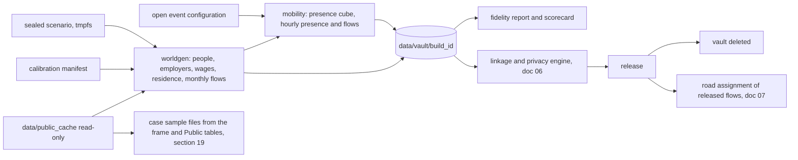

# 05 — Synthetic World and Simulation

| | |
|---|---|
| Status | Draft v0.3, amended by decisions 0016 and 0017 on 2026-11-12 |
| Date | 2026-11-12 |
| Owner | albarami |
| Purpose | Specify how the custodian plane generates the fully synthetic records, their monthly periods and the simulated presence and flow feeds, how the case sample files are made, what each parameter rests on, and how the result is checked, sealed and reproduced. |
| Read first | [01_PROJECT_BRIEF.md](01_PROJECT_BRIEF.md), [02_ARCHITECTURE.md](02_ARCHITECTURE.md), [03_DATA_CONTRACTS.md](03_DATA_CONTRACTS.md), [04_PUBLIC_DATA_PACK.md](04_PUBLIC_DATA_PACK.md), [decision 0016](decisions/0016-version-1-covers-the-whole-initiative.md), [decision 0017](decisions/0017-public-data-additions-and-public-splits.md) |

## In brief

- Every company and person in this project is invented. The generators read public inputs only, inside an operating-system sandbox, and the build checks this with a sandbox sentinel test.
- Every generator parameter, every schedule value and every rule number a generator reads sits in one calibration manifest, marked ANCHORED (to a cited public figure) or ASSUMED (with a value, a range and a sensitivity sweep), or in one declared constants module. Nothing else may set a number. A value computed from several entries is a derived calculation, never an anchor when an input is ASSUMED, and its lineage names every input (SYN-83).
- The world is raked to published margins. A fidelity report states what matches exactly and what matches within a tolerance.
- No synthetic record carries nationality, sex, gender, age or origin, or anything derived from them. Official splits by sex or nationality are Public facts only and never shape a generator ([decision 0017](decisions/0017-public-data-additions-and-public-splits.md)).
- Synthetic firms are calibrated by municipality to the census 2015 establishments (dated 2015) and the May 2025 licence counts. They carry fictional SYN names that never resemble a real name, and they open and close month by month. The months of the reference period are released as monthly periods inside one protected window ([decision 0016](decisions/0016-version-1-covers-the-whole-initiative.md)).
- A sealed scenario plants truths, traps, null areas and canaries in synthetic and simulated layers only. Its SHA-256 is committed before the build. There is one sealed world and two spare seeds.
- Movement is an aggregate presence cube, not a trace of individuals. Through `mobility.v1` it gives hour-by-hour estimated counts of people with a range, split into workers, residents and visitors, for a weekday, a Friday and a Saturday (each with the summer switch), a day in Ramadan, National Day and a major-match day, and crowd density per square kilometre. The range comes from the panel expansion.
- The seasonal shape of simulated visitors is calibrated to the monthly visits of museums and exhibitions, and their share to hotel supply by municipality. No named place's level becomes a Simulated figure.
- Traffic comes from the released hourly flows, assigned to the real road graph by the method of [07_ECONOMIC_METHODS.md](07_ECONOMIC_METHODS.md). It gives link speeds and drive-time areas by hour, always Simulated.
- Two synthetic sample files, for cases C3 and C4 of decision 0016, stand for a company's own records and stay inside the session and seat that loaded them.
- Hold-out anchors, kept out of calibration, test the result against tolerances written in this document before any run. The only permitted claim is "consistent with published anchors within stated tolerances".
- Builds are seeded and byte-identical. The vault is deleted after every build.

## 1. Scope and position

This document covers the code in `custodian/worldgen/` and `custodian/mobility/` (see the repository layout in [02_ARCHITECTURE.md](02_ARCHITECTURE.md)). It produces the synthetic stand-ins for the five record types (`business_register.v1`, `employment.v1`, `wages.v1`, `residence.v1`, `mobility.v1`). Field names and schemas are fixed by [03_DATA_CONTRACTS.md](03_DATA_CONTRACTS.md). Where this document names a field descriptively and the contract names it differently, the contract wins. Disclosure control is in [06_PRIVACY_AND_DISCLOSURE_CONTROL.md](06_PRIVACY_AND_DISCLOSURE_CONTROL.md). The public inputs, their licences and their fetchers are in [04_PUBLIC_DATA_PACK.md](04_PUBLIC_DATA_PACK.md). This document also states what the simulated flows give the road assignment of [07_ECONOMIC_METHODS.md](07_ECONOMIC_METHODS.md) (section 14), and specifies the two case sample files (section 19), which are made from the frame and the Public tables only, never from the vault, a protected table or a Simulated table ([03_DATA_CONTRACTS.md](03_DATA_CONTRACTS.md) DAT-150).

Two terms are used throughout:

- **Synthetic**: an invented record-level stand-in for a custodian feed (people, employers, wages, residence), or for a company's own records (the case sample files).
- **Simulated**: an output of a model of behaviour (presence, crowd density, flows, link speeds by hour).

Both are provenance classes on screen. Neither is evidence about Qatar. The world shows what linked records would add; it does not show what any real place is.



## 2. Rule zero and the sandbox

Rule zero: no real custodian record, field, count or parameter is read, at any stage, by any code in the repository. Generators read the public cache, the committed code and configuration, and the sealed scenario. Nothing else.

| ID | Requirement | Verified by |
|---|---|---|
| SYN-01 | `./eii build-world` must run every generator inside a bubblewrap sandbox with the network unshared. The sandbox must mount read-only: the Python environment, the repository checkout, a project-local folder of engine extensions fetched in advance (the sandbox does not mount the home directory; ARC-14 in [02_ARCHITECTURE.md](02_ARCHITECTURE.md)), `data/public_cache/`, and the decrypted scenario file on a temporary in-memory mount. The only writable path must be `data/vault/<build_id>/`. `./eii build-release` runs inside a sandbox of the same kind. | sandbox test (slice S0) and slice S4 gate |
| SYN-02 | A generator must obtain every number it uses from the calibration manifest (section 3) or from a public-cache file whose hash is listed in the public-cache manifest of [04_PUBLIC_DATA_PACK.md](04_PUBLIC_DATA_PACK.md). Literal tuning constants in generator code are forbidden. Structural constants (slot length, normalisation base, months in the window) live in one declared constants module; a lint step must flag any other numeric literal in `custodian/worldgen/` and `custodian/mobility/` except 0 and 1. | lint step; reviewer |
| SYN-03 | Each world build must write a signed input record: the bubblewrap command line, the SHA-256 of every public-cache file read, the SHA-256 of the calibration manifest, the scenario commitment hash, the code commit and the seed. | slice S4 gate |
| SYN-04 | At the slice S4 gate the build must also run once under a system-call trace of file opens (for example `strace -f -e trace=open,openat,openat2`), and a check must assert that every opened path lies inside the allowed mounts. The trace summary (paths only, no data) is kept with the build record. | slice S4 gate |
| SYN-05 | No dedicated-user-only fallback is permitted. If bubblewrap is unavailable on the build machine or in CI, an equivalent mount-namespace and network-namespace sandbox must enforce the same mounts and pass the same path and network tests; otherwise `build-world` fails. | sandbox test (slice S0) and slice S4 gate |

The sentinel test itself (a probe generator that tries to open a file outside the public cache and to open a network connection) is specified in [12_TESTING_AND_QUALITY.md](12_TESTING_AND_QUALITY.md). A design-research check on 2026-11-11 found bubblewrap 0.11.1 installed on the build machine and ran one local test with the network unshared; that is a single check, not a proof for CI, and slice S0 repeats it on the build machine and on the hosted runner. Read the current bubblewrap manual before writing the mount list.

ASSUMPTION: "public inputs only" is read as "no data input other than the public cache". Code, the calibration manifest and the scenario are authored configuration that contains no custodian data, so mounting them does not break rule zero.

## 3. The calibration manifest

The manifest is one YAML file, `custodian/worldgen/calibration_manifest.yaml` (ASSUMPTION: path). Each entry has these fields:

```yaml
- key: wage.within_cell_sigma          # dotted name, unique
  status: ASSUMED                      # ANCHORED | ASSUMED
  unit: log-QAR
  value: 0.45                          # the default used by the sealed build
  range: [0.25, 0.70]                  # ASSUMED only
  sweep: [0.25, 0.45, 0.70]            # ASSUMED only
  source_ids: []                       # ANCHORED only: ids in source_registry (doc 04)
  rule: "log-normal spread of basic pay inside occupation x activity"
  affects: [resident_pay, worker_pay, occupation_pay]
```

| ID | Requirement | Verified by |
|---|---|---|
| SYN-06 | Every entry must hold exactly one scalar parameter (or one enumerated choice) and be ANCHORED (with at least one `source_ids` entry naming publisher, dataset, URL, licence and retrieval date through `source_registry`) or ASSUMED (with explicit `value`, `range` and a `sweep` of at least the two ends and the default). An entry whose value is pinned to the release contract (`sched.block_lunch_start`, `sched.block_evening_start`) carries the pinned value and no range or sweep, and the build asserts it equals the contract's situation window. Any other status or shape fails the build. | manifest schema test |
| SYN-07 | A generator that asks for a key absent from the manifest must stop the build. | unit test |
| SYN-08 | A sensitivity sweep must rebuild a reduced-scale, non-sealed world (scale 0.05; ASSUMPTION) once per sweep value of each ASSUMED key, others at default, and report the change in a fixed indicator set: covered share, resident and worker median band in a fixed test area, share of release units suppressed under Set A, the ratio of estimated people present in `weekday_lunch` to `weekday_evening`, the visitor share of estimated people in the fixed test area, and the estimated people in each event area at the peak hour of its event day. The report is shown in the Proof room. | sensitivity report exists for every ASSUMED key |
| SYN-09 | Each synthetic fact's lineage must reference the manifest hash, so the evidence drawer can say "calibrated" or "assumed" beside the Synthetic mark. | lineage test |
| SYN-69 | A manifest validation test must run before any generator: it loads the calibration manifest and checks every entry against the schema of this section — unique dotted key, exactly one scalar parameter or enumerated choice per entry, exactly one status, and the fields that status requires (explicit `value`, `range` and `sweep` for every ASSUMED entry; `source_ids` for every ANCHORED entry). A failure stops the build before any generator starts. | manifest schema test, runs first |
| SYN-83 | An ANCHORED entry takes its value only from the public sources its `source_ids` name. A value that depends on an ASSUMED entry is never ANCHORED: a value that combines entries is a derived calculation, computed by a deterministic, tested function of the world build from the entries it names and never written into the manifest as an entry, and its lineage names every input entry with its status, every Public source and the manifest hash (SYN-09). The manifest validation test of SYN-69 fails on an ANCHORED entry whose `value` or `rule` names an ASSUMED key. | manifest schema test, with a planted ANCHORED entry that names an ASSUMED key, which must fail |

### 3.1 Starting table

Values below are the starting manifest. ANCHORED figures were retrieved on 2026-11-11 by the research agents named in Sources, and on 2026-11-12 for the sources added by [decision 0017](decisions/0017-public-data-additions-and-public-splits.md); the fetchers in [04_PUBLIC_DATA_PACK.md](04_PUBLIC_DATA_PACK.md) re-read them at build time and the build uses the fetched value, not this table. ASSUMED defaults, ranges and sweeps are engineering judgement and carry no evidence. An ASSUMED cell reads `default (low to high; sweep low/default/high)`; an enumerated cell lists its choices. A cell that reads "fixed at slice S1" has no value yet: slice S1 writes its value, range and sweep before the first world build, and until then SYN-69 stops the build. Every schedule and rule number a generator reads is a manifest entry (ASSUMED with value, range and sweep, or ANCHORED to its source) or a structural constant in the declared constants module (SYN-02); no clock time, calendar date or rule number is a code literal.

| Key | Status | Value (range; sweep) | Source or reason |
|---|---|---|---|
| `pop.municipal_total` | ANCHORED | 3,219,982 residents in 2025, by municipality | Qatar Open Data Portal, population and labour force by municipality [S1] |
| `pop.employed_total` | ANCHORED | 2,355,504 employed in 2025, by municipality | same [S1] |
| `pop.zone_share_2020` | ANCHORED | Census 2020 population by zone (2,846,118 in 87 populated zones) | Census 2020 workbook, archived copy [S2]; zone layer [S3] |
| `pop.zone_scaling_exponent` | ASSUMED | 0.5 (0 to 1; sweep 0/0.5/1) | weight on zone electricity growth 2021 to 2025 when scaling 2020 zone shares to 2025 municipal totals [S4]; 0 means uniform scaling |
| `pop.housing_split` | ANCHORED | 2020 shares by municipality: households 1,516,965; labour camps 1,326,300; public housing and institutions 2,853 | portal, population by type of household, census night 2020 [S5] |
| `pop.housing_split_drift` | ASSUMED | 0 points (minus 5 to plus 5; sweep -5/0/+5) | no post-2020 split is published; the share was 60.0% in 2015 and 46.6% in 2020 [S5], so it moves |
| `pop.labour_zone_weight` | ANCHORED | small (2 to 6 persons) and large (7 or more) labour gatherings per zone, 2020 | statistics authority census layer [S6] |
| `pop.persons_per_small_gathering` | ASSUMED | 4 (2 to 6; sweep 2/4/6) | converts small-gathering counts into a zone weight; not published |
| `pop.persons_per_large_gathering` | ASSUMED | 25 (10 to 60; sweep 10/25/60) | converts large-gathering counts into a zone weight; not published |
| `pop.within_zone_shape` | ANCHORED | constrained 100 m gridded population, 2020; used only for relative within-zone family-housing weights, rescaled to the 2025 zone targets of section 9 | WorldPop, CC BY 4.0 [S7] |
| `pop.sector_by_zone` | ANCHORED | employed residents by employer sector per zone, 2020 (private 78.9% nationally) | census layer [S6] |
| `pop.occupation_by_zone` | ANCHORED | employed residents by occupation group per zone, 2020 | census layer [S6] |
| `pop.coverage_exclusions` | ANCHORED | government entities, oil and oil-derivatives sector, armed forces and police, financial-centre employees, casual, domestic, employer's family, agriculture and shepherding | ILO regional report on wage protection systems, Nov 2025 [S8] |
| `pop.mixed_sector_coverage` | ASSUMED | `not_measured` (choices `covered` or `not_measured`; sweep both) | the report does not state it; the conservative choice shrinks the covered set |
| `pop.residence_not_measured` | ASSUMED | 3% (1% to 8%; sweep 1/3/8) | residents whose housing class or address is unknown |
| `emp.size_class_shares` | ANCHORED | 71,203 establishments: 1 to 4: 33,517; 5 to 9: 14,529; 10 to 34: 16,531; 35 to 49: 2,235; 50 to 99: 2,328; 100 to 499: 1,696; 500 and over: 367 | Census 2020 Table 151 [S2] |
| `emp.municipal_share_census_2015` | ANCHORED | each municipality's share of establishments in the census 2015 (dated 2015, and every use says so) | census 2015 establishments by municipality, `est_census_2015_muni` [S40]; [decision 0017](decisions/0017-public-data-additions-and-public-splits.md) |
| `emp.municipal_share_licences_2025` | ANCHORED | each municipality's share of active licence-activity counts, May 2025 | active licences, `lic_active` [S9]; licence-activity counts are not establishment counts, so they set a share only |
| `emp.municipal_share_census_weight` | ASSUMED | fixed at slice S1 (a weight between 0 and 1) | the weight of the census 2015 share in the derived municipal establishment target (SYN-84); no public source dates both shares to 2025 |
| `emp.growth_2020_2025` | ASSUMED | 1.0 (0.9 to 1.1; sweep 0.9/1.0/1.1) times the national ratio of 2025 to 2020 employed, applied to the Census 2020 national total to give the national establishment target | no establishment count after 2020 was found; the municipal split comes from the derived municipal establishment target (SYN-84) |
| `emp.activity_mix` | ANCHORED | active licence-activity counts by municipality and activity code, May 2025 (249,622 across 4,755 codes) | portal [S9]; licence-activity counts are not establishment counts, so they set shares only |
| `emp.activity_isic` | ANCHORED | activity spine crosswalk; unmapped codes kept as `not_mappable` | [04_PUBLIC_DATA_PACK.md](04_PUBLIC_DATA_PACK.md) |
| `emp.address_own_premises_share` | ASSUMED | 70% (50% to 85%; sweep 50/70/85) | no public source; the three address shares renormalise to 100% |
| `emp.address_office_tower_share` | ASSUMED | 20% (10% to 35%; sweep 10/20/35) | no public source; renormalised with the other address shares |
| `emp.address_shared_centre_share` | ASSUMED | 10% (5% to 20%; sweep 5/10/20) | no public source; renormalised with the other address shares |
| `emp.deployed_share.construction` | ASSUMED | 0.75 (0.6 to 0.9; sweep 0.6/0.75/0.9) | no public source |
| `emp.deployed_share.cleaning` | ASSUMED | 0.75 (0.6 to 0.9; sweep 0.6/0.75/0.9) | no public source |
| `emp.deployed_share.security` | ASSUMED | 0.85 (0.7 to 0.95; sweep 0.7/0.85/0.95) | no public source |
| `emp.deployed_share.logistics` | ASSUMED | 0.45 (0.3 to 0.6; sweep 0.3/0.45/0.6) | no public source |
| `emp.deployed_share.other` | ASSUMED | 0.02 (0 to 0.1; sweep 0/0.02/0.1) | no public source |
| `emp.multi_establishment_share` | ASSUMED | 15% (5% to 25%; sweep 5/15/25) of legal entities | no public source |
| `emp.establishments_per_multi_entity` | ASSUMED | 4 (2 to 20; sweep 2/4/20) | no public source |
| `emp.group_share` | ASSUMED | 10% (5% to 20%; sweep 5/10/20) of legal entities in a hidden group | no public source |
| `emp.legal_entities_per_group` | ASSUMED | 3 (2 to 8; sweep 2/3/8) | no public source |
| `emp.dormant_share` | ASSUMED | 15% (5% to 30%; sweep 5/15/30) of establishments with no payroll | no public source; it directly drives the licensed-versus-operating strip (see SYN-24) |
| `emp.monthly_open_rate` | ASSUMED | 0.8% (0.5% to 1.5%; sweep 0.5/0.8/1.5) of the previous month's stock (section 6.1) | public issued series is incomplete [master design section 9], so it cannot anchor openings |
| `emp.monthly_close_rate` | ASSUMED | 0.8% (0.5% to 1.5%; sweep 0.5/0.8/1.5) of the previous month's stock (section 6.1) | the public cancellation series has bulk months ([04_PUBLIC_DATA_PACK.md](04_PUBLIC_DATA_PACK.md)), so it cannot anchor closures |
| `wage.minimum` | ANCHORED | basic QAR 1,000 a month; plus QAR 500 housing and QAR 300 food when not provided | Law No. 17 of 2020, via ILO [S10] |
| `wage.mean_by_occupation` | ANCHORED | 2025 mean monthly wage by occupation group, combined across the published sex split by worker counts | portal [S11] |
| `wage.private_sector_mean` | ANCHORED | 2023 private sector, combined: about QAR 7,728 (derived here: 7,302 for 1,523,423 men and 11,150 for 189,575 women, weighted by workers) | portal [S12] |
| `wage.restaurant_annual` | ANCHORED | QAR 31,579 average annual wage, restaurants (activity 561), 2022 | master design section 9 |
| `wage.within_cell_sigma` | ASSUMED | 0.45 (0.25 to 0.70; sweep 0.25/0.45/0.70) | spread inside occupation by activity; not published |
| `wage.employer_effect_sigma` | ASSUMED | 0.20 (0.05 to 0.40; sweep 0.05/0.20/0.40) | not published |
| `wage.flat_scale_share` | ASSUMED | 25% (10% to 40%; sweep 10/25/40) of employers pay one basic per occupation | not published |
| `wage.heap_at_minimum` | ASSUMED | 40% (20% to 60%; sweep 20/40/60) of draws below QAR 1,300 basic are set to exactly QAR 1,000 | not published |
| `wage.allowance_ratio` | ASSUMED | 35% (10% to 60%; sweep 10/35/60) of basic | not published |
| `wage.overtime_incidence` | ASSUMED | 30% (10% to 50%; sweep 10/30/50) of worker-months | not published |
| `wage.overtime_share_of_basic` | ASSUMED | 10% (5% to 20%; sweep 5/10/20) of basic | not published |
| `wage.deduction_incidence` | ASSUMED | 10% (2% to 20%; sweep 2/10/20) of worker-months | not published |
| `wage.zero_pay_rate` | ASSUMED | 1% (0.2% to 3%; sweep 0.2/1/3) of worker-months | not published |
| `wage.late_filing_rate` | ASSUMED | 5% (2% to 10%; sweep 2/5/10) of employer-months in the latest month | not published |
| `wage.joiner_rate` | ASSUMED | 1.5% (0.5% to 3%; sweep 0.5/1.5/3) a month | not published |
| `wage.leaver_rate` | ASSUMED | 1.5% (0.5% to 3%; sweep 0.5/1.5/3) a month | not published |
| `wage.mover_share` | ASSUMED | 30% (10% to 50%; sweep 10/30/50) of leavers join another synthetic employer | not published |
| `wage.nominal_drift` | ASSUMED | 1% (0% to 3%; sweep 0/1/3) a year, applied once a year in January (section 7.1) | the published 2020 to 2025 rise is mostly workforce mix [master design section 9], so it is not a pay-drift anchor |
| `res.employers_per_accommodation` | ASSUMED | 3 (1 to 3; sweep 1/2/3) employer groups per accommodation site at most | stresses the dominance rule (pessimistic by design) |
| `res.accommodation_site_size` | ASSUMED | 500 (50 to 5,000; sweep 50/500/5,000) residents per accommodation site, the target mean | not published per site |
| `res.wage_sorting` | ASSUMED | 0.3 (0 to 0.6; sweep 0/0.3/0.6) rank correlation between family-housing wage and district median sale price | sale prices from the portal sales bulletin [S13] |
| `res.address_staleness` | ASSUMED | 8% (3% to 15%; sweep 3/8/15) of residents recorded at a previous cell | not published |
| `feed.identifier_noise_rate` | ASSUMED | 1% (0.5% to 2%; sweep 0.5/1/2) of identifiers carry formatting noise | exercises the contract rules in [03_DATA_CONTRACTS.md](03_DATA_CONTRACTS.md) |
| `feed.placeholder_rate` | ASSUMED | 0.2% (0.1% to 0.5%; sweep 0.1/0.2/0.5) of identifier fields hold placeholders | as `feed.identifier_noise_rate` |
| `feed.unmapped_occupation_rate` | ASSUMED | 2% (1% to 5%; sweep 1/2/5) of occupation entries are free text that maps to no group | as `feed.identifier_noise_rate` |
| `feed.duplicate_person_rate` | ASSUMED | 0.5% (0.2% to 1%; sweep 0.2/0.5/1) of person rows are duplicates | as `feed.identifier_noise_rate` |
| `mob.weekly_hours_by_activity` | ANCHORED | 2023 average actual weekly hours by activity (for example construction 50, accommodation and food 50, public administration 38) | portal [S14] |
| `mob.trip_rate.office_worker` | ASSUMED | 1.5 (1.0 to 2.5; sweep 1.0/1.5/2.5) weekday discretionary trips per person per day | see section 12.6 on why no transport-survey figure is used |
| `mob.trip_rate.shift_worker` | ASSUMED | 1.2 (0.8 to 2.0; sweep 0.8/1.2/2.0) | as `mob.trip_rate.office_worker` |
| `mob.trip_rate.outdoor_worker` | ASSUMED | 1.0 (0.5 to 1.5; sweep 0.5/1.0/1.5) | as `mob.trip_rate.office_worker` |
| `mob.trip_rate.resident_not_working` | ASSUMED | 2.2 (1.5 to 3.5; sweep 1.5/2.2/3.5) | as `mob.trip_rate.office_worker` |
| `mob.trip_rate.student` | ASSUMED | 1.6 (1.0 to 2.5; sweep 1.0/1.6/2.5) | as `mob.trip_rate.office_worker` |
| `mob.trip_rate.visitor` | ASSUMED | 2.8 (2.0 to 3.5; sweep 2.0/2.8/3.5) | as `mob.trip_rate.office_worker` |
| `mob.trip_rate_friday_factor` | ASSUMED | 1.2 (0.9 to 1.6; sweep 0.9/1.2/1.6) multiplier on the weekday rate on Fridays | not published |
| `mob.trip_rate_saturday_factor` | ASSUMED | 1.1 (0.8 to 1.5; sweep 0.8/1.1/1.5) multiplier on the weekday rate on Saturdays | not published |
| `mob.category_attraction.restaurant` | ASSUMED | 6 (0 to 10; sweep 0/6/10) | not published; mall and venue footfall were not found |
| `mob.category_attraction.cafe` | ASSUMED | 5 (0 to 10; sweep 0/5/10) | as `mob.category_attraction.restaurant` |
| `mob.category_attraction.grocery` | ASSUMED | 4 (0 to 10; sweep 0/4/10) | as `mob.category_attraction.restaurant` |
| `mob.category_attraction.retail` | ASSUMED | 5 (0 to 10; sweep 0/5/10) | as `mob.category_attraction.restaurant` |
| `mob.category_attraction.mall` | ASSUMED | 8 (0 to 10; sweep 0/8/10) | as `mob.category_attraction.restaurant` |
| `mob.category_attraction.mosque` | ASSUMED | 7 (0 to 10; sweep 0/7/10) | as `mob.category_attraction.restaurant` |
| `mob.category_attraction.park` | ASSUMED | 4 (0 to 10; sweep 0/4/10) | as `mob.category_attraction.restaurant` |
| `mob.category_attraction.culture` | ASSUMED | 5 (0 to 10; sweep 0/5/10) | as `mob.category_attraction.restaurant` |
| `mob.category_attraction.entertainment` | ASSUMED | 6 (0 to 10; sweep 0/6/10) | as `mob.category_attraction.restaurant` |
| `mob.category_attraction.other` | ASSUMED | 1 (0 to 10; sweep 0/1/10) | every public-place category that maps to no group above, through the reviewed category mapping held with the activity spine ([04_PUBLIC_DATA_PACK.md](04_PUBLIC_DATA_PACK.md)) |
| `mob.work_decay_beta` | ASSUMED | 0.08 (0.04 to 0.15; sweep 0.04/0.08/0.15) per minute | no public commuting matrix exists [S35 research note] |
| `mob.discretionary_decay_beta` | ASSUMED | 0.12 (0.06 to 0.25; sweep 0.06/0.12/0.25) per minute | not published |
| `mob.pt_share` | ASSUMED | 5% (2% to 10%; sweep 2/5/10) of trips by bus, metro or tram | needed only for hold-out H3 |
| `mob.summer_discretionary_proxy` | ANCHORED | 2025 mean of July and August metro riders divided by the 2025 monthly mean; an ANCHORED proxy for discretionary-trip seasonality, not a visitor count or visitor-share estimate; it scales the discretionary trips each person makes in summer, while the number of visitors follows `mob.visitor_month_shape` | portal, public transport users [S15] |
| `mob.summer_resident_absence` | ASSUMED | 10% (0% to 25%; sweep 0/10/25) of family-housing residents absent in summer | not published |
| `mob.ramadan_evening_factor` | ASSUMED | 1.3 (1.0 to 1.8; sweep 1.0/1.3/1.8) times regular evening discretionary trips | not published |
| `mob.hotel_occupancy` | ANCHORED | summed demand divided by summed supply of `pub_hotel_monthly` (`hotel_segment`), over the twelve complete months ending at the latest month the fetcher finds (April 2024 to March 2025 as registered in [04_PUBLIC_DATA_PACK.md](04_PUBLIC_DATA_PACK.md)) and over all star classes; anchors the visitor segment's lodging-place level (section 12.8) | Qatar Tourism, accommodation data by segment [S36] |
| `mob.visitor_month_shape` | ANCHORED | each calendar month's share of its year in visits to museums and exhibitions, summed over venues and averaged over the complete years fixed at slice S1; a proxy for the seasonal shape of visitors, never a visitor count or a venue's level | `visits_museum` [S37]; [decision 0017](decisions/0017-public-data-additions-and-public-splits.md) |
| `mob.visitor_share_by_municipality` | ANCHORED | each municipality's share of hotels and hotel apartments, latest year; counts of facilities, not rooms or guests | `hotels_muni` [S39]; [decision 0017](decisions/0017-public-data-additions-and-public-splits.md) |
| `mob.rooms_per_hotel_facility` | ASSUMED | fixed at slice S1 | the pack holds no room count by municipality |
| `mob.guests_per_occupied_room` | ASSUMED | fixed at slice S1 | not published in the pack |
| `mob.split_shift_share` | ASSUMED | 20% (0% to 40%; sweep 0/20/40) of long-shift workers | no citable source was found [S16 research note] |
| `mob.panel_penetration` | ASSUMED | 10% (5% to 20%; sweep 5/10/20) of people carry a panel device | stands in for a telecom market share |
| `mob.range_multiple` | ASSUMED | fixed at slice S1, before any simulated row is read | multiple of the sampling spread that sets the ends of every presence range (section 13, SYN-77); a rule value of PRV-59, not a confidence level |
| `mob.expansion_cap` | ANCHORED | 50; home zones with a larger expansion factor are dropped | Spanish transport ministry mobility-study methodology [S17] |
| `sched.block_early_start` | ASSUMED | 04:00 (03:30 to 05:00; sweep 03:30/04:00/05:00) | release-block boundary; not sourced |
| `sched.block_morning_start` | ASSUMED | 07:00 (06:30 to 08:00; sweep 06:30/07:00/08:00) | release-block boundary; government arrival window starts 06:30 [S22] |
| `sched.block_lunch_start` | ASSUMED | 12:00 (pinned to the release contract's `weekday_lunch` hour window) | release-block boundary; the build asserts equality with the contract |
| `sched.block_afternoon_start` | ASSUMED | 14:00 (13:30 to 15:00; sweep 13:30/14:00/15:00) | release-block boundary; not sourced |
| `sched.block_evening_start` | ASSUMED | 19:00 (pinned to the release contract's `weekday_evening` and `friday_evening` hour windows) | release-block boundary; the build asserts equality with the contract |
| `sched.block_late_start` | ASSUMED | 22:00 (21:30 to 23:00; sweep 21:30/22:00/23:00) | release-block boundary; not sourced |
| `sched.school_day_start` | ASSUMED | 06:30 (06:00 to 07:00; sweep 06:00/06:30/07:00) | no licensed public source was used |
| `sched.school_day_end` | ASSUMED | 13:30 (13:00 to 14:00; sweep 13:00/13:30/14:00) | no licensed public source was used |
| `sched.friday_prayer_start` | ASSUMED | 11:30 (11:00 to 12:00; sweep 11:00/11:30/12:00) | prayer times were not sourced |
| `sched.friday_closure_minutes` | ANCHORED | 90 | Ministerial Decision No. 80 of 2025 [S23] |
| `sched.summer_start` | ANCHORED | 1 June | the published outdoor-work ban window defines the summer season [S25] |
| `sched.summer_end` | ANCHORED | 15 September | as `sched.summer_start` |
| `event.national_day.*`, `event.match_day.*` | ASSUMED | base day types `friday` for National Day and `weekday` for the match day (choices `weekday`, `friday`, `saturday`; sweep all three); every numeric entry fixed at slice S1 (section 12.7 lists the entries) | no public source in the pack describes movement on these days; a venue's capacity, ticketing or attendance is never used |
| `name.min_edit_distance` | ASSUMED | fixed at slice S1 | smallest edit distance allowed between a normalised synthetic name and any real name (SYN-20) |

The published rules of section 12.5 are manifest entries as well: one ANCHORED entry per rule, carrying every number the rule states (hours, windows, dates) beside its `source_ids`, so that no named function of SYN-49 reads a literal.

## 4. The frame

| ID | Requirement | Verified by |
|---|---|---|
| SYN-10 | The world must use the frame built in slice S2 ([04_PUBLIC_DATA_PACK.md](04_PUBLIC_DATA_PACK.md)): 8 municipalities, the official zones with a zone-number crosswalk between sources, and the fixed H3 grid at resolution 9 in Greater Doha and 8 elsewhere. Generators never build their own geography. | frame hash in input record |
| SYN-11 | Every synthetic person, establishment, worksite and accommodation site must be located to a grid cell. No synthetic record carries a coordinate, a street, a building or a gazetteer reference. | schema test |
| SYN-12 | The world must have a reference period of the 24 months January 2024 to December 2025, released as monthly periods ([decision 0016](decisions/0016-version-1-covers-the-whole-initiative.md)). Residents and employers are built and raked as of December 2025, and every earlier month is derived from that stock by the monthly flows of section 7.1. Wage records cover every month of the window; the incomplete latest month is never released (section 7). All the months sit inside one protected window: its protected `period` is the span of its months, and the `window_key` formula, one `window_key` per `world_seed` and the freeze rules of AGENTS.md rule 12 are unchanged. ASSUMPTION: chosen to sit on the 2025 municipal anchors; the number of months shown first is fixed at the slice S1 gate. | schema test |

Zone counts differ by source (91 polygons in the 2020 boundary layer, 92 zone numbers in the portal table, 79 merged polygons in geoBoundaries) [S3, S18]. The crosswalk resolves this in slice S2, not here. The census zone and district layers and the archived census workbook state no licence: they are fetched at build time and never committed (OI-04).

## 5. People

Each synthetic person has exactly these analytic attributes: home cell, housing class, activity status, occupation group, employer sector, coverage class, and (if employed) employer establishment.

| Attribute | Values |
|---|---|
| housing class | `family_housing`, `labour_accommodation`, `institution`, `unknown` |
| activity status | `employed`, `not_employed`, `student` |
| occupation group | the groups of the published census and labour-force tables (list fixed in doc 04) |
| employer sector | `private`, `government`, `government_company`, `mixed`, `household`, `other` |
| coverage class | `covered_private` (a job the wage-protection rules cover) or `not_measured` |

| ID | Requirement | Verified by |
|---|---|---|
| SYN-13 | No synthetic or protected record (person, establishment, employment, wage or residence), no simulated presence or flow row, no case sample file, and no output derived from them may carry nationality, country of origin, language, religion, sex, gender or age, or any field or segment derived from those attributes. No person carries a name; establishments carry only the fictional names of SYN-20. A schema test must fail on any such column, and a review must reject any segment defined by them. Official figures split by sex or nationality exist only as Public facts with their source and year, on the source's own geography and categories. None is joined to a synthetic record, used to segment synthetic records or simulated presence, apportioned to a drawn area or combined with a protected figure, and no split value reaches a generator ([decision 0017](decisions/0017-public-data-additions-and-public-splits.md)): an anchor published only with such a split enters the manifest already combined across the split by worker counts, as `wage.mean_by_occupation` and `wage.private_sector_mean` do. Simulated visitors carry no origin; visitor source markets are Public facts of `visitors_markets` on their own geography. | schema test; reviewer |
| SYN-14 | Coverage class must be `covered_private` only when the employer sector is `private` (or `mixed`, if `pop.mixed_sector_coverage` says so) and the establishment's activity and the job are not in `pop.coverage_exclusions`. All other employed people are `not_measured`, and they never receive a wage record. | unit test |
| SYN-15 | Person identifiers must have the form `SYN-P-` followed by an eight-character body from the Crockford base-32 alphabet, with at least two letters and no run of more than four digits (the rules of DAT-12 and DAT-13 in [03_DATA_CONTRACTS.md](03_DATA_CONTRACTS.md)). They are generated by a seeded, collision-free keyed permutation of a counter, never by random draw; any duplicate fails the build. They never encode an attribute. | identifier scan; DAT-12/DAT-13 conformance |

Housing classes map from the census types: households to `family_housing`, labour camps to `labour_accommodation`, public housing and institutions to `institution` (ASSUMPTION: the published label groups public housing with institutions). Labour-accommodation residents are placed by zone weight from labour gatherings, then to cells with industrial or mixed land use; family-housing residents follow the gridded population surface inside each zone. Gridded surfaces cannot tell a villa from a large labour camp, which is why the two classes are placed by different rules [S16 research note].

## 6. Employers and the register stand-in

Each establishment belongs to one legal entity; a legal entity may sit in one hidden employer group. The register stand-in (`business_register.v1`) carries establishments and legal entities; the group is held only in the vault for the dominance tests in [06_PRIVACY_AND_DISCLOSURE_CONTROL.md](06_PRIVACY_AND_DISCLOSURE_CONTROL.md).

| ID | Requirement | Verified by |
|---|---|---|
| SYN-16 | Each establishment must carry: a fictional name (SYN-20), a size class (the seven census classes), a commerce activity code drawn from the May 2025 public code list, its ISIC Rev.4 class from the activity spine or `not_mappable`, a registered-address type (`own_premises`, `office_tower`, `shared_business_centre`), a registered cell, a deployed share of staff, and open and close months (section 6.1). | conformance suite |
| SYN-17 | The activity code is the pre-recode ("legacy") commerce code. The world must keep both the code and the ISIC class because the code list was recoded to the GCC unified classification from 1 June 2026 [S19], and because six-digit legacy codes do not follow ISIC (561000 is spare-parts trade, not restaurants; master design section 9). | spine test |
| SYN-18 | Deployed staff must be assigned to simulated worksite cells that exist only inside the simulator. They never appear in the register. Worker pay by workplace must exclude them; they count only as "registered here, working elsewhere" (doc 06). | linkage test |
| SYN-19 | Establishment identifiers use `SYN-E-`, legal entities `SYN-L-`, employer groups `SYN-G-` and salary files `SYN-F-`; with `SYN-P-` persons these five are the only allowed forms. Bodies are six Crockford base-32 characters for `SYN-E-`, `SYN-L-` and `SYN-G-` and eight for `SYN-P-` and `SYN-F-`, each with at least two letters and no run of more than four digits, generated by a seeded, collision-free keyed permutation of a counter, never by random draw; any duplicate within a kind fails the build (DAT-12, DAT-13 in [03_DATA_CONTRACTS.md](03_DATA_CONTRACTS.md)). | identifier scan; DAT-12/DAT-13 conformance |
| SYN-20 | Every establishment carries a fictional name from a committed lexicon of invented syllables, with the visible token "SYN". Names are drawn independently per establishment and never encode its legal entity, group, size, activity or any other attribute, so no two names reveal a shared legal entity or hidden group. A name is normalised by case-folding, unifying Arabic letter variants and removing the token "SYN". The build must fail if a normalised synthetic name equals a normalised real place or business name, contains one or is contained in one as a whole-word sequence, or is fewer than `name.min_edit_distance` edits from one, over every real name the build holds: `pub_place`, the gazetteer, every public listing of real businesses, the company names of `fdi_projects`, and the venue and health-centre names of the crosswalks (BRF-31; [decision 0016](decisions/0016-version-1-covers-the-whole-initiative.md)). The name generator skips any candidate that fails this test, and the build check is the guard. | name-collision test |
| SYN-21 | No synthetic establishment may carry the key, the name or the coordinates of a public place, a gazetteer entry or a real business, including the companies of `fdi_projects`. A named synthetic firm is shown only with its Synthetic mark and only with its fictional name, activity, size band (derived inside the vault from the establishment's jobs in the last month of the window, on the `outlet_register` size bands of [03_DATA_CONTRACTS.md](03_DATA_CONTRACTS.md), joined as PRV-125 of [06_PRIVACY_AND_DISCLOSURE_CONTROL.md](06_PRIVACY_AND_DISCLOSURE_CONTROL.md) requires) and area (the release unit that holds it, or coarser where 06 requires). Its own wages, wage bill and headcount are never shown, and a list that names firms obeys the minimum, dominance and complement rules of 06 like any protected figure ([decision 0016](decisions/0016-version-1-covers-the-whole-initiative.md)). A synthetic firm is never drawn as a named point, never placed at a real address or building, and never joined to a public place, a real business or an FDI project. No screen places a synthetic or simulated attribute on a public place. A grid cell is an area and may hold both synthetic establishments and public places. The build checks these rules over the complete `pub_place`, `gazetteer` and `fdi_projects` tables. | build check |
| SYN-22 | Legal entities with several establishments must exist in the register, so that joining on the registration alone is visibly wrong (contract requirement 1 in the master design). | conformance suite |
| SYN-23 | Hidden groups must be planted so that two or more legal entities with no shared identifier share one group. The dominance tests use the group, never the legal entity alone. | privacy test (doc 06) |
| SYN-24 | The licensed-versus-operating strip (capability S1 of the master design's value stack, not slice S1) must state in its evidence drawer that the dormant share is the ASSUMED parameter `emp.dormant_share`; the strip demonstrates the method, not a finding about operating outlets. | provenance audit |
| SYN-84 | The establishment target of each municipality is a derived calculation (SYN-83), not a manifest entry. One deterministic, tested function of the world build computes `share_j = w × c_j + (1 − w) × l_j` and `target_j = share_j × T`, where `c_j` is `emp.municipal_share_census_2015`, `l_j` is `emp.municipal_share_licences_2025`, `w` is `emp.municipal_share_census_weight` and `T` is the national establishment target of `emp.growth_2020_2025`. The lineage of every target names all three inputs: the two Public sources (`est_census_2015_muni` and `lic_active`, through their ANCHORED entries) and the ASSUMED weight with its value, beside the inputs of `T` and the manifest hash (SYN-09). The evidence drawer calls the target calculated from two anchors and an assumption, never anchored. Census 2020 Table 152 stays out of the calculation and checks its result as hold-out H6. Fixture: two municipalities with census shares 0.6 and 0.4, licence shares 0.5 and 0.5, `w` = 0.25 and `T` = 1,000 give shares 0.525 and 0.475 and targets 525 and 475. | unit test on the fixture; lineage test that every target names both Public sources and the weight, with a planted lineage that lacks any one of the three, which must fail |

Size classes and the national total come from the Census 2020 establishment tables (71,203 establishments; 1,657,346 persons engaged) [S2]. The establishment target of each municipality blends two ANCHORED shares, the census 2015 establishments by municipality [S40], dated 2015, and the May 2025 shares of active licence-activity counts [S9], with the ASSUMED weight `emp.municipal_share_census_weight`; it is a derived calculation, not an anchor (SYN-84; [decision 0017](decisions/0017-public-data-additions-and-public-splits.md)). Census 2020 Table 152 stays out of calibration and checks the result as hold-out H6. Activity shares come from licence-activity counts, which do not reconcile with census establishments [S35 research note]; the world therefore takes counts from the censuses and shares from the licences, and says so. The evidence drawer of every synthetic firm figure names the census year 2015 beside the licence date.

### 6.1 Named firms, births and closures

Synthetic firms may be named, listed, ranked and suggested as prospects, partners or suppliers ([decision 0016](decisions/0016-version-1-covers-the-whole-initiative.md)). A synthetic firm is an establishment of the register stand-in. Its density on the map and every list that names it are business-register figures: they are released only at release-unit grain under [06_PRIVACY_AND_DISCLOSURE_CONTROL.md](06_PRIVACY_AND_DISCLOSURE_CONTROL.md), and they snap to whole release units with the snap sentence of DES-101, like every protected figure. A ranking or a suggestion is the output of tested code of [07_ECONOMIC_METHODS.md](07_ECONOMIC_METHODS.md) over criteria the user can see and change, with its rank-stability sentence; it is never advice to act.

| ID | Requirement | Verified by |
|---|---|---|
| SYN-72 | Each month of the reference period, establishments must open at `emp.monthly_open_rate` and close at `emp.monthly_close_rate` of the previous month's stock, drawn by municipality and activity in proportion to that stock (ASSUMPTION). An establishment exists from its open month to its close month. The openings and closures view reads synthetic births and closures by area and month, released under 06 and marked Synthetic. They sit beside the public licence issues and cancellations, which stay Public facts on their official geography; the two are never added together, netted or calibrated against each other, and no net formation is computed from the incomplete issued series ([04_PUBLIC_DATA_PACK.md](04_PUBLIC_DATA_PACK.md)). | unit test; release test |
| SYN-73 | No generator reads a value from `fdi_projects` or `investqa_pages`. Only the name test of SYN-20, which the name generator also uses to skip candidates, reads the company names of `fdi_projects`. No synthetic firm is joined to, matched with or calibrated from an FDI project or any real business ([decision 0017](decisions/0017-public-data-additions-and-public-splits.md)). | input record (SYN-03); reviewer |

## 7. Wages

`wages.v1` holds one record per covered person, employer and month: `pay_period` (YYYY-MM), basic, allowances, overtime, deductions, net, working days. Field names are fixed in [03_DATA_CONTRACTS.md](03_DATA_CONTRACTS.md).

| ID | Requirement | Verified by |
|---|---|---|
| SYN-25 | Every covered employment spell must have one record per month it is open in the 24-month window. Joiners start mid-window, leavers end mid-window, movers carry two spells with different employers. | conformance suite |
| SYN-26 | Net must equal basic plus allowances plus overtime minus deductions, exactly, on every record. | fidelity check F9 |
| SYN-27 | Basic must be at least QAR 1,000 on every record that is not a zero-pay month. Where the employer does not provide housing or food (family-housing workers), allowances must be at least QAR 800 (500 housing plus 300 food). Labour-accommodation workers are treated as provided with housing and food (ASSUMPTION). | fidelity check F10 |
| SYN-28 | Levels: basic is drawn log-normal around a cell mean set by occupation group and activity, with cell means scaled to target `wage.private_sector_mean` for the covered mean and `wage.restaurant_annual` for restaurants. The ordering of occupation means must follow `wage.mean_by_occupation`. | fidelity checks F11 to F13 |
| SYN-29 | Assumed realism: an employer effect, flat pay scales, heaping at exactly QAR 1,000, zero-pay months (net 0, working days kept, an arrears pattern), late filing that leaves the latest month incomplete, and monthly joiners, leavers and movers, each set only by its manifest key. | unit tests per key |
| SYN-30 | The public private-sector wage-band table counts occupations, not workers [S20]; it must not be used as a worker distribution. | reviewer |

The late-filing rule creates an incomplete December 2025 on purpose. The privacy engine must exclude it (master design section 7); the trap in section 10 checks that it does.

### 7.1 Month to month

The months of the reference period are released as monthly periods inside one protected window (SYN-12). Each month passes the same disclosure controls as a single period, under one treatment for the whole window ([06_PRIVACY_AND_DISCLOSURE_CONTROL.md](06_PRIVACY_AND_DISCLOSURE_CONTROL.md)). In the generator, employment, wages and firms change from one month to the next only through the flows below; nothing else moves between months.

| What | How it changes from one month to the next |
|---|---|
| Firms | births and closures of SYN-72. A closing establishment ends its spells in its close month; an opening one starts its spells from its open month. Dormant establishments (`emp.dormant_share`) have no spell in any month. |
| Employment | spells start at `wage.joiner_rate` and end at `wage.leaver_rate` of the previous month's covered stock. A share `wage.mover_share` of leavers, including the staff of a closing establishment, start a spell with another synthetic employer in the next month (ASSUMPTION); the others leave the covered population. |
| Wages | basic stays fixed within a spell, except for `wage.nominal_drift`, applied once a year in January (ASSUMPTION). Overtime, deductions and zero-pay months are drawn per worker-month at their manifest rates. A flat-scale employer keeps one basic per occupation in each month. |
| Residence | one home cell and housing class per person for every month the person is present (ASSUMPTION: no residential move inside the window, apart from the stale addresses of SYN-33). |
| Latest month | incomplete by late filing (SYN-29); the privacy engine excludes it, so it is never released. |

Month-to-month change in an area's pay therefore comes only from joiners, leavers, movers, births and closures, the monthly draws and the yearly drift. The planted truth "an area whose mean pay rises only because its worker mix changed" (section 10) tests that released wage trends separate pay from worker mix.

| ID | Requirement | Verified by |
|---|---|---|
| SYN-74 | The December 2025 stock must be built and raked first (sections 5, 6 and 9). Every earlier month is derived from it backwards by the seeded flows above, so the exact checks of section 9 hold for December 2025 and an earlier month differs from it only by those flows. People and establishments present only before December 2025 are generated by the same rules and are not counted in the December 2025 margins. | unit test; fidelity report |

## 8. Residence

`residence.v1` maps a person token to a cell code and housing class, and nothing finer.

| ID | Requirement | Verified by |
|---|---|---|
| SYN-31 | Labour-accommodation residents must be housed with their employer: each accommodation site holds staff of 1 to `res.employers_per_accommodation` employer groups (default 3). This clustering is deliberately pessimistic, to make the dominance rule work hard. | fidelity check F14 |
| SYN-32 | Family-housing residents must be sorted mildly by wage toward districts with higher median sale prices, at the rank correlation set by `res.wage_sorting`. | fidelity check F15 |
| SYN-33 | A share `res.address_staleness` of residents who moved must keep their previous cell. A share `pop.residence_not_measured` must carry the housing class `unknown` (a separate value, not a missing field); the housing split shows them as its own `unknown` row, never as zero and never under the coverage label "not measured", which means only that a person has no pay in the wage records ([06_PRIVACY_AND_DISCLOSURE_CONTROL.md](06_PRIVACY_AND_DISCLOSURE_CONTROL.md), PRV-39). | unit test |

## 9. Raking to published margins and the fidelity report

The people table is built as weighted cell counts (zone by housing class by sector by occupation by activity status), raked by iterative proportional fitting to the anchored margins, then integerised by controlled rounding so that the exact margins hold in whole people. Zone targets for 2025 are the 2020 zone shares within each municipality, multiplied by `(electricity 2025 / electricity 2021) ^ pop.zone_scaling_exponent`, renormalised to the 2025 municipal total. This is a stated rule, not a published estimate: no zone population after December 2020 was found [S35 research note]. Every check below is computed by a deterministic, tested function of the build; nothing in this section is produced by a model.

| ID | Requirement | Verified by |
|---|---|---|
| SYN-34 | `./eii build-world` must write a fidelity report (machine-readable and one page for the Proof room) with every check below, its target, its result and pass or fail. A failed exact check stops the build. A failed tolerance check stops the slice S4 gate. | slice S4 gate |
| SYN-35 | Tolerances in the fidelity table are fixed by this document. Changing one needs a decision record and shows the old and new value in the report. | reviewer |

| Check | Target | Rule |
|---|---|---|
| F1 | residents by municipality, 2025 | exact |
| F2 | employed by municipality, 2025 | exact |
| F3 | housing class by municipality (2020 shares on 2025 totals, plus drift) | exact |
| F4 | residents by zone against the scaled target | exact |
| F5 | covered plus not-measured equals employed, by municipality | exact |
| F6 | no nationality, sex, gender or age column in any synthetic or simulated table; identifier forms; zero name collisions or resemblances (SYN-20) | exact |
| F7 | occupation shares by zone (zones with 1,000 or more employed) | within 2 percentage points |
| F8 | employer-sector shares by zone (same zones) | within 2 percentage points |
| F9 | net identity on every wage record | exact |
| F10 | minimum-wage floor on every non-zero-pay record | exact |
| F11 | covered mean monthly wage (2025 months) against `wage.private_sector_mean` | within 10% (anchor year 2023) |
| F12 | ordering of covered occupation means against `wage.mean_by_occupation` | identical order |
| F13 | restaurant (ISIC 5610) mean annual pay against QAR 31,579 | within 15% (anchor year 2022) |
| F14 | accommodation sites with more than `res.employers_per_accommodation` employer groups | zero |
| F15 | rank correlation of family-housing wage with district sale price | within 0.1 of `res.wage_sorting` |
| F16 | establishment size-class shares, national | within 1 percentage point |
| F17 | establishments by municipality against the derived municipal establishment target (SYN-84) | within 2% |
| F18 | activity shares by municipality, 100 largest codes | within 0.5 percentage points |
| F19 | simulated visitor presence by month of 2025 (each month's share of the year, from the cube's daily visitor values) against `mob.visitor_month_shape` | largest monthly difference within the tolerance fixed at slice S1; a calibration fit, never a hold-out |
| F20 | simulated visitors by municipality against `mob.visitor_share_by_municipality` | exact |

ASSUMPTION: the tolerances F7 to F18 are proposals from this document; they are wide where the anchor year differs from the reference year. The tolerance of F19 is written into this table at slice S1, before the first world build, and SYN-35 governs it from then on. A failed F19 is remedied by a change of the visitor model, recorded in a decision, never by a wider tolerance.

## 10. The planted layer and sealing

The scenario file holds what is planted. Its schema is public and committed (`custodian/worldgen/scenario_schema.json`; ASSUMPTION: path). Its contents for the sealed world are not.

| Type | Purpose | Examples by type |
|---|---|---|
| Truth | a pattern the released statistics must show | a high resident-pay area with low daytime presence; a lunch-strong, evening-weak area; a cluster of new establishments in one activity across a few cells; an area whose mean pay rises only because its worker mix changed |
| Trap | a pattern that must be flagged, not read naively | a contractor registered in an office tower with most staff deployed; a single-employer accommodation cell; dormant licences; an affluent area that is mostly not measured; an incomplete latest month; a shared business-centre address holding hundreds of firms |
| Null area | an area where nothing is planted and nothing should be found | two areas |
| Canary | a record the attack suite must fail to recover with controls on | a very high earner; a small affluent cell of about 40 people; one sector with three firms in one area, which also serves the attack that links firm lists with area figures; a high earner who joins an employer in a small area in one month of the window, for the cross-month differencing attack ([decision 0016](decisions/0016-version-1-covers-the-whole-initiative.md)); scenario-labelled hidden-group and aggregate mobility targets, each with a typed recovery predicate of [06_PRIVACY_AND_DISCLOSURE_CONTROL.md](06_PRIVACY_AND_DISCLOSURE_CONTROL.md) (PRV-116). The mover canary is one person who changes employer group between two adjacent months of the window (PRV-75); a mover between two protected windows belongs only to a deployment that publishes successive windows ([17_DEPLOYMENT_HARDENING.md](17_DEPLOYMENT_HARDENING.md) section 3), because version 1 holds one protected window |

| ID | Requirement | Verified by |
|---|---|---|
| SYN-36 | Plants must live only in synthetic and simulated layers. No plant may reference a gazetteer entry, a public place, or a real name. Plants are placed by grid cell. | scenario schema test |
| SYN-37 | No plant cell may lie inside the four showcase areas (Lusail, West Bay, Msheireb, The Pearl) or within 1 km of the flagship building. ASSUMPTION: 1 km keeps the flagship's walk area plant-free. | build check |
| SYN-38 | Each truth, trap and null area must declare the released indicator to test, the expected direction and a magnitude band. Each canary must carry a unique scenario label, and the world must plant the text markers and the exact pay values that the canary egress scan in [12_TESTING_AND_QUALITY.md](12_TESTING_AND_QUALITY.md) and the privacy document's scans look for. No canary label, marker or value may appear on any rendered page, in any export or in any payload; a replay or proof panel refers to a canary by its scenario label only. | schema test |
| SYN-39 | The scenario must be written by the independent reviewer role (a different maker from the builder; master design section 2), encrypted with `age` to the owner's public key, and never stored in the repository. | slice S4 gate record |
| SYN-40 | Before the first slice S4 build, the SHA-256 of the plaintext scenario file must be committed in `evals/sealed/commitments.json` with the world label, the date and the scenario schema version. ASSUMPTION: path. | git history |
| SYN-41 | `./eii build-world` must refuse to run with a scenario whose SHA-256 differs from its committed value. The owner decrypts it to a temporary in-memory path for the build; the builder never sees the plaintext. | build test |
| SYN-42 | There is one sealed world, W0, and two spare seeds, W1 and W2. Each has its own seed and its own reviewer-written scenario, committed with W0. W1 replaces W0 only if W0 is exposed or fails a gate for a reason outside the code under test; the switch is recorded in `OPEN_ITEMS.md`. The reviewer runs the recovery tests on W1 and W2 at the slice S4 and slice S10 gates and reports counts only. | gate records |
| SYN-43 | Recovery is computed from the release through the product tools, never from the vault. A recovery report lists, per plant type: recovered, flagged, missed and falsely discovered. It is signed with ed25519 and kept until the reveal. | slice S10 gate |
| SYN-44 | Reveal (slice S10): the owner decrypts the scenario on stage; the Proof room shows its SHA-256 beside the commit hash, commit date and commitment file, so anyone can repeat the check with a standard SHA-256 tool. | slice S10 rehearsal |
| SYN-45 | The "average alone is not enough" pair used in the guided story (two areas with the same average and different markets) is an open fixture, committed in clear, not part of the sealed scenario. | reviewer |

Read the current documentation of `age` (and of its Python binding, if used) and of the ed25519 signing library before writing this code; versions are pinned at slice S1. A builder who knows the plants could tune the analytics to find them; the seal exists to make that impossible to hide. The commitment does not prove the plants are realistic. It proves only that they were fixed before the build.

## 11. Contract defects

The synthetic feeds must also carry the defects that administrative feeds have, at the rates of the `feed.*_rate` manifest entries: identifiers with formatting noise and placeholders, occupation and activity as free text, the same person twice in one feed and in two feeds, partial coverage declared in the feed header. A separate defect fixture (a headerless file and a file with no internal reference period) must be rejected by conformance. The rules themselves are in [03_DATA_CONTRACTS.md](03_DATA_CONTRACTS.md); this document only generates the cases.

| ID | Requirement | Verified by |
|---|---|---|
| SYN-46 | Every defect type listed in this section must occur in each world build, and the conformance and linkage reports must count each one. | conformance report |

## 12. The presence cube

The presence cube is an aggregate model of where people are. It holds expected presence by cell for each population segment, day type (including the event days of section 12.7), season and half-hour slot. It is built from rules and parameters, not from any trace. No individual agent is simulated.

### 12.1 Dimensions

| Dimension | Values |
|---|---|
| Segment | `office_worker`, `shift_worker`, `outdoor_worker`, `resident_not_working`, `student`, `visitor` |
| Housing class (home side) | `family_housing`, `labour_accommodation`, `institution`; visitors are housed at public lodging places (section 12.8) |
| Day type | `weekday` (Sunday to Thursday), `friday`, `saturday`; the event day types `national_day` and `match_day` (section 12.7) |
| Season | `regular`, `summer` (1 June to 15 September, `sched.summer_start` to `sched.summer_end`), `ramadan` |
| Time | 48 half-hour slots; released as hourly values (SYN-70) and grouped into named blocks |

Release time blocks: `early` 04:00 to 07:00, `morning` 07:00 to 12:00, `lunch` 12:00 to 14:00, `afternoon` 14:00 to 19:00, `evening` 19:00 to 22:00, `late` 22:00 to 04:00. The situation hour windows are those of the release contract ([03_DATA_CONTRACTS.md](03_DATA_CONTRACTS.md), stored in `rules_version`): `weekday_lunch` is weekday hours 12 and 13, `weekday_evening` and `friday_evening` are hours 19 to 21, and `ramadan_iftar` is weekday hours 17 to 19 in season `ramadan`, which overlaps the `afternoon` and `evening` blocks and is computed from the same slots. The `lunch` and `evening` block boundaries equal those windows exactly, and the build asserts the equality; the remaining block boundaries are the ASSUMED manifest entries `sched.block_*`. ASSUMPTION: the free block clock times; prayer and sunset times were not sourced. The release grain is the hour ([decision 0016](decisions/0016-version-1-covers-the-whole-initiative.md)); the blocks remain named groupings of hours, used for summaries such as night against day.

Segments are activity patterns, not identities. A worker's segment comes from the activity and occupation of the job (outdoor sites, long shifts in retail and hospitality, office hours). On screen the segments roll up into three groups: workers, residents, visitors. No segment or group is defined by nationality, sex, age or origin (SYN-13).

### 12.2 Daily schedules

For each segment, day type and season, a schedule gives the probability of being at home, at work or school, on a discretionary trip, or travelling, per half-hour slot. Working time per week follows `mob.weekly_hours_by_activity`; six-day weeks follow from 47 to 50 hours in construction, retail, hospitality and transport [S14]. Saturday is a working day for shift and outdoor workers (ASSUMPTION, consistent with those hours). Split shifts follow `mob.split_shift_share`. Event day types take the schedules of their base day type (section 12.7).

### 12.3 Workplaces: doubly constrained gravity

Work trips for family-housing and institution residents are distributed by a doubly constrained gravity model at zone level: `T_ij = A_i O_i B_j D_j exp(-beta c_ij)`, where `O_i` is resident workers in zone i, `D_j` is located jobs in zone j (establishments' registered cells, plus simulated worksites for deployed staff), `c_ij` is free-flow drive time in minutes between population-weighted zone centroids from the routing engine, and `beta` is `mob.work_decay_beta`. Balancing factors `A_i` and `B_j` are found by iterative proportional fitting until both margins match within 0.1%. Zone flows are then split to cells in proportion to residents and jobs. Labour-accommodation workers are removed from both margins first: their workplace is fixed by their employer (section 8). Gravity with travel-time deterrence is preferred to a radiation model because employer housing, not free residential choice, shapes much of the home-to-work pattern [S21].

### 12.4 Discretionary trips over real places

Discretionary trips (meals, shopping, prayer, leisure) are produced per segment, day type, season and slot from the `mob.trip_rate.*` entries (the weekday rate of the segment, times the day-type factor; an event day uses the factor of its base day type, and National Day also `event.national_day.trip_factor`), and sent to destination cells by a production-constrained choice: the attraction of a cell is the sum, over public places in that cell, of the attraction weight of the place's category group (`mob.category_attraction.<group>`), where every public-place category maps to exactly one group through the reviewed category mapping held with the activity spine ([04_PUBLIC_DATA_PACK.md](04_PUBLIC_DATA_PACK.md)) and categories that map to no group fall to `other`, discounted by `exp(-beta c)` with `mob.discretionary_decay_beta`. Places come from the public places data in the public cache [master design section 9: about 26,000 Qatar records against about 71,000 establishments], so attraction is biased toward mapped places; the coverage note applies.

| ID | Requirement | Verified by |
|---|---|---|
| SYN-47 | Discretionary presence must be published per cell only. No table, log or report may hold a visit count, share or capture rate for a single place. | release manifest test |
| SYN-48 | The destination model is internal. Its choice probabilities must never be published as capture shares or demand estimates (master design section 3.3). | reviewer |

### 12.5 Published rules built in

| Rule | Effect in the cube | Source |
|---|---|---|
| Government working hours 07:00 to 14:00, Sunday to Thursday, arrival 06:30 to 08:30 | office schedule for government-sector workers | The Peninsula, 4 Sep 2024 [S22] |
| Friday prayer: commercial establishments close for 90 minutes from the first call to prayer; exempt: pharmacies, hotels, hospitals and clinics, fuel stations, airport and port outlets, telecom, power and water, bakeries, continuous-shift businesses, transport | zero attraction for non-exempt retail categories in the closure slots; start time is the ASSUMED manifest entry `sched.friday_prayer_start` (11:30) and duration `sched.friday_closure_minutes` | Ministerial Decision No. 80 of 2025, The Peninsula, 17 Aug 2025 [S23] |
| Metro Saturday to Thursday 05:00 to 01:00, Friday 09:00 to 01:00; tram Saturday to Thursday 05:00 to 01:30, Friday 14:00 to 01:30 | no rail-based trips outside service hours (affects H3 only) | Qatar Tribune, from 1 Jan 2025 [S24] |
| Outdoor work prohibited 10:00 to 15:30, 1 June to 15 September | `outdoor_worker` not at outdoor worksites in those slots in summer; placed at accommodation | Ministerial Decision No. 17 of 2021, The Peninsula, 31 May 2026 [S25] |
| Trucks and buses over 25 passengers barred inside Doha 06:00 to 08:00, 12:00 to 15:00, 17:00 to 20:00 without a permit | employer-bus commutes from accommodation leave before 06:00 and return outside the windows | The Peninsula, 1 Jun 2024 [S26] |
| Ramadan 2026: government 09:00 to 14:00; private sector at most 6 hours a day and 36 a week | Ramadan schedules | QNA, 16 Feb 2026 [S27]; The Peninsula, 14 Feb 2026 [S28] |
| Ramadan 2026 rail: metro Saturday to Thursday 05:30 to 01:30, Friday from 09:30; tram Friday from 14:30 to 02:00 | Ramadan rail hours | The Peninsula, 17 Feb 2026 [S29] |
| School day | student schedule `sched.school_day_start` (06:30) to `sched.school_day_end` (13:30) | ASSUMPTION (manifest entries); no licensed public source was used |

| ID | Requirement | Verified by |
|---|---|---|
| SYN-49 | Each rule above must be one named function with a unit test that shows its effect on a small fixture, and its source id and every number it states (hours, windows, dates) as an ANCHORED manifest entry. | unit tests |
| SYN-50 | The full cube (all segments, day types, seasons, slots) must be computed, even though only the day profiles of section 13 are released (Saturday in Ramadan, for example, is computed and not released), so that adding a profile later needs no model change. Event day types are computed in season `regular` only (ASSUMPTION). | unit test |

### 12.6 What the transport surveys do not give us

The national transport surveys publish trip rates, mode shares and day-type traffic shapes. Their summary documents restrict use and forbid publicising their contents without written consent [S30]. No figure from them enters this repository. Trip rates and the public-transport share are therefore ASSUMED with wide ranges. Asking for consent is an open question below.

### 12.7 Event days

Version 1 adds three event days, each with its own hour-by-hour profile ([decision 0016](decisions/0016-version-1-covers-the-whole-initiative.md)). Their calibration sources are named below.

| Event day | Built from | What changes | Calibration source |
|---|---|---|---|
| A day in Ramadan (`ramadan_day` in the feed) | day type `weekday` in season `ramadan` | the Ramadan working and rail hours of section 12.5; evening discretionary trips times `mob.ramadan_evening_factor` | [S27], [S28], [S29]; the factor is ASSUMED |
| National Day (`national_day`) | the schedules of `event.national_day.base_day_type` (ASSUMPTION: `friday`, a holiday pattern) | discretionary trips times `event.national_day.trip_factor`; an event load in the event area | none in the pack: every entry ASSUMED |
| A major-match day (`match_day`) | the schedules of `event.match_day.base_day_type` (ASSUMPTION: `weekday`) | an event load in the event area in the match window | none in the pack: every entry ASSUMED |

An event load is `event.<day>.attendance` people who travel to the event area. They arrive over the `event.<day>.arrival_slots` half-hour slots before `event.<day>.start`, stay until `event.<day>.end`, and leave over the `event.<day>.departure_slots` slots after it. They are drawn from the residents and visitors of every zone in proportion to the zone's people times `exp(-beta c)`, where `c` is the drive time to the event area and `beta` is the `mob.discretionary_decay_beta` of section 12.4. They are moved, not added: while at the event they are absent from where the base day type would have put them, and they stay in their own segments. Their trips enter the origin-destination flows with the purpose `event`, so roads near the event area slow down through the assignment of section 14. The entries per event day are `base_day_type`, `attendance`, `start`, `end`, `arrival_slots` and `departure_slots`; National Day adds `trip_factor`. Every numeric entry is ASSUMED, with its value, range and sweep fixed at slice S1.

The event area is a set of grid cells written in the open event configuration, committed in clear and reviewed like the fixture of SYN-45. It is an area: it may hold a public place, as any cell may (SYN-21), but the configuration stores no place key, name, address or capacity.

| ID | Requirement | Verified by |
|---|---|---|
| SYN-75 | Each event day must be computed for every segment and slot from the manifest entries above and the event configuration only. No `event.*` value may come from a named venue's capacity, ticketing or attendance. An event day's output is presence and flow by release unit, never a figure for a venue. No plant cell may lie inside an event area. | unit tests; scenario schema test; reviewer |

### 12.8 Visitors: level, municipal share and season

Visitors are the people lodged at public lodging places. How many there are, where they stay and how their number changes through the year rest on public figures, none of them a venue's level ([decision 0017](decisions/0017-public-data-additions-and-public-splits.md)):

- **Level and municipal share.** For each municipality: its hotels and hotel apartments (`hotels_muni`, latest year), times `mob.rooms_per_hotel_facility`, times `mob.hotel_occupancy`, times `mob.guests_per_occupied_room`. Each municipality's share of visitors therefore equals its share of hotel facilities (`mob.visitor_share_by_municipality`). The source counts facilities, not rooms or guests, which is why rooms and guests are ASSUMED entries.
- **Place.** Within a municipality, visitors are spread over the lodging places of the public places data in equal shares per place, by cell (ASSUMPTION). A municipality with hotel facilities and no lodging place in the places data spreads its visitors over all its public places (ASSUMPTION); the fidelity report counts such municipalities.
- **Season.** The level above is the year's mean daily number of visitors. Each month's visitor-days are the year's visitor-days (that level times the days of the year) times the month's share in `mob.visitor_month_shape`, and the daily number in a month is its visitor-days divided by its days. The `summer` and `regular` seasons of the cube take the mean daily number over their days; `ramadan` takes the `regular` value (ASSUMPTION). The shape sets how many visitors are present; `mob.summer_discretionary_proxy` still scales how many discretionary trips each person makes in summer. The two act on different quantities.

The checks are F19 and F20 (section 9) and the annual cross-check X1 (section 16).

| ID | Requirement | Verified by |
|---|---|---|
| SYN-76 | No Simulated or Synthetic figure may take its level from a named place. The museum series enters only as a monthly shape summed over venues, hotel supply only as facility counts by municipality, and the health-centre series only in the annual cross-check X1. No venue's or centre's count, capacity or attendance enters a generator, and no Simulated figure is attached to a named place or stored beside one (SYN-21, SYN-47, SYN-71). Venue names are normalised through the committed, reviewed venue crosswalk of [04_PUBLIC_DATA_PACK.md](04_PUBLIC_DATA_PACK.md), and health centres are located to zones through a committed, reviewed crosswalk; no value is ever edited by hand. | lineage test; reviewer |

## 13. Hourly presence counts, crowd density and the dial

Counts replace the presence index of the first pack ([decision 0016](decisions/0016-version-1-covers-the-whole-initiative.md)). For each released day profile below, the release holds, per release unit, hour and group (workers, residents, visitors), the estimated number of people present with the low and high ends of its range. Field names are fixed in [03_DATA_CONTRACTS.md](03_DATA_CONTRACTS.md) (`presence_count`), and the disclosure controls (panel minimum, complementary suppression, rounding) in [06_PRIVACY_AND_DISCLOSURE_CONTROL.md](06_PRIVACY_AND_DISCLOSURE_CONTROL.md); the counts are released only at release-unit grain. The product apportions released counts to a drawn shape, a radius, or a walk or drive time by the method of [07_ECONOMIC_METHODS.md](07_ECONOMIC_METHODS.md), which is post-processing of released values. Figures from the protected record types (business register, employment, residence, wages) still snap to whole release units, with the snap sentence of DES-101, before any figure is read.

| Released day profile | Day type | Summer switch off | Summer switch on |
|---|---|---|---|
| Weekday | `weekday` | season `regular` | season `summer` |
| Friday | `friday` | season `regular` | season `summer` |
| Saturday | `saturday` | season `regular` | season `summer` |
| A day in Ramadan | `weekday` | season `ramadan` | switch disabled |
| National Day | `national_day` | season `regular` | switch disabled |
| A major-match day | `match_day` | season `regular` | switch disabled |

In the feed and the release, the profiles carry the contract's day types (`weekday`, `friday`, `saturday`, `ramadan_day`, `national_day`, `match_day`) and its `summer` flag; `ramadan_day` is the cube's `weekday` in season `ramadan`.

The dial keeps four named situations. Each is an hour window of a released profile.

| Dial situation | Day type | Hour window (release contract) | Summer switch off | Summer switch on |
|---|---|---|---|---|
| `weekday_lunch` | weekday | hours 12 and 13 (12:00 to 13:59) | season `regular` | season `summer` |
| `weekday_evening` | weekday | hours 19 to 21 (19:00 to 21:59) | season `regular` | season `summer` |
| `friday_evening` | friday | hours 19 to 21 (19:00 to 21:59) | season `regular` | season `summer` |
| `ramadan_iftar` | weekday | hours 17 to 19 (17:00 to 19:59) in season `ramadan` | season `ramadan` | season `ramadan` (switch shown disabled) |

What the summer switch changes: outdoor workers leave outdoor worksites during the ban window (visible in `weekday_lunch`, which falls inside 10:00 to 15:30); family-housing residents are reduced by `mob.summer_resident_absence`; discretionary trips are scaled by `mob.summer_discretionary_proxy`, an ANCHORED proxy for discretionary-trip seasonality, not a visitor count or visitor-share estimate; and the number of visitors takes its `summer` value from `mob.visitor_month_shape` (section 12.8).

Why the Ramadan position ignores the summer switch:

1. Ramadan is a season of its own with published working and rail hours that replace the regular ones. Combining it with summer would need a third regime that no source describes.
2. The iftar block starts at sunset, which in Doha is always after 15:30 (estimate; sunset times were not sourced), so the outdoor-work ban never overlaps it.
3. Ramadan 2026 fell in February and March (the working-hours notices are dated February 2026 [S27, S28]). The Hijri year is about 11 days shorter than the Gregorian year (estimate), so Ramadan does not reach the 1 June to 15 September window for many years. A "summer Ramadan" would describe no year the demonstration refers to.

National Day and the match day are each one profile in season `regular` (ASSUMPTION), so the summer switch is disabled for them as well.

**The range.** The range comes from the panel expansion. Only a sample of people carry a panel device, and each device stands for several people: the nominal expansion factor, one over `mob.panel_penetration`. Every person joins the panel with the same probability (SYN-56), so every home zone's factor is close to that nominal one. An estimate of a given number of people therefore rests on about that number divided by the nominal factor in devices. A count of devices changes from one sample to another by about its own square root, so, scaled back up, the estimate changes by about the square root of the estimate times the nominal factor: this is the spread. The low and high ends are the rounded estimate minus and plus `mob.range_multiple` times the spread; the low end never goes below zero, and both ends are rounded outward to the `round_movement` base of [06_PRIVACY_AND_DISCLOSURE_CONTROL.md](06_PRIVACY_AND_DISCLOSURE_CONTROL.md) (PRV-59). The ends are a fixed function of the rounded estimate and of rule values only, so they reveal no panel size and no expansion factor of any row. The range describes sampling only. It is not a probability, a confidence level or a forecast, and it says nothing about errors in the model's assumptions; the sensitivity sweeps of SYN-08 show those.

**Crowd density.** The crowd density of a release unit is its estimated people divided by its land area in square kilometres; both ends of the range are divided the same way. It is drawn on the map and may be animated through the day, always marked Simulated.

| ID | Requirement | Verified by |
|---|---|---|
| SYN-51 | The release must hold, per release unit, released day profile, summer setting, hour and group (workers, residents, visitors), the estimated number of people present and the low and high ends of its range, taken from the feed's hourly values (SYN-70) by one deterministic, tested function. Presence is a count and is divided by no scale ([decision 0016](decisions/0016-version-1-covers-the-whole-initiative.md)). Field names, rounding and complementary suppression are those of [03_DATA_CONTRACTS.md](03_DATA_CONTRACTS.md) and [06_PRIVACY_AND_DISCLOSURE_CONTROL.md](06_PRIVACY_AND_DISCLOSURE_CONTROL.md), at release-unit grain only. No national, municipal or per-group total of presence or flow is stored; no value is normalised by a national mean or a sum over protected rows; panel devices and expansion factors never enter a release (PRV-59). Released flows follow the rules of PRV-58 and PRV-59. The estimate is a Simulated count of people: never a count of devices or visits, and never a figure for a named place. | release test |
| SYN-52 | With a day in Ramadan, National Day or the match day selected, the summer switch must be disabled on screen, with its reason, and must not change any value; a test asserts identical facts with the switch on and off. | front-end and API test |
| SYN-70 | Each hourly presence value in a `mobility.v1` feed is the arithmetic mean of its two half-hour expected-presence values, and each situation value is the arithmetic mean of the hourly values inside the situation's window of the release contract; for presence, which is a number of people at a time, neither step ever sums. Where code takes a situation's value as the mean of released hourly values, its range ends are the means of the hourly ends, so averaging claims no extra precision. Trips are events, not a number of people at a time: each hourly origin-destination feed value is the sum of the trips that start in its two half-hour slots, so it is the trips of that hour, the unit the assignment of [07_ECONOMIC_METHODS.md](07_ECONOMIC_METHODS.md) loads onto roads. (The earlier unitless flow score used the mean rule; [decision 0016](decisions/0016-version-1-covers-the-whole-initiative.md) makes flows trip counts.) | feed conformance suite |
| SYN-71 | A Synthetic or Simulated fact may be selected only for a claim or component whose subject accepts it. An `area` (from a pin, a drawn shape, a radius, or a walk or drive time) accepts Public, Synthetic, Simulated and Inferred facts; a named synthetic firm accepts Synthetic facts only and is never placed at a real address; `place_public` and `fdi_project` accept Public facts only, and no other subject accepts a Synthetic or Simulated fact (AGENTS.md rule 8; [decision 0016](decisions/0016-version-1-covers-the-whole-initiative.md)). Selection is by catalogue key and typed fact slot; no model-written prose or per-place simulated metric is permitted. | release and brief validation tests ([09_AI_ASSISTANT.md](09_AI_ASSISTANT.md)) |
| SYN-77 | The low and high ends of every released presence estimate must come from the panel expansion as stated above, by one fixed, tested function of the rounded estimate and of two rule values only: the nominal expansion factor (one over `mob.panel_penetration`) and `mob.range_multiple`, both fixed before any simulated row is read. The spread is the square root of the rounded estimate times the nominal factor; the ends are the rounded estimate minus and plus `mob.range_multiple` times the spread, the low end floored at zero, rounded outward (PRV-59). No panel count, expansion factor or other value of a feed row enters the ends. No text describes the range as a probability, a confidence level or a forecast. | unit test on a fixture with known estimates and rule values; copy lint |
| SYN-78 | Crowd density must be computed by one shared, tested function of [07_ECONOMIC_METHODS.md](07_ECONOMIC_METHODS.md) from released counts and the land area of each release unit (ASSUMPTION: the unit's cells clipped to the municipal boundaries of the frame), with both range ends divided the same way. On screen a presence count reads "estimated people around this location"; no count or density is ever worded as the footfall, visitors or crowd of a named building, business or place. | release test; copy lint |

How an area's count is drawn from these values (released unit counts apportioned to the area, shown separately for workers, residents and visitors, with the range carried the same way) is specified in [07_ECONOMIC_METHODS.md](07_ECONOMIC_METHODS.md) and [10_FRONTEND.md](10_FRONTEND.md).

## 14. Traffic by hour on the real road graph

Traffic is Simulated and is never computed from protected rows ([decision 0016](decisions/0016-version-1-covers-the-whole-initiative.md), item 8). The simulator writes no speeds. It writes hourly origin-destination flows for every released day profile and summer setting (section 15). In the release build, tested code of [07_ECONOMIC_METHODS.md](07_ECONOMIC_METHODS.md) assigns the released hourly flows to the OpenStreetMap road graph with one fixed volume-delay rule. The result is a speed for each road link by hour and day profile (`traffic_hourly` in [03_DATA_CONTRACTS.md](03_DATA_CONTRACTS.md)), from which drive-time areas are built by hour. The road-class speed factors of the earlier draft are replaced; this document holds no speed-factor table.

The routing engine (pyvalhalla, in process) returns the same drive time at any hour when it has no speed data: the design research of 2026-11-11 recorded 743.44 s for one route at 03:00 and at 08:00 (one measurement, repeated at slice S1). Time-of-day drive areas therefore need the assigned link speeds.

What the released flows hold, and what they leave out:

- trips of the simulated residents, workers and visitors between release units, by hour and purpose (work, discretionary, event);
- no freight, service or through traffic, and no trip the cube does not model; [07_ECONOMIC_METHODS.md](07_ECONOMIC_METHODS.md) states how the assignment treats that traffic;
- no row withheld by the panel minimum or the complementary suppression of [06_PRIVACY_AND_DISCLOSURE_CONTROL.md](06_PRIVACY_AND_DISCLOSURE_CONTROL.md). The link speeds say that withheld flows are left out. The amount withheld stays in the feed's coverage note and is never released, because it would bound the suppressed rows (PRV-59).

| ID | Requirement | Verified by |
|---|---|---|
| SYN-53 | Assigned link speeds by hour must be applied to the routing graph used for `drive` areas, by the mechanism chosen at slice S1 (time-dependent edge speeds in the routing engine, or per-edge scaling of edge times). Read the current Valhalla documentation before choosing. | slice S1 decision record |
| SYN-54 | Every link speed, and every drive area that depends on an hour's link speeds, carries the Simulated class through the least-real rule. | provenance audit |
| SYN-55 | No proprietary congestion figure is stored in the repository or the release except the single plausibility value in section 16, cited. | reviewer |
| SYN-79 | The assignment must read released hourly flows only, never the vault, a feed row or a protected row. It is a method of [07_ECONOMIC_METHODS.md](07_ECONOMIC_METHODS.md), not a generator of this document, and its parameters are fixed there. Link speeds carry a fixed note that flows withheld by the disclosure controls are left out; no withheld amount is released. | release test; provenance audit |

## 15. Feed tables through `mobility.v1`

The simulator writes aggregate feed tables only. Their exact names and fields are fixed in [03_DATA_CONTRACTS.md](03_DATA_CONTRACTS.md). In content they must carry what real aggregate mobility feeds carry: a spatial unit, a time bin, an expanded estimate, a category split, an origin split and a suppression basis [S31 research note].

| Feed content | Grain | Used for |
|---|---|---|
| presence | cell, day type (the six of the contract, with the event days), summer flag, hour, segment (resident, worker, visitor): panel devices, expansion factor, expanded estimate | `presence_count` with its range, and crowd density (section 13) |
| origin-destination flows | origin cell, destination cell, day type, summer flag, hour, purpose (work, discretionary or event): panel devices, expansion factor, expanded trips | `flow_hourly`, and `traffic_hourly` through the assignment of [07_ECONOMIC_METHODS.md](07_ECONOMIC_METHODS.md) (section 14) |

The simulator writes no speed table: link speeds come only from the assignment of released flows (section 14).

| ID | Requirement | Verified by |
|---|---|---|
| SYN-56 | Each synthetic person is a panel member with probability `mob.panel_penetration` (a seeded draw held only in the vault). A home zone's expansion factor is its residents divided by its panel members; home zones whose factor exceeds `mob.expansion_cap` are dropped and counted in the feed's coverage note. Visitors are a simulated number, not person records: their panel members are drawn per lodging zone at the same penetration (ASSUMPTION), and the lodging zone stands in for the home zone. Panel devices in a cell and hour are the panel members expected there from the cube, integerised by a seeded draw; the expanded estimate is the sum over home zones of panel devices times the home-zone factor. Its range is set at release from the rounded estimate alone (SYN-77). | conformance suite |
| SYN-57 | Each feed row must carry panel devices beside the expanded estimate. The simulator must omit feed rows with fewer than 20 panel devices and record their withheld coverage in the feed's coverage note before conformance; the privacy engine then applies the parameter-set release minimum (20 devices under Set A, 30 under Set B) to what is released. | conformance suite ([12_TESTING_AND_QUALITY.md](12_TESTING_AND_QUALITY.md)) |
| SYN-58 | Origin geography in released flows must be no finer than doc 06 allows for `flow_hourly`. | release test |
| SYN-59 | The animated flow on screen must be drawn as particles sampled from `flow_hourly` with a fixed seed. No trajectory, track or per-person path exists in the simulator, the vault or the release. The 24-hour animation shows only traffic (link speeds by hour) and crowd density by hour, always marked Simulated ([decision 0016](decisions/0016-version-1-covers-the-whole-initiative.md)). | reviewer; schema test |

Because the product reads only these aggregates, a real aggregated feed can replace the simulator through an adapter that passes the same suite. Such a feed states its own nominal expansion factor for the range of SYN-77, and it follows its own disclosure rules; what a deployment on real records must add is listed in `docs/17_DEPLOYMENT_HARDENING.md`.

## 16. Validation scorecard

Calibration anchors (section 3, ANCHORED) shape the world. Hold-outs are never read by any generator. Using an anchor to calibrate and then citing it as validation would be circular [S32 research note]. Every scorecard number is computed by a deterministic, tested function of the build.

| Hold-out | Public figure | Simulated counterpart | Tolerance (written before the run) |
|---|---|---|---|
| H1 district population | Census 2020 population by district (published for 778 of the 781 district polygons) [S6]; not used in raking | synthetic residents by district, rescaled to 2020 zone totals | Spearman rank correlation at least 0.80 |
| H2 accidents by zone | 2024 accident records, zone field only [S33] | simulated weekday trip ends by zone | Spearman rank correlation at least 0.60 |
| H3 public-transport riders | 2025 bus, metro and tram total 108,501,667, about 297,000 a day (derived here) [S15] | simulated daily public-transport trips | within 30% |
| H5 face validity | two long-term residents review the hourly profiles, the four situations and the three event days | recorded comments and the changes made | review held and recorded |
| H6 establishments by municipality | Census 2020 establishments by municipality (Table 152) [S2]; read only by the scorecard, never by a generator | each municipality's share of synthetic establishments, December 2025 | each share within the tolerance fixed at slice S1 |

**Plausibility comparison (not a hold-out).** Doha 2025 evening congestion: 6.7 km in 15 minutes at rush hour against 10.3 km at the best hour, ratio 0.65 [S34], compared with the ratio of the distance driven in 15 minutes on motorway and primary roads at the slowest simulated weekday hour to the distance at the fastest simulated weekday hour, within 0.10. The volume-delay rule and its parameters ([07_ECONOMIC_METHODS.md](07_ECONOMIC_METHODS.md)) are assumptions, not calibrated to the cited figure, so this checks assumed parameters for plausibility, not the model against independent evidence: it does not count as a hold-out and never counts toward the permitted claim. If the assignment is ever calibrated to the cited figure, that calibration must be declared explicitly and a genuinely independent congestion check obtained before any validation claim.

**Annual cross-check X1 (not a hold-out).** The health-centre series (`visits_phcc` [S38]) is annual and gives no monthly shape, so it serves only as an annual cross-check ([decision 0017](decisions/0017-public-data-additions-and-public-splits.md)). Each centre is located to its zone through a committed, reviewed crosswalk. The centres' latest annual patient visits are summed by zone, and the Spearman rank correlation with the simulated annual mean presence by zone, over the zones that hold a centre, must reach the tolerance fixed at slice S1. The scorecard reports the coefficient and pass or fail only: never a simulated value beside a centre, and never a zone's visits beside a simulated figure. Patient visits relate to presence only indirectly (a centre's size and services shape them), so X1 is not a hold-out and never counts toward the permitted claim.

What each hold-out can and cannot show:

- H1 tests within-zone placement, the only check with a fine official geography.
- H2 tests the spatial spread of activity. The accident hour field does not behave like traffic (70.1% of 2024 records carry morning labels, counted by the mobility research through the portal API) [S33, S16], so it is never used.
- H3 tests the assumed parameter `mob.pt_share` more than the model; the scorecard says so. The congestion comparison above does the same for the assumed parameters of the assignment (section 14).
- H6 tests the municipal blend of section 6 against a census year that the blend does not use. The years differ (2015 and May 2025 against 2020), so its tolerance is wide.
- Electricity by zone is not a hold-out, because `pop.zone_scaling_exponent` uses it.

The calibration section of the scorecard lists the museum shape and the hotel visitor share with the results of F19 and F20; neither is a hold-out.

| ID | Requirement | Verified by |
|---|---|---|
| SYN-60 | The tolerances above must be copied into `custodian/mobility/scorecard.yaml` in a commit that precedes the first full slice S4 build. A later change creates a new version; the scorecard shows both. | git history |
| SYN-61 | The scorecard must list calibration anchors, hold-outs and cross-checks in separate sections, with the source, the target, the result and pass or fail for each. | slice S4 gate |
| SYN-62 | The permitted claim, on screen and in every document, is: "Consistent with published anchors within stated tolerances." The words "validated", "accurate", "measured" and "realistic" must not describe the world or the simulation. The congestion plausibility comparison is not a hold-out and does not count toward the permitted claim. | copy lint; reviewer |

## 17. Reproducibility and the vault

| ID | Requirement | Verified by |
|---|---|---|
| SYN-63 | One build seed must drive all randomness. Each stage takes its own stream derived from the seed and a fixed stage name (for example NumPy `SeedSequence` with spawn keys); no stage reads the clock, the process id or an unseeded generator. | unit test |
| SYN-64 | Two builds from the same seed, scenario, code commit, public-cache manifest and calibration manifest must produce byte-identical files. Writers must sort rows on a declared key, fix Parquet writer settings, and write no timestamps or host names into files. | slice S4 gate |
| SYN-65 | Because the vault is deleted, each build must keep a hash list (SHA-256 per vault file); the slice S4 gate compares the two lists. | slice S4 gate |
| SYN-66 | The world must support a scale factor (default 1.0). CI uses a small seeded world (ASSUMPTION: 0.01). Gate claims are made only on the full-scale build. | CI config |
| SYN-67 | `./eii build-release` must delete `data/vault/<build_id>/` after the release, the audit artefacts and the signed results are written, and also when the build fails. The deletion is logged with the build id. A debug flag that keeps the vault must refuse to run with W0, W1 or W2. | build test |
| SYN-68 | The product plane must have no path to the vault (import-boundary test in [12_TESTING_AND_QUALITY.md](12_TESTING_AND_QUALITY.md)). | boundary test |

Deleting files on a solid-state disk does not guarantee physical erasure. The vault holds only synthetic data that can be regenerated from the seed and the scenario, so the deletion is a discipline that keeps "the product cannot open records" literally true, not a security control.

Estimate, to be measured at slice S4: the full world has about 3.2 million people and, at roughly 70% of the employed covered, about 1.6 to 1.7 million covered workers, so about 40 million wage records over 24 months. The design research of 2026-11-11 recorded 0.85 s to build a 7.5 million-row throwaway synthetic table set in DuckDB on the build machine; the world build time itself is not yet measured. The hourly presence and flow feeds grow with the released day profiles and hours; their size and build time are measured at slice S4 as well.

## 18. Not modelled, and dropped ideas

Not modelled in v1:

| Item | Why |
|---|---|
| Nationality, sex, gender, age, origin on any synthetic or simulated record | dropped by the owner; no proxy is allowed; official splits by sex or nationality are Public facts only (SYN-13, [decision 0017](decisions/0017-public-data-additions-and-public-splits.md)) |
| Individual agents and dwell bands | the aggregate cube answers every v1 question; an agent sample was judged a later, first-to-cut stage |
| Mode choice beyond one assumed public-transport share | no licensed public survey parameters (section 12.6) |
| Queues, signal timing, and congestion that builds or clears within an hour | the assignment of section 14 is static by hour, with one volume-delay rule ([decision 0016](decisions/0016-version-1-covers-the-whole-initiative.md)) |
| Freight, service and through traffic | not in the simulated flows; [07_ECONOMIC_METHODS.md](07_ECONOMIC_METHODS.md) states how the assignment treats it |
| Spending, purchases, revenue | movement is not purchases; forecasts are prohibited (master design section 13). The case C4 file holds a synthetic chain's own sales, not a model of spending in an area |
| Prayer and sunset clock times, split-shift patterns, school timetables | not sourced; held as ASSUMED manifest entries (`sched.school_day_*`, `sched.friday_prayer_start`) or left unstated |
| Residential moves inside the window | one home cell per person for the whole window, apart from stale addresses (section 7.1) |
| A visitor's origin or source market | simulated visitors carry no origin; source markets are Public facts (SYN-13) |

Dropped ideas:

| Idea | Reason |
|---|---|
| Agent trails on screen | Nothing on screen may depend on simulated individuals; trails would read as tracked people. Particles from aggregated flows show movement without a trace (SYN-59). |
| Events planted at or named for a real venue | Event days are simulated for areas (section 12.7). An event tied to a named venue, or a venue's capacity, ticketing or attendance used as a level, would attach a simulated figure to a real place, which the provenance rules forbid; real venue totals must never sit beside a simulated figure for the same venue. |
| Twelve or three sealed worlds | One sealed world plus two spare seeds is enough for the reveal and the gate (master design section 8). |
| A transport-model fit benchmark on the scorecard | its source restricts publication (section 12.6). |

Road assignment, and 24-hour animation for traffic and crowd density only, were dropped in the first pack and return in version 1 ([decision 0016](decisions/0016-version-1-covers-the-whole-initiative.md), item 19; sections 13 and 14). Saturday and every other hour, once held back from the dial, are released in the hourly profiles of section 13.

## 19. The case sample files

Two of the four cases of [decision 0016](decisions/0016-version-1-covers-the-whole-initiative.md) come with a synthetic sample file that stands for the company's own records: case C3, a distributor weighing a second depot, and case C4, a retail chain asking whether a weak branch suffers from its area or from itself. Cases C1 and C2 use released and Public figures only. The cases are illustrative, not measured results.

| File | One row per | Columns |
|---|---|---|
| Case C3 delivery records | delivery | `delivery_date` (a date inside the reference period); `hour` (the dispatch hour, 0 to 23); `depot` (a fictional depot label, SYN-20); `depot_cell` and `customer_cell` (grid cells of the frame, never a coordinate, address or building); `customer_activity` (an ISIC class of the activity spine); `units` (the quantity delivered, a whole number) |
| Case C4 branch sales | branch, month, day type and opening hour | `branch` (a fictional branch label, SYN-20); `branch_cell` (a grid cell of the frame, never an address or building); `month` (YYYY-MM, inside the reference period); `day_type` (`weekday`, `friday` or `saturday`); `hour` (an opening hour, 0 to 23); `sales_qar` (net sales in that hour, summed over the days of that type in the month); `tickets` (the number of sales transactions, a whole number) |

Size: the number of depots, deliveries a month, branches, opening hours and months in each file are set in the open case configuration and fixed at slice S1 (ASSUMPTION). Each file stays small enough to load into one session.

| ID | Requirement | Verified by |
|---|---|---|
| SYN-80 | Each case file must be generated by seeded, tested code from the open case configuration, the frame and the Public tables only, never from the vault, a feed, a protected row or a Simulated table ([03_DATA_CONTRACTS.md](03_DATA_CONTRACTS.md) DAT-150); the same Public inputs, configuration and seed give a byte-identical file. The configuration is committed in clear and reviewed, like the fixture of SYN-45, and states the pattern each file illustrates; it is not part of the sealed scenario. | unit test; reviewer |
| SYN-81 | Every figure read from a case file carries the Synthetic mark and names the sample file as its source. A loaded file stays inside the session and seat that loaded it: its rows are never written to the release, a shared table, a log, another session or another seat ([decision 0016](decisions/0016-version-1-covers-the-whole-initiative.md), item 4). No code projects a file's sales or deliveries forward. | API and session tests |
| SYN-82 | A case file carries no person, no identifier of the forms of SYN-19, no coordinate, address or real name, and no field barred by SYN-13. Customers are areas and activities, never named firms, so no figure from a file attaches to a named synthetic firm or a real business. Its labels pass the name test of SYN-20. | schema test; name-collision test |

## Open questions and assumptions

Open items from the master design that touch this document: OI-03 (wage-table means must be reconciled before `wage.mean_by_occupation` is used in display; the fidelity check uses the table named by the fetcher), OI-04 (closed for version 1 by decision 0017 item 10: the census zone and district layers enter the local release; they are fetched at build time and never committed), OI-11 (privacy thresholds, including the panel-device minimum, are proposals).

Open questions:

- Q1. May the transport surveys' published parameters be used, with written consent? Default: no; trip rates stay ASSUMED.
- Q2. Who are the two long-term residents for H5? Default: the owner nominates them before slice S4.
- Q3. Which complete years of the museum series form `mob.visitor_month_shape`? A year with a one-off event distorts the shape (2022 is a World Cup year, as [04_PUBLIC_DATA_PACK.md](04_PUBLIC_DATA_PACK.md) notes). Default: a stated rule, fixed at slice S1 and recorded with the manifest, never a choice made after a run.
- Q4. Is there a citable national public source, never a venue's level, for movement on National Day or a match day? Default: none; the `event.*` entries stay ASSUMED.
- Q5. Should the monthly occupancy of `hotel_segment`, which describes lodged visitors directly, join the museum shape as a second seasonal signal? Default: no; [decision 0017](decisions/0017-public-data-additions-and-public-splits.md) names the museum shape.
- Q6. How does the assignment treat flows withheld by the disclosure controls, and traffic the cube does not model? Default: [07_ECONOMIC_METHODS.md](07_ECONOMIC_METHODS.md) states it; withheld flows are left out and the link speeds say so.
- Q7. How do the cube's trips, which include public-transport trips (`mob.pt_share`), become the vehicle trips that `flow_hourly` releases ([03_DATA_CONTRACTS.md](03_DATA_CONTRACTS.md) DAT-139) and the assignment loads (MTH-88)? Default: no conversion is assumed here; the rule and its values are fixed at the slice S1 gate, before the first world build, and until then the traffic assignment returns `NO_DATA` (MTH-88).

ASSUMPTIONS (each with its reason in the text):

1. "Public inputs only" covers code, configuration and the sealed scenario (section 2).
2. Manifest path `custodian/worldgen/calibration_manifest.yaml`; scenario schema `custodian/worldgen/scenario_schema.json`; commitments `evals/sealed/commitments.json`; scorecard `custodian/mobility/scorecard.yaml`.
3. Sensitivity sweeps run at scale 0.05; CI uses scale 0.01.
4. Reference period: the 24 months January 2024 to December 2025, released as monthly periods; people and employers are raked as of December 2025, and earlier months are derived by the monthly flows; the number of months shown first is fixed at the slice S1 gate.
5. Census "public housing and institutions" maps to `institution`.
6. Labour-accommodation workers are treated as provided with housing and food.
7. Mixed-sector jobs default to `not_measured`.
8. The free release-block clock times, the Friday-prayer start and the school day are ASSUMED manifest entries (`sched.*`); the situation hour windows are the release contract's.
9. Saturday is a working day for shift and outdoor workers.
10. The release holds hourly presence for a weekday, a Friday and a Saturday with the summer switch off and on, and for the three event days; the four dial situations are hour windows of these profiles.
11. Every ASSUMED value, range and sweep in the starting table, including the enumerated trip-rate, category-attraction and split-parameter defaults and their ranges, and every entry marked "fixed at slice S1".
12. Presence and flows are released as rounded estimates, not scores, so neither `presence_scale` nor `flow_scale` applies (PRV-59); the `round_movement` base is fixed at the slice S1 gate, before the first slice S4 world build.
13. Plant exclusion radius of 1 km around the flagship building.
14. The fidelity tolerances F7 to F18 and the hold-out tolerances H1 to H3; the tolerances of F19, H6 and X1 are fixed at slice S1, before the first world build; the congestion comparison is a plausibility check, not a hold-out.
15. The entries marked "fixed at slice S1" (`emp.municipal_share_census_weight`, `mob.range_multiple`, `mob.rooms_per_hotel_facility`, `mob.guests_per_occupied_room`, `name.min_edit_distance` and the numeric `event.*` entries) get their value, range and sweep at slice S1, before the first world build.
16. The range uses one nominal expansion factor, one over `mob.panel_penetration`, for every row; this holds closely in the simulation, where every person joins the panel with the same probability. A situation's ends are the means of its hourly ends; released ends are rounded outward (PRV-59).
17. Visitors: their panel members are drawn per lodging zone at the residents' penetration; they are spread equally over the lodging places of a municipality; season `ramadan` takes the `regular` number of visitors.
18. Event days: National Day takes the Friday schedules and the match day the weekday schedules; both are in season `regular`, so the summer switch is disabled for them; people at an event are moved, not added.
19. Crowd density uses the land area of a unit's cells, clipped to the municipal boundaries of the frame.
20. Monthly flows: births and closures in proportion to the previous month's stock by municipality and activity; a mover's second spell starts in the month after the first ends; nominal drift once a year in January; no residential move inside the window apart from stale addresses.
21. The sizes and patterns of the case files are set in the open case configuration and fixed at slice S1.
22. The establishment target of each municipality blends the census 2015 share and the May 2025 licence share, two anchors, with an assumed weight; it is a derived calculation, not an anchor (SYN-84). The national total grows with national employed persons.

## Sources

Retrieved 2026-11-11 unless stated. "Research note" means the point is an inference recorded by the cited research, not a published figure.

- [S1] Qatar Open Data Portal, Population and Labour Force by Municipality, https://www.data.gov.qa/explore/dataset/population-and-labour-force-by-municipality/ (CC BY 4.0).
- [S2] Planning and Statistics Authority, Census 2020 detailed results workbook (Tables 1, 2, 151, 152), archived copy, http://web.archive.org/web/20240422094401/https://www.psa.gov.qa/Style%20Library/PSA/CensusDetailedResults/documents/Qatar_Census_2022_Final_Results.xlsx.
- [S3] Statistics authority public map layer Zone_Boundary_2020, https://services7.arcgis.com/mffQJB8rpVa5We20/arcgis/rest/services/Zone_Boundary_2020/FeatureServer (no licence stated).
- [S4] Qatar Open Data Portal, Electricity Total Consumption by Zone Number, https://www.data.gov.qa/explore/dataset/electricity-total-consumption-by-zone-number/ (CC BY 4.0).
- [S5] Qatar Open Data Portal, Population by Type of Household, Gender and Place of Residence on the Census Night, December 2020, https://www.data.gov.qa/explore/dataset/population-by-type-of-household-gender-and-place-of-residence-on-the-census-night-december-2020/.
- [S6] Statistics authority census layers by zone, 2020 (employer sector, occupation, labour gatherings, district population), https://services7.arcgis.com/mffQJB8rpVa5We20/arcgis/rest/services (no licence stated).
- [S7] WorldPop, constrained 100 m population, https://data.worldpop.org/GIS/Population/Global_2015_2030/R2025A/2020/QAT/v1/100m/constrained/ and method note https://www.worldpop.org/methods/top_down_constrained_vs_unconstrained/.
- [S8] ILO, Wage protection systems in GCC countries, regional report, November 2025, https://www.ilo.org/sites/default/files/2025-11/ILO_Beirut_Wage-Protection_Report_R10.pdf.
- [S9] Qatar Open Data Portal, active commercial licences by municipality and business activity (May 2025), https://www.data.gov.qa/explore/dataset/moci-active-certificates-by-municipality-and-business-activity/.
- [S10] ILO, Qatar adopts non-discriminatory minimum wage, https://www.ilo.org/resource/news/qatar-adopts-non-discriminatory-minimum-wage.
- [S11] Qatar Open Data Portal, workers in paid employment and monthly average wage by occupation, https://www.data.gov.qa/explore/dataset/workers-in-paid-employment-15-years-and-above-and-monthly-average-wage-q1/.
- [S12] Qatar Open Data Portal, workers in paid employment and average monthly wage by gender and sector, https://www.data.gov.qa/explore/dataset/workers-in-paid-employment-and-average-monthly-wage-by-gender-and-sector/.
- [S13] Qatar Open Data Portal, Weekly Real Estates Sales Bulletin, https://www.data.gov.qa/explore/dataset/weekly-real-estates-sales-bulletin/.
- [S14] Qatar Open Data Portal, employed persons and average work hours by gender and economic activity, https://www.data.gov.qa/api/explore/v2.1/catalog/datasets/employed-persons-15-years-and-above-and-average-work-hours-by-gender-and-economic-activity/records.
- [S15] Qatar Open Data Portal, Public Transport Users (monthly, January 2024 to February 2026), https://www.data.gov.qa/explore/dataset/public-transport-users/.
- [S16] Mobility simulation research (this project's design research, 2026-11-11): gridded population cannot separate villas from labour camps; no citable source on split shifts, school timetables or prayer clock times; accident hour-label counts.
- [S35] Public geography and statistics research (this project's design research, 2026-11-11): no public commuting flows below municipality; no zone population after December 2020; licence-activity counts do not reconcile with census establishments.
- [S17] Spanish Ministry of Transport, mobility study methodology v3 (expansion factors above 50 discarded), https://ropenspain.github.io/spanishoddata/codebooks/mitma_-_estudio_movilidad_covid-19_informe_metodologico_v3_en.pdf.
- [S18] Qatar Open Data Portal, Population, Area and Population Density by Zone, https://www.data.gov.qa/explore/dataset/population-area-and-population-density-per-square-kilometers-by-zone/; geoBoundaries Qatar, https://www.geoboundaries.org/api/current/gbOpen/QAT/ALL/.
- [S19] Qatar News Agency, commercial activity classification update, 1 June 2026, https://qna.org.qa/en/News-Area/News/2026-6/1/moci-launches-commercial-activity-classification-update-for-registered-companies.
- [S20] Qatar Open Data Portal, average monthly wage for workers in the private sector, https://www.data.gov.qa/explore/dataset/average-monthly-wage-q-r-for-workers-in-private-sector-in-qatar-2021-2025/.
- [S21] Lenormand, Bassolas and Ramasco, systematic comparison of trip distribution laws, https://arxiv.org/abs/1506.04889; Simini et al., radiation model, https://arxiv.org/abs/1111.0586.
- [S22] The Peninsula, flexible working system for the government sector, 4 Sep 2024, https://thepeninsulaqatar.com/article/04/09/2024/cgb-announces-flexible-remote-work-system-for-qatar-government-sector.
- [S23] The Peninsula, services exempted from closure during Friday prayers, 17 Aug 2025, https://thepeninsulaqatar.com/article/17/08/2025/over-10-services-in-qatar-exempted-from-closure-during-friday-prayers-gazette.
- [S24] Qatar Tribune, metro and tram service hours from 1 January, https://qatar-tribune.com/article/156642/front/metro-tram-service-hours-extended-from-january-1.
- [S25] The Peninsula, regulated outdoor summer working hours from 1 June, 31 May 2026, https://www.thepeninsulaqatar.com/article/31/05/2026/regulated-outdoor-summer-working-hours-come-into-force-on-june-1-in-qatar.
- [S26] The Peninsula, restriction on trucks and large buses within Doha, 1 Jun 2024, https://thepeninsulaqatar.com/article/01/06/2024/restriction-on-movement-of-trucks-and-large-buses-within-doha:-traffic-department.
- [S27] Qatar News Agency, reduced public-sector hours during Ramadan, 16 Feb 2026, https://qna.org.qa/en/News-Area/News/2026-2/16/qatar-sets-reduced-working-hours-for-public-sector-during-ramadan.
- [S28] The Peninsula, Ramadan working hours for the private sector, 14 Feb 2026, https://s.thepeninsula.qa/article/14/02/2026/ministry-of-labour-announces-ramadan-working-hours-for-private-sector.
- [S29] The Peninsula, metro and tram Ramadan hours, 17 Feb 2026, https://s.thepeninsula.qa/article/17/02/2026/doha-metro-and-lusail-tram-announce-operating-hours-in-ramadan.
- [S30] Ministry of Transport, transport master plan executive summaries (terms restrict publication), https://www.mot.gov.qa/en/land-transport/transportation-master-plan-for-qatar-2050.
- [S31] Mobility simulation research, synthesis of the common fields of aggregate mobility feeds (research note).
- [S32] Mobility simulation research, validation metrics and the circular-validation pitfall (research note).
- [S33] Qatar Open Data Portal, Accident (zone and hour fields), https://www.data.gov.qa/explore/dataset/accident/.
- [S34] TomTom Traffic Index, Doha 2025, https://www.tomtom.com/traffic-index/city/doha/ (proprietary publication; one figure cited, nothing redistributed).
- [S36] Qatar Tourism through the Qatar Open Data Portal, Accommodation Data by Segment, Date and Key Metrics (supply, demand, occupancy, ADR, RevPAR), https://www.data.gov.qa/explore/dataset/accommodation-data-by-segment-date-and-key-metrics-supply-demand-occupancy-adr-revpar/ (CC BY, portal; registered as `hotel_segment` in [04_PUBLIC_DATA_PACK.md](04_PUBLIC_DATA_PACK.md)).
- [S37] Qatar Open Data Portal, publisher National Planning Council, Visitors of museums and exhibitions by month and museum, https://www.data.gov.qa/explore/dataset/visitors-of-museums-and-exhibition-by-month-and-museum/ (CC BY 4.0; source_id `visits_museum`, release table `pub_venue_visits`), catalogue read 2026-11-12.
- [S38] Qatar Open Data Portal, publisher Primary Health Care Corporation, Patient visits by health centre and region, https://www.data.gov.qa/explore/dataset/phcc-patient-visits-by-health-center-and-region/ (CC BY 4.0; source_id `visits_phcc`), catalogue read 2026-11-12; annual only.
- [S39] Qatar Open Data Portal, publisher National Planning Council, Hotels and hotel apartments by municipality, https://www.data.gov.qa/explore/dataset/hotels-and-hotel-apartments-by-municipality/ (CC BY 4.0; source_id `hotels_muni`, release table `pub_hotels_municipality`), catalogue read 2026-11-12.
- [S40] Qatar Open Data Portal, publisher National Planning Council, Business establishments and employees by municipality, census 2015, https://www.data.gov.qa/explore/dataset/distribution-of-business-establishments-and-employees-by-municipalities-according-to-census-2015/ (CC BY 4.0; source_id `est_census_2015_muni`), catalogue read 2026-11-12; dated 2015.
- Accepted decision records of 2026-11-12: [decision 0016](decisions/0016-version-1-covers-the-whole-initiative.md) and [decision 0017](decisions/0017-public-data-additions-and-public-splits.md) (binding project decisions).
- Master design, sections 3, 6, 7, 8, 9 and 13 (binding project decisions).
- Feasibility review of the design research, speed-factor and routing observation citing the methods report, 2026-11-11.
- Engineering judge, bubblewrap check on the build machine, 2026-11-11.
