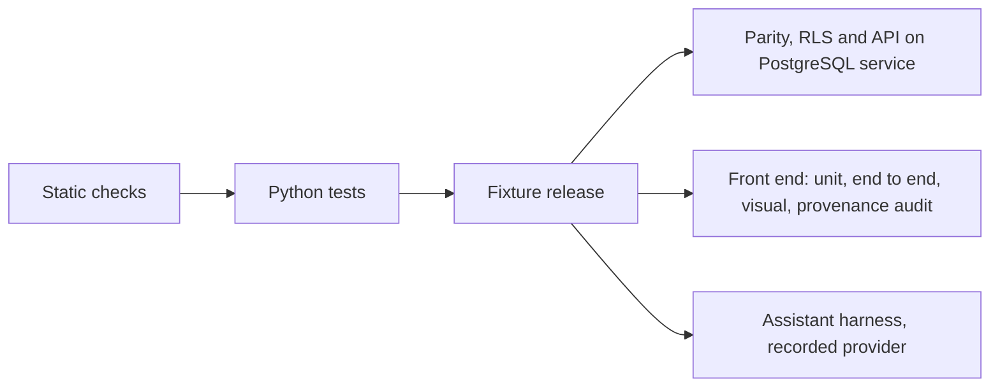

# 12 — Testing and Quality

| | |
|---|---|
| Status | Draft v0.2, corrected after independent review on 2026-11-11 (see PROGRESS.md) |
| Date | 2026-11-11 |
| Owner | albarami |
| Purpose | Define every kind of test, the CI pipeline, the evidence that proves each slice gate, and the definition of done. |
| Read first | [01_PROJECT_BRIEF.md](01_PROJECT_BRIEF.md), [02_ARCHITECTURE.md](02_ARCHITECTURE.md), [06_PRIVACY_AND_DISCLOSURE_CONTROL.md](06_PRIVACY_AND_DISCLOSURE_CONTROL.md), [14_IMPLEMENTATION_PLAN.md](14_IMPLEMENTATION_PLAN.md), [15_REVIEWER_CHECKLIST.md](15_REVIEWER_CHECKLIST.md) |

## In brief

- Nothing is built yet. This document says what must be tested, with which tool, and what counts as proof.
- A claim is accepted only with evidence: a command, its real exit code and the commit it ran on, recorded in [PROGRESS.md](../PROGRESS.md).
- No check is ever weakened to get a green result. A failing check is fixed or recorded as an open item; it is never skipped, loosened or retried until it passes.
- The privacy invariants (closure, partition completeness, dominance) are proved by exhaustive structural checks, seeded fuzz regressions and an attack suite that runs with controls off (it must recover every typed release-attack predicate) and on (it must recover none).
- Every gate from slice S0 to slice S11 maps to named test evidence in section 5.
- A random failure is an open item with evidence, not noise.

## 1. Principles

| ID | Requirement |
|---|---|
| TST-01 | Every statement that something works, passes, is fast or is safe must cite evidence: the exact command, its exit code, the full commit hash and the date, recorded in [PROGRESS.md](../PROGRESS.md) as in section 6.3. A statement without that evidence is treated as false. |
| TST-02 | Exit codes must be real. A command whose output is piped must run with `set -o pipefail` (or report `${PIPESTATUS[0]}`), and no CI step may use `\|\| true`, `continue-on-error: true` or an equivalent that turns a failure into a success. |
| TST-03 | No check may be weakened to obtain a green result. Forbidden without an approved decision record: lowering a threshold, widening a tolerance, removing or loosening an assertion, reducing the example count of a property test, adding a skip or expected-failure mark, deleting a test, updating a visual baseline or a recorded model response to match new output, and adding automatic re-runs of failed tests. |
| TST-04 | Every guard test must be shown to have teeth: next to it sits a planted violation (a fixture or a controls-off run) that the guard must reject, so the test is known to fail for the right reason. |
| TST-05 | A test that fails at random is an open item, not noise. The failing run is recorded in [OPEN_ITEMS.md](../OPEN_ITEMS.md) with the command, commit, seed, log excerpt and date. A green re-run does not close it; a found cause and a fix with a regression test does. |
| TST-06 | A skipped test is not a passed test. Gate evidence counts only passed tests. Only two standing skips are allowed: a live-model test while the API key is absent, which must print OI-01 as its reason, and a PostgreSQL test on a machine where no database answers, which must print OI-10 as its reason and whose gate evidence then comes from the CI run on the same commit. |
| TST-07 | All randomness in tests is seeded, and the seed is printed in the log of every run, so any failure can be replayed. |
| TST-08 | Tests never read real custodian data and never read outside the repository, `data/public_cache/`, a temporary directory created by the test, or a release built by the test run. |
| TST-09 | Any value that would look like a real identifier in a test fixture (for example a run of exactly eight or eleven digits used for the identifier-scanner teeth test) is built at run time in memory, never written literally in a committed file. |

## 2. Test map by plane

The three planes are defined in [02_ARCHITECTURE.md](02_ARCHITECTURE.md). The table shows where each kind of test lives and what it proves. Tool choices marked ASSUMPTION are listed again at the end.

| Test kind | Plane | What it proves | Tool | Runs |
|---|---|---|---|---|
| Unit | all | each function does what its contract says | pytest (Python), Vitest (front end) | every pull request |
| Property (privacy invariants) | custodian | exhaustive structural closure, partition completeness, dominance and minimum sizes hold, with seeded fuzz pairs as regression evidence | Hypothesis with pytest; exhaustive structural audit and counted area-pair fuzzer in the release build | every pull request (fixture size), every release build (full size) |
| Contract conformance | custodian | a feed meets its contract, including the eight contract design requirements in [03_DATA_CONTRACTS.md](03_DATA_CONTRACTS.md) | pytest suites per contract under `contracts/` | every pull request |
| Two-engine parity | product | PostgreSQL and DuckDB return the same facts from the same release | pytest against both stores | every pull request (fixture release), nightly (full release) |
| Public regression examples | custodian and product | fetchers and methods reproduce the verified public figures | pytest | every pull request (committed fixtures), nightly (live fetch) |
| Boundary | all | the planes stay separated and the database enforces seats | pytest, bubblewrap, PostgreSQL service | every pull request |
| API | product | endpoints, statuses, templates and stream order | pytest with the FastAPI test client | every pull request |
| End to end | experience | the story and exploration flows work in a real browser | Playwright with Chromium | every pull request (smoke), nightly (full) |
| Visual | experience | layout at four sizes in two languages | Playwright screenshots | every pull request (story frames), nightly (full matrix) |
| Provenance audit | experience | every numeral sits in a Fact chip that carries a provenance mark | Playwright DOM crawl plus a lint rule | every pull request |
| Assistant evaluation | product | the assistant plans, declines and narrates correctly | harness in `evals/` | every pull request (recorded provider), release (live model when the key exists) |
| Attack suite | custodian | the privacy controls stop the planted attacks | harness in `evals/` | nightly and every release build |
| Performance | product and experience | latency and frame-rate targets | timing harness; Playwright frame counter | nightly smoke; gate runs on the build machine |
| Documentation check | repository | pack structure, links, IDs and forbidden patterns | `scripts/check_docs.py` | every pull request |
| Secret and identifier scan | repository | no secret and no identifier-shaped token is committed | gitleaks; `scripts/check_docs.py` | pre-commit and every pull request |

### 2.1 Commands and test data

| ID | Requirement |
|---|---|
| TST-15 | `./eii test` must run every pull-request-level suite that needs no network, print the count of passed, failed and skipped tests per suite, and exit non-zero if any test failed or errored. |
| TST-16 | Tests that need more than the default set must carry a marker so they can be selected and counted: `postgres`, `sandbox`, `nightly` and `live_model`. ASSUMPTION: pytest markers with these names; the nightly workflow selects them explicitly. |
| TST-17 | Fixture releases must be built by the test run itself, from a small seeded synthetic world, through the same `custodian/` code path as a real build, into a temporary directory. Hand-written release tables standing in for the engine's output are forbidden, because they would test the fixture instead of the engine. |
| TST-18 | The attack suite and planted-truth checks must use the sealed world. Before running, the test must verify that the SHA-256 of the scenario file equals the hash committed before the build, and fail otherwise. |
| TST-19 | Recorded model responses for the recorded provider must live under `evals/`, must pass the secret and identifier scans, and must record the model name, prompt version and release they were captured against; a mismatch with the current prompt version or release fails the run instead of replaying stale answers. |

## 3. Requirements by test kind

### 3.1 Unit tests

| ID | Requirement |
|---|---|
| TST-10 | Each Python package (`eii_core`, `eii_custodian`, `eii_product`) must have its own unit tests, run by `./eii test`. ASSUMPTION: pytest is the runner, because Hypothesis and the FastAPI test client integrate with it. |
| TST-11 | The least-real rule must have a unit test for every combination of input classes: Public with Synthetic gives Synthetic, any input Simulated gives Simulated, and the evidence drawer lists every input class. |
| TST-12 | The fact object must have a schema test: every pinned field is present (`fact_id`, `value`, `unit`, `period`, `geography`, `provenance`, `input_classes`, `evidence_status`, `reliability`, `coverage_keys`, `caveat_keys`, `label_en`, `label_ar`, `lineage_ref`, `release_id`), `provenance` and `evidence_status` are separate fields, and a figure from the user's own inputs is `inferred`, tagged "your inputs" and rejected by the release writer. |
| TST-13 | Identifier normalisation and validation must have unit tests for formatting noise, placeholders and rejected values, as the contracts in [03_DATA_CONTRACTS.md](03_DATA_CONTRACTS.md) require. |
| TST-14 | Front-end units (number formatting with `ar-QA-u-nu-latn`, provenance texture selection, right-to-left mirroring helpers) must have unit tests. ASSUMPTION: Vitest is the runner, because the front end is built with Vite. |

### 3.2 Property tests for the privacy invariants

The rules and the two parameter sets are defined in [06_PRIVACY_AND_DISCLOSURE_CONTROL.md](06_PRIVACY_AND_DISCLOSURE_CONTROL.md). An area here is the set of release units it snaps to.

| ID | Requirement |
|---|---|
| TST-20 | Closure under union and difference, inside one additive family: for any two areas A and B whose answers come from one additive family of one contributor universe (one release table, one partition, one measure, one breakdown), every additive primitive must resolve to that family's treated leaves under PRV-111. The test then asserts A union B plus A intersection B equals A plus B exactly inside that family, every difference resolves to whole published leaves of that family, and no withheld unit or unlisted atom contributes. For two answers from different families of one contributor universe the test asserts only that the geographic difference resolves to whole units of the finer nested partition and sends the numeric route pair to the PRV-71 consistency audit; equality between families is never asserted. Subtraction inside one partition alone is insufficient. Cross-universe and public-total residuals go to the attacker-view audit of PRV-69 rather than being assumed closed. |
| TST-21 | Every `./eii build-release` must first pass the exhaustive structural checks of PRV-111 for each candidate parameter set and again for the selected export: enumerate every unit, every pair of protected partitions and breakdown dimensions of each contributor universe, every parent link, treated leaf and additive family, every protected row, within-family total, supported derivation and cross-family route pair, and every finite `make_area` input after pin-to-cell reduction; map every row, within-family total and supported derivation to its family's leaves, assert every within-family margin exactly, send every cross-family route pair to the PRV-71 consistency audit without requiring equality, and prove that no withheld unit or unlisted atom contributes. The finite enumeration covers every `grid_cell` pin; distance 250, 500 and 1,000 metres; walk and drive 5, 10 and 15 minutes; drive 30 only in `staffing_and_pay`; and every absent or allowed `situation` and `summer` combination. After that proof, at least 10,000 seeded fuzz pairs must pass **per release and per parameter set**, covering every protected partition and dimension, adjacent pins, two cut-offs at one pin, the scene fixtures, every applicable situation and summer combination, and the staffing-only drive 30 cut-off. The shared `eii_core` grid helpers used by `make_area` perform snapping (ASSUMPTION: snapping lives in `eii_core`, so the custodian-plane audit never imports product code). The build report names the release by `window_key`, `protected_sha256`, `rules_version_id` and `parameter_set`, never by `release_id`, and records the seed and exact pair count; any structural failure or a count below 10,000 fails the build. Random pairs are regression evidence, never a substitute for exhaustive checks. |
| TST-22 | Because Hypothesis may stop before `max_examples` (it stops early on a failure or when it judges the search space exhausted, per its documentation), the Hypothesis tests on fixture data must not be the evidence for either part of TST-21; the exhaustive structural audit and the counted, seeded fuzz audit are. |
| TST-23 | Partition completeness: every protected partition must cover every frame cell exactly once through non-overlapping `unit_member` rows, units within one contributor universe must be pairwise disjoint or nested, a finer level must appear only where every sibling cell passes (all-or-nothing), and any remainder must be either published as a passing municipality remainder or withheld as a whole. Every parent link must be derived and checked through `unit_member` under PRV-111. |
| TST-24 | Dominance and minimum sizes: under each parameter set and in every complete month, every published unit total and every band, category, side-count, home-area and register leaf atom must meet its applicable minimum earners and unrelated employer groups, largest-group, top-two and insider-removal tests of PRV-24; every wage-bill atom must also meet the person-concentration test, and a register atom must retain the required unrelated groups after any one group is removed. Unit-tier minimums for money, median and quartile bands remain included. A planted failing atom for each test, in the fixed test and leaf order of PRV-24, must be merged or withheld and reported under the correct first-failed-test reason. |
| TST-25 | Stable treatment: the same area asked twice, and two different shapes that snap to the same units, must return identical facts, byte for byte. |
| TST-26 | No released table may contain a minimum, a maximum or a closed top band, and adjacent bands with fewer than five earners or failing an atom test must be merged. Under PRV-110 and PRV-29, inside one additive family every parent, every `ALL` or `all` total that has a breakdown, and every municipality, national and area total is the exact arithmetic sum of that family's rounded treated leaves, with no second draw or rounding; where a family has no breakdown its `ALL` row is the one treated leaf; `other` is itself a treated leaf present only where pooling occurred. No equality is asserted between families: every cross-family route pair enumerated by PRV-71 must lie within the deterministic count or wage-bill bound of PRV-114, every treated count and wage-bill leaf must contain its untreated aggregate inside its PRV-114 outer interval, and a planted out-of-bound cross-family difference or outer-interval violation must fail the build — the outer-interval check belongs to this consistency audit only and is never an acceptance constraint of the attacker-view model. Regression fixtures must prove exact equality and non-negativity of every row, column and parent margin inside each family. A split that needs a negative residual must be withheld, never clamped or reconciled by subtraction, and a planted margin mismatch must fail the build. Every non-ratio fact computed from protected tables names exactly one home family in its lineage (PRV-30). The mean wage and coverage, irregular and deployed-elsewhere shares are the only ratio-statistic exceptions: each takes numerator and denominator columns from the same stored rows — one table, one partition, one unit set and one measure where applicable — and names both families. Fixtures must reject a mismatched row set, a two-family statistic outside that closed list, a count and adjacent non-ratio shares from different families, and two routes to one population presented as two numeric estimates. |
| TST-27 | Hypothesis tests must run on generated micro-populations (random employers, earners and wages on a small grid) through the real privacy engine. In pull-request CI they run with a fixed seed passed as `--hypothesis-seed`; nightly runs use a fresh seed that is printed in the log. Any shrunk failing case must be added as a permanent explicit `@example`. |
| TST-188 | The attacker-view audit tests must implement the one acceptance model of PRV-112 and PRV-113: every published leaf of every protected table is fixed to its untreated aggregate, month by month, and the model has no released-value acceptance interval. Verify the canonical, manifest-hashed `artefacts/attacker_view_audit.json`, its model schema version, parameter set, `window_key`, `protected_sha256`, `rules_version_id`, target classes, signed local-knowledge, insider and colluder fixtures, solver settings and the audit rule `time_budget_seconds`; it contains no `release_id`, `build_id` or `built_at`. Before optimisation, every signed knowledge fixture is compared with sealed truth — containing published units for local knowledge, own staff, sites and payroll for each insider and colluder — and a planted mismatching fixture must fail the build before any constraint is built; only a matching fixture becomes a constraint. The model then holds the untreated aggregate of every published leaf and the verified knowledge fixtures. A planted undeclared person-level or employer-level true value, hidden contribution, key or draw in any variable, bound, constraint or objective must fail; target truth is read after a solve only to score the recovery predicates of PRV-116. Validate the finite variable domains, category tuples, contribution classes, complete-month constraints, non-negativity, deduplication and table identities, with no cross-period variable in version 1; the joint band indices (count and membership variables carry one net and one basic index, net rows sum over the basic index, basic rows over the net index, and each wage variable uses its own measure's band bounds); the published-means-passed linear forms for every contribution class that is one employer group, with the group-count forms for register leaves; and the survival-report constraints, under which every `survival_report` value that depends on protected counts, for both parameter sets, enters the model as the interval implied by its rounding. Targets with the same published-unit memberships, contribution class and complete months form one target class and are solved once; the report lists class and solve counts. The time budget is set from a measured full run at the start of slice S5 and recorded in the artefact with the command, machine class, elapsed seconds and run hash; an over-budget run fails the build and the model is never relaxed to meet it. Derived totals inherit their leaves' constraints and receive no second treatment interval; the PRV-114 count and wage-bill outer intervals are checked only inside the PRV-71 consistency audit (TST-26), and the PRV-114 presence and flow score interval enters this model only for movement-score predicates (PRV-113, PRV-116). |
| TST-189 | The versioned public-total inventory test must use `artefacts/attacker_view_public_totals.json`, listed with its SHA-256 in `manifest.artefacts`, and must first assert deterministic inventory equality under PRV-115: its entry identifiers equal, with no missing, duplicate or extra entry, one `source` entry for every `source_registry` row plus one `row` entry for every row of every manifest table whose provenance class is Public. Check every enabled selector, period, geography and population mapping, relation, value column and unit, and every closed not-applicable reason. Separate planted cases for an absent applicable municipality, district or national total, an unconfigured or ambiguous mapping, an unsafe relation, an extra or missing inventory entry, and `unreconciled_source` used to bypass an applicable total must each fail the build. Enabled values must come only from the named Public table, and the complete inventory and applicability outcomes must participate in release identity. A public total outside the signed inventory is outside the tested attacker model and is never reported as covered by the audit (PRV-115; document 06, section 17). |
| TST-190 | Target and solver tests under PRV-116 must minimise and maximise every configured target, expand finite intervals outwards by the configured bound, and require `OPTIMAL` status for both bounds of a finite target. `UNBOUNDED` on an open numeric side is scored not recovered; `FEASIBLE` on a conditioned candidate proves only that candidate possible; `INFEASIBLE` on a conditioned candidate proves only that candidate impossible; `INFEASIBLE` on the unconditioned base model fails the build. `INF_OR_UNBD`, a time, node, iteration, solution or gap limit, a numerical failure, interruption, any other status, and any run over the PRV-112 time budget must fail the build. A predicate is recovered only when the attacker learns something the published rules do not already imply: a single feasible released band for a person (covered membership forced TRUE, exactly one released range feasible, sealed truth inside it); a forced TRUE, with sealed truth TRUE, for membership of the covered population, a three-employer concentration or hidden-group dominance; or an interval at or below its width bound that contains sealed truth. A value that every published atom has because it passed a published rule is not a recovery, and the dominance and concentration predicates are defined on the scenario-labelled population, which may be an unpublished cell. Boundary tests prove that width equality does not pass a strictly-greater headcount or relative wage-bill bound, every person has at least two feasible released bands for each month and measure, and every directly computable positive public, protected-municipality or home-area residual below `min_earners_count` fails. |
| TST-191 | Seat and presenter boundary tests under PRV-117 must prove that the verified signed `eii_seat` session cookie is the only seat source after picker selection; seat values in an address or request field and an invalid signature are rejected. Every presenter route must require `EII_PRESENTER=1`, a loopback request and the valid per-session `X-EII-Presenter-Token`; missing and incorrect tokens receive 403 on every window, and the token never enters a log, ledger row or health response. Tests and assertions must describe query isolation after seat selection and stage control only, never identity, tenant authentication or a disclosure control. |
| TST-192 | One-export boundary tests must show both parameter sets evaluated inside the custodian plane and exactly one selected release folder written for `export_parameter_set`. The selected release contains only that set's protected tables plus aggregate survival and attack results for both sets; `EII_RELEASE_DIR` names that release. No test may expect two release folders. A planted attempt to export, load, log or send the unselected protected table set in a release, artefact, report, payload or serving store must fail at the build boundary, while aggregate results for the unselected set remain allowed under PRV-05 and PRV-80. |
| TST-193 | One-treatment-per-window tests under PRV-120 must verify at the slice S1 gate that `export_parameter_set` is fixed (default `A`) before any world is built, with `presence_scale` and `flow_scale` also fixed under PRV-59. Recompute `window_key` exactly as DAT-80 defines it from canonical JSON holding the protected `period` and, in name order, `{name, sha256}` for `business_register.v1`, `employment.v1`, `residence.v1` and `wages.v1`, using each feed's manifest `feed_sha256`; nothing else enters it. `protected_sha256` is the manifest value PRV-120 defines. Run `./eii freeze` twice with no new flag for a `protected` release. The first run checks the test pass and human review, writes the data bundle, checksum list and pending `freeze.json`, and appends one line to `infra/export_register.jsonl` with these seven fields in order: `window_key`, `protected_sha256`, `world_seed`, `rules_version_id`, `parameter_set`, `release_id`, `code_version`. After that line reaches the base branch by normal pull request, the second run on a base-branch commit containing it builds the application archive from that commit, verifies offline installation, writes the archive checksum beside the bundle, appends no line and marks `freeze.json` complete. Continuous integration checks the register alone and must fail when an existing line is changed or removed, when one `window_key` is registered with a second `protected_sha256`, or when one `world_seed` is registered with a second `window_key`. A `public_only` release is refused by freeze and never adds a register line. A protected release is frozen when its bundle has `freeze.json`. For a frozen protected release only, installer and `./eii up` fixtures must exit 7 when the matching line is absent from the installed application's register or `freeze.json` is not complete. A release under `data/releases/` has no descriptor and is not checked. A freeze conflict requires a new seed and build after any change of rules version, exported set, treatment code or world generator; a frozen-bundle refusal is remedied by finishing the two-run freeze, not by changing the seed. No signed export receipt file is created. |
| TST-194 | Freeze must refuse without a recorded human release review whose fields are `reviewer_role`, `review_date`, `survival_report_read`, `attack_report_read`, `window_key`, `protected_sha256`, `rules_version_id` and `parameter_set`, with the two report-read values true and all release fields matching. Missing, incomplete and wrong-release review fixtures must each produce no freeze bundle and no export-register line; the passing control is written before freeze, copied by the first run into the bundle as `review.json`, and named by `freeze.json.review_record` as `review.json`. |
| TST-202 | Exact-reduction tests under PRV-121 must solve one small fixture world with the audit model in both the full base-cell form of PRV-113 and the reduced form, and require identical statuses and identical minimum and maximum for every target class. The reduction may only substitute a constant for a sum that an equality fixes, merge variables that enter every constraint and every target expression only through their sum, and drop a variable that no constraint links, directly or through other variables, to the target expression of the run. A planted inexact reduction — an approximation, a sampling of targets, a relaxation, or any reduction that changes the feasible set of a target expression — must fail the test. No other approximation is allowed (PRV-112, PRV-121). |

### 3.3 Contract conformance suites

| ID | Requirement |
|---|---|
| TST-30 | Each source contract (`business_register.v1`, `employment.v1`, `wages.v1`, `residence.v1`, `mobility.v1`) and the release contract must have a conformance suite that any adapter, synthetic or real, runs unchanged. |
| TST-31 | Each suite must include a negative fixture for each of the eight contract design requirements that applies to that contract, and the suite must reject each one. The eight are: a registration mapped to several establishments joined on the registration alone, a placeholder identifier, an unmapped free-text code counted as a category, a duplicated person within an employer group, a feed without an internal reference period, a feed without a coverage declaration, a missing value turned into zero, and a headerless file. |
| TST-32 | The `mobility.v1` suite must reject any cell and time block below the minimum panel devices of the active parameter set. |
| TST-195 | Release-contract enumeration tests must accept exactly these `resident_pay.housing_class` values: `family_housing`, `labour_accommodation`, `institution`, `unknown`, `other` and the derived total `all`; and exactly these `occupation_pay.occupation_group` values: `0` to `9`, `unmapped` and `other`. Every other value fails. `other` is a real treated leaf emitted only where pooling occurred. Wherever a breakdown exists, an `all` or `ALL` row is the exact sum of the treated leaves and is never treated again; where no breakdown exists (the earner count of a `count`-tier unit, or a wage bill with no wage-bill split) the `ALL` row is itself the one treated leaf (section 6.1 and PRV-29 of [06_PRIVACY_AND_DISCLOSURE_CONTROL.md](06_PRIVACY_AND_DISCLOSURE_CONTROL.md)). A fixture of each kind is required. Side-count columns are accepted only on `ALL` rows of partition `rp_housing_count` in `resident_pay` and partition `wp_site_count` in `worker_pay`, and planted placements elsewhere fail. A `home_area_share.home_unit_id` must resolve to a terminal `ha_home` unit with `unit_kind: municipality`, kind letter `u` in its `unit_id`, null `resolution` and membership formed as a union of units of the governing residence family. A fixture proves that terminal unit loads in both stores. |
| TST-196 | Public-release contract and attacker-selector tests must enforce the four table schemas below, including their keys, under PUB-83, PUB-48 and PUB-53. `pub_place` must additionally carry `source_provider`, `licence`, `confidence` and nullable `merged_ids`. While OI-04 leaves a source unlicensed for reuse, `pub_census_zone` and `pub_census_district` must still be present in every release with zero rows; a validation-only value in either fails. The only count indicators an attacker-view selector may enable are `residents` (`persons`), `households` (`households`), `establishments` (`establishments`) and `employees` (`persons`); names are lower snake case and any other indicator fails until a contract revision adds it. |

| Public table | Required columns | Key |
|---|---|---|
| `pub_population_municipality` | `municipality_code`, `period`, `indicator`, `value`, `unit`, `source_id` | `municipality_code`, `period`, `indicator` |
| `pub_census_national` | `period`, `indicator`, `value`, `unit`, `source_id` | `period`, `indicator` |
| `pub_census_district` | `district_key`, `period`, `indicator`, `value`, `unit`, `source_id` | `district_key`, `period`, `indicator` |
| `pub_place_verification` | `place_id`, `check_date`, `reviewer_role`, `verification_link`, `status` (`verified_open`, `closed_or_moved`, `not_found`, `duplicate`), `source_id` | `place_id`, `check_date` |

### 3.4 Two-engine parity suite

| ID | Requirement |
|---|---|
| TST-40 | Every tool must ship with at least one parity case from the day it is written, and every release table must be covered by a parity case. |
| TST-41 | A parity case runs the same tool call against PostgreSQL and against the embedded DuckDB reader on the same release and compares the resulting facts field by field. |
| TST-42 | The rounding rule must be stated before comparison: released primitives are integers after treatment and must match exactly; any non-integer value returned by a store must be compared after rounding to the display precision declared for that fact's unit. ASSUMPTION: derived values (means, shares, median bands) are computed once in shared Python code from primitives, so they are compared exactly. |
| TST-43 | A lint step must reject any SQL in `product/store/sql/` outside the portable subset, any extension beyond PostGIS, and any spatial predicate in a tool query. Loader, schema, index and reviewer-view SQL lives outside that directory and is covered by separate role, privilege and execution tests; it is not required to run on DuckDB. ASSUMPTION: the allow-list is checked by parsing each query into a syntax tree; the parser is chosen in slice S0. |

### 3.5 Regression examples from the verified public figures

These figures were checked on the Qatar Open Data Portal (CC BY) on 2026-11-11 by two independent agents (the open places count comes from the Overture extract named in the row); their sources are listed in [04_PUBLIC_DATA_PACK.md](04_PUBLIC_DATA_PACK.md). Fetchers must re-verify them; methods must reproduce them.

| Figure | Expected value |
|---|---|
| Zone 69 (Lusail) electricity, 2021 to 2025 | 429,964,072 to 1,436,402,796 kWh (3.34 times); national 1.34 times |
| Mean monthly pay, 2020 to 2025 | QAR 10,084 to 11,855 (+17.6%); QAR 38 within 17 occupation-by-sex groups; QAR 1,733 (97.8%) from workforce mix |
| Restaurants (activity 561), 2022 | production value QAR 6,337,897 thousand; 2,086 establishments; 41,458 employees; goods 40.6% and services 16.5% of output; compensation 1,308,140 thousand; operating surplus 1,247,422 thousand; average annual wage QAR 31,579 |
| Pasta (heading 1902) calculated import unit value (QAR per kg) | Italy QAR 8.69/kg; Saudi Arabia QAR 11.45/kg; heading-level regression only, never displayed |
| Imports 2025 | QAR 138.53 bn over 216,073 rows |
| Active licence-activity counts, May 2025 | 249,622 across 4,755 codes; 84.6% (211,277; 2,035 codes) under 7-digit codes whose first four digits are an international class; 4.5% (11,276; 1,363 codes) under other 7-digit codes; 10.8% (26,844; 1,336 codes) under 6-digit legacy codes; 0.1% (225) under 13 five-digit codes (169) and 8 eight-digit codes (56); among the legacy codes, 138 codes (3,163 counts) have a prefix that only looks like a class |
| Cancellations 2015 to 2025 | 161,055; three months hold 43% of dated cancellations |
| Metro riders, December 2025 | 7.38 million, +33% on December 2024 |
| Private-employer share of employed residents, two Lusail-area zones | 72% and 45% (Census 2020) |
| Restaurant licences per 10,000 residents | Al Daayen 32, national 15 |
| Open places extract (Overture 2026-10-21.0) | about 26,000 Qatar records |

| ID | Requirement |
|---|---|
| TST-50 | Each figure in the table above must be a regression test. Counts and money must match exactly; ratios and percentages must match at the precision shown. A figure marked "about" is a sanity bound: the fetcher records the exact count of the pinned release, and the test asserts that it rounds to the figure shown at the nearest thousand. |
| TST-51 | Pull-request CI must run the method tests on small committed fixtures that hold only the published input values needed, each fixture carrying source URL, licence and retrieval date as metadata fields. ASSUMPTION: this keeps pull-request CI offline while `data/` stays uncommitted. |
| TST-52 | The nightly job must fetch the live sources with `./eii build-public` and re-verify every figure. A mismatch is recorded as an open item with both values; the expected value is never edited to match. |
| TST-53 | Until OI-03 is closed, a test must fail if a release contains a restaurant revenue fact of QAR 8,579,462 thousand, or a 2020 mean pay fact whose lineage does not name its source table. |
| TST-54 | Assert all four underlying class-bucket counts exactly (211,277 + 11,276 + 26,844 + 225 = 249,622), the fifth- and eight-digit split of the 225 remainder, and the displayed percentages at their stated precision, without requiring the rounded percentages to total 100. Assert that no 6-digit legacy code is mapped by its first four digits, that all 138 look-alike legacy prefixes follow the reviewed not-mappable path, and specifically that 561000 is never mapped to restaurants; also assert that a 7-digit code is not accepted when its prefix is not an international class. The issued-licence series is never used for net formation. |
| TST-197 | Every version 1 method card's worked example must be a regression test under MTH-03, using the method requirement IDs in the exhaustive matrix below. Each fully pinned example has an arithmetic test of `eii_core.calc` and a data test that recomputes it from the pinned public file; Synthetic or Simulated examples use their pinned sealed fixtures. An illustrative note is not a passing regression and may not be skipped or counted as passed while MTH-03 or MTH-51 leaves it unpinned. |

| Method card | Requirement IDs whose worked behaviour is tested |
|---|---|
| Shared Wilson interval and reliability | MTH-12, MTH-13, MTH-14 |
| C1 Licence density and location quotient | MTH-15, MTH-16, MTH-17 |
| C2 Licence churn | MTH-18, MTH-19, MTH-20 |
| C3 Pay-versus-mix decomposition | MTH-21, MTH-22, MTH-23, MTH-24 |
| C4 Unit economics, break-even and target surplus | MTH-25, MTH-26, MTH-27, MTH-28, MTH-29 |
| C5 Customs supplier lens | MTH-30, MTH-31, MTH-32, MTH-33 |
| C6 Typical neighbours | MTH-34, MTH-35, MTH-36 |
| C7 Shared reach | MTH-37, MTH-38 |
| C8 Coverage and reliability | MTH-39, MTH-40 |
| C9 Zone momentum | MTH-41 |
| C10 Staffing bands and Public anchors | MTH-42, MTH-43, MTH-44 |
| C14 Sale price per square metre | MTH-50, MTH-51 |
| C15 Area presence index | MTH-52 |

For C4 under MTH-25 and MTH-26, the default break-even case (`U = 0`, mode A, `R = 40,000`, `S = 60`, `B = 120`, `D = 30`) must return `m = 0.313`, revenue QAR 127,796 a month, 36 covers a day and 0.6 seat turns; with `E = 50`, maximum rent QAR 56,340 and minimum bill QAR 85.20. The target-surplus case (`U = 0.197`, same inputs) must return `m - U = 0.116`, revenue QAR 344,827.59 a month, 96 covers a day and 1.6 seat turns; with `E = 50`, maximum rent QAR 20,880 and minimum bill QAR 229.89. Its label is exactly "to earn the sector's 2022 surplus share", never break-even.

| ID | Requirement |
|---|---|
| TST-198 | At slice S2, `./eii build-public` must produce the regression inputs that MTH-03 lists as unpinned, including the C14 riyal medians of MTH-51. A reviewer must confirm each source-derived pinned value against its public source and each non-source setting against its recorded generation configuration, and a slice S2 task must write the values and settings into [07_ECONOMIC_METHODS.md](07_ECONOMIC_METHODS.md); no value may be invented. The slice S7 gate must fail while any regression value listed by MTH-03 or MTH-51 remains unpinned. The slice S2 evidence names each value, source and reviewer result. |

### 3.6 Boundary tests

| ID | Requirement |
|---|---|
| TST-60 | Parse every Python file in all three packages and reject every forbidden edge—`eii_product -> eii_custodian`, `eii_custodian -> eii_product`, and `eii_core -> either`—including direct imports, function-local imports and string arguments to `importlib.import_module`. Fresh-interpreter tests assert no forbidden module is loaded, and package metadata tests assert no forbidden dependency. Supply one planted-violation fixture for each edge and each import mechanism. |
| TST-61 | Generators cannot read outside the public cache: a test must place a sentinel file outside `data/public_cache/`, run a probe generator inside the bubblewrap sandbox that tries to open it and to open a network connection, and pass only if both attempts fail. Teeth: the same probe run outside the sandbox must succeed in reading the sentinel. |
| TST-62 | The sandbox test must run in CI and must never be skipped. If the runner blocks unprivileged user namespaces (Ubuntu 24.04 restricts them through AppArmor), the CI job must enable them for bubblewrap in a setup step, preferring the per-binary AppArmor profile over a system-wide switch. |
| TST-63 | The loader rejects a table not in the manifest: a release directory with an extra Parquet table not named in `release_manifest` must make `./eii load-release` exit non-zero and load nothing into either store. The same must hold for a manifest whose recorded hash does not match a file. A `public_only` fixture must omit all Protected and Simulated tables and every protected-only manifest field, load its listed Public tables into both stores, and write a complete `load_receipt.json` whose `release_id` matches the manifest. A `protected` fixture must load its listed tables and write the same matching receipt fields. |
| TST-64 | The application role cannot bypass row-level security, proved against a real PostgreSQL: connected as the application role with the seat `company_b`, a query for a `company_a` brief must return zero rows; `SET ROLE` to the table-owner role must be refused; with `row_security` set to `off` the same query must raise an error (PostgreSQL documents that `off` does not bypass policies but raises an error when a result would be filtered); and the application role must own no table and hold no superuser or `BYPASSRLS` attribute. |
| TST-65 | The release read-only role must be refused `INSERT`, `UPDATE`, `DELETE` and `CREATE` on every release table. The test relies on privileges, not on a session default, because a session can change `default_transaction_read_only`. |

### 3.7 API tests

| ID | Requirement |
|---|---|
| TST-70 | Every one of the nine tools (`resolve`, `make_area`, `area_evidence`, `scan_places`, `compare_areas`, `pay_benchmark`, `sector_facts`, `supplier_lens`, `stage`) must have API tests for each status it can return: `OK`, `SUPPRESSED`, `NO_DATA`, `OUT_OF_SCOPE`. |
| TST-71 | For each status, the response must carry the template chosen by the application, and no response may carry model-written refusal text. |
| TST-72 | In the server-sent event stream, deterministic evidence events with complete source chains may arrive before the brief. The whole structured brief must be buffered and the five accounting-gate checks run once on the complete brief; no narrative or other brief item may be sent before that gate passes. A delayed-gate fixture must show evidence arriving while zero brief items are emitted. After a pass, items may be emitted in their original order for legibility. On failure, only the template writer's default brief may be emitted, after its own complete-brief gate passes; no failed model-selected item may appear. |
| TST-73 | Every fact in a response must carry every field of the fact object and a `lineage_ref` that resolves through the fact API to its release table, method and version, source publisher and dataset, licence, retrieval date, file hash and release. A fact with any missing link is not emitted by the API. |
| TST-74 | A request for a person's pay, a named firm's pay, any nationality split or a revenue forecast must return the decline template. |

### 3.8 End-to-end tests

| ID | Requirement |
|---|---|
| TST-80 | Playwright with Chromium must run the guided story (see [16_DEMO_RUNBOOK.md](16_DEMO_RUNBOOK.md)) from opening to hand-over against a built release, in English and in Arabic. |
| TST-81 | The language flip must show identical fact identifiers and identical numerals before and after, on every card of the flagship answer. |
| TST-82 | Every blank must offer "Why can't I see this?" and open the reason for its suppression. |
| TST-83 | The "Try to break it" scene must be tested as the prepared regression of PRV-105 to PRV-108 and PRV-119. Named-entity pay is declined and two different shapes return byte-identical facts and equal unit-set hashes. For the complement step, `POST /api/proof/scene` accepts exactly `{"fixture_id": "scene:<lowercase SHA-256>"}` and only an id listed for its signed scene artefact in `manifest.artefacts`; unknown ids, uppercase hashes, every extra property and any pin, polygon, cut-off, arbitrary cell or unit id, SQL, question text or model argument are rejected. One accepted fixture selects two prepared requests and returns their two pre-validated unit sets and `OK` area answers; their snapped unit sets differ by exactly one published `merged` unit containing at least two base cells, their difference is exactly that merged unit's own stored figures, and no figure exists for any member base cell alone (PRV-105, PRV-106). Separately, the typed phrase "the city minus this cell" is sent to the application, declined with `AREAS_FROM_PINS_ONLY`, and never calls the scene endpoint. The signed injection fixture's unknown claim or component property is rejected, its one prepared invalid repair is rejected, and the catalogue path falls back to the playbook default and logs from verified signed fixture identity, never from visitor-text detection; no model prose or unlisted tool call reaches the screen. Replay verifies the signed build-time results and uses scenario labels only. |
| TST-84 | The three seats must be tested in three browser contexts at once: a question from `company_a` appears in the `oversight` ledger, and `company_b` cannot open the brief of `company_a`. |
| TST-85 | The "Viewing as" badge and the standing strip must be present on every screen of every seat. |

### 3.9 Visual tests

| ID | Requirement |
|---|---|
| TST-90 | Visual tests must cover 3840x2160, 1920x1080, 1440x900 and 1024x768, each in English and Arabic. ASSUMPTION: the first two are the wall layout, 1440x900 the laptop layout and 1024x768 the tablet layout. |
| TST-91 | Screenshots must use Playwright's `toHaveScreenshot` with baselines committed and generated only in the CI environment, because Playwright documents that rendering varies with host, browser and hardware. Animations, the clock and the release are fixed for the run. |
| TST-92 | A baseline change must be committed in its own commit, with the before and after images attached to the pull request, and approved by the reviewer. Running the update command to make a failure pass is forbidden (TST-03). |
| TST-93 | Non-pixel layout checks must run at every size: no text under 28 px in presenter mode on the 1920x1080 canvas; content inside the 5% safe margins; no horizontal overflow; no information available on hover only; the pixel-ratio cap applied at 3840x2160. |
| TST-94 | In Arabic, the document direction must be right-to-left and the chrome and reading order mirrored, while the map, charts, numerals and dial are not mirrored; in both languages no Arabic-Indic digit may appear in the page text. |
| TST-95 | Each provenance class must be distinguishable without colour: a greyscale screenshot test must show the solid, dotted, moving-dash and hatched-with-lock styles. |

### 3.10 Automated provenance audit

| ID | Requirement |
|---|---|
| TST-100 | A lint rule must fail the build when any front-end source file renders a numeral outside the Fact chip component. Teeth: a fixture component with a raw numeral must be reported. |
| TST-101 | Every digit-bearing text node must sit inside the Fact chip family. `value`, `compact` and `input` variants must carry their required provenance or "your inputs" treatment and resolve their fact id. A `reference` variant may carry no provenance mark and is instead checked against the originating API identifier or code and its allowed variant schema; it must not be rejected for lacking a fact id or provenance mark. |
| TST-102 | The crawl must have no allow-list. Dates, codes, release identifiers and licence versions are numerals too and must be rendered through the Fact chip. ASSUMPTION: [10_FRONTEND.md](10_FRONTEND.md) renders such metadata through the Fact chip; if it does not, the conflict is raised as an open item rather than met with an allow-list. |
| TST-103 | Every exported briefing pack page must pass the same audit on its rendered text. |

### 3.11 Assistant evaluation harness

The assistant is specified in [09_AI_ASSISTANT.md](09_AI_ASSISTANT.md).

| ID | Requirement |
|---|---|
| TST-110 | The golden set must contain every prepared story question plus at least eight questions for each of the three playbooks, in English and Arabic: at least 48 questions in total. |
| TST-111 | Each prepared question must run five times and pass all five (pass^k with k equal to 5: the probability that all k trials succeed). |
| TST-112 | Under PRV-118, code graders must check: the tools and arguments called; for every Observed and Inferred item its catalogue `claim_key`, ordered fact slots, metric keys, units, geography roles, period rules, allowed provenance and evidence status (`decision_template_key` on the decision); a mutation exchanging two valid fact identifiers must fail; an unknown `claim_key`, component or property must fail; a `place_public` claim with a non-Public slot must fail; required caveats present; `layout[]` validates against the component catalogue; refusal and status templates match the tool status; Synthetic or Simulated facts never attach to a real named place in narrative context (derived from resolved place and slots, not from omitted names); and the answer language matches the request. At build time, a scan of every catalogue sentence template must reject numerals, number words, names of real places inside `area` claims and go or no-go wording. |
| TST-113 | The must-decline set must pass at 100% and include at least: a withheld cell, an individual's salary, a named firm's pay, a subtraction probe, a nationality question, a revenue forecast, a place outside Qatar, and injection strings in both languages. |
| TST-114 | Run 500 distinct structured briefs returned by the model before repair or fallback. Every fallback is counted and reported; template output cannot be counted as a model-written brief. |
| TST-115 | The injection suite (instructions hidden in questions and in third-party free text returned by tools) must have zero successes: no change of tool plan outside the playbook, no stage directive outside the closed list, and a ledger entry for each attempt. |
| TST-116 | Until OI-01 is closed, the harness must run against a recorded provider that replays stored model responses, and each run report must state "recorded provider". Recordings are updated only by a live run, never edited by hand. |
| TST-117 | When the key exists, the live-model harness must run before each release and on any change of prompt, model or tool definition. The template writer must pass the same golden set without a model. |
| TST-118 | Arabic wording must be signed off by the native reviewer (OI-09). An automated judge may pre-screen but never approves Arabic, because a 2026 study found frontier model judges lenient on Arabic tasks. |
| TST-119 | A table-driven adapter suite covers every failure row in [09_AI_ASSISTANT.md](09_AI_ASSISTANT.md) section 8 and both validator failures. Assert the selected writer, whether any provider connection or tool execution occurs, the exact event sequence, the egress record, and recovery on the next answer where specified. Include a ledger-unavailable case proving that response content is discarded and the template writer completes the answer. |
| TST-127 | Re-run every prepared recording's tools against the mounted release with no model; require identical fact values and provenance, matching release and prompt versions, a valid brief, and the prepared mark. Tamper with one fact, release ID, prompt version and brief segment in separate fixtures and require rejection with template fallback. |
| TST-199 | Accuracy-layer tests must prove that the assistant output schema has no numeric field; that every difference, ratio, rank, direction, comparison and numeric selection is a fact produced only by deterministic tested code in `eii_core.calc`; and that every other displayed number and rounding comes from `eii_core.calc`, the release build or a fixed read function of the application schema listed by the data contracts and covered by tests, never from a model or the browser. Planted model-supplied numbers and browser-computed comparisons must be rejected; numeric tool arguments remain limited to closed schema values, typed user inputs or returned facts. The fixed oversight read function must use the configured `distinct_organisation_minimum`, default 2: one organisation returns no grouped fact and two organisations return the aggregate, without exposing an organisation identifier to the oversight role. Two clean release builds from identical pinned inputs must be byte-identical, including tables and artefacts, and have the same `release_id`. TST-40 to TST-43 are the mandatory two-engine parity evidence: every released fact and comparison fact must agree across PostgreSQL and DuckDB under the stated rounding rule, and a deliberate divergence fails. |
| TST-200 | Sanad-refusal fixtures must remove, in turn, the release-table link, method or version, publisher, dataset, licence, retrieval date and file hash from a fact's source chain. Each incomplete chain must fail the release build, be withheld by the fact API, be rejected by brief validation and be refused by the Fact chip. The passing control opens the evidence drawer under "Source chain" and resolves the complete chain. |
| TST-201 | The accounting gate must have one failing fixture for each of its five named checks—Sources, Assumptions, Nothing invented, Scope and Limits stated. Each fixture must prove that the failed model-selected brief emits nothing, the template writer's default answer is checked and then shown, one log row records the failed check, and the receipt shows each check's pass or fail result under "Checked before display". An all-pass control proves that the answer is emitted only after all five checks pass; the five pipeline stages remain First reading, Watchfulness, Striving, Accounting and Answer. |

### 3.12 Attack suite

| ID | Requirement |
|---|---|
| TST-120 | The attack suite must evaluate both candidate parameter sets inside the custodian plane, using the sealed world with its planted canaries and threat outcomes. Controls-off release attacks run only against the build-time naive twin. Controls-on audits run separately for each candidate inside the custodian plane; no run receives both protected table sets, and only the selected set and aggregate survival and attack results for both sets may cross the export boundary. Attacker knowledge is limited to PRV-78. Every version 1 canary and threat outcome maps to at least one predicate in the closed, versioned registry of PRV-116. |
| TST-121 | With controls off, every release-attack predicate must be recovered and match sealed truth; this run proves the attacks have teeth. With controls on, no predicate may be recovered under either candidate parameter set. Assistant, egress and scene boundary attacks have no controls-off run under PRV-77. |
| TST-122 | Recovery is decided only by the closed typed-predicate registry of PRV-116, using its declared target, optimisation or Boolean condition, interval bound, accepted solver status and post-optimisation truth match; a wage-band-only rule or a guess is not a recovery, and a value that every published atom has because it passed a published rule is not a recovery. The dominance and concentration predicates are defined on the scenario-labelled population, which may be an unpublished cell. Registry conformance requires exactly the version 1 predicate types defined there, with `mover_status` marked backlog item L4 only and absent from version 1. An unknown predicate type or a predicate evaluated against vault truth before optimisation fails validation. |
| TST-123 | The version 1 suite must include at least: small areas; nested and adjacent areas; differently shaped areas that snap to the same units; a category against its explicit `other` leaf; linked tables across bases, tiers, splits and measures; every cross-family route pair enumerated by PRV-71; an insider employer subtracting its own payroll; declared colluding employer groups; every configured public total; covered earners against public resident counts; every `home_area_share` complement and home-area residual; presence and flow marginals and aggregate mobility residuals; public place listings combined with area statistics; the separately declined typed phrase "the city minus this cell"; and repeated, paraphrased and injection probes through the assistant in both languages. It holds at least one typed attack for each layout signal the acceptance model excludes: a merged band, a category pooled into `other`, merged siblings, a withheld remainder and a released reason code (PRV-76). Cross-period fixtures, consecutive-window attacks, the mover canary and `mover_status` are backlog item L4 only: version 1 builds no second protected window, including a test-only window, and makes no consecutive-window or person-level movement-protection claim. |
| TST-124 | The reviewer from a different maker must add attacks of their own. Each new attack becomes a permanent test and must recover nothing from either candidate protected table set inside the custodian plane; an attack that succeeds is a privacy defect that blocks the slice until fixed. |
| TST-125 | A canary egress scan must search every outbound model payload and payload record, API response, log file, release table, rendered page, export and briefing pack for canary markers, canary strings, synthetic identifiers and each canary's exact pay value; one hit fails the build. Canaries never appear on any rendered page, in any export or in any payload. Replay and proof panels may use only the scenario label, and a planted canary in each output class proves the scan has teeth. |
| TST-126 | The controls-off results shown in the Proof room must be the signed build-time results, and the replay must be re-validated at start-up. No runtime path may hold unprotected data. |

### 3.13 Performance checks

All numbers below are targets to be measured, not promises.

| ID | Requirement |
|---|---|
| TST-130 | The evidence bundle for the flagship question must be under 1.5 s at the 95th percentile locally. ASSUMPTION: measured over at least 200 requests from random pins after 20 warm-up requests, with the sample count and machine recorded. |
| TST-131 | The answer targets must be measured and reported against: evidence on screen within 2 s; the complete checked brief within 6 s when no live model is called (template writer or recorded provider); and the complete checked brief within 20 s when a live model composes it. Each measurement must state the writer mode and show that the accounting gate passed before the first brief item; these are targets, not promises. |
| TST-132 | The slice S1 frame-rate check (110,000 hexagons and 50,000 particles at 60 frames per second) must be measured on the build machine in a browser running natively on the host, because a browser inside WSL can fall back to software rendering. |
| TST-133 | Performance gates are decided on the build machine only. CI runs a smoke version and reports numbers but does not gate on them, because shared runners vary. |

### 3.14 Oversight seat and ledger tests

| ID | Requirement |
|---|---|
| TST-145 | Every question from any seat must create one ledger row carrying the seat, the release and zero or more linked egress record identifiers, with zero required in no-key and offline modes, and the row must appear on the `oversight` seat without a page reload. |
| TST-146 | The demand view must withhold an aggregate built from fewer distinct organisations than the configured minimum (OI-08): a test must show the aggregate withheld at the minimum minus one and shown at the minimum. |
| TST-147 | The `oversight` seat must show no company identity, live rows must be tagged "this session" and seeded history must carry the Synthetic mark (OI-08 defaults). |
| TST-148 | Validate outbound payloads recursively against [09_AI_ASSISTANT.md](09_AI_ASSISTANT.md) AI-80's closed payload categories and [02_ARCHITECTURE.md](02_ARCHITECTURE.md) ARC-73. Facts use TST-12's schema; tool envelopes may additionally contain only their pinned identifiers, labels, statuses, enumerations and geometry. A planted extra field, record row, secret, path or scenario value outside its permitted location must fail. |
| TST-149 | With PostgreSQL away, ledger rows must be written to the local SQLite ledger and none may be lost; the test counts rows before and after. |

### 3.15 Documentation check, secret scanning and identifier-pattern scan

| ID | Requirement |
|---|---|
| TST-140 | `python3 scripts/check_docs.py` must exit 0 on every pull request. It checks required files, identical `AGENTS.md` and `CLAUDE.md`, links, headers, requirement IDs, forbidden patterns (absolute local paths, e-mail addresses, secret-shaped tokens and identifier-shaped numbers) and, when the environment variable `EII_FORBIDDEN_PATTERNS_FILE` names a file, the extra forbidden patterns listed in it. Inside a git checkout it scans the files git tracks plus the untracked files git does not ignore. A recorded human review for implied inferiority or endorsement is required before each release. |
| TST-141 | gitleaks must run as a pre-commit hook and in CI over the full history of the pull request branch. GitHub secret scanning and push protection are enabled under OI-13. |
| TST-142 | The identifier-pattern scan must also run on every built release and on the built web bundle, so no generated artefact carries a token of exactly eight or eleven digits. |
| TST-143 | Identifier fixtures and refusal tests must cover all five forms with their pinned record types: `SYN-E-` establishment, `SYN-L-` legal entity, `SYN-G-` employer group, `SYN-P-` person and `SYN-F-` salary file. The world build must fail on a malformed identifier, a valid prefix used for the wrong record type, any other prefix, a realistic identifier, and any collision with a real place or business name in the public cache. |
| TST-144 | Teeth for each scanner: a test must generate, at run time, a forbidden token in a temporary file and confirm that the scanner exits non-zero. |

### 3.16 Typed-decision gateway tests (offline only)

| ID | Requirement |
|---|---|
| TST-155 | With `EII_DECISION_PROVIDER=none`, the complete pull-request suite, slice S8 harness, guided story, preflight and freeze pass with network access disabled. Recorded-provider gateway tests cover the five closed decision classes, dual option-order agreement, thresholds, memoisation, token caps, data-policy refusal, decision-record persistence and the prohibition on visitor-typed text. Import tests prove that facts, privacy, release building and serving tools do not depend on gateway results. A mapping supported only by a decision record is rejected, and `brief_second_reader` can add but never remove human review. |

## 4. The CI pipeline

GitHub Actions runs the pipeline. The existing `.github/workflows/docs.yml` keeps running the documentation check. ASSUMPTION: the other workflow file names are chosen in slice S0 and listed in [13_DEPLOYMENT_AND_OPERATIONS.md](13_DEPLOYMENT_AND_OPERATIONS.md).



| Stage | Runs on every pull request | Nightly | Per release and slice gate |
|---|---|---|---|
| Static | documentation check; gitleaks; identifier scan; lint, format and type checks; SQL portability lint; Fact chip numeral lint | same | same |
| Python tests | unit; Hypothesis at fixed seed; conformance; boundary including the sandbox test; regression on committed fixtures | Hypothesis at fresh seed; regression with live fetch | all |
| Release | fixture release from a small seeded world; loader rejection test | both sets evaluated inside the custodian plane; one selected release; exhaustive structural closure; at least 10,000 fuzz pairs per release and per parameter set; byte-identical second build | one selected release; all structural, fuzz and reproducibility checks |
| Stores | parity, row-level security, ledger and API tests on DuckDB and the PostgreSQL service | parity over all release tables | same |
| Front end | Vitest; Playwright story smoke in both languages; visual tests on story frames at four sizes; provenance audit | full visual matrix; full end-to-end suite | same |
| Assistant | harness on the recorded provider; validator and accounting-gate tests | 500 distinct structured briefs before fallback (TST-114) on the recorded provider | live-model harness when the key exists |
| Privacy | none beyond property tests | exhaustive structural closure; attacker-view audit; typed attack suite controls off and on under both candidate sets; one-export boundary and canary egress scans | same, with signed results and the export-register checks of PRV-120 (line immutability, one `protected_sha256` per `window_key`, one `window_key` per `world_seed`) |
| Performance | none | smoke numbers reported | gate runs on the build machine |

| ID | Requirement |
|---|---|
| TST-150 | A pull request may merge only when every pull-request stage passed on its final commit. |
| TST-151 | A nightly failure must be recorded as an open item the same day under TST-05, with the run link. |
| TST-152 | The PostgreSQL service container must use the PostGIS image for PostgreSQL 18 with PostGIS 3.6, pinned by digest at slice S1; define its own health check, because the image has none; and probe TCP rather than the socket, because the first-boot server listens on the socket only. |
| TST-153 | CI must use Python 3.14 managed by `uv` and Node 22, as pinned in [02_ARCHITECTURE.md](02_ARCHITECTURE.md). |
| TST-154 | The CI database must be throwaway: a fresh container per job, created by the same `infra/` SQL that the product uses, with no committed credential. |

Example service definition (shape from the GitHub Actions documentation; the image tag, digest and health-check quoting are confirmed at slice S0 and slice S1):

```yaml
services:
  postgres:
    image: postgis/postgis:18-3.6
    env:
      # Ephemeral CI container only; never used outside CI.
      POSTGRES_HOST_AUTH_METHOD: trust
    options: >-
      --health-cmd "pg_isready -h localhost -p 5432"
      --health-interval 5s
      --health-timeout 5s
      --health-retries 20
    ports:
      - 5432:5432
```

The `trust` method avoids a committed password; the official image documents that it allows anyone to connect, so it is acceptable only for a throwaway container inside one CI job. Row-level security tests do not depend on passwords; they depend on role privileges (TST-64).

## 5. Slice gates and the evidence that proves them

Gates are the slice gates of [14_IMPLEMENTATION_PLAN.md](14_IMPLEMENTATION_PLAN.md), restated here in substance. Every row's evidence is recorded in [PROGRESS.md](../PROGRESS.md) as in section 6.3. Each test named in a slice gate joins the mandatory CI set from that slice onward and must stay in every later gate.

| Slice | Gate (all must hold) | Test evidence that proves it |
|---|---|---|
| slice S0 Foundation | CI green; with `EII_RELEASE_DIR` unset, `./eii preflight` exits 0 in foundation mode, reporting `WARN not_configured` for release, load-receipt, embedded-reader and recorded-replay checks while every other check keeps its normal severity; `./eii test` exits 0; boundary and sandbox tests exist and pass; independent APPROVED | CI run link on the final commit; both commands with exit code 0 run by the lead; foundation-mode preflight output; TST-60, TST-61 and TST-62 passing with their teeth; TST-140, TST-141 and TST-144 passing, including runtime-generated scanner teeth; TST-155 with provider `none` and network disabled; reviewer verdict |
| slice S1 Technical spike | Arabic labels with self-hosted glyphs; hexagons under labels; 110,000 hexagons and 50,000 particles at 60 frames per second; an isochrone turned into grid cells; tiles served with range requests; PostgreSQL and DuckDB answering one parity query; sandbox working. Each gate item passes its named test. A technical alternative is accepted only if it preserves the same user-visible capability, passes the same assertion and is recorded as a decision. No fallback is permitted for sandbox enforcement, store parity or any security check. The rules configuration fixes `export_parameter_set` (default `A`), `presence_scale` and `flow_scale` before any world is built | per item: a script with exit code, a screenshot or frame log, and TST-132 numbers; the first parity case (TST-41); TST-61; TST-193 configuration evidence; for any accepted alternative, its decision record and passing unchanged assertion |
| slice S2 Public pack, frame, spine, places | every stored public figure has URL, licence, retrieval date and hash; the reviewer checks 20 random figures against source; the regression examples of master design section 9 pass; the regression values that the method cards could not pin are produced, checked against the source and written into the cards; no file without a stated licence is committed | source-registry completeness test; the reviewer's list of 20 figures with source links; TST-50 to TST-54 and TST-197; TST-198 source and setting checks; TST-155 `spine_match` qualification with provider `none`; a licence check on committed files |
| slice S3 Public-only flagship answer | flagship answered end to end with Public facts only, no synthetic data and no model; a `release_kind: public_only` release builds and loads in both stores, its complete receipt matches the manifest `release_id`, and configured preflight passes; lint forbids numerals outside the Fact chip; parity suite green; design audit has no Blocker or Major finding | end-to-end run asserting every fact is Public and no model call was made; TST-63 on the public-only release; configured preflight output; TST-72, TST-73 and TST-200; TST-100 with teeth; TST-40 to TST-43; TST-142 on the built web bundle; the design audit report with severity counts |
| slice S4 Synthetic world and presence cube | all feeds pass conformance; fidelity within stated tolerances; zero identifier-format or name collisions; two builds from one seed are byte-identical; sandbox proof that only public inputs were read | TST-30 to TST-32; fidelity report against tolerances written before the run; TST-143; SHA-256 of every output of two clean builds compared; TST-61 plus the recorded sandbox bind list of the build |
| slice S5 Privacy engine and release | closure is proved by exhaustive structural checks, and a fuzz run of at least 10,000 area pairs per release and per parameter set passes; the attacker-view audit passes with every applicable public total configured; with controls off every typed predicate is recovered, with controls on none is, for each parameter set; exactly one protected table set leaves the custodian plane; the loader rejects any table not in the manifest; the release hash is reproducible | TST-20 to TST-27, including the exhaustive structural proof report and per-release/per-set seeds and pair counts; TST-188 to TST-193 and TST-202; TST-120 to TST-126; TST-195 and TST-196; TST-63; TST-40 to TST-43; TST-199 and TST-200; two byte-identical release builds with the same `release_id` |
| slice S6 The joined door | flagship answered end to end with no model call; every number resolves to a fact with a complete source chain; every receipt carries the accounting-gate result; evidence bundle under 1.5 s at the 95th percentile locally; visual tests pass at wall, laptop and tablet sizes in both languages | end-to-end run with the model disabled; TST-72, TST-73, TST-101, TST-200 and TST-201; TST-130 on the build machine; TST-90 to TST-95 |
| slice S7 Costs, suppliers, staffing | each method reproduces its public worked example; no regression value is left unpinned; each card passes the provenance audit | the complete method matrix and both C4 cases of TST-197, with arithmetic and independent data tests; TST-198 pin evidence from slice S2; TST-50 to TST-54 for pack-level public regressions; TST-101 and TST-103 over every new card; TST-199 and TST-200; zero, empty, missing-input and invalid-user-input cases for the break-even calculator |
| slice S8 Assistant | golden set five out of five on every prepared question; must-decline at 100%; 500 distinct structured briefs before fallback with every fallback counted; injection suite zero successes; live gates when the key exists, else a recorded provider and the open item stays open | TST-110 to TST-119, TST-127, TST-155 and TST-199 to TST-201 run report, marked "recorded provider" or "live"; TST-72 and TST-131 stream-order and latency evidence; `brief_second_reader` advisory only; OI-01 status in [OPEN_ITEMS.md](../OPEN_ITEMS.md) |
| slice S9 Seats and oversight | Company B cannot read Company A's brief (database-level test; this statement drops out if company separation is cut under the global cut order, with the revised scope and evidence recorded by the lead); ledger rows arrive live; aggregates respect the distinct-organisation minimum; the release opens read-only in a standard GIS tool | TST-64 and TST-65; TST-84 and TST-191; TST-145 to TST-147 (minimum per OI-08); a reader-role connection test plus a screenshot of a standard GIS tool showing the layers with editing refused |
| slice S10 Proof and story | replay re-validation passes at start-up; every prepared Arabic string is signed off by a native reviewer; every pack figure is traceable | TST-127 start-up log and its four negative fixtures; TST-83 and TST-126 separately for the scene and Proof room; the signed string list (OI-09) and TST-118; TST-103 on every pack; TST-80 in both languages |
| slice S11 Hardening and hand-over | three rehearsals (one with PostgreSQL stopped, one offline); versions frozen; the freeze carries a recorded human review of the release and passes the export register check; independent APPROVED; owner go or no-go | section 7 rehearsal records including TST-180 to TST-187; the frozen lock files and `./eii freeze` output; TST-193 export-register evidence and TST-194 human-review refusal and passing control; reviewer verdict; the owner's recorded decision |

## 6. Definition of done and evidence

### 6.1 A task is done when

| ID | Requirement |
|---|---|
| TST-160 | Every acceptance criterion of the task in [TASKS.md](../TASKS.md) is met, and each criterion points at a test or a recorded check. |
| TST-161 | New behaviour has tests, and each new guard has its teeth (TST-04). Where practical, the test was seen failing before the code that makes it pass. |
| TST-162 | `./eii test` and `python3 scripts/check_docs.py` exited 0 in the lead's own run on the final commit, and CI is green on the same commit. |
| TST-163 | Only files in the task's scope changed; documents affected by the change are updated in the same pull request. |
| TST-164 | The [PROGRESS.md](../PROGRESS.md) entry of section 6.3 exists, and the independent reviewer returned APPROVED under [15_REVIEWER_CHECKLIST.md](15_REVIEWER_CHECKLIST.md). |

### 6.2 A slice is done when

| ID | Requirement |
|---|---|
| TST-165 | Every task of the slice is done. |
| TST-166 | Every gate item of section 5 has its evidence recorded against one commit, the slice's final commit. |
| TST-167 | Every gate item passes its named test. A technical alternative is acceptable only when it preserves the same user-visible capability, passes the same assertion and has an owner-approved decision record. No fallback is permitted for sandbox enforcement, store parity or any security check. A revised performance target requires an owner-approved decision record and a measured result against that revised target. |
| TST-168 | [OPEN_ITEMS.md](../OPEN_ITEMS.md) is updated, including every random failure seen in the slice. |
| TST-169 | The independent reviewer returned APPROVED on the slice as a whole. |

### 6.3 How evidence is recorded in PROGRESS.md

| ID | Requirement |
|---|---|
| TST-170 | Each evidence entry must give the task or gate item, the full 40-character commit hash, the exact command, the exit code as printed by the shell, the date, who ran it (lead or CI, with the run link), the test counts (passed, failed, skipped) and any seed. |
| TST-171 | An entry is never edited after the fact. A correction is a new entry that names the one it corrects. |

```text
### <task or gate item from TASKS.md>
Commit:    <full 40-character hash>
Command:   set -o pipefail; ./eii test 2>&1 | tee test.log
Exit code: <value of $? printed by the shell>
Date:      <YYYY-MM-DD>
Run by:    lead (local) | CI <run link>
Counts:    <passed> passed, <failed> failed, <skipped> skipped (reasons)
Seed:      <seed, if any>
Notes:     <open items raised or closed>
```

## 7. Rehearsal tests for the demonstration

Operating procedures are in [16_DEMO_RUNBOOK.md](16_DEMO_RUNBOOK.md). These tests prove the store-selection rules of [02_ARCHITECTURE.md](02_ARCHITECTURE.md): the store is chosen at start-up by the preflight check, one presenter control switches to the embedded reader at a request boundary, and there is no automatic mid-request failover.

| ID | Requirement |
|---|---|
| TST-180 | Database up: with PostgreSQL running, `./eii preflight` must report `postgres`, the full story must run, and ledger rows must reach the `oversight` seat live. |
| TST-181 | Database stopped: with PostgreSQL stopped before start, `./eii preflight` must report `embedded`, every released fact must still answer, ledger rows must go to the local SQLite ledger, and the `oversight` seat must show "paused". |
| TST-182 | Started embedded: `./eii up --embedded` with PostgreSQL running must use the embedded reader, and the flagship brief must show the same fact values as in TST-180. |
| TST-183 | Offline: with the network disabled, the story must run on replay and the template writer, tiles and fonts must load locally, and the browser network log must show no request to any host other than the local server. |
| TST-184 | Presenter switch: stopping PostgreSQL during a session must not flip the store by itself; the presenter control must switch to the embedded reader at the next request boundary. |
| TST-185 | TST-180 to TST-184 must be automated where possible and run before each rehearsal. The slice S11 gate additionally needs three full human rehearsals, one with PostgreSQL stopped and one offline, each recorded with date, commit and result. |
| TST-186 | Replay local ledger rows at the next PostgreSQL start, replay them a second time, interrupt one replay after commit, and assert stable identifiers, no duplicates, no loss and an accurate replay count. |
| TST-187 | Hold one answer in flight on PostgreSQL, request the presenter switch, and assert that the in-flight answer uses only PostgreSQL while the next answer uses only DuckDB; separately stop PostgreSQL and assert one governed store error, no automatic switch, then a successful embedded answer after the presenter action. |

## 8. Not tested in version 1, and why

| Not tested | Why |
|---|---|
| Behaviour on real custodian data | No real custodian record is read by any code in the repository (owner decision 1). Real suppression rates stay unknown until the engine runs inside a custodian's environment. |
| A formal privacy guarantee | Differential privacy is not claimed; the tests prove the stated rules, not a formal bound. |
| Security certification or a professional penetration test | Not claimed. The attack suite and the reviewer's attacks are the v1 evidence. |
| Live-model quality before the key exists | OI-01. The recorded provider proves the plumbing, not the model. |
| Arabic quality by automated judges alone | Judges were found lenient on Arabic; the native reviewer decides (OI-09). |
| Load beyond one machine with three seats | v1 is a single-machine demonstrator. |
| Browsers other than Chromium-based ones; phone layouts | The demonstration uses a Chromium-based browser; phone layouts are not in v1. |
| Managed cloud deployment and data residency | Later work; the deployment platform is not confirmed. |
| Neo4j, the tool server and a local model | Later items L5, L6 and L7. |
| Accessibility conformance to a published standard | Not claimed in v1; only the non-colour provenance check (TST-95) and the size rules (TST-93) are tested. |

## Open questions and assumptions

ASSUMPTIONS (each also listed in the return message):
- pytest is the Python runner (TST-10) and Vitest the front-end runner (TST-14).
- Test selection uses pytest markers named `postgres`, `sandbox`, `nightly` and `live_model` (TST-16).
- Derived values are computed once in shared Python code, so parity compares them exactly (TST-42); the SQL allow-list uses a parser chosen in slice S0 (TST-43).
- Committed public fixtures keep pull-request CI offline (TST-51).
- The 3840x2160 and 1920x1080 sizes are wall, 1440x900 laptop and 1024x768 tablet (TST-90).
- Dates, codes, release identifiers and licence versions are rendered through the Fact chip (TST-102).
- The golden set has at least 48 questions (TST-110).
- Area snapping lives in the shared `eii_core` grid helpers, so the release audit can draw areas without importing product code (TST-21).
- The p95 latency sample is at least 200 requests after 20 warm-ups (TST-130).
- Workflow file names other than `docs.yml` are chosen in slice S0 (section 4).
- The CI database uses `trust` authentication inside an ephemeral container (section 4).

Open items touching this document: OI-01 (recorded provider until the key exists), OI-03 (conflicting public figures, TST-53), OI-04 (unlicensed census tables stay present with zero rows), OI-08 (distinct-organisation minimum for the slice S9 gate), OI-09 (native Arabic reviewer), OI-10 (PostgreSQL on the build machine; CI always uses a service container), OI-11 (thresholds are proposals; tests follow the configured parameter sets), OI-13 (secret scanning and push protection), OI-35 (the exported parameter set may be overruled from default `A` before the first world build). Numeric `presence_scale` and `flow_scale` values still require confirmation and fixing at slice S1 under PRV-59.

## Sources

- PostgreSQL Global Development Group, "Row Security Policies", PostgreSQL 18 documentation, https://www.postgresql.org/docs/18/ddl-rowsecurity.html, retrieved 2026-11-11.
- GitHub, "Creating PostgreSQL service containers", GitHub Actions documentation, https://docs.github.com/en/actions/use-cases-and-examples/using-containerized-services/creating-postgresql-service-containers, retrieved 2026-11-11.
- GitHub, "About push protection", https://docs.github.com/en/code-security/secret-scanning/introduction/about-push-protection, retrieved 2026-11-11.
- Docker Hub, official `postgres` image documentation (`POSTGRES_HOST_AUTH_METHOD`, data directory for 18), https://hub.docker.com/_/postgres, retrieved 2026-11-11.
- Hypothesis, API reference (`max_examples`, `derandomize`, `--hypothesis-seed`, `@example`), https://hypothesis.readthedocs.io/en/latest/reference/api.html, retrieved 2026-11-11.
- Playwright, "Visual comparisons", https://playwright.dev/docs/test-snapshots, retrieved 2026-11-11.
- gitleaks project README, https://github.com/gitleaks/gitleaks, retrieved 2026-11-11.
- Anthropic, "Demystifying evals for AI agents", 9 January 2026, https://www.anthropic.com/engineering/demystifying-evals-for-ai-agents, retrieved 2026-11-11.
- Ubuntu Launchpad bug 2046477, "Enable unprivileged user namespace restrictions by default", https://bugs.launchpad.net/bugs/2046477, retrieved 2026-11-11.
- Arabic judge leniency: arXiv 2607.00139 (June 2026), https://arxiv.org/abs/2607.00139, as cited in the project's AI-patterns research, 2026-11-11.
- Qatar Open Data Portal (CC BY), figures as verified on 2026-11-11 and recorded in the project design; per-dataset links are kept in [04_PUBLIC_DATA_PACK.md](04_PUBLIC_DATA_PACK.md).
- Store measurements (PostgreSQL first-boot socket behaviour, missing image health check, role privileges versus `default_transaction_read_only`, row-level security bypass by table owners, browser software rendering inside WSL): project architecture and engineering research reports, 2026-11-11.
