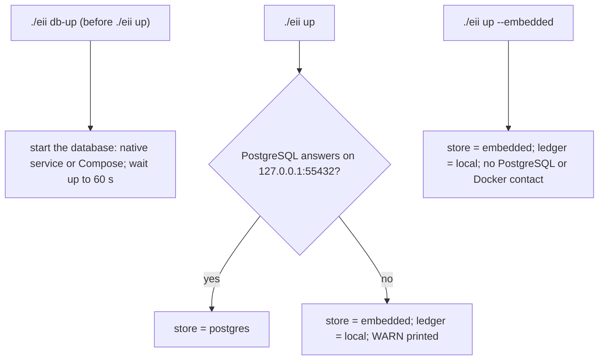

# 13 — Deployment and Operations

| | |
|---|---|
| Status | Draft v0.3, amended by decisions 0016, 0017 and 0018 on 2026-11-12 |
| Date | 2026-11-12 |
| Owner | albarami |
| Purpose | How the EII proof of concept is installed, started, frozen, run on stage, recovered, backed up and later deployed. |
| Read first | [02_ARCHITECTURE.md](02_ARCHITECTURE.md), [08_BACKEND.md](08_BACKEND.md), [12_TESTING_AND_QUALITY.md](12_TESTING_AND_QUALITY.md), [16_DEMO_RUNBOOK.md](16_DEMO_RUNBOOK.md), [decisions/0014-typed-decision-gateway.md](decisions/0014-typed-decision-gateway.md), [decision 0016](decisions/0016-version-1-covers-the-whole-initiative.md), [decision 0017](decisions/0017-public-data-additions-and-public-splits.md) |

## In brief

- Nothing is built yet. This document states how the product must be operated once slices S0 and S11 deliver it.
- `./eii build-public` is the only command that reaches a public source host, and only the hosts of the fetcher allow-list, which now include `www.data.qa`, `www.data.gov.qa`, `fdiprojects.invest.qa` and `www.invest.qa` ([decision 0017](decisions/0017-public-data-additions-and-public-splits.md)). Everything fetched from the investment sources stays in the uncommitted `data/` folder.
- A case sample file, and every value computed from it, stays in the API process's memory for the session and seat that loaded it; no log, ledger row, backup or freeze bundle holds it ([decision 0016](decisions/0016-version-1-covers-the-whole-initiative.md)).
- One command starts the product (`./eii up`) and one stops it (`./eii down`). The database has its own commands: `./eii db-up` starts it and `./eii db-down` stops it; `./eii up` never starts a database. A preflight check runs first and refuses to start on any failed prerequisite; a database that does not answer is a warning, not a failure.
- PostgreSQL 18 with PostGIS serves the release. On the build machine it runs either as a native service inside Ubuntu or through Docker Compose; preflight uses whichever answers. Continuous integration always uses a service container.
- The store is chosen once, at start-up: PostgreSQL if it answers, otherwise the embedded DuckDB reader. During a session only the presenter can move reads to the embedded DuckDB reader, and only at a request boundary. There is no automatic failover.
- The stage runs from a frozen bundle: release files, database dumps, saved images, recorded assistant replays, tiles and fonts, the application source and an offline install archive. It needs neither the network nor an API key.
- Deployment later means the same PostgreSQL engine in a custodian-approved place. The build engine never leaves the custodian environment. What a deployment on real records adds beyond version 1 is listed in [17_DEPLOYMENT_HARDENING.md](17_DEPLOYMENT_HARDENING.md) (sections 2 to 8).

## 1. Terms

| Term | Meaning in this document |
|---|---|
| Build machine | The owner's Windows computer with Ubuntu under WSL2 (Windows Subsystem for Linux, version 2). It builds and, by default, also runs the stage session. |
| Stage machine | The computer that drives the screen in a live session. ASSUMPTION: it is the build machine unless the owner names another; the requirements below apply to whichever it is. |
| Release | One content-addressed set of Parquet files plus a manifest under `data/releases/<release_id>/`, as defined in [03_DATA_CONTRACTS.md](03_DATA_CONTRACTS.md). |
| Serving store | PostgreSQL 18 with PostGIS holding one schema per loaded release and the `app` schema. |
| Embedded reader | A read-only DuckDB file built from the same release by the loader, opened inside the API process. |
| Local ledger | A SQLite file that holds ledger rows while PostgreSQL is away. |
| Freeze bundle | The set of files that lets the stage machine run the frozen version with no network (section 7). |
| Presenter | The person running the session from the presenter console (`EII_PRESENTER=1`). |

## 2. Environments

| Environment | Runs | PostgreSQL | Network | Model |
|---|---|---|---|---|
| Developer machine | Windows with Ubuntu under WSL2; Python, Node and the API run inside Ubuntu; the browser runs on Windows | Native service in Ubuntu, or Docker Compose | Available for `./eii build-public`, on the allow-listed hosts only (OPS-65), and for installs | Template writer and recorded provider only; never a live key during the build ([decision 0018](decisions/0018-priorities-and-amendments-to-decision-0015.md) item 12) |
| Continuous integration | GitHub Actions on an Ubuntu runner | Service container, same image digest as Compose | Available | Recorded provider only, never a live key |
| Stage machine | Frozen bundle, native Windows Chrome or Edge in full screen | Whichever preflight finds answering; embedded reader always open | Not required | Live, recorded replay, or template writer |
| Later deployment | Product plane in a custodian-approved environment | Same engine as a managed service or on a custodian server (section 11) | Custodian-controlled | Custodian decision |

| ID | Requirement |
|---|---|
| OPS-01 | The API process binds to the loopback address `127.0.0.1` only, on every environment except a later deployment that the custodian approves in writing. |
| OPS-02 | ASSUMPTION: the API listens on `127.0.0.1:8000` by default. Reason: one fixed, documented address keeps the runbook exact; doc 08 may change it, and then this table must change with it. |
| OPS-03 | The three seats (`oversight`, `company_a`, `company_b`) and the presenter console run as browser windows on the stage machine. No second device reaches the API over WSL networking in v1. |
| OPS-04 | The stage browser is a native Windows browser (Chrome or Edge), never a Linux browser under WSLg. Reason: WSLg can fall back to software rendering, while Windows browsers use the GPU through Direct3D (stack research, 2026-11-11). |
| OPS-05 | Continuous integration never holds a live `ANTHROPIC_API_KEY`; assistant tests run against the recorded provider. |

Configuration (names pinned in [02_ARCHITECTURE.md](02_ARCHITECTURE.md); values come from the process environment, and setup scripts may read the uncommitted `.env`, OPS-08):

| Variable | Values | Set by | Operational note |
|---|---|---|---|
| `ANTHROPIC_API_KEY` | key or absent | Owner, stage session only | Absent means template writer and recorded replays only |
| `EII_STORE` | `postgres` or `embedded` | `./eii up` (section 5) | Not edited by hand on stage |
| `EII_DATABASE_URL` | connection string to `127.0.0.1:55432` | `.env` | Holds the application role's password; never printed |
| `EII_RELEASE_DIR` | `data/releases/<release_id>` | `.env` | Must match the frozen release on stage |
| `EII_LANG_DEFAULT` | `en` or `ar` | `.env` | Language of the opening scene |
| `EII_PRESENTER` | `0` or `1` | `.env` | `1` on the stage machine only; enables the presenter console and its controls |
| `EII_DECISION_PROVIDER` | `none` or `jev`, default `none` | Build/evaluation environment | No stage or run-time use in v1 |
| `JEV_PRO_API_KEY` | key or absent | Owner, build/evaluation only | Never required by `up`, preflight, freeze or any gate; never printed |

## 3. Prerequisites and how each is checked

Exact versions are pinned in slice S0 and confirmed at the spike (slice S1) with written retreat pins. Several components are newer than most model training data (PostgreSQL 18, DuckDB 2.0, MapLibre GL JS 6, deck.gl 9.4, the current Claude API): builders must read the current official documentation before writing code against them.

| Prerequisite | Pin source | Check run by `./eii preflight` | Pass condition |
|---|---|---|---|
| Python 3.14 managed by `uv` | [02_ARCHITECTURE.md](02_ARCHITECTURE.md) | `uv run python --version` | Reports 3.14.x |
| Node 22 and npm | [10_FRONTEND.md](10_FRONTEND.md) | `node --version` | Reports v22.x |
| Locked dependencies | `uv.lock`, `package-lock.json` | The `uv` and `npm` lockfile checks, with network access disabled | Lockfiles match the manifests; nothing to download |
| DuckDB with `spatial` and `h3` extensions installed locally | 2.0.x, retreat 1.5.x | Load each extension with network access disabled | Both load without a download |
| PostgreSQL 18 with PostGIS 3.6 | Section 4 | `pg_isready -h 127.0.0.1 -p 55432 -t 5`, then a version query | Exit 0; server 18.x; PostGIS 3.6.x. No answer is a `WARN` and selects `embedded` (section 5); a wrong version is a `FAIL` |
| Release present and intact | Manifest | Recompute the release hash | Equals the manifest hash |
| Load receipt | Loader output ([08_BACKEND.md](08_BACKEND.md) BE-46) | Read `load_receipt.json` beside the manifest | Present, `state: complete`, and `release_id` equals the mounted manifest's id. For `protected`, `window_key`, `protected_sha256`, `rules_version_id` and `parameter_set` also match; `public_only` omits those protected-window fields (OPS-64) |
| Embedded reader file | Loader output | Read its stored `release_id` and hash | Equal to the release on disk |
| Tiles, glyphs and interface fonts | Freeze bundle | Hash each file | All present, hashes match |
| Recorded assistant replays | Freeze bundle | Re-validate each replay against the current release | Every replay is checked. Valid replays report `PASS`; missing or invalid replays report `WARN` naming the affected story steps and are excluded from the memo; those steps use the template writer. Replay failure does not prevent startup unless the runbook explicitly requires that prepared scene |
| bubblewrap sandbox (build machine only) | [05_SYNTHETIC_WORLD_AND_SIMULATION.md](05_SYNTHETIC_WORLD_AND_SIMULATION.md) | `bwrap --version` and the sandbox test | Present; test passes |
| API port free | OPS-02 | Try to bind `127.0.0.1:8000` | Free |
| Model key | Optional | Test that `ANTHROPIC_API_KEY` is non-empty | Reports `present` or `absent`; never prints the value |
| `.env` not tracked | `.gitignore` | `git ls-files --error-unmatch .env` | Fails (file is untracked) |
| WSL interoperability (warning only) | Section 10 | `cmd.exe /c ver` with a 5 s timeout | Prints a Windows version |

| ID | Requirement |
|---|---|
| OPS-06 | `./eii preflight` runs every check in the table above and prints one line per check: `PASS`, `WARN` or `FAIL`, the check name and a short reason. Whenever `EII_RELEASE_DIR` is unset, it runs in foundation mode: the release, load-receipt, embedded-reader and recorded-replay checks print `WARN not_configured` and do not make the command non-zero; every other check keeps its normal severity. `./eii up` always requires a configured, complete release. From the slice S3 gate onward, every gate runs preflight with `EII_RELEASE_DIR` set, where a missing release, incomplete receipt or mismatched receipt `release_id` is `FAIL`. |
| OPS-07 | No preflight line, log line or error message prints a secret, a connection password or the value of `ANTHROPIC_API_KEY`. A test asserts this by running preflight with a known dummy key and searching the output. |
| OPS-08 | Running application code reads secrets only from its process environment or, for the loader's owner role, the libpq password file; setup scripts may read the uncommitted `.env`. The repository commits `.env.example` with variable names and empty values, never a value. |
| OPS-09 | Network, socket, process and Docker probes have five-second timeouts. The database start waits up to 60 seconds inside `./eii db-up`. File hashing, replay validation and sandbox tests have separately recorded budgets and emit progress; they are not subject to the five-second probe limit. |
| OPS-10 | No document, script or log in the repository contains an absolute local path, a user name or a machine name. Paths are written relative to the repository root. |
| OPS-55 | With `EII_DECISION_PROVIDER` at its default `none`, `./eii preflight` performs no gateway probe and opens no gateway connection, and stage start-up always behaves as provider `none`. The typed-decision gateway has no stage or run-time use in v1 ([decisions/0014-typed-decision-gateway.md](decisions/0014-typed-decision-gateway.md)). |

## 4. PostgreSQL on the build machine

### 4.1 Measured facts (architecture research, build machine, 2026-11-11)

Measured once during design research on 2026-11-11, before any product code existed, with a throwaway random synthetic table set of 7.54 million rows on the `postgis/postgis` image tagged 18-3.7 (PostgreSQL 18.6, PostGIS 3.7.0). These are figures about third-party software, not test results of this product, and slice S1 measures them again. Data directories were RAM-backed, so disk effects are absent.

| Measure | Value |
|---|---|
| First start including database creation | 1.28 s |
| Warm restart | 0.21 s |
| Memory at idle after restart | about 32 MB |
| Release copy, then indexing | 2.2 s, then 2.7 s |
| Database size for that release | 576 MB |
| Dump of the whole release | 1.5 s, 82 MB |
| Parallel restore of that dump | 3.4 s |
| Embedded DuckDB build of the same release; file size; open time | 0.85 s; 90.5 MB; 0.02 to 0.05 s |
| One ledger row insert; one notification delivered | 0.31 ms; 1.45 ms median |

Environment incidents observed the same day: the Linux `docker` command inside Ubuntu was a dangling link while Docker Desktop was running on Windows; calls through the Docker socket took about 24 s each; launching Windows programs from Ubuntu later failed with "Exec format error" after another WSL distribution was started and shut down (a known WSL behaviour, WSL issue 8952); the engine picked a different random host port on each of three starts; a mis-quoted `shared_preload_libraries` value stopped PostgreSQL from starting; the image's first-boot helper server listened on the Unix socket only. Throughout, running databases kept answering on their loopback ports. Not tested that day: the Compose file end to end, a native PostgreSQL service inside Ubuntu, and disk-backed latencies.

### 4.2 The two options

| | Option N: native service inside Ubuntu | Option C: Docker Compose |
|---|---|---|
| Install | `sudo apt install postgresql-18 postgresql-18-postgis-3` (the Ubuntu archive offered 18.6 and PostGIS 3.6.2 on 2026-11-11, feasibility research) | Docker Desktop with WSL integration enabled, or Docker Engine inside Ubuntu (neither path was run end to end on 2026-11-11) |
| Needs | The owner's sudo once (OPEN ITEM OI-10) | A working `docker` command in Ubuntu |
| Starts | At boot, by systemd; on demand through `./eii db-up` | `./eii db-up` runs `docker compose up -d --wait --wait-timeout 60 db` |
| Stage risk | Removes Docker from the stage path | Depends on the Docker control path that failed three ways on 2026-11-11 |
| Default on stage | Preferred | Fallback when Option N is not installed |

### 4.3 Compose service definition (in words)

The file `infra/compose.yaml` defines one service, `db`:

1. Image: `postgis/postgis` on the PostgreSQL 18 with PostGIS 3.6 line, pinned by its image digest, never by a moving tag. The digest is recorded in slice S0 and confirmed at slice S1. Reason: the in-country managed services carried PostGIS 3.6 on 2026-11-11 (section 11), so v1 must not depend on 3.7-only functions.
2. Pull policy `never` on the stage machine, so a start never reaches the network.
3. Port: container port 5432 published on `127.0.0.1:55432` only. A fixed port, because engine-chosen ports changed on every start during the measurements.
4. Storage: one named volume, `eii_pgdata`, mounted at `/var/lib/postgresql`. The PostgreSQL 18 images declare that path and keep data under `/var/lib/postgresql/18/docker`; the older mount at `/var/lib/postgresql/data` would leave data on an anonymous volume (architecture research).
5. Health check: `pg_isready -h 127.0.0.1 -p 5432` inside the container, every 2 s, 30 retries. It probes TCP, because the first-boot helper server listens on the Unix socket only.
6. No `shared_preload_libraries` and no extension beyond PostGIS.

### 4.4 One-time setup of Option N

Run once by the owner, who holds sudo. The script lives in `infra/` (created in slice S0) and is idempotent.

1. Install the two packages named in section 4.2.
2. Set the cluster to listen on `localhost` only and on port 55432, then restart the service.
3. Enable the service at boot (`sudo systemctl enable postgresql`).
4. Create the EII database and the three roles of OPS-13; write the generated `eii_app` and `eii_reviewer` passwords to the local `.env` only, and the `eii_owner` credential to the loader account's libpq password file with owner-only permissions (OPS-14).
5. Create the PostGIS extension in the EII database.
6. Run `./eii preflight`; the PostgreSQL line must read `PASS`.

### 4.5 Continuous integration

The CI workflow declares a `postgres` service container from the pinned `db` image digest, publishes port 5432 to the job, and waits on a `pg_isready` health check before any step runs. The job then runs the same role setup as Option N, `./eii load-release` on a small fixture release, and `./eii test`. CI never uses the native option and never needs Docker Desktop.

### 4.6 Roles and schemas

| ID | Requirement |
|---|---|
| OPS-11 | Option N and Option C both answer on `127.0.0.1:55432`. ASSUMPTION: the native cluster's port is set to 55432 in its configuration. Reason: one `EII_DATABASE_URL` then serves both options. |
| OPS-12 | The database contains no extension other than PostGIS (and the built-in procedural language). Preflight fails if another extension is installed in the EII database. |
| OPS-13 | Three roles exist: a loader role that owns the release schemas and `app` tables; an application role that owns no table and is subject to row-level security; a reviewer role with `SELECT` only on the documented release views. Reason: table owners bypass row-level security (observed in the architecture research). |
| OPS-14 | The `eii_app` and `eii_reviewer` credentials are generated into the uncommitted `.env`; the API receives only `eii_app` through `EII_DATABASE_URL`. The `eii_owner` credential is written only to the loader account's libpq password file with owner-only permissions and is never placed in the API environment. |
| OPS-15 | The stage serves exactly one selected release, named by `EII_RELEASE_DIR`. A `public_only` release has no parameter set or protected-window fields. For a `protected` release, no route, setting or switch selects a parameter set at run time, and no second protected table set of one window exists in the product plane (PRV-05, PRV-120; [08_BACKEND.md](08_BACKEND.md) BE-103). A release schema other than the selected one can only be a different release left in place during a change; removing it is an operator step, never done by a command of a running session. |
| OPS-16 | Continuous integration runs PostgreSQL as a GitHub Actions service container with the same image digest as `infra/compose.yaml` and a TCP health check. |

## 5. Store selection, the presenter switch and the local ledger

`./eii preflight` only probes current state and never starts or stops anything. Whenever
`EII_RELEASE_DIR` is unset, it uses the foundation behaviour of OPS-06. If PostgreSQL does not
answer, it reports `WARN`, the currently selectable store `embedded`, and whether Docker was
reachable; it does not predict a post-`./eii db-up` result. `./eii db-up` is the one command that
starts the database (native service or Compose) and waits up to 60 seconds for it to answer.
`./eii up` always requires a configured complete release and never starts a database: it serves
from the store preflight found, so configured preflight and start-up cannot disagree.

| ID | Requirement |
|---|---|
| OPS-17 | The store is chosen once, at start-up, from the store preflight found: `postgres` when PostgreSQL answers, otherwise `embedded`, with a `WARN` line naming the reason and whether Docker was reachable. `./eii up` never starts or stops a database. `./eii preflight` prints the store it would select. `./eii up --embedded` selects `embedded` without contacting PostgreSQL or Docker. The selection is written to `EII_STORE` for the API process. |
| OPS-18 | The API opens the embedded reader at every start, whatever the store. When the store is `postgres`, the API refuses to start (exit 4) unless the embedded reader and the PostgreSQL release schema carry the same `release_id` and hash. |
| OPS-19 | When `EII_PRESENTER=1`, the presenter console includes the control "Switch to embedded reader" (the full control list is in [16_DEMO_RUNBOOK.md](16_DEMO_RUNBOOK.md)). It takes effect at the next request boundary: requests already running finish on PostgreSQL; every later request reads the embedded reader. One answer never mixes stores. The control is a presenter route: it requires the per-session `X-EII-Presenter-Token` header (OPS-56) and is rejected with `403` without it. |
| OPS-56 | At each `./eii up`, the API generates a cryptographically random per-session presenter token. The presenter console receives it in its start-up URL and sends it as `X-EII-Presenter-Token` on every presenter API call. Missing or incorrect tokens are rejected with `403` on every window, including loopback company windows. The token is never written to logs, ledger rows or health responses, and it is regenerated on restart. A browser test proves that the `company_a` and `company_b` windows cannot switch stores or toggle offline mode. |
| OPS-20 | The switch is one-way for the session. ASSUMPTION: returning to PostgreSQL needs `./eii down` and `./eii up` after the session, never during it. Reason: a two-way control is the flapping risk this design removes. |
| OPS-21 | While the store is `embedded`, or PostgreSQL is unreachable, ledger rows are written to the local ledger with stable unique identifiers. |
| OPS-22 | At the next start with PostgreSQL answering, `./eii up` replays local ledger rows into `app.ledger_entry` idempotently (a row already present is skipped) and reports how many were replayed. |
| OPS-23 | While the ledger is local, the oversight seat shows a "paused" badge and no live feed. Features that need PostgreSQL (the live ledger, two-company separation, the reviewer's read-only mirror) show "paused", not an error, and release facts are unchanged. |
| OPS-24 | The current store and ledger state are shown only on the presenter console and on the health page, never on a company seat. |
| OPS-25 | There is no automatic failover in the middle of a request, and no latency-triggered switch. |

Why no automatic failover. The architecture research proposed a circuit breaker that switched stores when a call exceeded 300 ms. The feasibility judge dropped it: PostgreSQL's own measured 95th percentile on one whole-country query was 229 ms, just under the trip point, so the store could flip back and forth during a session. A presenter decision at a request boundary is predictable, can be rehearsed, and cannot mix two stores inside one answer.

## 6. The `./eii` commands

All commands run from the repository root inside Ubuntu. Names are pinned in [02_ARCHITECTURE.md](02_ARCHITECTURE.md).

| Command | Does | Network | Preflight checks it runs |
|---|---|---|---|
| `./eii preflight` | Runs every check in section 3, prints the store it would select, and changes nothing | No | All |
| `./eii db-up` | Starts the database (Option N native service or Option C Compose `db`) and waits up to 60 s for it to answer; it starts nothing else | No | Tools, database |
| `./eii db-down` | Stops the database; never removes volumes | No | Tools |
| `./eii up` | Serves from the store preflight found (section 5), invokes `./eii load-release` only when the configured release schema is absent, replays the local ledger, starts the API serving the front end, tiles and fonts, prints the links for the three seats and the presenter console, the store, `release_id` and model mode, then stays in the foreground until stopped | No | All |
| `./eii up --embedded` | Same, with store `embedded`; skips PostgreSQL and Docker | No | All except PostgreSQL |
| `./eii down` | Stops the API cleanly; never starts or stops the database (that is `./eii db-up` and `./eii db-down`); never removes volumes | No | None |
| `./eii test` | Runs the suites defined in [12_TESTING_AND_QUALITY.md](12_TESTING_AND_QUALITY.md), including parity on both engines | No | Tools, PostgreSQL |
| `./eii build-public` | Runs the public fetchers, against the allow-listed hosts only (OPS-65), into `data/public_cache/` with hash, licence (for the investment sources, the publisher's terms as read and the basis of use) and retrieval date; reads the FDI dashboard page on every run | Yes | Tools, disk |
| `./eii build-world` | Builds the synthetic world and mobility feeds inside the sandbox from the public cache | No | Tools, sandbox |
| `./eii build-release` | Runs linkage, the privacy engine and the traffic assignment, writes `data/releases/<release_id>/`, deletes the vault | No | Tools, sandbox |
| `./eii load-release` | Loads the release named by `EII_RELEASE_DIR` into a PostgreSQL schema named after the release and into the embedded reader file; accepts only tables named in the manifest | No | Tools, PostgreSQL, release |
| `./eii freeze` | Accepts `protected` releases only and takes no mode flag. It is run twice (section 7): the first run writes the data bundle, checksum list and pending `freeze.json` and appends the register line; the second run, from the containing base-branch commit, builds and verifies the application archive, writes its checksum beside the bundle and marks `freeze.json` complete. A `public_only` release is never frozen or registered | No | All |

Exit codes (ASSUMPTION: this scheme is set here because nothing else defines it; it is the simplest set that lets the runbook name each failure):

| Code | Meaning |
|---|---|
| 0 | Success |
| 1 | A check or step failed; the printed `FAIL` lines say which |
| 2 | Usage error: unknown command or flag |
| 3 | PostgreSQL required by this command but not answering (`test`, `load-release`, `freeze`) |
| 4 | Release missing, incomplete, or hash mismatch (including embedded reader mismatch) |
| 5 | API port already in use |
| 6 | Network required but unavailable (`build-public` only) |
| 7 | Freeze refused because the register conflicts or the recorded human review is missing; or frozen-bundle install or start refused because the installed application's register lacks the line or `freeze.json` is not complete (OPS-62, OPS-63) |

| ID | Requirement |
|---|---|
| OPS-26 | Every `./eii` command exits with one of the codes above and prints the code's meaning on failure. |
| OPS-27 | `./eii up` never issues a Docker command and never starts or stops a database: it serves from the store preflight found. `./eii db-up` is the one command that starts the database (native service or Compose), waiting up to 60 s for it to answer; `./eii db-down` stops it. |
| OPS-28 | `./eii down` never deletes a volume, a release, the local ledger or the freeze bundle. |
| OPS-29 | `./eii load-release` refuses any table not named in the release manifest and exits 4. |
| OPS-57 | `./eii up` invokes `./eii load-release` only when the configured release schema is absent. If an existing schema has the configured release prefix but a different full release ID or hash, it exits 4 and changes neither store. A changed release uses its own content-addressed schema and `EII_RELEASE_DIR`; no running-stage schema is overwritten. |

### 6.1 Health page

| ID | Requirement |
|---|---|
| OPS-30 | The API serves `GET /health` as JSON with these fields: `status` (`ok` or `degraded`), `store` (`postgres` or `embedded`), `postgres` (`up`, `down` or `not_used`), `release_id`, `release_hash`, `parity` (`identical` or `failed`, from the last parity run recorded for this release), `ledger` (`postgres` or `local`), `local_ledger_rows`, `model` (`live`, `replay` or `template`), `tiles`, `fonts`, `replays` (each `ok`, `missing` or `invalid`). |
| OPS-31 | `status` is `ok` only when every other field holds its healthy value; for an embedded start, `store: embedded`, `postgres: not_used` and `ledger: local` count as healthy. While the store is `postgres` and PostgreSQL stops answering, `postgres` reads `down` and `status` reads `degraded` within 5 s; the store does not change by itself (OPS-25). |

### 6.2 Public sources, investment sources and case sample files

| ID | Requirement |
|---|---|
| OPS-65 | `./eii build-public` is the only command that contacts a public source host, and it contacts only the hosts of the fetcher allow-list (PUB-03; [02_ARCHITECTURE.md](02_ARCHITECTURE.md) ARC-13). [Decision 0017](decisions/0017-public-data-additions-and-public-splits.md) adds `www.data.qa` beside `www.data.gov.qa`, which answer the same portal API (a dataset is identified by its slug whichever host served it), and the two investment hosts `fdiprojects.invest.qa` and `www.invest.qa`. The registry records the host each file came from. A request to any other host, a redirect to one included, stops the run with exit 1 before anything is stored. The running API, preflight, freeze and every stage mode contact none of these hosts. |
| OPS-66 | Everything fetched from the investment sources stays in the uncommitted `data/` folder: the FDI dashboard page, read on every `./eii build-public`, the agency's sector, opportunity, incentive, set-up and law pages, and every record parsed from them, in the public cache, the releases and the freeze bundles alike. Only the fetcher, the parsers, the `fdi_projects` contract and their tests, which use a small synthetic page shaped like the real one, are committed ([02_ARCHITECTURE.md](02_ARCHITECTURE.md) ARC-99). The source registry records the publisher's terms as read at fetch and the basis of use: the owner's decision of 2026-11-12 for this personal internal project. If the terms read at a fetch forbid that use, the source is switched off and the owner is told ([decision 0017](decisions/0017-public-data-additions-and-public-splits.md)). |
| OPS-67 | A case sample file loaded through the case route ([08_BACKEND.md](08_BACKEND.md) BE-118) stays in the API process's memory for the session and seat that loaded it, and so does a drawn shape (BE-117). Neither the loaded copy nor any value computed from it is written to a log, a ledger or egress row, the local ledger, a backup or the freeze bundle; `./eii down` and every restart drop them. The committed synthetic sample files ship with the application source like any other committed file, and the one-click case start loads them through the same route, so the case stories need no network on stage. |

## 7. Building, loading and freezing a release

Order for a protected release on the build machine: `./eii build-public` → `./eii build-world` →
`./eii build-release` → `./eii load-release` → `./eii test` → the recorded human review of the
release (OPS-62) → first `./eii freeze` run → the register line merged to the base branch through
its normal pull request → second `./eii freeze` run from a base-branch commit that contains the
line → stage install. A `public_only` release is buildable and loadable but is never frozen or
entered in the export register. The command takes no new flag. The first protected-release run
writes the data bundle, checksum list and pending `freeze.json` and appends the register line. The
second builds the application archive from that base-branch commit, verifies an offline
installation, writes the archive checksum beside the bundle and marks `freeze.json` complete. A
protected release is frozen when its bundle has `freeze.json`. For a frozen release only, the
installer and `./eii up` require the matching line in the register shipped inside the installed
application and a complete descriptor; otherwise they exit 7. A release under `data/releases/` on
the build machine has no `freeze.json` and is not checked. Continuous integration checks the
register file alone. No signed export receipt file is created (PRV-120).

Freeze bundle contents, written to `data/freeze/<release_id>/` (ASSUMPTION: location chosen to stay inside the uncommitted `data/` folder):

| Item | Why it is needed offline |
|---|---|
| Release files: Parquet tables and manifest | Source of truth; reload into either engine |
| Embedded reader file | Live standby without a rebuild |
| PostgreSQL dump in custom format (`pg_dump -Fc`) of the release schema only | Restore the release in seconds without re-indexing |
| PostgreSQL dump in custom format (`pg_dump -Fc`) of the seeded `app` schema only | Restore the seeded application state without touching a live `app` schema |
| Saved container image (`docker image save`) for the pinned `db` image | Start Option C with no registry access |
| Installed DuckDB extension files | DuckDB installs extensions from the network the first time (stack research) |
| Recorded assistant replays for every prepared story question, copied from the committed `evals/prepared/` (see [09_AI_ASSISTANT.md](09_AI_ASSISTANT.md)) | Model outage or no key |
| Basemap PMTiles file, map glyphs (including Arabic), sprites, interface fonts | Hosted tiles, glyphs and fonts fail without internet (stack research) |
| Built front end | No CDN or build step on stage |
| Repository source, the built API artefact, `uv.lock`, `package-lock.json`, and a complete offline Python wheel/cache archive for the locked environment | A replacement stage machine installs and runs the application with no network; the archive installed on the stage machine is built from a base-branch commit that contains the freeze's register line, so the register shipped inside the installed application is the allow-list of OPS-63 |
| Routing graph for the release | In-process routing without rebuilding |
| Version list of every pinned package | Confirm the exact versions offline |
| Recorded human review of the release (OPS-62) | Evidence that the survival report and the signed attack report were read before the freeze; the freeze refuses to run without it |
| `freeze.json` | Descriptor that makes the release frozen: `release_id`, `window_key`, `protected_sha256`, `world_seed`, frozen commit, review-record path and `state` (`pending` after the first run, `complete` after the second) |
| `SHA256SUMS`: one SHA-256 and relative path for every other regular file in the bundle, sorted by path; it excludes itself | Verify the copy; verification rejects missing, additional or changed regular files |

The release files in the bundle carry the Public tables of the investment sources. The bundle therefore stays under `data/freeze/` and on the removable storage of OPS-42, never in the repository (OPS-66). It holds no loaded case sample file and no drawn shape (OPS-67).

| ID | Requirement |
|---|---|
| OPS-32 | `./eii test` records each pass with the commit and `release_id`; `./eii freeze` refuses to run unless such a pass exists for the current commit and release. |
| OPS-33 | The bundle's `SHA256SUMS` verifies with `sha256sum -c SHA256SUMS` on the stage machine before every session. `SHA256SUMS` contains one SHA-256 and relative path for every other regular file in the bundle, sorted by path, and excludes itself. Verification rejects missing, additional or changed regular files; a test with one extra file and one modified file in the bundle must fail. |
| OPS-34 | Recorded replays carry the `release_id` they were recorded on; at start-up the API re-validates each one and rejects any recorded on a different release. |
| OPS-35 | The front end loads no script, style, font, glyph or tile from any external host. A test serves the app with outbound network blocked and fails on any external request. |
| OPS-36 | Tiles are served by the API process with HTTP range requests (supported by Starlette's file response, stack research); no separate tile server. |
| OPS-58 | `./eii freeze` takes no mode flag and is run twice. The first run records the frozen commit in `freeze.json` and leaves its `state` as `pending`. After the register line is merged to the base branch, the second run must execute from a base-branch commit containing that line; it builds the application archive from that commit, verifies an offline installation into a clean temporary directory, writes the archive's SHA-256 beside the bundle and changes the descriptor to `state: complete`. The stage-restore procedure copies both the freeze bundle and this application archive, verifies both, and installs with network access disabled. |
| OPS-62 | `./eii freeze` also requires a recorded human review of the release: the reviewer's role, the review date, and confirmation that the survival report (PRV-80) and the signed attack report (PRV-79) were read. The review record is a JSON file written before `./eii freeze` runs. The first run copies it into the freeze bundle as `review.json`. `freeze.json.review_record` is the bundle-relative path `review.json`. The record fields are `reviewer_role`, `review_date`, `survival_report_read`, `attack_report_read`, `window_key`, `protected_sha256`, `rules_version_id` and `parameter_set`. No review record, no freeze: the command prints what is missing and exits 7. |
| OPS-63 | One treatment per window (PRV-120). This rule and the export register accept `protected` releases only; a `public_only` release is never frozen or registered. `window_key` is computed exactly as DAT-80 defines it from canonical JSON holding the protected `period` and, in name order, `{name, sha256}` for `business_register.v1`, `employment.v1`, `residence.v1` and `wages.v1`, using each feed's manifest `feed_sha256`; nothing else enters it. On the first successful `./eii freeze` run, the command appends exactly one line to the committed, append-only file `infra/export_register.jsonl` with these seven fields in order: `window_key`, `protected_sha256`, `world_seed`, `rules_version_id`, `parameter_set`, `release_id`, `code_version`. The second run appends no line. A freeze is refused with exit 7 for a `public_only` release, when the same `window_key` is already registered with different protected tables or when the same `world_seed` has a different `window_key`; after a freeze, any change of rules version, exported set, treatment code or world generator requires a new `world_seed` and a new build before another freeze. Continuous integration checks the register alone: existing lines are unchanged, one `protected_sha256` per `window_key`, and one `window_key` per `world_seed`. For a frozen release only, the installer and `./eii up` exit 7 when the register shipped inside the installed application lacks the matching `window_key` and `protected_sha256` line or `freeze.json` is not complete. The remedy is to finish the two-run freeze of OPS-58; changing the seed is not the remedy for this bundle refusal. An unfrozen release under `data/releases/` has no descriptor and is not checked. No signed export receipt file is created; the shipped register and complete descriptor are required. |
| OPS-64 | A release of either kind is loaded under its content-addressed schema, `r_` plus the first 16 hexadecimal characters of its `release_id` ([08_BACKEND.md](08_BACKEND.md) BE-33). Preflight refuses a release whose `load_receipt.json` is missing, whose `state` is not `complete`, or whose `release_id` differs from the mounted manifest. For a `protected` release it also refuses a receipt whose `window_key`, `protected_sha256`, `rules_version_id` or `parameter_set` differs from the manifest; a `public_only` receipt omits those protected-window fields (BE-46). |

Runbook step for a refused freeze, to be carried by [16_DEMO_RUNBOOK.md](16_DEMO_RUNBOOK.md): when the first `./eii freeze` run exits 7, stop and investigate. A freeze is refused when the same `window_key` is already registered with different protected tables or the same `world_seed` with a different `window_key`. Never edit or remove a register line. After a freeze, a change of rules version, exported set, treatment code or world generator requires a new `world_seed` and a new build before another freeze (PRV-120). A missing review record is resolved by performing and recording the review (OPS-62), then re-running the first freeze step.

Runbook step for a refused frozen bundle, to be carried by [16_DEMO_RUNBOOK.md](16_DEMO_RUNBOOK.md): when install or `./eii up` exits 7 because the register shipped inside the installed application lacks the bundle's line or `freeze.json` is not complete, stop. Finish the two-run freeze: merge the line normally if needed, run `./eii freeze` again with no new flag from a base-branch commit containing it, and verify that the archive checksum is present and `freeze.json` says `complete`. Do not change the seed, edit the shipped register or substitute a receipt file.

## 8. Offline and no-key modes

| Mode | Trigger | Assistant behaviour | Everything else |
|---|---|---|---|
| Live | Key present and network up | Model plans the answer and selects claims and components; the application renders every word; evidence lands before words | Normal |
| No-key | `ANTHROPIC_API_KEY` absent at start | Template writer for every answer; recorded replays for prepared story questions, marked "prepared" | Unchanged |
| Offline | Presenter console "Offline" control | Same as no-key; no outbound call is attempted | Unchanged; tiles and fonts are local |
| Fallthrough | Model refusal, network loss, outage or time-out on one answer | That answer falls through to the template writer (see [09_AI_ASSISTANT.md](09_AI_ASSISTANT.md)) | Unchanged |

| ID | Requirement |
|---|---|
| OPS-37 | In no-key and offline modes the session makes zero outbound model calls, and ledger rows carry zero linked egress records. |
| OPS-38 | The current model mode is shown on the presenter console and the health page; a replayed answer shows the "prepared" mark on screen. |
| OPS-59 | The freeze bundle and every stage mode require no Jev key or gateway service. |

## 9. Logs, backups and restore

| ID | Requirement |
|---|---|
| OPS-39 | The API writes structured JSON lines to standard output and to `data/logs/`. ASSUMPTION: one file per day, kept for 30 days. Each line has time, level, request id, seat key, store, `release_id`, event and duration. |
| OPS-40 | Logs never contain a secret, a full model prompt, a person-level record, a drawn shape's coordinates, or a case sample file or any value computed from it. Egress content is recorded only in `app.egress_record` (or the local ledger), as defined in [08_BACKEND.md](08_BACKEND.md). |
| OPS-41 | Backup scope: the `app` schema (custom-format dump), the local ledger file, and the freeze bundle. Release schemas are not backed up: they are rebuilt from Parquet. There is no `app.decision_record` table in version 1; decision records of the typed-decision gateway are files under `evals/` and are covered by the repository's normal version control, not by this backup. Drawn shapes and case sample files are never backed up, because they are never persisted (OPS-67). |
| OPS-42 | Before and after each session, the operator copies the latest backup (created by the quiesced procedure of OPS-60) and the freeze bundle to removable storage kept apart from the stage machine. |
| OPS-60 | Backups are taken quiesced: after `./eii down`, use `pg_dump -Fc --schema=app` as `eii_owner` through libpq to create a timestamped app dump, and use Python's `sqlite3.Connection.backup` for the local ledger; hash both before the removable-storage copy. |
| OPS-61 | A clean-machine restore rehearsal belongs to the slice S11 rehearsals: on a second machine, restore from the freeze bundle and the application archive with network access disabled, verify both, and check that every restored hash and row count matches the values recorded at freeze. |

Restore procedures:

| Situation | Steps |
|---|---|
| Release schema damaged or missing | `./eii load-release`, or `pg_restore -j 4 -d <database>` from the bundle's release-only dump. Parallel restore works only with custom or directory formats and not with `--single-transaction` (PostgreSQL 18 manual). |
| `app` schema lost | Restore the latest `app` dump into an empty `app` schema with `pg_restore`; then `./eii up` replays any local ledger rows. |
| Compose volume lost | `docker load -i <saved image>` if the image is missing, `./eii db-up`, then restore as above. |
| Stage machine lost | On a second machine, copy the freeze bundle and the application archive, install with network access disabled (OPS-58), verify checksums (OPS-33), `./eii up --embedded`. |

## 10. Stage hardening checklist

The runbook ([16_DEMO_RUNBOOK.md](16_DEMO_RUNBOOK.md)) turns this into timed steps.

| ID | Requirement |
|---|---|
| OPS-43 | WSL interoperability works: `cmd.exe /c ver` prints a Windows version. If it fails with "Exec format error", run `sudo systemctl restart systemd-binfmt` inside Ubuntu, or `wsl --shutdown` from Windows and reopen (architecture research; WSL issue 8952). |
| OPS-44 | No other WSL distribution runs during the session. |
| OPS-45 | PostgreSQL is started (with `./eii db-up`, or at boot under Option N) and answering at least one hour before the session; no Docker command is issued during the session. |
| OPS-46 | The stage browser reports hardware-accelerated WebGL2 (checked on the browser's GPU status page) at the venue resolution. |
| OPS-47 | Operating-system updates, notifications and sleep are paused on the stage machine for the session day. |
| OPS-48 | The model key, if used, sits in a dedicated workspace with a spend cap (OPEN ITEM OI-01) and is present only in the environment of the stage session. |
| OPS-49 | Three full rehearsals pass before the first session: PostgreSQL up; PostgreSQL stopped mid-story with the presenter switch; and offline. Fact values match across all three. |
| OPS-50 | A screen recording of a passing rehearsal is kept on a separate device as the last line of defence. |

## 11. Deployment path (later)

The research checked provider pages on 2026-11-11. They describe what the providers offered that day, not a commitment, and not what any custodian runs. The target platform must be confirmed with the custodian's IT team before any fit is claimed.

| Finding (provider pages, 2026-11-11) | Source |
|---|---|
| Azure Database for PostgreSQL lists the Qatar Central region; new zone-redundant deployments there were temporarily blocked and geo-redundant backup was not offered | Microsoft Learn, flexible server overview |
| Its PostgreSQL 18 extension table lists PostGIS 3.6.1 and pgAudit 18.0, and no h3 | Microsoft Learn, extension versions |
| Google Cloud SQL lists the `me-central1` (Doha) location; its extension page lists PostGIS 3.6.0 for PostgreSQL 18 and pgAudit, and neither h3 nor Apache AGE | Google Cloud documentation |
| PostgreSQL 18 adds OAuth authentication and data checksums by default | PostgreSQL 18 release notes |

| ID | Requirement |
|---|---|
| OPS-51 | A deployment uses the same PostgreSQL major version and PostGIS minor line as v1, as a managed service in an in-country cloud region or on a custodian server with the pinned image. No v1 feature may depend on an extension absent from the target. |
| OPS-52 | The build engine (DuckDB and the custodian plane) runs only inside the custodian environment. Only a release crosses to the serving store. |
| OPS-53 | Later items, not in v1: single sign-on at the API (PostgreSQL 18 offers OAuth authentication) and database audit logging with pgAudit on the managed service. |
| OPS-54 | Before any deployment statement is made to an audience, the owner records the custodian's confirmed platform in `OPEN_ITEMS.md`. Until then the only permitted sentence is: "PostgreSQL with PostGIS was offered as a managed service in both in-country cloud regions when checked on 2026-11-11." |
| OPS-68 | A deployment on real records must add what [17_DEPLOYMENT_HARDENING.md](17_DEPLOYMENT_HARDENING.md) lists ([decision 0016](decisions/0016-version-1-covers-the-whole-initiative.md)), among others the release cadence, rolling windows and query auditing against differencing across periods, query auditing and rate limits for drawn areas, and, for any count taken from a real telecom feed, that feed's own disclosure rules. No deployment statement may imply that version 1 already provides them, and version 1 accepts no real company file in place of a committed case sample file (OPS-67). |
| OPS-69 | If the demonstrator is ever hosted publicly, the owner decides then which public and investment sources stay on ([decision 0017](decisions/0017-public-data-additions-and-public-splits.md)). |

## 12. Running cost notes (estimates only)

| Item | Note |
|---|---|
| Compute on the build machine | Negligible at test scale: about 32 MB idle for PostgreSQL; queries of 0.4 to 3 ms (measured 2026-11-11). Not a constraint. |
| Disk | Per release: about 576 MB in PostgreSQL, 35 MB Parquet, 90 MB embedded file (measured on the 7.54 million-row test release). One selected release online plus the bundle and one saved image: estimate under 3 GB, excluding the basemap tiles, whose size is fixed when the extract is cut in slice S1. This estimate predates the hourly presence and traffic tables, the monthly periods and the public additions of decisions 0016 and 0017; the release size is measured again when the slices that build them run (open question below). |
| Container image | The 18-3.7 image measured 245 MB compressed and 980.7 MB unpacked; the 3.6 image size is not measured. |
| Model API | Estimate by the feasibility judge from the provider's price table: roughly USD 0.05 to 0.15 per answer and a few hundred dollars over the whole project. To be measured at go-live, when the owner switches the live adapter on (OI-01: the key is supplied for go-live and is not used during the build). |
| Managed database in country | Not estimated. To be priced with the custodian. |
| Continuous integration | Not estimated; depends on the repository's GitHub plan. |

## Open questions and assumptions

ASSUMPTIONS made in this document:

- The stage machine is the build machine unless the owner names another.
- The API listens on `127.0.0.1:8000` (OPS-02).
- The native PostgreSQL cluster is configured to port 55432 so both options share one connection string (OPS-11).
- The presenter switch is one-way per session (OPS-20).
- The `./eii` exit-code scheme in section 6, including code 7 for a refused freeze.
- The freeze bundle lives in `data/freeze/<release_id>/`.
- The human-review record of OPS-62 is written before freeze and copied into the bundle as `review.json`, with the pinned fields in that requirement.
- Logs are daily files kept for 30 days (OPS-39).
- A case sample file is loaded only by the server, from a closed key naming a committed synthetic sample file of its case, and only when that file's SHA-256 equals its committed value; no file is received from the browser, so no real record can enter, and the one-click case start loads the committed file through the same route (OPS-67; [08_BACKEND.md](08_BACKEND.md) BE-118).
- A blocked host stops `./eii build-public` with exit 1, the code of a failed check, not exit 6, which stays for an unavailable network (OPS-65).

OPEN items raised by decisions 0016 and 0017 that touch this document:

- OPEN: the page structure of the FDI dashboard and of the agency's pages, the agency's page list and where each publisher states its terms are confirmed at slice S2, against a synthetic test page of the same shape (OPS-66).
- OPEN: the release size with the hourly presence and traffic tables, the monthly periods and the public additions is measured when the slices that build them run; the disk estimate of section 12 is revised then.

Open items from the master design that touch this document: OI-01 (API key and spend cap), OI-02 (demonstration date; no date-driven freeze yet), OI-08 (label for live ledger rows), OI-10 (PostgreSQL option on the build machine), OI-13 (GitHub repository settings), OI-14 to OI-18 (typed-decision gateway: approved route, qualification sets, mapping sign-off, Proof-room panel, token cap), OI-35 (which parameter set is exported; default A, fixed at the slice S1 gate).

## Sources

- Project decision record 0014, "Typed-decision gateway", [decisions/0014-typed-decision-gateway.md](decisions/0014-typed-decision-gateway.md), 2026-11-11.
- Project decision records 0016 and 0017, "Version 1 covers the whole initiative" and "Public data additions, public splits by sex and nationality, and investment sources": [decision 0016](decisions/0016-version-1-covers-the-whole-initiative.md) and [decision 0017](decisions/0017-public-data-additions-and-public-splits.md), 2026-11-12.
- Qatar Open Data Portal, Explore API v2.1, https://www.data.gov.qa/api/explore/v2.1/ (CC BY 4.0; also served at `www.data.qa`), retrieved 2026-11-12 as recorded in decision 0017.
- National investment promotion agency, FDI Projects dashboard, https://fdiprojects.invest.qa/ (data from fDi Markets), read 2026-11-12 as recorded in decision 0017; and its site, https://www.invest.qa/ , whose sector, opportunity, incentive, set-up and law pages the fetcher reads under the publisher's terms recorded at fetch.
- EII architecture-options research, measurements on the build machine, 2026-11-11 (project research record held by the owner).
- EII feasibility-and-cost judgement, 2026-11-11 (project research record held by the owner).
- EII technology-stack research, 2026-11-11 (project research record held by the owner).
- PostgreSQL Global Development Group, "Versioning policy", https://www.postgresql.org/support/versioning/, retrieved 2026-11-11.
- PostgreSQL Global Development Group, "Release 18", https://www.postgresql.org/docs/18/release-18.html, retrieved 2026-11-11.
- PostgreSQL Global Development Group, "pg_isready", https://www.postgresql.org/docs/18/app-pg-isready.html, retrieved 2026-11-11.
- PostgreSQL Global Development Group, "pg_restore", https://www.postgresql.org/docs/18/app-pgrestore.html, retrieved 2026-11-11.
- Docker, "docker compose up", https://docs.docker.com/reference/cli/docker/compose/up/, retrieved 2026-11-11.
- Docker, "docker image save", https://docs.docker.com/reference/cli/docker/image/save/, retrieved 2026-11-11.
- Microsoft, WSL issue 8952, https://github.com/microsoft/WSL/issues/8952, retrieved 2026-11-11.
- Microsoft, WSLg issue 474, https://github.com/microsoft/wslg/issues/474, retrieved 2026-11-11.
- Microsoft Learn, "Azure Database for PostgreSQL flexible server overview", https://learn.microsoft.com/en-us/azure/postgresql/flexible-server/overview, retrieved 2026-11-11.
- Microsoft Learn, "Extension versions", https://learn.microsoft.com/en-us/azure/postgresql/extensions/concepts-extensions-versions, retrieved 2026-11-11.
- Google Cloud, "Cloud SQL locations", https://docs.cloud.google.com/sql/docs/postgres/locations, retrieved 2026-11-11.
- Google Cloud, "Cloud SQL extensions", https://docs.cloud.google.com/sql/docs/postgres/extensions, retrieved 2026-11-11.
- DuckDB project, "Announcing DuckDB 2.0.0", https://duckdb.org/2026/10/21/announcing-duckdb-200, retrieved 2026-11-11.
- Protomaps, "PMTiles CLI", https://docs.protomaps.com/pmtiles/cli, retrieved 2026-11-11.
