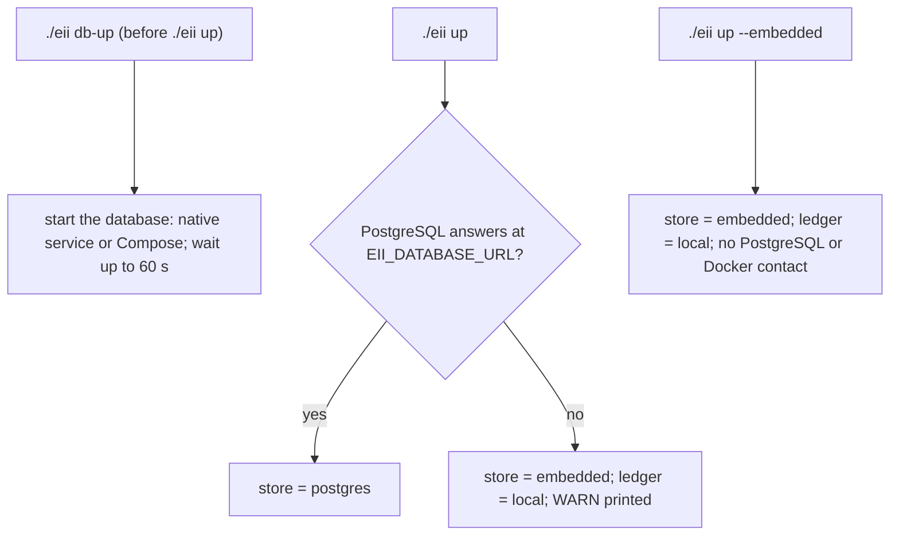

# 13 — Deployment and Operations

| | |
|---|---|
| Status | Draft v0.3, amended by decisions 0016, 0017, 0018, 0019 and 0020 on 2026-11-12, and by decisions 0022 and 0023 on 2026-11-13, and by decision 0026 on 2026-11-14 |
| Date | 2026-11-14 |
| Owner | albarami |
| Purpose | How the EII proof of concept is installed, started, frozen, run on stage, recovered, backed up and later deployed. |
| Read first | [02_ARCHITECTURE.md](02_ARCHITECTURE.md), [08_BACKEND.md](08_BACKEND.md), [12_TESTING_AND_QUALITY.md](12_TESTING_AND_QUALITY.md), [16_DEMO_RUNBOOK.md](16_DEMO_RUNBOOK.md), [decisions/0014-typed-decision-gateway.md](decisions/0014-typed-decision-gateway.md), [decision 0016](decisions/0016-version-1-covers-the-whole-initiative.md), [decision 0017](decisions/0017-public-data-additions-and-public-splits.md), [decision 0019](decisions/0019-forecasts-estimates-scenarios-and-self-serve-sources.md), [decision 0022](decisions/0022-real-register-companies-with-a-synthetic-world.md), [decision 0023](decisions/0023-ten-additions-and-the-data-rule.md) |

## In brief

- Nothing is built yet. This document states how the product must be operated once slices S0 and S11 deliver it.
- `./eii build-public` is the only command that reaches a public source host, and only the hosts of the fetcher allow-list, which now include `www.data.qa`, `www.data.gov.qa`, `fdiprojects.invest.qa` and `www.invest.qa` ([decision 0017](decisions/0017-public-data-additions-and-public-splits.md)). `data.source.coop`, the host of the public copy of the places source `places_fsq`, joins that list, and the hosts of the other self-serve sources of [decision 0019](decisions/0019-forecasts-estimates-scenarios-and-self-serve-sources.md) join it by a reviewed registry change (OPS-65). The other outside hosts the product may reach are those of three optional providers, each only from the running API process and only while the presenter's offline control is not set: the traffic provider, only with `EII_TRAFFIC_PROVIDER=tomtom` and `TOMTOM_API_KEY` present (OPS-70); the imagery provider, for satellite tiles and address search, only with `ESRI_API_KEY` present (OPS-73); and the photorealistic 3D tiles, only with `MAPTILE_API_KEY` present and while the owner's spend cap allows (OPS-74; [decision 0023](decisions/0023-ten-additions-and-the-data-rule.md) item A7). Everything fetched from the investment sources stays in the uncommitted `data/` folder. Proposed decision 0066 adds only the lead-shell `./eii build-public --cdse-backup` form for an optional unread cache; ordinary mode makes no CDSE request, and CDSE hosts remain unadmitted pending official review.
- A case sample file, and every value computed from it, stays in the API process's memory for the session and seat that loaded it; no log, ledger row, backup or freeze bundle holds it ([decision 0016](decisions/0016-version-1-covers-the-whole-initiative.md)).
- [Decision 0023](decisions/0023-ten-additions-and-the-data-rule.md) makes the product one for companies: the two company seats and the presenter console run on the stage machine, the oversight seat is removed, and the ledger stays only as an internal question log with no screen, which starts empty (OPS-03, OPS-23). It adds a voice route whose models run on the workstation with no egress (OPS-75), and a snapshot of each register file, kept each month beside that file outside the repository and read through the same setting.
- One command starts the product (`./eii up`) and one stops it (`./eii down`). The database has its own commands: `./eii db-up` starts it and `./eii db-down` stops it; `./eii up` never starts a database. A preflight check runs first and refuses to start on any failed prerequisite; a database that does not answer is a warning, not a failure.
- PostgreSQL 18 with PostGIS serves the release. On the build machine it runs either as a native service inside Ubuntu or through Docker Compose; preflight uses whichever answers. Continuous integration always uses a service container.
- The store is chosen once, at start-up: PostgreSQL if it answers, otherwise the embedded DuckDB reader. During a session only the presenter can move reads to the embedded DuckDB reader, and only at a request boundary. There is no automatic failover.
- The stage runs from a frozen bundle: release files, database dumps, saved images, recorded assistant replays, tiles and fonts, the application source and an offline install archive. It needs neither the network nor an API key.
- Deployment later means the same PostgreSQL engine in a custodian-approved place. The build engine never leaves the custodian environment. What a deployment on real records adds beyond version 1 is listed in [17_DEPLOYMENT_HARDENING.md](17_DEPLOYMENT_HARDENING.md) (sections 2 to 8).

## 1. Terms

| Term | Meaning in this document |
|---|---|
| Build machine | The owner's Windows computer with Ubuntu under WSL2 (Windows Subsystem for Linux, version 2). It builds and, by default, also runs the stage session. |
| Stage machine | The computer that drives the screen in a live session. ASSUMPTION: it is the build machine unless the owner names another; the requirements below apply to whichever it is. |
| Release | One content-addressed set of Parquet files plus a manifest under `data/releases/<release_id>/`, as defined in [03_DATA_CONTRACTS.md](03_DATA_CONTRACTS.md). |
| Serving store | PostgreSQL 18 with PostGIS holding one schema per loaded release and the `app` schema. |
| Embedded reader | A read-only DuckDB file built from the same release by the loader, opened inside the API process. |
| Local ledger | A SQLite file that holds ledger rows while PostgreSQL is away. |
| Freeze bundle | The set of files that lets the stage machine run the frozen version with no network (section 7). |
| Presenter | The person running the session from the presenter console (`EII_PRESENTER=1`). |

## 2. Environments

| Environment | Runs | PostgreSQL | Network | Model |
|---|---|---|---|---|
| Developer machine | Windows with Ubuntu under WSL2; Python, Node and the API run inside Ubuntu; the browser runs on Windows | Native service in Ubuntu, or Docker Compose | Available for `./eii build-public`, on the allow-listed hosts only (OPS-65), and for installs; the traffic provider only when the owner sets the switch for a session (OPS-70); the imagery provider and the photorealistic 3D tiles only from the running API process with their keys present (OPS-73, OPS-74) | Template writer and recorded provider only; never a live key during the build ([decision 0018](decisions/0018-priorities-and-amendments-to-decision-0015.md) item 12) |
| Continuous integration | GitHub Actions on an Ubuntu runner | Service container, same image digest as Compose | Available; no live call to the traffic provider, the imagery provider, the photorealistic 3D tiles or a keyed source (OPS-71, OPS-73, OPS-74) | Recorded provider only, never a live key |
| Stage machine | Frozen bundle, native Windows Chrome or Edge in full screen | Whichever preflight finds answering; embedded reader always open | Not required; the traffic provider stays at `simulated` (OPS-70); the satellite and photorealistic 3D modes run online only and no story step needs them (OPS-73, OPS-74) | Live, recorded replay, or template writer |
| Later deployment | Product plane in a custodian-approved environment | Same engine as a managed service or on a custodian server (section 11) | Custodian-controlled | Custodian decision |

| ID | Requirement |
|---|---|
| OPS-01 | The API process binds to the loopback address `127.0.0.1` only, on every environment except a later deployment that the custodian approves in writing. |
| OPS-02 | `EII_API_PORT` defaults to 8000 for development and 8089 for staging. Live has one loopback entry at 8088 and alternates private upstreams 18088 and 18089, under L-1238 A-S3-28a and decision 0072. |
| OPS-03 | Changed by [decision 0023](decisions/0023-ten-additions-and-the-data-rule.md) item 15, which removes the oversight seat: the two company seats (`company_a`, `company_b`) and the presenter console run as browser windows on the stage machine. No second device reaches the API over WSL networking in v1. |
| OPS-04 | The stage browser is a native Windows browser (Chrome or Edge), never a Linux browser under WSLg. Reason: WSLg can fall back to software rendering, while Windows browsers use the GPU through Direct3D (stack research, 2026-11-11). |
| OPS-05 | Continuous integration never holds a live `ANTHROPIC_API_KEY`; assistant tests run against the recorded provider. |

Configuration (names pinned in [02_ARCHITECTURE.md](02_ARCHITECTURE.md); values come from the process environment, and setup scripts may read the uncommitted `.env`, OPS-08):

| Variable | Values | Set by | Operational note |
|---|---|---|---|
| `ANTHROPIC_API_KEY` | key or absent | Owner, stage session only | Absent means template writer and recorded replays only |
| `EII_STORE` | `postgres` or `embedded` | `./eii up` (section 5) | Not edited by hand on stage |
| `EII_DATABASE_URL` | connection string to this project's loopback database, default `127.0.0.1:55440` ([decision 0020](decisions/0020-freeze-bundle-check-and-project-database-port.md)); parsed database name ends in `_staging` for staging or `_live` for live, and neither for development, case-insensitively (L-1260) | `.env` | Holds the application role's password; never printed. A namespace mismatch refuses `environment_database_conflict` before a database probe, store or loader is touched; query parameters remain refused |
| `EII_RELEASE_DIR` | `data/releases/<release_id>` | `.env` | Must match the frozen release on stage |
| `EII_ENVIRONMENT` | `development`, `staging` or `live` | Operator | Selects the isolated operational environment; absent or empty means development, with the same database namespace rule |
| `EII_LISTEN_HOST` | `127.0.0.1` | Operator | Any other bind refuses |
| `EII_API_PORT` | development 8000, staging 8089, live entry 8088 | Operator | Live alternates private upstreams 18088 and 18089 under L-1238 A-S3-28a |
| `EII_STATE_DIR` | `<deployment>/<environment>/state` | Operator | Persistent environment state outside application and release hashes |
| `EII_OPERATION_RECORD` | local operation JSON under the environment home | Lead or operator | Closed request schema; no credentials; public handover requires the lead |
| `EII_SOURCE_RELEASE_DIR` | content-addressed exported Public release | Installer only | Used by load-release; excluded from the API child environment |
| `EII_APPLICATION_ARCHIVE` | checksummed offline application ZIP | Installer only | Reuse the same archive for live; absent in staging prepares one from the exact clean commit |
| `EII_LANG_DEFAULT` | `en` or `ar` | `.env` | Language of the opening scene |
| `EII_PRESENTER` | `0` or `1` | `.env` | `1` on the stage machine only; enables the presenter console and its controls |
| `EII_TRAFFIC_PROVIDER` | `simulated` (default) or `tomtom` | `.env` | `simulated` on the stage machine and in every test and gate; `tomtom` only for a session the owner chooses (OPS-70) |
| `TOMTOM_API_KEY` | key or absent | Owner, session only | Never printed; absent means simulated congestion by hour only; needed by no test, gate, command or story (OPS-71) |
| `EARTHDATA_API_KEY` | key or absent | Owner, build environment only | Read by the fetcher of `./eii build-public` for the night-lights source; never printed, never in a work tree, brief or sandbox (OPS-71) |
| `CDSE_CLIENT_ID` | key or absent | Lead-shell build tooling only | Optional unread CDSE backup; never printed, never forwarded to a probe, product or sandbox; proposed decision 0066 |
| `CDSE_CLIENT_SECRET` | key or absent | Lead-shell build tooling only | Optional unread CDSE backup; never printed, never forwarded to a probe, product or sandbox; proposed decision 0066 |
| `BESTTIME_API_KEY_PRIVATE` | key or absent | Owner, the lead's shell only | Read by the reader of `./eii build-public` for the relative-busyness source ([decision 0031](decisions/0031-venue-busyness-from-a-provider-interface.md)); never printed, logged or committed, never in a work tree, brief, worker tool or sandbox; an address that carries it is never written down; needed by no test, gate, command or story (OPS-72) |
| `BESTTIME_API_KEY_PUBLIC` | key or absent | Owner, the lead's shell only | The same source's second key, under the same rules (OPS-72) |
| `EII_BESTTIME_RUN_CREDIT_LIMIT` | whole number of credits or absent | Owner, the lead's shell only | The most credits one keyed run of the relative-busyness source may spend ([decision 0031](decisions/0031-venue-busyness-from-a-provider-interface.md) item 5); a keyed run refuses to start without it; never committed |
| `ESRI_API_KEY` | key or absent | Owner, the product's own server only | The imagery provider's key ([decision 0023](decisions/0023-ten-additions-and-the-data-rule.md) item A7), within its free tier on an account with pay-as-you-go disabled: read only by the running API process for the satellite mode and the address search; never printed, logged or committed, never in a work tree, brief, worker tool or sandbox; absent means the open map and the gazetteer only; needed by no test, gate, command or story (OPS-73) |
| `MAPTILE_API_KEY` | key or absent | Owner, the product's own server only | The key of the photorealistic 3D tiles (Google's Map Tiles API; [decision 0023](decisions/0023-ten-additions-and-the-data-rule.md) item A7), the one paid service of that decision: read at run time only by the running API process, which adds it to each tile request on a same-origin route of its own; the browser never holds it; never printed, logged or committed, never in a work tree, brief, worker tool or sandbox; the owner's `SPEND_CEILING_USD` total-spend ceiling is kept by a project-wide count of billable tile requests, with a warning at `WARNING_FRACTION` (80 percent of the ceiling; the warning stays until one showing is measured, [decision 0064](decisions/0064-the-narrowing-rows-decided.md) item 7) and refusal at the computed request limit; there is no per-view budget and no lowered detail; absent means no photorealistic 3D mode; needed by no test, gate, command or story (OPS-74) |
| `EII_IMAGERY_TILE_BASE` | HTTPS service base or empty | API process | Runtime imagery service address; empty disables satellite mode; S3-T16 Part A remains incomplete |
| `EII_PHOTOREAL_TILE_BASE` | HTTPS service base or empty | API process | Runtime photorealistic base; empty disables the mode; no browser address is supplied |
| `EII_PHOTOREAL_LIMIT` | non-negative integer or empty | API process | Optional lower request limit, bounded by the computed spend cap; empty uses that cap |
| `EII_PHOTOREAL_PRICE_PER_THOUSAND` | positive decimal or empty | API process | Price used for the spend cap; empty uses ruling L-717 item 3; a higher price lowers the request limit |
| `EII_DECISION_PROVIDER` | `none` or `jev`, default `none` | Build/evaluation environment | No stage or run-time use in v1 |
| `EII_REGISTER_FILE` | path to the register file outside the repository, or absent | Owner, in the lead's own shell | The file of public records of the public business register, source `biz_register` ([decision 0022](decisions/0022-real-register-companies-with-a-synthetic-world.md) item 1); read, read-only, by the world build and the release build run from the lead's own shell and by the running product; the path and the file's content are never printed and never put in the repository, a brief, a fixture, a log or a worker tool's or reviewer's environment; tests and continuous integration use an invented stand-in register. A snapshot of the file is kept each month from 2026-11 beside it, in the same folder outside the repository; the readers find the snapshots there through this same setting and read them under the same rules, so no further setting is added ([decision 0023](decisions/0023-ten-additions-and-the-data-rule.md) item 12). Who keeps them is open for the owner |
| `EII_FC_REGISTER_FILE` | path to the financial centre's register file outside the repository, or absent | Owner, in the lead's own shell, or the operator for the staging and live API child | The file of public company records of the financial centre's public register, source `fc_register`, a file of its own ([decision 0022](decisions/0022-real-register-companies-with-a-synthetic-world.md) item 1); read, read-only, by the same readers as `EII_REGISTER_FILE` and under the same rules: the path and the file's content are never printed and never put in the repository, a brief, a fixture, a log or a worker tool's or reviewer's environment; tests and continuous integration use an invented stand-in of the same shape. Its monthly snapshots are kept beside it and read in the same way as those of `EII_REGISTER_FILE` ([decision 0023](decisions/0023-ten-additions-and-the-data-rule.md) item 12). Settings per environment (S3-P10, the owner's ruling of 2026-11-23): the API child environment of `staging` and `live` admits this one name beside the common API names, and the served `fc_firms_per_tower` layer reads the register through it alone; `development` keeps its stand-in and refuses the name with `unwanted_runtime_setting`, as every environment refuses every other unlisted `EII_` name and every restricted provider key. Unset, the layer answers `NO_DATA` with reason `missing_input`; a refusal or an error names the setting or a fixed reason, never the path. The file is checked against the hash that the verified release lists (lead ruling L-1509): the lead's `./eii build-release`, from the lead's own shell, hashes the bytes of the file this setting names and records the hash as the `fc_register` entry of the manifest's `listed_inputs` (document 03); an unreadable file or value refuses the build with `fc_register_unreadable`. The served app reads that entry only through the fixed read function `release_fc_register_sha256` and refuses the file with `hash_unlisted` when the loaded release lists none, before the file is opened, and with `hash_mismatch` when its bytes differ, before any row is parsed; at start either stops the start, and later the request is refused. The setting must name a regular file: the build and the served app read it only through the one product read `read_register_bytes`, which opens it read-only without following a symlink and without blocking, checks the opened descriptor is a regular file, reads and hashes the same bytes, and refuses a symlink, a FIFO, a device, a folder, a missing file, or a file changed or replaced during the read (served app `read_refused`, which stops the start naming only the setting; build `fc_register_unreadable`). No second setting carries a hash |
| `JEV_PRO_API_KEY` | key or absent | Owner, build/evaluation only | Never required by `up`, preflight, freeze or any gate; never printed |

## 3. Prerequisites and how each is checked

Exact versions are pinned in slice S0 and confirmed at the spike (slice S1) with written retreat pins. Several components are newer than most model training data (PostgreSQL 18, DuckDB 2.0, MapLibre GL JS 6, deck.gl 9.4, the current Claude API): builders must read the current official documentation before writing code against them.

| Prerequisite | Pin source | Check run by `./eii preflight` | Pass condition |
|---|---|---|---|
| Python 3.14 managed by `uv` | [02_ARCHITECTURE.md](02_ARCHITECTURE.md) | `uv run python --version` | Reports 3.14.x |
| Node 22 and npm | [10_FRONTEND.md](10_FRONTEND.md) | `node --version` | Reports v22.x |
| Locked dependencies | `uv.lock`, `package-lock.json` | The `uv` and `npm` lockfile checks, with network access disabled | Lockfiles match the manifests; nothing to download |
| DuckDB with `spatial` and `h3` extensions installed locally | 2.0.x, retreat 1.5.x | Load each extension with network access disabled | Both load without a download |
| PostgreSQL 18 with PostGIS 3.6 | Section 4 | `pg_isready -h <host> -p <port> -t 5` with the host and port of `EII_DATABASE_URL` (default `127.0.0.1:55440`), then one query of the server version and PostGIS version | Exit 0; server 18.x; PostGIS 3.6.x. No answer is a `WARN` and selects `embedded` (section 5); a wrong version, or an answering server whose query fails, is a `FAIL` |
| Release present and intact | Manifest | Recompute the release hash | Equals the manifest hash |
| Load receipt | Loader output ([08_BACKEND.md](08_BACKEND.md) BE-46) | Read `load_receipt.json` beside the manifest | Present, `state: complete`, and `release_id` equals the mounted manifest's id. For `protected`, `window_key`, `protected_sha256`, `rules_version_id` and `parameter_set` also match; `public_only` omits those protected-window fields (OPS-64) |
| Embedded reader file | Loader output | Read its stored `release_id` and hash | Equal to the release on disk |
| Tiles, glyphs and interface fonts | Freeze bundle | Hash each file | A freeze-bundle check in every mode: with a `freeze.json` under `data/freeze/`, all files are present and hashes match, otherwise `FAIL`; with no `freeze.json`, a named `WARN` never makes preflight non-zero ([decision 0020](decisions/0020-freeze-bundle-check-and-project-database-port.md)) |
| Recorded assistant replays | Freeze bundle | Re-validate each replay against the current release | Every replay is checked. Valid replays report `PASS`; missing or invalid replays report `WARN` naming the affected story steps and are excluded from the memo; those steps use the template writer. Replay failure does not prevent startup unless the runbook explicitly requires that prepared scene |
| bubblewrap sandbox (build machine only) | [05_SYNTHETIC_WORLD_AND_SIMULATION.md](05_SYNTHETIC_WORLD_AND_SIMULATION.md) | `bwrap --version` and the sandbox test | Present; test passes. Never downgraded on the build machine ([decision 0020](decisions/0020-freeze-bundle-check-and-project-database-port.md)) |
| API port free | OPS-02 | Try to bind `127.0.0.1` at the configured API or candidate backend port | Free, or verified as the environment’s owned process |
| Model key | Optional | Test that `ANTHROPIC_API_KEY` is non-empty | Reports `present` or `absent`; never prints the value |
| Traffic provider key | Optional | Test that `TOMTOM_API_KEY` is non-empty and read `EII_TRAFFIC_PROVIDER` | Reports `present` or `absent` and the switch value; never prints the key; makes no call to the provider |
| Night-lights key | Optional | Test that `EARTHDATA_API_KEY` is non-empty | Reports `present` or `absent`; never prints the value; makes no call to a source host |
| CDSE client ID | Optional | Test that `CDSE_CLIENT_ID` is non-blank | Reports `present` or `absent` only; no auth or network call |
| CDSE client secret | Optional | Test that `CDSE_CLIENT_SECRET` is non-blank | Reports `present` or `absent` only; no auth or network call |
| Imagery provider key | Optional | Test that `ESRI_API_KEY` is non-empty | Reports `present` or `absent`; never prints the value; makes no call to the provider (OPS-73) |
| Photorealistic 3D key | Optional | Test that `MAPTILE_API_KEY` is non-empty | Reports `present` or `absent`; never prints the value; makes no call to the provider (OPS-74) |
| `.env` not tracked | `.gitignore` | `git ls-files --error-unmatch .env` | Fails (file is untracked) |
| WSL interoperability (warning only) | Section 10 | `cmd.exe /c ver` with a 5 s timeout | Prints a Windows version |

| ID | Requirement |
|---|---|
| OPS-06 | `./eii preflight` runs every check in the table above and prints one line per check: `PASS`, `WARN` or `FAIL`, the check name and a short reason. Whenever `EII_RELEASE_DIR` is unset, it runs in foundation mode: the release, load-receipt, embedded-reader and recorded-replay checks print `WARN not_configured` and do not make the command non-zero; every other check keeps its normal severity; the tiles, glyphs and interface fonts row is a freeze-bundle check in every mode and the bubblewrap sandbox row keeps full severity on the build machine (table above; [decision 0020](decisions/0020-freeze-bundle-check-and-project-database-port.md)). `./eii up` always requires a configured, complete release. From the slice S3 gate onward, every gate runs preflight with `EII_RELEASE_DIR` set, where a missing release, incomplete receipt or mismatched receipt `release_id` is `FAIL`. |
| OPS-07 | No preflight line, log line or error message prints a secret, a connection password or the value of `ANTHROPIC_API_KEY`, `TOMTOM_API_KEY`, `EARTHDATA_API_KEY`, `ESRI_API_KEY` or `MAPTILE_API_KEY` (the last two from [decision 0023](decisions/0023-ten-additions-and-the-data-rule.md) item A7). A test asserts this by running preflight with a known dummy value for each key and searching the output. Under proposed decision 0066, `CDSE_CLIENT_ID` and `CDSE_CLIENT_SECRET` are tooling-only, environment-only, never disclosed or passed to product, generators, release or sandbox; defaults, tests, gates and the guided story need neither value nor cache. Only the lead-shell `./eii build-public --cdse-backup` form selects the optional unread backup; ordinary build-public never selects it. Provider hosts, request contracts, publisher and quota remain pending verification; no unverified host is admitted. The narrow unread CDSE public-cache exception changes no other provider storage rule. |
| OPS-08 | Running application code reads secrets only from its process environment or, for the loader's owner role, the libpq password file; setup scripts may read the uncommitted `.env`; the keyed fetcher of `./eii build-public` reads `EARTHDATA_API_KEY` from its process environment in the same way. The repository commits `.env.example` with variable names and empty values, never a value. Under proposed decision 0066, `CDSE_CLIENT_ID` and `CDSE_CLIENT_SECRET` are tooling-only, environment-only, never disclosed or passed to product, generators, release or sandbox; defaults, tests, gates and the guided story need neither value nor cache. Only the lead-shell `./eii build-public --cdse-backup` form selects the optional unread backup; ordinary build-public never selects it. Provider hosts, request contracts, publisher and quota remain pending verification; no unverified host is admitted. The narrow unread CDSE public-cache exception changes no other provider storage rule. |
| OPS-09 | Network, socket, process and Docker probes have five-second timeouts. The database start waits up to 60 seconds inside `./eii db-up`. File hashing, replay validation and sandbox tests have separately recorded budgets and emit progress; they are not subject to the five-second probe limit. |
| OPS-10 | No document, script or log in the repository contains an absolute local path, a user name or a machine name. Paths are written relative to the repository root. |
| OPS-55 | With `EII_DECISION_PROVIDER` at its default `none`, `./eii preflight` performs no gateway probe and opens no gateway connection, and stage start-up always behaves as provider `none`. The typed-decision gateway has no stage or run-time use in v1 ([decisions/0014-typed-decision-gateway.md](decisions/0014-typed-decision-gateway.md)). |

## 4. PostgreSQL on the build machine

### 4.1 Measured facts (architecture research, build machine, 2026-11-11)

Measured once during design research on 2026-11-11, before any product code existed, with a throwaway random synthetic table set of 7.54 million rows on the `postgis/postgis` image tagged 18-3.7 (PostgreSQL 18.6, PostGIS 3.7.0). These are figures about third-party software, not test results of this product, and slice S1 measures them again. Data directories were RAM-backed, so disk effects are absent.

| Measure | Value |
|---|---|
| First start including database creation | 1.28 s |
| Warm restart | 0.21 s |
| Memory at idle after restart | about 32 MB |
| Release copy, then indexing | 2.2 s, then 2.7 s |
| Database size for that release | 576 MB |
| Dump of the whole release | 1.5 s, 82 MB |
| Parallel restore of that dump | 3.4 s |
| Embedded DuckDB build of the same release; file size; open time | 0.85 s; 90.5 MB; 0.02 to 0.05 s |
| One ledger row insert; one notification delivered | 0.31 ms; 1.45 ms median |

Environment incidents observed the same day: the Linux `docker` command inside Ubuntu was a dangling link while Docker Desktop was running on Windows; calls through the Docker socket took about 24 s each; launching Windows programs from Ubuntu later failed with "Exec format error" after another WSL distribution was started and shut down (a known WSL behaviour, WSL issue 8952); the engine picked a different random host port on each of three starts; a mis-quoted `shared_preload_libraries` value stopped PostgreSQL from starting; the image's first-boot helper server listened on the Unix socket only. Throughout, running databases kept answering on their loopback ports. Not tested that day: the Compose file end to end, a native PostgreSQL service inside Ubuntu, and disk-backed latencies.

### 4.2 The two options

| | Option N: native service inside Ubuntu | Option C: Docker Compose |
|---|---|---|
| Install | `sudo apt install postgresql-18 postgresql-18-postgis-3` (the Ubuntu archive offered 18.6 and PostGIS 3.6.2 on 2026-11-11, feasibility research) | Docker Desktop with WSL integration enabled, or Docker Engine inside Ubuntu (neither path was run end to end on 2026-11-11) |
| Needs | The owner's sudo once (OPEN ITEM OI-10) | A working `docker` command in Ubuntu |
| Starts | At boot, by systemd; on demand through `./eii db-up` | `./eii db-up` runs `docker compose -p eii-poc -f infra/compose.yaml --env-file <generated-port-file> up -d --wait --wait-timeout 60 db` |
| Stage risk | Removes Docker from the stage path | Depends on the Docker control path that failed three ways on 2026-11-11 |
| Default on stage | Preferred | Fallback when Option N is not installed |

### 4.3 Compose service definition (in words)

The file `infra/compose.yaml` defines one service, `db`:

1. Image: `postgis/postgis` on the PostgreSQL 18 with PostGIS 3.6 line, pinned by its image digest, never by a moving tag. The image-index digest recorded by S0-T08 is in `infra/compose.yaml`; slice S1 confirms it. Reason: the in-country managed services carried PostGIS 3.6 on 2026-11-11 (section 11), so v1 must not depend on 3.7-only functions.
2. Pull policy `never` on the stage machine, so a start never reaches the network.
3. Port: container port 5432 published on `127.0.0.1` only, on the port of `EII_DATABASE_URL` (default 55440). `./eii db-up` derives it from that variable and passes it to Compose as `EII_COMPOSE_DB_PORT` in a generated file; that name is not a product configuration variable and the Compose file holds no host port number.
4. Storage: one named volume, `eii_pgdata`, mounted at `/var/lib/postgresql`. The PostgreSQL 18 images declare that path and keep data under `/var/lib/postgresql/18/docker`; the older mount at `/var/lib/postgresql/data` would leave data on an anonymous volume (architecture research).
5. Health check: `pg_isready -h 127.0.0.1 -p 5432` inside the container, every 2 s, 30 retries. It probes TCP, because the first-boot helper server listens on the Unix socket only.
6. No `shared_preload_libraries` and no extension beyond PostGIS. The file fixes the Compose project name `eii-poc` and takes the superuser password from a Compose secret file under the uncommitted `data/` folder, never from the Compose file itself.

### 4.4 One-time setup of Option N

This native-option procedure is not built in version 1: this project's Compose service is the PostgreSQL path on the build machine ([decision 0020](decisions/0020-freeze-bundle-check-and-project-database-port.md)); the section remains as the description of the native option.

1. Install the two packages named in section 4.2.
2. Set the cluster to listen on `localhost` only and on the port of `EII_DATABASE_URL` (default 55440), then restart the service.
3. Enable the service at boot (`sudo systemctl enable postgresql`).
4. Create the EII database and the three roles of OPS-13; write the generated `eii_app` and `eii_reviewer` passwords to the local `.env` only, and the `eii_owner` credential to the loader account's libpq password file with owner-only permissions (OPS-14).
5. Create the PostGIS extension in the EII database.
6. Run `./eii preflight`; the PostgreSQL line must read `PASS`.

### 4.5 Continuous integration

The CI workflow declares a `postgres` service container from the pinned `db` image digest, publishes port 5432 to the job, and waits on a `pg_isready` health check before any step runs. The job then runs the same role setup as Option N, `./eii load-release` on a small fixture release, and `./eii test`. CI never uses the native option and never needs Docker Desktop. The workflow files in `.github/workflows/` are `docs.yml`, which provides `check-docs`; `ci.yml`, which provides `static-checks`, `tests`, `secret-scan` and `planted-failures`; and `sandbox.yml`, which provides `sandbox proof` by running the tests marked `sandbox` through `scripts/ci_sandbox.py prove` on an `ubuntu-24.04` runner. Those three workflows run on pull requests and pushes to `main`; no failed check is skipped, retried or converted to success. Task S1-T20 adds `mutation-pilot.yml`, dispatched manually from main with an allow-listed module and a full reviewed commit reachable from main. It adds no required check. It reuses the existing action and uv pins and read-only contents permission; input values enter shell through environment variables. Its discovery, four bounded shards and always-running merge use the transport and refusal rules in document 12 section 4. A synthetic transport dispatch precedes the real campaign; parity and CPU evidence are recorded by the lead under document 12 section 6.3.

### 4.6 Roles and schemas

| ID | Requirement |
|---|---|
| OPS-11 | Option N and Option C both answer on the loopback host and port of `EII_DATABASE_URL`, default `127.0.0.1:55440` ([decision 0020](decisions/0020-freeze-bundle-check-and-project-database-port.md)). ASSUMPTION: the native cluster is configured to that address. Reason: one `EII_DATABASE_URL` then serves both options. |
| OPS-12 | The database contains no extension other than PostGIS (and the built-in procedural language). Preflight fails if another extension is installed in the EII database. |
| OPS-13 | Three roles exist: a loader role that owns the release schemas and `app` tables; an application role that owns no table and is subject to row-level security; a reviewer role with `SELECT` only on the documented release views. Reason: table owners bypass row-level security (observed in the architecture research). |
| OPS-14 | The `eii_app` and `eii_reviewer` credentials are generated into the uncommitted `.env`; the API receives only `eii_app` through `EII_DATABASE_URL`. The `eii_owner` credential is written only to the loader account's libpq password file with owner-only permissions and is never placed in the API environment. |
| OPS-15 | The stage serves exactly one selected release, named by `EII_RELEASE_DIR`. A `public_only` release has no parameter set or protected-window fields. For a `protected` release, no route, setting or switch selects a parameter set at run time, and no second protected table set of one window exists in the product plane (PRV-05, PRV-120; [08_BACKEND.md](08_BACKEND.md) BE-103). A release schema other than the selected one can only be a different release left in place during a change; removing it is an operator step, never done by a command of a running session. |
| OPS-16 | Continuous integration runs PostgreSQL as a GitHub Actions service container with the same image digest as `infra/compose.yaml` and a TCP health check. |

## 5. Store selection, the presenter switch and the local ledger

S3-T28 live and staging require PostgreSQL and refuse explicit embedded mode. The developer selection and presenter contracts below remain separate. Runtime settings are closed: provider none, simulated traffic, presenter disabled and no paid or build keys. The first Public map uses the existing S3 local question journal and reports `ledger: local` truthfully; it does not claim the later PostgreSQL ledger integration exists.

`./eii preflight` only probes current state and never starts or stops anything. Whenever
`EII_RELEASE_DIR` is unset, it uses the foundation behaviour of OPS-06. If PostgreSQL does not
answer, it reports `WARN`, the currently selectable store `embedded`, and whether Docker was
reachable; it does not predict a post-`./eii db-up` result. `./eii db-up` is the one command that
starts the database (native service or Compose) and waits up to 60 seconds for it to answer.
`./eii up` always requires a configured complete release and never starts a database: it serves
from the store preflight found, so configured preflight and start-up cannot disagree.

| ID | Requirement |
|---|---|
| OPS-17 | The store is chosen once, at start-up, from the store preflight found: `postgres` when PostgreSQL answers, otherwise `embedded`, with a `WARN` line naming the reason and whether Docker was reachable. `./eii up` never starts or stops a database. `./eii preflight` prints the store it would select. `./eii up --embedded` selects `embedded` without contacting PostgreSQL or Docker. The selection is written to `EII_STORE` for the API process. |
| OPS-18 | The API opens the embedded reader at every start, whatever the store. When the store is `postgres`, the API refuses to start (exit 4) unless the embedded reader and the PostgreSQL release schema carry the same `release_id` and hash. |
| OPS-19 | When `EII_PRESENTER=1`, the presenter console includes the control "Switch to embedded reader" (the full control list is in [16_DEMO_RUNBOOK.md](16_DEMO_RUNBOOK.md)). It takes effect at the next request boundary: requests already running finish on PostgreSQL; every later request reads the embedded reader. One answer never mixes stores. The control is a presenter route: it requires the per-session `X-EII-Presenter-Token` header (OPS-56) and is rejected with `403` without it. |
| OPS-56 | At each `./eii up`, the API generates a cryptographically random per-session presenter token. The presenter console receives it in its start-up URL and sends it as `X-EII-Presenter-Token` on every presenter API call. Missing or incorrect tokens are rejected with `403` on every window, including loopback company windows. The token is never written to logs, ledger rows or health responses, and it is regenerated on restart. A browser test proves that the `company_a` and `company_b` windows cannot switch stores or toggle offline mode. |
| OPS-20 | The switch is one-way for the session. ASSUMPTION: returning to PostgreSQL needs `./eii down` and `./eii up` after the session, never during it. Reason: a two-way control is the flapping risk this design removes. |
| OPS-21 | While the store is `embedded`, or PostgreSQL is unreachable, ledger rows are written to the local ledger with stable unique identifiers. |
| OPS-22 | At the next start with PostgreSQL answering, `./eii up` replays local ledger rows into `app.ledger_entry` idempotently (a row already present is skipped) and reports how many were replayed. |
| OPS-23 | Changed by [decision 0023](decisions/0023-ten-additions-and-the-data-rule.md) item 15, which removes the oversight seat and its badge: while the ledger is local, the features that need PostgreSQL (two-company separation and the reviewer's read-only mirror) show "paused", not an error, and release facts are unchanged. The ledger is the internal question log and has no screen and no live feed; its rows wait in the local ledger (OPS-21) until the replay of OPS-22. |
| OPS-24 | The current store and ledger state are shown only on the presenter console and on the health page, never on a company seat. |
| OPS-25 | There is no automatic failover in the middle of a request, and no latency-triggered switch. |

Why no automatic failover. The architecture research proposed a circuit breaker that switched stores when a call exceeded 300 ms. The feasibility judge dropped it: PostgreSQL's own measured 95th percentile on one whole-country query was 229 ms, just under the trip point, so the store could flip back and forth during a session. A presenter decision at a request boundary is predictable, can be rehearsed, and cannot mix two stores inside one answer.

## 6. The `./eii` commands

All commands run from the repository root inside Ubuntu. Names are pinned in [02_ARCHITECTURE.md](02_ARCHITECTURE.md).

| Command | Does | Network | Preflight checks it runs |
|---|---|---|---|
| `./eii preflight` | Runs every check in section 3, prints the store it would select, and changes nothing | No | All |
| `./eii db-up` | Starts the database (Option N native service or Option C Compose `db`) and waits up to 60 s for it to answer; it starts nothing else | No | Tools, database |
| `./eii db-down` | Stops the database; never removes volumes | No | Tools |
| `./eii up` | Serves from the store preflight found (section 5), invokes `./eii load-release` only when the configured release schema is absent, replays the local ledger, starts the API serving the front end, tiles and fonts, prints the links for the two company seats and the presenter console (OPS-03), the store, `release_id` and model mode, for live/staging, returns zero only after its owned detached process is ready; the foreground contract for other environments remains unchanged (decision 0072) | No | All |
| `./eii up --embedded` | Same, with store `embedded`; skips PostgreSQL and Docker | No | All except PostgreSQL |
| `./eii down` | Stops the API cleanly; never starts or stops the database (that is `./eii db-up` and `./eii db-down`); never removes volumes | No | None |
| `./eii down --previous-boot` | Marks the process records a previous boot left behind as stopped and signals nothing; this boot's owned processes keep running and keep their records; a record of this boot that is not owned refuses `process_identity_mismatch` with exit 4 after the other records were handled; any other argument is a usage error; the first step of the boot script (S3-T20 start on boot, below) | No | None |
| `./eii test` | Runs the suites defined in [12_TESTING_AND_QUALITY.md](12_TESTING_AND_QUALITY.md), including parity on both engines | No | Tools, PostgreSQL |
| `./eii build-public` | Runs the public fetchers, against the allow-listed hosts only (OPS-65), into `data/public_cache/` with hash, licence (for every source, the publisher's terms in its own words with the date read and the basis of use) and retrieval date; reads the FDI dashboard page on every run; fetches the self-serve sources of [decision 0019](decisions/0019-forecasts-estimates-scenarios-and-self-serve-sources.md) (OPS-72) | Yes | Tools, disk |
| `./eii build-public --tenders-only [--resume]` | Lead-shell background tender acquisition or one-time verified handoff from a completed tender entry; exactly one registry key, `tenders_pub`, with a separate cache journal, log, page/terms receipts and archive; it does not run whole-pack completeness | Tender list and its terms on a fresh fetch only | Tools, disk |
| `./eii build-public --seed N --resume` | Resume the same cache’s interrupted fetch only when `build-run.json` matches the seed; reuse each completed entry only while its stored per-entry fingerprint (the closed-encoded constructed entry carrying every field of its registry row, dispatch branch, interpreter and locked-dependency versions, computed code closure, the repository modules loaded before the run, the `eii` launcher, tracked public-data inputs and, for the tender portal, its intake receipts) reproduces, rehashing selected files against receipts or page meta hashes; refetch missing, changed, older or unproven inputs, preserve original provenance in `REUSE` lines, and rerun all assembly/checks and existing terms handling; refuse a missing, invalid, version-1 or complete record with a named exit-1 failure | Existing allow-listed fetch/terms paths only | Tools, disk |
| `./eii build-public --gis-imagery-snapshot` | Separate lead-shell background job after S2-T51 approval, with its configured external root and the six conditions of decision 0079; no ordinary public build or earlier task waits for it | Dedicated allow-listed metadata/tiles only | Tools, priority, lock, disk |
| `./eii build-public --cdse-backup` | Custodian | Select only the optional unread CDSE cache in the lead’s shell; omit on missing pair or pending provider contract/bulk budget; no other source selected | optional, reviewed hosts only; currently pending | no |
| `./eii build-public --busyness-bootstrap` | Explicit lead-shell identity acquisition for pending cache crosswalk rows; writes only the minimal returned identity handoff, input/code fingerprints and permitted usage counts; no hourly values, raw response or publication; no seed/resume flags | Forecast only, existing one-shot reservations and cap | Tools, disk |
| `./eii build-public --busyness-confirm SHA256 ROLE DATE` | Confirm the exact reviewed handoff hash, functional reviewer role and ISO review date into the cache crosswalk atomically; changed inputs or a mismatched name refuse; production is a separate recorded run | No | Tools, disk |
| `./eii build-world` | Builds the synthetic world and mobility feeds inside the sandbox from the public cache | No | Tools, sandbox |
| `./eii build-release` | Public-only: consumes the reviewed assembly envelope in the existing build-release sandbox, removes this build’s vault, verifies and publishes `data/releases/<release_id>/`. Protected linkage/privacy/traffic remains unimplemented, owned by S11-T09 | No | Tools, sandbox |
| `./eii load-release` | Live/staging first install the verified application and an exact release copy from `EII_SOURCE_RELEASE_DIR`, then use the existing owner-only loader and full two-store verification. Application archive identity is separate from release identity; accepts only manifest tables | No | Tools, PostgreSQL, release |
| `./eii freeze` | Accepts `protected` releases only and takes no mode flag. It is run twice (section 7): the first run writes the data bundle, checksum list and pending `freeze.json` and appends the register line; the second run, from the containing base-branch commit, builds and verifies the application archive, writes its checksum beside the bundle and marks `freeze.json` complete. A `public_only` release is never frozen or registered | No | All |
| `./eii question-lab run --n N --seed S` | Runs distinct invented S3 scenarios in both languages through the loaded fixture; records coverage, empty cells, per-question results and the gallery packet; missing native, sealed, pixel or human evidence fails qualification | No | Local evaluation prerequisites only |
| `./eii remote-check` | Lead's own shell only, never a worker, test, gate or CI (decision 0041 item 5). Takes no argument. Reads the owner's own host name from `EII_REMOTE_HOST`, never prints it, and prints PASS or FAIL for each item with its HTTP status or the words that no HTTP status was received. Exit 0 when every item passes, 1 when any item fails, 2 for an argument or for a host refused before any request | Yes, through the owner's own tunnel only | None |

"Network" in the table means that the command itself needs the network. The running API may in addition reach the traffic provider under the three conditions of OPS-70, the imagery provider under those of OPS-73 and the photorealistic 3D tiles under those of OPS-74.

Under [decision 0084](decisions/0084-public-tenders-in-a-separate-run.md), the lead owns the background `--tenders-only` seat and the later pick-up before S7-T09. Before a fresh fetch, the lead places the same verified awards intake in both caches: `intake/awards_owner_scrape/intake.json`, its hash-bound workbook, and every explicitly selected register snapshot's index, receipt and body. The existing shared reviewed tender certificate remains at its uncommitted bridge location; neither cache invents or copies a new certificate. A missing or refused intake makes the awarded list a documented full read with its closed reason. A selected archive must later match the main cache's intake for both awarded languages, including that full-read reason. The pin is added only to the main cache's `snapshot_pins.json`, never under `custodian/publicdata/`. Separately, the `register_tables` assembly phase consumes only the lead-staged `register_bundle/` directory (the published `current/` projection output) and `register_bundle_pin.json` (the manifest's byte hash) placed in the allowed cache, and a symlinked bundle component is refused as missing; no register path or `EII_*_REGISTER_FILE` setting is opened by assembly (S2-P64).

The one-time handoff checks for an already pinned, completed tender entry in the main cache before opening a new tender list. It rehashes the original page/list proofs, terms snapshot, archive index, receipt and body, verifies the committed tender binding and intake, and copies only the immutable archive and terms objects. A refused proof is recorded in the separate log and is not silently adopted. If the previous run has completed pages but no archive, the lead first reviews its journal/page proofs and actual terms body, calls the existing `archive_pages` with the entry's original retrieval UTC and verified terms hash, reviews the result and pins that identity in the main cache; no hash or acquisition time is invented. `--tenders-only --resume` reuses a proven completed entry of an interrupted separate run, not the last page of an incomplete fetch. A later ordinary pick-up is a fresh whole-pack run unless its own journal is eligible for interrupted-entry reuse. The lead verifies the selected archive against the successful assembly source chain on S7-T09's start day and again before freeze (decision 0084 item 6).

Exit codes (ASSUMPTION: this scheme is set here because nothing else defines it; it is the simplest set that lets the runbook name each failure):

| Code | Meaning |
|---|---|
| 0 | Success |
| 1 | A check or step failed; the printed `FAIL` lines say which; an existing final schema, a release kind the loader does not support, a host off the loopback address (`host_not_loopback`), an extension the target database must not hold, an extension schema that is not a plain identifier (`extension_schema_invalid`), or an engine operation that failed (`engine_operation_failed`) |
| 2 | Usage error: unknown command or flag |
| 3 | PostgreSQL required by this command but not answering (`test`, `load-release`, `freeze`); or the owner role cannot connect on a server that answers |
| 4 | Release missing, incomplete, or hash mismatch (including embedded reader mismatch); a forbidden manifest field, a forbidden table class, a privacy-written table (`privacy_written_table`) or an empty table list; a duplicate manifest key (`duplicate_key`), an unknown manifest key (`unknown_manifest_key`), a manifest key in another case (`manifest_key_case`), a manifest value of the wrong type (`manifest_type_invalid`) or a table listed twice (`duplicate_table`); an absolute table path (`absolute_path`), a table path with `..` (`path_traversal`), a symbolic link on a table path (`symbolic_link`) or a table path outside the release (`path_outside_release`); a source chain that is missing (`source_link_missing`), incomplete (`source_link_incomplete`), unknown (`source_link_unknown`) or mismatched (`source_link_mismatch`); or staged stores that differ in a count, a digest or the release identity |
| 5 | API port already in use |
| 6 | Network required but unavailable (`build-public` only) |
| 7 | Freeze refused because the register conflicts or the recorded human review is missing; or frozen-bundle install or start refused because the installed application's register lacks the line or `freeze.json` is not complete (OPS-62, OPS-63) |
| 8 | Candidate written for independent review; approval missing (candidate_written_approval_missing) |

| ID | Requirement |
|---|---|
| OPS-26 | Every `./eii` command exits with one of the codes above and prints the code's meaning on failure. |
| OPS-27 | `./eii up` never issues a Docker command and never starts or stops a database: it serves from the store preflight found. `./eii db-up` is the one command that starts the database (native service or Compose), waiting up to 60 s for it to answer; `./eii db-down` stops it. |
| OPS-28 | `./eii down` never deletes a volume, a release, the local ledger or the freeze bundle. |
| OPS-29 | `./eii load-release` refuses any table not named in the release manifest and exits 4. |
| OPS-57 | `./eii up` invokes `./eii load-release` only when the configured release schema is absent. If an existing schema has the configured release prefix but a different full release ID or hash, it exits 4 and changes neither store. A changed release uses its own content-addressed schema and `EII_RELEASE_DIR`; no running-stage schema is overwritten. |

### 6.1 Health page

| ID | Requirement |
|---|---|
| OPS-30 | The API serves `GET /health` as JSON with these fields: `status` (`ok` or `degraded`), `store` (`postgres` or `embedded`), `postgres` (`up`, `down` or `not_used`), `release_id`, `release_hash`, `parity` (`identical` or `failed`, from the last parity run recorded for this release), `ledger` (`postgres` or `local`), `local_ledger_rows`, `model` (`live`, `replay` or `template`), `traffic` (`live` or `simulated`), `tiles`, `fonts`, `replays` (each `ok`, `missing` or `invalid`). |
| OPS-31 | `status` is `ok` only when every other field holds its healthy value; for an embedded start, `store: embedded`, `postgres: not_used` and `ledger: local` count as healthy. While the store is `postgres` and PostgreSQL stops answering, `postgres` reads `down` and `status` reads `degraded` within 5 s; the store does not change by itself (OPS-25). |

### 6.2 Public sources, investment sources and case sample files

| ID | Requirement |
|---|---|
| OPS-65 | `./eii build-public` is the only command that contacts a public source host, and it contacts only the hosts of the fetcher allow-list (PUB-03; [02_ARCHITECTURE.md](02_ARCHITECTURE.md) ARC-13). [Decision 0017](decisions/0017-public-data-additions-and-public-splits.md) adds `www.data.qa` beside `www.data.gov.qa`, which answer the same portal API (a dataset is identified by its slug whichever host served it), and the two investment hosts `fdiprojects.invest.qa` and `www.invest.qa`. `data.source.coop`, the host of the public copy of `places_fsq` ([decision 0019](decisions/0019-forecasts-estimates-scenarios-and-self-serve-sources.md) item 21), joins the list, and S2-T14 adds `ladsweb.modaps.eosdis.nasa.gov` and `archive-api.open-meteo.com`. The hosts of the other sources of that decision (item 24) join it by a reviewed registry change, the host of each fixed by the task that builds its fetcher; a host that a download redirects to is listed like any other. The registry records the host each file came from. A request to any other host, a redirect to one included, stops the run with exit 1 before anything is stored. The running API, preflight, freeze and every stage mode contact none of these hosts. The optional traffic provider, the imagery provider and the photorealistic 3D tiles are not among them; OPS-70, OPS-73 and OPS-74 say when the running API may contact each. Under proposed decision 0066, `CDSE_CLIENT_ID` and `CDSE_CLIENT_SECRET` are tooling-only, environment-only, never disclosed or passed to product, generators, release or sandbox; defaults, tests, gates and the guided story need neither value nor cache. Only the lead-shell `./eii build-public --cdse-backup` form selects the optional unread backup; ordinary build-public never selects it. Provider hosts, request contracts, publisher and quota remain pending verification; no unverified host is admitted. The narrow unread CDSE public-cache exception changes no other provider storage rule. [decision 0079](decisions/0079-dated-gis-snapshot-and-structured-address-search.md) item 3 adds only the dedicated lead-shell `./eii build-public --gis-imagery-snapshot` form, in its own low-priority process and external folder, with a global lock, no bursts above ten starts per second, bounded retries, resumable immutable shards, and disk watches on both filesystems. No ordinary build, test, gate or story selects it or waits for completion. Its product readers are offline; it adds no run-time provider permission. |
| OPS-66 | Everything fetched from the investment sources stays in the uncommitted `data/` folder: the FDI dashboard page, read on every `./eii build-public`, the agency's sector, opportunity, incentive, set-up and law pages, and every record parsed from them, in the public cache, the releases and the freeze bundles alike. Only the fetcher, the parsers, the `fdi_projects` contract and their tests, which use a small synthetic page shaped like the real one, are committed ([02_ARCHITECTURE.md](02_ARCHITECTURE.md) ARC-99). The source registry records the publisher's terms in its own words with the date read and the basis of use: the owner's decision for a personal, local project where no open licence covers the use ([decision 0026](decisions/0026-public-sources-used-in-full-locally.md)). Terms that need a permission or licence before real use are listed in document 17, DHA-102; they do not switch a source off or limit its display in version 1. |
| OPS-67 | A case sample file loaded through the case route ([08_BACKEND.md](08_BACKEND.md) BE-118) stays in the API process's memory for the session and seat that loaded it, and so do a drawn shape (BE-117) and a traffic-aware drive-time area from the provider (OPS-70). Neither the loaded copy nor any value computed from it is written to a log, a ledger or egress row, the local ledger, a backup or the freeze bundle; `./eii down` and every restart drop them. The committed synthetic sample files ship with the application source like any other committed file, and the one-click case start loads them through the same route, so the case stories need no network on stage. |

### 6.3 The optional traffic provider, the keys and the self-serve sources

| ID | Requirement |
|---|---|
| OPS-70 | The setting `EII_TRAFFIC_PROVIDER` is `simulated` by default: the simulated congestion by hour. The running API process may contact the traffic provider only when the setting is `tomtom`, `TOMTOM_API_KEY` is present and the presenter's offline control is not set ([02_ARCHITECTURE.md](02_ARCHITECTURE.md) ARC-35, ARC-135); it fetches live flow tiles and traffic-aware drive-time areas and passes them on, and the browser still contacts only its own origin. The offline control stops every provider call, as it stops every model call (OPS-37). The health field `traffic` reads `live` only while the provider is in use and `simulated` otherwise (OPS-30). Nothing of a response is written to disk, to a release, to a ledger or egress row, to the local ledger, to a log, to a backup or to the freeze bundle; the run-time lineage keeps only the request, the retrieval time and the response hash. A traffic-aware drive-time area lives in the API process's memory for its session and seat like a drawn shape (OPS-67). The stage machine, every test, every gate, `./eii up`, preflight, freeze and the guided story run with the setting at `simulated`; prepared story replays are recorded with it at `simulated`. |
| OPS-71 | `TOMTOM_API_KEY` and `EARTHDATA_API_KEY` lie outside the keys of [decision 0018](decisions/0018-priorities-and-amendments-to-decision-0015.md) item 12, which stay unused, and may be used by the build within their free allowances ([decision 0019](decisions/0019-forecasts-estimates-scenarios-and-self-serve-sources.md) item 16). Neither is printed, logged, committed, or put into a work tree, a brief, a prompt or a sandbox (OPS-07, OPS-08). No test, gate, command or the guided story needs either. Tests and continuous integration never call a live service: their fixtures are made by hand in the documented response format, and no response of a live service is committed. Under proposed decision 0066, `CDSE_CLIENT_ID` and `CDSE_CLIENT_SECRET` are tooling-only, environment-only, never disclosed or passed to product, generators, release or sandbox; defaults, tests, gates and the guided story need neither value nor cache. Only the lead-shell `./eii build-public --cdse-backup` form selects the optional unread backup; ordinary build-public never selects it. Provider hosts, request contracts, publisher and quota remain pending verification; no unverified host is admitted. The narrow unread CDSE public-cache exception changes no other provider storage rule. |
| OPS-72 | The self-serve sources of [decision 0019](decisions/0019-forecasts-estimates-scenarios-and-self-serve-sources.md) items 18 to 24 are fetched only by `./eii build-public`, into the uncommitted public cache, each with its hash, licence or terms and retrieval date. `places_fsq`, a further source of the places layer (Apache 2.0), is fetched from the public copy on Source Cooperative, `https://data.source.coop/fused/fsq-os-places/` (host `data.source.coop`), which is geospatially partitioned GeoParquet read without an account; each refresh selects the newest dated release through the copy's root listing and fetches only the files that cover Qatar from that release, no secret variable is added for it, and runtime registry evidence records the actual release date, which is the date the places are shown with; every earlier dated snapshot is retained. `busy_besttime`, the relative busyness by hour of named venues, is read by the project's own reader of the provider's interface for a build-time list of venues, never at run time ([decision 0031](decisions/0031-venue-busyness-from-a-provider-interface.md)). Its two keys are read from the environment in the lead's shell only; neither is ever printed, logged, committed or put in a brief, worktree or sandbox, and an address that carries a key is never written to a log, receipt, error, cache name, fixture or file. No test, gate or command of `./eii test` needs either key. The provider's terms are recorded truthfully as the licence text with the date read; the source uses `licence_basis: provider_terms` ([decision 0026](decisions/0026-public-sources-used-in-full-locally.md) item 3, [decision 0031](decisions/0031-venue-busyness-from-a-provider-interface.md)). Its values stay in the uncommitted public cache, the releases and the freeze bundles; they never enter the repository or a test fixture; and the source is left out of the nightly live fetch, as are the two keyed sources, whose fetchers are tested on hand-made fixtures only ([12_TESTING_AND_QUALITY.md](12_TESTING_AND_QUALITY.md)). Terms that need a permission or licence before real use are listed in document 17, DHA-102; they do not switch a source off or limit its display in version 1. See OPS-66. |
| OPS-73 | `ESRI_API_KEY` is the imagery provider's key ([decision 0023](decisions/0023-ten-additions-and-the-data-rule.md) item A7), on the free tier of an account with pay-as-you-go disabled, so no spend is possible. It is read only from the environment of the running API process, which alone contacts the provider, and only while the key is present and the presenter's offline control is not set; the browser never holds the key and still contacts only its own origin: the satellite tiles and the address-search results pass through the server's own paths. No tile is stored, and no address-search result is written to a file, the database, a ledger or egress row, a log, a backup or the freeze bundle. The key is never printed, logged or committed, and never reaches a work tree, a brief, a prompt, a worker tool or a sandbox (OPS-07, OPS-08). The provider's hosts are never on the fetcher allow-list of `./eii build-public`. Tests and continuous integration never call the provider: a planted request to the provider's hosts without the key fails a test. The open map, every test, every gate, `./eii up`, preflight, freeze and the guided story run without the key. RECEIVED (owner; ruling L-151; item 7; OI-132): the imagery provider's attribution note is received; the provider's name may appear only in the map attribution line and in the source rows of [04_PUBLIC_DATA_PACK.md](04_PUBLIC_DATA_PACK.md). What remains is the documentation check's place-scoped exception, which task S1-T14 builds. |
| OPS-74 | `MAPTILE_API_KEY` is the key of the photorealistic 3D mode ([decision 0023](decisions/0023-ten-additions-and-the-data-rule.md) item A7): Google's photorealistic 3D tiles through its Map Tiles API, the one paid service of that decision (item 14). It is read at run time only, from the environment of the running API process, which alone contacts the provider: it adds the key to each tile request on a same-origin route of its own, so the browser never holds the key and still contacts only its own origin ([02_ARCHITECTURE.md](02_ARCHITECTURE.md) ARC-35, ARC-36). It does so only while the key is present, the presenter's offline control is not set and the count of billable requests is under its limit. The owner caps total paid spend at `SPEND_CEILING_USD`: every billable tile request is counted project-wide, free use is ignored, and requests are refused once the count reaches 3,333 (USD 6.00 per 1,000 requests at the provider's first paid tier). The task that builds the mode reads the provider's price again, and a higher price lowers that limit so that the spend stays within `SPEND_CEILING_USD`. Because the cap is in total, no command, restart, store switch, new release or restore resets or lowers the count. There is no per-view budget. The spend meter reports the running billable count, request limit and exact server-computed money, and warns at `WARNING_FRACTION` (80 percent of the ceiling; the warning stays until one showing is measured, [decision 0064](decisions/0064-the-narrowing-rows-decided.md) item 7) without reducing view detail, area or duration. No tile is stored: none is written to a file, the database, a release, a ledger or egress row, a log, a backup or the freeze bundle. The mode shows the attribution its tiles carry. The key is never printed, logged or committed, and never reaches a work tree, a brief, a prompt, a worker tool or a sandbox (OPS-07, OPS-08). The provider's hosts are never on the fetcher allow-list of `./eii build-public`. Tests and continuous integration never call the provider; the refusal at the ceiling, the warning boundary and continued requests above the former per-view allowance are tested without it ([12_TESTING_AND_QUALITY.md](12_TESTING_AND_QUALITY.md)). The open map stays the default; every test, every gate, `./eii up`, preflight, freeze and the guided story run without the key. The count journal and its remaining operator-rollback limit are described in section "S3-T16 Part A settings under implementation". |

### 6.4 The voice environment

| ID | Requirement |
|---|---|
| OPS-75 | The voice route of [decision 0023](decisions/0023-ten-additions-and-the-data-rule.md) item A4 ([09_AI_ASSISTANT.md](09_AI_ASSISTANT.md) AI-128) uses a speech-to-text model and a voice that run on the workstation in their own environment, apart from the product's locked environment, because the speech model pins a library version of its own; their versions are pinned at S8-T10 after their current documentation and licences are read. They are reached on the loopback address only and open no outbound connection: no audio, transcript or speech request leaves the machine. No audio is stored anywhere, and a transcript is kept only as the confirmed question text that the ledger already records (task S8-T10). Both models are optional: every gate, the guided story and the template mode pass with both absent, so neither `./eii up` nor preflight requires them, and the ask bar then offers typing only. OPEN, settled at S8-T10: how the environment is installed on the build machine and on the stage machine, and whether the freeze bundle carries it; how it is started, and whether it runs as a process of its own beside the API ([02_ARCHITECTURE.md](02_ARCHITECTURE.md) ARC-05); and how preflight checks it. |

## 7. Building, loading and freezing a release

Order for a protected release on the build machine: `./eii build-public` → `./eii build-world` →
`./eii build-release` → `./eii load-release` → `./eii test` → the recorded human review of the
release (OPS-62) → first `./eii freeze` run → the register line merged to the base branch through
its normal pull request → second `./eii freeze` run from a base-branch commit that contains the
line → stage install. A `public_only` release is buildable and loadable but is never frozen or
entered in the export register. The command takes no new flag. The first protected-release run
writes the data bundle, checksum list and pending `freeze.json` and appends the register line. The
second builds the application archive from that base-branch commit, verifies an offline
installation, writes the archive checksum beside the bundle and marks `freeze.json` complete. A
protected release is frozen when its bundle has `freeze.json`. For a frozen release only, the
installer and `./eii up` require the matching line in the register shipped inside the installed
application and a complete descriptor; otherwise they exit 7. A release under `data/releases/` on
the build machine has no `freeze.json` and is not checked. Continuous integration checks the
register file alone. No signed export receipt file is created (PRV-120).

Freeze bundle contents, written to `data/freeze/<release_id>/` (ASSUMPTION: location chosen to stay inside the uncommitted `data/` folder):

| Item | Why it is needed offline |
|---|---|
| Release files: Parquet tables and manifest | Source of truth; reload into either engine |
| Embedded reader file | Live standby without a rebuild |
| PostgreSQL dump in custom format (`pg_dump -Fc`) of the release schema only | Restore the release in seconds without re-indexing |
| PostgreSQL dump in custom format (`pg_dump -Fc`) of the `app` schema only, in its starting state: the fictional organisations and their two company seats, and the closed tool and playbook lists ([03_DATA_CONTRACTS.md](03_DATA_CONTRACTS.md) DAT-148). It holds no ledger, egress or brief row, because the ledger starts empty and holds only questions asked ([02_ARCHITECTURE.md](02_ARCHITECTURE.md) ARC-108; [08_BACKEND.md](08_BACKEND.md) BE-76; [decision 0023](decisions/0023-ten-additions-and-the-data-rule.md) items 12 and 15) | Restore the application's starting state without touching a live `app` schema |
| Saved container image (`docker image save`) for the pinned `db` image | Start Option C with no registry access |
| Installed DuckDB extension files | DuckDB installs extensions from the network the first time (stack research) |
| Recorded assistant replays for every prepared story question, copied from the committed `evals/prepared/` (see [09_AI_ASSISTANT.md](09_AI_ASSISTANT.md)) | Model outage or no key |
| Basemap PMTiles file, map glyphs (including Arabic), sprites, interface fonts | Hosted tiles, glyphs and fonts fail without internet (stack research) |
| Built front end | No CDN or build step on stage |
| Repository source, the built API artefact, `uv.lock`, `package-lock.json`, and a complete offline Python wheel/cache archive for the locked environment | A replacement stage machine installs and runs the application with no network; the archive installed on the stage machine is built from a base-branch commit that contains the freeze's register line, so the register shipped inside the installed application is the allow-list of OPS-63 |
| Routing graph for the release | In-process routing without rebuilding |
| Version list of every pinned package | Confirm the exact versions offline |
| Recorded human review of the release (OPS-62) | Evidence that the survival report and the signed attack report were read before the freeze; the freeze refuses to run without it |
| `freeze.json` | Descriptor that makes the release frozen: `release_id`, `window_key`, `protected_sha256`, `world_seed`, frozen commit, review-record path and `state` (`pending` after the first run, `complete` after the second) |
| `SHA256SUMS`: one SHA-256 and relative path for every other regular file in the bundle, sorted by path; it excludes itself | Verify the copy; verification rejects missing, additional or changed regular files |

The release files in the bundle carry the Public tables of the investment sources. The bundle therefore stays under `data/freeze/` and on the removable storage of OPS-42, never in the repository (OPS-66); the same holds for the relative-busyness values (OPS-72). It holds no loaded case sample file, no drawn shape, no traffic-aware drive-time area, no response of the traffic provider, no tile of the satellite or photorealistic 3D modes, no address-search result and no audio of the voice route (OPS-67, OPS-70, OPS-73 to OPS-75).

| ID | Requirement |
|---|---|
| OPS-32 | `./eii test` records each pass with the commit and `release_id`; `./eii freeze` refuses to run unless such a pass exists for the current commit and release. |
| OPS-33 | The bundle's `SHA256SUMS` verifies with `sha256sum -c SHA256SUMS` on the stage machine before every session. `SHA256SUMS` contains one SHA-256 and relative path for every other regular file in the bundle, sorted by path, and excludes itself. Verification rejects missing, additional or changed regular files; a test with one extra file and one modified file in the bundle must fail. |
| OPS-34 | Recorded replays carry the `release_id` they were recorded on; at start-up the API re-validates each one and rejects any recorded on a different release. |
| OPS-35 | The front end loads no script, style, font, glyph or tile from any external host. A test serves the app with outbound network blocked and fails on any external request. |
| OPS-36 | Tiles are served by the API process with HTTP range requests (supported by Starlette's file response, stack research); no separate tile server. |
| OPS-58 | `./eii freeze` takes no mode flag and is run twice. The first run records the frozen commit in `freeze.json` and leaves its `state` as `pending`. After the register line is merged to the base branch, the second run must execute from a base-branch commit containing that line; it builds the application archive from that commit, verifies an offline installation into a clean temporary directory, writes the archive's SHA-256 beside the bundle and changes the descriptor to `state: complete`. The stage-restore procedure copies both the freeze bundle and this application archive, verifies both, and installs with network access disabled. |
| OPS-62 | `./eii freeze` also requires a recorded human review of the release: the reviewer's role, the review date, and confirmation that the survival report (PRV-80) and the signed attack report (PRV-79) were read. The review record is a JSON file written before `./eii freeze` runs. The first run copies it into the freeze bundle as `review.json`. `freeze.json.review_record` is the bundle-relative path `review.json`. The record fields are `reviewer_role`, `review_date`, `survival_report_read`, `attack_report_read`, `window_key`, `protected_sha256`, `rules_version_id` and `parameter_set`. No review record, no freeze: the command prints what is missing and exits 7. |
| OPS-63 | One treatment per window (PRV-120). This rule and the export register accept `protected` releases only; a `public_only` release is never frozen or registered. `window_key` is computed exactly as DAT-80 defines it from canonical JSON holding the protected `period` and, in name order, `{name, sha256}` for `business_register.v1`, `employment.v1`, `residence.v1` and `wages.v1`, using each feed's manifest `feed_sha256`; nothing else enters it. On the first successful `./eii freeze` run, the command appends exactly one line to the committed, append-only file `infra/export_register.jsonl` with these seven fields in order: `window_key`, `protected_sha256`, `world_seed`, `rules_version_id`, `parameter_set`, `release_id`, `code_version`. The second run appends no line. A freeze is refused with exit 7 for a `public_only` release, when the same `window_key` is already registered with different protected tables or when the same `world_seed` has a different `window_key`; after a freeze, any change of rules version, exported set, treatment code or world generator requires a new `world_seed` and a new build before another freeze. Continuous integration checks the register alone: existing lines are unchanged, one `protected_sha256` per `window_key`, and one `window_key` per `world_seed`. For a frozen release only, the installer and `./eii up` exit 7 when the register shipped inside the installed application lacks the matching `window_key` and `protected_sha256` line or `freeze.json` is not complete. The remedy is to finish the two-run freeze of OPS-58; changing the seed is not the remedy for this bundle refusal. An unfrozen release under `data/releases/` has no descriptor and is not checked. No signed export receipt file is created; the shipped register and complete descriptor are required. |
| OPS-64 | A release of either kind is loaded under its content-addressed schema, `r_` plus the first 16 hexadecimal characters of its `release_id` ([08_BACKEND.md](08_BACKEND.md) BE-33). Preflight refuses a release whose `load_receipt.json` is missing, whose `state` is not `complete`, or whose `release_id` differs from the mounted manifest. For a `protected` release it also refuses a receipt whose `window_key`, `protected_sha256`, `rules_version_id` or `parameter_set` differs from the manifest; a `public_only` receipt omits those protected-window fields (BE-46). |

Runbook step for a refused freeze, to be carried by [16_DEMO_RUNBOOK.md](16_DEMO_RUNBOOK.md): when the first `./eii freeze` run exits 7, stop and investigate. A freeze is refused when the same `window_key` is already registered with different protected tables or the same `world_seed` with a different `window_key`. Never edit or remove a register line. After a freeze, a change of rules version, exported set, treatment code or world generator requires a new `world_seed` and a new build before another freeze (PRV-120). A missing review record is resolved by performing and recording the review (OPS-62), then re-running the first freeze step.

Runbook step for a refused frozen bundle, to be carried by [16_DEMO_RUNBOOK.md](16_DEMO_RUNBOOK.md): when install or `./eii up` exits 7 because the register shipped inside the installed application lacks the bundle's line or `freeze.json` is not complete, stop. Finish the two-run freeze: merge the line normally if needed, run `./eii freeze` again with no new flag from a base-branch commit containing it, and verify that the archive checksum is present and `freeze.json` says `complete`. Do not change the seed, edit the shipped register or substitute a receipt file.

### Closed build and operations reasons (S3-T11 early round, Part A)

At the Part-A CLI and installed-entry boundaries, preserve the inner closed reason.
The vocabulary is `eii_core.reason_codes.CODES`; `eii_core.reasons.reason` accepts
only a whole member from `reason`, the configuration variable name, or a single
exception argument. Unknown text is never printed, logged, sliced or prefixed.
Unstructured key, type, attribute, timeout and operating-system faults use
`input_key_missing`, `input_type_invalid`, `input_attribute_missing`,
`operation_timeout` and `operation_os_error`; all other unstructured failures use
`operation_failed`. Refusals still refuse. Startup and health logs carry the
closed code as `error_code`, without exception text or traceback.

Assembly input, approval, path, bound-file hash and pending-gate failures remain
distinct. Independent approval checks use `approval_fields_invalid`,
`approval_verdict_invalid`, `approval_builder_invalid`, `approval_reviewer_invalid`,
`approval_same_maker`, `approval_code_mismatch` and `approval_hash_mismatch`.
Receipt validation names the invalid field using the closed
`producer_receipt_*` codes; no field value is included. The sandbox passes one
whole closed stderr code only. Other stderr is `operation_failed`.
Web packaging distinguishes `application_web_build_timeout`,
`application_web_build_unavailable` and `application_web_build_nonzero` and
never publishes npm output. Preflight reports `basemap_missing`, `fonts_missing`
or `replays_missing` for one missing slot; combined codes retain every missing
or invalid slot in asset order. An owned-process refusal is also retained.
Catalogue export prints the closed loader rule code, or
`catalogue_target_missing` for an absent check target. Lab fixture problems keep
their `execution:` or `fixture:` scope and the inner closed code.

Round-two additions to the Part-A boundary table:

| Row | Boundary | Closed outcome |
|---|---|---|
| D54 | `operations.deploy.require_retained` | Retain the installed release/archive verifier's inner code, including `release_missing` and `application_checksum_mismatch`, with exit 4. Only an unstructured general failure uses `rollback_retention_failed`; typed unstructured faults retain the shared class code. A missing retained target still refuses. |
| D55 | `evals.question_lab.runner.run_lab` input selection, through the command adapter | Print `question_manifest`, `question_identity`, `question_capacity` or `question_families`, with exit 2. Unknown exception text is withheld using the shared class code or `operation_failed`. |

The static guard covers exact and prefixed generic constants, literal f-string
tails, concatenation, percent/format construction and lexically bound constant
names. Each generic output sink must carry its own projection. A direct reference to a
caught exception in a raise, return, print, logging or write sink fails even when
that sink also calls `reason(error)`. Only the argument to that call or the
`.reason`, `.code` and `.exit_code` projections are admitted. This is a structural
check, not arbitrary Python execution or alias/data-flow analysis. In deploy,
D54 is covered now; D32 health and staging-evidence handling retain their later
part's ownership. The two live-load diagnostic handlers also use `reason(error)`.
The database parser's existing fixed literal outcomes, including its scheme and loopback
refusals, are explicit closed-vocabulary members; their exact words are retained
without admitting any connection-string value or arbitrary parser text.

When a valid producer candidate has been written and only its approval file is
absent, `./eii build-release` prints `candidate_written_approval_missing` and exits
8. It writes no release and runs no sandbox. Supply the existing independently
reviewed, hash-bound approval and use the same command again; no new command or
flag is introduced. Malformed, stale and same-maker approvals remain failures,
with their specific closed reasons and exit 4. An incomplete source chain is
also a failure, with its closed reason and exit 4. Protected placeholders,
freeze refusal, sandbox enforcement, cleanup and publication gates retain their
existing behaviour.

### S3-T28 isolated Public setup and operator sequence

Authority: supplied decision 0071 items 1–6, L-1219 and L-1238 A-S3-28a/b/c; the task wording is owned by the documents branch. [Decision 0072](decisions/0072-loopback-activation-and-ready-return.md) records the narrow process reconciliation. This implementation candidate is not a public launch or a slice gate approval.

Use `<deployment>/<environment>/releases/<full-release-id>`, `applications/<archive-sha256>` and `state/` as three separate roots. Each configured environment has a distinct canonical database and port. The installer records database identity without credentials. State, local question journal and the photoreal count journal survive upgrades, rollback and down. The count journal is never initialised or reset by these commands. Installer settings are removed before preflight/up. Application children receive only the closed list in `scripts/operations/config.py`; the selected store is generated after verification. Product code never reads gateway settings.

1. **Build.** `./eii build-release` once per export consumes `assembly/release.json` and `assembly/release_review.json` from the Public cache. With `review/release_spec.json` present, the Public assembly producer described below materialises these files from the stored S2 outputs and their authenticated receipts before the read-only sandbox mount. The closed envelope supplies typed columns and original rows, scalar build metadata, source records, artefact descriptors and hashes of its reviewed inputs, including `assembly/final_audit.json`. The different-maker review binds its canonical SHA-256 and full code commit. Missing or unresolved inputs refuse; no synthetic substitute is produced. The sandbox has no network, product mount or unsandboxed retry. Only this build’s temporary vault is removed, on success and failure; cleanup failure blocks publication.
2. **Staging install.** Set `EII_ENVIRONMENT=staging`, its own application-role database URL, state and installed release paths, the source export and operation request. The parsed database name must end in `_staging`; live requires `_live`, and development permits neither reserved suffix. Suffix classification ignores case and uses the decoded database name, while the actual connection name retains its case. Query parameters remain refused. A namespace mismatch refuses `environment_database_conflict` before any database probe, store or loader is touched, including under disjoint deployment parents (L-1260). `./eii load-release` copies exact export bytes, prepares or verifies the checksummed offline application archive, and writes only the existing loader outputs beside the manifest. Expect zero and a complete matching two-store receipt. Keep the archive for live. Absent offline dependencies, a dirty/wrong source commit or a failed web build refuses packaging.
3. **Staging readiness.** Remove installation-only settings. `./eii preflight` then `./eii up`, using `start_staging`, must both exit zero. Expect healthy `/health`, `/`, `/api/release` and one Public layer. A ready result binds the installed archive and source commit through process state, without extra health fields.
4. **First live activation.** Install with the same source export and archive into live’s separate roots and database. Run `load-release`, `preflight`, then `up` using `initial_live_activation`, loopback exposure and a null predecessor. Every promotion item is required; only pristine empty history permits this operation. Retain the initial installation itself. Expect entry 8088 to serve the full identity through upstream 18088. No S3 gate approval is required for this loopback setup.
5. **Promote.** Build the next export once, install/check/start its staging copy, then install and preflight live. `./eii up` with `promote` names the active predecessor and the other private upstream. Offline evidence files bind full commit, release and archive: merged-main ancestry and each of the six hosted checks; a different-maker APPROVED review; actual whole-test exit/count/seed report; staging identity plus actual smoke/health probes; retained predecessor; reviewed completed surfaces and existing gates. Hash references and structured reports are required; a boolean is insufficient. Authorisation is appended and synced before candidate service, readiness precedes atomic route replacement, and only then is the retiring owned upstream stopped.
6. **Rollback.** Keep both application archives, installed copies, schemas and loader outputs. Recheck the retained target in staging, then `./eii up` with `rollback` names the current predecessor and restores the retained release **and its backend port**. No rebuild or schema overwrite occurs. First-release rollback refuses `no_previous_release_for_rollback`; down is the explicit stop operation.
7. **Public handover.** After recorded S3 gate approval, the lead uses an `expose_public` request for the current identity, with `EII_REMOTE_HOST` set in that one command's environment. Approval must match the exact commit, release and archive. `up` validates the host before anything is appended (`remote_host_missing`, `remote_host_invalid`), appends the authorisation, switches the route and, inside the same lock, retires the owned entry; its entry step then starts the one entry that holds the host and waits for it. A request that reaches the activation without that handover still refuses `public_entry_requires_s3_t20`. The command starts no tunnel and records no public address; the order around the tunnel is the lead's, in "S3-T20 entry at the owner's address" below.
8. **Stop.** `./eii down` for each environment verifies PID/start ticks/command hash/nonce/environment, signals only owned processes through pidfds and waits within its fixed bound. New process records include the kernel boot identity. Records from a previous boot are marked stopped without signalling; a same-boot identity refusal is reported after the other records have been processed. A same-boot record with different live start ticks or a PID now owned by another user is also marked stopped without signalling, while still reporting the mismatch; matching ticks with a different nonce or command do not retire the record. A failed ownership probe keeps refusing and does not retire the record. It retains releases, databases, route/history, question journal, count journal and archives. It issues no database-control command.

A request has exactly the fields of `operations.evidence.FIELDS`; reports use local relative hash references. Promotion logs form a hash chain; the route binds its authorisation sequence/hash, release, archive and backend. Serving also requires a durable switched outcome for the entire route, including its predecessor; the outcome is written ahead of the route, so an interrupted switch leaves the previous route serving. Missing/truncated history, a mismatched route, concurrent operation, removed retention or a failed readiness check refuses. A file edit that does not match a durable authorisation and switched outcome never promotes; the unkeyed hash chain detects accidental corruption, not a writer with access to the state folder. Recovery is an explicit reviewed operation; there is no automatic rollback or store fallback.

Authorisation and outcome appends use unbuffered writes. A short return or an
operating-system write/sync error truncates that append back to its starting
offset and syncs it before reporting `promotion_log_unwritable`. A failed append
therefore leaves the previous complete log and serving route intact when the
truncate and sync succeed; a failed recovery still refuses.

Readiness failure cleans up only a newly launched child. Reused backends and
their route/process records remain intact. The live entry's ownership check,
launch and readiness step hold the operation lock. Its numeric loopback HTTP
server avoids the standard server's optional name-service lookup.

The loader now reserves environment/database identity before either store is
loaded, serialising the sibling check and reservation with the deployment-folder
lock. A failed load retains that reservation. L-1260 closes lens A F5's
disjoint-parent database gap with the parsed-name namespace rule above; the
proposed required deployment-root setting was declined. Case-insensitive suffix
classification keeps case variants of the reserved namespaces unavailable to
development; it does not fold or rewrite a connection's database identity.
`read_environment`, direct `Environment` construction, preflight probes and the
legacy development loader apply the same guard before database access. The
staging smoke check reads staging's persisted database identity rather than
copying live's, and retained releases preserve their validated environment.
Local regression evidence for this repair does not replace independent review
or the lead's real-store and joined-result checks.

`up` probes once. If only release checks fail, the installed archive and application role are verified before the selected namespace is inspected. Only an absent namespace permits the owner-only loader step, followed by full two-store verification. An existing namespace is never reloaded by `up`; a mismatch keeps exit 4 and its bytes. Explicit developer `up --embedded` remains foreground, uses a separate development installation and state, and imports no PostgreSQL driver.

Ambient `PG*` settings are refused by the operational runtime boundary. Its application connector pins the numeric loopback host address and disables password-file lookup through the platform's null device; credentials come from the configured environment URL. The current [libpq connection-parameter documentation](https://www.postgresql.org/docs/18/libpq-connect.html#LIBPQ-PARAMKEYWORDS), read 2026-11-20, explains the independent host-address and password-file parameters. Driver-spy tests prove the supplied arguments and rejection variants; they are not a live PostgreSQL observation.

Current official API pages read for S3-T28 on 2026-11-20: [DuckDB Python DB API](https://duckdb.org/docs/2.0/clients/python/dbapi) for read-only connections; PostgreSQL [roles](https://www.postgresql.org/docs/18/view-pg-roles.html) and [relations](https://www.postgresql.org/docs/18/catalog-pg-class.html) for application-role flags and exact namespace inventory; [Psycopg connections](https://www.psycopg.org/psycopg3/docs/api/connections.html) for connection options and transaction mode; [Uvicorn programmatic serving](https://uvicorn.dev/deployment/) for a single application instance; [uv workspaces](https://docs.astral.sh/uv/concepts/projects/workspaces/) for command-scoped packages; [Shapely WKB conversion](https://shapely.readthedocs.io/en/stable/reference/shapely.from_wkb.html) for the existing Public geometry reader. The exact pins and written retreats remain in `pins.toml`; no retreat was selected or tested here. Shapely's existing pin is now also a Product dependency, so its existing geometry reader works in the isolated offline archive. Native tests exercise the installed dependency closure; the PostgreSQL server integration still belongs to the lead's permitted live proof.

The runbook tests use invented store/package/process interfaces; they are not evidence of a real database, protected release, public handover or installed production service. World build, protected release and non-Public freeze remain placeholders with S11-T09’s obligations intact.

S3-T28 round-two verification keeps those boundaries. The Public build and install
validators independently refuse an explicit privacy-parameter request before
work begins; no command flag or parameter selection is added. The shared Public
source chain refuses an explicitly generated producer kind or origin and an
explicit Synthetic or Simulated lineage input class, using the existing
`source_link_mismatch` reason (DAT-107). This detects declared producing metadata;
it does not establish the truth of an otherwise unmarked source. The Parquet
serving projection preserves registry `kind` and `origin` and lineage
`input_class` for that shared guard. Hash-consistent generated-metadata plants
exercise `check_release` and refuse before either loader stage is called.

Every retained rollback node is checked against an earlier authorisation in the
same environment. Candidate evidence is read once: its SHA-256 and decoded JSON
come from the same bytes. Individual controls-off tests compile copies with one
deciding refusal or invocation removed; another refusal or setup error is not
admission evidence. Separate native tests plant sandbox bypass, a broader mount,
an omitted network namespace, missing loader cleanup and changed loader outputs.
The syscall-entry tripwire covers the complete invented command sequence and
the native sandbox/writer, offline archive, entry and owned-child interfaces.
It observes native libraries and descendants and blocks disallowed attempts
before execution, including attempts whose errors the caller catches. Internet
destinations are limited to exact loopback addresses and ports bound by the
test's process tree in the same network namespace. Every destination on port
53 is recorded as DNS; other loopback addresses and Unix destinations outside
the scratch root, including abstract names, are recorded and blocked. A listen
without an owned loopback bind is recorded and blocked. Socket inspection reads the thread group's descriptor table, so binds and listens from worker threads are classified the same way. The tracer runs in its own process, so its cleanup never waits for or reaps a child of the test that called it. Only kernel-directed,
non-multicast NETLINK_ROUTE IPC is permitted for sandbox loopback setup.
This catches accidental attempts, not an adversary racing sockaddr or path
changes against inspection. Unsupported tracing fails; there is no no-tracing
fallback, skip or increased existing bound.

The catalogue grammar/slot validators accept
otherwise valid templates containing prohibited meanings; they are not a
general rule-24 semantic classifier. Under lead ruling L-1256, the AC8 row is:
"S3-T28 adds no claim, fragment or template text; operations output is structural evidence only; the semantic review of catalogue claims stays with the catalogue's owning review".
The existing shape-versus-semantics test and narrower generated-chain wording
check remain in place; neither certifies semantic claims. Rule 24 and the
catalogue's independent content review still bind every release (supplied
decision 0071 item 6). Part C adds the tracked
Public assembly producer below. Its invented-input evidence does not establish
the completeness of a real cache, its reviewed schema bindings or its release
approval. Those remain lead-run evidence; no real cache was read here. These
limits and the F5 root decision do not close S3-T28 or a slice gate.

### S3-T28 Public assembly producer

`eii_custodian.release.producer` adapts the stored table envelopes emitted by
`publicdata.assembly_adapters.Production.record`. Its closed phases are
`reviewed_selections`, `frame`, `spine_graph`, `gis_property_singles`, `fsq`, `series_stage`,
`additions`, `busyness` and `artefacts`. A release spec supplies schemas and explicit source
bindings, because these S2 envelopes contain original rows rather than the
reader's typed column declarations. The spec is operator-supplied review
configuration; the producer never guesses a column type, selects a latest
snapshot, fetches data or supplies replacement rows.

The local `review/release_spec.json` has exactly `version` (the supported integer
version), `scalars`, `sources`, `tables` and `artefacts`. `scalars` contains the
common build metadata of document 03 section **8. The manifest and the loader**, including
`release_kind: public_only`, the full code commit and all three engine versions;
it excludes `release_id` and all protected-window fields. No clock is sampled.
`sources` maps each registry key to exactly `format`, `receipt` and `body`.
Each file reference has exactly `path` and `sha256`, relative to the Public
cache. `format: sidecar` reads the receipt directly; `format: manifest` reads
the native source manifest's embedded `receipt`. Both authenticate the actual
body bytes against the receipt's own SHA-256. These references point at the
existing dated S2 receipt/body pair or selected native manifest and archive;
they do not create another raw-data store.

Each `tables` item has exactly `name`, `phase`, `columns` and `source_keys`.
Columns use `ColumnSpec` names, logical types, nullability and geometry metadata.
The rows come only from that phase's stored `tables[name]`; `spine_graph` reads
its existing `assembly/graph/graph_node.parquet` and `graph_edge.parquet` through
the existing S2 Parquet reader and binds both files. Graph source nodes and
source edges keep their schema's `lineage` metadata class; their inputs remain
Public and their sources must resolve exactly as every other row. An untyped field,
omitted table, duplicate table or unresolvable row source refuses. The existing
frame-to-GIS gazetteer append is accepted only when the later stored rows keep
the complete earlier prefix. S2 now records its existing per-table `table_sources`
bindings alongside the rows; these and any inverse `source_tables` edges must
match the spec. Each source also matches the phase's recorded source
chain. `artefacts` contains existing relative `artefacts/` paths and their
digests; it supplies no artefact bytes.

**Release artefacts (S3-P04, decision 0096, accepted 2026-11-23).**
`eii_custodian.release.artefacts.place_artefact(cache, relative, source_file)`
is the one writer of a release artefact. `relative` must be a normalised
relative path (ARC-119) of one file under `artefacts/`: a string, unchanged by
POSIX and NFC normalisation, with no empty, `.` or `..` part, no backslash or
control character, no `.private` or `.env` part, at most 255 bytes a part and
1,024 bytes in all, with no symlink at or above the destination, no folder
at it and no file in place of a folder above it in the cache; any other path refuses as `artefact_path_refused`. The source is opened
without following a symlink; a symlink, folder, other non-regular or missing
source refuses as `artefact_not_regular`. The bytes are copied through a
temporary file in the destination folder and synchronised. Both the artefact
and its phase record go through `eii_custodian.release.pinned`: the cache and
every folder below it are opened as directory descriptors without following a
symlink, and every read, creation, rename and cleanup names its entry relative to
one of them; the phase record is read through such a descriptor, opened
without following a symlink and checked by `fstat`. The rename is conditional
and atomic: `renameat2` with `RENAME_NOREPLACE` when the destination was
absent, and `RENAME_EXCHANGE` when it existed, after which the displaced file
must be the one pinned, or the exchange is undone. A root, folder, leaf or
temporary entry substituted by name refuses as `artefact_path_refused`; a
substitution detected after the rename withdraws the new file (or exchanges
the earlier one back) before the refusal, and no call returns success after a
detected substitution. After an exchange, the exchange back runs only while
the destination still holds the new file and must leave the new file under the
temporary name; when it cannot run, fails or leaves anything else there, the
displaced file is never removed but kept under its temporary name for
recovery, the new file is withdrawn only while the destination still holds it,
and the call refuses as `publication_rollback_incomplete`. On a refusal only
the file this call created is ever removed; the displaced file is removed only
after a successful exchange, while its temporary name still holds it. A
pinned entry that disappears before it is read refuses; only an entry absent
when pinned reads as absent. Identity is device, inode and type: a file deleted
and recreated with its inode number reused inside the pinned folder is not
told apart, and cannot be outside it. A system without `renameat2` (missing,
or refused with `ENOSYS` or `EINVAL`) refuses as
`publication_rename_unsupported`, with no fallback to a plain rename.
On success the call returns `{path, sha256}`. It records that entry, sorted by path
and replacing an earlier entry of the same path, in the phase record
`assembly/artefacts.json` (method `public-assembly.artefacts`, version `1`, no
tables), the producer's ninth phase. The spec's `artefacts` list must equal that
record: a spec hash that differs from the record refuses as
`producer_hash_mismatch`; a recorded path absent from the spec, an unrecorded or
repeated spec path refuses as `producer_chain_incomplete`; a malformed record
as `producer_schema_refused`. `producer_path_refused` for a path outside
`artefacts/` and start-up's `startup_inventory_mismatch` for an unlisted
release file stay. No folder artefact exists. Item 2 of decision 0096, the
routing tile extract `artefacts/routing/tiles.tar`, is still verified at S3-P05
(decision 0096, accepted 2026-11-23); this task places no real routing file.

S3-P06 adds the build-public map-asset step. It reads the configured pinned
Qatar PMTiles source and glyph source directory and places each present file
through `place_artefact` as `artefacts/tiles/basemap.pmtiles` or
`artefacts/fonts/<stack>/<range>.pbf`. An absent basemap records
`COVERAGE map_basemap basemap_missing 1`; an absent or empty glyph source
records `COVERAGE map_fonts fonts_missing 1`, and neither case places that
asset. Installed and embedded serving start when either asset is absent: a
missing basemap leaves `basemap_url` null, missing glyphs select no release
font directory, and health reports the corresponding asset `missing`. A
duplicate manifest basemap refuses as `basemap_missing`. Real glyph ranges
are not yet generated; the writer reads them when present.

The producer derives `source_registry` and manifest citations from receipt
publisher, title, key-free fetch URL, licence and basis, original retrieval UTC
date and body hash. It derives `fact_lineage` from the released table, the
versioned S2 producing method and every explicitly bound source. Source IDs are
canonical registry keys; ambiguous family-to-key mappings refuse. Only Public
source kinds and input classes are admitted. The existing writer's table and
source-chain checks also run before a candidate is written. Decimal JSON
lexemes are retained as decimal strings; values requiring rounding or driver
coercion refuse. Input receipts, bodies, phases, spec, final audit and artefacts
all enter the envelope's bound `files` inventory.
Typed decoder errors preserve a closed inner reason; otherwise value errors use
`producer_schema_refused` and type errors use `input_type_invalid`. Missing
final-audit or graph files refuse as `producer_receipt_missing`, before a
candidate is written.

`prepare(cache)` writes deterministic `assembly/release_candidate.json` for
review. It and `produce(cache)`'s two outputs are written through the same
`eii_custodian.release.pinned` publication as the artefacts; a substituted root,
folder or leaf, or another refused rename, refuses as `producer_path_refused`,
a rollback that cannot complete as `publication_rollback_incomplete`, and a
system without `renameat2` as `publication_rename_unsupported`. A read file
that existed when pinned and disappears before it is opened refuses as
`producer_path_refused`, never as missing. The first `build-release` with a complete spec and no approval prepares
this candidate, prints `candidate_written_approval_missing` and exits eight
without running the sandbox or publishing an
export. A different maker must then supply `review/release_approval.json` with
exactly `verdict: APPROVED`, `builder`, `reviewer`, `code_version` and
`input_sha256`, the SHA-256 of the candidate's canonical JSON. Builder and
reviewer must differ after trimming and case folding. This is an external
review record, never a verdict manufactured by the producer. On a subsequent
`build-release`, `produce(cache)` reconstructs the candidate, verifies that
exact approval and writes canonical `assembly/release.json` and
`assembly/release_review.json` for the existing reader. Changed inputs require
another review; the producer never rebinds an old approval. Already materialised
reviewed envelopes retain their existing consumer path when no spec is supplied.

**Release-spec draft (S3-P03).** From the lead's shell only,
`./eii build-release --spec-draft LISTING` runs
`eii_custodian.release.spec_draft.draft` over the Public cache and writes
`review/release_spec.draft.json`; it builds nothing and runs no sandbox.
`LISTING` is a JSON object mapping each source key to exactly `format`,
`receipt` and `body`, the two being cache-relative paths with no hash. The draft
takes each `tables` item from the present phase records with its owning
`phase` (a later phase that extends a table, the GIS gazetteer, owns it) and its
`source_keys` from the phase's `table_sources`, else its `source_tables`, else
its recorded source chain. Each `sources` hash is computed, never typed: the
receipt hash by the producer's own receipt reader, and the body bound to the
phase record's chain hash by the producer's own source check, so the draft's
sources pass the producer's checks before it is written. The core manifest
catalogue carries no column types, so each column's type comes from its stored
values only: all booleans `bool`, all integers `int`, all strings `string`,
with `nullable` when a value is null or absent; any other or mixed value type,
an empty table or an all-null column refuses as `column_type_unknown`, and the
lead supplies such types (for example a decimal) by hand. The draft carries no
scalar but `release_contract_version: release.v1`, and its `artefacts` list
is the `assembly/artefacts.json` record's entries (empty when no artefact was
placed; a malformed record refuses as `producer_schema_refused`). When the
cache holds a `built` assembly `heights` record (`assembly/heights.json`), the
draft, only after its own checks pass, first places the four files that record
binds through `place_artefact` (decision 0096 item 4), each only while its
bytes match the record, under `artefacts/heights/` (the heights manifest as
`<sha256>.json`), so they enter that record with their hashes; a record that
is not `built`, a missing file or a changed file refuses as
`assembly_heights_incomplete` (S3-T16, `heights_artefacts.stage_heights`;
document 08, "Building heights read (S3-T16)"). The lead fills the scalars and any narrower types, reviews the draft and
renames it to `review/release_spec.json`; the producer's checks then run
unchanged. The draft never writes or reads `review/release_approval.json` and
refuses to replace an existing regular draft (`spec_draft_exists`) through
the pinned publication itself, only after the draft's own checks pass. Any
other existing entry that is not a regular file (a symlink or a folder)
refuses as `producer_path_refused`. An existing draft with an incomplete
listing therefore refuses as `producer_chain_incomplete`, without writing.
Its other refusals
are `producer_receipt_missing`, `producer_hash_mismatch`, `unknown_table` (a
phase table absent from the core catalogue), `producer_chain_incomplete` (no
phase table, a listed key absent from the recorded chains, or a table source
absent from the listing), `producer_schema_refused` (a malformed listing entry
or phase record) and the producer's own source refusals; each exits four with
its reason and writes nothing.

With `EII_FC_REGISTER_FILE` set in the lead's shell, `build-release` hashes the
bytes of that file, read through the product's one register read (a regular
file, no symlink; otherwise `fc_register_unreadable`), and passes the hash to `prepare` and `produce` as `fc_register_sha256`; the candidate, and so
the reviewed envelope and the manifest, then carry `listed_inputs` with the one
entry `{name: fc_register, sha256}` (lead ruling L-1509, document 03). The spec
has no key for it, so a typed hash is refused with the spec; a changed file
after review gives another candidate and needs another review. Unset, nothing
is listed and the served layer refuses the file with `hash_unlisted`. A release
loaded before this change has no `release_manifest.fc_register_sha256` column
and is loaded again before it serves.

Invented tests cover byte determinism, each required refusal, a real S2 bank
parser output, actual sandbox/writer/verification, command dispatch and cleanup.
The script command tests replace the store/sandbox interface and remain driver-free;
the custodian tests separately run the actual sandbox, including command dispatch
returning success followed by independent export verification. These are not real-cache
or real PostgreSQL observations. See TASKS.md **S3-T28** and OPEN_ITEMS.md
**S3-T28 Part C — real-cache assembly and independent review**.

### S3-T20 entry at the owner's address

Authority: [decision 0041](decisions/0041-remote-mode-through-the-owners-own-host.md) items 1 to 5 and 8. This section describes code and the lead's ordered steps; it claims no tunnel, no public address, no gate approval and no recorded run (AGENTS.md rule 47). The tests named here use invented `.invalid` hosts and invented process, store and upstream fixtures.

**One entry.** The owner's tunnel points at the loopback entry on port 8088 and at nothing else. The entry relays to the private upstream the durable route names; promotion and rollback keep switching that upstream behind the fixed entry. No second listener is added. The host name is read from `EII_REMOTE_HOST` in the environment of the lead's command and is never committed, printed or logged. Its value is one lower-case DNS name of at least two labels, with no scheme, port, path, address literal, trailing dot or localhost form (`remote_host_invalid`). `up` and `down` take the name out of the settings before the closed list of S3-T28 is checked, so that list is unchanged and still refuses the name, and the API child never receives it. The entry child receives it only when it is started under a route whose exposure is `public_entry`.

**Admission.** For each request the entry reads the verified route and requires live, entry port 8088 and a known exposure, else it answers `entry_route_unavailable`. It then decides, before it reads the Host, the Origin or the target and before any upstream connection, from three things no caller can set: the exposure of the route; whether this live state is bound, meaning its verified promotion log holds at least one authorised `public_entry` request; and whether this entry process was started with a validated host.

| Route exposure | Bound state or host-holding entry | Every request on the socket |
|---|---|---|
| `public_entry` | entry holds the host | Goes on to the request rules below; `localhost:8088` and the remote name are both served |
| `public_entry` | entry holds no host | `remote_host_missing` |
| `loopback` | either | `remote_exposure_required`, for every Host, Origin, method and path |
| `loopback` | neither | The S3-T28 loopback entry: `localhost:8088` is served and any other Host is `host_refused` |

The Host is read only after this table and can only refuse. The environment value alone enables nothing. The log is append-only, so inside one state folder a bound state never becomes unbound.

**First exposure and the tunnel: the lead's ordered steps.** The product cannot observe whether a tunnel process is running, and nothing here detects a tunnel that was started independently. Before the first authorised exposure of a live state folder, port 8088 is the unbound loopback entry and relays `localhost:8088`; a tunnel running then would reach the product without any approval. The order is therefore the lead's, and the lead records each step in the gate record as one row holding the step, the 64-character label the lead gives that state folder, and the command's exit code:

1. `tunnel_stopped`: the tunnel is stopped, and the placeholder has left port 8088, before the unbound entry is used.
2. `live_start`: `./eii up` with a loopback request (step 4 of the operator sequence above, or a later loopback `restart`), exit 0.
3. `handover`: `./eii up` with the `expose_public` request and `EII_REMOTE_HOST` (step 7 above), exit 0. Readiness is part of that exit code.
4. Only then is the tunnel started.

`operations.runbook.require_tunnel_start` checks that record before step 4, in the way `verify_transcript` checks the operator sequence: it checks the record and observes no tunnel. For the named state folder it refuses `tunnel_stop_missing` when the record does not begin with the stopped tunnel, `tunnel_start_before_exposure` when it holds no handover, `tunnel_start_after_failed_exposure` when the latest handover did not exit 0, `runbook_step_missing` when no successful loopback start precedes that handover, and `runbook_result_invalid` for a row of another shape. A new live state folder starts unbound: an earlier folder's rows do not count for it, and its own record begins again with the tunnel stopped. The tests of this order (`scripts/tests/test_s3_t20_handover.py`, class `FirstExposure`) run the two `up` commands through the real dispatcher on invented fixtures and use a counter in place of a tunnel; no test starts one.

**After the first exposure.** On a public route the entry relays. On a loopback route a bound state is a closed door at 8088, whichever entry process is running: the earlier host-holding one, a new one after `down` and `up`, or the boot script's after a restart of the computer. A tunnel left running through a promotion, rollback, restart, `down`, `up` or reboot therefore reaches only `remote_exposure_required` until the lead exposes again with an approval bound to the new identity. An exposure that fails after its authorisation was appended also leaves the state bound, and the tunnel is not started after it (`tunnel_start_after_failed_exposure`). Stopping exposure is any authorised loopback operation, or `./eii down`; neither needs the tunnel stopped first. To replace the tunnel or its name the lead changes `EII_REMOTE_HOST` and exposes again; the handover replaces the entry and the old name is `host_refused` from then on.

**Entry readiness.** The entry step of `up` waits for what the table says the owned entry must answer: relayed health with the route's identity where the table relays, and the entry's closed body with exactly `remote_exposure_required` on a loopback route of a bound state. Any other answer, relayed health on a closed door included, is `startup_not_ready`, and a newly started entry is stopped. If readiness fails during a handover the route is public with no listener; repeating the `expose_public` command recovers.

**Local use of a bound state.** Once a state is bound, a loopback route closes 8088 to every caller, the local one included: Host, Origin, forwarded headers and the peer address are all set by the caller or by the tunnel process, so none of them tells one ingress from another. Local viewing, local checks and the presenter console use the route's private upstream port on the loopback (18088 or 18089), which serves the bundle and the API under one origin and at which the tunnel is never pointed.

**Request rules.** A refusal is the entry's one closed JSON body, `{"error_code": <reason>, "status": "entry_refused"}`, sent before any upstream connection with `Cache-Control: no-store`; a HEAD refusal has no body. Every answer closes its connection, so one connection carries one request. Nothing of the request is echoed or logged.

| Rule | Closed reason (HTTP status) |
|---|---|
| The request line and headers parse, in HTTP/1.0 or HTTP/1.1, within the line limit | `request_malformed` (400) |
| Method is GET, HEAD, OPTIONS or POST | `method_refused` (405) |
| Each read of the request line, headers and body completes within 10 seconds, a judgement for the lead to confirm and not a measurement | `request_read_timeout` (408) |
| Header names are tokens; no folded or control-bearing value | `header_syntax_refused` (400) |
| Exactly one Host | `host_header_invalid` (400) |
| Host is `localhost:8088` or, in an entry that holds it, the remote name with or without the HTTPS port; address literals, upper case, a trailing dot and other ports are refused | `host_refused` (403) |
| At most one Origin | `origin_header_invalid` (400) |
| Origin is absent only on a safe method, otherwise equal to the origin of the presented Host | `origin_refused` (403) |
| Target is in origin form | `target_form_refused` (400) |
| The path decodes once; no encoded slash, backslash, dot or percent, no control or non-UTF-8 byte, no fragment, no empty or dot segment. Decisions use the canonical path and the entry forwards its own re-encoding of it with the query | `target_path_refused` (400) |
| No presenter path and no presenter token header, whatever the Host: the presenter console stays local (ARC-36) | `presenter_remote_refused` (403) |
| No Transfer-Encoding | `transfer_encoding_refused` (400) |
| At most one Content-Length, decimal digits only, required on POST | `content_length_invalid` (400) |
| No body on another method | `request_body_refused` (400) |
| Body at most 65,536 bytes, the API's largest accepted body; a test fails if the two diverge | `request_body_too_large` (413) |
| The whole declared body arrives | `request_body_incomplete` (400) |
| The upstream answers | `entry_upstream_unavailable` (503) |
| On a public route every relayed cookie carries a real SameSite value | `cookie_policy_refused` (502) |

The entry forwards only the rebuilt request. It drops the fixed hop-by-hop headers, every header the client's Connection names, `Forwarded` and every `X-Forwarded-` header; the API server is started with its proxy-header interpretation explicitly off, so it never reads one either. A line ending of a bare line feed is accepted by the standard parser and is normalised by the rebuild; this is an accepted limit. While the route is `public_entry` the entry adds Secure to every cookie it relays; in loopback exposure cookies are relayed unchanged (S3-T08 A15). Each Set-Cookie field is relayed separately.

**Compression and streaming.** The entry compresses with gzip only when the client accepts it and the response is a complete 200 of a listed text type with a known length of at most 4,194,304 bytes, no encoding of its own and no range; it then sets `Vary: Accept-Encoding` and the new length. Everything else, an event stream included, is relayed chunk by chunk as it arrives.

**Hosting-off sources and the assistant.** The served API child receives `EII_BUSYNESS_SOURCE` and `EII_WEATHER_SOURCE` beside the three existing fixed modes. Each has one admitted value, `off`, and both are forced by `serve` and not read from the operator's settings, so they stay outside the settings table of section 2 and outside `.env.example`. The serving policy the application requires at start-up mirrors them (`busyness_mode_refused`, `weather_mode_refused`, `traffic_mode_refused`), and a capability that would need such a source answers as out of scope with `hosting_off_source`. Weather and the live traffic provider have no reader in the product; no provider contract is invented. The same policy owns the only assistant key reader and provider opener; in a served environment both refuse `remote_paid_assistant_refused`, so the address serves replays and templates only. No setting turns a paid call on: a paid-call switch would be a new name outside every admitted list, which the closed-list rule refuses at start-up.

Current official page read for S3-T20 on 2026-11-24: [Uvicorn settings](https://uvicorn.dev/settings/) for the proxy-header option; the standard-library `http.server`, `http.client` and `gzip` modules are used as documented for the pinned Python. No pin changed.

### S3-T20 remote-check

`./eii remote-check` is run from the lead's own shell only, never by a worker, a test, a gate or CI (decision 0041 item 5). It takes no argument, reads the owner's own host name from `EII_REMOTE_HOST` in the environment and never prints it. Its tests reach only invented `.invalid` names on loopback fixtures through an injected resolver, opener and browser result; no test resolves or reaches a host, and none starts a browser.

**What runs.** The command resolves the host once and uses that same address for its own requests, with the certificate checked against the host name and no redirect followed. It reads the health page and, last, one streamed answer itself. Between the two it starts the pinned browser runner of `web/` once, in a closed child environment that holds no credential, with the child's own output neither printed nor kept; the runner observes both language start pages, one card with its Fact chip, the map style and one tile in one fresh browser context and writes one closed result file, which the command validates before it believes any of it. The one child launch is `scripts/remote_check_browser.py`; the command and the reader start no process themselves.

**Items of remote-check.** Seven lines in this order: health, start page (en), start page (ar), card with fact chip, map style, tile, streamed answer. Each is `PASS <item>: HTTP <status>`, or `FAIL <item>: HTTP <status>: <reason>`, or `FAIL <item>: no HTTP status was received: <reason>`. A refusal before any request prints `FAIL remote-check: <reason>` and exits 2. The command exits 0 when every item passes and 1 when any item fails.

**Closed refusal list of remote-check.** Before any request: `remote_host_missing`, `remote_host_invalid`, `remote_host_unresolved`, `remote_host_loopback`. Transport: `no_response`, `tls_failed`, `redirect_refused`, `response_timeout`, `response_too_large`, `status_unexpected`, or the entry's own reason from its closed body. Health: `health_malformed`, `health_not_ok`. Streamed answer: `stream_answer_unavailable`, `stream_type_invalid`, `stream_length_fixed`, `stream_encoded`, `stream_frame_malformed`, `stream_order_invalid`, `stream_error_event`, `stream_truncated`. Browser: `browser_unavailable`, `browser_timeout`, `browser_failed`, `browser_result_missing`, `browser_result_invalid`, or the reason the runner decided for that item from its own closed list. A fault outside these lists prints `FAIL remote-check: operation_failed` with no exception text, address or setting, and exits 1.

**The card's fixed selection.** The card item asks one activity query and one place query, two Public labels held in the tracked closed file `web/tests/remote-check/selection.json`. The lead picks them from the live release's own pickers; as tracked, both are null, so until the lead records them the card item reports `card_selection_unresolved` and the streamed answer `stream_answer_unavailable`. Nothing substitutes for a label that stops resolving. The runner's own tests use the invented labels of the opening fixture.

A result file is read by each field's own rule. A successful item with no reason is valid; an item the runner could not observe withholds only what depends on it, so a result without the path of the answer's events keeps the browser's items and withholds the streamed answer alone as `stream_answer_unavailable`.

**Bounds of remote-check.** Each is one named constant of `scripts/operations/remote_check.py`, a judgement for the lead to confirm and not a measurement.

| Bound | Constant | Value |
|---|---|---|
| Connect | `CONNECT_SECONDS` | 5 seconds |
| Each read | `READ_SECONDS` | 10 seconds |
| One HTTP item | `ITEM_SECONDS` | 30 seconds |
| Health body | `HEALTH_BYTES` | 65,536 bytes |
| Streamed answer | `STREAM_BYTES` | 1,048,576 bytes |
| Browser child | `BROWSER_SECONDS` | 180 seconds |
| Each browser step | `BROWSER_STEP_SECONDS` | 15 seconds |
| Result file | `RESULT_BYTES` | 65,536 bytes |

The bound of one HTTP item is applied between reads of the body; the header phase is bounded by each read alone.

**Closing line of remote-check.** One of six closed sentences, the first that applies, claiming no more than the responses establish:

1. `remote-check: every item passed`
2. `remote-check: the entry answered and public exposure is not authorised`
3. `remote-check: the entry answered and the product is not serving`
4. `remote-check: the entry answered and refused the check's request`
5. `remote-check: the tunnel or the product is down, and the responses cannot establish which`
6. `remote-check: the failed items above failed on content, or the browser could not run`

Sentences 2 to 4 are used only when an answer carried the entry's own closed body. The last sentence says nothing about whether the entry or the product answered: no response established it. The product-down case is planted in a test of the check logic against an invented host on loopback (`entry_upstream_unavailable`), never through the tunnel.

### S3-T20 start on boot and the no-login choice

Authority: [decision 0041](decisions/0041-remote-mode-through-the-owners-own-host.md) items 6 and 8. This section describes a script and a choice; it claims no boot setup, no recorded boot run and no port handover (AGENTS.md rule 47). Those are the lead's records.

**The Linux-side script.** `scripts/boot/start-on-boot.sh` runs four commands from the repository root, in this order, and stops at the first one that fails with that command's exit code:

1. `./eii down --previous-boot` marks the process records of a previous boot as stopped. Nothing is signalled: after a restart of the computer those processes no longer exist, and their recorded process numbers may now belong to other programs. A record of this boot that is not owned refuses `process_identity_mismatch`, and no later step runs. A record of this boot whose process has ended is such a record; the lead runs `./eii down`, which retires it, and runs the script again.
2. `./eii db-up` starts the database service and waits for it to answer.
3. `./eii preflight` only probes.
4. `./eii up` starts the product behind the loopback entry. Run a second time in the same boot, it finds the owned processes and starts no second one.

The script reads no settings file and never reads `.env`. The caller supplies the environment of the live installation: the settings of step 4 of the operator sequence above, with an operation record that names a loopback `restart` of the current identity. The script removes `EII_REMOTE_HOST` from its own environment before any command, so a start on boot is always a loopback start. A live state that was exposed before stays a closed door at port 8088 after a restart of the computer, until the lead exposes it again with an approval bound to the current identity. The script prints no setting, key or path.

**The Windows side.** ASSUMPTION, to be settled by the lead's recorded boot run and the operating system's own documentation: the owner installs one log-on task that starts the Linux side and runs the script there. The steps are the owner's:

1. Keep the live settings in a file of the owner's own, outside the repository and readable only by the owner. No committed file holds them.
2. Create one task that runs at log-on, with the owner's own account, and that starts the Linux distribution with a command that loads those settings and runs `scripts/boot/start-on-boot.sh`.
3. Restart the computer, log on and read the task's recorded result. Exit 0 means all four commands passed.

Whether the Linux side stays alive after that task's command returns is not established here. The lead's recorded boot run shows it, together with the start and with `./eii remote-check` detecting a stopped product. A stopped product is reported by remote-check; nothing restarts it between boots.

**Port handover.** When the web entry is ready to take port 8088, the advisor is told so that the placeholder can be stopped. The lead records that handover with the boot run. No handover is recorded here.

**The owner's no-login choice and what it means.** The owner chose no login gate (decision 0041 item 8). Anyone who has the address can open the product while the owner's computer is on and the lead has exposed it. No account, password or session check stands between the address and the Public first map. What the address shows is the `public_only` release; the presenter console and its controls are not reachable through it. Work a public address needs beyond the seven points of the owner's note is recorded in document 17's Hardening register (DHA-133 and DHA-146 to DHA-149), each row with its origin, and is not added to S3-T20's acceptance criteria.

## 8. Offline and no-key modes

| Mode | Trigger | Assistant behaviour | Everything else |
|---|---|---|---|
| Live | Key present and network up | Model plans the answer and selects claims and components; the application renders every word; evidence lands before words | Normal |
| No-key | `ANTHROPIC_API_KEY` absent at start | Template writer for every answer; recorded replays for prepared story questions, marked "prepared" | Unchanged |
| Offline | Presenter console "Offline" control | Same as no-key; no outbound call is attempted | Unchanged; tiles and fonts are local; no call to the traffic provider, the imagery provider or the photorealistic 3D tiles is attempted, and the field `traffic` reads `simulated` |
| Fallthrough | Model refusal, network loss, outage or time-out on one answer | That answer falls through to the template writer (see [09_AI_ASSISTANT.md](09_AI_ASSISTANT.md)) | Unchanged |

| ID | Requirement |
|---|---|
| OPS-37 | In no-key and offline modes the session makes zero outbound model calls, and ledger rows carry zero linked egress records. In offline mode the session also makes zero calls to the traffic provider, the imagery provider and the photorealistic 3D tiles (OPS-70, OPS-73, OPS-74; [decision 0023](decisions/0023-ten-additions-and-the-data-rule.md) item A7). |
| OPS-38 | The current model mode is shown on the presenter console and the health page; a replayed answer shows the "prepared" mark on screen. |
| OPS-59 | The freeze bundle and every stage mode require no Jev key or gateway service. |

## 9. Logs, backups and restore

| ID | Requirement |
|---|---|
| OPS-39 | The API writes structured JSON lines to standard output and to `data/logs/`. ASSUMPTION: one file per day, kept for 30 days. Each line has time, level, request id, seat key, store, `release_id`, event and duration. |
| OPS-40 | Logs never contain a secret, a full model prompt, a person-level record, a drawn shape's or traffic-aware area's coordinates, a response body of the traffic provider, a response of the imagery provider or of the photorealistic 3D tiles (an address-search result included), audio or a transcript of the voice route ([decision 0023](decisions/0023-ten-additions-and-the-data-rule.md) items A4 and A7), or a case sample file or any value computed from it. Egress content is recorded only in `app.egress_record` (or the local ledger), as defined in [08_BACKEND.md](08_BACKEND.md). |
| OPS-41 | Backup scope: the `app` schema (custom-format dump), the local ledger file, and the freeze bundle. Release schemas are not backed up: they are rebuilt from Parquet. There is no `app.decision_record` table in version 1; decision records of the typed-decision gateway are files under `evals/` and are covered by the repository's normal version control, not by this backup. Drawn shapes, traffic-aware drive-time areas, case sample files, the tiles of the satellite and photorealistic 3D modes, address-search results and the voice route's audio are never backed up, because they are never persisted (OPS-67, OPS-70, OPS-73 to OPS-75). |
| OPS-42 | Before and after each session, the operator copies the latest backup (created by the quiesced procedure of OPS-60) and the freeze bundle to removable storage kept apart from the stage machine. |
| OPS-60 | Backups are taken quiesced: after `./eii down`, use `pg_dump -Fc --schema=app` as `eii_owner` through libpq to create a timestamped app dump, and use Python's `sqlite3.Connection.backup` for the local ledger; hash both before the removable-storage copy. |
| OPS-61 | A clean-machine restore rehearsal belongs to the slice S11 rehearsals: on a second machine, restore from the freeze bundle and the application archive with network access disabled, verify both, and check that every restored hash and row count matches the values recorded at freeze. |

Restore procedures:

| Situation | Steps |
|---|---|
| Release schema damaged or missing | `./eii load-release`, or `pg_restore -j 4 -d <database>` from the bundle's release-only dump. Parallel restore works only with custom or directory formats and not with `--single-transaction` (PostgreSQL 18 manual). |
| `app` schema lost | Restore the latest `app` dump into an empty `app` schema with `pg_restore`; then `./eii up` replays any local ledger rows. |
| Compose volume lost | `docker load -i <saved image>` if the image is missing, `./eii db-up`, then restore as above. |
| Stage machine lost | On a second machine, copy the freeze bundle and the application archive, install with network access disabled (OPS-58), verify checksums (OPS-33), `./eii up --embedded`. |

## 10. Stage hardening checklist

The runbook ([16_DEMO_RUNBOOK.md](16_DEMO_RUNBOOK.md)) turns this into timed steps.

| ID | Requirement |
|---|---|
| OPS-43 | WSL interoperability works: `cmd.exe /c ver` prints a Windows version. If it fails with "Exec format error", run `sudo systemctl restart systemd-binfmt` inside Ubuntu, or `wsl --shutdown` from Windows and reopen (architecture research; WSL issue 8952). |
| OPS-44 | No other WSL distribution runs during the session. |
| OPS-45 | PostgreSQL is started (with `./eii db-up`, or at boot under Option N) and answering at least one hour before the session; no Docker command is issued during the session. |
| OPS-46 | The stage browser reports hardware-accelerated WebGL2 (checked on the browser's GPU status page) at the venue resolution. |
| OPS-47 | Operating-system updates, notifications and sleep are paused on the stage machine for the session day. |
| OPS-48 | The model key, if used, sits in a dedicated workspace with a spend cap (OPEN ITEM OI-01) and is present only in the environment of the stage session. |
| OPS-49 | Three full rehearsals pass before the first session: PostgreSQL up; PostgreSQL stopped mid-story with the presenter switch; and offline. Fact values match across all three. |
| OPS-50 | A screen recording of a passing rehearsal is kept on a separate device as the last line of defence. |

## 11. Deployment path (later)

The research checked provider pages on 2026-11-11. They describe what the providers offered that day, not a commitment, and not what any custodian runs. The target platform must be confirmed with the custodian's IT team before any fit is claimed.

| Finding (provider pages, 2026-11-11) | Source |
|---|---|
| Azure Database for PostgreSQL lists the Qatar Central region; new zone-redundant deployments there were temporarily blocked and geo-redundant backup was not offered | Microsoft Learn, flexible server overview |
| Its PostgreSQL 18 extension table lists PostGIS 3.6.1 and pgAudit 18.0, and no h3 | Microsoft Learn, extension versions |
| Google Cloud SQL lists the `me-central1` (Doha) location; its extension page lists PostGIS 3.6.0 for PostgreSQL 18 and pgAudit, and neither h3 nor Apache AGE | Google Cloud documentation |
| PostgreSQL 18 adds OAuth authentication and data checksums by default | PostgreSQL 18 release notes |

| ID | Requirement |
|---|---|
| OPS-51 | A deployment uses the same PostgreSQL major version and PostGIS minor line as v1, as a managed service in an in-country cloud region or on a custodian server with the pinned image. No v1 feature may depend on an extension absent from the target. |
| OPS-52 | The build engine (DuckDB and the custodian plane) runs only inside the custodian environment. Only a release crosses to the serving store. |
| OPS-53 | Later items, not in v1: single sign-on at the API (PostgreSQL 18 offers OAuth authentication) and database audit logging with pgAudit on the managed service. |
| OPS-54 | Changed by [decision 0023](decisions/0023-ten-additions-and-the-data-rule.md) item 15: before any deployment statement is made outside the project, the owner records the custodian's confirmed platform in `OPEN_ITEMS.md`. Until then the only permitted sentence is: "PostgreSQL with PostGIS was offered as a managed service in both in-country cloud regions when checked on 2026-11-11." |
| OPS-68 | A deployment on real records must add what [17_DEPLOYMENT_HARDENING.md](17_DEPLOYMENT_HARDENING.md) lists ([decision 0016](decisions/0016-version-1-covers-the-whole-initiative.md)), among others the release cadence, rolling windows and query auditing against differencing across periods, query auditing and rate limits for drawn areas, and, for any count taken from a real telecom feed, that feed's own disclosure rules. No deployment statement may imply that version 1 already provides them, and version 1 accepts no real company file in place of a committed case sample file (OPS-67). |
| OPS-69 | Before real use as defined by document 17, DHA-102, the owner uses that list to settle the needed permissions or licences and decides which public and investment sources stay on ([decision 0017](decisions/0017-public-data-additions-and-public-splits.md)); a public or commercial hosting also leaves the traffic provider, `busy_besttime` and `weather_openmeteo` off until the owner decides ([decision 0019](decisions/0019-forecasts-estimates-scenarios-and-self-serve-sources.md), [17_DEPLOYMENT_HARDENING.md](17_DEPLOYMENT_HARDENING.md) DHA-85 to DHA-87). |

## 12. Running cost notes (estimates only)

| Item | Note |
|---|---|
| Compute on the build machine | Negligible at test scale: about 32 MB idle for PostgreSQL; queries of 0.4 to 3 ms (measured 2026-11-11). Not a constraint. |
| Disk | Per release: about 576 MB in PostgreSQL, 35 MB Parquet, 90 MB embedded file (measured on the 7.54 million-row test release). One selected release online plus the bundle and one saved image: estimate under 3 GB, excluding the basemap tiles, whose size is fixed when the extract is cut in slice S1. This estimate predates the hourly presence and traffic tables, the monthly periods and the public additions of decisions 0016 and 0017; the release size is measured again when the slices that build them run (open question below). |
| Container image | The 18-3.7 image measured 245 MB compressed and 980.7 MB unpacked; the 3.6 image size is not measured. |
| Model API | Estimate by the feasibility judge from the provider's price table: roughly USD 0.05 to 0.15 per answer and a few hundred dollars over the whole project. To be measured at go-live, when the owner switches the live adapter on (OI-01: the key is supplied for go-live and is not used during the build). |
| Traffic provider | Used only within its free allowance, which is monthly: 200,000 tile requests and 2,500 reachable-range requests (provider pricing page, read 2026-11-12). No paid use is decided. The developer terms page could not be read. |
| Imagery provider | Used only within its free tier, on an account with pay-as-you-go disabled, so no spend is possible ([decision 0023](decisions/0023-ten-additions-and-the-data-rule.md) item A7; OPS-73). |
| Photorealistic 3D tiles | The one paid service of decision 0023, capped by the owner at `SPEND_CEILING_USD` in total: requests are refused once a project-wide count of billable tile requests reaches 3,333, at USD 6.00 per 1,000 requests at the provider's first paid tier, as the lead's brief of 2026-11-14 states the price (recorded in decision 0023); the task that builds the mode reads the price again (OPS-74). |
| Managed database in country | Not estimated. To be priced with the custodian. |
| Continuous integration | Not estimated; depends on the repository's GitHub plan. |

## Open questions and assumptions

ASSUMPTIONS made in this document:

- The stage machine is the build machine unless the owner names another.
- The API listens on `127.0.0.1:8000` (OPS-02).
- The native PostgreSQL cluster is configured to the loopback host and port of `EII_DATABASE_URL` (default 55440) so both options share one connection string (OPS-11).
- The presenter switch is one-way per session (OPS-20).
- The `./eii` exit-code scheme in section 6, including code 7 for a refused freeze.
- The freeze bundle lives in `data/freeze/<release_id>/`.
- The human-review record of OPS-62 is written before freeze and copied into the bundle as `review.json`, with the pinned fields in that requirement.
- Logs are daily files kept for 30 days (OPS-39).
- A case sample file is loaded only by the server, from a closed key naming a committed synthetic sample file of its case, and only when that file's SHA-256 equals its committed value; no file is received from the browser, so no real record can enter, and the one-click case start loads the committed file through the same route (OPS-67; [08_BACKEND.md](08_BACKEND.md) BE-118).
- A blocked host stops `./eii build-public` with exit 1, the code of a failed check, not exit 6, which stays for an unavailable network (OPS-65).

OPEN items raised by decisions 0016, 0017 and 0019 that touch this document:

- OPEN: the page structure of the FDI dashboard and of the agency's pages, the agency's page list and where each publisher states its terms are confirmed at slice S2, against a synthetic test page of the same shape (OPS-66).
- Settled by [decision 0064](decisions/0064-the-narrowing-rows-decided.md) item 2 (OI-130, closed): the traffic provider's terms, read on 2026-11-13, prohibit storing results and license the free plan for internal evaluation and testing only; nothing is stored (OPS-70). The live layer may be shown to others under the provider's paid plan, a spend choice listed for the owner (OI-304); until the owner holds it, the layer stays the owner's own evaluation, and it stays off by default and is never needed by a test, a gate, a command or the guided story.
- ASSUMPTION: the files of the places copy of [decision 0019](decisions/0019-forecasts-estimates-scenarios-and-self-serve-sources.md) item 21 that cover Qatar are found through the dataset's own metadata file; the task that builds the fetcher confirms it.
- OPEN: whether absence of `EARTHDATA_API_KEY` produces a warning that names the key and the layer left out, or a silent omission of the night-lights layer, is fixed by the task that builds that fetcher; in either case `build-public` continues successfully without the layer, and exit 6 stays for an unavailable network only (OPS-71).
- OPEN: the release size with the hourly presence and traffic tables, the monthly periods and the public additions is measured when the slices that build them run; the disk estimate of section 12 is revised then.

OPEN items raised by [decision 0023](decisions/0023-ten-additions-and-the-data-rule.md) that touch this document:

- OPEN: where the project-wide count of billable photorealistic 3D tile requests is kept, so that no restart, store switch, new release, or restore from a backup or from the freeze bundle resets or lowers it, is settled by the task that builds the mode: S3-T16, or S3-T15 if that task enters TASKS.md first (OPS-74).
- OPEN: how the voice environment is installed, started and checked by preflight, whether the freeze bundle carries it, and whether it runs as a process of its own beside the API ([02_ARCHITECTURE.md](02_ARCHITECTURE.md) ARC-05) are settled at S8-T10 (OPS-75).
- OPEN (owner): who keeps the snapshot of each register file each month beside that file (decision 0023 items 12 and 13). The naming that gives each snapshot's month, so that the readers can tell the snapshots apart beside the file a setting names, is fixed by the first task that reads them, without printing a path or committing a file name.
- RECEIVED (owner; ruling L-151; item 7; OI-132): the imagery provider's attribution note is received; the provider's name may appear only in the map attribution line and in the source rows of [04_PUBLIC_DATA_PACK.md](04_PUBLIC_DATA_PACK.md) (OPS-73). What remains open is the documentation check's place-scoped exception, built by task S1-T14.

Open items from the master design that touch this document: OI-01 (API key and spend cap), OI-02 (demonstration date; no date-driven freeze yet), OI-08 (label for live ledger rows), OI-10 (PostgreSQL option on the build machine), OI-13 (GitHub repository settings), OI-14 to OI-18 (typed-decision gateway: approved route, qualification sets, mapping sign-off, Proof-room panel, token cap), OI-35 (which parameter set is exported; default A, fixed at the slice S1 gate).

## Sources

- Project decision record 0014, "Typed-decision gateway", [decisions/0014-typed-decision-gateway.md](decisions/0014-typed-decision-gateway.md), 2026-11-11.
- Project decision record 0019, "Forecasts, estimates and scenarios by tested code; six self-serve sources; citations by stable anchor": [decision 0019](decisions/0019-forecasts-estimates-scenarios-and-self-serve-sources.md), 2026-11-12. TomTom, Traffic API documentation and pricing page, https://docs.tomtom.com/traffic-api/ and https://docs.tomtom.com/pricing , read 2026-11-12 (free allowance; the developer terms page was not read).
- Project decision record 0022, "Real register companies with a synthetic labour and residence world attached": [decision 0022](decisions/0022-real-register-companies-with-a-synthetic-world.md), 2026-11-13, for the settings `EII_REGISTER_FILE` and `EII_FC_REGISTER_FILE`.
- Project decision record 0023, "Ten additions and the data rule": [decision 0023](decisions/0023-ten-additions-and-the-data-rule.md), 2026-11-13, for the settings `ESRI_API_KEY` and `MAPTILE_API_KEY`, the original spend cap and count of the photorealistic 3D mode (the per-view budget is removed by lead rulings L-1015 and L-1017 of 2026-11-18), the monthly register snapshots, the voice environment and the removal of the oversight seat. The price of a billable photorealistic 3D tile request at the provider's first paid tier, USD 6.00 per 1,000, is the one the lead's brief of 2026-11-14 states, as that record cites it (a project record of the run, not in this repository); the task that builds the mode reads it again.
- Project decision records 0016 and 0017, "Version 1 covers the whole initiative" and "Public data additions, public splits by sex and nationality, and investment sources": [decision 0016](decisions/0016-version-1-covers-the-whole-initiative.md) and [decision 0017](decisions/0017-public-data-additions-and-public-splits.md), 2026-11-12.
- Qatar Open Data Portal, Explore API v2.1, https://www.data.gov.qa/api/explore/v2.1/ (CC BY 4.0; also served at `www.data.qa`), retrieved 2026-11-12 as recorded in decision 0017.
- National investment promotion agency, FDI Projects dashboard, https://fdiprojects.invest.qa/ (data from fDi Markets), read 2026-11-12 as recorded in decision 0017; and its site, https://www.invest.qa/ , whose sector, opportunity, incentive, set-up and law pages the fetcher reads under the publisher's terms recorded at fetch.
- EII architecture-options research, measurements on the build machine, 2026-11-11 (project research record held by the owner).
- EII feasibility-and-cost judgement, 2026-11-11 (project research record held by the owner).
- EII technology-stack research, 2026-11-11 (project research record held by the owner).
- PostgreSQL Global Development Group, "Versioning policy", https://www.postgresql.org/support/versioning/, retrieved 2026-11-11.
- PostgreSQL Global Development Group, "Release 18", https://www.postgresql.org/docs/18/release-18.html, retrieved 2026-11-11.
- PostgreSQL Global Development Group, "pg_isready", https://www.postgresql.org/docs/18/app-pg-isready.html, retrieved 2026-11-11.
- PostgreSQL Global Development Group, "pg_restore", https://www.postgresql.org/docs/18/app-pgrestore.html, retrieved 2026-11-11.
- Docker, "docker compose up", https://docs.docker.com/reference/cli/docker/compose/up/, retrieved 2026-11-11.
- Docker, "docker image save", https://docs.docker.com/reference/cli/docker/image/save/, retrieved 2026-11-11.
- Microsoft, WSL issue 8952, https://github.com/microsoft/WSL/issues/8952, retrieved 2026-11-11.
- Microsoft, WSLg issue 474, https://github.com/microsoft/wslg/issues/474, retrieved 2026-11-11.
- Microsoft Learn, "Azure Database for PostgreSQL flexible server overview", https://learn.microsoft.com/en-us/azure/postgresql/flexible-server/overview, retrieved 2026-11-11.
- Microsoft Learn, "Extension versions", https://learn.microsoft.com/en-us/azure/postgresql/extensions/concepts-extensions-versions, retrieved 2026-11-11.
- Google Cloud, "Cloud SQL locations", https://docs.cloud.google.com/sql/docs/postgres/locations, retrieved 2026-11-11.
- Google Cloud, "Cloud SQL extensions", https://docs.cloud.google.com/sql/docs/postgres/extensions, retrieved 2026-11-11.
- DuckDB project, "Announcing DuckDB 2.0.0", https://duckdb.org/2026/10/21/announcing-duckdb-200, retrieved 2026-11-11.
- Protomaps, "PMTiles CLI", https://docs.protomaps.com/pmtiles/cli, retrieved 2026-11-11.

## Register file verification (S2-T49)

The two register settings retain the source ids and lead-only boundary specified
in the configuration table of **2. Environments**. The offline adapter's sibling receipt protocol is
documented in the [register adapter README](../custodian/src/eii_custodian/publicdata/registers/README.md),
**Sibling intake protocol**. It adds no environment setting and performs no
fetch, geocoding, snapshot creation or directory discovery. The lead prepares
the declared sibling indexes and the exact cell ownership projection of the
verified S2 frame, then uses the adapter's module entry point with explicit
frame hash, both reviewed sibling-index hashes, output and release kind. Its success message and refusals contain no
paths, row content or keys. This entry point verifies reusable register outputs;
it is not the placeholder `build-release` command. Actual source and monthly
retention verification remain lead-shell work.

## S3-T16 Part A settings under implementation

The empty names in `.env.example` and the pinned tree-check names additionally
include `EII_IMAGERY_TILE_BASE`, `EII_PHOTOREAL_TILE_BASE`,
`EII_PHOTOREAL_LIMIT` and `EII_PHOTOREAL_PRICE_PER_THOUSAND`. Addresses default
to empty and disable the corresponding mode. The limit setting can lower the
computed limit, never raise it. The price defaults to the reading recorded in
ruling L-717 item 3; a higher configured price lowers the limit. These settings
are read in the API process. The browser receives only the effective request
limit and operational meter, never a provider address or key.

`SPEND_CEILING_USD` is the USD 20 absolute project-wide ceiling,
defined once in `product/src/eii_product/photoreal_tiles/limit.py` and used by
`billable_limit`; tests import this constant. `WARNING_FRACTION = Decimal("0.80")`
is the second named constant: a lead default until a micro-pass measures a
showing. The warning becomes true exactly when the billable count reaches
that fraction of the effective request limit, including a lower configured
limit, and remains true above it. It never refuses, slows or lowers the detail of a request, and it stays until one showing is measured ([decision 0064](decisions/0064-the-narrowing-rows-decided.md) item 7). Only the
absolute project-wide ceiling refuses requests with `cap_reached`; journal
failure still refuses with `count_unavailable`. There is no per-view request
budget; registration, alias binding, native session expiry and disposal remain.

The photoreal entry of `GET /api/map-modes` returns `meter` with
`billable_requests`, `request_limit`, `spend_usd`, `warning`, `ceiling_usd`,
`price_per_thousand_usd`, `method_version` and `default_price_retrieved_on`.
Money is an exact
plain decimal string computed with Python `Decimal` from count times the read
price per thousand, without rounding or browser arithmetic. A missing or
unsafe journal or price returns a null meter, never a made-up zero; reading the
meter does not write the journal. The total survives application restart and
release changes because it is read from that same durable journal.

Under lead ruling L-1020, the bilingual running-total display and warning now
appear in the photoreal Stage controls through the Fact chip family's typed
`operational` form. Requests, effective request limit, exact USD spend and the
named ceiling use the existing formatters and bidi isolation. The explanation
names the project's request journal, `Budget.meter` and its server version,
`EII_PHOTOREAL_PRICE_PER_THOUSAND`, its effective value, and
`SPEND_CEILING_USD`. Document 04's `tiles3d_google` row records the default
price read date; it does not attest to an operator override. The pricing-page
address remains "To record", proposed for the lead's open items. No publisher
licence or release lineage is invented for the count. The server's warning
flag alone controls the warning sentence. Existing availability responses
refresh the display, with no extra polling or spending request; null shows
the withheld treatment and reason, never zero. Arabic keys remain pending
native review.

The count journal at `data/photoreal-count.log` is separate from releases and
stores. Before initial use, the operator creates the file once with exactly
`ready:0` followed by a newline, and grants the API process read and append
access. An existing file is never replaced. No initialization, reset or restore
command is provided; no product action creates or lowers this file. Missing,
unreadable, malformed or interrupted state disables the mode with
`count_unavailable` and keeps the open map.

Under ruling L-721 item 2, restoring an older valid copy by hand after a process
restart is a stated limit: this local journal cannot detect operator rollback
without independent durable state. The owner should consider an independent
budget alert or cap in the provider account as a backstop; none is configured by
this task. Release restoration excludes this journal. The real provider adapters
and frontend integration remain incomplete; this work does not authorize live
use or claim all of OPS-74 is satisfied.

### Closed API and tool reasons (S3-T11 early round, Part B)

The Part-A diagnostic helper is also the API/tool boundary. API responses retain
the BE-91 envelope and place the whole inner closed reason in `message_key`;
refusal logs put it in `error_code`. See document 08, **Closed API reasons
(S3-T11 early round, Part B)**. No documented CLI command or named printed outcome changes in this round;
rule 44 is unchanged. Its existing promise to preserve a closed inner reason
also applies to the extended diagnostic vocabulary.

`make_area` separates bad user arguments from release geometry, grid and routing
configuration failures. `resolve` preserves a refused candidate's reason;
malformed release keys, codes or geometry withhold the result with a closed
reason rather than silently dropping the row. Sector blocks retain chain,
validation and ambiguous employee-total reasons while withholding the same
facts. Public context cards retain their calculator's `NoData` reason. Provider
transport diagnostics contain no URL or response text; the existing journal
still distinguishes billable success, known unbillable redirect and an unknown
outcome that must stay pending. Catalogue syntax diagnostics use `yaml_invalid`.

The shared static reason guard includes the Part-B modules. Its D18 regression
plant, behavioural table and guard-deletion evidence are part of this local
candidate; independent maker acceptance remains the lead's review step.
