# 14 — Implementation plan

| | |
|---|---|
| Status | Draft v0.2, corrected after independent review on 2026-11-11 (see PROGRESS.md); amended on 2026-11-12 by [decision 0015](decisions/0015-review-rounds-and-the-scope-of-repository-checks.md) |
| Date | 2026-11-12 |
| Owner | albarami |
| Purpose | Define the gated build sequence, task boundaries, review method and evidence needed to deliver the EII proof of concept. |
| Read first | [01 Project brief](01_PROJECT_BRIEF.md), [02 Architecture](02_ARCHITECTURE.md), [12 Testing and quality](12_TESTING_AND_QUALITY.md), [15 Reviewer checklist](15_REVIEWER_CHECKLIST.md), [16 Demo runbook](16_DEMO_RUNBOOK.md) |

## In brief

- Documentation is the first product; coding starts only from an approved task in [TASKS.md](../TASKS.md).
- The build advances from slice S0 through slice S11. Each slice ends in something a person can see and a gate a machine or reviewer can check.
- One builder writes each task. An independent reviewer from a different maker returns `APPROVED` or `REJECTED`.
- One task uses one branch and one pull request. Feature work never lands directly on the base branch.
- The lead coordinates, verifies evidence and decides. Other makers' tools build and perform the first independent review.
- Every claim of completion carries command, result, commit and review evidence.
- Scope is reduced only in the pinned order; the public-only answer, privacy, provenance, coverage and Arabic review are never cut.

## 1. Delivery requirements

| ID | Requirement |
|---|---|
| PLN-01 | Documentation must be completed and independently reviewed before feature construction begins; every build task must cite this pack and its acceptance criteria. |
| PLN-02 | Work must advance from slice S0 through slice S11 in order, and a later slice must not start until the preceding slice gate is recorded as passed. |
| PLN-03 | Every task must have one builder, one independent reviewer from a different maker and one owner decision by the lead. |
| PLN-04 | Every task must use one branch and one pull request; feature work must never be committed directly to the base branch. |
| PLN-05 | Commits must follow Conventional Commits and remain atomic to the task. |
| PLN-06 | Pushes to GitHub must be strictly sequential: the lead permits one task branch to push, waits for that push to finish, then permits the next. |
| PLN-07 | Each acceptance claim must name its evidence: exact command or recorded check, exit code or result, full commit hash and reviewer verdict. |
| PLN-08 | The reviewer verdict must be exactly `APPROVED` or `REJECTED`; a rejection must give the file, line, defect and exact fix. |
| PLN-09 | The lead must coordinate tasks, verify evidence, resolve conflicts and make final scope decisions; tools from other makers must build and give the first review. |
| PLN-10 | Model routing must use a fast, low-cost model for mechanical work and a strong mid-tier model for most planning, building and review; the top model is reserved for architecture, privacy and security rules, hard debugging, phase reviews and final disagreement rulings. Other makers' models perform independent review, and agent counts remain lean. |
| PLN-11 | Every task brief must start with the builder persona and reviewer persona, and the writer and reviewer must always come from different makers. |
| PLN-12 | Every task log must record the personas, maker and model, skills used, branch, pull request, evidence and verdict. |
| PLN-13 | Parallel tasks must have disjoint writable file scopes; the lead must serialize any tasks that would edit the same file. |
| PLN-14 | A task is done only when it is built, verified, independently reviewed, merged and green in CI on the merged commit. |
| PLN-15 | Effort figures in this plan are estimates only and must be re-estimated after the slice S1 spike. |
| PLN-16 | No calendar date is inferred from an effort estimate while OI-02 remains open. |
| PLN-17 | Open items must use the default in the master design so work continues without waiting for the owner, unless a safe default is impossible. |
| PLN-18 | A new assumption must be labelled `ASSUMPTION`, justified, added to the run record and tested or replaced by evidence at the earliest gate. |
| PLN-19 | Scope cuts must follow the global cut order and must never remove the public-only answer, privacy engine, coverage and provenance marks, or Arabic review. |
| PLN-20 | The typed-decision gateway must remain behind the stage; all commands, gates and the story must pass with provider `none` and the network unavailable. |
| PLN-21 | Later items L1 to L10 must remain ordered and must not begin until slice S11 passes and their entry condition holds. |
| PLN-22 | slice S0 must begin with the environment, repository structure and dependencies before feature-facing work. |

## 2. Roles, hand-offs and review

| Role | Accountable for | Must not do |
|---|---|---|
| Builder | Implement one task, write tests, run checks, collect evidence and answer review findings. | Review their own work, widen task scope or push while another push is active. |
| Independent reviewer | Review the final task commit against its criteria and applicable requirements; return a binary verdict. | Edit the branch, accept vague fixes or come from the builder's maker. |
| Owner role: lead | Issue briefs, enforce file ownership, route models, sequence pushes, reproduce evidence, decide conflicts and merge after approval. | Treat agent output as evidence, waive a security gate or commit feature work to the base branch. |

The lead supplies each maker with the same task brief, including the relevant source extracts.
The builder hands over a final commit and evidence bundle.
The reviewer uses [15 Reviewer checklist](15_REVIEWER_CHECKLIST.md).
A `REJECTED` task returns to the same builder with the exact fixes, except where REV-40 names another builder.
In round 1 the reviewer checks the full task; in a later round the reviewer still answers every check but may reject only for the kinds of finding in REV-39.
The lead reproduces the decisive checks before merge.

## 3. Branch, pull request and evidence protocol

1. The lead marks one queued task active and records its writable file scope.
2. The builder creates a task branch from the current green base branch, or, when the lead builds a task ahead under [decision 0015](decisions/0015-review-rounds-and-the-scope-of-repository-checks.md), works in a worktree on the pushed head of its one base task; a task built ahead is rebased onto `main`, and every check is rerun, before it is pushed.
3. The builder works test-first where behaviour changes and commits with a Conventional Commit message.
4. The lead confirms no other active task owns any file in that scope.
5. The lead grants the single push slot; only that branch pushes.
6. CI runs tests, documentation checks, secret scanning and identifier-pattern scanning as applicable.
7. The reviewer from another maker reviews the final commit and returns `APPROVED` or `REJECTED`.
8. For `REJECTED`, the builder applies every exact fix and the reviewer reviews the new commit under REV-08 and REV-39; a rejected third round is followed as REV-40 says, and no task ends blocked.
9. For `APPROVED`, or a commit that counts as APPROVED under REV-40, the lead reproduces the gate evidence and merges.
10. The merged commit must be green before the next dependent task is pushed or the slice gate review starts; a dependent task may be built ahead earlier, as step 2 says.

Evidence follows TST-01 and TST-160 to TST-171.
No statement that a feature works is accepted without its recorded result.
Screenshots support visual claims but do not replace executable checks.
Manual evidence names the reviewer role and maker, never a personal name.

## 4. Model routing and maker division

| Work | Default route | Escalation |
|---|---|---|
| Mechanical edits, inventories and generated fixtures | Fast, low-cost model | Escalate when a check exposes ambiguity. |
| Normal planning, implementation and review | Strong mid-tier model | Escalate for repeated failure or material design uncertainty. |
| Architecture, privacy and security rules, and hard debugging | Top model | Keep the agent count lean; do not route broader implementation work here. |
| Phase review and final disagreement rulings | Top model | Reviewer must be from a different maker. |
| Independent task review | Another maker's model | The builder's maker cannot supply the first review. |

The lead coordinates, verifies and decides.
Other makers' tools do the construction and the first review.
The top model is not used when a smaller model can produce the same checked result.
Model selection is recorded in the task log so quality and cost can be compared after slice S1.

## 5. Skills and personas

Every task brief starts with its builder persona and reviewer persona.
The reviewer persona is a strict senior reviewer in the same field.
The lead runs an applicable installed skill and writes its rules into briefs sent to tools that do not have it.

| Kind of work | Skills to use |
|---|---|
| Start of any task | `project-orientation`, `task-standards` |
| A hard decision or design question | `al-muhasibi`, `superpowers:brainstorming` |
| Planning | `superpowers:writing-plans` |
| Building | `superpowers:test-driven-development`, `superpowers:executing-plans` or `superpowers:subagent-driven-development`, `superpowers:using-git-worktrees` |
| A failure or a bug | `superpowers:systematic-debugging` |
| Interface work | `frontend-design-pro`, `dataviz` for every chart, `design-audit` as the gate |
| Assistant and model work | `claude-api`; verify every API statement |
| Facts, data and statistics | `sanad-provenance` |
| Review | `strict-reviewer`, `code-review`, `security-review` for security-relevant changes, `superpowers:requesting-code-review`, `superpowers:receiving-code-review` |
| Before claiming anything is done | `superpowers:verification-before-completion`, `muhasabah-gate` |
| Git and GitHub | `github-flow`, `superpowers:finishing-a-development-branch` |
| Parallel work | `superpowers:dispatching-parallel-agents` |

| Work area | Builder persona | Reviewer persona |
|---|---|---|
| Repository, CI and operations | Senior platform engineer | Principal platform and supply-chain reviewer |
| Data contracts and public pack | Senior data engineer | Principal data quality and provenance reviewer |
| Synthetic world and simulation | Senior simulation engineer | Principal statistical simulation reviewer |
| Privacy and release | Senior disclosure-control engineer | Principal privacy and adversarial reviewer |
| Backend and stores | Senior backend and database engineer | Principal backend security reviewer |
| Economic methods | Senior applied economist and calculation engineer | Principal economic-methods reviewer |
| Front end and visualisation | Senior bilingual product engineer | Principal design, accessibility and data-visualisation reviewer |
| Assistant and catalogues | Senior AI systems engineer | Principal AI safety and evaluation reviewer |
| Story and operations | Senior demonstration producer | Principal operational-readiness reviewer |

## 6. Slice dependency graph

```mermaid
flowchart LR
  S0["slice S0 Foundation"] --> S1["slice S1 Technical spike"]
  S1 --> S2["slice S2 Public pack, frame, spine, places"]
  S2 --> S3["slice S3 Public-only flagship answer"]
  S3 --> S4["slice S4 Synthetic world and presence cube"]
  S4 --> S5["slice S5 Privacy engine and release"]
  S5 --> S6["slice S6 The joined door"]
  S6 --> S7["slice S7 Costs, suppliers, staffing"]
  S7 --> S8["slice S8 Assistant"]
  S8 --> S9["slice S9 Seats and oversight"]
  S9 --> S10["slice S10 Proof and story"]
  S10 --> S11["slice S11 Hardening and hand-over"]
  S11 --> L[L1 to L10, in order]
```

No slice overlaps another slice's gate.
Tasks inside a slice may run concurrently only where this plan names disjoint scopes.
Integration and gate tasks run after all of their slice dependencies.

## 7. Estimated effort

These are planning estimates, not commitments or calendar dates.
ASSUMPTION: one agent-hour means one focused builder hour excluding independent review and queue time.

| Slice | Estimated builder effort | Uncertainty |
|---|---:|---|
| slice S0 | 36–52 agent-hours | Medium |
| slice S1 | 32–48 agent-hours | High |
| slice S2 | 64–96 agent-hours | High |
| slice S3 | 72–112 agent-hours | High |
| slice S4 | 80–128 agent-hours | High |
| slice S5 | 96–144 agent-hours | High |
| slice S6 | 72–112 agent-hours | Medium after slice S5 |
| slice S7 | 72–112 agent-hours | Medium after slice S2 |
| slice S8 | 80–128 agent-hours | High while OI-01 is open |
| slice S9 | 56–88 agent-hours | Medium |
| slice S10 | 56–88 agent-hours | Medium |
| slice S11 | 40–64 agent-hours | Medium |

The lead re-estimates every slice after slice S1 from measured task throughput, review load and spike results.
OI-02 remains open, so the estimates must not be converted to a demonstration date.

## 8. slice S0 — Foundation

**Goal.** Establish the environment, structure and dependencies first, then make every later change checkable.

**Visible outcome.** A person can clone the repository, inspect the pinned structure, run `./eii preflight` and `./eii test`, and see green CI.

**Scope.** Repository scaffolding, the `uv` workspace, three Python packages, web skeleton, developer checks, CI, database portability, command shell, boundaries, sandbox proof, pins and repository settings.

**Out of scope.** Product facts, public fetchers, release data, map features and assistant behaviour.

**Dependencies.** Documentation pack approved; no code slice.

**Tasks.**
- S0-T01 — Scaffold the pinned repository structure and tool configuration.
- S0-T02 — Create the `uv` workspace with `eii_core`, `eii_custodian` and `eii_product`.
- S0-T03 — Create the React and TypeScript web application skeleton.
- S0-T04 — Configure lint, format and type checks.
- S0-T05 — Configure Python and web test runners behind `./eii test`.
- S0-T06 — Install pre-commit checks, including secret and identifier teeth and a commit guard that refuses a staged local secret value without printing it.
- S0-T07 — Build CI for tests, documentation, secrets, identifier patterns and the hosted-runner sandbox proof.
- S0-T08 — Add Compose and read-only store preflight probes, including foundation preflight when `EII_RELEASE_DIR` is unset.
- S0-T09 — Create the `./eii` command skeleton, including `db-up` and `db-down`.
- S0-T10 — Add the three-plane import-boundary test.
- S0-T11 — Add local and hosted-runner sandbox sentinel tests for `build-world` and `build-release`, including unprivileged-user-namespace setup and a read-only mounted engine-extension folder populated before sandbox entry.
- S0-T12 — Record version pins and retreat pins.
- S0-T13 — Add official-reference notes for newer libraries.
- S0-T14 — Apply GitHub repository settings under OI-13.

**Parallel work.** After S0-T01, T02 and T03 may run in parallel on `core/`, `custodian/`, `product/` and `web/`; T04 to T07 are serialized on shared configuration; T08, T10, T11 and T13 may then run in disjoint paths. T09 follows T08. T14 runs last and changes no repository file.

**Gate: all statements must be true.**
- CI is green.
- With `EII_RELEASE_DIR` unset, `./eii preflight` exits zero in foundation mode: release, load-receipt, embedded-reader and recorded-replay checks report `WARN not_configured`; every other check retains its normal severity.
- `./eii test` exits zero.
- Boundary and sandbox tests exist and pass.
- The independent reviewer returns `APPROVED`.

**Cut first.** No gate item is cut. Optional developer convenience beyond the pinned commands is omitted first.

## 9. slice S1 — Technical spike

**Goal.** Prove the uncertain joints on the build machine before feature construction.

**Visible outcome.** A person can open the spike page, see Arabic labels over hexagons and inspect recorded performance, routing, tile, store, sandbox and gateway results.

**Scope.** Map and glyph proof, frame-rate proof, routing conversion, range requests, one parity query, sandbox enforcement, typed-decision gateway and exact pin confirmation. The rules configuration fixes `export_parameter_set` = `A`, `presence_scale` and `flow_scale` before the first world build (PRV-59, PRV-120; open item OI-35). The name `presence_base` is not used.

**Out of scope.** Production screens, complete public pack, visitor text and any run-time gateway use.

**Dependencies.** slice S0.

**Tasks.**
- S1-T01 — Prove Arabic labels, self-hosted glyphs and hexagons under labels.
- S1-T02 — Measure 110,000 hexagons and 50,000 particles at 60 frames per second.
- S1-T03 — Convert one in-process isochrone to snapped grid cells.
- S1-T04 — Serve tiles with valid range requests.
- S1-T05 — Run one PostgreSQL and DuckDB parity query.
- S1-T06 — Prove sandbox enforcement with no fallback.
- S1-T07 — Build the offline typed-decision gateway contract, providers, records, policy and boundaries.
- S1-T08 — Requalify `evals/typed_decisions/`, reproduce the admitted measurement within its stated intervals, run every choice case in both fixed option orders, confirm pins and record any accepted alternative.
- S1-T09 — Fix `export_parameter_set` = `A`, `presence_scale` and `flow_scale` in the rules configuration before the first world build.

**Parallel work.** T01–T04 own separate spike fixtures; T05 owns store spike files; T06 owns sandbox fixtures; T07 owns `gateway/`; T08 follows T07 and owns run artefacts. Shared dependency pins are edited only by T08. T09 follows T08 and owns the rules configuration.

**Gate: all statements must be true.**
- Arabic labels render with self-hosted glyphs.
- Hexagons remain under labels.
- 110,000 hexagons and 50,000 particles render at 60 frames per second.
- An isochrone is turned into grid cells.
- Tiles are served with range requests.
- PostgreSQL and DuckDB answer one parity query.
- The sandbox works.
- Each item passes its named test.
- A technical alternative is accepted only if it keeps the same user-visible capability, passes the same assertion and is recorded as a decision.
- No fallback is permitted for sandbox enforcement, store parity or any security check.
- `export_parameter_set` (default A), `presence_scale` and `flow_scale` are fixed in the rules configuration before any world is built (PRV-59, PRV-120; open item OI-35). The name `presence_base` is not used.

**Cut first.** No security, parity or sandbox assertion is cut. Decorative spike presentation is removed first.

## 10. slice S2 — Public pack, frame, spine, places

**Goal.** Build the real public evidence base, its geography and the reviewed activity spine.

**Visible outcome.** A reviewer can inspect source receipts, query the frame and gazetteer, see the largest 200 codes, all food-service and playbook codes reviewed with the rest flagged, verify section 9 conflicts are reconciled, check four showcase areas and identify the flagship building.

**Scope.** Fetchers with hashes, licences and dates; a registry covering every Public input required anywhere in the pack; frame; gazetteer; `pub_population_municipality`, `pub_census_national`, `pub_census_district` and `pub_place_verification`; the pinned activity-spine review coverage; graph and public method tables; verified places; flagship selection by recorded data check; completed section 9 reconciliations and closure of OI-03; offline `spine_match` triage. A source with no stated licence is validation-only, and the coverage bar uses and names the finest licensed geography available. After the reviewer has checked them against the source, the values listed by MTH-03 are written into the method cards. No value is invented.

**Out of scope.** Synthetic records, privacy-protected statistics, model calls and final interface.

**Dependencies.** slice S1.

**Tasks.**
- S2-T01 — Build allow-listed public fetchers, register every Public input required by the pack and complete source receipts and licence dispositions.
- S2-T02 — Build the zone, district and grid frame, gazetteer, municipality population and national and district census tables.
- S2-T03 — Build public series and customs inputs, then reconcile the section 9 conflicts and close OI-03.
- S2-T04 — Build the pinned-coverage activity spine, flagged remainder, graph tables and human review queue.
- S2-T05 — Apply offline `spine_match` triage while retaining human sign-off.
- S2-T06 — Build place records with `source_provider`, `licence` and `confidence`, build place-verification records, verify four showcase areas and choose the flagship building from the recorded data check.
- S2-T07 — Build `eii_core.calc` public calculations and worked-example regression tests.
- S2-T08 — Assemble the public pack, enforce validation-only treatment for sources without a stated licence, confirm the coverage bar uses the finest licensed geography, and complete the twenty-figure source review and OI-03 closure evidence.
- S2-T09 — After the reviewer has checked them against the source, write the values listed by MTH-03 into the method cards.

**Parallel work.** T01 precedes all data consumers. T02, T03 and T04 then own disjoint publicdata modules. T05 follows T04. T06 follows T02 and T01. T07 follows T03. T08 integrates all outputs and runs alone. T09 follows T08 and writes only values the reviewer has checked.

**Gate: all statements must be true.**
- Every stored Public figure has URL, licence, retrieval date and hash.
- The independent reviewer checks twenty random figures against their sources.
- Every section 9 public regression example passes.
- The regression values that the method cards could not pin are produced, checked against the source and written into the cards.
- No file without a stated licence is committed.

**Cut first.** No gate item is cut. Supplier baskets beyond the flagship are reduced first under the global cut order.

## 11. slice S3 — Public-only flagship answer

**Goal.** Deliver the first complete answer before any synthetic world or model exists.

**Visible outcome.** A person asks the flagship question in English or Arabic and receives a Public-only answer on the Stage and Brief with inspectable source chains.

**Scope.** Dual stores, first tools, calculation facts, catalogue foundations, API stream, Stage, Brief, Fact chip, provenance, evidence drawer, bilingual opening and design audit.

**Out of scope.** Synthetic and Simulated facts, live model use, seats and oversight.

**Dependencies.** slice S2.

**Tasks.**
- S3-T01 — Implement the release-store interface, portable SQL and first parity cases.
- S3-T02 — Build, load and verify in both stores a `release_kind: public_only` release with no Protected or Simulated table and none of the protected-window manifest fields. Its loader-written, non-manifest `load_receipt.json` has `state: complete` and the matching `release_id`.
- S3-T03 — Implement `resolve` with Public facts and statuses.
- S3-T04 — Implement Public-only `make_area` on the fixed base-cell frame, with no privacy-derived release-unit, protected-table or simulated-table read, plus the staffing-only drive option.
- S3-T05 — Implement `scan_places` with network distances and coverage caveats.
- S3-T06 — Implement `sector_facts` through `eii_core.calc`.
- S3-T07 — Create the four closed, versioned claim, component, fragment and question catalogues and their schema validators.
- S3-T08 — Serve the Public playbook through the API and template writer. Evidence cards may appear before the brief. The brief is buffered until the accounting gate has passed.
- S3-T09 — Build Stage, Brief, Fact chip, provenance marks and evidence drawer with sanad refusal.
- S3-T10 — Deliver the bilingual opening scene, end-to-end tests and design audit.

**Parallel work.** T03–T06 may run after T01 on separate tool modules and each supplies a parity case. T07 owns catalogue files. T08 follows T03–T07. T09 may run beside backend tools in `web/`. T10 integrates and runs alone.

**Gate: all statements must be true.**
- The flagship question is answered end to end with Public facts only.
- No synthetic data is loaded and no model call is made.
- The `public_only` release builds and loads in both stores, its complete receipt matches the manifest `release_id`, and configured preflight passes.
- A lint rule forbids numerals outside the Fact chip.
- The parity suite is green.
- The design audit has no Blocker or Major finding.

**Cut first.** No public-only capability is cut. Non-essential opening animation is removed first.

## 12. slice S4 — Synthetic world and presence cube

**Goal.** Produce a reproducible, explicitly synthetic world and simulated aggregate presence feed.

**Visible outcome.** A reviewer can inspect conformance, calibration, fidelity and collision reports and compare two byte-identical builds from one seed.

**Scope.** Contracts, conformance, sandboxed generators, linkage, wages, residence, calibration, presence, feed tables, sealed scenario and reproducibility.

**Out of scope.** Released protected facts, product-plane record access and claims that the world represents Qatar.

**Dependencies.** slice S3.

**Tasks.**
- S4-T01 — Implement source-contract conformance and planted defect fixtures.
- S4-T02 — Generate the synthetic register and employment world with the five pinned identifier forms and no public-place key, name or coordinates, inside the sandbox.
- S4-T03 — Generate wages and residence, then link and deduplicate them.
- S4-T04 — Generate the simulated presence cube on the fixed pre-committed `presence_scale` and `flow_scale` (PRV-59), speed factors and aggregate feeds. The name `presence_base` is not used.
- S4-T05 — Seal the scenario and prove calibration, fidelity, collision safety and byte reproducibility, treating hold-out H4 as a plausibility comparison only.

**Parallel work.** T02 and T04 may run after T01 in disjoint generator modules. T03 follows T02. T05 integrates all slice S4 outputs and runs alone. These coarse tasks are refined at the slice S3 gate.

**Gate: all statements must be true.**
- Every feed passes conformance.
- Fidelity is within tolerances written before the run.
- Identifier-format and name collisions are zero.
- Two builds from one seed are byte-identical.
- The sandbox proof shows that only public inputs were read.

**Cut first.** No conformance or reproducibility evidence is cut. Spare-seed analysis beyond the sealed world is deferred first.

## 13. slice S5 — Privacy engine and release

**Goal.** Convert the build-plane world into a reproducible, serveable release that exposes only governed aggregates.

**Visible outcome.** A reviewer can run the attack suite, inspect the survival and privacy receipts, and verify the same complete release in both stores.

**Scope.** Both parameter sets evaluated inside the custodian plane but exactly one exported; a survival report for both; resolution-7-parent-by-municipality roots; one parent-linked partition family per contributor universe, including `home_area_share` and its two-sided municipality complements; the two cross-root municipality exceptions, a remainder (the union of the failed roots of one municipality) and the terminal `ha_home` unit (the union of every residence unit and remainder of one municipality); mutually exclusive treated leaf atoms with exact sums within one additive family, and no cross-family equality, plus controlled rounding; cell keys over distinct contributors; stable treatment; every-atom insider-removal checks; the pinned row-dropping order, fixed test order, reason-code mapping and worked example; exhaustive structural closure checks plus a seeded fuzz run of at least 10,000 area pairs per release and per parameter set; one attacker-view acceptance model that fixes every published leaf to its untreated aggregate, run against an enumerated, versioned list of public totals, with the pinned person and employer residual pass conditions; the audit is evidence under a stated attacker and is not a proof; typed recovery predicates for every canary; one protected window and no version 1 mover test or person-level movement-protection claim; privacy receipt, manifest, release identity, two-store loader, parity over every exported release table and complete load receipt.

**Out of scope.** Run-time privacy decisions, unprotected product data and formal differential-privacy claims.

**Dependencies.** slice S4.

**Entry condition.** OI-37 is closed: a maker other than the one that last edited the privacy
document has reviewed the lead's last ten corrections to it (made on 2026-11-11 after the second confirmation review), and the review is recorded in
[PROGRESS.md](../PROGRESS.md). slice S5 does not start before that evidence exists.

**Tasks.**
- S5-T01 — After OI-37 is closed with its review recorded, build both proposed parameter sets on resolution-7-parent-by-municipality roots with one parent-linked partition family per contributor universe. A whole-cell unit stays inside one root. The two cross-root municipality exceptions are the remainder (the union of the failed roots of one municipality) and the terminal `ha_home` unit (the union of every residence unit and remainder of one municipality). Include two-sided `home_area_share` complement protection, and build one protected window.
- S5-T02 — Build distinct-contributor cell keys and stable treatment of mutually exclusive leaf atoms. Exact sums hold inside one additive family only, and `other` is a treated leaf. Include controlled rounding, the insider-removal test on every atom, and the pinned row-dropping order, test order, reason-code mapping and worked example.
- S5-T03 — Run exhaustive structural closure checks and the per-release, per-parameter-set fuzz regression; build the one attacker-view acceptance model (exact untreated aggregates, knowledge fixtures checked against sealed truth, published-means-passed constraints, one solve per target class, a time budget measured at the start of slice S5, and PRV-121 exact reduction with identical full and reduced results); run one typed attack for each layout signal the model does not cover; recover every typed predicate with controls off and none with controls on, for each parameter set. The audit is evidence under a stated attacker and is not called a proof.
- S5-T04 — Select exactly one parameter set for export and build its canonical manifest and sanad build gate.
- S5-T05 — Prove parity over every release table, verify both stores, then write the complete two-store load receipt.
- S5-T06 — Publish the two-set survival report and release-safe privacy and audit receipts, then confirm the flagship pin and default cut-offs without tuning any privacy rule to make an area look finer.
- S5-T07 — Add `window_key` and `protected_sha256` to `manifest.json` as PRV-120 defines them, then compute and verify the full 64-character `release_id` under DAT-80 with every table and artefact digest included; two identical builds produce the same id. `window_key` is the SHA-256 of canonical JSON holding the protected `period` and, in name order, `{name, sha256}` for `business_register.v1`, `employment.v1`, `residence.v1` and `wages.v1`, using each feed's manifest `feed_sha256`; nothing else enters it.

**Parallel work.** T01 precedes T02. Audit fixtures for T03 may be prepared beside T01 but execute after T02. T04 follows T03 and owns the one-set release assembly. T07 follows T04 and owns the two manifest scalars. T05 follows T07. T06 reads final reports and records the post-survival flagship decision. These coarse tasks are refined at the slice S4 gate.

**Gate: all statements must be true.**
- Closure is proved by exhaustive structural checks, and a fuzz run of at least 10,000 area pairs per release and per parameter set passes.
- The attacker-view audit passes with every applicable public total configured.
- With controls off every typed predicate is recovered, and with controls on none is, for each parameter set.
- Exactly one protected table set leaves the custodian plane.
- The loader rejects any table not in the manifest.
- The release hash is reproducible.

**Cut first.** No privacy, sanad, manifest or attack assertion is cut. Presentation polish in the receipts is removed first.

## 14. slice S6 — The joined door

**Goal.** Show who works and lives within reach, what is covered and how the Qatari day changes the area.

**Visible outcome.** The flagship pin produces the two pay cards, housing split, coverage, dial, snap report, licensed-versus-operating strip and governed brief without a model call.

**Scope.** `area_evidence`, pay cards, housing split, coverage, dial, summer switch, licensed-versus-operating strip, snap animation, “Why can't I see this?”, template writer, catalogue completion and accounting gate.

**Out of scope.** Costs, suppliers, live assistant, seats and oversight.

**Dependencies.** slice S5.

**Tasks.**
- S6-T01 — Implement `area_evidence` and its parity cases.
- S6-T02 — Build worker and resident cards, the housing split (`family_housing`, `labour_accommodation`, `institution`, `unknown`, and `other` when pooling occurred) and the not-measured count separately. The count and the shares beside it come from one additive family.
- S6-T03 — Build the Simulated dial with no hourly Public-series anchor, separate Public monthly context cards, summer switch, snap animation and suppression explanations.
- S6-T04 — Complete answer catalogues, template writer and the five-check accounting gate with its "Checked before display" receipt line.
- S6-T05 — Prove no-model end-to-end behaviour, complete source chains, local performance and bilingual visual coverage.

**Parallel work.** T02 and T03 may run in separate component folders after T01 stabilises its schema. T04 owns assistant catalogues and gate code. T05 integrates and runs alone. These coarse tasks are refined at the slice S5 gate.

**Gate: all statements must be true.**
- The flagship question is answered end to end with no model call.
- Every number resolves to a fact with a complete source chain.
- Every receipt carries the accounting-gate result.
- The evidence bundle is under 1.5 seconds at the 95th percentile locally.
- Visual tests pass at wall, laptop and tablet sizes in English and Arabic.

**Cut first.** The licensed-versus-operating strip is the first optional capability in slice S6 to leave v1; the joined-door cards, coverage, provenance and Arabic remain.

## 15. slice S7 — Costs, suppliers, staffing

**Goal.** Add the decision methods that turn area evidence into a business scenario without forecasting success.

**Visible outcome.** A person can inspect break-even inputs, supplier paths, staffing pay, national pay decomposition, churn, momentum, neighbours and two-door overlap with source chains.

**Scope.** Public calculation cards C1 to C10, the property-sale method card, request-time scenario calculations including the six-input break-even and optional target-surplus scenario, `supplier_lens`, `pay_benchmark`, `compare_areas` and provenance audit.

**Out of scope.** Rankings, forecasts, firm recommendations and later methods.

**Dependencies.** slice S6.

**Tasks.**
- S7-T01 — Build unit economics, the six-input user scenario, break-even and the optional target-surplus scenario with both pinned regressions.
- S7-T02 — Build supplier baskets, origin paths, calculated import unit value, concentration and wholesale depth.
- S7-T03 — Build staffing and pay bands with public benchmarks.
- S7-T04 — Build the property-sale method card, national pay, churn, zone momentum and neighbour evidence.
- S7-T05 — Build two-door overlap, pin every method's worked example and complete method and provenance audits. The slice S7 gate fails while any value listed by MTH-03 is unpinned.

**Parallel work.** T01–T04 use separate method and component modules. T05 follows their shared fact contracts and runs the full audit. These coarse tasks are refined at the slice S6 gate.

**Gate: all statements must be true.**
- Each method reproduces its public worked example.
- No regression value is left unpinned, including every value listed by MTH-03.
- Each card passes the provenance audit.

**Cut first.** Neighbours chips, then churn, then two-door comparison, then supplier baskets beyond the flagship, following the global order where applicable.

## 16. slice S8 — Assistant

**Goal.** Add governed planning and composition while keeping facts, calculations, prose and interface code under application control.

**Visible outcome.** Prepared questions produce validated structured briefs through the live or recorded provider, while template mode remains complete offline.

**Scope.** Deterministic router, three playbooks, main model loop, fixed tools, structured brief, catalogues, validator, memo, replay, egress, evaluations and admitted offline gateway classes.

**Out of scope.** Model-written prose, model-written code, visitor text sent to the typed-decision gateway and any gateway gate decision.

**Dependencies.** slice S7.

**Tasks.**
- S8-T01 — Build the deterministic router and three declarative playbooks.
- S8-T02 — Build the main provider loop, fixed tool registry and egress controls.
- S8-T03 — Validate structured briefs against the claim, component, fragment and question catalogues, slots and accounting receipts, and enforce the build-time template scan.
- S8-T04 — Run `router_miss_finder`, `brief_second_reader` and shadow `question_route` offline.
- S8-T05 — Build and run golden, must-decline, structured-brief and injection evaluations.
- S8-T06 — Build memo, replay, recorded-provider and complete offline behaviour.

**Parallel work.** T01 owns router and playbooks; T02 owns the provider adapter; T03 owns validation; T04 owns offline gateway tooling. T05 follows T01–T04. T06 may prepare fixtures earlier but integrates after T03. These coarse tasks are refined at the slice S7 gate.

**Gate: all statements must be true.**
- The golden set passes five out of five runs on every prepared question.
- The must-decline set passes at 100%.
- 500 distinct structured briefs returned by the model validate against the catalogues before repair or fallback, with every fallback counted and reported.
- The injection suite passes with zero successes.
- Live-model gates run when the API key exists; otherwise the recorded provider runs and OI-01 stays open.

**Cut first.** No validator, decline or offline path is cut. Live-provider polish is omitted while OI-01 remains open.

## 17. slice S9 — Seats and oversight

**Goal.** Demonstrate query isolation, live demand oversight and the visible value of PostgreSQL.

**Visible outcome.** Three windows retain separate seats, company briefs remain isolated, ledger rows arrive live, the paused fallback is clear and a reviewer opens the release read-only in a standard GIS tool.

**Scope.** Canonical application DDL, roles, row-level security, fixed read functions with separate company and oversight return types, signed seat cookie, presenter token, ledger, SQLite fallback, oversight view with a distinct-organisation demonstration minimum of 2, and GIS role.

**Out of scope.** Tenant authentication, identity claims, cloud deployment and run-time gateway data.

**Dependencies.** slice S8.

**Tasks.**
- S9-T01 — Apply canonical application DDL, roles, fixed functions with separate company and oversight return types, and row-level security.
- S9-T02 — Bind seats with the signed `eii_seat` cookie and protect controls with the presenter token.
- S9-T03 — Stream ledger rows and replay the durable SQLite fallback.
- S9-T04 — Build the oversight screen and distinct-organisation roll-ups with 2 as the demonstration configuration.
- S9-T05 — Open the release read-only in a GIS tool and run isolation integration tests.

**Parallel work.** T01 precedes all seat-aware work. T02 and T03 then own disjoint API modules. T04 follows their contracts. T05 runs after the database roles exist. These coarse tasks are refined at the slice S8 gate.

**Gate: all statements must be true.**
- Connected as Company B, a database-level test cannot read Company A's brief.
- Ledger rows arrive live.
- Oversight aggregates respect the distinct-organisation minimum.
- The release opens read-only in a standard GIS tool.

**Cut first.** Under the global cut order, company separation is the first v1 scope cut and the oversight seat falls back to the local ledger view last. Neither cut may be used to claim this unchanged gate passed; the lead must record the revised scope decision.

## 18. slice S10 — Proof and story

**Goal.** Turn the completed capabilities into a traceable guided demonstration and proof surface.

**Visible outcome.** A person can run the attack replay and sealed reveal, inspect the Proof room and Trust centre, complete the guided story, use presenter controls and export a bilingual traceable pack.

**Scope.** Replay validation; the complement step of the "Try to break it" scene on `POST /api/proof/scene` (PRV-119), which this plan cites and does not restate; the separate typed-phrase decline; catalogue rejection of one invalid prepared repair, playbook fallback and logging from signed fixture identity; the labelled replay of signed build-time unprotected results; sealed reveal; proof surfaces; gateway lineage line; prepared gateway answer; story record and replay; presenter controls; Arabic sign-off of every sentence template; and briefing pack.

**Out of scope.** Live typed-decision calls, unreviewed Arabic and any untraceable pack figure.

**Dependencies.** slice S9.

**Tasks.**
- S10-T01 — Build signed attack replay, `POST /api/proof/scene` (PRV-119) for the complement step, the separate typed-phrase decline, catalogue rejection of one invalid prepared repair, playbook fallback logged from signed fixture identity, and the labelled unprotected replay, with start-up revalidation.
- S10-T02 — Build the sealed reveal, Proof room, Trust centre, gateway lineage line and prepared answer.
- S10-T03 — Build the guided story, record and replay, and presenter controls.
- S10-T04 — Complete native Arabic sign-off of every sentence template and every other prepared string.
- S10-T05 — Build and audit the bilingual briefing pack.

**Parallel work.** T01 owns replay fixtures and the scene-only endpoint; T02 owns proof surfaces; T03 owns story state; T04 owns signed string records; T05 follows the stable fact and string catalogues. These coarse tasks are refined at the slice S9 gate.

**Gate: all statements must be true.**
- Replay revalidation passes at start-up.
- Every prepared Arabic string is signed off by a native reviewer.
- Every briefing-pack figure is traceable.

**Cut first.** No proof, Arabic or traceability assertion is cut. Non-essential story transitions are removed first.

## 19. slice S11 — Hardening and hand-over

**Goal.** Freeze a repeatable, honest demonstration and present the owner with a go or no-go decision.

**Visible outcome.** A person can start the system through the supported commands, follow the runbook, inspect limits and rehearsal evidence, and see the recorded owner decision.

**Scope.** Final preflight, one-command application start, the two no-flag `./eii freeze` runs, the recorded human review required before the first run, `freeze.json`, the application archive and checksum produced by the second run, the append-only export register, the two uniqueness rules and the installed-application allow-list checks for frozen releases (PRV-120), runbook, limits, pilot request, rehearsals, independent review and hand-over.

**Out of scope.** New capabilities, later backlog work and unresolved live-model claims.

**Dependencies.** slice S10.

**Tasks.**
- S11-T01 — Harden preflight, start, stop and both no-flag freeze runs, including the recorded human review required before the first run, the pending and complete `freeze.json` states, application-archive build and offline verification on the second run, and exit code 7 for frozen-bundle install or start refusal.
- S11-T02 — Finalise the runbook, limits page and pilot request.
- S11-T03 — Run three full rehearsals, including database-stopped and offline cases.
- S11-T04 — Complete final evidence, security, design and independent reviews.
- S11-T05 — Record the owner's go or no-go and hand over the frozen bundle.
- S11-T06 — On the first `./eii freeze` run, append the export-register line with `window_key`, `protected_sha256`, `world_seed`, `rules_version_id`, `parameter_set`, `release_id` and `code_version` in that order; enforce one `protected_sha256` per `window_key` and one `window_key` per `world_seed`; then, on the second no-flag run from the containing base-branch commit, build and verify the application archive, write its checksum and mark `freeze.json` complete. For a frozen release, installation and `./eii up` exit 7 unless the descriptor is complete and the installed application's register holds the line (PRV-120).

**Parallel work.** T01 and T02 may proceed on disjoint operational and documentation scopes. T06 follows T01 and owns the export register and its continuous-integration check. T03 follows T01 and T02. T04 reviews the frozen candidate. T05 follows `APPROVED`. These coarse tasks are refined at the slice S10 gate.

**Gate: all statements must be true.**
- Three rehearsals are complete, including one with PostgreSQL stopped and one offline.
- The freeze carries a recorded human review of the release (role, date, and that the survival report and the signed attack report were read) and passes the export register check.
- Versions are frozen.
- The independent reviewer returns `APPROVED`.
- The owner records go or no-go.

**Cut first.** No gate item is cut. A new feature request is placed in Later rather than entering slice S11.

## 20. Global cut order and never-cut list

If effort or uncertainty requires a v1 scope reduction, cut in this exact order:

1. Company separation: the two-company row-level-security capability.
2. Neighbours chips.
3. Churn panel.
4. Two-door comparison.
5. Supplier baskets beyond the flagship.
6. Where the door's workers live.
7. Oversight seat, falling back to the local ledger view.

A cut is a lead decision recorded with its affected tasks, requirements and revised evidence.
It is not a silent skip, partial implementation or waived failing test.

Never cut:

- The Public-only answer.
- The privacy engine and its attack evidence.
- Coverage and provenance marks.
- Arabic review.

## 21. Risk register

| Risk | Early signal | Mitigation | Decision owner |
|---|---|---|---|
| New library behaviour differs from remembered APIs. | The slice S0 reference check or slice S1 compile fails. | Read current official documentation, confirm exact and retreat pins in slice S1, record a decision for an alternative. | Lead architecture role |
| Map load misses the frame-rate gate. | The slice S1 native-browser trace is below the target. | Profile layer count and rendering path; preserve the same visible capability and assertion or stop for a decision. | Lead design and architecture role |
| Sandbox cannot enforce its boundary. | Sentinel reads outside the cache or opens a network connection. | Stop the slice; repair enforcement. No fallback is permitted. | Lead security role |
| Public licences or OI-03 reconciliations block figures. | Registry lacks licence text or a lineage remains `open`. | Keep an unlicensed source validation-only and emit none of its values; block the slice S2 gate until OI-03 is reconciled and recorded closed. | Lead data role |
| Activity mapping appears automatic. | A release row lacks named human sign-off. | Reject the row; use machine output only to order review work. | Lead data role |
| Synthetic identifiers or names resemble real ones. | Scanner or collision test reports a hit. | Stop the build, regenerate and retain the failing fixture. | Lead privacy role |
| Privacy closure or attack test fails. | An exhaustive structural check fails, the fuzz regression finds a counterexample or a canary survives controls. | Block slice S5, add the case permanently and repair the engine rather than the test. | Lead privacy role |
| Store results diverge. | Any parity case differs after normalisation. | Block the task; fix SQL, rounding or loading. No fallback is permitted. | Lead backend role |
| A fact lacks a complete source chain. | Release sanad check or Fact chip validation fails. | Refuse the release fact and refuse rendering until lineage is complete. | Lead accuracy role |
| A structured brief escapes the catalogues. | Unknown claim, slot, component or property reaches validation. | Reject once, allow one repair, then use the deterministic template writer. | Lead AI safety role |
| Arabic is not ready. | A prepared string lacks native sign-off. | Keep the gate closed; OI-09 default identifies the owner reviewer. | Lead language role |
| Live model access remains unavailable. | OI-01 stays open or pre-warm fails. | Use template mode and the recorded provider; make no live-quality claim. | Lead AI role |
| Seat isolation is mistaken for authentication. | Copy or review uses identity or tenant language. | Correct the claim and test only signed-cookie query isolation. | Lead security role |
| Parallel agents collide. | Two briefs name the same writable file. | Serialize those tasks before either edits the file. | Lead delivery role |
| Review quality varies across makers. | Verdict lacks evidence or exact fixes. | Reject the verdict and rerun the checklist with a different-maker reviewer. | Lead delivery role |

## 22. Later backlog

Later work starts only after slice S11 and stays in this order.

| Item | Later capability | Entry condition |
|---|---|---|
| L1 | Site ranking with visible weights, rank stability and Public-only mode. | slice S11 passes; owner approves ranking weights and the no-forecast wording. |
| L2 | Reachable-access score with a national travel-time matrix. | L1 passes; a licensed national matrix and method card are approved. |
| L3 | Imports against local production, Public only. | L2 passes; both public series have compatible scope and complete source chains. |
| L4 | The second protected window and the release switch ("what changed since the last release"), as one item. The second-window privacy rules are built and attacked first, on two adjacent test windows inside the custodian plane; only then is a second window exported and the switch shown. | L3 passes. Two adjacent complete custodian-plane test windows pass every changed-cohort rule at origin and destination, the full cross-period attacker audit and every mover predicate before a second protected window is exported. The switch is shown only after that export. |
| L5 | Optional Neo4j loader with the same query templates. | L4 passes; OI-12 is reopened only if a lawful relationship feed needs paths deeper than four steps. |
| L6 | Tool server over the same governed tools. | L5 passes; its transport threat model and no-new-capability test are approved. |
| L7 | Sovereign-mode local or in-region model trial. | L6 passes; the same evaluation set, approved hosting route and data agreement exist. |
| L8 | Further cases: industrial services, technology prospects, second depot and weak branch. | L7 passes; OI-07 decides whether any clearly fictional prospect list is allowed. |
| L9 | Product-space context line on the imports card. | L8 passes; a Public method and wording review prevent recommendation claims. |
| L10 | Similar-areas search with three area types. | L9 passes; the three types, distance measure and privacy implications are approved. |

## 23. Open items during a run

The lead does not pause the build merely because an owner choice remains open.
For OI-01 to OI-18, the task uses the master design's stated default and records the open item in its evidence.
For OI-35, the default exported parameter set is A unless the owner or a data owner overrules it before the slice S1 gate (PRV-120).
The lead may make a reversible implementation choice that preserves the default, but may not invent an endorsement, licence, threshold or permission.
If new evidence resolves an item, the lead records the source and updates only a task whose file scope includes the affected document or code.
If an item has no safe default, the task is split at that boundary and unrelated work continues.
Only the owner can close an item that the master design reserves to the owner.

## Open questions and assumptions

- ASSUMPTION: the agent-hour ranges in section 7 are planning placeholders derived from task size, not measured throughput; slice S1 replaces them with evidence.
- ASSUMPTION: one builder owns each task branch even when a maker uses internal subagents; this preserves one accountable writer and one independent reviewer.
- ASSUMPTION: repository settings in S0-T14 are an operational task with no repository file edits; the lead records the command results as evidence under OI-13.
- ASSUMPTION: a slice's coarse tasks from slice S4 onward may be split only at the preceding gate, with new task IDs appended and no acceptance criterion weakened.
- OI-01: use the template writer and recorded provider until the API key exists.
- OI-02: make no date-driven freeze and publish no calendar schedule.
- OI-03: block the conflicting restaurant and wage figures until slice S2 reconciles them and records the item closed as part of its gate.
- OI-04: treat census map layers with no stated licence as validation-only until terms are recorded; no value, derived share, title or geometry from them enters a release, and the coverage bar uses and names the finest licensed geography available.
- OI-05: use the working title Economic & Investment Intelligence (EII).
- OI-06: use neutral record-type source labels.
- OI-07: exclude a prospect list from v1.
- OI-08: label live rows “this session”, mark seeded history Synthetic and show no company identity in oversight.
- OI-09: the owner performs native Arabic review by default.
- OI-10: preflight selects the available database path; CI uses a service container.
- OI-11: present privacy thresholds as proposals.
- OI-12: keep Neo4j deferred to L5.
- OI-13: enable repository secret scanning, push protection and branch protection under standing permission.
- OI-14: no run-time typed-decision use until an approved route exists.
- OI-15: the owner or native reviewer labels a fresh qualification set before an external claim.
- OI-16: every activity code is reviewed individually by the owner's delegate by default.
- OI-17: show only the activity-spine lineage line, not a measurement panel.
- OI-18: apply the stated total token cap; no agent may purchase, upgrade or renew.
- OI-35: export parameter set A unless the owner or a data owner overrules it before the slice S1 gate.
- OI-36: state that layout signals are outside the acceptance model and resolve the objection before any real-data pilot.
- OI-37: do not start slice S5 until the different-maker review of the lead's last ten privacy corrections is recorded.

## Sources

- Internal design authority and post-review lead rulings, dated 2026-11-11.
- Product and architecture: [01](01_PROJECT_BRIEF.md), [02](02_ARCHITECTURE.md), [03](03_DATA_CONTRACTS.md), [04](04_PUBLIC_DATA_PACK.md) and [05](05_SYNTHETIC_WORLD_AND_SIMULATION.md).
- Rules and build design: [06](06_PRIVACY_AND_DISCLOSURE_CONTROL.md), [07](07_ECONOMIC_METHODS.md), [08](08_BACKEND.md), [09](09_AI_ASSISTANT.md) and [10](10_FRONTEND.md).
- Quality and operation: [11](11_DESIGN_DIRECTION.md), [12](12_TESTING_AND_QUALITY.md), [13](13_DEPLOYMENT_AND_OPERATIONS.md), [15](15_REVIEWER_CHECKLIST.md) and [16](16_DEMO_RUNBOOK.md).
- Decision records [0001](decisions/0001-fully-synthetic-records-real-public-data.md) to [0015](decisions/0015-review-rounds-and-the-scope-of-repository-checks.md). No external source was used directly in this plan.
