# 14 — Implementation plan

| | |
|---|---|
| Status | Draft v0.3, amended by decisions 0016, 0017 and 0018 on 2026-11-12; also amended that day by [decision 0015](decisions/0015-review-rounds-and-the-scope-of-repository-checks.md) |
| Date | 2026-11-12 |
| Owner | albarami |
| Purpose | Define the gated build sequence, task boundaries, review method and evidence needed to deliver the EII proof of concept. |
| Read first | [01 Project brief](01_PROJECT_BRIEF.md), [02 Architecture](02_ARCHITECTURE.md), [12 Testing and quality](12_TESTING_AND_QUALITY.md), [15 Reviewer checklist](15_REVIEWER_CHECKLIST.md), [16 Demo runbook](16_DEMO_RUNBOOK.md), [decision 0016](decisions/0016-version-1-covers-the-whole-initiative.md), [decision 0017](decisions/0017-public-data-additions-and-public-splits.md), [decision 0018](decisions/0018-priorities-and-amendments-to-decision-0015.md) |

## In brief

- Documentation is the first product; coding starts only from an approved task in [TASKS.md](../TASKS.md).
- Version 1 covers every company decision, service and case of the initiative on one living map ([decision 0016](decisions/0016-version-1-covers-the-whole-initiative.md)), with the public data additions and the two investment sources of [decision 0017](decisions/0017-public-data-additions-and-public-splits.md).
- The build advances from slice S0 through slice S11. Each slice ends in something a person can see and a gate a machine or reviewer can check.
- The build order is fixed: slices S1 to S3 lay the map and data foundation, slices S4 to S6 build the flagship location choice in full depth, slice S7 builds the other six journeys and the three services, and slice S8 adds the four cases and the assistant across every module. Slices S9 to S11 keep seats and oversight, proof and story, and hardening and hand-over. Slice S0 is unchanged.
- A task may be built ahead only inside its own slice, on the pushed head of one base task that is still in review, in a fix round or in CI, when the lead's checks are green on that head and its open findings do not change what the new task builds on; one level only. It is not pushed and gets no pull request before its base is merged and it is rebased onto `main`; then every check is rerun ([decision 0018](decisions/0018-priorities-and-amendments-to-decision-0015.md) item 10).
- Proposed open items go where [decision 0018](decisions/0018-priorities-and-amendments-to-decision-0015.md) item 8 sends them: a plan-review item into the task's build brief; an item from a slice follow-up task's review or a gate re-review to the next slice's follow-up task, in the last slice to the final report; the findings of a rejected gate review into a gate-fix task with its own entry in [TASKS.md](../TASKS.md).
- Every build brief makes the builder break each condition of the code it writes, add a test for any break nothing catches and list the breaks. The break pass is short (section 3).
- Security beyond a task's acceptance criterion is built only in its simplest form; further hardening is never a verdict finding and moves to [17_DEPLOYMENT_HARDENING.md](17_DEPLOYMENT_HARDENING.md) at each plan's one refresh ([decision 0018](decisions/0018-priorities-and-amendments-to-decision-0015.md) items 2 to 4).
- One builder writes each task. An independent reviewer from a different maker returns `APPROVED` or `REJECTED`.
- One task uses one branch and one pull request. Feature work never lands directly on the base branch.
- The lead coordinates, verifies evidence and decides. Other makers' tools build and perform the first independent review.
- Every claim of completion carries command, result, commit and review evidence.
- No pinned cut order remains: the build order and the slice gates replace it, and a scope change is an owner decision. The public-only answer, privacy, provenance, coverage and Arabic review are never cut.
- Later keeps only L5, L6, L7 and L9; the other Later items are version 1 work in the slices that section 22 names.

## 1. Delivery requirements

| ID | Requirement |
|---|---|
| PLN-01 | Documentation must be completed and independently reviewed before feature construction begins; every build task must cite this pack and its acceptance criteria. |
| PLN-02 | Work must advance from slice S0 through slice S11 in order, and a later slice must not start until the preceding slice gate is recorded as passed. |
| PLN-03 | Every task must have one builder, one independent reviewer from a different maker and one owner decision by the lead. |
| PLN-04 | Every task must use one branch and one pull request; feature work must never be committed directly to the base branch. |
| PLN-05 | Commits must follow Conventional Commits and remain atomic to the task. |
| PLN-06 | Pushes to GitHub must be strictly sequential: the lead permits one task branch to push, waits for that push to finish, then permits the next. |
| PLN-07 | Each acceptance claim must name its evidence: exact command or recorded check, exit code or result, full commit hash and reviewer verdict. |
| PLN-08 | The reviewer verdict must be exactly `APPROVED` or `REJECTED`; a rejection must give the file, line, defect and exact fix. |
| PLN-09 | The lead must coordinate tasks, verify evidence, resolve conflicts and make final scope decisions; tools from other makers must build and give the first review. |
| PLN-10 | Model routing must use a fast, low-cost model for mechanical work and a strong mid-tier model for most planning, building and review; the top model is reserved for architecture, privacy and security rules, hard debugging, phase reviews and final disagreement rulings. Other makers' models perform independent review, and agent counts remain lean. |
| PLN-11 | Every task brief must start with the builder persona and reviewer persona, and the writer and reviewer must always come from different makers. |
| PLN-12 | Every task log must record the personas, maker and model, skills used, branch, pull request, evidence and verdict. |
| PLN-13 | Parallel tasks must have disjoint writable file scopes; the lead must serialize any tasks that would edit the same file. |
| PLN-14 | A task is done only when it is built, verified, independently reviewed, merged and green in CI on the merged commit. |
| PLN-15 | Effort figures in this plan are estimates only and must be re-estimated after the slice S1 spike. |
| PLN-16 | No calendar date is inferred from an effort estimate while OI-02 remains open. |
| PLN-17 | Open items must use the default in the master design so work continues without waiting for the owner, unless a safe default is impossible. |
| PLN-18 | A new assumption must be labelled `ASSUMPTION`, justified, added to the run record and tested or replaced by evidence at the earliest gate. |
| PLN-19 | Scope changes must follow section 20: no pinned cut order applies, a scope change is an owner decision recorded in a decision record, and no change may remove the public-only answer, the privacy engine, coverage and provenance marks, or Arabic review ([decision 0016](decisions/0016-version-1-covers-the-whole-initiative.md)). |
| PLN-20 | The typed-decision gateway must remain behind the stage; all commands, gates and the story must pass with provider `none` and the network unavailable. |
| PLN-21 | Later items L5, L6, L7 and L9 must remain ordered and must not begin until slice S11 passes and their entry condition holds; [decision 0016](decisions/0016-version-1-covers-the-whole-initiative.md) moved L1, L2, L3, L4, L8 and L10 into version 1. |
| PLN-22 | slice S0 must begin with the environment, repository structure and dependencies before feature-facing work. |
| PLN-23 | The slices must follow the build order of [decision 0016](decisions/0016-version-1-covers-the-whole-initiative.md): the map and data foundation (slices S1 to S3), then the flagship location choice in full depth (slices S4 to S6), then the other journeys and the three services (slice S7), before the four cases and the assistant across every module (slice S8). |
| PLN-24 | Each Later item that [decision 0016](decisions/0016-version-1-covers-the-whole-initiative.md) moved into version 1 must be delivered by the slice and tasks that section 22 names for it; that slice's gate replaces the item's former entry condition. |
| PLN-25 | The slice S1 gate must record the number of monthly periods shown first, and the slice S2 gate must record the public source of tenders or that none was found, the apportioning weight for drawn shapes and the page structure of the investment sources, as decisions 0016 and 0017 assign them. |
| PLN-26 | Every task must cite the requirement IDs that cover it. Where a requirement added for decision 0016 or 0017 has no ID when the task is written, the task names its document and section, and the lead replaces that reference with the ID before the task becomes active. |
| PLN-27 | Every build brief must make the builder break each condition of the code it writes, add a test for any break that nothing catches and list the breaks, in a short pass that runs only the covering test files after each break and the full suite once at the end; building ahead must stay inside the task's own slice; proposed open items must go where [decision 0018](decisions/0018-priorities-and-amendments-to-decision-0015.md) item 8 sends them, and the findings of a rejected gate review must be fixed in a gate-fix task with its own entry in TASKS.md; a lead review with several internal lenses must be used only for the calculation layer, the privacy engine and the release build; hardening beyond a task's acceptance criterion must go to document 17 and not be built. |

## 2. Roles, hand-offs and review

| Role | Accountable for | Must not do |
|---|---|---|
| Builder | Implement one task, write tests, run checks, collect evidence and answer review findings. | Review their own work, widen task scope or push while another push is active. |
| Independent reviewer | Review the final task commit against its criteria and applicable requirements; return a binary verdict. | Edit the branch, accept vague fixes or come from the builder's maker. |
| Owner role: lead | Issue briefs, enforce file ownership, route models, sequence pushes, reproduce evidence, decide conflicts and merge after approval. | Treat agent output as evidence, waive a security gate or commit feature work to the base branch. |

The lead supplies each maker with the same task brief, including the relevant source extracts.
The builder hands over a final commit and evidence bundle.
The reviewer uses [15 Reviewer checklist](15_REVIEWER_CHECKLIST.md).
A `REJECTED` task returns to the same builder with the exact fixes, except where REV-40 names another builder.
In round 1 the reviewer checks the full task; in a later round the reviewer still answers every check but may reject only for the kinds of finding in REV-39.
The lead reproduces the decisive checks before merge.
A lead review with several internal lenses is used only for the calculation layer, the privacy engine and the release build; the difficulty `hard` in [TASKS.md](../TASKS.md) does not decide it.
A reviewer's point that asks for hardening beyond the task's acceptance criterion is not a verdict finding; it goes to [17_DEPLOYMENT_HARDENING.md](17_DEPLOYMENT_HARDENING.md) with its origin.

## 3. Branch, pull request and evidence protocol

1. The lead marks one queued task active and records its writable file scope.
2. The builder creates a task branch from the current green base branch, or, when the lead builds a task ahead under [decision 0015](decisions/0015-review-rounds-and-the-scope-of-repository-checks.md), works in a worktree on the pushed head of its one base task of the same slice; a task built ahead is rebased onto `main`, and every check is rerun, before it is pushed.
3. The builder works test-first where behaviour changes and commits with a Conventional Commit message. After the first green build the builder breaks each condition of the code it writes, adds a test for any break that nothing catches, and lists the breaks in the return. The break pass is short: after each break only the test files that cover the broken code run, the pass aims at about 15 minutes, and the full suite runs once at the end.
4. The lead confirms no other active task owns any file in that scope.
5. The lead grants the single push slot; only that branch pushes.
6. CI runs tests, documentation checks, secret scanning and identifier-pattern scanning as applicable.
7. The reviewer from another maker reviews the final commit and returns `APPROVED` or `REJECTED`.
8. For `REJECTED`, the builder applies every exact fix and the reviewer reviews the new commit under REV-08 and REV-39; a rejected third round is followed as REV-40 says, and no task ends blocked. Findings of a rejected slice gate review are fixed in a gate-fix task, with its own entry in [TASKS.md](../TASKS.md), its own branch and pull request and a full independent review.
9. For `APPROVED`, or a commit that counts as APPROVED under REV-40, the lead reproduces the gate evidence and merges. Before the merge the lead reads the proposed open items of the last verdict and fixes any that belongs to a kind that may reject. The proposed open items of an approved pull request are entered by the next pull request's ledger commit, never on the approved head; an item from a plan review goes into that task's build brief, and an item from a follow-up task's review or a gate re-review goes to the next slice's follow-up task, in the last slice to the final report.
10. The merged commit must be green before the next dependent task is pushed or the slice gate review starts; a dependent task of the same slice may be built ahead earlier, as step 2 says.

Evidence follows TST-01 and TST-160 to TST-171.
No statement that a feature works is accepted without its recorded result.
Screenshots support visual claims but do not replace executable checks.
Manual evidence names the reviewer role and maker, never a personal name.

## 4. Model routing and maker division

| Work | Default route | Escalation |
|---|---|---|
| Mechanical edits, inventories and generated fixtures | Fast, low-cost model | Escalate when a check exposes ambiguity. |
| Normal planning, implementation and review | Strong mid-tier model | Escalate for repeated failure or material design uncertainty. |
| Architecture, privacy and security rules, and hard debugging | Top model | Keep the agent count lean; do not route broader implementation work here. |
| Phase review and final disagreement rulings | Top model | Reviewer must be from a different maker. |
| Independent task review | Another maker's model | The builder's maker cannot supply the first review. |

The lead coordinates, verifies and decides.
Other makers' tools do the construction and the first review.
The top model is not used when a smaller model can produce the same checked result.
Model selection is recorded in the task log so quality and cost can be compared after slice S1.

## 5. Skills and personas

Every task brief starts with its builder persona and reviewer persona.
The reviewer persona is a strict senior reviewer in the same field.
The lead runs an applicable installed skill and writes its rules into briefs sent to tools that do not have it.

| Kind of work | Skills to use |
|---|---|
| Start of any task | `project-orientation`, `task-standards` |
| A hard decision or design question | `al-muhasibi`, `superpowers:brainstorming` |
| Planning | `superpowers:writing-plans` |
| Building | `superpowers:test-driven-development`, `superpowers:executing-plans` or `superpowers:subagent-driven-development`, `superpowers:using-git-worktrees` |
| A failure or a bug | `superpowers:systematic-debugging` |
| Interface work | `frontend-design-pro`, `dataviz` for every chart, `design-audit` as the gate |
| Assistant and model work | `claude-api`; verify every API statement |
| Facts, data and statistics | `sanad-provenance` |
| Review | `strict-reviewer`, `code-review`, `security-review` for security-relevant changes, `superpowers:requesting-code-review`, `superpowers:receiving-code-review` |
| Before claiming anything is done | `superpowers:verification-before-completion`, `muhasabah-gate` |
| Git and GitHub | `github-flow`, `superpowers:finishing-a-development-branch` |
| Parallel work | `superpowers:dispatching-parallel-agents` |

| Work area | Builder persona | Reviewer persona |
|---|---|---|
| Repository, CI and operations | Senior platform engineer | Principal platform and supply-chain reviewer |
| Data contracts and public pack | Senior data engineer | Principal data quality and provenance reviewer |
| Synthetic world and simulation | Senior simulation engineer | Principal statistical simulation reviewer |
| Privacy and release | Senior disclosure-control engineer | Principal privacy and adversarial reviewer |
| Backend and stores | Senior backend and database engineer | Principal backend security reviewer |
| Economic methods | Senior applied economist and calculation engineer | Principal economic-methods reviewer |
| Front end and visualisation | Senior bilingual product engineer | Principal design, accessibility and data-visualisation reviewer |
| Assistant and catalogues | Senior AI systems engineer | Principal AI safety and evaluation reviewer |
| Story and operations | Senior demonstration producer | Principal operational-readiness reviewer |

## 6. Slice dependency graph

```mermaid
flowchart LR
  S0["slice S0 Foundation"] --> S1["slice S1 Technical spike"]
  S1 --> S2["slice S2 Public pack, frame, spine, places and investment sources"]
  S2 --> S3["slice S3 Living map and Public-only answer"]
  S3 --> S4["slice S4 Synthetic world, months, presence and traffic"]
  S4 --> S5["slice S5 Privacy engine and release"]
  S5 --> S6["slice S6 The flagship location choice"]
  S6 --> S7["slice S7 The other journeys and the three services"]
  S7 --> S8["slice S8 The four cases and the assistant"]
  S8 --> S9["slice S9 Seats and oversight"]
  S9 --> S10["slice S10 Proof and story"]
  S10 --> S11["slice S11 Hardening and hand-over"]
  S11 --> L[L5, L6, L7 and L9, in order]
```

No slice overlaps another slice's gate.
Tasks inside a slice may run concurrently only where this plan names disjoint scopes.
Integration and gate tasks run after all of their slice dependencies.
Each slice ends with its review follow-up task, which closes every proposed open item of the slice's reviews before the gate (REV-41); it is the last task of the slice in [TASKS.md](../TASKS.md).

The slice numbers of the earlier plan are kept, so that slice references across the pack and in the decision records stay valid. Slices S1 to S5 and S8 to S10 grow; slice S6 becomes the flagship location choice in full depth, and slice S7 the other journeys and the three services. The table shows where the work of decisions 0016 and 0017 lands.

| Work | Slice | Tasks |
|---|---|---|
| The 77 added portal datasets, both portal hosts and the Public split rule | slice S2 | S2-T01, S2-T11 |
| The investment sources: the FDI projects dashboard and the agency's pages | slice S2 | S2-T01, S2-T12 |
| The tender source and the apportioning weight for drawn shapes | slice S2 | S2-T13 |
| Real business points and the living map's Public layers | slices S2 and S3 | S2-T06, S3-T12 |
| Drawn areas, radii and walk or drive times by hour | slices S1, S3 and S6 | S1-T03, S3-T04, S3-T13, S6-T07 |
| Named synthetic firms, monthly periods, event days and hourly flows | slice S4 | S4-T02, S4-T03, S4-T04, S4-T07, S4-T08 |
| Presence counts, traffic link speeds, monthly periods and firm lists through the privacy engine | slice S5 | S5-T01, S5-T03, S5-T09, S5-T10 |
| Road assignment with one fixed volume-delay rule | slices S1, S5 and S6 | S1-T11, S5-T09, S6-T08 |
| Presence counts, crowd density, traffic and synthetic density on the map | slice S6 | S6-T03, S6-T08 |
| The six income indicators with monthly trends | slice S6 | S6-T02, S6-T09 |
| Best location, the reverse, similar areas and reachable access | slice S6 | S6-T11, S6-T12, S6-T13 |
| Journeys D1 and D3 to D7 and the three services | slice S7 | S7-T01 to S7-T05, S7-T07 to S7-T13 |
| The four cases with their sample files, and the assistant across every module | slice S8 | S8-T01 to S8-T06, S8-T08, S8-T09 |
| Each case sample file bound to the seat that loaded it | slice S9 | S9-T02 |

## 7. Estimated effort

These are planning estimates, not commitments or calendar dates.
ASSUMPTION: one agent-hour means one focused builder hour excluding independent review and queue time.
[Decision 0016](decisions/0016-version-1-covers-the-whole-initiative.md) grows version 1 by a large factor, and the owner accepted this. The earlier figures below were made for the smaller scope; they are kept as a record and are not estimates of the slices as now planned.

| Slice | Estimated builder effort | Uncertainty |
|---|---|---|
| slice S0 | 36–52 agent-hours | Medium |
| slice S1 | Earlier figure 32–48 agent-hours, before a spike task was added; set again after slice S1 | High |
| slice S2 | Earlier figure 64–96 agent-hours, before the added sources; set again after slice S1 | High |
| slice S3 | Earlier figure 72–112 agent-hours, before the living map; set again after slice S1 | High |
| slice S4 | Earlier figure 80–128 agent-hours, before monthly periods, event days and flows; set again after slice S1 | High |
| slice S5 | Earlier figure 96–144 agent-hours, before counts, monthly periods and firm lists; set again after slice S1 | High |
| slice S6 | Not estimated: the scope is new under decision 0016; set after slice S1 | High |
| slice S7 | Not estimated: the scope is new under decision 0016; set after slice S1 | High |
| slice S8 | Earlier figure 80–128 agent-hours, before the cases and the other journeys; set again after slice S1 | High while OI-01 is open |
| slice S9 | 56–88 agent-hours | Medium |
| slice S10 | 56–88 agent-hours | Medium |
| slice S11 | 40–64 agent-hours | Medium |

The lead re-estimates every slice after slice S1 from measured task throughput, review load and spike results.
OI-02 remains open, so the estimates must not be converted to a demonstration date.

## 8. slice S0 — Foundation

**Goal.** Establish the environment, structure and dependencies first, then make every later change checkable.

**Visible outcome.** A person can clone the repository, inspect the pinned structure, run `./eii preflight` and `./eii test`, and see green CI.

**Scope.** Repository scaffolding, the `uv` workspace, three Python packages, web skeleton, developer checks, CI, database portability, command shell, boundaries, sandbox proof, pins and repository settings.

**Out of scope.** Product facts, public fetchers, release data, map features and assistant behaviour.

**Dependencies.** Documentation pack approved; no code slice.

**Tasks.**
- S0-T01 — Scaffold the pinned repository structure and tool configuration.
- S0-T02 — Create the `uv` workspace with `eii_core`, `eii_custodian` and `eii_product`.
- S0-T03 — Create the React and TypeScript web application skeleton.
- S0-T04 — Configure lint, format and type checks.
- S0-T05 — Configure Python and web test runners behind `./eii test`.
- S0-T06 — Install pre-commit checks, including secret and identifier teeth and a commit guard that refuses a staged local secret value without printing it.
- S0-T07 — Build CI for tests, documentation, secrets, identifier patterns and the hosted-runner sandbox proof.
- S0-T08 — Add Compose and read-only store preflight probes, including foundation preflight when `EII_RELEASE_DIR` is unset.
- S0-T09 — Create the `./eii` command skeleton, including `db-up` and `db-down`.
- S0-T10 — Add the three-plane import-boundary test.
- S0-T11 — Add local and hosted-runner sandbox sentinel tests for `build-world` and `build-release`, including unprivileged-user-namespace setup and a read-only mounted engine-extension folder populated before sandbox entry.
- S0-T12 — Record version pins and retreat pins.
- S0-T13 — Add official-reference notes for newer libraries.
- S0-T14 — Apply GitHub repository settings under OI-13.

**Parallel work.** After S0-T01, T02 and T03 may run in parallel on `core/`, `custodian/`, `product/` and `web/`; T04 to T07 are serialized on shared configuration; T08, T10, T11 and T13 may then run in disjoint paths. T09 follows T08. T14 runs last and changes no repository file.

**Gate: all statements must be true.**
- CI is green.
- With `EII_RELEASE_DIR` unset, `./eii preflight` exits zero in foundation mode: release, load-receipt, embedded-reader and recorded-replay checks report `WARN not_configured`; every other check retains its normal severity.
- `./eii test` exits zero.
- Boundary and sandbox tests exist and pass.
- The independent reviewer returns `APPROVED`.

**Cut first.** No gate item is cut. Optional developer convenience beyond the pinned commands is omitted first.

## 9. slice S1 — Technical spike

**Goal.** Prove the uncertain joints on the build machine before feature construction.

**Visible outcome.** A person can open the spike page, see Arabic labels over hexagons, a drawn shape and a drive-time area that changes with the hour, and road links whose simulated speeds change through the day, and inspect recorded performance, routing, assignment, tile, store, sandbox and gateway results.

**Scope.** Map and glyph proof, frame-rate proof, routing conversion of isochrones at different hours of day, of a free-drawn polygon and of a radius, a road-assignment proof with one fixed volume-delay rule, range requests, one parity query, sandbox enforcement, typed-decision gateway and exact pin confirmation. The rules configuration fixes `export_parameter_set` = `A` and the presence and flow parameters of PRV-59 before the first world build (PRV-59, PRV-120; open item OI-35), and the gate records the number of monthly periods shown first ([decision 0016](decisions/0016-version-1-covers-the-whole-initiative.md), PLN-25). The name `presence_base` is not used.

**Out of scope.** Production screens, complete public pack, visitor text and any run-time gateway use.

**Dependencies.** slice S0.

**Tasks.**
- S1-T01 — Prove Arabic labels, self-hosted glyphs and hexagons under labels.
- S1-T02 — Measure 110,000 hexagons and 50,000 particles at 60 frames per second.
- S1-T03 — Convert in-process walk and drive isochrones at different hours of day, a free-drawn polygon and a radius into exact shapes and into snapped grid cells.
- S1-T04 — Serve tiles with valid range requests.
- S1-T05 — Run one PostgreSQL and DuckDB parity query.
- S1-T06 — Prove sandbox enforcement with no fallback.
- S1-T07 — Build the offline typed-decision gateway contract, providers, records, policy and boundaries.
- S1-T11 — Assign one hourly origin-destination fixture to the routing graph with one fixed volume-delay rule, and animate the hourly link speeds on the map.
- S1-T08 — Requalify `evals/typed_decisions/`, reproduce the admitted measurement within its stated intervals, run every choice case in both fixed option orders, confirm pins and record any accepted alternative.
- S1-T09 — Fix `export_parameter_set` = `A` and the presence and flow parameters of PRV-59 in the rules configuration before the first world build, and record the number of monthly periods shown first.
- S1-T10 — Close every proposed open item of the slice's reviews before the gate (REV-41).

**Parallel work.** T01–T04 own separate spike fixtures; T05 owns store spike files; T06 owns sandbox fixtures; T07 owns `gateway/`; T11 owns the assignment spike fixtures and follows T02 and T03; T08 follows T02 to T07 and T11 and owns run artefacts. Shared dependency pins are edited only by T08. T09 follows T08 and owns the rules configuration. T10 runs last.

**Gate: all statements must be true.**
- Arabic labels render with self-hosted glyphs.
- Hexagons remain under labels.
- 110,000 hexagons and 50,000 particles render at 60 frames per second.
- An isochrone is turned into grid cells.
- Walk and drive isochrones at different hours of day, a free-drawn polygon and a radius are each kept as an exact shape and turned into whole grid cells, deterministically.
- One hourly origin-destination fixture is assigned to the routing graph with one fixed volume-delay rule, deterministically, and the hourly link speeds animate on the map.
- Tiles are served with range requests.
- PostgreSQL and DuckDB answer one parity query.
- The sandbox works.
- Each item passes its named test.
- A technical alternative is accepted only if it keeps the same user-visible capability, passes the same assertion and is recorded as a decision.
- No fallback is permitted for sandbox enforcement, store parity or any security check.
- `export_parameter_set` (default A) and the presence and flow parameters of PRV-59 are fixed in the rules configuration before any world is built (PRV-59, PRV-120; open item OI-35). The name `presence_base` is not used.
- The number of monthly periods shown first is recorded (PLN-25).

**Cut first.** No security, parity or sandbox assertion is cut. Decorative spike presentation is removed first.

## 10. slice S2 — Public pack, frame, spine, places and investment sources

**Goal.** Build the real public evidence base, its geography, the reviewed activity spine, the real business points of the map and the investment sources.

**Visible outcome.** A reviewer can inspect source receipts, query the frame and gazetteer, see the largest 200 codes, all food-service and playbook codes reviewed with the rest flagged, verify section 9 conflicts are reconciled, check four showcase areas and identify the flagship building. The reviewer can also inspect the registry rows of the 77 added portal datasets with the host each file came from, the FDI projects with the source's estimate note, the structured records of the agency's pages, and the recorded tender-source and apportioning-weight confirmations.

**Scope.** Fetchers with hashes, licences and dates; a registry covering every Public input required anywhere in the pack; frame; gazetteer; `pub_population_municipality`, `pub_census_national`, `pub_census_zone`, `pub_census_district` and `pub_place_verification`; the pinned activity-spine review coverage; graph and public method tables; verified places and the real business points of the map; flagship selection by recorded data check; completed section 9 reconciliations and closure of OI-03; offline `spine_match` triage. A source with no stated licence is validation-only unless decision 0017 admits it, as it admits the census map layers (PUB-13), and the coverage bar uses and names the finest admitted geography available (PUB-82). After the reviewer has checked them against the source, the values listed by MTH-03 are written into the method cards. No value is invented.

[Decision 0017](decisions/0017-public-data-additions-and-public-splits.md) adds to this scope the 77 further portal datasets with their known traps; both portal hosts, `www.data.qa` and `www.data.gov.qa`, on the allow-list, with the host of each file recorded; the Public split rule for official figures by sex or nationality; the reviewed venue crosswalk; and the two investment sources of the national investment promotion agency: its FDI projects dashboard, read on every build into `fdi_projects`, and its sector, opportunity, incentive, set-up and law pages, loaded into structured records. The registry records for them the publisher's terms as read at fetch and the basis of use that decision 0017 records. Their parsers are tested on small synthetic pages of the same shape; nothing fetched is committed, and the data stays in `data/`. The slice also settles what decisions 0016 and 0017 leave to slice S2: the public source of tenders, the apportioning weight for drawn shapes and the page structure of the investment sources (PLN-25).

**Out of scope.** Synthetic records, privacy-protected statistics, model calls and final interface.

**Dependencies.** slice S1.

**Tasks.**
- S2-T01 — Build allow-listed public fetchers, register every Public input required by the pack and complete source receipts and licence dispositions, with both portal hosts and the two investment-source hosts on the allow-list.
- S2-T02 — Build the zone, district and grid frame, gazetteer, municipality population and national, zone and district census tables.
- S2-T03 — Build public series and customs inputs, then reconcile the section 9 conflicts and close OI-03.
- S2-T11 — Fetch, parse and register the 77 further portal datasets of decision 0017 with their known traps, under the Public split rule and with the reviewed venue crosswalk.
- S2-T12 — Read the FDI projects dashboard on every build into `fdi_projects` and the agency's sector, opportunity, incentive, set-up and law pages into structured records, tested on synthetic pages of the same shape, and confirm the page structure.
- S2-T04 — Build the pinned-coverage activity spine, flagged remainder, graph tables and human review queue.
- S2-T05 — Apply offline `spine_match` triage while retaining human sign-off.
- S2-T06 — Build place records with `source_provider`, `licence` and `confidence` and the real business points of the map, build place-verification records, verify four showcase areas and choose the flagship building from the recorded data check.
- S2-T07 — Build `eii_core.calc` public calculations and worked-example regression tests.
- S2-T13 — Confirm the public source of tenders, or record that none was found, and the apportioning weight for drawn shapes.
- S2-T08 — Assemble the public pack, enforce validation-only treatment for sources without a stated licence other than those decision 0017 admits (PUB-13), confirm the coverage bar uses the finest admitted geography (PUB-82), and complete the twenty-figure source review, the slice S2 confirmations (PLN-25) and OI-03 closure evidence.
- S2-T09 — After the reviewer has checked them against the source, write the values listed by MTH-03 into the method cards.
- S2-T10 — Close every proposed open item of the slice's reviews before the gate (REV-41).

**Parallel work.** T01 precedes all data consumers. T02, T03, T04 and T12 then own disjoint publicdata modules; T11 follows T02 and owns the modules of the added portal datasets. T05 follows T04. T06 follows T02 and T01. T07 follows T03. T13 follows T01 and owns the tender-source and apportioning-weight records. T08 integrates all outputs and runs alone. T09 follows T08 and writes only values the reviewer has checked. T10 runs last.

**Gate: all statements must be true.**
- Every stored Public figure has URL, licence, retrieval date and hash.
- The independent reviewer checks twenty random figures against their sources.
- Every section 9 public regression example passes.
- The regression values that the method cards could not pin are produced, checked against the source and written into the cards.
- No file without a stated licence is committed.
- Every added portal dataset and both investment sources have registry rows; the registry records the host each file came from and, for the investment sources, the publisher's terms as read at fetch and the basis of use.
- No fetched investment page, record or project is committed, and the parsers pass on synthetic pages of the same shape.
- The public source of tenders or its absence, the apportioning weight for drawn shapes and the page structure of the investment sources are recorded (PLN-25).

**Cut first.** No gate item is cut; a scope change is an owner decision under section 20.

## 11. slice S3 — Living map and Public-only answer

**Goal.** Deliver the living map's Public layers and the first complete answer before any synthetic world or model exists.

**Visible outcome.** A person sees the map of Qatar with real geography, roads, real business points, FDI projects and Public statistics on their official geography; draws an area, sets a radius or picks a walk or drive time and sees the Public layers for that exact shape; and asks the flagship question in English or Arabic and receives a Public-only answer on the Stage and Brief with inspectable source chains.

**Scope.** Dual stores, first tools, calculation facts, catalogue foundations, API stream, Stage, Brief, Fact chip, provenance, evidence drawer, bilingual opening and design audit. The living map's Public layers: real business points, FDI projects as published announcements with the source's estimate note, and Public statistics on their official geography, with any value apportioned to a drawn shape labelled Inferred; and area drawing (a drawn area, a radius, or a walk or drive time from any point) for those layers.

**Out of scope.** Synthetic and Simulated facts and layers, live model use, seats and oversight.

**Dependencies.** slice S2.

**Tasks.**
- S3-T01 — Implement the release-store interface, portable SQL and first parity cases.
- S3-T02 — Build, load and verify in both stores a `release_kind: public_only` release with no Protected or Simulated table and none of the protected-window manifest fields, with the Public tables of decision 0017 among its tables. Its loader-written, non-manifest `load_receipt.json` has `state: complete` and the matching `release_id`.
- S3-T03 — Implement `resolve` with Public facts and statuses.
- S3-T04 — Implement Public-only `make_area` on the fixed base-cell frame, with no privacy-derived release-unit, protected-table or simulated-table read, plus the staffing-only drive option, free-drawn polygons and radii, keeping the exact shape for Public point layers.
- S3-T05 — Implement `scan_places` with network distances and coverage caveats, inside the exact shape of the area.
- S3-T06 — Implement `sector_facts` through `eii_core.calc`.
- S3-T07 — Create the four closed, versioned claim, component, fragment and question catalogues and their schema validators.
- S3-T08 — Serve the Public playbook through the API and template writer. Evidence cards may appear before the brief. The brief is buffered until the accounting gate has passed.
- S3-T09 — Build Stage, Brief, Fact chip, provenance marks and evidence drawer with sanad refusal.
- S3-T12 — Draw the living map's Public layers: real business points, FDI projects and Public statistics on their official geography, each with its source chain.
- S3-T13 — Build area drawing on the map: a drawn area, a radius, or a walk or drive time from any point, for the Public layers.
- S3-T10 — Deliver the bilingual opening scene, end-to-end tests and design audit.
- S3-T11 — Close every proposed open item of the slice's reviews before the gate (REV-41).

**Parallel work.** T03–T06 may run after T01 on separate tool modules and each supplies a parity case. T07 owns catalogue files. T08 follows T03–T07. T09 may run beside backend tools in `web/`. T12 follows T02 and T09 and owns the map layer registry; T13 follows T04 and T12 and owns the area-drawing components. T10 integrates and runs alone. T11 runs last.

**Gate: all statements must be true.**
- The flagship question is answered end to end with Public facts only.
- No synthetic data is loaded and no model call is made.
- The `public_only` release builds and loads in both stores, its complete receipt matches the manifest `release_id`, and configured preflight passes.
- A lint rule forbids numerals outside the Fact chip.
- The parity suite is green.
- The design audit has no Blocker or Major finding.
- The map shows real business points, FDI projects and Public statistics on their official geography, each with its source and retrieval date, and attaches no Synthetic or Simulated figure to a real named place, business, building or project.
- A drawn area, a radius and a walk or drive area return the Public layers for that exact shape.

**Cut first.** No public-only capability is cut. Non-essential opening animation is removed first.

## 12. slice S4 — Synthetic world, months, presence and traffic

**Goal.** Produce a reproducible, explicitly synthetic world with named synthetic firms and monthly periods, and simulated aggregate presence and traffic feeds.

**Visible outcome.** A reviewer can inspect conformance, calibration, fidelity and collision reports and compare two byte-identical builds from one seed. The reviewer can also inspect hourly presence for every dial situation, the summer switch and the three event days, the hourly flows for traffic, and the check of the simulated visitor season against the public museum-visit shape.

**Scope.** Contracts, conformance, sandboxed generators, linkage, wages, residence, calibration, presence, feed tables, sealed scenario and reproducibility.

[Decision 0016](decisions/0016-version-1-covers-the-whole-initiative.md) adds to this scope named synthetic firms whose names never resemble real ones, with their openings and closures by month; synthetic firm density calibrated to public licence and census counts; wages and residence for every month of the reference period; hourly presence for every dial situation, the summer switch and three event days (National Day, a day in Ramadan, a major match), split into workers, residents and visitors; and hourly origin-destination flows for traffic. [Decision 0017](decisions/0017-public-data-additions-and-public-splits.md) adds the calibration of the simulated visitor season to the monthly shape of the public museum visits, checked within a stated tolerance, and of the visitor share to hotel supply by municipality.

**Out of scope.** Released protected facts, product-plane record access and claims that the world represents Qatar.

**Dependencies.** slice S3.

**Tasks.**
- S4-T01 — Implement source-contract conformance and planted defect fixtures.
- S4-T02 — Generate the synthetic register and employment world with the five pinned identifier forms, named synthetic firms that pass the real-name collision check and their openings and closures by month, and no public-place key, name or coordinates, inside the sandbox.
- S4-T03 — Generate wages and residence for every month of the reference period, then link and deduplicate them.
- S4-T04 — Generate hourly simulated presence for every dial situation, the summer switch and the three event days, split into workers, residents and visitors, with aggregate feeds and no speed table, on the presence and flow parameters fixed at the slice S1 gate (PRV-59). The name `presence_base` is not used.
- S4-T08 — Generate the hourly origin-destination flows that traffic assignment uses, from simulated trips only.
- S4-T07 — Calibrate the simulated visitor season to the public museum visits and the visitor share to hotel supply, and check the season within its tolerance.
- S4-T05 — Seal the scenario and prove calibration, fidelity, collision safety and byte reproducibility, treating hold-out H4 as a plausibility comparison only.
- S4-T06 — Close every proposed open item of the slice's reviews before the gate (REV-41).

**Parallel work.** T02 and T04 may run after T01 in disjoint generator modules. T03 follows T02. T08 follows T04 and owns the flow generator; T07 follows T04 and owns the visitor calibration. T05 integrates all slice S4 outputs and runs alone. T06 runs last. These coarse tasks are refined at the slice S3 gate.

**Gate: all statements must be true.**
- Every feed passes conformance.
- Fidelity is within tolerances written before the run.
- Identifier-format and name collisions are zero.
- Two builds from one seed are byte-identical.
- The sandbox proof shows that only public inputs were read.
- Hourly presence exists for every dial situation, the summer switch and the three event days, and hourly flows exist for traffic.
- The simulated visitor season matches the public museum-visit shape within its tolerance written before the run.

**Cut first.** No conformance or reproducibility evidence is cut. Spare-seed analysis beyond the sealed world is deferred first.

## 13. slice S5 — Privacy engine and release

**Goal.** Convert the build-plane world into a reproducible, serveable release that exposes only governed aggregates, among them presence counts, monthly periods and synthetic firm lists.

**Visible outcome.** A reviewer can run the attack suite, including the attacks on cross-month differencing, on apportioning to drawn shapes and on linking firm lists with area figures, inspect the survival and privacy receipts, and verify the same complete release in both stores.

**Scope.** Both parameter sets evaluated inside the custodian plane but exactly one exported; a survival report for both; resolution-7-parent-by-municipality roots; one parent-linked partition family per contributor universe, including `home_area_share` and its two-sided municipality complements; the two cross-root municipality exceptions, a remainder (the union of the failed roots of one municipality) and the terminal `ha_home` unit (the union of every residence unit and remainder of one municipality); mutually exclusive treated leaf atoms with exact sums within one additive family, and no cross-family equality, plus controlled rounding; cell keys over distinct contributors; stable treatment; every-atom insider-removal checks; the pinned row-dropping order, fixed test order, reason-code mapping and worked example; exhaustive structural closure checks plus a seeded fuzz run of at least 10,000 area pairs per release and per parameter set; one attacker-view acceptance model that fixes every published leaf to its untreated aggregate, run against an enumerated, versioned list of public totals, with the pinned person and employer residual pass conditions; the audit is evidence under a stated attacker and is not a proof; typed recovery predicates for every canary, the mover canary between adjacent months of the window included (PRV-75); one protected window and no consecutive-window test or person-level movement-protection claim; privacy receipt, manifest, release identity, two-store loader, parity over every exported release table and complete load receipt.

[Decision 0016](decisions/0016-version-1-covers-the-whole-initiative.md) adds to this scope, inside the same one protected window: several monthly periods, the window's protected `period` being the span of its months, each month under the same controls and one treatment for every month (the `window_key` formula, one `window_key` per `world_seed` and the freeze rules are unchanged); hourly presence counts with ranges at release-unit grain under the panel minimum, complementary suppression and rounding; traffic link speeds by hour from released flows, never from protected rows; synthetic firm lists under the same minimum, dominance and complement rules as any protected figure; and the three attack families named above. No privacy invariant is weakened.

**Out of scope.** Run-time privacy decisions, unprotected product data and formal differential-privacy claims.

**Dependencies.** slice S4.

**Entry condition.** OI-37 is closed: a maker other than the one that last edited the privacy
document has reviewed the lead's last ten corrections to it (made on 2026-11-11 after the second confirmation review), and the review is recorded in
[PROGRESS.md](../PROGRESS.md). slice S5 does not start before that evidence exists.

**Tasks.**
- S5-T01 — After OI-37 is closed with its review recorded, build both proposed parameter sets on resolution-7-parent-by-municipality roots with one parent-linked partition family per contributor universe. A whole-cell unit stays inside one root. The two cross-root municipality exceptions are the remainder (the union of the failed roots of one municipality) and the terminal `ha_home` unit (the union of every residence unit and remainder of one municipality). Include two-sided `home_area_share` complement protection, and build one protected window whose `period` spans its monthly periods.
- S5-T02 — Build distinct-contributor cell keys and stable treatment of mutually exclusive leaf atoms. Exact sums hold inside one additive family only, and `other` is a treated leaf. Include controlled rounding, the insider-removal test on every atom, and the pinned row-dropping order, test order, reason-code mapping and worked example. One treatment holds for every month of the window.
- S5-T09 — Release hourly presence counts with ranges at release-unit grain, and traffic link speeds by hour from released flows assigned with the one fixed volume-delay rule, under the controls of document 06.
- S5-T10 — Release the window's monthly periods and the synthetic firm lists under the same minimum, dominance and complement rules as any protected figure.
- S5-T03 — Run exhaustive structural closure checks and the per-release, per-parameter-set fuzz regression; build the one attacker-view acceptance model (exact untreated aggregates, knowledge fixtures checked against sealed truth, published-means-passed constraints, one solve per target class, a time budget measured at the start of slice S5, and PRV-121 exact reduction with identical full and reduced results); run one typed attack for each layout signal the model does not cover; run the attacks on cross-month differencing, on apportioning to drawn shapes and on linking firm lists with area figures; recover every typed predicate with controls off and none with controls on, for each parameter set. The audit is evidence under a stated attacker and is not called a proof.
- S5-T04 — Select exactly one parameter set for export and build its canonical manifest and sanad build gate.
- S5-T05 — Prove parity over every release table, verify both stores, then write the complete two-store load receipt.
- S5-T06 — Publish the two-set survival report and release-safe privacy and audit receipts, then confirm the flagship pin and default cut-offs without tuning any privacy rule to make an area look finer.
- S5-T07 — Add `window_key` and `protected_sha256` to `manifest.json` as PRV-120 defines them, then compute and verify the full 64-character `release_id` under DAT-80 with every table and artefact digest included; two identical builds produce the same id. `window_key` is the SHA-256 of canonical JSON holding the protected `period` and, in name order, `{name, sha256}` for `business_register.v1`, `employment.v1`, `residence.v1` and `wages.v1`, using each feed's manifest `feed_sha256`; nothing else enters it.
- S5-T08 — Close every proposed open item of the slice's reviews before the gate (REV-41).

**Parallel work.** T01 precedes T02. T09 and T10 follow T02 and own disjoint release builders. Audit fixtures for T03 may be prepared beside T01 but execute after T02, T09 and T10. T04 follows T03 and owns the one-set release assembly. T07 follows T04 and owns the two manifest scalars. T05 follows T07. T06 reads final reports and records the post-survival flagship decision. T08 runs last. These coarse tasks are refined at the slice S4 gate.

**Gate: all statements must be true.**
- Closure is proved by exhaustive structural checks, and a fuzz run of at least 10,000 area pairs per release and per parameter set passes.
- The attacker-view audit passes with every applicable public total configured.
- With controls off every typed predicate is recovered, and with controls on none is, for each parameter set.
- Exactly one protected table set leaves the custodian plane.
- The loader rejects any table not in the manifest.
- The release hash is reproducible.
- Presence counts, monthly periods and synthetic firm lists leave the custodian plane only at release-unit grain under the controls of document 06, and traffic link speeds come from released flows only.
- The attacks on cross-month differencing, on apportioning to drawn shapes and on linking firm lists with area figures recover every typed predicate with controls off and none with controls on, for each parameter set.

**Cut first.** No privacy, sanad, manifest or attack assertion is cut. Presentation polish in the receipts is removed first.

## 14. slice S6 — The flagship location choice

**Goal.** Answer which location fits, for a drawn, radius or travel-time area at any hour of day, with who is there through the day, the traffic, the businesses and the pay of the people who work and live there, and with the best-location ranking and its reverse, without a model call.

**Visible outcome.** A person draws an area, sets a radius or picks a walk or drive time at an hour of day, and sees estimated people around this location with ranges for each dial situation, the summer switch and the three event days, crowd density, traffic through the day, synthetic firm and worker density, the six income indicators with monthly trends, the housing split, coverage, the snap report, the licensed-versus-operating strip, neighbours and district prices, the best-location ranking with visible weights and its reverse, similar areas, reachable access and a governed brief, without a model call.

**Scope.** `area_evidence` for drawn, radius and travel-time areas, in which protected figures snap with the snap sentence, Public and Simulated layers use the exact shape and an apportioned Public statistic is labelled Inferred; pay cards with the six income indicators and their monthly trends; housing split; coverage; dial with presence counts and ranges; summer switch; event days; crowd density; traffic by hour and drive times that change with the hour; synthetic firm and worker density; licensed-versus-operating strip; snap animation; “Why can't I see this?”; neighbours and district prices; the best-location ranking with visible weights, rank stability and a Public-only mode; the reverse; similar areas with three area types; reachable access by hour; template writer, catalogue completion and accounting gate.

**Out of scope.** The other journeys, live assistant, seats and oversight, and any revenue, demand or success forecast, verdict, probability, confidence claim or advice to act.

**Dependencies.** slice S5.

**Tasks.**
- S6-T01 — Implement `area_evidence` for drawn, radius and travel-time areas, and its parity cases.
- S6-T07 — Extend areas to every hour of day: drive times change with the hour, protected figures snap with the snap sentence, and Public and Simulated layers use the exact shape.
- S6-T02 — Build worker and resident cards, the housing split (`family_housing`, `labour_accommodation`, `institution`, `unknown`, and `other` when pooling occurred) and the not-measured count separately. The count and the shares beside it come from one additive family. The first three income indicators appear together, and the average is never shown alone.
- S6-T03 — Build the Simulated dial with presence counts and ranges for every situation, the summer switch and the three event days and no hourly Public-series anchor, the crowd-density layer, separate Public monthly context cards, snap animation and suppression explanations.
- S6-T08 — Add the living map's traffic by hour, animated through the day, and its synthetic firm and worker density.
- S6-T09 — Complete the six income indicators with their monthly trends and what changed.
- S6-T10 — Build the property-sale method card with the district price layer, and the neighbour evidence, split from S7-T04.
- S6-T11 — Rank candidate areas for an activity with visible criteria, weights and values, weights the user can change, a rank-stability sentence and a Public-only mode.
- S6-T12 — Build the reverse, which activities fit a site, and similar areas with three area types.
- S6-T13 — Build reachable access, a travel-time catchment score by hour.
- S6-T04 — Complete answer catalogues, template writer and the five-check accounting gate with its "Checked before display" receipt line.
- S6-T05 — Prove no-model end-to-end behaviour, complete source chains, local performance and bilingual visual coverage.
- S6-T06 — Close every proposed open item of the slice's reviews before the gate (REV-41).

**Parallel work.** T07 follows T01. T02, T03 and T08 may run in separate component folders after T01 stabilises its schema. T09 follows T02. T10 follows T01. T11 follows T03, T09 and T10; T12 follows T11; T13 follows T07 and T08. T04 owns assistant catalogues and gate code and follows the cards. T05 integrates and runs alone. T06 runs last. These coarse tasks are refined at the slice S5 gate.

**Gate: all statements must be true.**
- The flagship question is answered end to end with no model call.
- Every number resolves to a fact with a complete source chain.
- Every receipt carries the accounting-gate result.
- The evidence bundle is under 1.5 seconds at the 95th percentile locally.
- Visual tests pass at wall, laptop and tablet sizes in English and Arabic.
- A drawn area, a radius and a walk or drive time at a chosen hour each return the location evidence; protected figures snap with the snap sentence, and Public and Simulated layers use the exact shape.
- Presence shows estimated counts with ranges for every situation, the summer switch and the three event days, worded “estimated people around this location”, never as the footfall of a named building or business.
- Every rank and fit shows its criteria, weights, values and rank-stability sentence; a Public-only mode exists; and no rank is worded as a verdict, a probability, a confidence claim, a forecast or advice to act.

**Cut first.** No gate item is cut; a scope change is an owner decision under section 20. Decorative transitions are removed first.

## 15. slice S7 — The other journeys and the three services

**Goal.** Give each of the other six company decisions its own answer, and produce the three services as journey outputs, without forecasting success.

**Visible outcome.** A person can open the market entry pack, the customer finder, the partner and supplier finder, staffing and the labour-market view, where to grow and serving the region, each ending with its own answer and source chains, and can inspect break-even inputs with the optional incentive packages, supplier paths, staffing pay, national pay decomposition, churn, momentum and the second-site comparison.

**Scope.** Public calculation cards C1 to C10 not built in slice S6, request-time scenario calculations including the six-input break-even, the optional target-surplus scenario and the incentive packages as optional inputs, `supplier_lens`, `pay_benchmark`, `compare_areas` and provenance audit. Journeys D1 and D3 to D7 of [decision 0016](decisions/0016-version-1-covers-the-whole-initiative.md), each through its declarative playbook and the template writer: the market entry pack (service S1) with the investment sources; the customer finder; the partner and supplier finder (service S3) with named synthetic firms, real businesses from public listings, tenders where a public source exists and a structured qualification route; staffing and pay with the labour-market view and its marked projections; where to grow (service S2) with openings and closures over time and the comparison of growth and operating options; and serving the region, with travel times to the ports, the airport, the free zones and the land routes, and imports against local production. Official figures split by sex or nationality appear only as Public facts with source and year.

**Out of scope.** Any revenue, demand or success forecast; any verdict, probability, confidence claim or advice to act; a lookup of a real firm, owner or individual; networks of firms or owners; the live assistant.

**Dependencies.** slice S6.

**Tasks.**
- S7-T01 — Build unit economics, the six-input user scenario, break-even and the optional target-surplus scenario with both pinned regressions, with the agency's incentive packages as optional inputs tagged "your inputs".
- S7-T02 — Build supplier baskets, origin paths, calculated import unit value, concentration and wholesale depth.
- S7-T03 — Build staffing and pay bands with public benchmarks, middle ranges, earner counts and where such workers live.
- S7-T04 — Build the licence-density card, national pay, churn and zone momentum; the property-sale method card and the neighbour evidence moved to S6-T10.
- S7-T05 — Build the second-site comparison, worded as shared reach and overlap, never as lost sales.
- S7-T07 — Build the customer finder (journey D3): a targeted territory and a prospect list of named synthetic firms by sector and size band.
- S7-T08 — Build the labour-market view (journey D5): sectors, occupations, pay, trends and marked projections, with official Public splits.
- S7-T09 — Build the partner and supplier finder (journey D4) with the supplier and workforce connections of service S3.
- S7-T10 — Build where to grow (journey D6) with the comparison of growth and operating options of service S2.
- S7-T11 — Build serving the region (journey D7): travel times to the ports, the airport, the free zones and the land routes, complementary firms, the import context and imports against local production.
- S7-T12 — Assemble the market entry pack (journey D1, service S1) with the investment sources.
- S7-T13 — Prove each journey's answer end to end with no model call, pin every method's worked example and complete method and provenance audits. The slice S7 gate fails while any value listed by MTH-03 is unpinned.
- S7-T06 — Close every proposed open item of the slice's reviews before the gate (REV-41).

**Parallel work.** T01–T05 use separate method and component modules. T07, T08 and T11 may then run in separate journey modules; T09 follows T02, T03 and T08; T10 follows T04 and T05; T12 follows T01, T03, T04, T07 and T08. T13 follows every other content task and runs the full audit. T06 runs last. These coarse tasks are refined at the slice S6 gate.

**Gate: all statements must be true.**
- Each method reproduces its public worked example.
- No regression value is left unpinned, including every value listed by MTH-03.
- Each card passes the provenance audit.
- Each of journeys D1 and D3 to D7 ends with its own answer end to end with no model call, and the three services are produced as journey outputs.
- Named synthetic firms appear only with their fictional name, activity, size band and area, marked Synthetic, and never at a real address.
- No answer gives a revenue, demand or success forecast, a verdict, a probability, a confidence claim or advice to act.

**Cut first.** No gate item is cut; a scope change is an owner decision under section 20.

## 16. slice S8 — The four cases and the assistant

**Goal.** Add the four cases as one-click guided stories with their sample files, and governed planning and composition across every module, while keeping facts, calculations, prose and interface code under application control.

**Visible outcome.** A person starts any of the four cases with one click from the gallery, with the synthetic sample file of case C3 or C4 where the case has one, and prepared questions on every module produce validated structured briefs through the live or recorded provider, while template mode remains complete offline.

**Scope.** Deterministic router over the closed playbooks of every journey and case; the four case stories and their gallery; the synthetic sample files of cases C3 and C4, marked Synthetic and held inside the session that loaded them; main model loop, fixed tools, structured brief, catalogues grown to cover the journeys, validator, memo, replay, egress, evaluations and admitted offline gateway classes.

**Out of scope.** Model-written prose, model-written code, visitor text sent to the typed-decision gateway, any gateway gate decision, and real company records, for which the synthetic sample files stand.

**Dependencies.** slice S7.

**Tasks.**
- S8-T01 — Build the deterministic router over the closed, declarative playbooks of every journey.
- S8-T08 — Load the synthetic sample files of cases C3 and C4 through closed schemas into the session that loaded them.
- S8-T09 — Build the four case stories, each started with one click from a gallery.
- S8-T02 — Build the main provider loop, fixed tool registry and egress controls.
- S8-T03 — Validate structured briefs against the claim, component, fragment and question catalogues, slots and accounting receipts, and enforce the build-time template scan.
- S8-T04 — Run `router_miss_finder`, `brief_second_reader` and shadow `question_route` offline.
- S8-T05 — Build and run golden, must-decline, structured-brief and injection evaluations over every journey and case.
- S8-T06 — Build memo, replay, recorded-provider and complete offline behaviour.
- S8-T07 — Close every proposed open item of the slice's reviews before the gate (REV-41).

**Parallel work.** T01 owns router and playbooks; T08 owns the sample-file loader and follows T01; T09 owns the case stories and follows T08; T02 owns the provider adapter; T03 owns validation; T04 owns offline gateway tooling. T05 follows T01–T04 and T09. T06 may prepare fixtures earlier but integrates after T03. T07 runs last. These coarse tasks are refined at the slice S7 gate.

**Gate: all statements must be true.**
- The golden set passes five out of five runs on every prepared question.
- The must-decline set passes at 100%.
- 500 distinct structured briefs returned by the model validate against the catalogues before repair or fallback, with every fallback counted and reported.
- The injection suite passes with zero successes.
- Live-model gates run when the API key exists; otherwise the recorded provider runs and OI-01 stays open.
- Each of the four cases starts with one click and runs end to end with no model call, and each sample file stays inside the session that loaded it.

**Cut first.** No validator, decline or offline path is cut. Live-provider polish is omitted while OI-01 remains open.

## 17. slice S9 — Seats and oversight

**Goal.** Demonstrate query isolation, live demand oversight and the visible value of PostgreSQL.

**Visible outcome.** Three windows retain separate seats, company briefs and case sample files remain isolated, ledger rows arrive live, the paused fallback is clear and a reviewer opens the release read-only in a standard GIS tool.

**Scope.** Canonical application DDL, roles, row-level security, fixed read functions with separate company and oversight return types, signed seat cookie, presenter token, ledger, SQLite fallback, oversight view with a distinct-organisation demonstration minimum of 2, GIS role, and the binding of each case sample file to the seat that loaded it.

**Out of scope.** Tenant authentication, identity claims, cloud deployment and run-time gateway data.

**Dependencies.** slice S8.

**Tasks.**
- S9-T01 — Apply canonical application DDL, roles, fixed functions with separate company and oversight return types, and row-level security.
- S9-T02 — Bind seats with the signed `eii_seat` cookie, protect controls with the presenter token, and bind each case sample file to the seat that loaded it.
- S9-T03 — Stream ledger rows and replay the durable SQLite fallback.
- S9-T04 — Build the oversight screen and distinct-organisation roll-ups with 2 as the demonstration configuration.
- S9-T05 — Open the release read-only in a GIS tool and run isolation integration tests.
- S9-T06 — Close every proposed open item of the slice's reviews before the gate (REV-41).

**Parallel work.** T01 precedes all seat-aware work. T02 and T03 then own disjoint API modules. T04 follows their contracts. T05 runs after the database roles exist. T06 runs last. These coarse tasks are refined at the slice S8 gate.

**Gate: all statements must be true.**
- Connected as Company B, a database-level test cannot read Company A's brief.
- Ledger rows arrive live.
- Oversight aggregates respect the distinct-organisation minimum.
- The release opens read-only in a standard GIS tool.
- A case sample file loaded on one seat cannot be reached from another seat.

**Cut first.** No gate item is cut. A scope change is an owner decision under section 20, and it may not be used to claim this unchanged gate passed.

## 18. slice S10 — Proof and story

**Goal.** Turn the completed capabilities into a traceable guided demonstration and proof surface.

**Visible outcome.** A person can run the attack replay and sealed reveal, inspect the Proof room and Trust centre, complete the guided story, start each of the four cases from the presenter console, use presenter controls and export the one-page bilingual traceable pack of any journey or case.

**Scope.** Replay validation; the complement step of the "Try to break it" scene on `POST /api/proof/scene` (PRV-119), which this plan cites and does not restate; the separate typed-phrase decline; catalogue rejection of one invalid prepared repair, playbook fallback and logging from signed fixture identity; the labelled replay of signed build-time unprotected results; sealed reveal; proof surfaces; gateway lineage line; prepared gateway answer; story record and replay; presenter controls; Arabic sign-off of every sentence template; and the one-page bilingual briefing pack for the brief of any journey or case.

**Out of scope.** Live typed-decision calls, unreviewed Arabic and any untraceable pack figure.

**Dependencies.** slice S9.

**Tasks.**
- S10-T01 — Build signed attack replay, `POST /api/proof/scene` (PRV-119) for the complement step, the separate typed-phrase decline, catalogue rejection of one invalid prepared repair, playbook fallback logged from signed fixture identity, and the labelled unprotected replay, with start-up revalidation.
- S10-T02 — Build the sealed reveal, Proof room, Trust centre, gateway lineage line and prepared answer.
- S10-T03 — Build the guided story, record and replay, and presenter controls, from which each of the four cases starts.
- S10-T04 — Complete native Arabic sign-off of every sentence template and every other prepared string.
- S10-T05 — Build and audit the one-page bilingual briefing pack for the brief of any journey or case.
- S10-T06 — Close every proposed open item of the slice's reviews before the gate (REV-41).

**Parallel work.** T01 owns replay fixtures and the scene-only endpoint; T02 owns proof surfaces; T03 owns story state; T04 owns signed string records; T05 follows the stable fact and string catalogues. T06 runs last. These coarse tasks are refined at the slice S9 gate.

**Gate: all statements must be true.**
- Replay revalidation passes at start-up.
- Every prepared Arabic string is signed off by a native reviewer.
- Every briefing-pack figure is traceable.

**Cut first.** No proof, Arabic or traceability assertion is cut. Non-essential story transitions are removed first.

## 19. slice S11 — Hardening and hand-over

**Goal.** Freeze a repeatable, honest demonstration and present the owner with a go or no-go decision.

**Visible outcome.** A person can start the system through the supported commands, follow the runbook, inspect limits and rehearsal evidence, and see the recorded owner decision.

**Scope.** Final preflight, one-command application start, the two no-flag `./eii freeze` runs, the recorded human review required before the first run, `freeze.json`, the application archive and checksum produced by the second run, the append-only export register, the two uniqueness rules and the installed-application allow-list checks for frozen releases (PRV-120), runbook, limits, pilot request, rehearsals, independent review and hand-over.

**Out of scope.** New capabilities, later backlog work and unresolved live-model claims.

**Dependencies.** slice S10.

**Tasks.**
- S11-T01 — Harden preflight, start, stop and both no-flag freeze runs, including the recorded human review required before the first run, the pending and complete `freeze.json` states, application-archive build and offline verification on the second run, and exit code 7 for frozen-bundle install or start refusal.
- S11-T02 — Finalise the runbook, limits page and pilot request.
- S11-T03 — Run three full rehearsals, including database-stopped and offline cases.
- S11-T04 — Complete final evidence, security, design and independent reviews.
- S11-T05 — Record the owner's go or no-go and hand over the frozen bundle.
- S11-T06 — On the first `./eii freeze` run, append the export-register line with `window_key`, `protected_sha256`, `world_seed`, `rules_version_id`, `parameter_set`, `release_id` and `code_version` in that order; enforce one `protected_sha256` per `window_key` and one `window_key` per `world_seed`; then, on the second no-flag run from the containing base-branch commit, build and verify the application archive, write its checksum and mark `freeze.json` complete. For a frozen release, installation and `./eii up` exit 7 unless the descriptor is complete and the installed application's register holds the line (PRV-120).
- S11-T07 — Close every proposed open item of the slice's reviews before the gate (REV-41).

**Parallel work.** T01 and T02 may proceed on disjoint operational and documentation scopes. T06 follows T01 and owns the export register and its continuous-integration check. T03 follows T01 and T02. T04 reviews the frozen candidate. T05 follows `APPROVED`. T07 runs last. These coarse tasks are refined at the slice S10 gate.

**Gate: all statements must be true.**
- Three rehearsals are complete, including one with PostgreSQL stopped and one offline.
- The freeze carries a recorded human review of the release (role, date, and that the survival report and the signed attack report were read) and passes the export register check.
- Versions are frozen.
- The independent reviewer returns `APPROVED`.
- The owner records go or no-go.

**Cut first.** No gate item is cut. A new feature request is placed in Later rather than entering slice S11.

## 20. Build order, scope changes and the never-cut list

[Decision 0016](decisions/0016-version-1-covers-the-whole-initiative.md) replaces the cut order of [decision 0013](decisions/0013-one-deep-journey-before-breadth.md), which this section held, with the build order and the slice gates.
Version 1 is built in this order: the map and data foundation (slices S1 to S3), the flagship location choice in full depth (slices S4 to S6), the other journeys and the three services (slice S7), the four cases and the assistant across every module (slice S8), then seats and oversight, proof and story, and hardening and hand-over (slices S9 to S11).
Nothing below a slice gate is half-built: every capability that a slice lists is complete at its gate.
If effort or uncertainty calls for less scope, the lead raises it with the owner.
A scope change is an owner decision recorded in a decision record, with its affected tasks, requirements and revised evidence.
It is not a silent skip, partial implementation or waived failing test.

Never cut:

- The Public-only answer.
- The privacy engine and its attack evidence.
- Coverage and provenance marks.
- Arabic review.

## 21. Risk register

| Risk | Early signal | Mitigation | Decision owner |
|---|---|---|---|
| New library behaviour differs from remembered APIs. | The slice S0 reference check or slice S1 compile fails. | Read current official documentation, confirm exact and retreat pins in slice S1, record a decision for an alternative. | Lead architecture role |
| Map load misses the frame-rate gate. | The slice S1 native-browser trace is below the target. | Profile layer count and rendering path; preserve the same visible capability and assertion or stop for a decision. | Lead design and architecture role |
| Sandbox cannot enforce its boundary. | Sentinel reads outside the cache or opens a network connection. | Stop the slice; repair enforcement. No fallback is permitted. | Lead security role |
| Public licences or OI-03 reconciliations block figures. | Registry lacks licence text or a lineage remains `open`. | Keep an unlicensed source validation-only and emit none of its values, unless a decision record admits it (PUB-12, PUB-13); block the slice S2 gate until OI-03 is reconciled and recorded closed. | Lead data role |
| Activity mapping appears automatic. | A release row lacks named human sign-off. | Reject the row; use machine output only to order review work. | Lead data role |
| Synthetic identifiers or names resemble real ones. | Scanner or collision test reports a hit, or a named synthetic firm is drawn at a real address. | Stop the build, regenerate and retain the failing fixture. | Lead privacy role |
| Privacy closure or attack test fails. | An exhaustive structural check fails, the fuzz regression finds a counterexample or a canary survives controls. | Block slice S5, add the case permanently and repair the engine rather than the test. | Lead privacy role |
| Drawn shapes, monthly periods or firm lists open a differencing path. | An attack on cross-month differencing, on apportioning to drawn shapes or on linking firm lists with area figures recovers a predicate with controls on. | Block slice S5, keep the attack and tighten the release rule, never the attack. | Lead privacy role |
| A Public split by sex or nationality reaches synthetic data. | A schema test finds a sex, gender or nationality column on a synthetic or protected contract, or a Public split joined to synthetic records or apportioned to a drawn area. | Fail the build; Public splits enter only Public tables through their registry entry. | Lead privacy role |
| Store results diverge. | Any parity case differs after normalisation. | Block the task; fix SQL, rounding or loading. No fallback is permitted. | Lead backend role |
| A fact lacks a complete source chain. | Release sanad check or Fact chip validation fails. | Refuse the release fact and refuse rendering until lineage is complete. | Lead accuracy role |
| A ranking or fit reads as advice or a forecast. | Review finds a rank without its criteria, weights or rank-stability sentence, or wording that advises action. | Reject the card; show only the output of tested code over visible criteria with its rank-stability sentence (MTH-45). | Lead accuracy role |
| A structured brief escapes the catalogues. | Unknown claim, slot, component or property reaches validation. | Reject once, allow one repair, then use the deterministic template writer. | Lead AI safety role |
| Arabic is not ready. | A prepared string lacks native sign-off. | Keep the gate closed; OI-09 default identifies the owner reviewer. | Lead language role |
| Live model access remains unavailable. | OI-01 stays open or pre-warm fails. | Use template mode and the recorded provider; make no live-quality claim. | Lead AI role |
| Seat isolation is mistaken for authentication. | Copy or review uses identity or tenant language. | Correct the claim and test only signed-cookie query isolation. | Lead security role |
| Parallel agents collide. | Two briefs name the same writable file. | Serialize those tasks before either edits the file. | Lead delivery role |
| Review quality varies across makers. | Verdict lacks evidence or exact fixes. | Reject the verdict and rerun the checklist with a different-maker reviewer. | Lead delivery role |
| An investment source changes its page or its terms. | A parser fails on the fetched page, or the terms read at fetch forbid the use. | On a parser failure, fail the build naming the source and load nothing from it; on terms that forbid the use, switch the source off and tell the owner ([decision 0017](decisions/0017-public-data-additions-and-public-splits.md)). | Lead data role |
| The larger scope outruns the plan. | The slice S1 re-estimate or measured throughput shows a slice far beyond its plan. | Re-estimate after slice S1; raise a scope change with the owner as a decision record; never half-build below a gate. | Lead delivery role |

## 22. Later backlog

Later work starts only after slice S11 and stays in this order.

| Item | Later capability | Entry condition |
|---|---|---|
| L5 | Optional Neo4j loader with the same query templates. | slice S11 passes; OI-12 is reopened only if a lawful relationship feed needs paths deeper than four steps. |
| L6 | Tool server over the same governed tools. | L5 passes; its transport threat model and no-new-capability test are approved. |
| L7 | Sovereign-mode local or in-region model trial. | L6 passes; the same evaluation set, approved hosting route and data agreement exist. |
| L9 | Product-space context line on the imports card. | L7 passes; a Public method and wording review prevent recommendation claims. |

[Decision 0016](decisions/0016-version-1-covers-the-whole-initiative.md) moved the other Later items into version 1 (PLN-24). Their former entry conditions no longer apply; the gate of the slice that builds each one replaces them.

| Former item | Capability in version 1 | Slice and tasks |
|---|---|---|
| L1 | Best-location ranking with visible weights, rank stability and a Public-only mode | slice S6: S6-T11 |
| L2 | Reachable access, a travel-time catchment score by hour of day | slice S6: S6-T13 |
| L3 | Imports against local production, Public only | slice S7: S7-T11 |
| L4 | What changed and wage trends, as monthly periods inside the one protected window; the window rules of [AGENTS.md](../AGENTS.md) rule 12 are unchanged | slices S4 to S6: S4-T03, S5-T10, S6-T09 |
| L8 | The four cases (industrial services, technology prospects, second depot, weak branch) with their sample files | slice S8: S8-T08, S8-T09 |
| L10 | Similar-areas search with three area types | slice S6: S6-T12 |

The defences that a deployment on real records needs beyond monthly periods inside one window (release cadence, rolling windows, query auditing) are listed in [17_DEPLOYMENT_HARDENING.md](17_DEPLOYMENT_HARDENING.md).

## 23. Open items during a run

The lead does not pause the build merely because an owner choice remains open.
For OI-01 to OI-18, the task uses the master design's stated default and records the open item in its evidence.
For OI-35, the default exported parameter set is A unless the owner or a data owner overrules it before the slice S1 gate (PRV-120).
The lead may make a reversible implementation choice that preserves the default, but may not invent an endorsement, licence, threshold or permission.
If new evidence resolves an item, the lead records the source and updates only a task whose file scope includes the affected document or code.
If an item has no safe default, the task is split at that boundary and unrelated work continues.
Only the owner can close an item that the master design reserves to the owner.
[Decision 0016](decisions/0016-version-1-covers-the-whole-initiative.md) item 12 settles OI-07: named synthetic firms, always marked Synthetic and never placed at a real address, may appear in prospect, partner and supplier lists. The default "exclude a prospect list" no longer applies, and the lead records the closure in [OPEN_ITEMS.md](../OPEN_ITEMS.md).
The open points of decisions 0016 and 0017 are settled at the gates that PLN-25 names; until then a task uses the decisions' stated defaults, so no tender is shown without a confirmed public source.

## Open questions and assumptions

- ASSUMPTION: the agent-hour ranges in section 7 are planning placeholders derived from task size, not measured throughput; slice S1 replaces them with evidence.
- ASSUMPTION: one builder owns each task branch even when a maker uses internal subagents; this preserves one accountable writer and one independent reviewer.
- ASSUMPTION: repository settings in S0-T14 are an operational task with no repository file edits; the lead records the command results as evidence under OI-13.
- ASSUMPTION: a slice's coarse tasks from slice S4 onward may be split only at the preceding gate, with new task IDs appended and no acceptance criterion weakened.
- OI-01: use the template writer and recorded provider until the API key exists.
- OI-02: make no date-driven freeze and publish no calendar schedule.
- OI-03: block the conflicting restaurant and wage figures until slice S2 reconciles them and records the item closed as part of its gate.
- OI-04: closed for version 1 by [decision 0017](decisions/0017-public-data-additions-and-public-splits.md) item 10: the census map layers enter the local release, each figure with its source and retrieval date, and are never committed; the coverage bar uses and names the finest admitted geography available.
- OI-05: use the working title Economic & Investment Intelligence (EII).
- OI-06: use neutral record-type source labels.
- OI-07: settled by [decision 0016](decisions/0016-version-1-covers-the-whole-initiative.md) item 12: named synthetic firms, marked Synthetic, may be prospects, partners and suppliers; the lead records the closure in OPEN_ITEMS.md.
- OI-08: label live rows “this session”, mark seeded history Synthetic and show no company identity in oversight.
- OI-09: the owner performs native Arabic review by default.
- OI-10: preflight selects the available database path; CI uses a service container.
- OI-11: present privacy thresholds as proposals.
- OI-12: keep Neo4j deferred to L5.
- OI-13: enable repository secret scanning, push protection and branch protection under standing permission.
- OI-14: no run-time typed-decision use until an approved route exists.
- OI-15: the owner or native reviewer labels a fresh qualification set before an external claim.
- OI-16: every activity code is reviewed individually by the owner's delegate by default.
- OI-17: show only the activity-spine lineage line, not a measurement panel.
- OI-18: apply the stated total token cap; no agent may purchase, upgrade or renew.
- OI-35: export parameter set A unless the owner or a data owner overrules it before the slice S1 gate.
- OI-36: state that layout signals are outside the acceptance model and resolve the objection before any real-data pilot.
- OI-37: do not start slice S5 until the different-maker review of the lead's last ten privacy corrections is recorded.
- ASSUMPTION: the slice numbers of the earlier plan are kept so that slice references across the pack and in the decision records stay valid; slices S6 and S7 change content, and no task ID is reused.
- ASSUMPTION: the four cases are built in slice S8, after the journeys they draw on and beside the assistant whose gallery starts them; their sample files stay inside the session that loaded them, and slice S9 binds them to the seat.
- ASSUMPTION: a requirement added for decision 0016 or 0017 that has no ID yet is cited in TASKS.md by its document and section; the lead replaces the reference with the ID before the task becomes active (PLN-26).
- ASSUMPTION: the effort figures of section 7 for slices that decision 0016 grew are kept only as a record; slice S1 measures throughput and the lead sets new figures (PLN-15).
- ASSUMPTION ([decision 0016](decisions/0016-version-1-covers-the-whole-initiative.md)): the monthly periods are the months of the synthetic reference period (24 months, SYN-12); the number shown first is fixed at the slice S1 gate (S1-T09).
- ASSUMPTION ([decision 0016](decisions/0016-version-1-covers-the-whole-initiative.md)): the three event days are simulated day types (National Day, a day in Ramadan, a major match at a stadium), each with its own hour-by-hour profile, generated in slice S4 (S4-T04).
- OPEN ([decision 0016](decisions/0016-version-1-covers-the-whole-initiative.md)): the public source of tenders is confirmed at slice S2 (S2-T13); without one, tenders are not shown.
- OPEN ([decision 0016](decisions/0016-version-1-covers-the-whole-initiative.md)): the apportioning weight for drawn shapes (area, or a licensed public population grid) is fixed in document 07 and confirmed at slice S2 (S2-T13).
- OPEN ([decision 0017](decisions/0017-public-data-additions-and-public-splits.md)): the page structure of the FDI projects dashboard and of the agency's pages is confirmed at slice S2 (S2-T12), against synthetic test pages of the same shape.
- ASSUMPTION ([decision 0017](decisions/0017-public-data-additions-and-public-splits.md)): the incentive packages are optional scenario inputs of the break-even calculator, tagged "your inputs" with their source page; they never change a Public figure (S7-T01).
- ASSUMPTION ([decision 0018](decisions/0018-priorities-and-amendments-to-decision-0015.md)): at each plan's one refresh, above all S0-T06, S0-T07, S0-T11, S0-T12 and S0-T14, hardening beyond a task's acceptance criterion moves out of the plan into [17_DEPLOYMENT_HARDENING.md](17_DEPLOYMENT_HARDENING.md) with the review, plan or document that raised it, and is not built now.
- ASSUMPTION ([decision 0018](decisions/0018-priorities-and-amendments-to-decision-0015.md)): the break pass of a build brief is bounded by the owner's note of 2026-11-12: only the test files that cover the broken code run after each break, about 15 minutes in all, then one full run.
- ASSUMPTION ([decision 0018](decisions/0018-priorities-and-amendments-to-decision-0015.md)): the main model key (OI-01) is supplied for go-live and is not used during the build; no model, research or review service is called through any key, and the assistant stays in template mode (BRF-23).

## Sources

- Internal design authority and post-review lead rulings, dated 2026-11-11.
- Owner decisions of 2026-11-12, recorded in [decision 0016](decisions/0016-version-1-covers-the-whole-initiative.md) and [decision 0017](decisions/0017-public-data-additions-and-public-splits.md).
- Product and architecture: [01](01_PROJECT_BRIEF.md), [02](02_ARCHITECTURE.md), [03](03_DATA_CONTRACTS.md), [04](04_PUBLIC_DATA_PACK.md) and [05](05_SYNTHETIC_WORLD_AND_SIMULATION.md).
- Rules and build design: [06](06_PRIVACY_AND_DISCLOSURE_CONTROL.md), [07](07_ECONOMIC_METHODS.md), [08](08_BACKEND.md), [09](09_AI_ASSISTANT.md) and [10](10_FRONTEND.md).
- Quality and operation: [11](11_DESIGN_DIRECTION.md), [12](12_TESTING_AND_QUALITY.md), [13](13_DEPLOYMENT_AND_OPERATIONS.md), [15](15_REVIEWER_CHECKLIST.md), [16](16_DEMO_RUNBOOK.md) and [17](17_DEPLOYMENT_HARDENING.md).
- Decision records [0001](decisions/0001-fully-synthetic-records-real-public-data.md) to [0017](decisions/0017-public-data-additions-and-public-splits.md); [decision 0013](decisions/0013-one-deep-journey-before-breadth.md) is superseded by [decision 0016](decisions/0016-version-1-covers-the-whole-initiative.md). No external source was used directly in this plan.
